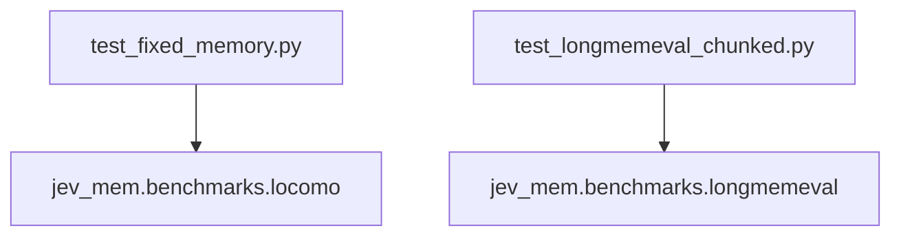

<!-- source: DeepWiki mcp.deepwiki.com · repo libingzheren/Jev-Mem · page 6.2 Testing · fetched 2026-10-13 -->

# Testing

<details>
<summary>Relevant source files</summary>

The following files were used as context for generating this wiki page:

- [pytest.ini](pytest.ini)
- [test_fixed_memory.py](test_fixed_memory.py)
- [test_longmemeval_chunked.py](test_longmemeval_chunked.py)
- [tests/test_jev_mem.py](tests/test_jev_mem.py)
- [tests/test_longmemeval_jev.py](tests/test_longmemeval_jev.py)
- [tests/test_metric_resources.py](tests/test_metric_resources.py)
- [tests/test_naming.py](tests/test_naming.py)
- [tests/test_project_layout.py](tests/test_project_layout.py)
- [tests/test_public_release.py](tests/test_public_release.py)

</details>


This page details the testing suite for the Jev-Mem codebase, located primarily in the `tests/` directory. It covers the structure of the tests, naming conventions, how public release compatibility is ensured, and how metric resources are handled to prevent unintended downloads during testing. It also touches upon the `pytest` configuration and the role of root-level test scripts.

## Test Suite Overview

The `tests/` directory contains various test modules designed to ensure the correctness and robustness of the Jev-Mem system. These tests cover core functionalities, public release requirements, naming consistency, and the project's overall layout. The primary testing framework used is `pytest` [pytest.ini:1-2]().

### Core Jev-Mem Functionality Tests

The `tests/test_jev_mem.py` module contains comprehensive tests for the core `jev_mem` package. These tests validate the behavior of key components such as `MemoryBuilder`, `QueryEngine`, `TemporalResonanceGraphMemory`, and `JevClient`. They cover aspects like memory admission, node and link creation, graph budget allocation, and retrieval limits.

For example, `test_rejection_has_no_storage_or_embedding_side_effects` verifies that rejected memories do not leave any traces in the storage or vector database [tests/test_jev_mem.py:52-59](). The `test_canonical_node_multigraph_and_direction` function asserts the correct creation and linking of nodes within the graph database, including `LinkType.CAUSAL` and `LinkType.TEMPORAL` relationships [tests/test_jev_mem.py:62-82](). Graph budget allocation is tested by `test_graph_budgets_respect_total`, ensuring that allocated budgets sum up to the total and adhere to minimums [tests/test_jev_mem.py:123-130]().

Sources:
* [tests/test_jev_mem.py:1-147]()

### Public Release Compatibility Tests

The `tests/test_public_release.py` module focuses on ensuring that the public release of Jev-Mem adheres to specified criteria, particularly regarding file inclusion, exclusion of private data, and detection of sensitive information.

The `test_public_manifest_passes_and_excludes_local_data` function verifies that the public release manifest correctly includes necessary files like `README.md` and `config/jev_mem.json` while excluding private files such as `.env` and `data/locomo10.json` [tests/test_public_release.py:14-24](). `test_private_artifacts_are_rejected` uses a parameterized test to confirm that various private file paths are correctly identified as such [tests/test_public_release.py:27-31](). Credential detection without printing sensitive values is handled by `test_credentials_detected_without_printing_values` [tests/test_public_release.py:35-46](). The `test_export_is_allowlisted_and_refuses_overwrite` function validates the export process, ensuring only allowed files are included in the public archive and preventing overwrites [tests/test_public_release.py:57-74]().

Sources:
* [tests/test_public_release.py:1-155]()

### Naming Conventions and Project Layout Tests

The `tests/test_naming.py` and `tests/test_project_layout.py` modules are dedicated to verifying naming consistency, migration of historical metadata, and the overall project structure.

`test_public_api_and_distribution_use_the_canonical_project_name` in `test_naming.py` asserts that the project name "jev-mem" is consistently used across `pyproject.toml`, `README.md`, and `CITATION.bib`, and that public API classes use `jev_config` instead of `sys1_config` [tests/test_naming.py:13-26](). The `test_cache_metadata_migration_preserves_evidence_and_current_fields` function ensures that old `sys1mem` metadata is correctly migrated to `jev_mem` format in `EventNode`, `EpisodeNode`, and `SessionNode` objects [tests/test_naming.py:31-49]().

`test_legacy_import_is_the_canonical_module` in `test_project_layout.py` confirms that legacy module imports (e.g., `main`, `test_fixed_memory`) correctly resolve to their canonical `jev_mem` counterparts (e.g., `jev_mem.cli`, `jev_mem.benchmarks.locomo`) [tests/test_project_layout.py:11-20](). `test_public_package_import_does_not_initialize_memory_or_providers` checks that importing the `jev_mem` package does not inadvertently initialize heavy dependencies like `memory_builder` or `typesafe_sdk` [tests/test_project_layout.py:32-40]().

Sources:
* [tests/test_naming.py:1-66]()
* [tests/test_project_layout.py:1-77]()

### Metric Resources Handling

The `tests/test_metric_resources.py` module ensures that optional metric resources (like NLTK data or Sentence Transformers models) are not downloaded or initialized automatically upon module import. This prevents unnecessary network requests and resource loading during standard operations or tests that don't require these metrics.

The `metrics` fixture uses `monkeypatch` to mock `nltk.download` and `SentenceTransformer` to track calls without actual downloads [tests/test_metric_resources.py:10-35](). `test_import_does_not_initialize_optional_resources` verifies that simply importing the `utils` module (which contains metric functions) does not trigger any downloads [tests/test_metric_resources.py:38-41](). Downloads and model loading are only expected when `calculate_bleu_scores`, `calculate_meteor_score`, or `calculate_sentence_similarity` are explicitly called, as demonstrated by `test_explicit_metrics_initialize_resources_once` [tests/test_metric_resources.py:44-52]().

Sources:
* [tests/test_metric_resources.py:1-62]()

## Root-Level Test Scripts

The codebase includes compatibility entry points for benchmarks that were previously standalone scripts. These files, such as `test_fixed_memory.py` and `test_longmemeval_chunked.py`, now serve as redirects to their canonical locations within `jev_mem.benchmarks`.


**Diagram 1: Benchmark Compatibility Entry Points**

These scripts ensure backward compatibility by preserving class identity, module globals, and legacy monkeypatch targets, while directing execution to the updated benchmark modules [test_fixed_memory.py:7-9](), [test_longmemeval_chunked.py:7-9]().

Sources:
* [test_fixed_memory.py:1-9]()
* [test_longmemeval_chunked.py:1-9]()

## Pytest Configuration

The `pytest.ini` file at the root of the repository configures `pytest` to discover tests within the `tests` directory.
```ini
[pytest]
testpaths = tests
```
This simple configuration ensures that all test files located under the `tests/` folder are automatically found and executed when `pytest` is run.

Sources:
* [pytest.ini:1-2]()

---

