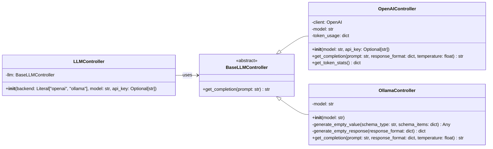
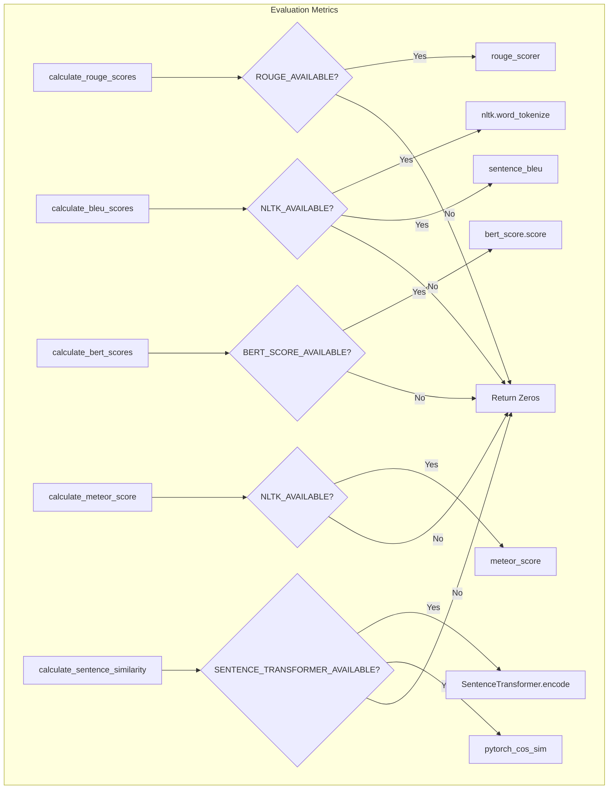

<!-- source: DeepWiki mcp.deepwiki.com · repo libingzheren/Jev-Mem · page 6.3 Utilities and Docs · fetched 2026-10-13 -->

# 6.3. Utilities and Docs

<details>
<summary>Relevant source files</summary>

The following files were used as context for generating this wiki page:

- [CITATION.bib](CITATION.bib)
- [CONTRIBUTING.md](CONTRIBUTING.md)
- [NOTICE](NOTICE)
- [SECURITY.md](SECURITY.md)
- [docs/README.md](docs/README.md)
- [docs/figures/README.md](docs/figures/README.md)
- [utils/__init__.py](utils/__init__.py)
- [utils/memory_layer.py](utils/memory_layer.py)
- [utils/utils.py](utils/utils.py)

</details>


This page details the utility functions and helper classes found in the `utils/` directory, the documentation structure in `docs/`, and the project's governance files. The `utils/` directory provides common functionalities such as LLM controllers, memory note structures, and evaluation metrics. The `docs/` directory contains essential project documentation and architectural figures. Governance files like `LICENSE`, `NOTICE`, `SECURITY.md`, and `CITATION.bib` define the project's legal, ethical, and attribution guidelines.

## Utilities (`utils/`)

The `utils/` directory contains various helper modules that support the core functionalities of Jev-Mem. These include `memory_layer.py` for memory-related data structures and LLM interactions, and `utils.py` for general-purpose utilities, especially those related to evaluation metrics.

### Memory Layer Utilities (`utils/memory_layer.py`)

The `utils/memory_layer.py` module provides foundational classes for interacting with Large Language Models (LLMs) and defining the basic unit of memory within Jev-Mem.

#### LLM Controllers

The module defines an abstract base class `BaseLLMController` [utils/memory_layer.py:56-60]() and concrete implementations for different LLM backends.


**Figure: LLM Controller Class Hierarchy**

The `LLMController` [utils/memory_layer.py:167-178]() acts as a facade, allowing the system to switch between different LLM backends (e.g., OpenAI, Ollama) based on configuration.

*   **`OpenAIController`** [utils/memory_layer.py:62-119]() handles interactions with OpenAI's API. It tracks token usage for prompt, completion, and total tokens [utils/memory_layer.py:73-76](). The `get_completion` method [utils/memory_layer.py:81-102]() constructs messages and calls the OpenAI API, enforcing JSON response formats when specified.
*   **`OllamaController`** [utils/memory_layer.py:121-165]() provides an interface for Ollama models. It includes logic to generate empty responses based on a JSON schema [utils/memory_layer.py:138-150]() in case of API failures, ensuring a consistent return type.

#### MemoryNote

The `MemoryNote` class [utils/memory_layer.py:180-188]() represents the fundamental unit of memory in Jev-Mem. It encapsulates content and various metadata attributes.

```python
class MemoryNote:
    """Basic memory unit with metadata"""
    def __init__(self,
                 content: str,
                 id: Optional[str] = None,
                 keywords: Optional[List[str]] = None,
                 links: Optional[Dict] = None,
                 importance_score: Optional[float] = None,
                 retrieval_count: Optional[int] = None,
                 # ... other attributes
                 ):
        # ... initialization logic
```
[utils/memory_layer.py:180-188]()

This class is central to how information is stored, retrieved, and processed within the memory subsystem.

Sources:
* [utils/memory_layer.py:1-188]()

### General Utilities (`utils/utils.py`)

The `utils/utils.py` module contains a collection of general-purpose helper functions, primarily focused on text processing and evaluation metrics. Many functions include graceful fallbacks if external libraries are not available.

#### Text Processing and Tokenization

The `simple_tokenize` function [utils/utils.py:93-97]() provides a basic tokenization mechanism, splitting text by spaces and removing common punctuation.

#### Evaluation Metrics

This module offers functions to calculate various natural language processing evaluation metrics, often used in benchmarks and performance assessment.


**Figure: Evaluation Metrics Flow**

*   **ROUGE Scores**: `calculate_rouge_scores(prediction, reference)` [utils/utils.py:99-115]() computes ROUGE-1, ROUGE-2, and ROUGE-L F-measures using `rouge_scorer`. It returns zero scores if `rouge_score` is not installed.
*   **BLEU Scores**: `calculate_bleu_scores(prediction, reference)` [utils/utils.py:117-137]() calculates BLEU scores with different n-gram weights. It relies on `nltk` and includes lazy initialization of NLTK data [utils/utils.py:63-75]().
*   **BERTScore**: `calculate_bert_scores(prediction, reference)` [utils/utils.py:139-159]() measures semantic similarity using BERTScore. It uses a thread lock (`bert_score_lock`) [utils/utils.py:60]() to prevent concurrent access to the PyTorch model.
*   **METEOR Score**: `calculate_meteor_score(prediction, reference)` [utils/utils.py:161-168]() computes the METEOR score, also relying on `nltk`.
*   **Sentence Similarity**: `calculate_sentence_similarity(prediction, reference)` [utils/utils.py:170-184]() uses Sentence-BERT (`all-MiniLM-L6-v2`) to calculate cosine similarity between sentence embeddings. The SentenceTransformer model is loaded lazily [utils/utils.py:78-90]().

#### Unanswerable Check

The `is_unanswerable(text)` function [utils/utils.py:187-196]() checks if a given text indicates an unanswerable response, which is crucial for evaluating retrieval systems.

Sources:
* [utils/utils.py:1-196]()
* [utils/__init__.py:1]()

## Documentation (`docs/`)

The `docs/` directory contains the project's documentation, providing guidance on various aspects of Jev-Mem.

*   **`README.md`** [docs/README.md:1-8]() serves as an entry point to the documentation, linking to key topics such as project layout, evaluation, and releasing procedures.
*   **`architecture.md`**: Describes the module responsibilities and where to make changes.
*   **`evaluation.md`**: Provides details on benchmark commands, scoring, and reproducibility.
*   **`releasing.md`**: Covers packaging, credential checks, and clean source exports.

### Figures (`docs/figures/`)

The `docs/figures/` subdirectory stores architectural diagrams and workflow overviews, often referenced in the main documentation and the project's `README.md`.

*   **`overview.png`**: An annotated workflow overview.
*   **`overall_structure.png`**: A compact architecture diagram.
*   **`overall_structure.pdf`**: A PDF version of the compact architecture diagram.

These figures visually represent the write path, shared memory plane, and retrieval loop of the Jev-Mem system [docs/figures/README.md:7]().

Sources:
* [docs/README.md:1-8]()
* [docs/figures/README.md:1-7]()

## Governance Files

Jev-Mem includes several governance files that define its licensing, attribution, security policies, and contribution guidelines.

### `CITATION.bib`

The `CITATION.bib` file [CITATION.bib:1-6]() provides BibTeX entry for citing Jev-Mem as research software. It attributes the work to Jiang, Li, and Li, and specifies the title "Jev-Mem: System-One Controlled Agentic Memory" and version 0.1.0.

Sources:
* [CITATION.bib:1-6]()

### `CONTRIBUTING.md`

The `CONTRIBUTING.md` file [CONTRIBUTING.md:1-42]() outlines the guidelines for contributing to the Jev-Mem project. It covers:

*   **Development Setup**: Instructions for setting up a development environment using `venv` and installing dependencies [CONTRIBUTING.md:8-15]().
*   **Testing**: Emphasizes that tests and demos use mocks and do not require API keys [CONTRIBUTING.md:20-21]().
*   **Pull Request Guidelines**: Requirements for pull requests, including explaining changes, preserving the MAGMA baseline, recording configuration, and avoiding commitment of sensitive data [CONTRIBUTING.md:30-37]().
*   **Legal and Security**: States that contributions are under the MIT license and refers to `CODE_OF_CONDUCT.md` and `SECURITY.md` [CONTRIBUTING.md:40-42]().

Sources:
* [CONTRIBUTING.md:1-42]()

### `NOTICE`

The `NOTICE` file [NOTICE:1-14]() clarifies the project's relationship with its upstream origins and other dependencies. It states that Jev-Mem is derived from MAGMA and preserves its MIT license. It also notes that Jev-Mem adds a TypeSafe Jev control layer, bounded retrieval, and evaluation support, which are also distributed under the MIT license. The notice explicitly states that Jev-Mem is not an official release of MAGMA or TypeSafe and does not imply their endorsement [NOTICE:1-11](). It also mentions that external services like Jev and TypeSafe SDK have their own terms, and datasets like LoCoMo and LongMemEval must be obtained from their original distributors [NOTICE:12-14]().

Sources:
* [NOTICE:1-14]()

### `SECURITY.md`

The `SECURITY.md` file [SECURITY.md:1-43]() details the security policies and best practices for Jev-Mem, emphasizing its status as a research prototype. Key points include:

*   **Data Handling**: Warnings about loading data from untrusted sources due to the use of Python pickle [SECURITY.md:3-4]().
*   **Credential Management**: Strict instructions to keep credentials in `.env` or environment variables and never commit them to source control [SECURITY.md:6-9]().
*   **Data Flow**: Explains that live Jev decisions send observations to TypeSafe, and answer generation/judging send context to OpenAI/Azure endpoints. It advises reviewing provider terms and handling data responsibly [SECURITY.md:11-16]().
*   **Vulnerability Reporting**: Provides guidance on how to report vulnerabilities, preferably through private reporting features [SECURITY.md:18-22]().
*   **Pre-publication Checks**: Recommends running `python scripts/check_public_release.py --tracked` to scan for sensitive information before publication [SECURITY.md:30-32]().

Sources:
* [SECURITY.md:1-43]()

---

