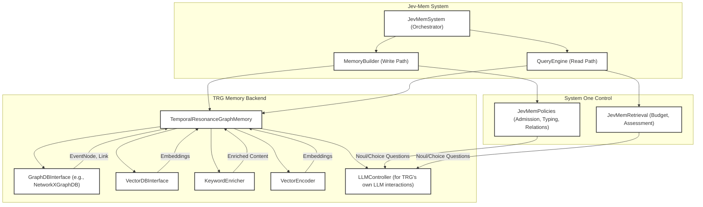
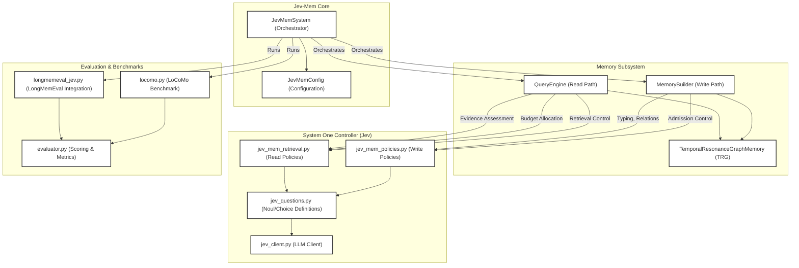

<!-- source: DeepWiki mcp.deepwiki.com · repo libingzheren/Jev-Mem · page 7 Glossary · fetched 2026-10-13 -->

# Glossary

Relevant source files

The following files were used as context for generating this wiki page:

- [CHANGELOG.md](CHANGELOG.md)
- [README.md](README.md)
- [memory/jev_questions.py](memory/jev_questions.py)
- [memory/trg_memory.py](memory/trg_memory.py)

This page defines key terms used throughout the Jev-Mem codebase and documentation. It aims to provide a clear understanding of the system's components, concepts, and evaluation metrics, with direct references to their implementation in the code.

## System One / System Two

Jev-Mem distinguishes between two cognitive systems, inspired by Daniel Kahneman's work, to manage memory operations:

*   **System One (Jev-Mem Controller)**: This is the fast, intuitive, and often unconscious part of Jev-Mem responsible for frequent, low-latency decisions related to memory management. It handles tasks like memory typing, relation judgments, query routing, budget allocation, candidate scoring, and evidence assessment [README.md:100-101](). It uses structured prompts (Noul and Choice questions) to guide these decisions.
    *   **Code Pointers**: The core logic for System One decisions resides in `memory/jev_mem_policies.py` and `memory/jev_mem_retrieval.py` [README.md:118-120](). The structured questions it uses are defined in `memory/jev_questions.py` [README.md:118-119]().
*   **System Two (Language Model)**: This is the slower, more deliberate, and reasoning-intensive part of Jev-Mem. Its primary role is to synthesize the final answer from the evidence selected by System One [README.md:103](). This typically involves a large language model (LLM).
    *   **Code Pointers**: The `LLMController` class in `utils/memory_layer.py` [memory/trg_memory.py:42-43]() (if `LLM_AVAILABLE` is True) is responsible for interacting with the System Two LLM.

## Noul

"Noul" (pronounced "knoll") represents a binary proposition or a yes/no question posed to the System One controller [README.md:117](). It's a structured way to ask the LLM to make a probabilistic judgment on a specific statement. Noul outputs are probabilities of defined propositions, not graded importance [memory/jev_questions.py:4]().

*   **Code Pointers**: The `Noul` class is imported from `typesafe_sdk` [memory/jev_questions.py:7](). The `noul` helper function [memory/jev_questions.py:10-12]() is used to construct Noul questions with specific instructions and criteria for "true" and "false" outcomes. Examples include `should_store`, `future_utility`, and `importance` questions for admission control [memory/jev_questions.py:20-41]().

## Choice

"Choice" represents a categorical decision where the System One controller selects one option from a predefined set of alternatives [README.md:117]().

*   **Code Pointers**: The `Choice` class is imported from `typesafe_sdk` [memory/jev_questions.py:7](). An example is the `representation` question used during consolidation, which asks whether to "keep_separate" or "merge" memories [memory/jev_questions.py:101-105]().

## MAGMA

MAGMA is a baseline memory system that Jev-Mem is compared against. It stands for "Memory-Augmented Generative Model Architecture". The Jev-Mem paper reports MAGMA's performance on the LoCoMo benchmark [README.md:60-61](). Jev-Mem's architecture shares some components with MAGMA, such as the underlying Temporal Resonance Graph (TRG) memory structure.

*   **Code Pointers**: The `TemporalResonanceGraphMemory` class in `memory/trg_memory.py` [memory/trg_memory.py:67]() is described as a "Shared graph backend used by Jev-Mem and the MAGMA baseline" [memory/trg_memory.py:3](). The `CHANGELOG.md` also mentions restoring "MAGMA sequence/proximity rules for temporal writes" [CHANGELOG.md:24]().

## TRG

TRG stands for **Temporal Resonance Graph**. It is the shared multi-relational graph backend used by Jev-Mem and the MAGMA baseline. The TRG manages event nodes, performs graph-based retrieval, and handles memory evolution [memory/trg_memory.py:2-6](). It connects memories in four ways: semantic, temporal, causal, and entity relations [README.md:41-43]().

*   **Code Pointers**: The `TemporalResonanceGraphMemory` class in `memory/trg_memory.py` [memory/trg_memory.py:67]() is the primary implementation of the TRG. It utilizes `GraphDBInterface` (e.g., `NetworkXGraphDB`) [memory/trg_memory.py:20-30]() and `VectorDBInterface` [memory/trg_memory.py:32-35]() for storage.

### Temporal Resonance Graph (TRG) Architecture

Sources:
- [memory/trg_memory.py:2-6]()
- [memory/trg_memory.py:67]()
- [memory/trg_memory.py:20-30]()
- [memory/trg_memory.py:32-35]()
- [memory/trg_memory.py:42-43]()
- [README.md:41-43]()

## LoCoMo

LoCoMo (Long-Context Memory) is a benchmark dataset used to evaluate the performance of memory systems like Jev-Mem. The Jev-Mem paper reports significant improvements over baselines on LoCoMo in terms of answer quality, memory build time, and query latency [README.md:19-20]().

*   **Code Pointers**: The LoCoMo benchmark implementation is found in `jev_mem/benchmarks/locomo.py` and the dataset loading in `datasets/locomo.py`. The `CHANGELOG.md` mentions support for "configuration-aware LoCoMo caches" [CHANGELOG.md:30]().

## LongMemEval

LongMemEval is another benchmark used for evaluating memory systems, particularly for long-running agents. Jev-Mem integrates with LongMemEval for evaluation.

*   **Code Pointers**: The `CHANGELOG.md` mentions integrating "Jev-Mem construction and retrieval with LongMemEval" [CHANGELOG.md:15](), including `longmemeval_jev.py` and an `evaluator`.

## Admission Control

Admission control refers to the process of deciding whether a new observation should be stored in memory. Jev-Mem uses System One (Jev) to make these decisions based on criteria like future utility, importance, novelty, and redundancy [README.md:105](). By default, Jev-Mem preserves all observations, making admission filtering optional [CHANGELOG.md:28]().

*   **Code Pointers**: The `admission_questions()` function in `memory/jev_questions.py` [memory/jev_questions.py:19-41]() defines the Noul questions used for admission control (e.g., `should_store`, `future_utility`, `importance`, `novelty`, `redundancy`). The `jev_mem_policies.py` module contains the logic for applying these policies.

## Anchors

Anchors are initial memory nodes identified during retrieval that serve as starting points for graph traversal. These are typically found through vector and keyword search [README.md:110]().

*   **Code Pointers**: The retrieval process in `memory/jev_mem_retrieval.py` would utilize initial search results as anchors. The `QueryContext` dataclass in `memory/trg_memory.py` includes an `anchor_nodes` field [memory/trg_memory.py:60]().

## Budgets

Budgets are explicit limits imposed on various memory operations, particularly during retrieval. These limits help control computational cost and latency. Jev-Mem bounds graph traversal by graph, depth, node, edge, request, and latency budgets [CHANGELOG.md:29](). The System One controller allocates search budgets [README.md:112]().

*   **Code Pointers**: The `TraversalConstraints` class in `memory/graph_db.py` [memory/trg_memory.py:29-30]() likely defines the types of budgets that can be applied to graph traversal. The `jev_mem_retrieval.py` module is responsible for allocating and managing these budgets.

## Ablations

Ablations refer to experiments where specific components or features of the Jev-Mem system are intentionally removed or disabled to understand their individual contribution to overall performance. This is a common practice in research to isolate the impact of different design choices.

*   **Code Pointers**: The CLI in `jev_mem/cli.py` and `__main__.py` supports "ablation flags" for running experiments with specific components disabled.

### Jev-Mem Core Components and Interactions

Sources:
- [README.md:100-103]()
- [README.md:118-120]()
- [memory/jev_questions.py:19-41]()
- [CHANGELOG.md:28]()
- [CHANGELOG.md:29]()
- [CHANGELOG.md:15]()