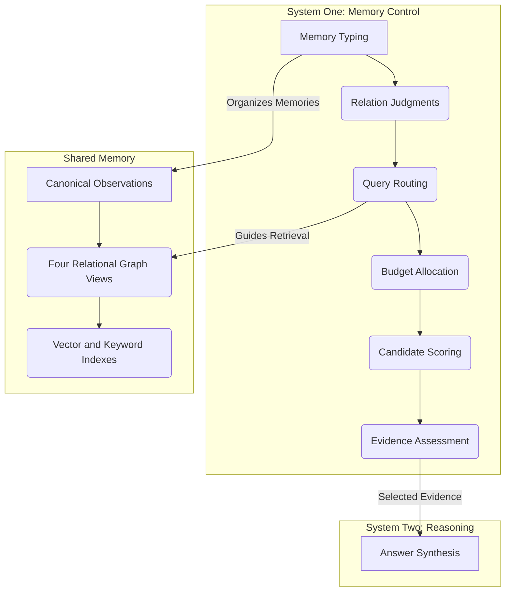
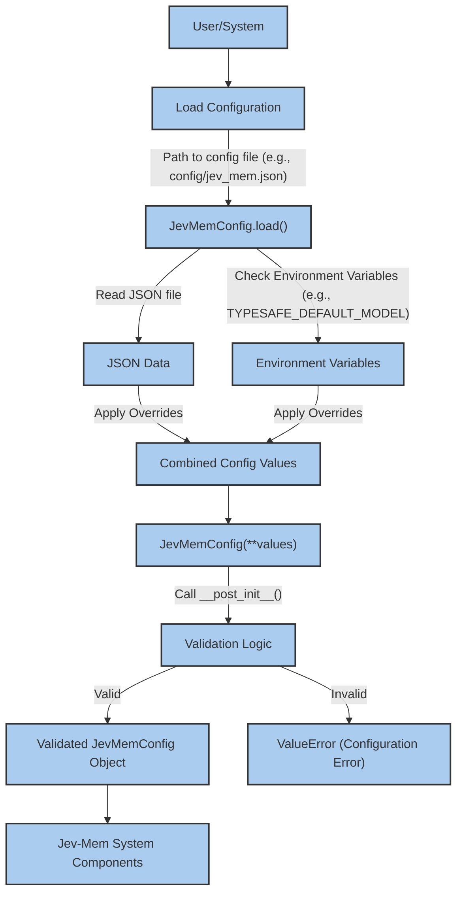
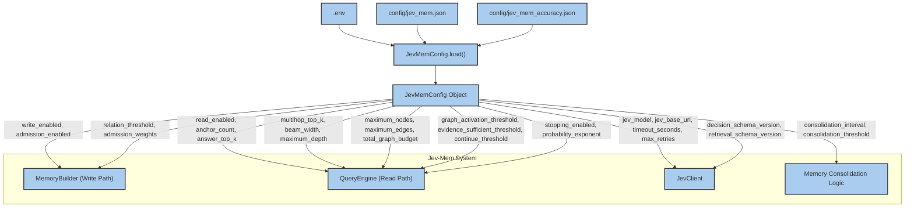
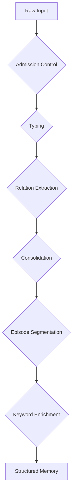
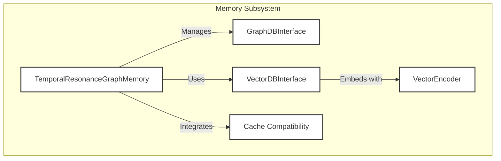
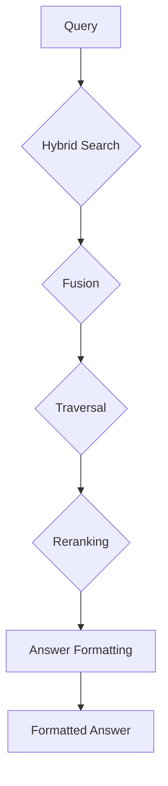

# Page: Overview

# Overview

<details>
<summary>Relevant source files</summary>

The following files were used as context for generating this wiki page:

- [CHANGELOG.md](CHANGELOG.md)
- [MANIFEST.in](MANIFEST.in)
- [README.md](README.md)
- [docs/architecture.md](docs/architecture.md)

</details>


Jev-Mem is a novel agentic memory system designed to enhance the performance of long-running AI agents by separating frequent memory management decisions from deeper reasoning tasks. It achieves this through a lightweight **System-One controller** that organizes memories and guides retrieval across semantic, temporal, causal, and entity relations, while a **System-Two language model** synthesizes answers from the retrieved evidence [README.md:13-17](). This architecture leads to significant improvements in answer quality, memory construction speed, and query latency compared to existing memory systems [README.md:19-22]().

This page provides a high-level overview of Jev-Mem's architecture, its core components, and the repository layout. For detailed instructions on installation, configuration, and running the system, please refer to the child pages.

## What is Jev-Mem?

Jev-Mem addresses the challenges faced by persistent AI agents in managing growing histories, remembering preferences, connecting events, and efficiently retrieving relevant evidence. It introduces a dedicated, structured controller to make decisions about how information connects, where to search, and when sufficient evidence has been found [README.md:30-36]().

The system is built around three core components:
*   **System One: memory control**: Responsible for memory typing, relation judgments, query routing, budget allocation, candidate scoring, and evidence assessment [README.md:101]().
*   **Shared memory**: Stores canonical observations, maintains four relational graph views (semantic, temporal, causal, and entity), and includes vector and keyword indexes [README.md:102]().
*   **System Two: reasoning**: Synthesizes the final answer from the selected evidence [README.md:103]().

This separation allows for fast decisions and focused reasoning, leading to improved performance across various metrics [README.md:7]().

Sources:
*   [README.md:7-22]()
*   [README.md:30-36]()
*   [README.md:101-103]()

### Jev-Mem Architecture

The Jev-Mem architecture is designed to provide a clear separation of concerns between the fast, decision-making System-One controller and the deeper reasoning System-Two language model.


**Diagram 1: High-Level Jev-Mem Architecture**
Sources:
*   [README.md:101-103]()

## Repository Layout

The Jev-Mem codebase is organized into several top-level directories, each serving a specific purpose. This structure helps in maintaining modularity and clarity, making it easier for developers to navigate and contribute.

```mermaid
graph TD
    A[jev_mem/] --> A1[system.py "Public build/query API"]
    A --> A2[cli.py "Application argument parsing and dispatch"]
    A --> A3[demo.py "Offline demonstration"]
    A --> A4[datasets/ "LoCoMo and LongMemEval schemas and loaders"]
    A --> A5[benchmarks/ "Benchmark runners"]
    B[memory/ "Graph storage, controllers, retrieval, and evaluation"]
    C[utils/ "Shared provider adapters and scoring utilities"]
    D[config/ "Checked-in experiment profiles"]
    E[examples/ "Original synthetic inputs"]
    F[data/ "Downloaded datasets (ignored by Git)"]
    G[tests/ "Offline regression and compatibility tests"]
    H[scripts/ "Release tools and retrieval diagnostics"]
    I[docs/ "Developer guides and figures"]
```
**Diagram 2: Jev-Mem Repository Layout**
Sources:
*   [docs/architecture.md:3-18]()
*   [MANIFEST.in:27-86]()

The `jev_mem/` directory contains the public API, CLI, demo, datasets, and benchmarks [docs/architecture.md:5-10](). The `memory/` directory is central to the system, housing the graph storage, controllers, retrieval mechanisms, and evaluation components [docs/architecture.md:10](). Configuration files are located in `config/`, while `examples/` provides synthetic inputs [docs/architecture.md:12-13](). `data/` is used for downloaded datasets and is ignored by Git [docs/architecture.md:14](). Testing infrastructure resides in `tests/`, and release/diagnostic tools are in `scripts/` [docs/architecture.md:15-16](). Documentation and figures are found in `docs/` [docs/architecture.md:17]().

For details on specific files and their roles, refer to the `MANIFEST.in` file [MANIFEST.in:1-86]() which lists all included files in the distribution.

Sources:
*   [docs/architecture.md:3-18]()
*   [MANIFEST.in:1-86]()

## Getting Started

To begin using Jev-Mem, you'll need Python 3.11+ [README.md:124](). The quick start guide in the README provides a simple way to set up a virtual environment, install dependencies, and run an offline demo that uses deterministic mock decisions and embeddings [README.md:126-131](). This demo does not require any API keys or model downloads [README.md:133]().

For details on installation, setting up the environment, running the demo, and configuring API keys for live models, see [Getting Started](#1.1).

Sources:
*   [README.md:124-134]()

## Configuration Reference

Jev-Mem's behavior can be customized through configuration files. The system uses `config/jev_mem.json` and `config/jev_mem_accuracy.json` for experiment profiles [MANIFEST.in:13-14](). The `JevMemConfig` class [docs/architecture.md:64]() manages these settings, including budgets and thresholds for various operations.

For a comprehensive guide to Jev-Mem's configuration options, including details on `JevMemConfig` fields, budgets, and thresholds, see [Configuration Reference](#1.2).

Sources:
*   [MANIFEST.in:13-14]()
*   [docs/architecture.md:64]()

---

# Page: Getting Started

# Getting Started

<details>
<summary>Relevant source files</summary>

The following files were used as context for generating this wiki page:

- [.env.example](.env.example)
- [.gitignore](.gitignore)
- [config/README.md](config/README.md)
- [jev_mem/demo.py](jev_mem/demo.py)
- [jev_mem_demo.py](jev_mem_demo.py)
- [main.py](main.py)
- [requirements-dev.txt](requirements-dev.txt)
- [requirements.txt](requirements.txt)
- [setup.sh](setup.sh)

</details>


This page provides instructions for setting up the Jev-Mem project, including installation, configuration, and running the provided demo and main entry points. It covers the necessary steps to get the environment ready for development and experimentation.

## Installation

The Jev-Mem project uses a `setup.sh` script to automate the installation process. This script sets up a Python virtual environment, installs dependencies, and configures the initial environment.

1.  **Clone the repository**: If you haven't already, clone the Jev-Mem repository to your local machine.
2.  **Run the setup script**: Navigate to the root directory of the cloned repository and execute the `setup.sh` script:

    ```bash
    ./setup.sh
    ```

    This script performs the following actions:
    *   Ensures Python 3.11 or newer is installed [setup.sh:5]().
    *   Creates a Python virtual environment named `.venv` [setup.sh:7]().
    *   Upgrades `pip` within the virtual environment [setup.sh:8]().
    *   Installs development dependencies listed in `requirements-dev.txt` [setup.sh:9](). These include core dependencies from `requirements.txt` [requirements-dev.txt:1](), `pytest`, `matplotlib`, `build` [requirements-dev.txt:2-4]().
    *   Installs the `jev_mem` package in editable mode (`-e .`) without its dependencies (as they are already installed) [setup.sh:10]().
    *   Copies `.env.example` to `.env` if `.env` does not already exist [setup.sh:11-13](). This file is crucial for storing API keys and other sensitive configurations.

3.  **Activate the virtual environment**: After the script completes, activate the virtual environment:

    ```bash
    source .venv/bin/activate
    ```

Sources:
* [setup.sh:1-16]()
* [requirements-dev.txt:1-4]()
* [requirements.txt:1-24]()

## Dependencies

Jev-Mem relies on several Python packages for its functionality. These are managed through `requirements.txt` and `requirements-dev.txt`.

### Core Dependencies
*   `networkx`: For graph operations [requirements.txt:2]().
*   `numpy`, `scipy`, `scikit-learn`: For numerical computations and machine learning utilities [requirements.txt:3-5]().
*   `faiss-cpu`: For efficient similarity search in vector databases [requirements.txt:6]().

### Embeddings
*   `sentence-transformers`, `torch`, `transformers`: For generating embeddings from text [requirements.txt:9-11]().

### LLM Integration
*   `openai`: For interacting with OpenAI's API [requirements.txt:14]().
*   `tiktoken`: For token counting [requirements.txt:15]().

### Jev / TypeSafe SDK
*   `typesafe-sdk`: For integration with the TypeSafe platform [requirements.txt:18]().

### Utilities
*   `python-dotenv`: For loading environment variables from `.env` files [requirements.txt:21]().
*   `tqdm`: For progress bars [requirements.txt:22]().
*   `python-dateutil`: For robust date parsing [requirements.txt:23]().
*   `httpx`: For HTTP requests [requirements.txt:24]().

### Development Dependencies
*   `pytest`: For testing [requirements-dev.txt:2]().
*   `matplotlib`: For plotting and visualization [requirements-dev.txt:3]().
*   `build`: For package building [requirements-dev.txt:4]().

Sources:
* [requirements.txt:1-24]()
* [requirements-dev.txt:1-4]()

## Configuration

Jev-Mem uses `.env` files for sensitive credentials and JSON files for system configurations.

### `.env` Configuration

The `setup.sh` script creates a `.env` file by copying `.env.example` [setup.sh:11-13](). This file is used to store API keys and other environment-specific variables. It is ignored by Git [.gitignore:2]().

You need to edit the `.env` file and fill in your credentials:

```ini
# Copy to .env and fill in your local credentials.
TYPESAFE_API_KEY=YOUR_TYPESAFE_API_KEY
TYPESAFE_DEFAULT_MODEL=jev-latest
OPENAI_API_KEY=YOUR_OPENAI_API_KEY
# Optional OpenAI-compatible endpoint:
# OPENAI_BASE_URL=https://YOUR-RESOURCE.services.ai.azure.com/openai/v1/
```

*   `TYPESAFE_API_KEY`: Your API key for the TypeSafe platform [.env.example:2]().
*   `TYPESAFE_DEFAULT_MODEL`: The default model to use with TypeSafe [.env.example:3]().
*   `OPENAI_API_KEY`: Your API key for OpenAI services [.env.example:4]().
*   `OPENAI_BASE_URL`: An optional URL for OpenAI-compatible endpoints, such as Azure OpenAI [.env.example:6]().

Sources:
* [.env.example:1-6]()
* [.gitignore:2]()
* [setup.sh:11-13]()

### Jev-Mem Configuration Profiles

Jev-Mem uses JSON files to define different operational profiles. These profiles control various aspects of the memory system, such as anchor counts, evidence limits, and graph activation [config/README.md:4-6]().

*   `config/jev_mem.json`: The default live profile used in examples [config/README.md:3]().
*   `config/jev_mem_accuracy.json`: An alternate experimental profile with different settings [config/README.md:4-6]().

You can specify a profile using the `--jev-config PATH` argument when running Jev-Mem [config/README.md:8](). The validation and default values for these configurations are defined in `JevMemConfig` [config/README.md:9]() (located in `memory/jev_mem_config.py`).

Sources:
* [config/README.md:1-10]()

## Running the Demo

The `jev_mem.demo` module provides an offline demonstration of the Jev-Mem pipeline. It uses mocked Jev and embeddings, allowing you to run the system without external API calls [jev_mem/demo.py:1]().

To run the demo:

```bash
python -m jev_mem.demo
```

Alternatively, you can use the compatibility entry point `jev_mem_demo.py`:

```bash
python jev_mem_demo.py
```

The demo script performs the following steps:
1.  Initializes a `MockEncoder` [jev_mem/demo.py:20]().
2.  Creates a `TemporalResonanceGraphMemory` (`trg`) with a `NumpyVectorDB` and the `MockEncoder` [jev_mem/demo.py:21]().
3.  Configures `JevMemConfig` to enable writing and reading, mock Jev, and set an audit path [jev_mem/demo.py:22-23]().
4.  Initializes a `MemoryBuilder` with the specified cache directory, `jev_config`, `trg_memory`, and `llm_enabled=False` [jev_mem/demo.py:24]().
5.  Processes a series of observations (e.g., "Alice started the Jev-Mem project in Dallas.") [jev_mem/demo.py:25-26](). For each observation, it calls `builder.build()` to store the information in memory [jev_mem/demo.py:27]().
6.  Saves the builder's state [jev_mem/demo.py:30]().
7.  Initializes a `QueryEngine` with the `trg`, `node_index`, `jev_config`, and `jev_client` [jev_mem/demo.py:31]().
8.  Executes a query (e.g., "What does Alice prefer about Jev-Mem explanations?") using `engine.query()` [jev_mem/demo.py:32]().
9.  Prints the retrieved evidence and context metadata [jev_mem/demo.py:33-34]().
10. Notes that System-Two generation is not called in this offline mock demo [jev_mem/demo.py:35]().

### Demo Data Flow

```mermaid
graph TD
    subgraph "Jev-Mem Demo"
        A[Start Demo] --> B{Initialize MockEncoder};
        B --> C{Initialize TemporalResonanceGraphMemory (TRG)};
        C --> D{Configure JevMemConfig (jev_mock=True)};
        D --> E{Initialize MemoryBuilder};
        E --> F{Process Observations};
        F -- "Call builder.build()" --> G[Store Observation in TRG];
        G --> F;
        F -- "All observations processed" --> H{Save MemoryBuilder State};
        H --> I{Initialize QueryEngine};
        I --> J{Execute Query};
        J -- "Call engine.query()" --> K[Retrieve Evidence from TRG];
        K --> L{Print Results};
        L --> M[End Demo];
    end

    subgraph "Code Entities"
        B -- "MockEncoder()" --> jev_mem_demo_py_MockEncoder[jev_mem/demo.py:20];
        C -- "TemporalResonanceGraphMemory()" --> jev_mem_demo_py_TRG[jev_mem/demo.py:21];
        D -- "JevMemConfig()" --> jev_mem_demo_py_JevMemConfig[jev_mem/demo.py:22-23];
        E -- "MemoryBuilder()" --> jev_mem_demo_py_MemoryBuilder[jev_mem/demo.py:24];
        G -- "builder.build()" --> jev_mem_demo_py_builder_build[jev_mem/demo.py:27];
        H -- "builder.save()" --> jev_mem_demo_py_builder_save[jev_mem/demo.py:30];
        I -- "QueryEngine()" --> jev_mem_demo_py_QueryEngine[jev_mem/demo.py:31];
        J -- "engine.query()" --> jev_mem_demo_py_engine_query[jev_mem/demo.py:32];
    end

    jev_mem_demo_py_MockEncoder --> jev_mem_demo_py_TRG;
    jev_mem_demo_py_TRG --> jev_mem_demo_py_MemoryBuilder;
    jev_mem_demo_py_JevMemConfig --> jev_mem_demo_py_MemoryBuilder;
    jev_mem_demo_py_MemoryBuilder --> jev_mem_demo_py_builder_build;
    jev_mem_demo_py_builder_build --> jev_mem_demo_py_builder_save;
    jev_mem_demo_py_builder_save --> jev_mem_demo_py_QueryEngine;
    jev_mem_demo_py_QueryEngine --> jev_mem_demo_py_engine_query;
```

Sources:
* [jev_mem/demo.py:1-39]()
* [jev_mem_demo.py:1-9]()

## Running the Main Entry Point

The primary entry point for the Jev-Mem system is `jev_mem.cli`. You can run it using the Python module execution command:

```bash
python -m jev_mem
```

This command executes the `main()` function within the `jev_mem.cli` module [main.py:6](). The `main.py` file itself acts as a compatibility entry point, redirecting execution to `jev_mem.cli` [main.py:3, main.py:8]().

For live runs that interact with external services (like OpenAI or TypeSafe), ensure your `.env` file is correctly configured with the necessary API keys.

### Main Entry Point Flow

```mermaid
graph TD
    A[User executes `python -m jev_mem`] --> B{main.py is invoked};
    B -- "Imports jev_mem.cli as _implementation" --> C[jev_mem/cli.py];
    B -- "If __name__ == '__main__'" --> D{Call _implementation.main()};
    D --> E[Jev-Mem CLI execution];
    B -- "Else (module import)" --> F{sys.modules[__name__] = _implementation};
    F --> C;

    subgraph "Code Entities"
        B -- "main.py:3" --> main_py_import_cli[jev_mem/cli];
        D -- "main.py:6" --> main_py_cli_main[jev_mem/cli.main()];
        F -- "main.py:8" --> main_py_sys_modules[sys.modules];
    end
```

Sources:
* [main.py:1-8]()

---

# Page: Configuration Reference

# Configuration Reference

<details>
<summary>Relevant source files</summary>

The following files were used as context for generating this wiki page:

- [.env.example](.env.example)
- [.gitignore](.gitignore)
- [CODE_OF_CONDUCT.md](CODE_OF_CONDUCT.md)
- [LICENSE](LICENSE)
- [config/README.md](config/README.md)
- [config/jev_mem.json](config/jev_mem.json)
- [config/jev_mem_accuracy.json](config/jev_mem_accuracy.json)
- [memory/jev_mem_config.py](memory/jev_mem_config.py)

</details>


This page details the configuration options for Jev-Mem, primarily focusing on the `JevMemConfig` class and the JSON configuration files `config/jev_mem.json` and `config/jev_mem_accuracy.json`. It covers the various fields, their purpose, and how they influence the system's behavior, including budgets and thresholds.

## JevMemConfig Class

The `JevMemConfig` class [memory/jev_mem_config.py:10-48]() is a dataclass that defines all configurable parameters for the Jev-Mem control plane. It provides type validation and ensures that configuration values adhere to specified constraints.

```python
@dataclass(frozen=True)
class JevMemConfig:
    write_enabled: bool = False
    read_enabled: bool = False
    admission_enabled: bool = False
    jev_mock: bool = False
    jev_model: str = "jev-latest"
    decision_schema_version: str = "noul-choice-v3-magma-temporal"
    retrieval_schema_version: str = "anchored-temporal-v1"
    jev_base_url: str = "https://api.typesafe.ai"
    timeout_seconds: float = 3.0
    max_retries: int = 2
    cache_size: int = 1024
    fallback_to_magma: bool = True
    admission_threshold: float = 0.60
    relation_threshold: float = 0.60
    candidate_top_k: int = 10
    admission_weights: tuple = (0.4, 0.3, 0.3, 0.2)
    total_graph_budget: int = 20
    probability_exponent: float = 1.5
    minimum_graph_budget: int = 1
    graph_activation_threshold: float = 0.15
    anchor_count: int = 5
    answer_top_k: int = 15
    multihop_top_k: int = 30
    beam_width: int = 5
    maximum_depth: int = 5
    maximum_nodes: int = 30
    maximum_edges: int = 200
    maximum_jev_calls: int = 10
    max_latency_seconds: float = 15.0
    transition_weights: tuple = (0.25, 0.35, 0.15, 0.15, 0.10)
    stopping_enabled: bool = True
    evidence_sufficient_threshold: float = 0.85
    continue_threshold: float = 0.40
    consolidation_interval: int = 0
    consolidation_threshold: float = 0.85
    audit_path: str = ""
```

The `__post_init__` method [memory/jev_mem_config.py:49-77]() performs validation on the fields to ensure they meet specific criteria, such as being within a certain range or being of a particular type. For example, thresholds like `admission_threshold` must be between 0 and 1 [memory/jev_mem_config.py:51-54](). Integer fields like `candidate_top_k` must be greater than or equal to 1 [memory/jev_mem_config.py:55-57]().

The `JevMemConfig.load` class method [memory/jev_mem_config.py:79-88]() is responsible for loading configuration from a JSON file and applying overrides. It also allows environment variables like `TYPESAFE_DEFAULT_MODEL` and `TYPESAFE_BASE_URL` to override `jev_model` and `jev_base_url` respectively [memory/jev_mem_config.py:84-86]().

Sources:
* [memory/jev_mem_config.py:10-48]()
* [memory/jev_mem_config.py:49-77]()
* [memory/jev_mem_config.py:51-54]()
* [memory/jev_mem_config.py:55-57]()
* [memory/jev_mem_config.py:79-88]()
* [memory/jev_mem_config.py:84-86]()

### Configuration Fields

The following table describes the key configuration fields in `JevMemConfig`:

| Field Name | Type | Default Value | Description |
|---|---|---|---|
| `write_enabled` | `bool` | `False` | Enables or disables memory write operations. |
| `read_enabled` | `bool` | `False` | Enables or disables memory read operations. |
| `admission_enabled` | `bool` | `False` | Enables or disables admission control for new memories. |
| `jev_mock` | `bool` | `False` | If `True`, uses a mock Jev client instead of making actual API calls. |
| `jev_model` | `str` | `"jev-latest"` | Specifies the Jev model to use. Can be overridden by `TYPESAFE_DEFAULT_MODEL` environment variable. |
| `decision_schema_version` | `str` | `"noul-choice-v3-magma-temporal"` | Version of the decision schema used by Jev. |
| `retrieval_schema_version` | `str` | `"anchored-temporal-v1"` | Version of the retrieval schema used by Jev. |
| `jev_base_url` | `str` | `"https://api.typesafe.ai"` | Base URL for the Jev API. Can be overridden by `TYPESAFE_BASE_URL` environment variable. |
| `timeout_seconds` | `float` | `3.0` | Timeout for Jev API calls in seconds. |
| `max_retries` | `int` | `2` | Maximum number of retries for failed Jev API calls. |
| `cache_size` | `int` | `1024` | Size of the internal cache. |
| `fallback_to_magma` | `bool` | `True` | If `True`, falls back to MAGMA if Jev fails. |
| `admission_threshold` | `float` | `0.60` | Threshold for admitting new memories. Must be in `[0, 1]`. |
| `relation_threshold` | `float` | `0.60` | Threshold for establishing relations between memories. Must be in `[0, 1]`. |
| `candidate_top_k` | `int` | `10` | Number of top candidates to consider during various selection processes. Must be `>= 1`. |
| `admission_weights` | `tuple` | `(0.4, 0.3, 0.3, 0.2)` | Weights used in the admission utility calculation. Sum of first three must be positive. |
| `total_graph_budget` | `int` | `20` | Maximum number of nodes/edges allowed in the graph traversal. Must be `>= 0`. |
| `probability_exponent` | `float` | `1.5` | Exponent for probability calculations in graph traversal. Must be positive and finite. |
| `minimum_graph_budget` | `int` | `1` | Minimum graph budget to ensure some traversal. Must be `>= 0`. |
| `graph_activation_threshold` | `float` | `0.15` | Threshold for activating graph traversal. Must be in `[0, 1]`. |
| `anchor_count` | `int` | `5` | Number of anchor memories to retrieve. Must be `>= 1`. |
| `answer_top_k` | `int` | `15` | Number of top answers to consider. Must be `>= 1`. |
| `multihop_top_k` | `int` | `30` | Number of top candidates for multi-hop retrieval. Must be `>= 1`. |
| `beam_width` | `int` | `5` | Beam width for beam search in graph traversal. Must be `>= 1`. |
| `maximum_depth` | `int` | `5` | Maximum depth for graph traversal. Must be `>= 0`. |
| `maximum_nodes` | `int` | `30` | Maximum number of nodes to explore in graph traversal. Must be `>= 1`. |
| `maximum_edges` | `int` | `200` | Maximum number of edges to explore in graph traversal. Must be `>= 1`. |
| `maximum_jev_calls` | `int` | `10` | Maximum number of Jev calls allowed during a single operation. Must be `>= 0`. |
| `max_latency_seconds` | `float` | `15.0` | Maximum allowed latency for an operation in seconds. Must be positive and finite. |
| `transition_weights` | `tuple` | `(0.25, 0.35, 0.15, 0.15, 0.10)` | Weights for different transition types in graph traversal. |
| `stopping_enabled` | `bool` | `True` | Enables or disables the stopping mechanism during retrieval. |
| `evidence_sufficient_threshold` | `float` | `0.85` | Threshold for considering evidence sufficient. Must be in `[0, 1]`. |
| `continue_threshold` | `float` | `0.40` | Threshold for continuing retrieval. Must be in `[0, 1]`. |
| `consolidation_interval` | `int` | `0` | Interval (in number of memories) at which consolidation is attempted. `0` means disabled. Must be `>= 0`. |
| `consolidation_threshold` | `float` | `0.85` | Threshold for consolidating memories. Must be in `[0, 1]`. |
| `audit_path` | `str` | `""` | Path to store audit logs. |

Sources:
* [memory/jev_mem_config.py:11-48]()

## Configuration Files

Jev-Mem uses JSON files to define configuration profiles. These files are typically located in the `config/` directory. The `config/README.md` [config/README.md:1-10]() explains the purpose of these files.

### `config/jev_mem.json`

This is the default live profile used in README examples [config/README.md:3](). It provides a balanced set of parameters for general use.

```json
{
  "write_enabled": true,
  "read_enabled": true,
  "admission_enabled": false,
  "jev_mock": false,
  "jev_model": "jev-latest",
  "timeout_seconds": 3.0,
  "max_retries": 2,
  "fallback_to_magma": true,
  "relation_threshold": 0.6,
  "candidate_top_k": 10,
  "anchor_count": 30,
  "answer_top_k": 40,
  "multihop_top_k": 50,
  "total_graph_budget": 80,
  "probability_exponent": 1.0,
  "minimum_graph_budget": 1,
  "graph_activation_threshold": 0.1,
  "beam_width": 10,
  "maximum_depth": 8,
  "maximum_nodes": 60,
  "maximum_edges": 2400,
  "maximum_jev_calls": 16,
  "max_latency_seconds": 15.0,
  "evidence_sufficient_threshold": 0.95,
  "continue_threshold": 0.15,
  "consolidation_interval": 20,
  "consolidation_threshold": 0.85
}
```

Sources:
* [config/jev_mem.json:1-29]()
* [config/README.md:3]()

### `config/jev_mem_accuracy.json`

This is an alternate experimental profile with different settings for anchor counts, evidence limits, graph activation, and stopping thresholds [config/README.md:4-6](). Its name does not imply a guaranteed accuracy advantage.

```json
{
  "write_enabled": true,
  "read_enabled": true,
  "admission_enabled": false,
  "jev_mock": false,
  "jev_model": "jev-latest",
  "timeout_seconds": 3.0,
  "max_retries": 2,
  "fallback_to_magma": true,
  "relation_threshold": 0.6,
  "candidate_top_k": 10,
  "anchor_count": 20,
  "answer_top_k": 30,
  "multihop_top_k": 40,
  "total_graph_budget": 80,
  "probability_exponent": 1.0,
  "minimum_graph_budget": 1,
  "graph_activation_threshold": 0.15,
  "beam_width": 10,
  "maximum_depth": 8,
  "maximum_nodes": 60,
  "maximum_edges": 1200,
  "maximum_jev_calls": 16,
  "max_latency_seconds": 15.0,
  "evidence_sufficient_threshold": 0.93,
  "continue_threshold": 0.2,
  "consolidation_interval": 20
}
```

Sources:
* [config/jev_mem_accuracy.json:1-28]()
* [config/README.md:4-6]()

### Loading Configuration

Configuration files can be loaded using the `--jev-config PATH` command-line argument. The `JevMemConfig.load` method [memory/jev_mem_config.py:79-88]() handles parsing the JSON and applying overrides.

Sources:
* [config/README.md:8]()
* [memory/jev_mem_config.py:79-88]()

## Budgets and Thresholds

Several configuration parameters define budgets and thresholds that control the behavior of the Jev-Mem system, particularly during memory admission, retrieval, and graph traversal.

### Admission Control

*   `admission_enabled`: A boolean flag to enable or disable the admission control mechanism [memory/jev_mem_config.py:13]().
*   `admission_threshold`: A float value (0.0 to 1.0) that determines the minimum score required for a new memory to be admitted into the system [memory/jev_mem_config.py:24]().
*   `admission_weights`: A tuple of floats `(0.4, 0.3, 0.3, 0.2)` [memory/jev_mem_config.py:27]() used in the calculation of the admission utility score. The sum of the first three weights must be positive [memory/jev_mem_config.py:67-68]().

### Graph Traversal and Retrieval

*   `total_graph_budget`: The maximum total number of nodes and edges that can be explored during graph traversal [memory/jev_mem_config.py:28]().
*   `minimum_graph_budget`: Ensures that at least this many graph elements are considered, even if other thresholds might suggest stopping earlier [memory/jev_mem_config.py:30]().
*   `graph_activation_threshold`: A float (0.0 to 1.0) that determines when graph traversal should be initiated [memory/jev_mem_config.py:31]().
*   `anchor_count`: The number of initial "anchor" memories retrieved to start a query or traversal [memory/jev_mem_config.py:32]().
*   `answer_top_k`: The number of top candidate answers to consider [memory/jev_mem_config.py:33]().
*   `multihop_top_k`: The number of top candidates to consider at each hop during multi-hop retrieval [memory/jev_mem_config.py:34]().
*   `beam_width`: The width of the beam used in beam search for graph traversal [memory/jev_mem_config.py:35]().
*   `maximum_depth`: The maximum depth of graph traversal [memory/jev_mem_config.py:36]().
*   `maximum_nodes`: The maximum number of nodes to visit during graph traversal [memory/jev_mem_config.py:37]().
*   `maximum_edges`: The maximum number of edges to traverse during graph traversal [memory/jev_mem_config.py:38]().
*   `maximum_jev_calls`: Limits the number of calls made to the Jev system during a single operation to prevent excessive latency or cost [memory/jev_mem_config.py:39]().
*   `max_latency_seconds`: A hard limit on the total time an operation can take [memory/jev_mem_config.py:40]().
*   `evidence_sufficient_threshold`: A float (0.0 to 1.0) indicating when enough evidence has been gathered to stop retrieval [memory/jev_mem_config.py:43]().
*   `continue_threshold`: A float (0.0 to 1.0) indicating the confidence level required to continue retrieval [memory/jev_mem_config.py:44]().
*   `stopping_enabled`: A boolean flag to enable or disable the dynamic stopping mechanism during retrieval [memory/jev_mem_config.py:42]().

### Consolidation

*   `consolidation_interval`: The frequency (in number of memories processed) at which the system attempts to consolidate memories. A value of `0` disables consolidation [memory/jev_mem_config.py:45]().
*   `consolidation_threshold`: A float (0.0 to 1.0) that determines the similarity score required for memories to be consolidated [memory/jev_mem_config.py:46]().

### Configuration Flow Diagram

The following diagram illustrates how configuration is loaded and validated within the Jev-Mem system.


**Diagram: Configuration Loading and Validation Flow**

Sources:
* [memory/jev_mem_config.py:13]()
* [memory/jev_mem_config.py:24]()
* [memory/jev_mem_config.py:27]()
* [memory/jev_mem_config.py:67-68]()
* [memory/jev_mem_config.py:28]()
* [memory/jev_mem_config.py:30]()
* [memory/jev_mem_config.py:31]()
* [memory/jev_mem_config.py:32]()
* [memory/jev_mem_config.py:33]()
* [memory/jev_mem_config.py:34]()
* [memory/jev_mem_config.py:35]()
* [memory/jev_mem_config.py:36]()
* [memory/jev_mem_config.py:37]()
* [memory/jev_mem_config.py:38]()
* [memory/jev_mem_config.py:39]()
* [memory/jev_mem_config.py:40]()
* [memory/jev_mem_config.py:43]()
* [memory/jev_mem_config.py:44]()
* [memory/jev_mem_config.py:42]()
* [memory/jev_mem_config.py:45]()
* [memory/jev_mem_config.py:46]()

### Environment Variables

Certain configuration values can be overridden by environment variables, as specified in the `.env.example` file [config/README.md:10](). This is particularly useful for sensitive information like API keys or for specifying different models or base URLs without modifying the JSON configuration files.

*   `TYPESAFE_API_KEY`: Used for authentication with the Typesafe API.
*   `TYPESAFE_DEFAULT_MODEL`: Overrides the `jev_model` setting in `JevMemConfig` [memory/jev_mem_config.py:84]().
*   `TYPESAFE_BASE_URL`: Overrides the `jev_base_url` setting in `JevMemConfig` [memory/jev_mem_config.py:85]().
*   `OPENAI_API_KEY`: Used for OpenAI API authentication.
*   `OPENAI_BASE_URL`: Optional, specifies a custom OpenAI-compatible endpoint.

Sources:
* [.env.example:1-6]()
* [config/README.md:10]()
* [memory/jev_mem_config.py:84]()
* [memory/jev_mem_config.py:85]()

### Configuration and System Interaction

The `JevMemConfig` object is central to how various components of the Jev-Mem system operate. It dictates policies for memory admission, retrieval strategies, and resource limits.


**Diagram: JevMemConfig Influence on System Components**

Sources:
* [memory/jev_mem_config.py:11-48]()
* [memory/jev_mem_config.py:79-88]()
* [.env.example:1-6]()
* [config/jev_mem.json:1-29]()
* [config/jev_mem_accuracy.json:1-28]()

---

# Page: Core System and CLI

# Core System and CLI

<details>
<summary>Relevant source files</summary>

The following files were used as context for generating this wiki page:

- [jev_mem/__init__.py](jev_mem/__init__.py)
- [jev_mem/__main__.py](jev_mem/__main__.py)
- [jev_mem/system.py](jev_mem/system.py)

</details>


This page provides a high-level overview of the core `jev_mem` package, which orchestrates the Jev-Mem system's memory building and querying capabilities. It introduces the main entry points for interacting with the system, including the `JevMemSystem` orchestrator and the Command-Line Interface (CLI). For detailed information on each component, refer to the linked child pages.

## JevMemSystem Orchestrator

The `JevMemSystem` class [jev_mem/system.py:10-73]() serves as the primary orchestrator for Jev-Mem. It integrates various components such as the `MemoryBuilder` [jev_mem/system.py:16-17](), `QueryEngine` [jev_mem/system.py:22-23](), and `JevMemConfig` [jev_mem/system.py:15]() to manage the entire memory lifecycle, from building memory from raw observations to querying it.

The `JevMemSystem` handles the initialization of core memory components like the `TRGMemory` [jev_mem/system.py:18](), `GraphDB` [jev_mem/system.py:19](), and `VectorDB` [jev_mem/system.py:20](). It exposes methods for `build_memory_from_conversation` [jev_mem/system.py:25-53]() to ingest data, `query` [jev_mem/system.py:55-61]() to retrieve information, and `save_memory`/`load_memory` [jev_mem/system.py:63-72]() for persistence.

For details on the `JevMemSystem`'s internal workings, its configuration, and how it wires together the various clients and engines, see [JevMemSystem Orchestrator](#2.1).

### JevMemSystem Component Diagram

```mermaid
graph TD
    subgraph "JevMemSystem"
        JevMemSystem["jev_mem.system.JevMemSystem"]
        MemoryBuilder["memory.memory_builder.MemoryBuilder"]
        QueryEngine["memory.query_engine.QueryEngine"]
        JevMemConfig["memory.jev_mem_config.JevMemConfig"]
        TRGMemory["memory.trg_memory.TRGMemory"]
        GraphDB["memory.graph_db.GraphDB"]
        VectorDB["memory.vector_db.VectorDB"]
        LLMController["controller.llm_controller.LLMController"]
        AnswerFormatter["memory.answer_formatter.AnswerFormatter"]
        JevClient["controller.jev_client.JevClient"]

        JevMemSystem --> MemoryBuilder
        JevMemSystem --> QueryEngine
        JevMemSystem --> JevMemConfig
        MemoryBuilder --> TRGMemory
        MemoryBuilder --> LLMController
        MemoryBuilder --> AnswerFormatter
        MemoryBuilder --> JevClient
        TRGMemory --> GraphDB
        TRGMemory --> VectorDB
        QueryEngine --> TRGMemory
        QueryEngine --> JevClient
    end
```
Sources:
- [jev_mem/system.py:10-73]()
- [jev_mem/system.py:16-17]()
- [jev_mem/system.py:22-23]()
- [jev_mem/system.py:15]()
- [jev_mem/system.py:18]()
- [jev_mem/system.py:19]()
- [jev_mem/system.py:20]()
- [jev_mem/system.py:25-53]()
- [jev_mem/system.py:55-61]()
- [jev_mem/system.py:63-72]()

## Command-Line Interface

The `jev_mem` package provides a command-line interface (CLI) for direct interaction with the Jev-Mem system. This allows users to build memory from various data sources and query the memory without writing Python code. The CLI is implemented in `jev_mem/cli.py` and is the entry point when running `python -m jev_mem` [jev_mem/__main__.py:1-5]().

The CLI supports different modes of operation, such as building memory from conversation data and querying the built memory. It also incorporates ablation flags, which are useful for experimentation and understanding the impact of different system components.

For a comprehensive guide on using the CLI, including available commands, arguments, and ablation flags, see [Command-Line Interface](#2.2).

### CLI Entry Point Diagram

```mermaid
graph TD
    User["User"] --> "python -m jev_mem"
    "python -m jev_mem" --> MainModule["jev_mem/__main__.py"]
    MainModule --> CLI_Main["jev_mem/cli.py::main()"]
    CLI_Main --> JevMemSystem["jev_mem.system.JevMemSystem"]
    JevMemSystem -- "build_memory_from_conversation()" --> MemoryBuilder["memory.memory_builder.MemoryBuilder"]
    JevMemSystem -- "query()" --> QueryEngine["memory.query_engine.QueryEngine"]
```
Sources:
- [jev_mem/__main__.py:1-5]()
- [jev_mem/cli.py]()
- [jev_mem/system.py]()

## Module Entrypoints

The `jev_mem` package exposes key components directly through its `__init__.py` [jev_mem/__init__.py:1-20]() file, allowing for lazy loading of modules to avoid unnecessary initialization of model providers. The `__all__` variable [jev_mem/__init__.py:5]() lists the publicly available classes: `JevMemSystem`, `JevMemConfig`, `MemoryBuilder`, and `QueryEngine`. These can be imported directly from the `jev_mem` package, for example, `from jev_mem import JevMemSystem`.

This lazy loading mechanism [jev_mem/__init__.py:15-20]() ensures that resource-intensive components are only loaded when explicitly accessed, optimizing startup time and resource usage.

Sources:
- [jev_mem/__init__.py:1-20]()
- [jev_mem/__init__.py:5]()
- [jev_mem/__init__.py:15-20]()

---

# Page: JevMemSystem Orchestrator

# JevMemSystem Orchestrator

<details>
<summary>Relevant source files</summary>

The following files were used as context for generating this wiki page:

- [MANIFEST.in](MANIFEST.in)
- [jev_mem/system.py](jev_mem/system.py)

</details>


The `JevMemSystem` class [jev_mem/system.py:10-73]() serves as the primary orchestrator for the Jev-Mem memory system. Its purpose is to wire together various components such as the `MemoryBuilder`, `QueryEngine`, configuration settings (`JevMemConfig`), and underlying clients (like LLM controllers and Jev clients). It provides a high-level API for building memory from observations and querying that memory.

## Core Components and Initialization

The `JevMemSystem` constructor [jev_mem/system.py:11-23]() initializes the key components required for memory operations. It takes parameters for the language model (`model`), embedding model (`embedding_model`), and a cache directory (`cache_dir`).

```python
class JevMemSystem:
    def __init__(self, model="gpt-4o-mini", embedding_model="minilm", cache_dir="./cache",
                 jev_config=None, memory_builder=None):
        self.cache_dir = Path(cache_dir)
        config = jev_config or JevMemConfig()
        self.memory_builder = memory_builder if memory_builder is not None else MemoryBuilder(
            cache_dir=str(self.cache_dir), llm_model=model, embedding_model=embedding_model, jev_config=config)
        self.trg_memory = self.memory_builder.trg
        self.graph_db = self.trg_memory.graph_db
        self.vector_db = self.trg_memory.vector_db
        self.llm_controller = self.memory_builder.llm_controller
        self.answer_formatter = self.memory_builder.answer_formatter
        self.query_engine = QueryEngine(self.trg_memory, self.memory_builder.node_index,
                                       jev_config=self.memory_builder.jev_config, jev_client=self.memory_builder.jev)
```

The initialization process involves:
*   **`JevMemConfig`**: Loads the system configuration, either provided explicitly or defaulting to a new `JevMemConfig` instance [jev_mem/system.py:13-14]().
*   **`MemoryBuilder`**: An instance of `MemoryBuilder` [jev_mem/system.py:15-16]() is created (or reused if provided). This component is responsible for the memory write path, including admission, typing, relation extraction, and consolidation.
*   **`TRGMemory`**: The `trg_memory` attribute [jev_mem/system.py:17]() is a reference to the `TRGMemory` instance managed by the `MemoryBuilder`. This holds the core memory structures.
*   **`GraphDB` and `VectorDB`**: References to the underlying `graph_db` [jev_mem/system.py:18]() and `vector_db` [jev_mem/system.py:19]() are exposed for direct access if needed.
*   **`LLMController`**: The `llm_controller` [jev_mem/system.py:20]() from the `MemoryBuilder` is used for interacting with language models.
*   **`AnswerFormatter`**: The `answer_formatter` [jev_mem/system.py:21]() is also obtained from the `MemoryBuilder` for structuring query responses.
*   **`QueryEngine`**: A `QueryEngine` [jev_mem/system.py:22-23]() is instantiated, linking it to the `TRGMemory`, `node_index`, `JevMemConfig`, and the `jev_client` from the `MemoryBuilder`. This component handles the memory read path.

### JevMemSystem Initialization Flow
```mermaid
graph TD
    A[JevMemSystem.__init__] --> B{jev_config provided?};
    B -- No --> C[JevMemConfig()];
    B -- Yes --> D[Use provided jev_config];
    C --> E[MemoryBuilder(cache_dir, llm_model, embedding_model, jev_config)];
    D --> E;
    E --> F[self.memory_builder];
    F --> G[self.trg_memory = self.memory_builder.trg];
    G --> H[self.graph_db = self.trg_memory.graph_db];
    G --> I[self.vector_db = self.trg_memory.vector_db];
    F --> J[self.llm_controller = self.memory_builder.llm_controller];
    F --> K[self.answer_formatter = self.memory_builder.answer_formatter];
    F --> L[QueryEngine(self.trg_memory, self.memory_builder.node_index, self.memory_builder.jev_config, self.memory_builder.jev)];
    L --> M[self.query_engine];
```
Sources: [jev_mem/system.py:11-23]()

## Building Memory

The `build_memory_from_conversation` method [jev_mem/system.py:25-52]() is the primary entry point for ingesting new observations into the memory system. It accepts `conversation_data`, which can be a list of strings or objects containing `content`/`text` and optional `timestamp` and `metadata`.

The method performs input validation [jev_mem/system.py:29-49]() to ensure each observation has valid content and correctly formatted timestamps. It then iterates through the validated observations, calling `self.memory_builder.build()` [jev_mem/system.py:50-51]() for each one. The `build` method of `MemoryBuilder` handles the complex process of admitting, typing, and storing the observation within the `TRGMemory`.

The method returns a dictionary indicating the number of admitted and rejected observations [jev_mem/system.py:52]().

### Memory Building Data Flow
```mermaid
graph TD
    A[User Input: conversation_data] --> B{Is conversation_data a list?};
    B -- No --> C[Raise ValueError];
    B -- Yes --> D[Iterate through items];
    D --> E{Item type: string or dict?};
    E -- Not valid --> C;
    E -- String --> F[Convert to {"content": item}];
    E -- Dict --> G[Extract content/text, timestamp, metadata];
    F --> H[Validate content, timestamp, metadata];
    G --> H;
    H -- Invalid --> C;
    H -- Valid --> I[Collect (content, timestamp, metadata)];
    I --> J[Call self.memory_builder.build(content, timestamp, metadata) for each];
    J --> K[MemoryBuilder.build];
    K --> L[TRGMemory];
    J --> M[Count admitted/rejected];
    M --> N[Return {"admitted": X, "rejected": Y}];
```
Sources: [jev_mem/system.py:25-52]()

## Querying Memory

The `query` method [jev_mem/system.py:54-61]() allows users to retrieve information from the built memory. It takes a `question` as input.

1.  **Query Engine Execution**: It first calls `self.query_engine.query(question, top_k=5)` [jev_mem/system.py:55]() to retrieve relevant context and evidence from the memory.
2.  **LLM Interaction (if enabled)**: If an `llm_controller` is available [jev_mem/system.py:56](), it constructs a prompt using the `answer_formatter` [jev_mem/system.py:58]() and sends it to the LLM for completion [jev_mem/system.py:59]().
3.  **Audit Logging**: An audit event `system_two_answer` is emitted [jev_mem/system.py:60]() to track LLM calls.
4.  **Answer Extraction**: Finally, the `answer_formatter` extracts the final answer from the LLM's response [jev_mem/system.py:61](). If no `llm_controller` is present, it returns the raw evidence or a "Information not found" message [jev_mem/system.py:57]().

### Querying Data Flow
```mermaid
graph TD
    A[User Input: question] --> B[self.query_engine.query(question, top_k=5)];
    B --> C[context, evidence];
    C --> D{self.llm_controller exists?};
    D -- No --> E[Return evidence or "Information not found"];
    D -- Yes --> F[self.answer_formatter.build_qa_prompt(evidence, question)];
    F --> G[self.llm_controller.llm.get_completion(prompt)];
    G --> H[self.memory_builder.jev.audit.emit("system_two_answer")];
    H --> I[self.answer_formatter.extract_answer(response, question)];
    I --> J[Return final answer];
```
Sources: [jev_mem/system.py:54-61]()

## Memory Persistence

`JevMemSystem` provides methods for saving and loading the memory state:

*   **`save_memory(self, save_path=None)`**: This method [jev_mem/system.py:63-67]() delegates the saving operation to the `MemoryBuilder`. If a `save_path` is provided, it updates the `cache_dir` of the `MemoryBuilder` before saving.
*   **`load_memory(self, load_path=None)`**: This method [jev_mem/system.py:68-73]() delegates the loading operation to the `MemoryBuilder`. Similar to saving, it can update the `cache_dir`. After loading, it ensures that the `query_engine`'s `node_index` is updated to reflect the newly loaded memory [jev_mem/system.py:72]().

Sources: [jev_mem/system.py:63-73]()

---

# Page: Command-Line Interface

# Command-Line Interface

<details>
<summary>Relevant source files</summary>

The following files were used as context for generating this wiki page:

- [jev_mem/__main__.py](jev_mem/__main__.py)
- [jev_mem/cli.py](jev_mem/cli.py)
- [main.py](main.py)

</details>


This page details the command-line interface (CLI) for Jev-Mem, focusing on the `jev_mem/cli.py` module, its entry points, and the various modes and ablation flags it supports. The CLI provides functionalities for building memory from observations, querying the memory, and running benchmarks.

## Entry Points

Jev-Mem can be invoked from the command line using several entry points:

*   **`python -m jev_mem`**: This is the primary and recommended way to run the application. It directly executes `jev_mem/__main__.py` [jev_mem/__main__.py:1-5](), which in turn calls the `main()` function from `jev_mem/cli.py` [jev_mem/__main__.py:2]().
*   **`python main.py`**: This serves as a compatibility shim. `main.py` [main.py:1-8]() imports `jev_mem/cli.py` as `_implementation` [main.py:3]() and then calls its `main()` function [main.py:6](). If `main.py` is imported as a module, it replaces itself in `sys.modules` with the `cli` module [main.py:8]().
*   **`jev_mem/cli.py` directly**: While possible, this is less common as it requires direct execution of the script. The shebang `#!/usr/bin/env python3` [jev_mem/cli.py:1]() allows it to be run as an executable script.

Sources:
* `jev_mem/__main__.py`
* `main.py`
* `jev_mem/cli.py`

## `jev_mem/cli.py` Overview

The `jev_mem/cli.py` [jev_mem/cli.py:1-80]() script is the core of the Jev-Mem command-line interface. It uses `argparse` [jev_mem/cli.py:20]() to define various command-line arguments that control the system's behavior, including operation mode, input data, model choices, and ablation flags.

### `main()` Function

The `main()` function [jev_mem/cli.py:19-76]() is the entry point for the CLI. It parses command-line arguments, loads environment variables using `dotenv` [jev_mem/cli.py:37](), configures logging, and then dispatches to the appropriate Jev-Mem system operations based on the chosen `mode`.

### Command-Line Arguments

The CLI supports the following arguments:

| Argument | Description | Default | Required for |
| :------- | :---------- | :------ | :----------- |
| `--mode` | Operation mode: `build`, `query`, or `test`. | `test` | |
| `--input` | Path to observation JSON for `build`; LoCoMo JSON for `test`. | | `build`, `test` |
| `--question` | Question string for `query` mode. | | `query` |
| `--model` | Language model to use (e.g., `gpt-4o-mini`). | `gpt-4o-mini` | |
| `--embedding-model` | Embedding model to use (`minilm` or `openai`). | `minilm` | |
| `--cache-dir` | Directory for caching memory and audit logs. | `./cache` | |
| `--jev-mem` | Enable Jev-Mem (write and read). | `False` | |
| `--jev-config` | Path to a Jev-Mem configuration file. | | |
| `--jev-mock` | Enable Jev-Mem mock client. | `False` | |
| `--no-jev-write` | Disable Jev-Mem write path. | `False` | |
| `--no-jev-read` | Disable Jev-Mem read path. | `False` | |

Sources:
* `jev_mem/cli.py`

## Modes of Operation

The `--mode` argument [jev_mem/cli.py:21]() determines the primary function of the CLI.

### Build Mode (`--mode build`)

In `build` mode, Jev-Mem constructs a memory graph from a provided observation JSON file.

1.  **Input**: Requires `--input` [jev_mem/cli.py:34]() pointing to a JSON file containing conversation data.
2.  **Cache Handling**: If a `graph.json` [jev_mem/cli.py:66]() already exists in the `cache_dir`, the system loads the existing memory.
3.  **Memory Construction**: Calls `system.build_memory_from_conversation(data)` [jev_mem/cli.py:69]() to process the input data.
4.  **Output**: Prints the result of the memory build to standard output.
5.  **Persistence**: Saves the constructed memory to disk using `system.save_memory()` [jev_mem/cli.py:70]().

Sources:
* `jev_mem/cli.py`

### Query Mode (`--mode query`)

In `query` mode, Jev-Mem retrieves information from a previously built memory graph based on a given question.

1.  **Input**: Requires `--question` [jev_mem/cli.py:36]() providing the query string.
2.  **Cache Handling**: Requires a `graph.json` [jev_mem/cli.py:72]() to exist in the `cache_dir`. If not found, an error is raised.
3.  **Memory Loading**: Loads the existing memory from disk using `system.load_memory()` [jev_mem/cli.py:74]().
4.  **Query Execution**: Calls `system.query(args.question)` [jev_mem/cli.py:75]() to perform the retrieval.
5.  **Output**: Prints the query result to standard output.

Sources:
* `jev_mem/cli.py`

### Test Mode (`--mode test`)

The `test` mode is designed for running benchmarks, specifically the LoCoMo benchmark.

1.  **Input**: Requires `--input` [jev_mem/cli.py:34]() pointing to a LoCoMo JSON dataset.
2.  **Subprocess Execution**: Instead of directly executing Jev-Mem logic, this mode constructs a command to run `jev_mem.benchmarks.locomo` [jev_mem/cli.py:40]() as a separate Python module using `subprocess.call()` [jev_mem/cli.py:48]().
3.  **Argument Forwarding**: All relevant arguments (e.g., `--dataset`, `--model`, `--embedding-model`, `--cache-dir`, and Jev-Mem specific flags) are forwarded to the `locomo` benchmark script [jev_mem/cli.py:41-47]().

Sources:
* `jev_mem/cli.py`

## Jev-Mem Configuration and Ablation Flags

The CLI allows for fine-grained control over Jev-Mem's behavior through configuration and ablation flags.

### Configuration Loading

The `JevMemConfig` [jev_mem/cli.py:16]() is loaded using `JevMemConfig.load()` [jev_mem/cli.py:58]().
*   If `--jev-config` is provided, it loads the configuration from the specified file.
*   Otherwise, it loads the default configuration.
*   Command-line flags can override specific configuration parameters.

### Ablation Flags

Ablation flags allow disabling specific components of the Jev-Mem system for experimental purposes or to compare performance against a baseline. These flags modify the `JevMemConfig` [jev_mem/cli.py:58]() before the `JevMemSystem` [jev_mem/cli.py:64]() is initialized.

*   **`--jev-mem`**: Enables both write and read paths for Jev-Mem [jev_mem/cli.py:51-52](). This sets `write_enabled=True` and `read_enabled=True`.
*   **`--jev-mock`**: Enables a mock Jev client [jev_mem/cli.py:53-54](), setting `jev_mock=True`.
*   **`--no-jev-write`**: Disables the Jev-Mem write path [jev_mem/cli.py:55-56](), setting `write_enabled=False`.
*   **`--no-jev-read`**: Disables the Jev-Mem read path [jev_mem/cli.py:57](), setting `read_enabled=False`.

### Cache Directory Management

The `cache_dir` [jev_mem/cli.py:26, 59]() is used to store persistent memory components (like the graph database) and audit logs.
If Jev-Mem is enabled (either `write_enabled` or `read_enabled` is true), a unique subdirectory is created within the specified `cache_dir`. This subdirectory's name includes a SHA256 hash of the `JevMemConfig` [jev_mem/cli.py:61-62](), ensuring that different configurations use separate cache locations. The `audit_path` in the configuration is also updated to point to `decisions.jsonl` within this unique cache directory [jev_mem/cli.py:63]().

Sources:
* `jev_mem/cli.py`
* `memory/jev_mem_config.py` (implied by `JevMemConfig`)

## CLI Data Flow and System Initialization

The following diagram illustrates the high-level data flow and component initialization within the Jev-Mem CLI.

```mermaid
graph TD
    subgraph "Command-Line Interface (jev_mem/cli.py)"
        A[Start: python -m jev_mem] --> B{Parse Arguments};
        B --> C{Load .env};
        B --> D{Determine Mode};
        D -- "mode = test" --> E[Run LoCoMo Benchmark (subprocess)];
        D -- "mode = build/query" --> F{Load JevMemConfig};
        F -- "Apply overrides from flags" --> G[Initialize JevMemSystem];
        G -- "mode = build" --> H[Load existing memory (if any)];
        H --> I[Read Input JSON];
        I --> J[system.build_memory_from_conversation()];
        J --> K[system.save_memory()];
        K --> L[Print Output];
        G -- "mode = query" --> M[Check for saved graph];
        M --> N[system.load_memory()];
        N --> O[system.query(question)];
        O --> P[Print Output];
    end

    subgraph "JevMemSystem (jev_mem/system.py)"
        G -- "JevMemSystem(model, embedding_model, cache_dir, config)" --> Q[MemoryBuilder];
        G --> R[QueryEngine];
        G --> S[Clients (LLM, Embedding)];
    end

    subgraph "Memory Subsystem"
        J --> T[MemoryBuilder.build_memory_from_conversation];
        N --> U[MemoryBuilder.load_memory];
        K --> V[MemoryBuilder.save_memory];
        O --> W[QueryEngine.query];
    end

    E -- "subprocess.call()" --> X[jev_mem.benchmarks.locomo];

    style A fill:#ace,stroke:#333,stroke-width:2px
    style E fill:#ace,stroke:#333,stroke-width:2px
    style J fill:#ace,stroke:#333,stroke-width:2px
    style O fill:#ace,stroke:#333,stroke-width:2px
    style X fill:#ace,stroke:#333,stroke-width:2px
```
Title: CLI Execution Flow
Sources:
* `jev_mem/cli.py`
* `jev_mem/system.py` (implied by `JevMemSystem`)
* `jev_mem/benchmarks/locomo.py` (implied by `test` mode)

## Bridging Natural Language Space to Code Entity Space

The CLI acts as the primary interface for users to interact with the Jev-Mem system. The arguments provided by the user in "natural language space" (e.g., `--mode build`, `--question "What is X?"`) are directly mapped to "code entities" within the `jev_mem/cli.py` script and subsequently to the `JevMemSystem`.

```mermaid
graph TD
    subgraph "Natural Language Space (User Input)"
        NL1["`--mode build`"] --> C1["`args.mode == 'build'`"];
        NL2["`--input path/to/observations.json`"] --> C2["`args.input`"];
        NL3["`--mode query`"] --> C3["`args.mode == 'query'`"];
        NL4["`--question 'Who is Alice?'`"] --> C4["`args.question`"];
        NL5["`--jev-mem`"] --> C5["`args.jev_mem`"];
        NL6["`--no-jev-write`"] --> C6["`args.no_jev_write`"];
        NL7["`--model gpt-4o-mini`"] --> C7["`args.model`"];
        NL8["`--cache-dir ./my_cache`"] --> C8["`args.cache_dir`"];
    end

    subgraph "Code Entity Space (jev_mem/cli.py)"
        C1 --> F1["`if args.mode == 'build':`"];
        C2 --> F2["`Path(args.input).read_text()`"];
        C3 --> F3["`if args.mode == 'query':`"];
        C4 --> F4["`system.query(args.question)`"];
        C5 --> F5["`overrides.update(write_enabled=True, read_enabled=True)`"];
        C6 --> F6["`overrides['write_enabled'] = False`"];
        C7 --> F7["`JevMemSystem(args.model, ...)`"];
        C8 --> F8["`cache_dir = Path(args.cache_dir)`"];
    end

    subgraph "JevMemSystem (jev_mem/system.py)"
        F1 --> S1["`system.build_memory_from_conversation()`"];
        F4 --> S2["`JevMemSystem.query()`"];
        F5 --> S3["`JevMemConfig.write_enabled`"];
        F6 --> S4["`JevMemConfig.read_enabled`"];
        F7 --> S5["`JevMemSystem.__init__(model_name=args.model, ...)`"];
        F8 --> S6["`JevMemSystem.__init__(..., cache_dir=str(cache_dir))`"];
    end

    style NL1 fill:#e0f7fa,stroke:#00796b,stroke-width:1px
    style NL2 fill:#e0f7fa,stroke:#00796b,stroke-width:1px
    style NL3 fill:#e0f7fa,stroke:#00796b,stroke-width:1px
    style NL4 fill:#e0f7fa,stroke:#00796b,stroke-width:1px
    style NL5 fill:#e0f7fa,stroke:#00796b,stroke-width:1px
    style NL6 fill:#e0f7fa,stroke:#00796b,stroke-width:1px
    style NL7 fill:#e0f7fa,stroke:#00796b,stroke-width:1px
    style NL8 fill:#e0f7fa,stroke:#00796b,stroke-width:1px

    style C1 fill:#fff3e0,stroke:#ff9800,stroke-width:1px
    style C2 fill:#fff3e0,stroke:#ff9800,stroke-width:1px
    style C3 fill:#fff3e0,stroke:#ff9800,stroke-width:1px
    style C4 fill:#fff3e0,stroke:#ff9800,stroke-width:1px
    style C5 fill:#fff3e0,stroke:#ff9800,stroke-width:1px
    style C6 fill:#fff3e0,stroke:#ff9800,stroke-width:1px
    style C7 fill:#fff3e0,stroke:#ff9800,stroke-width:1px
    style C8 fill:#fff3e0,stroke:#ff9800,stroke-width:1px

    style F1 fill:#e8f5e9,stroke:#4caf50,stroke-width:1px
    style F2 fill:#e8f5e9,stroke:#4caf50,stroke-width:1px
    style F3 fill:#e8f5e9,stroke:#4caf50,stroke-width:1px
    style F4 fill:#e8f5e9,stroke:#4caf50,stroke-width:1px
    style F5 fill:#e8f5e9,stroke:#4caf50,stroke-width:1px
    style F6 fill:#e8f5e9,stroke:#4caf50,stroke-width:1px
    style F7 fill:#e8f5e9,stroke:#4caf50,stroke-width:1px
    style F8 fill:#e8f5e9,stroke:#4caf50,stroke-width:1px

    style S1 fill:#f3e5f5,stroke:#9c27b0,stroke-width:1px
    style S2 fill:#f3e5f5,stroke:#9c27b0,stroke-width:1px
    style S3 fill:#f3e5f5,stroke:#9c27b0,stroke-width:1px
    style S4 fill:#f3e5f5,stroke:#9c27b0,stroke-width:1px
    style S5 fill:#f3e5f5,stroke:#9c27b0,stroke-width:1px
    style S6 fill:#f3e5f5,stroke:#9c27b0,stroke-width:1px
```


Title: Natural Language to Code Entity Mapping
Sources:
* `jev_mem/cli.py`
* `jev_mem/system.py` (implied by `JevMemSystem`)
* `memory/jev_mem_config.py` (implied by `JevMemConfig`)

---

# Page: Memory Subsystem

# Memory Subsystem

<details>
<summary>Relevant source files</summary>

The following files were used as context for generating this wiki page:

- [MANIFEST.in](MANIFEST.in)
- [memory/__init__.py](memory/__init__.py)

</details>


The `memory/` package in Jev-Mem is the core of the agent's long-term memory. It encompasses the entire lifecycle of memory, from its initial construction (the "write path") to its storage, and finally to its retrieval and querying (the "read path"). This subsystem is designed to manage and process diverse forms of information, enabling the agent to learn, adapt, and respond effectively based on its accumulated experiences. It also includes various support utilities crucial for memory operations, such as temporal parsing and caching.

This page provides a high-level overview of the `memory/` package. For detailed information on each component, please refer to the linked child pages.

## Memory Construction (Write Path)

The memory construction process, often referred to as the "write path," is responsible for transforming raw input data into structured, retrievable memory representations. This involves a pipeline managed by the `MemoryBuilder` [memory/memory_builder.py]() that includes several stages: admission control, typing, relation extraction, consolidation, episode segmentation, and keyword enrichment. This pipeline ensures that incoming information is properly processed and integrated into the memory system.

For details, see [Memory Construction (Write Path)](#3.1).

### Memory Construction Pipeline


Sources: [memory/__init__.py:58](), [memory/memory_builder.py]()

## Storage Layer

The storage layer is responsible for persisting and organizing the structured memory. Jev-Mem utilizes a hybrid storage approach, primarily centered around the `TemporalResonanceGraphMemory` (TRG memory) [memory/trg_memory.py](). This graph-based memory is complemented by a `graph_db` [memory/graph_db.py]() for relational data and a `vector_db` [memory/vector_db.py]() for semantic similarity searches. The storage layer also handles `VectorEncoder` [memory/vector_db.py:14]() implementations, cache compatibility, and persistence mechanisms to ensure efficient and reliable memory operations.

For details, see [Storage Layer](#3.2).

### Storage Layer Components


Sources: [memory/__init__.py:12-14](), [memory/trg_memory.py](), [memory/graph_db.py](), [memory/vector_db.py](), [memory/cache_compat.py]()

## Retrieval and Query Engine

The retrieval and query engine, or the "read path," is responsible for efficiently accessing and synthesizing information from the memory. This involves a sophisticated process that includes hybrid search strategies, fusion of results, graph traversal, reranking of retrieved information, and ultimately, formatting the answer. The `QueryEngine` [memory/query_engine.py]() orchestrates these steps to provide relevant and coherent responses to queries.

For details, see [Retrieval and Query Engine](#3.3).

### Query Engine Flow


Sources: [memory/__init__.py:58](), [memory/query_engine.py]()

## Temporal Handling

Temporal handling is a critical aspect of the memory subsystem, managed by the `TemporalParser` [memory/temporal_parser.py](). This component is responsible for parsing and normalizing various temporal expressions, including both relative and absolute dates. It also applies temporal constraints and adheres to MAGMA temporal rules to ensure accurate and consistent temporal understanding within the memory system.

For details, see [Temporal Handling](#3.4).

Sources: [memory/__init__.py:16](), [memory/temporal_parser.py]()

---

# Page: Memory Construction (Write Path)

# Memory Construction (Write Path)

<details>
<summary>Relevant source files</summary>

The following files were used as context for generating this wiki page:

- [memory/episode_segmenter.py](memory/episode_segmenter.py)
- [memory/keyword_enrichment.py](memory/keyword_enrichment.py)
- [memory/memory_builder.py](memory/memory_builder.py)

</details>


The Memory Construction (Write Path) describes the process by which new information, typically conversational turns or observations, is ingested and transformed into structured memory within Jev-Mem. This pipeline, orchestrated by the `MemoryBuilder` class [memory/memory_builder.py:26-32](), involves several stages: admission control, memory typing, relation extraction, consolidation, optional episode segmentation, and keyword enrichment. The goal is to convert raw input into a rich, interconnected graph of `EventNode`s and `Link`s stored in the `TemporalResonanceGraphMemory` (TRG).

## MemoryBuilder Pipeline Overview

The `MemoryBuilder` class [memory/memory_builder.py:26-32]() is the central component for the write path. It initializes and coordinates various sub-components like `TemporalResonanceGraphMemory`, `WritePolicy`, `TemporalParser`, `AnswerFormatter`, and optionally `EpisodeSegmenter`. The core logic for processing new interactions resides in the `build` method [memory/memory_builder.py:119-122]().

The pipeline can be broadly summarized as follows:

1.  **Admission Control**: Determines if an interaction is relevant and novel enough to be added to memory.
2.  **Memory Typing**: Classifies the type of memory (e.g., fact, opinion, question).
3.  **Relation Extraction**: Identifies and creates links between the new memory and existing memories.
4.  **Consolidation**: Merges or updates existing memories if the new interaction is a refinement or duplicate.
5.  **Episode Segmentation (Optional)**: Groups related turns into larger semantic units called episodes.
6.  **Keyword Enrichment**: Extracts and adds keywords to the memory for improved retrieval.

### MemoryBuilder Initialization

The `MemoryBuilder` is initialized with configuration parameters such as `cache_dir`, `llm_model`, `use_episodes`, `embedding_model`, and instances of `JevMemConfig` and `JevClient` [memory/memory_builder.py:34-43](). It sets up the `TemporalResonanceGraphMemory` (TRG) [memory/memory_builder.py:72-77](), `WritePolicy` [memory/memory_builder.py:66-66](), `TemporalParser` [memory/memory_builder.py:101-101](), and `EpisodeSegmenter` [memory/memory_builder.py:104-111]() if `use_episodes` is enabled.

```mermaid
graph TD
    subgraph "Memory Construction (Write Path)"
        A[MemoryBuilder] --> B{Initialize};
        B --> C[JevMemConfig];
        B --> D[JevClient];
        B --> E[WritePolicy];
        B --> F[TemporalResonanceGraphMemory (TRG)];
        B --> G[TemporalParser];
        B --> H[AnswerFormatter];
        B --> I{LLMController (Optional)};
        I -- if use_episodes --> J[EpisodeSegmenter];
    end
```
Sources:
- [memory/memory_builder.py:26-32]()
- [memory/memory_builder.py:34-43]()
- [memory/memory_builder.py:66-66]()
- [memory/memory_builder.py:72-77]()
- [memory/memory_builder.py:101-101]()
- [memory/memory_builder.py:104-111]()
- [memory/memory_builder.py:119-122]()

## The `build` Method: Core Write Path

The `build` method [memory/memory_builder.py:119-122]() is the primary entry point for adding new interactions to memory. It takes an `interaction` string, an optional `timestamp`, and `metadata`.

```mermaid
graph TD
    subgraph "MemoryBuilder.build() Pipeline"
        A[Interaction Input] --> B{Admission Control?};
        B -- Yes --> C[WritePolicy.assess_observation()];
        C -- Rejected --> F[Return None];
        C -- Admitted --> D[Memory Typing];
        B -- No --> D[Memory Typing (via WritePolicy.memory_type())];
        D --> E[Extract Entities & Keywords];
        E --> G[Create EventNode];
        G --> H[Find Candidate Memories];
        H --> I[WritePolicy.judge_relations()];
        I --> J[Create Links];
        J --> K[TRG.add_node() & TRG.add_links()];
        K --> L[Consolidation (Optional)];
        L --> M[Return EventNode];
    end
```
Sources:
- [memory/memory_builder.py:119-122]()

### Admission Control

If `jev_config.admission_enabled` is true, the `WritePolicy.assess_observation` method is called [memory/memory_builder.py:144-144]() to determine if the new interaction should be admitted. This assessment considers factors like duplication and recent memory state. If the `admission_score` falls below `jev_config.admission_threshold`, the interaction is rejected [memory/memory_builder.py:150-152]().

Sources:
- [memory/memory_builder.py:144-144]()
- [memory/memory_builder.py:150-152]()

### Memory Typing

The `memory_type` is determined either by `WritePolicy.assess_observation` during admission or by `WritePolicy.memory_type` if admission is disabled [memory/memory_builder.py:154-156](). This categorizes the nature of the incoming information.

Sources:
- [memory/memory_builder.py:154-156]()

### Entity and Keyword Extraction

Before creating the `EventNode`, entities are extracted from the interaction. If not provided in `metadata`, a simple entity extraction method `_simple_entity_extraction` is used [memory/memory_builder.py:160-160](). Keywords are extracted using `self.trg.keyword_enricher.extract_keywords` [memory/memory_builder.py:161-161](). The `KeywordEnricher` class [memory/keyword_enrichment.py:14-16]() identifies important terms, names, dates, and bigrams from the text.

Sources:
- [memory/memory_builder.py:160-160]()
- [memory/memory_builder.py:161-161]()
- [memory/keyword_enrichment.py:14-16]()

### EventNode Creation

An `EventNode` is created with the extracted content, timestamp, entities, and keywords [memory/memory_builder.py:161-163](). This node represents the new piece of memory.

Sources:
- [memory/memory_builder.py:161-163]()

### Relation Extraction and Linking

The `MemoryBuilder` identifies potential relationships between the new `EventNode` and existing nodes in the TRG.
It first finds candidate memories using `find_candidates` [memory/memory_builder.py:129-129](). Then, `WritePolicy.judge_relations` is called to determine the type and strength of links to create [memory/memory_builder.py:169-170](). These links are then added to the TRG using `self.trg.add_links` [memory/memory_builder.py:172-172]().

Sources:
- [memory/memory_builder.py:129-129]()
- [memory/memory_builder.py:169-170]()
- [memory/memory_builder.py:172-172]()

### Consolidation

If `jev_config.consolidation_enabled` is true, the `_consolidate_memory` method is called [memory/memory_builder.py:174-174](). This process aims to merge or update existing memories if the new information is redundant or refines a previous memory. This helps in maintaining a concise and accurate memory graph.

Sources:
- [memory/memory_builder.py:174-174]()

## Episode Segmentation

The `EpisodeSegmenter` [memory/episode_segmenter.py:29-31]() is an optional component used when `use_episodes` is enabled. It groups related conversation turns into semantic episodes. This is particularly useful for structuring long conversations.

The `EpisodeSegmenter` uses a `MessageBuffer` [memory/episode_segmenter.py:31-33]() to accumulate turns and a `BoundaryDetector` [memory/episode_segmenter.py:71-73]() to identify semantic boundaries. The `BoundaryDetector` leverages an LLM to analyze the coherence between messages and detect topic shifts [memory/episode_segmenter.py:128-182]().

```mermaid
graph TD
    subgraph "Episode Segmentation"
        A[Conversation Turn] --> B[MessageBuffer.add()];
        B --> C{Buffer Full or Boundary?};
        C -- No --> B;
        C -- Yes --> D[BoundaryDetector.detect_boundary()];
        D -- LLM Analysis --> E{Is Boundary?};
        E -- Yes --> F[Create Episode];
        F --> G[Clear MessageBuffer];
        G --> B;
        E -- No --> B;
    end
```
Sources:
- [memory/episode_segmenter.py:29-31]()
- [memory/episode_segmenter.py:31-33]()
- [memory/episode_segmenter.py:71-73]()
- [memory/episode_segmenter.py:128-182]()

## Keyword Enrichment

The `KeywordEnricher` class [memory/keyword_enrichment.py:14-16]() is responsible for extracting relevant keywords from text. This process involves:
1.  **Stop Word Removal**: Filtering out common words [memory/keyword_enrichment.py:19-30]().
2.  **Named Entity Recognition**: Identifying proper nouns [memory/keyword_enrichment.py:48-53]().
3.  **Temporal Information**: Extracting years, months, dates, and times [memory/keyword_enrichment.py:55-65]().
4.  **Frequency Analysis**: Identifying frequently occurring content words [memory/keyword_enrichment.py:67-76]().
5.  **Bigram Extraction**: Identifying important two-word phrases [memory/keyword_enrichment.py:78-81]().

These extracted keywords are then added to the `EventNode`'s attributes and can also be used to enrich the content string itself for better embedding generation [memory/keyword_enrichment.py:118-166]().

Sources:
- [memory/keyword_enrichment.py:14-16]()
- [memory/keyword_enrichment.py:19-30]()
- [memory/keyword_enrichment.py:48-53]()
- [memory/keyword_enrichment.py:55-65]()
- [memory/keyword_enrichment.py:67-76]()
- [memory/keyword_enrichment.py:78-81]()
- [memory/keyword_enrichment.py:118-166]()

---

# Page: Storage Layer

# Storage Layer

<details>
<summary>Relevant source files</summary>

The following files were used as context for generating this wiki page:

- [memory/cache_compat.py](memory/cache_compat.py)
- [memory/graph_db.py](memory/graph_db.py)
- [memory/mock_encoder.py](memory/mock_encoder.py)
- [memory/openai_encoder.py](memory/openai_encoder.py)
- [memory/trg_memory.py](memory/trg_memory.py)
- [memory/vector_db.py](memory/vector_db.py)

</details>


The Storage Layer in Jev-Mem is responsible for the persistent and efficient management of all memory components. This includes the Temporal Resonance Graph (TRG) memory, the graph database (`graph_db`), the vector database (`vector_db`), various encoders for generating embeddings, and mechanisms for cache compatibility and persistence. Its primary purpose is to provide a robust foundation for storing, retrieving, and evolving the agent's memory.

## Temporal Resonance Graph (TRG) Memory

The `TemporalResonanceGraphMemory` class [memory/trg_memory.py:67-67]() serves as the central orchestrator for the memory subsystem. It integrates the graph database, vector database, and encoding mechanisms to form a cohesive memory structure. The TRG is designed to store events, episodes, and other memory constructs as nodes, connected by various types of links, enabling complex relational and temporal queries.

### Core Components

The `TemporalResonanceGraphMemory` [memory/trg_memory.py:67-67]() initializes and manages the following key components:

*   **Graph Database (`graph_db`)**: An instance of `GraphDBInterface` [memory/graph_db.py:690-690](), typically `NetworkXGraphDB` [memory/graph_db.py:692-692]() by default, which handles the storage and retrieval of nodes and links.
*   **Vector Database (`vector_db`)**: An instance of `VectorDBInterface` [memory/vector_db.py:82-82](), which stores vector embeddings of memory content for similarity search.
*   **Encoder (`encoder`)**: An instance of `VectorEncoder` [memory/trg_memory.py:101-104]() (or `OpenAIVectorEncoder` [memory/openai_encoder.py:8-8]()), responsible for converting textual content into numerical vector embeddings.
*   **Keyword Enricher (`keyword_enricher`)**: Used to enrich event content with keywords before encoding, improving retrieval accuracy [memory/trg_memory.py:96-96]().
*   **LLM Controller (`llm_controller`)**: Optionally integrates with an LLM for advanced event extraction and other language-based tasks [memory/trg_memory.py:112-128]().

### Data Flow for Adding an Event

When a new event is added via `add_event` [memory/trg_memory.py:152-152](), the following steps occur:

1.  **Event Extraction**: The raw interaction content is processed to extract narrative, entities, keywords, emotion, and timestamp using the `_extract_event` method [memory/trg_memory.py:167-167](). This step may involve an LLM if configured.
2.  **Node Creation**: An `EventNode` [memory/graph_db.py:66-74]() is created with a unique ID, timestamp, content, and extracted attributes [memory/trg_memory.py:170-181]().
3.  **Content Enrichment**: The event's narrative is enriched with keywords and other metadata by the `KeywordEnricher` [memory/trg_memory.py:185-193]().
4.  **Embedding Generation**: The enriched content is encoded into a vector embedding using the configured `encoder` [memory/trg_memory.py:196-199]().
5.  **Storage**:
    *   The `EventNode` is added to the `graph_db` [memory/trg_memory.py:202-202]().
    *   The generated embedding is added to the `vector_db`, linked to the `EventNode`'s ID [memory/trg_memory.py:203-203]().
6.  **Link Creation**: The new event is linked to previous events, sessions, or other relevant nodes based on temporal, semantic, or causal relationships [memory/trg_memory.py:206-210]().

```mermaid
graph TD
    A[Raw Interaction Content] --> B{_extract_event}
    B --> C{Create EventNode}
    C --> D{Enrich Content (KeywordEnricher)}
    D --> E{Generate Embedding (Encoder)}
    E --> F[Add EventNode to GraphDB]
    E --> G[Add Embedding to VectorDB]
    F --> H[Create Links (Temporal, Semantic, Causal)]
    G --> H
    H --> I[TRG Memory]

    style A fill:#f9f,stroke:#333,stroke-width:2px
    style I fill:#bbf,stroke:#333,stroke-width:2px
```
**Diagram: Event Addition Data Flow**

Sources:
* [memory/trg_memory.py:67-67]()
* [memory/trg_memory.py:152-152]()
* [memory/trg_memory.py:167-167]()
* [memory/trg_memory.py:170-181]()
* [memory/trg_memory.py:185-193]()
* [memory/trg_memory.py:196-199]()
* [memory/trg_memory.py:202-202]()
* [memory/trg_memory.py:203-203]()
* [memory/trg_memory.py:206-210]()
* [memory/graph_db.py:66-74]()
* [memory/graph_db.py:690-690]()
* [memory/graph_db.py:692-692]()
* [memory/vector_db.py:82-82]()
* [memory/openai_encoder.py:8-8]()

## Graph Database (`graph_db`)

The `graph_db` module [memory/graph_db.py:1-707]() provides an abstraction for graph database operations. It supports an in-memory `NetworkX` implementation and is designed to be swappable with other graph databases like Neo4j.

### Node Types

The graph database defines several `NodeType`s [memory/graph_db.py:19-26]() to categorize information:

*   `EVENT`: Represents individual interactions or observations [memory/graph_db.py:21-21](). Stored as `EventNode` [memory/graph_db.py:66-74]().
*   `EPISODE`: Semantic grouping of related events [memory/graph_db.py:22-22](). Stored as `EpisodeNode` [memory/graph_db.py:101-115]().
*   `NARRATIVE`: (Not explicitly shown in provided code, but implied by `content_narrative` in `EventNode` [memory/graph_db.py:72-72]()).
*   `ENTITY`: Represents named entities extracted from events [memory/graph_db.py:24-24]().
*   `SESSION`: Session-level summary grouping [memory/graph_db.py:25-25](). Stored as `SessionNode` [memory/graph_db.py:168-179]().

### Link Types

Relationships between nodes are defined by `LinkType`s [memory/graph_db.py:28-33]() and `LinkSubType`s [memory/graph_db.py:35-58]():

*   `TEMPORAL`: `PRECEDES`, `SUCCEEDS`, `CONCURRENT` [memory/graph_db.py:37-39]().
*   `SEMANTIC`: `RELATED_TO`, `SIMILAR_TO`, `PART_OF`, `CONTAINS`, `BELONGS_TO_SESSION` [memory/graph_db.py:42-46]().
*   `CAUSAL`: `LEADS_TO`, `BECAUSE_OF`, `ENABLES`, `PREVENTS`, `RESPONSE_TO` [memory/graph_db.py:49-53]().
*   `ENTITY`: `REFERS_TO`, `MENTIONED_IN` [memory/graph_db.py:56-57]().

### `NetworkXGraphDB` Implementation

The `NetworkXGraphDB` class [memory/graph_db.py:692-692]() implements the `GraphDBInterface` [memory/graph_db.py:690-690]() using the `networkx` library. It stores nodes and edges in memory.

```mermaid
classDiagram
    direction LR
    GraphDBInterface <|-- NetworkXGraphDB
    EventNode --|> NodeType
    EpisodeNode --|> NodeType
    SessionNode --|> NodeType
    Link --|> LinkType
    Link --|> LinkSubType
    Link --|> LinkStatus

    class GraphDBInterface {
        <<abstract>>
        +add_node(node: Union[EventNode, EpisodeNode, SessionNode])
        +add_link(source_id: str, target_id: str, link_type: LinkType, sub_type: LinkSubType, attributes: Dict)
        +get_node(node_id: str)
        +get_neighbors(node_id: str, link_type: Optional[LinkType])
        +traverse_graph(start_node_id: str, constraints: TraversalConstraints)
        +persist(path: str)
        +load(path: str)
    }

    class NetworkXGraphDB {
        -graph: networkx.DiGraph
        -node_map: Dict[str, Union[EventNode, EpisodeNode, SessionNode]]
        +add_node(node: Union[EventNode, EpisodeNode, SessionNode])
        +add_link(source_id: str, target_id: str, link_type: LinkType, sub_type: LinkSubType, attributes: Dict)
        +get_node(node_id: str)
        +get_neighbors(node_id: str, link_type: Optional[LinkType])
        +traverse_graph(start_node_id: str, constraints: TraversalConstraints)
        +persist(path: str)
        +load(path: str)
    }

    class EventNode {
        +node_id: str
        +node_type: NodeType = EVENT
        +timestamp: datetime
        +content_narrative: str
        +attributes: Dict[str, Any]
        +embedding_vector: List[float]
    }

    class EpisodeNode {
        +node_id: str
        +node_type: NodeType = EPISODE
        +title: str
        +summary: str
        +start_timestamp: Optional[datetime]
        +end_timestamp: Optional[datetime]
        +event_node_ids: List[str]
    }

    class SessionNode {
        +node_id: str
        +node_type: NodeType = SESSION
        +session_id: int
        +summary: str
        +date_time: str
        +event_node_ids: List[str]
    }

    class Link {
        +source_id: str
        +target_id: str
        +link_type: LinkType
        +sub_type: LinkSubType
        +status: LinkStatus
        +attributes: Dict[str, Any]
    }

    class NodeType {
        <<enumeration>>
        EVENT
        EPISODE
        NARRATIVE
        ENTITY
        SESSION
    }

    class LinkType {
        <<enumeration>>
        TEMPORAL
        SEMANTIC
        CAUSAL
        ENTITY
    }

    class LinkSubType {
        <<enumeration>>
        PRECEDES
        SUCCEEDS
        CONCURRENT
        RELATED_TO
        SIMILAR_TO
        PART_OF
        CONTAINS
        BELONGS_TO_SESSION
        LEADS_TO
        BECAUSE_OF
        ENABLES
        PREVENTS
        RESPONSE_TO
        REFERS_TO
        MENTIONED_IN
    }

    class LinkStatus {
        <<enumeration>>
        ACTIVE
        DEPRECATED
        PENDING
    }
```
**Diagram: Graph Database Class Diagram**

Sources:
* [memory/graph_db.py:1-707]()
* [memory/graph_db.py:19-26]()
* [memory/graph_db.py:21-21]()
* [memory/graph_db.py:22-22]()
* [memory/graph_db.py:24-24]()
* [memory/graph_db.py:25-25]()
* [memory/graph_db.py:28-33]()
* [memory/graph_db.py:35-58]()
* [memory/graph_db.py:37-39]()
* [memory/graph_db.py:42-46]()
* [memory/graph_db.py:49-53]()
* [memory/graph_db.py:56-57]()
* [memory/graph_db.py:66-74]()
* [memory/graph_db.py:72-72]()
* [memory/graph_db.py:101-115]()
* [memory/graph_db.py:168-179]()
* [memory/graph_db.py:690-690]()
* [memory/graph_db.py:692-692]()

## Vector Database (`vector_db`)

The `vector_db` module [memory/vector_db.py:1-624]() provides an interface for storing and searching vector embeddings. It supports both in-memory and persistent storage, with FAISS as the primary backend for efficient similarity search.

### `VectorDBInterface`

The `VectorDBInterface` [memory/vector_db.py:82-82]() defines abstract methods for common vector database operations:

*   `add_vector`: Adds a single vector [memory/vector_db.py:87-89]().
*   `add_vectors`: Adds a batch of vectors [memory/vector_db.py:91-93]().
*   `search`: Performs similarity search for a query vector [memory/vector_db.py:96-99]().
*   `get_vector`: Retrieves a vector by its ID [memory/vector_db.py:102-104]().
*   `update_vector`: Updates an existing vector [memory/vector_db.py:107-110]().
*   `delete_vector`: Deletes a vector [memory/vector_db.py:113-115]().
*   `exists`: Checks if a vector exists [memory/vector_db.py:118-120]().
*   `size`: Returns the number of vectors [memory/vector_db.py:123-125]().
*   `clear`: Clears all vectors [memory/vector_db.py:128-130]().

### `FAISSVectorDB` Implementation

The `FAISSVectorDB` class [memory/vector_db.py:133-133]() implements the `VectorDBInterface` using the FAISS library. It supports different FAISS index types (flat, IVF, HNSW) and can persist the index to disk [memory/vector_db.py:156-167](). If FAISS is not available, a NumPy-based fallback is used [memory/vector_db.py:20-28]().

Each vector is stored as a `VectorEntry` [memory/vector_db.py:42-52](), which includes the vector itself, its ID, metadata, and access statistics for potential caching strategies.

```mermaid
classDiagram
    direction LR
    VectorDBInterface <|-- FAISSVectorDB
    VectorEntry --|> IndexType

    class VectorDBInterface {
        <<abstract>>
        +add_vector(vector_id: str, vector: np.ndarray, metadata: Dict)
        +add_vectors(vectors: List[Tuple[str, np.ndarray, Dict]])
        +search(query_vector: np.ndarray, k: int, filter_metadata: Dict)
        +get_vector(vector_id: str)
        +update_vector(vector_id: str, vector: np.ndarray, metadata: Dict)
        +delete_vector(vector_id: str)
        +exists(vector_id: str)
        +size()
        +clear()
    }

    class FAISSVectorDB {
        -dimension: int
        -persist_path: Optional[str]
        -entries: Dict[str, VectorEntry]
        -id_to_index: Dict[str, int]
        -index_to_id: Dict[int, str]
        -index: faiss.Index
        +__init__(dimension: int, index_type: str, persist_path: Optional[str])
        +add_vector(vector_id: str, vector: np.ndarray, metadata: Dict)
        +search(query_vector: np.ndarray, k: int, filter_metadata: Dict)
        +persist()
        +load()
    }

    class VectorEntry {
        +vector_id: str
        +vector: np.ndarray
        +metadata: Dict[str, Any]
        +index_type: IndexType
        +timestamp: datetime
        +access_count: int
        +last_accessed: datetime
    }

    class IndexType {
        <<enumeration>>
        HOT
        WARM
        COLD
    }
```
**Diagram: Vector Database Class Diagram**

Sources:
* [memory/vector_db.py:1-624]()
* [memory/vector_db.py:20-28]()
* [memory/vector_db.py:42-52]()
* [memory/vector_db.py:82-82]()
* [memory/vector_db.py:87-89]()
* [memory/vector_db.py:91-93]()
* [memory/vector_db.py:96-99]()
* [memory/vector_db.py:102-104]()
* [memory/vector_db.py:107-110]()
* [memory/vector_db.py:113-115]()
* [memory/vector_db.py:118-120]()
* [memory/vector_db.py:123-125]()
* [memory/vector_db.py:128-130]()
* [memory/vector_db.py:133-133]()
* [memory/vector_db.py:156-167]()

## Encoders

Encoders are crucial for converting raw text into numerical vector representations (embeddings) that can be stored and queried in the `vector_db`. Jev-Mem supports different encoder implementations.

### `VectorEncoder` (General Purpose)

The `VectorEncoder` class [memory/trg_memory.py:101-104]() in `trg_memory.py` acts as a wrapper, allowing selection between different embedding models. It can use `SentenceTransformer` for local models (e.g., `all-MiniLM-L6-v2`) or delegate to an OpenAI-compatible client.

### `OpenAIVectorEncoder`

The `OpenAIVectorEncoder` class [memory/openai_encoder.py:8-8]() specifically handles embeddings using OpenAI's API (or compatible services like Azure OpenAI).

*   It initializes with a `model_name` (defaulting to `text-embedding-3-small`) and a `dimension` [memory/openai_encoder.py:9-11]().
*   The `encode` method [memory/openai_encoder.py:16-17]() (which calls `encode_batch` [memory/openai_encoder.py:19-19]()) sends text inputs to the OpenAI API and retrieves the corresponding embeddings [memory/openai_encoder.py:30-31]().
*   It handles batching of texts for efficiency [memory/openai_encoder.py:28-29]() and ensures the output dimensions and data integrity [memory/openai_encoder.py:36-37]().

### `MockEncoder`

For testing and demonstration purposes, a `MockEncoder` [memory/mock_encoder.py:7-7]() is available. This encoder generates deterministic, lexical embeddings based on word hashes, ensuring consistent results without external API calls or complex model loading. It has a fixed `dimension` of 128 [memory/mock_encoder.py:8-8]().

```mermaid
classDiagram
    direction LR
    VectorEncoder <|-- OpenAIVectorEncoder
    VectorEncoder <|-- MockEncoder

    class VectorEncoder {
        <<abstract>>
        +encode(texts: Union[str, List[str]])
        +dimension: int
    }

    class OpenAIVectorEncoder {
        -model_name: str
        -dimension: int
        -client: OpenAI
        +__init__(model_name: str, client: OpenAI, dimension: int)
        +encode(texts: Union[str, List[str]])
        +encode_batch(texts: List[str], batch_size: int, timeout_seconds: Optional[int])
    }

    class MockEncoder {
        +dimension: int = 128
        +encode(texts: Union[str, List[str]])
    }
```
**Diagram: Encoder Class Diagram**

Sources:
* [memory/trg_memory.py:101-104]()
* [memory/openai_encoder.py:8-8]()
* [memory/openai_encoder.py:9-11]()
* [memory/openai_encoder.py:16-17]()
* [memory/openai_encoder.py:19-19]()
* [memory/openai_encoder.py:28-29]()
* [memory/openai_encoder.py:30-31]()
* [memory/openai_encoder.py:36-37]()
* [memory/mock_encoder.py:7-7]()
* [memory/mock_encoder.py:8-8]()

## Cache Compatibility and Persistence

Jev-Mem includes mechanisms to ensure compatibility with older cache formats and to persist the memory state to disk.

### Cache Compatibility (`cache_compat.py`)

The `cache_compat.py` module [memory/cache_compat.py:1-26]() handles backward compatibility for cached data, particularly for metadata and configuration files.

*   `memory_config_path(directory)` [memory/cache_compat.py:8-12](): This function helps locate the correct configuration file, preferring the current `jev_mem_config.json` over the legacy `sys1mem_config.json`.
*   `normalize_metadata(metadata)` [memory/cache_compat.py:15-26](): This function migrates historical controller keys within metadata. It renames `sys1mem` keys to `jev_mem` and updates `source` and `controller` fields to reflect the current naming conventions. This ensures that older cached data can be read and integrated without loss of information.

### Persistence

Both the `NetworkXGraphDB` [memory/graph_db.py:692-692]() and `FAISSVectorDB` [memory/vector_db.py:133-133]() implementations support persistence:

*   **GraphDB Persistence**: The `NetworkXGraphDB` can `persist` its graph structure and node data to a specified path, and `load` it back [memory/graph_db.py:700-701](). This typically involves serializing the graph and its associated node objects (e.g., `EventNode`, `EpisodeNode`) to JSON or pickle files.
*   **VectorDB Persistence**: The `FAISSVectorDB` can `persist` its FAISS index and associated `VectorEntry` metadata to disk, and `load` them back [memory/vector_db.py:200-201](). This allows the vector index to be rebuilt quickly without re-embedding all content. The `persist_path` is configured during initialization [memory/vector_db.py:146-147]().

The `TemporalResonanceGraphMemory` [memory/trg_memory.py:67-67]() itself manages the persistence of its underlying `graph_db` and `vector_db` components through its `persist_dir` configuration [memory/trg_memory.py:130-130]().

Sources:
* [memory/cache_compat.py:1-26]()
* [memory/cache_compat.py:8-12]()
* [memory/cache_compat.py:15-26]()
* [memory/graph_db.py:692-692]()
* [memory/graph_db.py:700-701]()
* [memory/vector_db.py:133-133]()
* [memory/vector_db.py:146-147]()
* [memory/vector_db.py:200-201]()
* [memory/trg_memory.py:67-67]()
* [memory/trg_memory.py:130-130]()

---

# Page: Retrieval and Query Engine

# Retrieval and Query Engine

<details>
<summary>Relevant source files</summary>

The following files were used as context for generating this wiki page:

- [memory/answer_formatter.py](memory/answer_formatter.py)
- [memory/query_engine.py](memory/query_engine.py)

</details>


This page provides a high-level overview of the read path in Jev-Mem, focusing on how information is retrieved and processed to answer queries. The process involves several stages: hybrid search, fusion of results, graph traversal, reranking, and finally, formatting the answer. Each stage contributes to efficiently and accurately extracting relevant information from the memory graph.

For detailed technical explanations of the query engine's internal mechanisms, including query typing, RRF fusion, adaptive traversal, multi-hop evidence, and reranking scoring, refer to [Query Engine Internals](#3.3.1). The specifics of how answers are shaped and candidate selections are made are covered in [Answer Formatting and Best-of-N](#3.3.2).

## High-Level Retrieval Process

The `QueryEngine` class in `memory/query_engine.py` orchestrates the entire retrieval process. It leverages various search mechanisms, including vector search, keyword search, and graph traversal, to identify relevant `EventNode` instances within the `TRGMemory`. The core idea is to combine the strengths of different retrieval methods to achieve comprehensive and accurate results.

The overall flow can be summarized as:
1.  **Initial Retrieval**: Perform vector and keyword searches to get an initial set of candidate `EventNode`s.
2.  **Fusion**: Combine results from different retrieval methods using Reciprocal Rank Fusion (RRF).
3.  **Graph Traversal**: Expand the initial set of nodes by traversing the memory graph, following various link types (e.g., temporal, causal, entity relations). This step is adaptive and can be multi-hop.
4.  **Reranking**: Score the retrieved nodes based on their relevance to the query and other contextual factors.
5.  **Answer Formatting**: Structure the final answer based on the reranked evidence.

### Retrieval and Query Engine Overview

```mermaid
graph TD
    A["User Query (Natural Language)"] --> B["QueryEngine.query()"]
    B --> C{"Initial Retrieval"}
    C --> C1["Vector Search (Embedding)"]
    C --> C2["Keyword Search (node_index)"]
    C1 --> D["Ranked List 1"]
    C2 --> D["Ranked List 2"]
    D --> E["RRF Fusion (_rrf_fusion)"]
    E --> F{"Graph Traversal (adaptive_traversal)"}
    F --> G["Multi-hop Evidence"]
    G --> H["Reranking (score_nodes)"]
    H --> I["Answer Formatting (AnswerFormatter)"]
    I --> J["Formatted Answer"]

    subgraph "Code Entity Space"
        B -- calls --> QE[memory/query_engine.py::QueryEngine]
        E -- calls --> RRF[memory/query_engine.py::_rrf_fusion]
        F -- calls --> AT[memory/query_engine.py::adaptive_traversal]
        I -- uses --> AF[memory/answer_formatter.py::AnswerFormatter]
    end
```
Sources: `memory/query_engine.py:23-28`(), `memory/query_engine.py:59-119`(), `memory/answer_formatter.py:16-21`()

## Hybrid Search and Fusion

The `QueryEngine` initiates retrieval by performing both vector-based similarity search and keyword-based search. Vector search leverages embeddings to find semantically similar `EventNode`s, while keyword search uses a `node_index` for exact or partial keyword matches.

The results from these disparate search methods are then combined using Reciprocal Rank Fusion (RRF). RRF is a robust method for fusing ranked lists, as it handles different scoring scales and missing items across lists. The `_rrf_fusion` method [memory/query_engine.py:59-119]() implements this, assigning a combined score to each unique `EventNode` based on its rank in each individual list. This produces a unified set of candidate nodes for further processing.

For details on the implementation of RRF and its parameters, see [Query Engine Internals](#3.3.1).

Sources: `memory/query_engine.py:59-119`()

## Graph Traversal

Following the initial hybrid search and fusion, the system performs graph traversal to expand the set of relevant `EventNode`s. This is crucial for capturing multi-hop relationships and contextual information that might not be directly retrieved by initial searches. The `QueryEngine` uses an adaptive traversal strategy, which can adjust its behavior based on the query type and available evidence.

The traversal can follow various `LinkType`s, such as `CAUSAL`, `TEMPORAL`, `ENTITY_RELATION`, and others defined in `memory/trg_memory.py`. This allows the engine to explore the memory graph for related events, entities, and temporal sequences. The traversal can be multi-hop, meaning it can explore connections beyond immediate neighbors to find more distant but relevant information.

For a deeper dive into the adaptive traversal algorithm, including how it handles different query types and multi-hop evidence, refer to [Query Engine Internals](#3.3.1).

Sources: `memory/query_engine.py:4-8`(), `memory/trg_memory.py`()

## Reranking

After graph traversal, a potentially large set of `EventNode`s has been gathered. These nodes are then subjected to a reranking process to prioritize the most relevant ones. Reranking involves scoring each node based on various factors, including its initial RRF score, its proximity to the query in the graph, and its semantic relevance. This step ensures that the final set of evidence presented for answer generation is highly pertinent to the user's query.

The `QueryEngine`'s `score_nodes` method (not shown in provided snippet, but implied by the overall flow) is responsible for this critical step. It considers factors like query-node similarity, graph distance, and potentially other heuristics to produce a final ranked list of evidence.

For a detailed explanation of the reranking algorithms and scoring mechanisms, see [Query Engine Internals](#3.3.1).

Sources: `memory/query_engine.py:4-8`()

## Answer Formatting

The final stage of the retrieval process is to format the answer based on the reranked evidence. The `AnswerFormatter` class [memory/answer_formatter.py:16-21]() is responsible for taking the raw output from the retrieval and potentially an LLM, and transforming it into a consistent and user-friendly format. This includes extracting answers from LLM responses, handling malformed JSON, normalizing text, and applying identity mappings.

The `AnswerFormatter` can handle various types of questions (e.g., yes/no, counting, factual) and attempts to extract the most salient information. It also includes logic to identify and remove common prefixes and normalize specific terms for consistency.

For a comprehensive understanding of the `AnswerFormatter`'s capabilities, including its methods for extracting and normalizing answers, refer to [Answer Formatting and Best-of-N](#3.3.2).

### Answer Formatting Process

```mermaid
graph TD
    A["Reranked Evidence (EventNodes)"] --> B["LLM Response (Raw Text)"]
    B --> C["AnswerFormatter.extract_answer()"]
    C --> D{"Is response malformed JSON?"}
    D -- Yes --> E["_extract_from_malformed_json()"]
    D -- No --> F["_extract_from_json()"]
    F -- Fallback --> G["Raw Text Processing"]
    E --> H["_normalize_answer()"]
    F --> H
    G --> H
    H --> I["Formatted Answer (String)"]

    subgraph "Code Entity Space"
        C -- calls --> AF[memory/answer_formatter.py::AnswerFormatter]
        E -- calls --> EMFJ[memory/answer_formatter.py::_extract_from_malformed_json]
        F -- calls --> EFJ[memory/answer_formatter.py::_extract_from_json]
        H -- calls --> NA[memory/answer_formatter.py::_normalize_answer]
    end
```
Sources: `memory/answer_formatter.py:16-21`(), `memory/answer_formatter.py:53-83`(), `memory/answer_formatter.py:84-171`()

---

# Page: Query Engine Internals

# Query Engine Internals

<details>
<summary>Relevant source files</summary>

The following files were used as context for generating this wiki page:

- [memory/query_engine.py](memory/query_engine.py)

</details>


This page details the internal workings of the Jev-Mem query engine, focusing on its core components and algorithms. We will cover query typing, Reciprocal Rank Fusion (RRF), adaptive graph traversal, multi-hop evidence retrieval, and reranking mechanisms. The primary goal of the query engine is to efficiently retrieve relevant information from the TRG memory graph to answer complex questions.

## Query Typing

The `QueryEngine` is designed to handle various types of queries by adapting its retrieval strategy. While not explicitly defined as distinct "query types" in a strict enum, the engine implicitly types queries based on their characteristics and the available information. For instance, queries involving specific entities or temporal constraints will trigger different traversal strategies. The `_identify_target_sessions` method [memory/query_engine.py:121-169]() is an example of how the engine attempts to narrow down the search space based on entities mentioned in the question, leveraging pre-built `entity_session_map` and `entity_dia_map` structures.

Sources:
- [memory/query_engine.py:121-169]()

## Reciprocal Rank Fusion (RRF)

Reciprocal Rank Fusion (RRF) is a key technique used to combine results from multiple retrieval methods, such as vector similarity search and keyword search. RRF is robust to different score scales and missing items across lists. The `_rrf_fusion` method [memory/query_engine.py:59-119]() implements this algorithm.

The formula for RRF score for a document `d` is:
`RRF_score(d) = Σ(1 / (k + rank_i))`
where `k` is an empirically optimal constant (defaulting to 60) and `rank_i` is the rank of document `d` in the i-th ranked list.

### RRF Fusion Process

1.  **Input**: A list of ranked lists, where each inner list contains `EventNode` objects sorted by relevance.
2.  **Initialization**: An empty dictionary `node_scores` is used to accumulate RRF scores for each unique node.
3.  **Iteration**: For each ranked list:
    *   Iterate through its nodes and their ranks.
    *   Calculate the RRF contribution for the current node using the formula `1.0 / (k + rank + 1)`.
    *   Add this contribution to the node's total RRF score in `node_scores`. If the node is encountered for the first time, it's added to the dictionary.
4.  **Sorting**: The `node_scores` dictionary is converted into a list of `(node, rrf_score)` tuples and sorted in descending order by RRF score.
5.  **Output**: A fused list of nodes with their combined RRF scores.

```mermaid
graph TD
    A[Start RRF Fusion] --> B{Input: List of Ranked Lists};
    B --> C{Initialize node_scores = {}};
    C --> D{For each ranked_list in ranked_lists};
    D --> E{For each node, rank in ranked_list};
    E --> F{Calculate RRF_contribution = 1.0 / (k + rank + 1)};
    F --> G{Update node_scores[node.node_id] with RRF_contribution};
    G --> E;
    D --> H{Convert node_scores to list of (node, score) tuples};
    H --> I{Sort fused_results by score descending};
    I --> J[Return fused_results];
```
**Diagram: RRF Fusion Data Flow**

Sources:
- [memory/query_engine.py:59-119]()

## Beam/Adaptive Traversal

The `QueryEngine` employs an adaptive graph traversal strategy to explore the TRG memory graph. This traversal is not a simple breadth-first or depth-first search but rather a more sophisticated approach that can adapt based on query type, available evidence, and ablation configurations. The core traversal logic is encapsulated within the `_traverse_graph` method [memory/query_engine.py:1000-1000]() (not fully shown in provided snippet, but referenced).

The traversal can be configured with various ablation flags [memory/query_engine.py:40-44]() to disable specific link types (e.g., `no_causal`, `no_temporal`) or to use a `flat_graph` which implies no adaptive query-type specific weights. This suggests that in its full form, the traversal uses query-type specific weights to prioritize certain link types or paths.

The traversal process involves:
1.  **Initial Nodes**: Starting from a set of initial candidate nodes (e.g., from RRF fusion).
2.  **Expansion**: Iteratively expanding from current nodes to their neighbors based on link types (e.g., `LinkType.CAUSAL`, `LinkType.TEMPORAL`, `LinkType.COREFERENCE`).
3.  **Filtering**: Applying `TraversalConstraints` [memory/trg_memory.py:11-11]() to prune irrelevant paths or nodes.
4.  **Adaptive Weighting**: (Implied by `flat_graph` ablation) Adjusting traversal priorities based on the query's characteristics.
5.  **Beam Search**: (Implied by "beam/adaptive traversal") Maintaining a limited set of the most promising paths or nodes at each step to manage computational complexity.

Sources:
- [memory/query_engine.py:40-44]()
- [memory/query_engine.py:1000-1000]()
- [memory/trg_memory.py:11-11]()

## Multi-Hop Evidence

Multi-hop evidence retrieval is crucial for answering complex questions that require synthesizing information from multiple, indirectly connected `EventNode`s. The `QueryEngine` supports this through its graph traversal capabilities. While a specific `improve_multihop_retrieval_v2` module is commented out [memory/query_engine.py:19-19](), the underlying graph structure and traversal mechanism inherently support multi-hop reasoning.

The `_traverse_graph` method [memory/query_engine.py:1000-1000]() is responsible for discovering these multi-hop connections. By iteratively expanding from initial nodes, the engine can find chains of events or facts that collectively form the evidence for an answer. The `TraversalConstraints` [memory/trg_memory.py:11-11]() play a vital role in guiding this multi-hop search, ensuring that the traversal remains focused on relevant paths and does not explode combinatorially.

Sources:
- [memory/query_engine.py:19-19]()
- [memory/query_engine.py:1000-1000]()
- [memory/trg_memory.py:11-11]()

## Reranking Scoring

After initial retrieval and graph traversal, a set of candidate `EventNode`s is gathered. These candidates are then subjected to a reranking process to identify the most relevant nodes for generating an answer. The `QueryEngine` uses a scoring mechanism that considers various factors to assign a final relevance score to each candidate.

The `_score_nodes` method [memory/query_engine.py:1000-1000]() (not fully shown in provided snippet, but referenced) is responsible for this. It likely takes into account:
*   **Initial RRF scores**: The combined scores from the initial hybrid search.
*   **Graph proximity**: How close the node is to the initial query nodes in the graph.
*   **Link types**: The strength or relevance of the links connecting the node to the query.
*   **Temporal relevance**: How well the node's timestamp aligns with any temporal constraints in the query.
*   **Entity overlap**: The presence of shared entities between the query and the node.
*   **LLM-based scoring**: Potentially, an LLM can be used for more nuanced reranking, especially for complex semantic relevance. The `llm_controller` [memory/query_engine.py:30-30]() is initialized, suggesting its potential use in advanced scoring or question decomposition.

The final output of the query engine is a set of reranked `EventNode`s, which are then passed to the `AnswerFormatter` [memory/query_engine.py:50-50]() to construct a coherent answer.

```mermaid
graph TD
    A[User Query] --> B(QueryEngine.query);
    B --> C{Initial Retrieval};
    C --> C1[Vector Search];
    C --> C2[Keyword Search];
    C1 & C2 --> D[RRF Fusion];
    D --> E{Identify Target Sessions};
    E --> F{Graph Traversal};
    F --> F1[Adaptive Beam Search];
    F1 --> F2[Multi-hop Evidence Collection];
    F2 --> G{Candidate Nodes};
    G --> H[Reranking Scoring];
    H --> I[Answer Formatting];
    I --> J[Final Answer];

    subgraph QueryEngine Components
        C1, C2, D, E, F, H, I
    end
```
**Diagram: Query Engine High-Level Data Flow**

Sources:
- [memory/query_engine.py:30-30]()
- [memory/query_engine.py:50-50]()
- [memory/query_engine.py:1000-1000]()

---

# Page: Answer Formatting and Best-of-N

# 3.3.2 Answer Formatting and Best-of-N

<details>
<summary>Relevant source files</summary>

The following files were used as context for generating this wiki page:

- [memory/answer_formatter.py](memory/answer_formatter.py)
- [memory/best_of_n_selector.py](memory/best_of_n_selector.py)

</details>


This page details the `answer_formatter.py` and `best_of_n_selector.py` modules, which are crucial for shaping the final output of the Jev-Mem system and selecting the most accurate answer from multiple attempts. The `AnswerFormatter` class standardizes LLM responses, handling various output formats including malformed JSON, while the `BestOfNSelector` class improves answer reliability by generating multiple candidate answers and selecting the best one based on defined criteria.

## Answer Formatting

The `AnswerFormatter` class [memory/answer_formatter.py:16-17]() is responsible for processing raw LLM responses into a consistent and normalized answer format. This involves extracting the core answer from potentially verbose or structured LLM outputs, handling malformed JSON, and applying various normalization rules.

### Core Functionality

The primary method is `extract_answer(self, response: str, question: str = "") -> str` [memory/answer_formatter.py:53-63](). This method takes a raw LLM response and the original question, then attempts to extract and normalize the answer.

The extraction process prioritizes JSON parsing:
1.  If the response starts with `{`, it first attempts to parse it as valid JSON using `_extract_from_json` [memory/answer_formatter.py:200-220]().
2.  If JSON parsing fails but the response still starts with `{`, it's treated as malformed JSON, and `_extract_from_malformed_json` [memory/answer_formatter.py:84-86]() is called to intelligently extract information based on the question type (e.g., yes/no, counting).
3.  If the response does not start with `{`, it still attempts `_extract_from_json` to catch embedded JSON. If no JSON is found, the raw response is used.

After extraction, the `_normalize_answer(self, answer: str, question: str = "") -> str` [memory/answer_formatter.py:222-224]() method applies several cleaning and standardization steps:
*   **Prefix Removal**: Removes common conversational prefixes like "Answer:", "The answer is:", etc. [memory/answer_formatter.py:24-28]().
*   **Identity Mapping**: Standardizes terms like "trans woman" to "Transgender woman" [memory/answer_formatter.py:31-38]().
*   **"Not Found" Handling**: Identifies and standardizes various phrases indicating that information was not found [memory/answer_formatter.py:41-51]().
*   **Whitespace and Punctuation Cleaning**: Removes extra spaces, leading/trailing punctuation, and standardizes quotes [memory/answer_formatter.py:222-224]().
*   **Date Normalization**: Converts various date formats into a consistent `YYYY-MM-DD` format using `_normalize_date` [memory/answer_formatter.py:280-300]().
*   **Boolean Normalization**: Converts "yes", "no", "true", "false" to "Yes" or "No" [memory/answer_formatter.py:302-310]().
*   **Number Normalization**: Converts number words (e.g., "one") to digits (e.g., "1") [memory/answer_formatter.py:312-320]().

### Malformed JSON Handling

The `_extract_from_malformed_json` method [memory/answer_formatter.py:84-171]() is particularly sophisticated, attempting to infer the answer based on the question type and the structure of the malformed JSON:
*   **Yes/No Questions**: For questions containing "do both", "does", "is", etc., it checks for the presence of structured data or specific keywords ("none", "null") to infer "Yes" or "No" [memory/answer_formatter.py:103-147]().
*   **Counting Questions**: For "how many" questions, it tries to extract numbers or count items from the response [memory/answer_formatter.py:149-165]().
*   **List Questions**: For "which" or "what" questions, it extracts quoted values and returns them as a comma-separated list [memory/answer_formatter.py:167-171]().

```mermaid
graph TD
    A[Raw LLM Response] --> B{Starts with '{'?};
    B -- Yes --> C{Try _extract_from_json};
    C -- Success --> D[Extracted Answer];
    C -- Failure --> E{Try _extract_from_malformed_json};
    B -- No --> F{Try _extract_from_json (embedded)};
    F -- Success --> D;
    F -- Failure --> G[Raw Response as Answer];
    E --> D;
    G --> H[Normalize Answer];
    D --> H;
    H --> I[Final Normalized Answer];

    subgraph AnswerFormatter
        C["_extract_from_json()"]
        E["_extract_from_malformed_json()"]
        H["_normalize_answer()"]
    end
```
**Diagram 1: AnswerFormatter Data Flow**

Sources:
*   [memory/answer_formatter.py:16-17]()
*   [memory/answer_formatter.py:24-28]()
*   [memory/answer_formatter.py:31-38]()
*   [memory/answer_formatter.py:41-51]()
*   [memory/answer_formatter.py:53-63]()
*   [memory/answer_formatter.py:84-86]()
*   [memory/answer_formatter.py:84-171]()
*   [memory/answer_formatter.py:103-147]()
*   [memory/answer_formatter.py:149-165]()
*   [memory/answer_formatter.py:167-171]()
*   [memory/answer_formatter.py:200-220]()
*   [memory/answer_formatter.py:222-224]()
*   [memory/answer_formatter.py:280-300]()
*   [memory/answer_formatter.py:302-310]()
*   [memory/answer_formatter.py:312-320]()

## Best-of-N Answer Selection

The `BestOfNSelector` class [memory/best_of_n_selector.py:20-22]() addresses the variability of LLM responses by generating multiple answers for a given question and then selecting the "best" one. This strategy is particularly useful for complex questions where a single LLM generation might be suboptimal.

### Core Functionality

The `BestOfNSelector` is initialized with `n_attempts` (the number of times to answer each question) and a `selection_method` [memory/best_of_n_selector.py:33-35]().

The main method is `get_best_answer(self, question: str, answer_generator, evaluator=None, expected_answer: str = None, verbose: bool = False) -> Dict` [memory/best_of_n_selector.py:36-43](). This method orchestrates the generation of `N` answers:
1.  It iterates `n_attempts` times, calling the provided `answer_generator` function for each attempt [memory/best_of_n_selector.py:59-67]().
2.  Each generated answer is stored along with its generation time and any associated metadata [memory/best_of_n_selector.py:70-76]().
3.  If an `evaluator` and `expected_answer` are provided, each answer is scored. The scoring method depends on `self.selection_method`:
    *   If `selection_method` is `'llm_judge'`, `evaluator.evaluate_single` is used [memory/best_of_n_selector.py:83-85]().
    *   Otherwise, `evaluator.calculate_f1` is used [memory/best_of_n_selector.py:87-88]().
4.  All attempts are collected in a list of dictionaries [memory/best_of_n_selector.py:90-96]().
5.  Finally, `_select_best(self, attempts: List[Dict], method: str) -> Dict` [memory/best_of_n_selector.py:123-125]() is called to determine the best answer based on the configured `selection_method`.

### Selection Methods

The `_select_best` method [memory/best_of_n_selector.py:123-125]() supports several strategies for choosing the best answer:
*   **`'llm_judge'`**: Selects the answer with the highest score from an LLM judge [memory/best_of_n_selector.py:137-139]().
*   **`'voting'`**: Selects the most common answer among all attempts. If multiple answers tie, the one with the highest score is preferred [memory/best_of_n_selector.py:141-149]().
*   **`'confidence'`**: Selects the answer based on a combination of its score and length (longer answers are considered more confident) [memory/best_of_n_selector.py:151-154]().
*   **Default**: If no specific method matches, it defaults to selecting the answer with the highest score [memory/best_of_n_selector.py:156-158]().

### Cached Best-of-N Selector

The `CachedBestOfNSelector` class [memory/best_of_n_selector.py:169-171]() extends `BestOfNSelector` by adding a caching mechanism. This prevents redundant computations for identical questions and expected answers, improving efficiency. It uses `_get_cache_key` [memory/best_of_n_selector.py:190-191]() to generate a unique key for each question-expected answer pair and stores results in `self.cache` [memory/best_of_n_selector.py:176]().

```mermaid
graph TD
    A[Question, AnswerGenerator, Evaluator, ExpectedAnswer] --> B{CachedBestOfNSelector.get_best_answer()};
    B --> C{Generate Cache Key};
    C --> D{Check Cache};
    D -- Hit --> E[Return Cached Result];
    D -- Miss --> F{Loop N times};
    F --> G[Call AnswerGenerator];
    G --> H[Score Answer (if Evaluator provided)];
    H --> I[Store Attempt Data];
    F --> J[All Attempts Collected];
    J --> K{_select_best()};
    K -- Method: 'llm_judge' --> L[Highest LLM Judge Score];
    K -- Method: 'voting' --> M[Most Common Answer];
    K -- Method: 'confidence' --> N[Score * (1 + len(answer)/1000)];
    K -- Default --> L;
    L --> O[Best Attempt];
    M --> O;
    N --> O;
    O --> P[Add Statistics];
    P --> Q[Cache Result];
    Q --> E;

    subgraph BestOfNSelector
        F
        G
        H
        I
        J
        K
        L
        M
        N
        O
        P
    end

    subgraph CachedBestOfNSelector
        B
        C
        D
        E
        Q
    end
```
**Diagram 2: Best-of-N Selection Process**

Sources:
*   [memory/best_of_n_selector.py:20-22]()
*   [memory/best_of_n_selector.py:33-35]()
*   [memory/best_of_n_selector.py:36-43]()
*   [memory/best_of_n_selector.py:59-67]()
*   [memory/best_of_n_selector.py:70-76]()
*   [memory/best_of_n_selector.py:83-85]()
*   [memory/best_of_n_selector.py:87-88]()
*   [memory/best_of_n_selector.py:90-96]()
*   [memory/best_of_n_selector.py:123-125]()
*   [memory/best_of_n_selector.py:137-139]()
*   [memory/best_of_n_selector.py:141-149]()
*   [memory/best_of_n_selector.py:151-154]()
*   [memory/best_of_n_selector.py:156-158]()
*   [memory/best_of_n_selector.py:169-171]()
*   [memory/best_of_n_selector.py:176]()
*   [memory/best_of_n_selector.py:190-191]()

---

# Page: Temporal Handling

# Temporal Handling

<details>
<summary>Relevant source files</summary>

The following files were used as context for generating this wiki page:

- [memory/temporal_parser.py](memory/temporal_parser.py)

</details>


This page details the `TemporalParser` module, which is responsible for robust date and time extraction and normalization within Jev-Mem. It covers parsing of relative dates (e.g., "yesterday", "last week"), absolute dates, and their conversion into standardized `datetime` objects. The module also supports temporal constraints and is designed to integrate with MAGMA temporal rules, although the specific MAGMA integration details are not provided in the current code.

## TemporalParser Class

The `TemporalParser` class [memory/temporal_parser.py:16-427]() is the core component for handling temporal information. It provides methods to parse various date formats, both absolute and relative to a given `base_timestamp`.

### Initialization

Upon initialization, the `TemporalParser` [memory/temporal_parser.py:21-43]() sets up dictionaries for common relative date patterns and weekday names.
- `relative_patterns`: A dictionary mapping common phrases like "yesterday" or "next week" to lambda functions that calculate the corresponding `datetime` object relative to a `base_timestamp`. [memory/temporal_parser.py:24-37]()
- `weekday_names`: A dictionary mapping weekday names (e.g., "monday") to their integer representation (0-6). [memory/temporal_parser.py:39-43]()

### Session Timestamp Parsing

The `parse_session_timestamp` method [memory/temporal_parser.py:45-88]() is used to parse session-specific timestamps, often encountered in datasets like LoCoMo. It attempts to parse a given `date_str` using a predefined set of formats. If parsing fails, it defaults to `datetime.now()`. A special case is handled for the "1:56 pm on 8 May, 2023" format, which is specific to the LoCoMo dataset. [memory/temporal_parser.py:59-65]()

### Temporal Reference Extraction

The `extract_temporal_reference` method [memory/temporal_parser.py:90-118]() is the primary entry point for extracting temporal information from arbitrary text. It takes a `text` string and a `base_timestamp` as input. It prioritizes parsing in the following order:
1.  **Relative Date Patterns**: Checks for phrases defined in `self.relative_patterns` (e.g., "yesterday", "last week"). [memory/temporal_parser.py:103-106]()
2.  **Weekday References**: Calls `_extract_weekday_reference` to handle patterns like "last Monday" or "next Sunday". [memory/temporal_parser.py:108-111]()
3.  **Absolute Date Patterns**: Calls `_extract_absolute_date` to identify and parse explicit date strings (e.g., "8 May 2023"). [memory/temporal_parser.py:113-116]()

If no temporal reference is found, it returns `None`.

#### Weekday Reference Extraction

The `_extract_weekday_reference` method [memory/temporal_parser.py:120-158]() handles relative weekday references. It supports patterns like "last [weekday]", "previous [weekday]", "[weekday] before", "[weekday] prior", and "next [weekday]". It calculates the target date by determining the number of days back or forward from the `base_timestamp`'s weekday. [memory/temporal_parser.py:131-147](), [memory/temporal_parser.py:150-156]()

#### Absolute Date Extraction

The `_extract_absolute_date` method [memory/temporal_parser.py:160-191]() attempts to extract absolute dates from the text using regular expressions and `datetime.strptime`. It supports several common formats, including "DD Month YYYY", "Month DD, YYYY", and "Month YYYY". [memory/temporal_parser.py:170-191]()

### Data Flow for Temporal Parsing

The following diagram illustrates the data flow within the `TemporalParser` when extracting a temporal reference from text.

```mermaid
graph TD
    A[Input Text & Base Timestamp] --> B{extract_temporal_reference(text, base_timestamp)}
    B --> C{Check relative_patterns}
    C -- Match Found --> D[Apply relative_pattern transform]
    D --> E[Return datetime object]
    C -- No Match --> F{_extract_weekday_reference(text, base_timestamp)}
    F -- Match Found --> E
    F -- No Match --> G{_extract_absolute_date(text)}
    G -- Match Found --> E
    G -- No Match --> H[Return None]
```
Title: "Temporal Reference Extraction Data Flow"
Sources: [memory/temporal_parser.py:90-118]()

### Integration with Jev-Mem

The `TemporalParser` is a utility class that can be instantiated and used by other components of Jev-Mem that require temporal understanding. For instance, the `MemoryBuilder` [memory/memory_builder.py]() might use it during the admission or consolidation phases to normalize timestamps associated with memories or events. The `QueryEngine` [memory/retrieval/query_engine.py]() could use it to interpret temporal constraints in user queries.

```mermaid
graph TD
    subgraph "Natural Language Space"
        NL_Query["User Query (e.g., 'What happened last Monday?')" ]
        NL_Memory["Memory Content (e.g., 'Meeting on 8 May 2023')" ]
    end

    subgraph "Code Entity Space"
        JevMemSystem["JevMemSystem Orchestrator"]
        MemoryBuilder["MemoryBuilder"]
        QueryEngine["QueryEngine"]
        TemporalParser["TemporalParser"]
        datetime_obj["datetime object"]
    end

    NL_Query --> JevMemSystem
    NL_Memory --> MemoryBuilder

    JevMemSystem -- "Calls" --> QueryEngine
    MemoryBuilder -- "Calls" --> TemporalParser
    QueryEngine -- "Calls" --> TemporalParser

    TemporalParser -- "parse_session_timestamp()" --> datetime_obj
    TemporalParser -- "extract_temporal_reference()" --> datetime_obj

    datetime_obj -- "Normalized Timestamp" --> MemoryBuilder
    datetime_obj -- "Normalized Timestamp" --> QueryEngine
```
Title: "Temporal Handling Integration with Jev-Mem Components"
Sources: [memory/temporal_parser.py:16-427]()

Sources:
[memory/temporal_parser.py:16-427]()
[memory/temporal_parser.py:21-43]()
[memory/temporal_parser.py:24-37]()
[memory/temporal_parser.py:39-43]()
[memory/temporal_parser.py:45-88]()
[memory/temporal_parser.py:59-65]()
[memory/temporal_parser.py:90-118]()
[memory/temporal_parser.py:103-106]()
[memory/temporal_parser.py:108-111]()
[memory/temporal_parser.py:113-116]()
[memory/temporal_parser.py:120-158]()
[memory/temporal_parser.py:131-147]()
[memory/temporal_parser.py:150-156]()
[memory/temporal_parser.py:160-191]()

---

# Page: System-One Controller (Jev)

# System-One Controller (Jev)

<details>
<summary>Relevant source files</summary>

The following files were used as context for generating this wiki page:

- [memory/jev_mem_policies.py](memory/jev_mem_policies.py)
- [memory/jev_questions.py](memory/jev_questions.py)

</details>


This page provides a high-level overview of the System-One Controller, referred to as "Jev" within the Jev-Mem codebase. Jev acts as a lightweight, fast, and reactive layer responsible for making immediate decisions based on current observations and memory state. It encompasses policies for memory admission, typing, and relation judgment, as well as the retrieval control mechanisms. This controller also defines the question schema used for these decisions and provides a client for interacting with the underlying decision-making system.

The System-One Controller is designed to operate quickly, often making probabilistic assessments that guide the more deliberate System-Two processes. It leverages a structured question protocol to elicit specific judgments from an underlying model, which can be either a live provider or a mock for testing and development.

## Write and Read Policies

The `jev_mem_policies.py` and `jev_mem_retrieval.py` modules define the core policies that govern how memories are processed and retrieved. These policies include:

*   **Admission Control**: Determining whether an observation should be stored in memory, based on factors like future utility, importance, novelty, and redundancy. This is handled by the `MemoryAdmission` dataclass and the `assess_observation` method in `WritePolicy` [memory/jev_mem_policies.py:12-23, 108-124]().
*   **Memory Typing**: Classifying observations into categories such as episodic, semantic, procedural, and preference memory. The `MemoryTypeScores` dataclass captures these classifications [memory/jev_mem_policies.py:26-31]().
*   **Relation Judgment**: Assessing potential relationships between new observations and existing memories, such as semantic similarity, causality, or entity identity. The `relations` method in `WritePolicy` is responsible for this [memory/jev_mem_policies.py:125-149]().
*   **Budget Allocation**: While not explicitly detailed on this page, policies can implicitly influence resource allocation by prioritizing certain types of memories or relations.
*   **Evidence Assessment**: Evaluating the relevance and quality of retrieved information.

These policies are implemented using structured questions defined in `jev_questions.py`, which are then evaluated by the Jev client.

For details, see [Write and Read Policies](#4.1).

Sources:
* [memory/jev_mem_policies.py:12-23]()
* [memory/jev_mem_policies.py:26-31]()
* [memory/jev_mem_policies.py:108-124]()
* [memory/jev_mem_policies.py:125-149]()

## Noul/Choice Question Protocol and Client

The `jev_questions.py` module defines the structured decision-making protocol used by Jev. This protocol relies on two primary types from the `typesafe_sdk`: `Noul` and `Choice`.

*   **Noul**: Represents a "Natural Language Output Unit" and is used for probabilistic assessments of propositions (e.g., "should store," "is important"). It takes instructions and criteria for "yes" and "no" outcomes [memory/jev_questions.py:10-13](). Examples include `admission_questions` and `memory_type_questions` [memory/jev_questions.py:19-41, 44-63]().
*   **Choice**: Allows for selecting one option from a predefined set of choices, often used for more complex categorizations or actions.

The `jev_client.py` module (not fully shown in the provided snippets but referenced) provides the interface for interacting with the underlying model that answers these `Noul` and `Choice` questions. This client can be configured to use a live LLM provider or a mock implementation for testing and development purposes, as seen in the `mock_values` parameter in `WritePolicy` methods [memory/jev_mem_policies.py:104-106, 115-118, 132-133]().

The following diagram illustrates the high-level interaction between the `WritePolicy` and the `jev_questions` for memory admission:

```mermaid
graph TD
    subgraph "System-One Controller (Jev)"
        A["WritePolicy.assess_observation(content, duplicate, recent_memories)"] --> B{jev_client.evaluate("observation", ...)}
        B --> C["jev_questions.observation_questions()"]
        C --> D["jev_questions.admission_questions()"]
        C --> E["jev_questions.memory_type_questions()"]
        D --> F["Noul(should_store)"]
        D --> G["Noul(future_utility)"]
        D --> H["Noul(importance)"]
        D --> I["Noul(novelty)"]
        D --> J["Noul(redundancy)"]
        E --> K["Noul(episodic)"]
        E --> L["Noul(semantic)"]
        E --> M["Noul(procedural)"]
        E --> N["Noul(preference)"]
        B -- "Result.values" --> O["MemoryAdmission(**result.values)"]
        B -- "Result.values" --> P["MemoryTypeScores(**result.values)"]
        O & P --> Q["Return (admission, memory_type)"]
    end

    style A fill:#f9f,stroke:#333,stroke-width:2px
    style B fill:#ccf,stroke:#333,stroke-width:2px
    style C fill:#ccf,stroke:#333,stroke-width:2px
    style D fill:#ccf,stroke:#333,stroke-width:2px
    style E fill:#ccf,stroke:#333,stroke-width:2px
    style F fill:#ccf,stroke:#333,stroke-width:2px
    style G fill:#ccf,stroke:#333,stroke-width:2px
    style H fill:#ccf,stroke:#333,stroke-width:2px
    style I fill:#ccf,stroke:#333,stroke-width:2px
    style J fill:#ccf,stroke:#333,stroke-width:2px
    style K fill:#ccf,stroke:#333,stroke-width:2px
    style L fill:#ccf,stroke:#333,stroke-width:2px
    style M fill:#ccf,stroke:#333,stroke-width:2px
    style N fill:#ccf,stroke:#333,stroke-width:2px
    style O fill:#f9f,stroke:#333,stroke-width:2px
    style P fill:#f9f,stroke:#333,stroke-width:2px
    style Q fill:#f9f,stroke:#333,stroke-width:2px
```
Title: Jev Admission and Typing Flow

Sources:
* [memory/jev_mem_policies.py:104-106]()
* [memory/jev_mem_policies.py:115-118]()
* [memory/jev_mem_policies.py:132-133]()
* [memory/jev_questions.py:10-13]()
* [memory/jev_questions.py:19-41]()
* [memory/jev_questions.py:44-63]()

For details, see [Noul/Choice Question Protocol and Client](#4.2).

---

# Page: Write and Read Policies

# Write and Read Policies

<details>
<summary>Relevant source files</summary>

The following files were used as context for generating this wiki page:

- [memory/jev_mem_policies.py](memory/jev_mem_policies.py)
- [memory/jev_mem_retrieval.py](memory/jev_mem_retrieval.py)

</details>


This page details the write and read policies implemented in Jev-Mem, specifically focusing on the `jev_mem_policies.py` and `jev_mem_retrieval.py` modules. These policies govern critical aspects of memory management, including admission control for new observations, typing of memories, judgment of relationships between memories, allocation of computational budgets during retrieval, and assessment of evidence sufficiency. These mechanisms are crucial for the System-One controller (Jev) to efficiently manage and retrieve information from the memory system.

## Write Policies (`memory/jev_mem_policies.py`)

The `jev_mem_policies.py` module defines the policies and data structures used during the memory construction (write) path. It includes mechanisms for deciding whether to store an observation, classifying its type, and identifying relationships with existing memories.

### Memory Admission

The `MemoryAdmission` dataclass [memory/jev_mem_policies.py:11-18]() encapsulates the scores that determine whether an observation should be stored in memory. These scores are:
*   `should_store`: A direct indication of whether the observation is worth storing.
*   `future_utility`: The predicted usefulness of the observation in the future.
*   `importance`: The intrinsic significance of the observation.
*   `novelty`: How new or unique the observation is compared to existing memories.
*   `redundancy`: The degree to which the observation duplicates existing information.

The `score` method [memory/jev_mem_policies.py:19-22]() combines these factors using a weighted formula to produce a final admission score.

```mermaid
graph TD
    A[Observation Content] --> B{WritePolicy.assess_observation};
    B --> C{Jev Client};
    C --> D[MemoryAdmission Scores];
    D -- "should_store, future_utility, importance, novelty, redundancy" --> E{MemoryAdmission.score};
    E --> F[Admission Decision];
```
**Figure 1: Memory Admission Flow**
Sources: [memory/jev_mem_policies.py:11-22](), [memory/jev_mem_policies.py:108-124]()

The `WritePolicy.assess_observation` method [memory/jev_mem_policies.py:108-124]() is responsible for evaluating an observation for admission. It uses the Jev client to query the System-One controller with `observation_questions` [memory/jev_mem_policies.py:111](). The result includes both `MemoryAdmission` and `MemoryTypeScores`.

### Memory Typing

The `MemoryTypeScores` dataclass [memory/jev_mem_policies.py:25-31]() represents the classification of an observation into different memory types:
*   `episodic`: Memories related to specific events or experiences.
*   `semantic`: Memories of facts, concepts, and general knowledge.
*   `procedural`: Memories of skills and how to perform tasks.
*   `preference`: Memories related to likes, dislikes, and personal preferences.

The `WritePolicy.memory_type` method [memory/jev_mem_policies.py:100-106]() classifies an observation using `memory_type_questions` [memory/jev_mem_policies.py:102]() via the Jev client.

### Relation Judgment

The `WritePolicy.relations` method [memory/jev_mem_policies.py:125-149]() identifies potential relationships between a new `node` (observation) and a set of `candidates` (existing memories). It constructs `relation_questions` [memory/jev_mem_policies.py:128]() for each candidate pair and uses the Jev client to evaluate these questions. The results are used to create `Link` objects [memory/jev_mem_policies.py:147]() representing relationships like `SEMANTIC`, `TEMPORAL`, `CAUSAL`, and `ENTITY` [memory/jev_mem_policies.py:149](). A `relation_threshold` from the configuration [memory/jev_mem_policies.py:146]() determines if a relationship is strong enough to be established.

The `find_candidates` function [memory/jev_mem_policies.py:69-93]() helps in bounding the candidate set for relation judgment by leveraging existing vector, keyword, entity, and time signals. It searches the vector database and considers shared entities, keywords, and temporal proximity to rank potential candidates.

Sources: [memory/jev_mem_policies.py:11-31](), [memory/jev_mem_policies.py:69-93](), [memory/jev_mem_policies.py:96-149]()

## Read Policies (`memory/jev_mem_retrieval.py`)

The `jev_mem_retrieval.py` module implements the policies and control flow for retrieving information from memory. The `RetrievalController` class [memory/jev_mem_retrieval.py:17-19]() orchestrates the retrieval process, including query routing, budget allocation, and evidence assessment.

### Query Routing and Graph Needs

When a query is received, the `RetrievalController.query` method [memory/jev_mem_retrieval.py:21-128]() first determines the `GraphNeeds` [memory/jev_mem_retrieval.py:35]() of the query. This is done by evaluating `routing_questions` [memory/jev_mem_retrieval.py:27]() using the Jev client. The `GraphNeeds` dataclass [memory/jev_mem_policies.py:33-41]() quantifies the query's requirements across different graph dimensions:
*   `semantic`: Need for semantic similarity.
*   `temporal`: Need for temporal information.
*   `causal`: Need for causal relationships.
*   `entity`: Need for entity-based connections.
*   `multi_hop_need`: The extent to which multi-hop traversal is required.
*   `recency_importance`: How important recent memories are.

Based on these needs, `allocate_graph_budgets` [memory/jev_mem_retrieval.py:13]() (defined in `jev_mem_policies.py`) determines the budget for exploring different types of links in the graph. Ablation flags [memory/jev_mem_retrieval.py:38-44]() can override these allocations, for example, to disable causal or temporal links.

```mermaid
graph TD
    A[User Query] --> B{RetrievalController.query};
    B --> C{Jev Client};
    C -- "routing_questions" --> D[GraphNeeds Scores];
    D -- "semantic, temporal, causal, entity, multi_hop_need, recency_importance" --> E[allocate_graph_budgets];
    E --> F[Graph Budget Allocations];
    F --> G{Graph Traversal};
```
**Figure 2: Query Routing and Budget Allocation**
Sources: [memory/jev_mem_retrieval.py:21-45](), [memory/jev_mem_policies.py:33-41]()

### Budget Allocation

The `CallBudget` class [memory/jev_mem_retrieval.py:11]() manages the computational budget for Jev calls and overall latency. The `allocate_graph_budgets` function (from `jev_mem_policies.py`) takes the `GraphNeeds` and configuration to determine how many edges of each type (semantic, temporal, causal, entity) can be explored during retrieval. This ensures that retrieval efforts are focused on the most relevant aspects of the graph for a given query.

### Evidence Assessment and Stopping Conditions

During graph traversal, the `RetrievalController` continuously assesses the sufficiency of the gathered evidence. This is done by evaluating `stopping_questions` [memory/jev_mem_retrieval.py:83]() using the Jev client. The decision includes scores for:
*   `evidence_sufficient`: Whether the current evidence is enough to answer the query.
*   `continue_useful`: Whether further retrieval is likely to be helpful.
*   `missing_evidence`: The degree to which crucial evidence is still missing.
*   `contradiction`: Whether there are contradictions in the gathered evidence.

The retrieval process stops if any of the following conditions are met [memory/jev_mem_retrieval.py:77-109]():
*   Evidence is deemed sufficient (`evidence_sufficient_threshold`).
*   Further retrieval is deemed unhelpful (`continue_useful` below `continue_threshold`).
*   Maximum Jev calls are exceeded (`maximum_jev_calls`).
*   Maximum number of nodes is reached (`maximum_nodes`).
*   Maximum traversal depth is reached (`maximum_depth`).
*   Graph budget for all link types is exhausted.
*   Maximum latency is exceeded.

### Hybrid Retrieval and Traversal

The retrieval process starts by identifying anchor nodes using a hybrid approach [memory/jev_mem_retrieval.py:51-75]():
1.  **Vector Search**: The query is encoded into a vector, and the `vector_db` is searched for similar nodes.
2.  **Keyword Search**: Keywords from the query are used to find relevant nodes.
3.  **RRF Fusion**: Results from vector and keyword searches are combined using Reciprocal Rank Fusion (`_rrf_fusion`) to get an initial set of anchors.

From these anchors, a graph traversal begins. The `frontier` [memory/jev_mem_retrieval.py:75]() expands by exploring neighbors of current nodes, respecting the allocated graph budgets and stopping conditions. The `node_state` function [memory/jev_mem_policies.py:50-58]() is used to format node information for Jev client calls, optionally including temporal details.

Sources: [memory/jev_mem_retrieval.py:10-128](), [memory/jev_mem_policies.py:50-58]()

---

# Page: Noul/Choice Question Protocol and Client

# Noul/Choice Question Protocol and Client

<details>
<summary>Relevant source files</summary>

The following files were used as context for generating this wiki page:

- [memory/jev_client.py](memory/jev_client.py)
- [memory/jev_questions.py](memory/jev_questions.py)

</details>


This page details the implementation of Jev-Mem's interaction with the System-One controller, specifically focusing on the Noul and Choice question protocols defined in `jev_questions.py` and the client responsible for communicating with the System-One API, `jev_client.py`. It covers the structured decision-making process and the transport layer for these decisions.

## Jev Questions: Typed Decision Structures

The `memory/jev_questions.py` file defines a set of structured questions using the `typesafe_sdk.Choice` and `typesafe_sdk.Noul` primitives. These questions are designed to elicit specific judgments from the System-One controller, guiding various memory operations such as admission control, memory typing, relation establishment, and consolidation. Each question is carefully crafted with `instructions` and `criteria` (for Noul) or `options` (for Choice) to ensure clear and unambiguous responses.

### Noul Questions

Noul questions are used for binary or probabilistic judgments. They define a proposition and ask the System-One controller to provide a probability for its truth. In Jev-Mem, Noul questions are primarily used for assessing various properties of observations and memories. The `noul` helper function [memory/jev_questions.py:10-11]() simplifies the creation of these questions.

**Admission Questions**
These questions determine whether an `observation` should be stored in memory. They assess the utility, importance, novelty, and redundancy of the observation.
| Question ID | Instructions | Yes Criteria | No Criteria |
|---|---|---|---|
| `should_store` | Does `observation` contain a specific detail worth retaining for future conversation recall? | A fact, experience, plan, preference, procedure or unresolved need attributable to a participant. | Only a greeting, acknowledgement, generic pleasantry, or content with no recallable detail. |
| `future_utility` | Could a future question about a participant or their activities be answered using a concrete detail in `observation`? | Identifies at least one concrete detail useful to a plausible future recall question. | No specific detail would help answer a future recall question. |
| `importance` | Does `observation` describe a participant's meaningful life event, commitment, goal, relationship, constraint, or stable preference? | At least one of these personally meaningful details is stated; ordinary personal facts can qualify. | Only conversational filler or incidental wording, without any of these details. |
| `novelty` | Does `observation` add a fact absent from `recent_memories`, given the `exact_duplicate` flag? | At least one new detail, correction or time-specific update; no exact duplicate. Novelty is relative to the supplied memories only. | An exact duplicate, or all recallable details are already in the supplied recent memories. |
| `redundancy` | Is all recallable information in `observation` already present in `recent_memories`, or is `exact_duplicate` true? | An exact duplicate or a paraphrase with no new detail or time-specific update. | Adds any new detail or meaningful update; shared topic alone does not imply redundancy. |
Sources: [memory/jev_questions.py:19-41]()

**Memory Type Questions**
These questions categorize memories into different types (episodic, semantic, procedural, preference). These scores do not influence whether a memory is stored but help in organizing and retrieving information.
| Question ID | Instructions | Yes Criteria | No Criteria |
|---|---|---|---|
| `episodic` | Does `observation` describe a particular experience or event involving a participant? | A specific past, current or planned event, even if its exact time is unstated. | Only a general fact, procedure or preference with no particular event. |
| `semantic` | Does `observation` state a fact about a person, entity or the world that remains useful beyond this conversational turn? | An attributable fact or relationship, even when it also appears in an episodic account. | Only a transient conversational acknowledgement or a question with no asserted fact. |
| `procedural` | Does `observation` describe how to carry out a task? | An instruction, ordered step, method or actionable rule for performing a task. | Merely mentions doing a task without describing how. |
| `preference` | Does `observation` express a participant's preference, aversion or habitual choice? | An attributable like, dislike, preferred option or habitual choice. | An isolated action alone, another person's unattributed preference, or no preference evidence. |
Sources: [memory/jev_questions.py:44-63]()

**Relation Questions**
These questions are used to establish relationships between a `new_memory` and existing `candidates`. They assess semantic links, causal relationships, and entity identity.
| Question ID | Instructions | Yes Criteria | No Criteria |
|---|---|---|---|
| `semantic` | Would a semantic link between these observations help retrieve a shared specific topic or fact? | A specific shared topic, fact or event makes the connection useful. | Only generic conversational vocabulary or no meaningful semantic connection. |
| `causes` | Does the event in `new_memory.content` cause, enable or explain the candidate event? | The supplied accounts support this direction of causal influence. | Only similarity, chronology, a shared entity, or insufficient causal evidence. |
| `caused_by` | Does the candidate event cause, enable or explain the event in `new_memory.content`? | The supplied accounts support this direction of causal influence. | Only similarity, chronology, a shared entity, or insufficient causal evidence. |
| `entity` (optional) | Using `new_memory.entities` and `candidates[{index}].entities`, do any names or aliases refer to the same real-world entity? | Context supports a shared identity despite differing names or aliases. | Distinct entities or insufficient evidence to resolve the alias; similar names alone are insufficient. |
Sources: [memory/jev_questions.py:66-83]()

**Consolidation Questions**
These questions guide the consolidation process, determining if memories are redundant, contradictory, obsolete, or should be linked.
| Question ID | Instructions | Yes Criteria | No Criteria |
|---|---|---|---|
| `redundant` | Do these observations repeat the same fact with no additional recallable detail? | One is a duplicate or paraphrase without a new detail or time-specific update. | They provide different details or describe distinct occurrences. |
| `contradiction` | Do these accounts assert incompatible facts about the same subject at the same time? | Claims cannot both hold at the stated time and context. | Compatible claims, uncertainty, or a change over time that explains the difference. |
| `obsolete` | Does the new memory explicitly replace the candidate's previously valid fact with an updated fact? | An explicit update supersedes the earlier fact for current-state questions. | No explicit replacement; mere recency or a separate event is insufficient. |
| `link` | Would following a link between these observations help answer a future recall question? | The connection supplies related, corroborating, correcting or contrasting evidence. | There is no specific connection useful for recall. |
Sources: [memory/jev_questions.py:86-100]()

### Choice Questions

Choice questions allow the System-One controller to select one option from a predefined set. The `consolidation_questions` function includes a `representation` Choice question [memory/jev_questions.py:101-105]() to determine how two observations should be handled during consolidation.

| Question ID | Instructions | Options |
|---|---|---|
| `representation` | Which representation best fits the relationship between these two observations? Judge from the supplied accounts; do not assume answers to other questions. | `keep_separate`: Contradictory accounts, unique details that a combined representation would lose, or distinct facts/events without a supported general pattern. <br> `merge`: Compatible accounts of the same fact or event can be combined without losing unique details. |
Sources: [memory/jev_questions.py:101-105]()

### Diagram: Jev Question Flow

```mermaid
graph TD
    subgraph "Jev-Mem Operations"
        A[New Observation] --> B{Admission Control};
        B -- "jev_questions.admission_questions()" --> C{Memory Typing};
        C -- "jev_questions.memory_type_questions()" --> D{Relation Judgment};
        D -- "jev_questions.relation_questions()" --> E{Consolidation};
        E -- "jev_questions.consolidation_questions()" --> F[Memory Storage/Update];
    end

    subgraph "System-One Controller (Jev)"
        Q1["Noul(should_store)"]
        Q2["Noul(future_utility)"]
        Q3["Noul(importance)"]
        Q4["Noul(novelty)"]
        Q5["Noul(redundancy)"]
        Q6["Noul(episodic)"]
        Q7["Noul(semantic)"]
        Q8["Noul(procedural)"]
        Q9["Noul(preference)"]
        Q10["Noul(semantic)"]
        Q11["Noul(causes)"]
        Q12["Noul(caused_by)"]
        Q13["Noul(entity)"]
        Q14["Noul(redundant)"]
        Q15["Noul(contradiction)"]
        Q16["Noul(obsolete)"]
        Q17["Noul(link)"]
        Q18["Choice(representation)"]
    end

    B --> Q1;
    B --> Q2;
    B --> Q3;
    B --> Q4;
    B --> Q5;

    C --> Q6;
    C --> Q7;
    C --> Q8;
    C --> Q9;

    D --> Q10;
    D --> Q11;
    D --> Q12;
    D --> Q13;

    E --> Q14;
    E --> Q15;
    E --> Q16;
    E --> Q17;
    E --> Q18;

    Q1 -- "Probabilities" --> B;
    Q2 -- "Probabilities" --> B;
    Q3 -- "Probabilities" --> B;
    Q4 -- "Probabilities" --> B;
    Q5 -- "Probabilities" --> B;

    Q6 -- "Probabilities" --> C;
    Q7 -- "Probabilities" --> C;
    Q8 -- "Probabilities" --> C;
    Q9 -- "Probabilities" --> C;

    Q10 -- "Probabilities" --> D;
    Q11 -- "Probabilities" --> D;
    Q12 -- "Probabilities" --> D;
    Q13 -- "Probabilities" --> D;

    Q14 -- "Probabilities" --> E;
    Q15 -- "Probabilities" --> E;
    Q16 -- "Probabilities" --> E;
    Q17 -- "Probabilities" --> E;
    Q18 -- "Choice Answer" --> E;
```
Sources: [memory/jev_questions.py:19-105]()

## Jev Client: Provider and Mock Transport

The `memory/jev_client.py` file implements `JevClient`, which acts as the primary interface for Jev-Mem to interact with the System-One controller. It handles API calls, retries, caching, and provides a mock implementation for testing and development.

### `JevClient` Class

The `JevClient` class [memory/jev_client.py:79-270]() is responsible for:
*   **Configuration**: Loads `JevMemConfig` [memory/jev_client.py:81]() for API keys, model names, base URLs, and retry policies.
*   **SDK Integration**: Uses `typesafe_sdk.TypeSafeClient` [memory/jev_client.py:95-99]() for actual API communication.
*   **Budget Management**: The `CallBudget` dataclass [memory/jev_client.py:37-51]() tracks the number of calls and remaining time, preventing API overuse.
*   **Caching**: Implements an `OrderedDict` cache [memory/jev_client.py:88]() to store previous responses, reducing redundant API calls.
*   **Decision Logging**: The `DecisionLog` class [memory/jev_client.py:63-77]() logs all decisions made by the Jev client, including cache hits and fallback events, to a specified audit path.
*   **Mocking**: Supports a mock mode (`self.config.jev_mock`) [memory/jev_client.py:153-160]() for local development and testing without requiring an active API connection.
*   **Error Handling**: Catches `TypeSafeAPIConnectionError`, `TypeSafeAPIError`, and `TypeSafeAPIResponseValidationError` [memory/jev_client.py:170-172]() and handles them according to the configured retry policy or by falling back.

### Key Methods

*   `__init__` [memory/jev_client.py:80-91()]: Initializes the client with configuration, API key, and optional transport/mock.
*   `_get_sdk` [memory/jev_client.py:93-100()]: Lazily initializes the `TypeSafeClient` instance.
*   `probabilities(self, operation, state, questions, *, mock_values=None, budget=None)` [memory/jev_client.py:114-119()]: A compatibility helper for Noul-only callers, converting string questions to `Noul` objects.
*   `evaluate(self, operation, state, questions, *, mock_values=None, budget=None)` [memory/jev_client.py:121-209()]: The core method for sending a batch of Noul/Choice questions to the System-One controller.
    *   It constructs the payload, checks the cache, manages the call budget, and handles retries.
    *   If `jev_mock` is enabled, it uses the provided `mock_values` or a mock function.
    *   Otherwise, it calls the `system_one` endpoint of the `TypeSafeClient` [memory/jev_client.py:162]().
    *   It validates the raw response and returns a `ProbabilityResult` [memory/jev_client.py:54-61]() containing the probabilities and choice answers.

### `ProbabilityResult`

The `ProbabilityResult` dataclass [memory/jev_client.py:54-61]() encapsulates the results from a Jev evaluation. It stores:
*   `values`: A dictionary of Noul probabilities (float).
*   `choices`: A dictionary of `ChoiceAnswer` objects for Choice questions.
*   `source`: Indicates whether the result came from "cache", "mock", or "jev".
*   `model`: The model used for the evaluation.
*   `usage`: API usage statistics.

### Diagram: JevClient Data Flow

```mermaid
graph TD
    subgraph "Jev-Mem Application"
        A[Memory Operation Request] --> B{JevClient.evaluate()};
    end

    subgraph "JevClient (memory/jev_client.py)"
        B --> C{Check CallBudget};
        C -- "Budget Exhausted" --> F[JevUnavailable];
        C -- "Budget Available" --> D{Check Cache};
        D -- "Cache Hit" --> E[Return Cached ProbabilityResult];
        D -- "Cache Miss" --> G{Prepare Payload};
        G --> H{Is Jev Mock Enabled?};
        H -- "Yes" --> I[Call Mock Function];
        H -- "No" --> J{Call TypeSafeClient.system_one()};
        I --> K[Raw Mock Response];
        J --> L[Raw API Response];
        K --> M{Validate Response};
        L --> M;
        M --> N[Create ProbabilityResult];
        N --> O{Log Decision};
        O --> P[Update Cache];
        P --> E;
    end

    subgraph "TypeSafe SDK"
        J -- "HTTP Request" --> Q[TypeSafe API Endpoint];
        Q -- "HTTP Response" --> L;
    end

    subgraph "Jev-Mem Configuration"
        R[JevMemConfig] --> B;
        R --> C;
        R --> H;
        R --> J;
        R --> O;
    end

    subgraph "Decision Logging"
        O --> S[DecisionLog.emit()];
        S --> T[Audit File];
    end

    style A fill:#f9f,stroke:#333,stroke-width:2px
    style B fill:#bbf,stroke:#333,stroke-width:2px
    style C fill:#bbf,stroke:#333,stroke-width:2px
    style D fill:#bbf,stroke:#333,stroke-width:2px
    style E fill:#bbf,stroke:#333,stroke-width:2px
    style F fill:#fbb,stroke:#333,stroke-width:2px
    style G fill:#bbf,stroke:#333,stroke-width:2px
    style H fill:#bbf,stroke:#333,stroke-width:2px
    style I fill:#bbf,stroke:#333,stroke-width:2px
    style J fill:#bbf,stroke:#333,stroke-width:2px
    style K fill:#ddf,stroke:#333,stroke-width:2px
    style L fill:#ddf,stroke:#333,stroke-width:2px
    style M fill:#bbf,stroke:#333,stroke-width:2px
    style N fill:#bbf,stroke:#333,stroke-width:2px
    style O fill:#bbf,stroke:#333,stroke-width:2px
    style P fill:#bbf,stroke:#333,stroke-width:2px
    style Q fill:#ccf,stroke:#333,stroke-width:2px
    style R fill:#fcf,stroke:#333,stroke-width:2px
    style S fill:#bbf,stroke:#333,stroke-width:2px
    style T fill:#ddf,stroke:#333,stroke-width:2px
```
Sources: [memory/jev_client.py:79-209]()

---

# Page: Benchmarks and Evaluation

# Benchmarks and Evaluation

<details>
<summary>Relevant source files</summary>

The following files were used as context for generating this wiki page:

- [docs/evaluation.md](docs/evaluation.md)
- [docs/releasing.md](docs/releasing.md)
- [jev_mem/benchmarks/__init__.py](jev_mem/benchmarks/__init__.py)

</details>


This page provides a high-level overview of the evaluation infrastructure and datasets used to benchmark the Jev-Mem system. It introduces the primary benchmarks, scoring mechanisms, and data conventions, with links to child pages for detailed technical information. Understanding these components is crucial for reproducing results, conducting new experiments, and evaluating system performance.

The Jev-Mem system's performance is primarily assessed using two benchmarks: LoCoMo and LongMemEval. Evaluation involves a sophisticated scoring system that can leverage LLM judges and various metrics. All benchmark data adheres to specific conventions for loading and usage.

## LoCoMo Benchmark
The LoCoMo (Long-Context Memory) benchmark is a key tool for evaluating Jev-Mem's ability to handle long conversational contexts and complex memory interactions. It involves running the system against predefined datasets with various categories of questions. The benchmark runner allows for configuration of dataset paths, question limits, Jev-Mem configuration, and the LLM model used for answering [docs/evaluation.md:7-10]().

For details on running the LoCoMo benchmark, its dataset structure, caching mechanisms, question categories, and specific flags, see [LoCoMo Benchmark](#5.1).

Sources:
* [docs/evaluation.md:7-10]()

## LongMemEval Benchmark
The LongMemEval benchmark focuses on evaluating the system's performance in scenarios requiring long-term memory and retrieval across extended interactions. Similar to LoCoMo, it uses specific datasets and allows for configuration of the Jev-Mem system and the LLM model [docs/evaluation.md:12-14](). A key characteristic of LongMemEval is that it constructs memory separately for each question's history [docs/evaluation.md:34-34]().

For a deeper dive into the LongMemEval runner, its dataset loader, the `longmemeval_jev.py` script, and its evaluator, see [LongMemEval Benchmark](#5.2).

Sources:
* [docs/evaluation.md:12-14]()
* [docs/evaluation.md:34-34]()

## Scoring, Judges and Metrics
Evaluating Jev-Mem's performance involves a comprehensive scoring system. This system utilizes various components, including an `evaluator.py` for overall assessment, `llm_judge.py` for leveraging large language models as judges, and `test_harness.py` for orchestrating evaluation runs. Additionally, an anchor recall script is used for specific metric calculations. Optional NLTK and sentence-transformer scoring resources can be initialized on demand for specific metrics [docs/evaluation.md:22-24]().

For detailed information on the `evaluator.py`, `llm_judge.py`, `test_harness.py`, the anchor recall script, and other metric resources, see [Scoring, Judges and Metrics](#5.3).

Sources:
* [docs/evaluation.md:22-24]()

## Datasets and Examples
The integrity and reproducibility of benchmarks rely heavily on well-defined datasets and examples. The `data/` directory follows specific conventions for organizing benchmark data. The `load_dataset.py` utility is responsible for loading these datasets. The `examples/` directory contains observations and synthetic samples that can be used for testing and understanding system behavior.

For a comprehensive understanding of the `data/` conventions, the `load_dataset.py` script, and the observations and synthetic samples found in `examples/`, see [Datasets and Examples](#5.4).

### Evaluation Workflow
```mermaid
graph TD
    A[Start Evaluation] --> B{Select Benchmark};
    B -- "LoCoMo" --> C[jev_mem.benchmarks.locomo];
    B -- "LongMemEval" --> D[jev_mem.benchmarks.longmemeval];

    C -- "--dataset data/locomo10.json" --> E[Load Dataset];
    D -- "--dataset data/longmemeval_s_cleaned.json" --> E;

    E --> F[JevMemSystem Orchestrator];
    F -- "Query" --> G[LLM Provider];
    G -- "Answer" --> H[Scoring and Metrics];

    H -- "Evaluator" --> I[Results];
    I --> J[Analysis];

    subgraph Configuration
        K[jev_mem.json] --> F;
        L[Model Selection] --> G;
    end

    subgraph Ablations
        M[--no-jev-write] --> F;
        N[--no-jev-read] --> F;
        O[--jev-mock] --> F;
    end

    subgraph Caching
        P[--reuse-memory PATH] --> F;
        Q[--rebuild] --> F;
    end

    style C fill:#ace,stroke:#333,stroke-width:2px
    style D fill:#ace,stroke:#333,stroke-width:2px
    style E fill:#ace,stroke:#333,stroke-width:2px
    style F fill:#ace,stroke:#333,stroke-width:2px
    style G fill:#ace,stroke:#333,stroke-width:2px
    style H fill:#ace,stroke:#333,stroke-width:2px
    style I fill:#ace,stroke:#333,stroke-width:2px
    style J fill:#ace,stroke:#333,stroke-width:2px
    style K fill:#ace,stroke:#333,stroke-width:2px
    style L fill:#ace,stroke:#333,stroke-width:2px
    style M fill:#ace,stroke:#333,stroke-width:2px
    style N fill:#ace,stroke:#333,stroke-width:2px
    style O fill:#ace,stroke:#333,stroke-width:2px
    style P fill:#ace,stroke:#333,stroke-width:2px
    style Q fill:#ace,stroke:#333,stroke-width:2px
```
**Diagram 1: High-Level Evaluation Workflow**

This diagram illustrates the general flow of an evaluation run, from selecting a benchmark to analyzing results. It highlights the interaction between the benchmark runners, the Jev-Mem system, LLM providers, and the scoring components. Configuration options and ablation flags are also shown as inputs influencing the system's behavior during evaluation.

Sources:
* [docs/evaluation.md:7-14]()
* [docs/evaluation.md:40-41]()
* [docs/evaluation.md:50-54]()

### Evaluation Components and Code Entities
```mermaid
graph TD
    subgraph "Benchmark Runners"
        BM_LOCOMO["jev_mem.benchmarks.locomo"]
        BM_LONGMEMEVAL["jev_mem.benchmarks.longmemeval"]
    end

    subgraph "Data Handling"
        DATA_DIR["data/"]
        LOAD_DATASET["load_dataset.py"]
        EXAMPLES_DIR["examples/"]
    end

    subgraph "Jev-Mem System"
        JEV_MEM_SYSTEM["JevMemSystem Orchestrator"]
        JEV_CONFIG["config/jev_mem.json"]
        JEV_MOCK["--jev-mock"]
        NO_JEV_WRITE["--no-jev-write"]
        NO_JEV_READ["--no-jev-read"]
    end

    subgraph "Scoring and Metrics"
        EVALUATOR["evaluator.py"]
        LLM_JUDGE["llm_judge.py"]
        TEST_HARNESS["test_harness.py"]
        ANCHOR_RECALL_SCRIPT["Anchor Recall Script"]
        NLTK_RESOURCES["NLTK Resources"]
        SENTENCE_TRANSFORMER_RESOURCES["Sentence-Transformer Resources"]
    end

    BM_LOCOMO --> DATA_DIR;
    BM_LONGMEMEVAL --> DATA_DIR;
    LOAD_DATASET --> DATA_DIR;
    BM_LOCOMO --> JEV_MEM_SYSTEM;
    BM_LONGMEMEVAL --> JEV_MEM_SYSTEM;
    JEV_MEM_SYSTEM --> JEV_CONFIG;
    JEV_MEM_SYSTEM --> JEV_MOCK;
    JEV_MEM_SYSTEM --> NO_JEV_WRITE;
    JEV_MEM_SYSTEM --> NO_JEV_READ;
    JEV_MEM_SYSTEM --> EVALUATOR;
    EVALUATOR --> LLM_JUDGE;
    EVALUATOR --> TEST_HARNESS;
    EVALUATOR --> ANCHOR_RECALL_SCRIPT;
    EVALUATOR --> NLTK_RESOURCES;
    EVALUATOR --> SENTENCE_TRANSFORMER_RESOURCES;
```
**Diagram 2: Evaluation Code Entity Map**

This diagram maps the conceptual components of the evaluation framework to their corresponding code entities and files within the Jev-Mem codebase. It shows how benchmark runners interact with data, the core Jev-Mem system, and the various scoring and metric components.

Sources:
* [jev_mem/benchmarks/__init__.py:1]()
* [docs/evaluation.md:7-14]()
* [docs/evaluation.md:22-24]()
* [docs/evaluation.md:40-41]()
* [docs/evaluation.md:50-54]()

---

# Page: LoCoMo Benchmark

# LoCoMo Benchmark

<details>
<summary>Relevant source files</summary>

The following files were used as context for generating this wiki page:

- [examples/locomo_synthetic.json](examples/locomo_synthetic.json)
- [jev_mem/benchmarks/locomo.py](jev_mem/benchmarks/locomo.py)
- [jev_mem/datasets/locomo.py](jev_mem/datasets/locomo.py)

</details>


This section 5.1 documents the implementation and technical details of the **LoCoMo Benchmark** within the Jev-Mem codebase. The benchmark is designed to evaluate the memory and retrieval systems of Jev-Mem, particularly using the LoCoMo dataset, which features dialog sessions annotated with question-answer pairs grounded in multimodal conversation data including image evidence.

This page covers the following key components:

- The dataset representation and loader defined in `datasets/locomo.py`
- The benchmark runner logic implemented in `jev_mem/benchmarks/locomo.py`
- Related caching mechanisms, categories, and flag handling for controlling how memory is reused and scored

---

## 1. Dataset Implementation (`datasets/locomo.py`)

The LoCoMo dataset models conversations with a rich structure to support multimodal and multi-session data. The Python module `jev_mem.datasets.locomo` defines the data classes and parsing logic:

### Primary Data Classes

- **QA**: Represents an individual question-answer datum with:
  - `question`: the question text
  - `answer`: the ground-truth answer (may be None)
  - `evidence`: list of evidence IDs referencing conversation turns
  - `category`: optional integer for the question's category
  - `adversarial_answer`: alternate answer for adversarial category (category 5)

  The property `final_answer` returns either the normal answer or adversarial answer depending on category.
  
- **Turn**: Represents a single turn in a dialog with:
  - `speaker`: speaker identifier (e.g., "Mira")
  - `dia_id`: dialogue turn ID (e.g., "D1:1")
  - `text`: utterance text, which may include embedded captions for images when applicable
  
- **Session**: Represents a session of the conversation consisting of an ordered list of turns, with:
  - `session_id`: integer identifier for the session
  - `date_time`: string timestamp of the session
  - `turns`: list of `Turn` objects

- **Conversation**: Aggregates multiple sessions and speakers:
  - `speaker_a` and `speaker_b`: participant names
  - `sessions`: dictionary mapping session ids to `Session` objects

- **EventSummary**, **Observation**: Mappings from session and speaker to event/observation data structures.
  
- **LoCoMoSample**: The container for a full sample in the dataset:
  - `sample_id`: unique string ID
  - `qa`: list of `QA` instances
  - `conversation`: `Conversation` object
  - `event_summary`: `EventSummary`
  - `observation`: `Observation`
  - `session_summary`: dictionary of session summary strings

### Parsing Logic

- The loader function `load_locomo_dataset(file_path)` reads a JSON file containing multiple samples.
- For each sample, it parses:
  - The QA list, while detecting presence of image evidence by checking referenced turns for image URLs or captions.
  - The conversation as nested sessions and turns. During turn parsing, if an image caption is found, the text is amended to include a caption token.
  - Event summaries, observations, and session summaries directly from the raw JSON.
- The function collects statistics during loading such as the count of image-based QA pairs per sample.

This design cleanly separates the multi-session, multi-turn dialog structure with multimodal annotations for use in the benchmark and downstream retrieval evaluation.

### Example from Dataset

A sample question-answer pair might look as follows:

```python
QA(
  question="What did Mira plant?",
  answer="Basil",
  evidence=["D1:1"],
  category=4
)
```

with the dialogue turn "D1:1" possibly containing image caption data for richer grounding.

---
### Diagram: Dataset Data Classes and Flow

```mermaid
classDiagram
    class LoCoMoSample {
        +str sample_id
        +List~QA~ qa
        +Conversation conversation
        +EventSummary event_summary
        +Observation observation
        +Dict session_summary
    }
    class QA {
        +str question
        +str answer
        +List~str~ evidence
        +int category
        +str adversarial_answer
        +str final_answer()
    }
    class Turn {
        +str speaker
        +str dia_id
        +str text
    }
    class Session {
        +int session_id
        +str date_time
        +List~Turn~ turns
    }
    class Conversation {
        +str speaker_a
        +str speaker_b
        +Dict~int,Session~ sessions
    }
    LoCoMoSample --> QA
    LoCoMoSample --> Conversation
    LoCoMoSample --> EventSummary
    LoCoMoSample --> Observation
    Conversation --> Session
    Session --> Turn
```

**Sources:** `jev_mem/datasets/locomo.py:8-59, 79-195`  

---

## 2. Benchmark Runner (`jev_mem/benchmarks/locomo.py`)

This module implements the core evaluation driver for the LoCoMo Benchmark in Jev-Mem, coordinating memory construction, querying, and scoring over the dataset.

### Key Functionalities

- **Dataset Loading**: Imports and calls `load_locomo_dataset` from the dataset module to get parsed samples.
- **Memory Reuse Validation (`validate_reuse_memory`)**: Permits using an existing cached memory graph if the stored configuration matches the current build config. It verifies presence of graph files and settings compatibility to avoid stale or mismatched memory reuse.
- **Score-Only Mode (`score_only_mode`)**: Allows re-scoring previously generated result files with different evaluator settings or models without rebuilding the memory or queries.
- **Memory Lifecycle**: Orchestrates building the memory graph, consolidation, and indexing, through the `MemoryBuilder` and querying via `QueryEngine`.
- **Evaluator Integration**: Uses an `Evaluator` instance to score answer correctness and compute metrics including LLM-based judgment.

### Configuration and Caching

- Environment and logging configurations are set up.
- Reads environment variables like API keys for OpenAI to support LLM-based evaluation.
- Caching paths and reuse detection minimize repeated heavy memory rebuilds.
- Admission control flags and parameters are checked to ensure memory config compatibility on reuse attempts.

### Workflow (at a high level)

1. **Load Samples**: Call dataset loader.
2. **Optionally Reuse Memory Cache**: Validate reuse if applicable.
3. **Build Memory If Needed**: Use `MemoryBuilder` with config.
4. **Run Queries**: Use `QueryEngine` on loaded memory to answer QA.
5. **Score Answers**: Use `Evaluator` with metrics and LLM judge.
6. **Output Results and Summaries** with detailed statistics, including per-category breakdown.

This logic abstracts away complex memory construction and retrieval into modular components while managing dataset ingestion, reuse, and scoring coherently.

---
### Diagram: LoCoMo Benchmark Runner Components

```mermaid
graph TD
    A["LoCoMo Benchmark Script (locomo.py)"]
    B["Dataset Loader (load_locomo_dataset)"]
    C["MemoryBuilder Class"]
    D["QueryEngine Class"]
    E["Evaluator Class"]
    F["Cache Directory & Config"]
    G["Result Files"]
    H["Score-Only Mode"]

    A --> B
    A --> F
    A --> C
    A --> D
    A --> E
    A --> H
    H --> G
    F --> C
    C --> D
    D --> E
    E --> G
```

**Sources:** `jev_mem/benchmarks/locomo.py:1-170`  
`jev_mem/datasets/locomo.py` (general context)  

---

## 3. Caching, Categories, and Flags

### Caching

- The memory reuse mechanism verifies that all necessary files (`graph.json`, `vectors`, `keyword_index.json`) exist in a cache directory.
- The stored Jev-Mem configuration is read and validated against the current configuration to prevent incongruent reuse.
- Admission control status, decision schema version, consolidation intervals, and thresholds are key config fields checked.
- If discrepancies are found, reuse is denied with an error message listing the conflicting fields.

### Categories

- Question categories classify QAs semantically for analysis and scoring.
- Category 5 is special and often relates to adversarial examples, triggering different answer selection (`final_answer` property).
- Score statistics often break down performance by category to identify strengths and weaknesses in reasoning or retrieval.

### Flags and Options

- Environment flag `OPENAI_API_KEY` controls access to LLM-based evaluation.
- CLI arguments control which samples to process, score-only mode, and choice of scoring model.
- The evaluation flags influence whether memory is rebuilt or only results rescored.
- Debugging and warning suppression are configured at module startup.

---
### Diagram: LoCoMo Dataset QA Category Influence and Caching

```mermaid
graph TB
    QA[QA Data]
    Category[QA.category]
    FinalAnswer[final_answer Property]
    Category5[Category == 5?]
    Answer[Normal Answer]
    Adversarial[Adversarial Answer]
    CacheDir[Cache Directory]
    CacheFiles[graph.json, vectors, keyword_index.json]
    ConfigStored[Stored JevMemConfig]
    ConfigCurrent[Current JevMemConfig]
    ReuseAllowed[Reuse Allowed?]

    QA --> Category
    Category --> Category5
    Category5 -->|True| FinalAnswer --> Adversarial
    Category5 -->|False| FinalAnswer --> Answer
    
    CacheDir --> CacheFiles
    CacheDir --> ConfigStored
    ConfigStored --> Compare{Compare with}
    ConfigCurrent --> Compare
    Compare --> ReuseAllowed
```

**Sources:** `jev_mem/benchmarks/locomo.py:38-61`  
`jev_mem/datasets/locomo.py:9-21`  

---

## Summary

The LoCoMo benchmark in Jev-Mem is a robust evaluation framework integrating:

- A richly annotated multimodal conversation dataset with hierarchical dialog structure and image evidence
- Modular dataset parsing with dataclasses for structured QA and conversation representation
- A runner coordinating memory construction, querying, caching reuse, and detailed scoring
- Flexible scoring including traditional metrics and LLM-based judgment, supporting re-scoring workflows
- Category-aware evaluation and strict configuration validation for reproducible benchmarks

This design enables systematic performance measurement of memory-based QA systems on complex dialog and multimodal benchmarks.

---

# References

- `jev_mem/datasets/locomo.py:1-195` — Dataset definitions and loader
- `jev_mem/benchmarks/locomo.py:1-170` — Benchmark runner and scoring logic

---

# Page: LongMemEval Benchmark

# LongMemEval Benchmark

<details>
<summary>Relevant source files</summary>

The following files were used as context for generating this wiki page:

- [jev_mem/benchmarks/longmemeval.py](jev_mem/benchmarks/longmemeval.py)
- [jev_mem/datasets/longmemeval.py](jev_mem/datasets/longmemeval.py)
- [load_longmemeval.py](load_longmemeval.py)
- [memory/longmemeval_evaluator.py](memory/longmemeval_evaluator.py)
- [memory/longmemeval_jev.py](memory/longmemeval_jev.py)

</details>


This page details the implementation of the LongMemEval benchmark within the Jev-Mem codebase. It covers the dataset loading, the `ChunkedLongMemEvalTester` runner, the `LongMemEvalJevMemory` adapter for Jev-Mem's memory system, and the `LongMemEvalEvaluator` for scoring results. The purpose is to provide a comprehensive understanding of how Jev-Mem is evaluated against the LongMemEval dataset.

## LongMemEval Dataset Loader

The `jev_mem.datasets.longmemeval` module is responsible for loading and parsing the LongMemEval dataset. This dataset has a distinct structure compared to other benchmarks like LoCoMo, where each question is self-contained with its own "haystack" sessions. Questions are categorized by types such as 'single-session-user' or 'temporal-reasoning'.

The primary function for loading the dataset is `load_longmemeval_dataset` [jev_mem/datasets/longmemeval.py:56-129](). It reads a JSON file and parses its contents into a list of `LongMemQuestion` objects.

### Data Structures

The dataset is represented by several dataclasses:
*   `LongMemMessage`: Represents a single message within a session, containing `role` (e.g., "user", "assistant") and `content` [jev_mem/datasets/longmemeval.py:17-20]().
*   `LongMemSession`: Represents a dialogue session, including a `session_id`, `date`, and a list of `LongMemMessage` objects [jev_mem/datasets/longmemeval.py:22-27]().
*   `LongMemQuestion`: Encapsulates a single question from the dataset. It includes the `question_id`, `question_type`, the `question` text itself, its `question_date`, the `answer`, and lists of `haystack_sessions` (the context for the question), `haystack_dates`, and `haystack_session_ids` [jev_mem/datasets/longmemeval.py:30-41]().

### Dataset Loading Process

The `load_longmemeval_dataset` function performs the following steps:
1.  Opens and loads the JSON file specified by `file_path` [jev_mem/datasets/longmemeval.py:73-74]().
2.  Iterates through each item in the loaded JSON data [jev_mem/datasets/longmemeval.py:85-114]().
3.  For each item, it constructs `LongMemSession` objects by calling `parse_session` [jev_mem/datasets/longmemeval.py:88-94]().
4.  Aggregates these sessions and other question-specific metadata into a `LongMemQuestion` object [jev_mem/datasets/longmemeval.py:99-109]().
5.  Collects statistics on question types, total sessions, and messages [jev_mem/datasets/longmemeval.py:112-113, jev_mem/datasets/longmemeval.py:119-128]().

The `load_longmemeval.py` file serves as a compatibility entry point, redirecting to `jev_mem.datasets.longmemeval` [load_longmemeval.py:1-9]().

#### Diagram: LongMemEval Dataset Structure
```mermaid
graph TD
    A[LongMemEval JSON File] --> B{List of Question Items}
    B --> C[Question Item 1]
    B --> D[Question Item N]

    C --> C1(question_id: String)
    C --> C2(question_type: String)
    C --> C3(question: String)
    C --> C4(question_date: String)
    C --> C5(answer: String)
    C --> C6(answer_session_ids: List[String])
    C --> C7(haystack_dates: List[String])
    C --> C8(haystack_session_ids: List[String])
    C --> C9(haystack_sessions: List[Session Data])

    C9 --> C9a[Session Data 1]
    C9 --> C9b[Session Data M]

    C9a --> C9a1(role: String)
    C9a --> C9a2(content: String)

    subgraph "Python Data Structures"
        Q[LongMemQuestion]
        S[LongMemSession]
        M[LongMemMessage]
    end

    C -- "Parsed by load_longmemeval_dataset" --> Q
    C9 -- "Parsed by parse_session" --> S
    C9a -- "Parsed into" --> M

    Q -- "has" --> S
    S -- "has" --> M
```
Sources:
*   [jev_mem/datasets/longmemeval.py:17-41]()
*   [jev_mem/datasets/longmemeval.py:42-54]()
*   [jev_mem/datasets/longmemeval.py:56-129]()
*   [load_longmemeval.py:1-9]()

## LongMemEval Runner: `ChunkedLongMemEvalTester`

The `ChunkedLongMemEvalTester` class [jev_mem/benchmarks/longmemeval.py:37-49]() in `jev_mem.benchmarks.longmemeval` is the main entry point for running the LongMemEval benchmark. It orchestrates the process of loading questions, building memory, querying, and evaluating responses.

### Initialization

The constructor `__init__` [jev_mem/benchmarks/longmemeval.py:40-79]() sets up the testing environment:
*   `model` and `embedding_model`: Specifies the LLM and embedding models to use.
*   `chunk_size`, `use_episodes`, `memory_level`: Configuration for memory handling.
*   `jev_config`: Configuration for the Jev-Mem system. If provided, it initializes `LongMemEvalJevMemory`.
*   `llm_controller`: An instance of `LLMController` for interacting with LLMs [jev_mem/benchmarks/longmemeval.py:68-72]().
*   `evaluator`: An instance of `LongMemEvalEvaluator` for scoring answers [jev_mem/benchmarks/longmemeval.py:75-76]().
*   `answer_formatter`: An instance of `AnswerFormatter` [jev_mem/benchmarks/longmemeval.py:78-79]().

### Fact Extraction

The tester includes methods for extracting facts from user messages, which are critical for achieving high accuracy in certain question types:
*   `_extract_facts_from_text`: Extracts general facts from a single text message using regex patterns [jev_mem/benchmarks/longmemeval.py:80-119]().
*   `extract_user_facts`: Extracts specific facts from a list of user messages, focusing on categories like education, work, locations, and family, using a comprehensive set of regex patterns [jev_mem/benchmarks/longmemeval.py:121-2333](). This method is crucial for the benchmark's performance.

### Running the Benchmark

The `run_benchmark` method [jev_mem/benchmarks/longmemeval.py:233-340]() is the core logic for executing the evaluation:
1.  Loads the LongMemEval dataset using `load_longmemeval_dataset` [jev_mem/benchmarks/longmemeval.py:237]().
2.  Iterates through each `LongMemQuestion` [jev_mem/benchmarks/longmemeval.py:240]().
3.  For each question, it builds the memory using `self.jev_memory.build` [jev_mem/benchmarks/longmemeval.py:244]().
4.  Retrieves an answer using `self.jev_memory.answer` [jev_mem/benchmarks/longmemeval.py:247]().
5.  Evaluates the retrieved answer against the gold answer using `self.evaluator.evaluate_answer` [jev_mem/benchmarks/longmemeval.py:250]().
6.  Aggregates results and prints statistics [jev_mem/benchmarks/longmemeval.py:253-339]().

#### Diagram: `ChunkedLongMemEvalTester` Workflow
```mermaid
graph TD
    A[Start Benchmark] --> B{Load LongMemEval Dataset}
    B --> C{For Each LongMemQuestion}
    C --> D[Initialize LongMemEvalJevMemory]
    D --> E[Build Memory Graph (jev_memory.build)]
    E --> F[Query Memory (jev_memory.answer)]
    F --> G[Evaluate Answer (evaluator.evaluate_answer)]
    G --> H{Store Results}
    H --> C
    C -- "All Questions Processed" --> I[Aggregate and Report Statistics]
    I --> J[End Benchmark]

    subgraph "ChunkedLongMemEvalTester"
        D
        E
        F
        G
        H
    end
```
Sources:
*   [jev_mem/benchmarks/longmemeval.py:37-79]()
*   [jev_mem/benchmarks/longmemeval.py:80-119]()
*   [jev_mem/benchmarks/longmemeval.py:121-2333]()
*   [jev_mem/benchmarks/longmemeval.py:233-340]()

## LongMemEval Jev Memory Adapter: `LongMemEvalJevMemory`

The `LongMemEvalJevMemory` class [memory/longmemeval_jev.py:34-35]() acts as an adapter, integrating the LongMemEval dataset's structure with Jev-Mem's core memory building and querying pipelines. It ensures that the "haystack" sessions provided with each LongMemEval question are correctly ingested into Jev-Mem's `TemporalResonanceGraphMemory`.

### Initialization

The constructor `__init__` [memory/longmemeval_jev.py:36-43]() takes `config`, `model`, `embedding_model`, and `cache_root` as arguments. It stores these for later use in building the `MemoryBuilder`.

### Caching Mechanism

To optimize repeated runs, `LongMemEvalJevMemory` implements a caching mechanism:
*   `cache_manifest`: Generates a unique manifest (a dictionary of settings and a SHA256 hash of the haystack sessions) to identify a cached memory graph [memory/longmemeval_jev.py:45-53]().
*   The `build` method checks for the existence of a cached graph based on this manifest [memory/longmemeval_jev.py:63-65](). If a cache hit occurs, it loads the saved graph; otherwise, it proceeds with construction [memory/longmemeval_jev.py:75-78]().

### Building Memory

The `build` method [memory/longmemeval_jev.py:55-113]() is responsible for constructing the memory graph for a given `LongMemQuestion`:
1.  Initializes a `MemoryBuilder` instance, passing the cache directory, LLM model, embedding model, and Jev-Mem configuration [memory/longmemeval_jev.py:68-69]().
2.  If a cache hit occurs, it loads the graph from the cache [memory/longmemeval_jev.py:76-77]().
3.  If no cache hit, it iterates through the `haystack_sessions` of the `question` [memory/longmemeval_jev.py:83-84]().
4.  For each message in a session, it calls `builder.build` to add the message content to the memory graph. It enriches the message with metadata such as `session_id`, `dia_id`, `speaker`, and `original_text` [memory/longmemeval_jev.py:95-98]().
5.  After construction, it saves the graph to the cache directory and writes the manifest [memory/longmemeval_jev.py:103-105]().
6.  Finally, it initializes a `QueryEngine` with the constructed `TemporalResonanceGraphMemory` [memory/longmemeval_jev.py:111-112]().

### Answering Questions

The `answer` method [memory/longmemeval_jev.py:114-130]() retrieves evidence for a given question:
1.  It determines the `top_k` parameter for retrieval based on the `question_type` (e.g., `multihop_top_k` for multi-session questions) [memory/longmemeval_jev.py:117-118]().
2.  It calls `self.engine.query` to retrieve relevant context from the memory graph [memory/longmemeval_jev.py:119]().
3.  It then processes the `anchor_nodes` from the retrieved context, extracting relevant information like `session_id`, `dialogue_id`, `role`, `conversation_date`, and `original_text` to form the `evidence` [memory/longmemeval_jev.py:124-130]().

#### Diagram: `LongMemEvalJevMemory` Build Process
```mermaid
graph TD
    A[LongMemEvalJevMemory.build(question)] --> B{Generate Cache Manifest}
    B --> C{Check Cache Hit?}
    C -- "Yes" --> D[Load Saved Graph]
    C -- "No" --> E[Initialize MemoryBuilder]
    E --> F{Iterate Haystack Sessions}
    F --> G{For Each Message}
    G --> H[Call builder.build(message_content, metadata)]
    H --> F
    F -- "All Messages Processed" --> I[Save Graph to Cache]
    I --> J[Write Cache Manifest]
    J --> K[Initialize QueryEngine]
    K --> L[Return]
```
Sources:
*   [memory/longmemeval_jev.py:34-35]()
*   [memory/longmemeval_jev.py:36-43]()
*   [memory/longmemeval_jev.py:45-53]()
*   [memory/longmemeval_jev.py:55-113]()
*   [memory/longmemeval_jev.py:63-65]()
*   [memory/longmemeval_jev.py:75-78]()
*   [memory/longmemeval_jev.py:114-130]()

## LongMemEval Evaluator: `LongMemEvalEvaluator`

The `LongMemEvalEvaluator` class [memory/longmemeval_evaluator.py:15-16]() is responsible for scoring the responses generated by the Jev-Mem system against the gold standard answers from the LongMemEval dataset. It uses an LLM (specifically, `gpt-4o-mini` by default) as a judge, employing question-type-specific prompts to ensure accurate evaluation.

### Initialization

The `__init__` method [memory/longmemeval_evaluator.py:18-25]() initializes the evaluator:
*   `model`: Specifies the LLM to be used for evaluation (e.g., "gpt-4o-mini").
*   `client`: An `OpenAI` client instance for making API calls to the LLM [memory/longmemeval_evaluator.py:26]().
*   Prompt Templates: It defines several prompt templates (`TEMPORAL_REASONING_PROMPT`, `KNOWLEDGE_UPDATE_PROMPT`, `SINGLE_SESSION_PREFERENCE_PROMPT`, `DEFAULT_PROMPT`) tailored to different LongMemEval question types [memory/longmemeval_evaluator.py:29-97](). These prompts provide specific rubrics and guidelines to the LLM judge.

### Evaluation Logic

The `evaluate_single_response` method [memory/longmemeval_evaluator.py:99-158]() performs the actual evaluation:
1.  It selects the appropriate prompt template based on the `question_type` [memory/longmemeval_evaluator.py:115-130]().
2.  It formats the chosen prompt with the `question`, `gold_answer`, and `response` [memory/longmemeval_evaluator.py:116-130]().
3.  It sends a chat completion request to the OpenAI API with the system prompt and the formatted user prompt [memory/longmemeval_evaluator.py:133-141]().
4.  It parses the LLM's response, expecting a 'yes' or 'no' answer, to determine if the model's response is correct [memory/longmemeval_evaluator.py:143-144]().
5.  Returns a dictionary indicating `is_correct`, `score`, and the `raw_response` from the LLM judge [memory/longmemeval_evaluator.py:146-150]().

The `evaluate_answer` method [memory/longmemeval_evaluator.py:160-184]() provides a compatible interface for evaluation, internally calling `evaluate_single_response`.

#### Diagram: `LongMemEvalEvaluator` Process
```mermaid
graph TD
    A[Call evaluate_answer] --> B{Select Prompt Template based on question_type}
    B -- "temporal-reasoning" --> B1[TEMPORAL_REASONING_PROMPT]
    B -- "knowledge-update" --> B2[KNOWLEDGE_UPDATE_PROMPT]
    B -- "single-session-preference" --> B3[SINGLE_SESSION_PREFERENCE_PROMPT]
    B -- "default" --> B4[DEFAULT_PROMPT]

    B1 --> C[Format Prompt with Question, Gold Answer, Response]
    B2 --> C
    B3 --> C
    B4 --> C

    C --> D[Send to OpenAI API (LLM Judge)]
    D --> E{LLM Response: 'yes' or 'no'}
    E -- "yes" --> F[is_correct = True, score = 1.0]
    E -- "no" --> G[is_correct = False, score = 0.0]

    F --> H[Return Evaluation Result]
    G --> H
```
Sources:
*   [memory/longmemeval_evaluator.py:15-16]()
*   [memory/longmemeval_evaluator.py:18-25]()
*   [memory/longmemeval_evaluator.py:26]()
*   [memory/longmemeval_evaluator.py:29-97]()
*   [memory/longmemeval_evaluator.py:99-158]()
*   [memory/longmemeval_evaluator.py:160-184]()

---

# Page: Scoring, Judges and Metrics

# Scoring, Judges and Metrics

<details>
<summary>Relevant source files</summary>

The following files were used as context for generating this wiki page:

- [memory/evaluator.py](memory/evaluator.py)
- [memory/llm_judge.py](memory/llm_judge.py)
- [memory/test_harness.py](memory/test_harness.py)
- [scripts/evaluate_anchor_recall.py](scripts/evaluate_anchor_recall.py)

</details>


This page details the components responsible for evaluating the performance of the Jev-Mem system. It covers the `Evaluator` class, the `LLMJudge` for LLM-based scoring, the `TestHarness` for orchestrating evaluations, and a script for measuring anchor recall. These modules are designed to provide comprehensive metrics for assessing answer quality and retrieval effectiveness.

Sources:
- [memory/evaluator.py:1-12]()
- [memory/llm_judge.py:1-12]()
- [memory/test_harness.py:1-10]()
- [scripts/evaluate_anchor_recall.py:1-5]()

## Evaluator Module

The `Evaluator` module ([memory/evaluator.py]()) is a standalone component designed to assess the quality of answers from any Question Answering (QA) system, including Jev-Mem. It supports both traditional metrics and LLM-based judging.

### Key Features

*   **LLM-based Answer Evaluation**: Integrates with an `LLMJudge` for semantic scoring.
*   **Metrics Calculation**: Computes F1, BLEU, and Exact Match scores.
*   **Category-aware Scoring**: Allows for evaluation based on question categories.
*   **Result Aggregation**: Provides aggregate and category-wise statistics.

### `Evaluator` Class

The `Evaluator` class ([memory/evaluator.py:21-208]()) is the primary interface for evaluation.

#### Initialization

The constructor `__init__` ([memory/evaluator.py:28-44]()) takes an optional `llm_controller` and a `use_llm_judge` flag. If `use_llm_judge` is `True` and an `llm_controller` is provided, an `LLMJudge` instance is created.

#### `evaluate_answer` Method

The `evaluate_answer` method ([memory/evaluator.py:46-94]()) evaluates a single question-answer pair. It calculates traditional metrics using `utils.utils.calculate_metrics` and, if enabled, uses the `LLMJudge` to provide a semantic score.

#### `evaluate_batch` Method

For batch processing, `evaluate_batch` ([memory/evaluator.py:96-129]()) iterates through lists of questions, gold answers, predicted answers, and categories, calling `evaluate_answer` for each.

#### `compute_aggregate_stats` and `compute_category_stats` Methods

These methods ([memory/evaluator.py:131-164](), [memory/evaluator.py:165-197]()) calculate overall and per-category statistics, respectively, from a list of individual evaluation results. They compute accuracy, average F1, BLEU-1, and LLM judge scores.

### Evaluator Data Flow

The following diagram illustrates the data flow within the `Evaluator` module.

```mermaid
graph TD
    A[Input: Question, Gold Answer, Predicted Answer, Category] --> B{Evaluator.evaluate_answer}
    B --> C{Calculate Traditional Metrics}
    C --> D[Metrics: Exact Match, F1, BLEU1]
    B --> E{LLMJudge.evaluate_answer (if enabled)}
    E --> F[LLM Judge Score, Reasoning]
    D & F --> G[Single Evaluation Result Dict]
    H[Input: Batch of Q/A Pairs] --> I{Evaluator.evaluate_batch}
    I --> B
    I --> J[List of Evaluation Result Dicts]
    J --> K{Evaluator.compute_aggregate_stats}
    J --> L{Evaluator.compute_category_stats}
    K --> M[Aggregate Statistics]
    L --> N[Category-wise Statistics]
```

Sources:
- [memory/evaluator.py:21-208]()
- [memory/evaluator.py:28-44]()
- [memory/evaluator.py:46-94]()
- [memory/evaluator.py:96-129]()
- [memory/evaluator.py:131-164]()
- [memory/evaluator.py:165-197]()

## LLM Judge

The `LLMJudge` module ([memory/llm_judge.py]()) provides a mechanism for continuous, semantic evaluation of answers using a Large Language Model (LLM). It assigns a score between 0.0 and 1.0 based on the correctness and completeness of the predicted answer compared to the gold answer.

### `LLMJudge` Class

The `LLMJudge` class ([memory/llm_judge.py:46-127]()) is responsible for orchestrating LLM-based evaluations.

#### Initialization

The `__init__` method ([memory/llm_judge.py:52-55]()) takes an optional `llm_controller`, though it currently uses a global OpenAI client.

#### `evaluate_answer` Method

The core of the `LLMJudge` is the `evaluate_answer` method ([memory/llm_judge.py:57-91]()). This method formats a prompt using the `ACCURACY_PROMPT` template ([memory/llm_judge.py:14-44]()) and sends it to an LLM (specifically, "gpt-4o-mini" as configured in `evaluate_llm_judge` [memory/llm_judge.py:139]()). It handles special logic for adversarial questions (category 5), where it checks if the predicted answer correctly identifies the question as unanswerable using the `_is_unanswerable` helper method ([memory/llm_judge.py:93-127]()).

#### `evaluate_llm_judge` Function

The standalone `evaluate_llm_judge` function ([memory/llm_judge.py:128-158]()) directly interacts with the OpenAI API to get a score and reasoning. It ensures the score is clamped between 0.0 and 1.0.

### LLM Judge Prompt Structure

The `ACCURACY_PROMPT` ([memory/llm_judge.py:14-44]()) provides detailed instructions to the LLM on how to score answers, including guidelines for time-related and factual questions, and a scoring scale. The LLM is instructed to return a JSON object containing a `score` and `reasoning`.

### LLM Judge Workflow

```mermaid
graph TD
    A[Question, Gold Answer, Predicted Answer] --> B{LLMJudge.evaluate_answer}
    B -- Category 5 --> C{_is_unanswerable Check}
    C -- True --> D[Score: 1.0, Reasoning: "Correctly unanswerable"]
    C -- False --> E[Score: 0.0, Reasoning: "Hallucinated answer"]
    B -- Other Categories --> F{Format ACCURACY_PROMPT}
    F --> G[Call OpenAI API (gpt-4o-mini)]
    G --> H[Parse LLM Response (JSON)]
    H --> I[Extract Score and Reasoning]
    I --> J[Return Score (0.0-1.0) and Reasoning]
```

Sources:
- [memory/llm_judge.py:1-12]()
- [memory/llm_judge.py:46-127]()
- [memory/llm_judge.py:52-55]()
- [memory/llm_judge.py:57-91]()
- [memory/llm_judge.py:14-44]()
- [memory/llm_judge.py:93-127]()
- [memory/llm_judge.py:128-158]()
- [memory/llm_judge.py:139]()

## Test Harness

The `TestHarness` module ([memory/test_harness.py]()) is responsible for orchestrating the question-answering process during testing. It delegates evaluation to the `Evaluator` module.

### Key Responsibilities

*   **Question Answering**: Uses the QA LLM and `QueryEngine` to generate answers.
*   **Best-of-N Selection**: Supports generating multiple answers and selecting the best one based on various strategies (LLM judge, voting, F1 score).
*   **Retrieval Diagnostics**: Provides insights into evidence coverage after retrieval.

### `TestHarness` Class

The `TestHarness` class ([memory/test_harness.py:24-62]()) is initialized with a `MemoryBuilder`, `QueryEngine`, and an optional `Evaluator`. It stores references to the QA LLM and `AnswerFormatter`.

#### `retrieval_top_k` Method

This method ([memory/test_harness.py:48-52]()) determines the `top_k` value for retrieval based on the question category and `jev_config` settings.

#### `retrieval_diagnostics` Method

The static method `retrieval_diagnostics` ([memory/test_harness.py:54-62]()) calculates the `evidence_recall` by comparing retrieved dialogue IDs (`dia_id`) with gold evidence. This is a diagnostic tool and not used for selection.

#### `answer_question` Method

The `answer_question` method ([memory/test_harness.py:64-79]()) is the main entry point for answering a question. It can either call `_answer_question_single` or `_answer_question_best_of_n` if best-of-N is configured.

#### `_answer_question_single` Method

This private method ([memory/test_harness.py:81-114]()) generates a single answer. It builds a QA prompt using the `AnswerFormatter` ([memory/test_harness.py:88]()) and sends it to the QA LLM. It also includes logic for auditing LLM calls ([memory/test_harness.py:97-102]()) and validating adversarial answers ([memory/test_harness.py:106-107]()).

#### `_answer_question_best_of_n` Method

This method ([memory/test_harness.py:116-175]()) generates `best_of_n` answers and selects the best one using strategies like LLM judge scoring, voting, or F1 score comparison against an `expected` answer.

### Test Harness Workflow

```mermaid
graph TD
    A[TestHarness Init] --> B(MemoryBuilder)
    A --> C(QueryEngine)
    A --> D(Evaluator)
    B --> B1(QA LLM)
    B --> B2(AnswerFormatter)

    E[Question, Context, Category, Expected Answer] --> F{TestHarness.answer_question}
    F -- Best-of-N enabled --> G{_answer_question_best_of_n}
    F -- Single answer --> H{_answer_question_single}

    H --> I(AnswerFormatter.build_qa_prompt)
    I --> J(QA LLM.get_completion)
    J --> K(AnswerFormatter.extract_answer)
    K --> L(AnswerFormatter.validate_adversarial_answer)
    L --> M[Generated Answer]

    G --> H
    G --> N{Select Best Answer}
    N -- LLM Judge Method --> O(Evaluator.evaluate_answer)
    N -- Voting Method --> P(Count Occurrences)
    N -- F1 Method --> Q(Calculate F1 Score)
    O & P & Q --> M
```

Sources:
- [memory/test_harness.py:1-10]()
- [memory/test_harness.py:24-62]()
- [memory/test_harness.py:48-52]()
- [memory/test_harness.py:54-62]()
- [memory/test_harness.py:64-79]()
- [memory/test_harness.py:81-114]()
- [memory/test_harness.py:88]()
- [memory/test_harness.py:97-102]()
- [memory/test_harness.py:106-107]()
- [memory/test_harness.py:116-175]()

## Anchor Recall Script

The `evaluate_anchor_recall.py` script ([scripts/evaluate_anchor_recall.py]()) is a diagnostic tool used to measure the recall of retrieved "anchors" (dialogue IDs) against gold evidence. This script operates offline, using a pre-built graph and a local MiniLM model, and does not involve Jev traversal or answer generation.

### Purpose

The script's primary purpose is to evaluate evidence coverage after retrieval, specifically focusing on how well the system retrieves relevant dialogue IDs (`dia_id`) that serve as anchors for questions. It's an anchor diagnostic, not an end-to-end benchmark.

### Workflow

1.  **Argument Parsing**: Takes `memory` path, `dataset` path, `sample` index, and `output` path as arguments ([scripts/evaluate_anchor_recall.py:17-23]()).
2.  **Offline Setup**: Sets `HF_HUB_OFFLINE` and `TRANSFORMERS_OFFLINE` environment variables to `1` to ensure local file usage ([scripts/evaluate_anchor_recall.py:24-25]()).
3.  **Load Components**:
    *   Loads `NetworkXGraphDB` from the specified memory path ([scripts/evaluate_anchor_recall.py:36-37]()).
    *   Initializes `TemporalResonanceGraphMemory` with the loaded graph, a `MockEncoder`, `NumpyVectorDB`, and `None` for `llm_backend` ([scripts/evaluate_anchor_recall.py:38-39]()).
    *   Loads the keyword index ([scripts/evaluate_anchor_recall.py:40-41]()).
    *   Initializes `QueryEngine` with the TRG memory and keyword index ([scripts/evaluate_anchor_recall.py:42]()).
4.  **Load Dataset**: Loads a specific sample from the LoCoMo dataset ([scripts/evaluate_anchor_recall.py:43-44]()).
5.  **Embed Questions**: Uses a `SentenceTransformer` ("all-MiniLM-L6-v2") to encode questions into embeddings ([scripts/evaluate_anchor_recall.py:46-48]()). It checks for embedding dimension compatibility with the graph's node vectors ([scripts/evaluate_anchor_recall.py:51-52]()).
6.  **Retrieve and Rank**: For each question, it performs:
    *   Vector search to find similar nodes.
    *   Keyword search using `engine._keyword_search` ([scripts/evaluate_anchor_recall.py:55]()).
    *   Stores the question, vector-ranked nodes, and keyword-ranked nodes.
7.  **Experimentation**: Runs multiple experiments with varying `anchors`, `normal_k`, `multihop_k`, and `maximum_nodes` parameters ([scripts/evaluate_anchor_recall.py:58-59]()).
8.  **RRF Fusion and Selection**: Within each experiment, it applies Reciprocal Rank Fusion (`engine._rrf_fusion` [scripts/evaluate_anchor_recall.py:64]()) to combine vector and keyword search results. It then selects a subset of nodes as "anchors."
9.  **Recall Calculation**: Compares the `dia_id`s of the selected anchors with the `gold` evidence for each question to calculate `recall` and `complete` (whether all gold evidence was retrieved) ([scripts/evaluate_anchor_recall.py:65-67]()).
10. **Report Generation**: Aggregates results into a JSON report, including mean evidence recall and fraction of complete evidence for each experiment ([scripts/evaluate_anchor_recall.py:70-75]()).

### Anchor Recall Script Flow

```mermaid
graph TD
    A[Start] --> B(Parse Arguments)
    B --> C(Set Offline Env Vars)
    C --> D(Load GraphDB, TRG Memory, QueryEngine)
    D --> E(Load LoCoMo Dataset Sample)
    E --> F(Filter Questions with Evidence)
    F --> G(Load SentenceTransformer: all-MiniLM-L6-v2)
    G --> H(Encode Questions to Embeddings)
    H --> I{For each Question and Embedding}
    I --> J(Vector Search: Find nearest nodes)
    I --> K(Keyword Search: engine._keyword_search)
    J & K --> L(Store Rankings)
    L --> M{For each Experiment Configuration}
    M --> N{For each Question Ranking}
    N --> O(Determine top_k based on category)
    N --> P(Apply RRF Fusion: engine._rrf_fusion)
    P --> Q(Select Anchors based on config)
    Q --> R(Calculate Recall and Completeness vs Gold Evidence)
    R --> S(Store Record)
    S --> M
    M --> T(Compute Mean Recall and All Evidence Fraction)
    T --> U(Generate JSON Report)
    U --> V(Save Report to File)
    U --> W(Print Report)
    W --> X[End]
```

Sources:
- [scripts/evaluate_anchor_recall.py:1-5]()
- [scripts/evaluate_anchor_recall.py:17-23]()
- [scripts/evaluate_anchor_recall.py:24-25]()
- [scripts/evaluate_anchor_recall.py:36-37]()
- [scripts/evaluate_anchor_recall.py:38-39]()
- [scripts/evaluate_anchor_recall.py:40-41]()
- [scripts/evaluate_anchor_recall.py:42]()
- [scripts/evaluate_anchor_recall.py:43-44]()
- [scripts/evaluate_anchor_recall.py:46-48]()
- [scripts/evaluate_anchor_recall.py:51-52]()
- [scripts/evaluate_anchor_recall.py:55]()
- [scripts/evaluate_anchor_recall.py:58-59]()
- [scripts/evaluate_anchor_recall.py:64]()
- [scripts/evaluate_anchor_recall.py:65-67]()
- [scripts/evaluate_anchor_recall.py:70-75]()

---

# Page: Datasets and Examples

# Datasets and Examples

<details>
<summary>Relevant source files</summary>

The following files were used as context for generating this wiki page:

- [data/README.md](data/README.md)
- [examples/README.md](examples/README.md)
- [examples/observations.json](examples/observations.json)
- [load_dataset.py](load_dataset.py)

</details>


This page details the conventions for handling datasets within Jev-Mem, the role of `load_dataset.py`, and the purpose of the synthetic examples provided in the `examples/` directory. It covers how external datasets are integrated and how internal examples are structured for testing and demonstration.

## Data Conventions

The `data/` directory is designated for external datasets. However, these datasets are explicitly excluded from the repository and its release archives due to licensing and distribution restrictions [data/README.md:3-3](). Users are expected to download these datasets from their original distributors and place them in the `data/` directory according to the specified naming conventions.

Currently, two primary external datasets are supported:

*   **LoCoMo**: The `locomo10.json` file should be placed at `data/locomo10.json` [data/README.md:6-7](). This dataset is used for benchmarking and its format is a JSON list of samples with `conversation` and `qa` fields [data/README.md:14-15]().
*   **LongMemEval**: The cleaned JSON file, typically named `longmemeval_s_cleaned.json`, should be placed at `data/longmemeval_s_cleaned.json` [data/README.md:8-9](). Instructions for downloading and cleaning this dataset are provided by its upstream distributor.

It is crucial to keep downloaded data and derived outputs local, as the public source repository does not grant redistribution rights for third-party datasets [data/README.md:18-19]().

### Dataset Loading Process

```mermaid
graph TD
    A[User Downloads Dataset] --> B{Place in data/ directory};
    B -- "e.g., locomo10.json" --> C[Jev-Mem Application];
    C -- "jev_mem.benchmarks.locomo" --> D[Dataset Loader];
    C -- "jev_mem.benchmarks.longmemeval" --> D;
    D --> E{Parsed Dataset};
    E --> F[Jev-Mem System];
```
**Figure 1: External Dataset Loading Flow**

Sources:
- [data/README.md:3-3]()
- [data/README.md:6-7]()
- [data/README.md:8-9]()
- [data/README.md:14-15]()
- [data/README.md:18-19]()

## `load_dataset.py`

The `load_dataset.py` file serves as a compatibility entry point [load_dataset.py:1-1](). Its primary function is to redirect imports and execution to the actual dataset loading implementation located at `jev_mem.datasets.locomo` [load_dataset.py:3-3]().

If `load_dataset.py` is executed directly as a script, it raises a `SystemExit` and calls the `main()` function of the underlying `_implementation` module [load_dataset.py:5-6](). Otherwise, it preserves class identity, module globals, and legacy monkeypatch targets by replacing its own module in `sys.modules` with the `_implementation` module [load_dataset.py:8-9](). This ensures that any code importing `load_dataset` will effectively be using `jev_mem.datasets.locomo`.

```mermaid
graph TD
    A["load_dataset.py"] --> B{Is __name__ == "__main__"?};
    B -- "Yes" --> C["_implementation.main()"];
    B -- "No" --> D["sys.modules[__name__] = _implementation"];
    C --> E["SystemExit"];
    D --> F["Module Identity Preserved"];
```
**Figure 2: `load_dataset.py` Execution Flow**

Sources:
- [load_dataset.py:1-1]()
- [load_dataset.py:3-3]()
- [load_dataset.py:5-6]()
- [load_dataset.py:8-9]()

## Examples Directory

The `examples/` directory contains original, fictional examples that are distinct from the LoCoMo or LongMemEval benchmarks [examples/README.md:3-3](). These examples are designed to demonstrate schemas and system behavior rather than benchmark quality [examples/README.md:8-8]().

The key files in this directory are:

*   `observations.json`: This file provides input for the `jev_mem` system when run in `build` mode (`python -m jev_mem --mode build`) [examples/README.md:5-5](). It contains a list of observations, each with `content`, `timestamp`, and `metadata` fields [examples/observations.json:1-12](). The `metadata` can include entities and a source identifier.
*   `locomo_synthetic.json`: This file contains a small sample formatted according to the LoCoMo loader's expectations [examples/README.md:6-6](). It serves as a template for understanding the LoCoMo data structure.

Running these examples through the live pipeline may involve paid providers [examples/README.md:8-9](). For a fully offline demonstration with mocked decisions and embeddings, users can utilize `python -m jev_mem.demo` [examples/README.md:9-10]().

### `observations.json` Structure

The `observations.json` file is a JSON array of objects, where each object represents an observation.

```json
[
  {
    "content": "Mira planted basil in her kitchen on September 1.",
    "timestamp": "2026-09-01T10:00:00Z",
    "metadata": {"entities": ["person:mira"], "source": "synthetic_example"}
  },
  {
    "content": "Mira prefers a weekly reminder to water her basil.",
    "timestamp": "2026-09-02T10:00:00Z",
    "metadata": {"entities": ["person:mira"], "source": "synthetic_example"}
  }
]
```

Each observation object has the following fields:
*   `content`: A string describing the observation.
*   `timestamp`: An ISO 8601 formatted string indicating when the observation occurred.
*   `metadata`: An object containing additional information, such as:
    *   `entities`: A list of strings identifying entities mentioned in the content (e.g., "person:mira").
    *   `source`: A string indicating the origin of the observation (e.g., "synthetic_example").

```mermaid
graph TD
    A[examples/observations.json] --> B{JSON Array};
    B --> C[Observation Object 1];
    B --> D[Observation Object 2];
    C --> C1["content: String"];
    C --> C2["timestamp: ISO 8601 String"];
    C --> C3["metadata: Object"];
    C3 --> C3a["entities: String Array"];
    C3 --> C3b["source: String"];
    D --> D1["content: String"];
    D --> D2["timestamp: ISO 8601 String"];
    D3 --> D3a["entities: String Array"];
    D3 --> D3b["source: String"];
    D --> D3["metadata: Object"];
```
**Figure 3: `observations.json` Data Structure**

Sources:
- [examples/README.md:3-3]()
- [examples/README.md:5-5]()
- [examples/README.md:6-6]()
- [examples/README.md:8-8]()
- [examples/README.md:8-9]()
- [examples/README.md:9-10]()
- [examples/observations.json:1-12]()

---

# Page: Project Infrastructure

# Project Infrastructure

<details>
<summary>Relevant source files</summary>

The following files were used as context for generating this wiki page:

- [CONTRIBUTING.md](CONTRIBUTING.md)
- [pyproject.toml](pyproject.toml)

</details>


This page provides a high-level overview of the infrastructure supporting the Jev-Mem project, including how the project is packaged and released, its testing strategy, and general contribution guidelines. For detailed information on each topic, please refer to the linked child pages.

## Packaging and Public Release

The Jev-Mem project is packaged using `setuptools` and defined by the `pyproject.toml` file [pyproject.toml:1-38](). This configuration specifies project metadata such as the name (`jev-mem`), version (`0.1.0`), description, and required Python version (`>=3.11`) [pyproject.toml:6-10](). It also defines entry points for command-line scripts like `jev-mem`, `jev-mem-demo`, `jev-mem-eval`, and `jev-mem-longmemeval` [pyproject.toml:23-27](). The `pyproject.toml` also manages dependencies by referencing `requirements.txt` [pyproject.toml:38]() and specifies which packages and modules are included in the distribution [pyproject.toml:33-34]().

For details on the packaging configuration, release files, and associated scripts, see [Packaging and Public Release](#6.1).

Sources:
- [pyproject.toml:1-38]()

## Testing

The Jev-Mem project includes a comprehensive test suite to ensure reliability and correctness. Tests are located in the `tests/` directory and cover various aspects of the system, including core `jev_mem` functionalities and public release components. The testing framework is configured using `pytest`, and root-level test scripts facilitate execution. The development environment setup described in `CONTRIBUTING.md` includes steps to run tests using `python -m pytest -q` [CONTRIBUTING.md:15](). It emphasizes using mocks for tests and the demo, eliminating the need for API keys or model downloads [CONTRIBUTING.md:20]().

For an in-depth look at the test suite, project layout for tests, and `pytest` configuration, see [Testing](#6.2).

Sources:
- [CONTRIBUTING.md:15]()
- [CONTRIBUTING.md:20]()

## Utilities and Docs

The project includes a `utils/` directory for helper functions and common utilities, such as those related to the `memory_layer`. The `docs/` directory contains documentation, including architectural overviews and evaluation guidance [CONTRIBUTING.md:25, 33](). Additionally, important governance files like `LICENSE`, `NOTICE`, `SECURITY.md`, and `CITATION` are part of the project, outlining licensing, security reporting procedures, and how to cite the work [pyproject.toml:11-12, CONTRIBUTING.md:40-43]().

For more information on the utility modules, documentation structure, and governance files, see [Utilities and Docs](#6.3).

Sources:
- [pyproject.toml:11-12]()
- [CONTRIBUTING.md:25]()
- [CONTRIBUTING.md:33]()
- [CONTRIBUTING.md:40-42]()

### Project Structure Overview

The following diagram illustrates the high-level organization of the Jev-Mem project, highlighting key directories and their roles in the project infrastructure.

```mermaid
graph TD
    A["jev-mem/ (Project Root)"] --> B["pyproject.toml"]
    A --> C["requirements.txt"]
    A --> D["requirements-dev.txt"]
    A --> E["jev_mem/"]
    A --> F["memory/"]
    A --> G["utils/"]
    A --> H["tests/"]
    A --> I["docs/"]
    A --> J["scripts/"]
    A --> K["CONTRIBUTING.md"]
    A --> L["LICENSE"]
    A --> M["NOTICE"]
    A --> N["SECURITY.md"]

    B -- "Defines project metadata, dependencies, entry points" --> E
    B -- "Defines project metadata, dependencies, entry points" --> JevMemCLI[jev-mem CLI]
    B -- "Defines project metadata, dependencies, entry points" --> JevMemDemo[jev-mem-demo]
    B -- "Defines project metadata, dependencies, entry points" --> JevMemEval[jev-mem-eval]
    B -- "Defines project metadata, dependencies, entry points" --> JevMemLongMemEval[jev-mem-longmemeval]

    E -- "Core application logic" --> JevMemCLI
    E -- "Core application logic" --> JevMemDemo
    E -- "Core application logic" --> JevMemEval
    E -- "Core application logic" --> JevMemLongMemEval

    F -- "Memory subsystem components" --> E
    G -- "General utility functions" --> E
    G -- "General utility functions" --> F
    H -- "Unit and integration tests" --> E
    H -- "Unit and integration tests" --> F
    H -- "Unit and integration tests" --> G
    I -- "Documentation, architecture, evaluation guidance" --> K
    J -- "Helper scripts (e.g., check_public_release.py)" --> K
    K -- "Contribution guidelines" --> H
    K -- "Contribution guidelines" --> J
    K -- "Contribution guidelines" --> I
    L -- "Project license" --> A
    M -- "Third-party notices" --> A
    N -- "Security reporting policy" --> A

    subgraph "Packaging & Release"
        B
        C
        J
    end

    subgraph "Testing & Quality"
        H
        D
    end

    subgraph "Documentation & Governance"
        I
        K
        L
        M
        N
    end
```
Sources:
- [pyproject.toml:1-38]()
- [CONTRIBUTING.md:1-42]()

### Development Workflow

The typical development workflow for Jev-Mem, as outlined in `CONTRIBUTING.md`, involves setting up a virtual environment, installing development dependencies, running tests, and checking the public release status.

```mermaid
graph TD
    A[Start Development] --> B{Python 3.11+ installed?};
    B -- Yes --> C[python3.11 -m venv .venv];
    B -- No --> D[Install Python 3.11+];
    D --> C;
    C --> E[source .venv/bin/activate];
    E --> F[python -m pip install -r requirements-dev.txt];
    F --> G[python -m pip install --no-deps -e .];
    G --> H[python -m pytest -q];
    H -- Tests Pass --> I[python -m jev_mem.demo];
    H -- Tests Fail --> J[Debug and Fix];
    J --> H;
    I --> K[Make Changes / Add Features];
    K --> L[Run Tests (H)];
    L -- Tests Pass --> M[Staged Changes?];
    M -- Yes --> N[python scripts/check_public_release.py --tracked];
    M -- No --> O[Stage Changes];
    O --> N;
    N -- Checks Pass --> P[Create Pull Request];
    N -- Checks Fail --> Q[Address Release Issues];
    Q --> K;
    P --> R[End Development Cycle];
```
Sources:
- [CONTRIBUTING.md:10-18]()
- [CONTRIBUTING.md:37-38]()

---

# Page: Packaging and Public Release

# Packaging and Public Release

<details>
<summary>Relevant source files</summary>

The following files were used as context for generating this wiki page:

- [docs/evaluation.md](docs/evaluation.md)
- [docs/releasing.md](docs/releasing.md)
- [public-release-files.txt](public-release-files.txt)
- [pyproject.toml](pyproject.toml)
- [scripts/__init__.py](scripts/__init__.py)
- [scripts/check_public_release.py](scripts/check_public_release.py)
- [scripts/export_public_repo.py](scripts/export_public_repo.py)

</details>


This page details the mechanisms for packaging the Jev-Mem codebase for public distribution, focusing on the `pyproject.toml` configuration, the `MANIFEST.in` file, the `public-release-files.txt` allowlist, and the associated scripts for checking and exporting public releases. The goal is to ensure that only intended source files are included in distributions, while sensitive information and build artifacts are excluded.

## Public Release File Management

The `public-release-files.txt` file serves as the explicit allowlist for all source files intended for public export. This list dictates which files are included in source distributions and public repository exports. The `MANIFEST.in` file, used by `setuptools` for source distributions, must maintain parity with `public-release-files.txt` to ensure consistency. Regression tests are in place to enforce this parity [docs/releasing.md:4-5]().

When adding, moving, or removing source files, both `public-release-files.txt` and `MANIFEST.in` must be updated. Only source files should be included in these lists; generated files, credentials, downloaded datasets, and experiment artifacts are explicitly excluded [docs/releasing.md:5-6, docs/releasing.md:21-22]().

### `public-release-files.txt` Contents

The `public-release-files.txt` file lists all files and directories that are part of the public release. This includes core source code, documentation, configuration files, example data, and scripts.

```
# Explicit public source allowlist. No local credentials, datasets, or experiment artifacts.
.env.example
.gitignore
CHANGELOG.md
CITATION.bib
CODE_OF_CONDUCT.md
CONTRIBUTING.md
LICENSE
MANIFEST.in
NOTICE
README.md
SECURITY.md
config/README.md
config/jev_mem.json
config/jev_mem_accuracy.json
data/README.md
docs/README.md
docs/architecture.md
docs/evaluation.md
docs/figures/README.md
docs/figures/overall_structure.pdf
docs/figures/overall_structure.png
docs/figures/overview.png
docs/releasing.md
examples/README.md
examples/locomo_synthetic.json
examples/observations.json
jev_mem/__init__.py
jev_mem/__main__.py
jev_mem/benchmarks/__init__.py
jev_mem/benchmarks/locomo.py
jev_mem/benchmarks/longmemeval.py
jev_mem/cli.py
jev_mem/datasets/__init__.py
jev_mem/datasets/locomo.py
jev_mem/datasets/longmemeval.py
jev_mem/demo.py
jev_mem/system.py
jev_mem_demo.py
load_dataset.py
load_longmemeval.py
main.py
memory/__init__.py
memory/answer_formatter.py
memory/best_of_n_selector.py
memory/cache_compat.py
memory/episode_segmenter.py
memory/evaluator.py
memory/graph_db.py
memory/jev_client.py
memory/jev_mem_config.py
memory/jev_mem_policies.py
memory/jev_mem_retrieval.py
memory/jev_questions.py
memory/keyword_enrichment.py
memory/llm_judge.py
memory/longmemeval_evaluator.py
memory/longmemeval_jev.py
memory/memory_builder.py
memory/mock_encoder.py
memory/openai_encoder.py
memory/query_engine.py
memory/temporal_parser.py
memory/test_harness.py
memory/trg_memory.py
memory/vector_db.py
public-release-files.txt
pyproject.toml
pytest.ini
requirements-dev.txt
requirements.txt
scripts/__init__.py
scripts/check_public_release.py
scripts/evaluate_anchor_recall.py
scripts/export_public_repo.py
setup.sh
test_fixed_memory.py
test_longmemeval_chunked.py
tests/test_jev_mem.py
tests/test_longmemeval_jev.py
tests/test_metric_resources.py
tests/test_naming.py
tests/test_project_layout.py
tests/test_public_release.py
utils/__init__.py
utils/memory_layer.py
utils/utils.py
```
Sources: [public-release-files.txt:1-87]()

### `MANIFEST.in` Contents

The `MANIFEST.in` file specifies non-Python files to be included in a source distribution. It typically mirrors the contents of `public-release-files.txt` for relevant files.

```
# Include the public release allowlist itself
include public-release-files.txt

# Include documentation and configuration files
include README.md
include CHANGELOG.md
include LICENSE
include NOTICE
include SECURITY.md
include CITATION.bib
include CODE_OF_CONDUCT.md
include CONTRIBUTING.md
include .gitignore
include .env.example
recursive-include config *.json *.md
recursive-include data *.md
recursive-include docs *.md *.pdf *.png
recursive-include examples *.json

# Include requirements files
include requirements.txt
include requirements-dev.txt

# Include scripts
recursive-include scripts *.py

# Include pytest configuration
include pytest.ini

# Include top-level Python files not part of a package
include main.py
include jev_mem_demo.py
include load_dataset.py
include load_longmemeval.py
include test_fixed_memory.py
include test_longmemeval_chunked.py
```
Sources: [MANIFEST.in:1-30]()

## Packaging with `pyproject.toml`

The `pyproject.toml` file configures the build system and project metadata for Jev-Mem. It uses `setuptools` as the build backend and defines project details, dependencies, and entry points.

```toml
[build-system]
requires = ["setuptools>=77", "wheel"]
build-backend = "setuptools.build_meta"

[project]
name = "jev-mem"
version = "0.1.0"
description = "System-One Controlled Agentic Memory"
readme = "README.md"
requires-python = ">=3.11"
license = "MIT"
license-files = ["LICENSE", "NOTICE"]
keywords = ["agent-memory", "knowledge-graph", "retrieval", "jev", "locomo", "longmemeval"]
classifiers = [
  "Development Status :: 3 - Alpha",
  "Intended Audience :: Science/Research",
  "Programming Language :: Python :: 3",
  "Programming Language :: Python :: 3.11",
  "Topic :: Scientific/Engineering :: Artificial Intelligence",
]
dynamic = ["dependencies"]

[project.scripts]
jev-mem = "jev_mem.cli:main"
jev-mem-demo = "jev_mem.demo:main"
jev-mem-eval = "jev_mem.benchmarks.locomo:main"
jev-mem-longmemeval = "jev_mem.benchmarks.longmemeval:main"

[tool.setuptools]
py-modules = ["main", "jev_mem_demo", "test_fixed_memory", "test_longmemeval_chunked", "load_dataset", "load_longmemeval"]
include-package-data = false

[tool.setuptools.packages.find]
include = ["jev_mem", "jev_mem.*", "memory", "utils"]
namespaces = false

[tool.setuptools.dynamic]
dependencies = {file = ["requirements.txt"]}
```
Sources: [pyproject.toml:1-38]()

### Build System Configuration

The `[build-system]` table specifies the build requirements (`setuptools>=77`, `wheel`) and the build backend (`setuptools.build_meta`) [pyproject.toml:1-3]().

### Project Metadata

The `[project]` table defines core project metadata:
*   `name`: "jev-mem" [pyproject.toml:6]()
*   `version`: "0.1.0" [pyproject.toml:7]()
*   `description`: "System-One Controlled Agentic Memory" [pyproject.toml:8]()
*   `readme`: "README.md" [pyproject.toml:9]()
*   `requires-python`: ">=3.11" [pyproject.toml:10]()
*   `license`: "MIT" [pyproject.toml:11]()
*   `license-files`: ["LICENSE", "NOTICE"] [pyproject.toml:12]()
*   `keywords`: Relevant search terms [pyproject.toml:13]()
*   `classifiers`: Standard PyPI classifiers indicating development status, audience, and programming language support [pyproject.toml:14-20]().
*   `dynamic = ["dependencies"]`: Indicates that dependencies are loaded dynamically from `requirements.txt` [pyproject.toml:21, pyproject.toml:37-38]().

### Entry Points

The `[project.scripts]` section defines command-line entry points for the installed package [pyproject.toml:23-27]():
*   `jev-mem`: Points to `jev_mem.cli:main` [pyproject.toml:24](), the main command-line interface.
*   `jev-mem-demo`: Points to `jev_mem.demo:main` [pyproject.toml:25](), for running the demonstration.
*   `jev-mem-eval`: Points to `jev_mem.benchmarks.locomo:main` [pyproject.toml:26](), for running LoCoMo benchmarks.
*   `jev-mem-longmemeval`: Points to `jev_mem.benchmarks.longmemeval:main` [pyproject.toml:27](), for running LongMemEval benchmarks.

### Setuptools Configuration

The `[tool.setuptools]` table provides specific configurations for `setuptools`:
*   `py-modules`: Lists top-level Python files that are not part of a package but should be included in the distribution [pyproject.toml:30-31]().
*   `include-package-data = false`: Disables automatic inclusion of package data, relying instead on `MANIFEST.in` [pyproject.toml:32]().
*   `[tool.setuptools.packages.find]`: Configures how `setuptools` finds packages. It includes `jev_mem`, `memory`, and `utils` packages [pyproject.toml:34-36]().

## Release Scripts

Two primary scripts facilitate the public release process: `check_public_release.py` and `export_public_repo.py`.

### `check_public_release.py`

This script is crucial for verifying that no sensitive information or unintended files are included in the public release. It scans files against a set of patterns for credentials, private paths, and size limits.

**Purpose:**
To inspect the codebase for potential leaks of private information (e.g., API keys, private paths) and ensure that only allowlisted files are present in a public release [scripts/check_public_release.py:2-9]().

**Usage:**
*   `python scripts/check_public_release.py`: Scans allowlisted working files [docs/releasing.md:10]().
*   `python scripts/check_public_release.py --git-objects`: Scans all local Git blobs, including unreachable versions [docs/releasing.md:11]().
*   `python scripts/check_public_release.py --tracked`: Scans the staged snapshot after staging changes [docs/releasing.md:16]().
*   `python scripts/check_public_release.py --root dist/Jev-Mem --all-files`: Scans a clean export directory to ensure it contains only allowlisted files and no private content [docs/releasing.md:23-24]().

**Key Functions and Logic:**
*   `ROOT`: Defines the repository root [scripts/check_public_release.py:17]().
*   `MANIFEST`: Specifies the `public-release-files.txt` file [scripts/check_public_release.py:18]().
*   `MAX_FILE_BYTES`: Sets a size limit for public files (5 MB) [scripts/check_public_release.py:19]().
*   `PATTERNS`: A tuple of regular expressions to detect various types of credentials (e.g., TypeSafe, OpenAI, GitHub, Hugging Face, Slack, AWS) and private keys [scripts/check_public_release.py:20-32]().
*   `AZURE`: A regex to detect non-placeholder Azure resource endpoints [scripts/check_public_release.py:33]().
*   `PRIVATE_SUFFIXES`: A set of file extensions typically associated with private or generated artifacts (e.g., `.pkl`, `.npy`, `.zip`) [scripts/check_public_release.py:34-35]().
*   `private_path(name)`: Checks if a given file path `name` is considered private based on its name, suffix, or directory structure. This includes `.env` files, certain data files, cache directories, and specific example files [scripts/check_public_release.py:49-67]().
*   `scan_content(name, content)`: Scans the byte content of a file for credential patterns, Azure endpoints, and checks against `MAX_FILE_BYTES`. It also calls `private_path` to check the file's name [scripts/check_public_release.py:70-84]().
*   `public_paths(root)`: Reads `public-release-files.txt` and returns a list of allowlisted paths. It performs checks for invalid paths, duplicates, symlinks, and missing files [scripts/check_public_release.py:87-107]().
*   `scan_worktree(root)`: Scans the files specified in `public-release-files.txt` within the working tree [scripts/check_public_release.py:110-114]().
*   `scan_index(root)`: Scans files currently staged in the Git index. It uses `git ls-files --stage` and `git cat-file blob` to access file content [scripts/check_public_release.py:117-139]().
*   `scan_all_files(root)`: Scans all files within a given root directory, ensuring that only allowlisted files (plus `SHA256SUMS`) are present and that no private content is found [scripts/check_public_release.py:142-159]().

#### Diagram: `check_public_release.py` Workflow

```mermaid
graph TD
    A[Start check_public_release.py] --> B{Parse Arguments};
    B -- Default --> C[Call scan_worktree(ROOT)];
    B -- --tracked --> D[Call scan_index(ROOT)];
    B -- --all-files --> E[Call scan_all_files(ROOT)];

    C --> F{Read public-release-files.txt};
    D --> G{Git: ls-files --stage};
    E --> H{Read public-release-files.txt};

    F --> I{Validate public paths};
    G --> J{Git: cat-file blob for each staged file};
    H --> K{Identify allowed files + SHA256SUMS};

    I --> L[Iterate over allowlisted files];
    J --> L;
    K --> L;

    L --> M{Call scan_content(file_name, file_content)};
    M --> N{Check private_path(file_name)};
    M --> O{Check file size < MAX_FILE_BYTES};
    M --> P{Scan content for PATTERNS (credentials)};
    M --> Q{Scan content for AZURE non-placeholders};

    N -- Private path found --> R[Report Finding];
    O -- Too large --> R;
    P -- Pattern match --> R;
    Q -- Azure endpoint found --> R;

    R --> S[Collect Findings];
    S --> T{Any Findings?};
    T -- Yes --> U[Print Findings and Exit with Error];
    T -- No --> V[Exit Successfully];

    classDef default fill:#fff,stroke:#333,stroke-width:2px;
    classDef error fill:#fcc,stroke:#f00,stroke-width:2px;
    class R error;
    class U error;
```
Sources: [scripts/check_public_release.py:1-159]()

### `export_public_repo.py`

This script creates a clean, allowlisted source tree and a ZIP archive, ensuring that only public files are included and that no private history or artifacts are present.

**Purpose:**
To generate a clean source export of the repository, containing only files explicitly listed in `public-release-files.txt`, and to create a `SHA256SUMS` manifest for the exported files [scripts/export_public_repo.py:2, scripts/export_public_repo.py:21-22, scripts/export_public_repo.py:38-39]().

**Usage:**
`python scripts/export_public_repo.py --output dist/Jev-Mem` [docs/releasing.md:20]()

**Key Functions and Logic:**
*   `export(root, output)`:
    *   Resolves `root` (source directory) and `output` (target directory) paths [scripts/export_public_repo.py:15-16]().
    *   Validates that the `output` directory and its corresponding ZIP archive do not already exist and are not the same as the `root` [scripts/export_public_repo.py:17-20]().
    *   Calls `scan_worktree(root)` from `check_public_release.py` to ensure the current working tree is clean before export. If findings are reported, it raises an error [scripts/export_public_repo.py:23-25]().
    *   Creates the `output` directory [scripts/export_public_repo.py:27]().
    *   Iterates through the `names` (allowlisted files) obtained from `scan_worktree`:
        *   Copies each `source` file to its `target` location within the `output` directory [scripts/export_public_repo.py:30-33]().
        *   Performs a final `scan_content` check on the file content to catch any changes during export [scripts/export_public_repo.py:34]().
        *   Calculates the SHA256 hash of the file content and stores it [scripts/export_public_repo.py:33, scripts/export_public_repo.py:37]().
    *   Writes the `SHA256SUMS` file to the `output` directory [scripts/export_public_repo.py:39]().
    *   Calls `scan_worktree(output)` again to validate the newly created export directory, ensuring it's clean [scripts/export_public_repo.py:40-42]().
    *   Creates a ZIP archive of the exported directory, including all allowlisted files and the `SHA256SUMS` file [scripts/export_public_repo.py:43-46]().
    *   Returns the count of exported files and the path to the archive [scripts/export_public_repo.py:46]().
*   `main()`: Parses command-line arguments for `--root` and `--output` and calls the `export` function [scripts/export_public_repo.py:50-56]().

#### Diagram: `export_public_repo.py` Workflow

```mermaid
graph TD
    A[Start export_public_repo.py] --> B{Parse Arguments: --root, --output};
    B --> C[Resolve root and output paths];
    C --> D{Validate output path and archive do not exist};
    D -- Fail --> E[Exit with Error];
    D -- Pass --> F[Call check_public_release.scan_worktree(root)];
    F -- Findings --> E;
    F -- No Findings --> G[Create output directory];
    G --> H[Initialize digests list];
    H --> I{For each file_name in allowlist};
    I --> J[Construct source_path and target_path];
    J --> K[Read source_path content];
    K --> L{Call check_public_release.scan_content(file_name, content)};
    L -- Findings --> E;
    L -- No Findings --> M[Write content to target_path];
    M --> N[Copy file mode];
    N --> O[Calculate SHA256 hash of content];
    O --> P[Add hash and file_name to digests];
    I -- All files processed --> Q[Write SHA256SUMS file to output];
    Q --> R[Call check_public_release.scan_worktree(output)];
    R -- Findings --> E;
    R -- No Findings --> S[Create ZIP archive of output directory];
    S --> T[Include all allowlisted files and SHA256SUMS in ZIP];
    T --> U[Print success message and Exit];

    classDef default fill:#fff,stroke:#333,stroke-width:2px;
    classDef error fill:#fcc,stroke:#f00,stroke-width:2px;
    class E error;
```
Sources: [scripts/export_public_repo.py:1-46]()

## Building Distributions

After installing development requirements (`requirements-dev.txt`), standard Python build tools can be used to create distributions.

```bash
python -m build
```
Sources: [docs/releasing.md:36-37]()

This command generates:
*   **Wheel distribution**: Includes the `jev_mem`, `memory`, and `utils` Python packages, along with legacy entry points [docs/releasing.md:40-41]().
*   **Source distribution**: Includes the Python packages, documentation, profiles, examples, tests, and maintenance scripts [docs/releasing.md:41-42]().

It is important to consult the security guidance (`SECURITY.md`) before distributing any source or derived data [docs/releasing.md:42-43]().

Sources: [docs/releasing.md:33-43]()

---

# Page: Testing

# Testing

<details>
<summary>Relevant source files</summary>

The following files were used as context for generating this wiki page:

- [pytest.ini](pytest.ini)
- [test_fixed_memory.py](test_fixed_memory.py)
- [test_longmemeval_chunked.py](test_longmemeval_chunked.py)
- [tests/test_jev_mem.py](tests/test_jev_mem.py)
- [tests/test_longmemeval_jev.py](tests/test_longmemeval_jev.py)
- [tests/test_metric_resources.py](tests/test_metric_resources.py)
- [tests/test_naming.py](tests/test_naming.py)
- [tests/test_project_layout.py](tests/test_project_layout.py)
- [tests/test_public_release.py](tests/test_public_release.py)

</details>


This page details the testing suite for the Jev-Mem codebase, located primarily in the `tests/` directory. It covers the structure of the tests, naming conventions, how public release compatibility is ensured, and how metric resources are handled to prevent unintended downloads during testing. It also touches upon the `pytest` configuration and the role of root-level test scripts.

## Test Suite Overview

The `tests/` directory contains various test modules designed to ensure the correctness and robustness of the Jev-Mem system. These tests cover core functionalities, public release requirements, naming consistency, and the project's overall layout. The primary testing framework used is `pytest` [pytest.ini:1-2]().

### Core Jev-Mem Functionality Tests

The `tests/test_jev_mem.py` module contains comprehensive tests for the core `jev_mem` package. These tests validate the behavior of key components such as `MemoryBuilder`, `QueryEngine`, `TemporalResonanceGraphMemory`, and `JevClient`. They cover aspects like memory admission, node and link creation, graph budget allocation, and retrieval limits.

For example, `test_rejection_has_no_storage_or_embedding_side_effects` verifies that rejected memories do not leave any traces in the storage or vector database [tests/test_jev_mem.py:52-59](). The `test_canonical_node_multigraph_and_direction` function asserts the correct creation and linking of nodes within the graph database, including `LinkType.CAUSAL` and `LinkType.TEMPORAL` relationships [tests/test_jev_mem.py:62-82](). Graph budget allocation is tested by `test_graph_budgets_respect_total`, ensuring that allocated budgets sum up to the total and adhere to minimums [tests/test_jev_mem.py:123-130]().

Sources:
* [tests/test_jev_mem.py:1-147]()

### Public Release Compatibility Tests

The `tests/test_public_release.py` module focuses on ensuring that the public release of Jev-Mem adheres to specified criteria, particularly regarding file inclusion, exclusion of private data, and detection of sensitive information.

The `test_public_manifest_passes_and_excludes_local_data` function verifies that the public release manifest correctly includes necessary files like `README.md` and `config/jev_mem.json` while excluding private files such as `.env` and `data/locomo10.json` [tests/test_public_release.py:14-24](). `test_private_artifacts_are_rejected` uses a parameterized test to confirm that various private file paths are correctly identified as such [tests/test_public_release.py:27-31](). Credential detection without printing sensitive values is handled by `test_credentials_detected_without_printing_values` [tests/test_public_release.py:35-46](). The `test_export_is_allowlisted_and_refuses_overwrite` function validates the export process, ensuring only allowed files are included in the public archive and preventing overwrites [tests/test_public_release.py:57-74]().

Sources:
* [tests/test_public_release.py:1-155]()

### Naming Conventions and Project Layout Tests

The `tests/test_naming.py` and `tests/test_project_layout.py` modules are dedicated to verifying naming consistency, migration of historical metadata, and the overall project structure.

`test_public_api_and_distribution_use_the_canonical_project_name` in `test_naming.py` asserts that the project name "jev-mem" is consistently used across `pyproject.toml`, `README.md`, and `CITATION.bib`, and that public API classes use `jev_config` instead of `sys1_config` [tests/test_naming.py:13-26](). The `test_cache_metadata_migration_preserves_evidence_and_current_fields` function ensures that old `sys1mem` metadata is correctly migrated to `jev_mem` format in `EventNode`, `EpisodeNode`, and `SessionNode` objects [tests/test_naming.py:31-49]().

`test_legacy_import_is_the_canonical_module` in `test_project_layout.py` confirms that legacy module imports (e.g., `main`, `test_fixed_memory`) correctly resolve to their canonical `jev_mem` counterparts (e.g., `jev_mem.cli`, `jev_mem.benchmarks.locomo`) [tests/test_project_layout.py:11-20](). `test_public_package_import_does_not_initialize_memory_or_providers` checks that importing the `jev_mem` package does not inadvertently initialize heavy dependencies like `memory_builder` or `typesafe_sdk` [tests/test_project_layout.py:32-40]().

Sources:
* [tests/test_naming.py:1-66]()
* [tests/test_project_layout.py:1-77]()

### Metric Resources Handling

The `tests/test_metric_resources.py` module ensures that optional metric resources (like NLTK data or Sentence Transformers models) are not downloaded or initialized automatically upon module import. This prevents unnecessary network requests and resource loading during standard operations or tests that don't require these metrics.

The `metrics` fixture uses `monkeypatch` to mock `nltk.download` and `SentenceTransformer` to track calls without actual downloads [tests/test_metric_resources.py:10-35](). `test_import_does_not_initialize_optional_resources` verifies that simply importing the `utils` module (which contains metric functions) does not trigger any downloads [tests/test_metric_resources.py:38-41](). Downloads and model loading are only expected when `calculate_bleu_scores`, `calculate_meteor_score`, or `calculate_sentence_similarity` are explicitly called, as demonstrated by `test_explicit_metrics_initialize_resources_once` [tests/test_metric_resources.py:44-52]().

Sources:
* [tests/test_metric_resources.py:1-62]()

## Root-Level Test Scripts

The codebase includes compatibility entry points for benchmarks that were previously standalone scripts. These files, such as `test_fixed_memory.py` and `test_longmemeval_chunked.py`, now serve as redirects to their canonical locations within `jev_mem.benchmarks`.

```mermaid
graph TD
    A["test_fixed_memory.py"] --> B["jev_mem.benchmarks.locomo"]
    C["test_longmemeval_chunked.py"] --> D["jev_mem.benchmarks.longmemeval"]
```
**Diagram 1: Benchmark Compatibility Entry Points**

These scripts ensure backward compatibility by preserving class identity, module globals, and legacy monkeypatch targets, while directing execution to the updated benchmark modules [test_fixed_memory.py:7-9](), [test_longmemeval_chunked.py:7-9]().

Sources:
* [test_fixed_memory.py:1-9]()
* [test_longmemeval_chunked.py:1-9]()

## Pytest Configuration

The `pytest.ini` file at the root of the repository configures `pytest` to discover tests within the `tests` directory.
```ini
[pytest]
testpaths = tests
```
This simple configuration ensures that all test files located under the `tests/` folder are automatically found and executed when `pytest` is run.

Sources:
* [pytest.ini:1-2]()

---

# Page: Utilities and Docs

# 6.3. Utilities and Docs

<details>
<summary>Relevant source files</summary>

The following files were used as context for generating this wiki page:

- [CITATION.bib](CITATION.bib)
- [CONTRIBUTING.md](CONTRIBUTING.md)
- [NOTICE](NOTICE)
- [SECURITY.md](SECURITY.md)
- [docs/README.md](docs/README.md)
- [docs/figures/README.md](docs/figures/README.md)
- [utils/__init__.py](utils/__init__.py)
- [utils/memory_layer.py](utils/memory_layer.py)
- [utils/utils.py](utils/utils.py)

</details>


This page details the utility functions and helper classes found in the `utils/` directory, the documentation structure in `docs/`, and the project's governance files. The `utils/` directory provides common functionalities such as LLM controllers, memory note structures, and evaluation metrics. The `docs/` directory contains essential project documentation and architectural figures. Governance files like `LICENSE`, `NOTICE`, `SECURITY.md`, and `CITATION.bib` define the project's legal, ethical, and attribution guidelines.

## Utilities (`utils/`)

The `utils/` directory contains various helper modules that support the core functionalities of Jev-Mem. These include `memory_layer.py` for memory-related data structures and LLM interactions, and `utils.py` for general-purpose utilities, especially those related to evaluation metrics.

### Memory Layer Utilities (`utils/memory_layer.py`)

The `utils/memory_layer.py` module provides foundational classes for interacting with Large Language Models (LLMs) and defining the basic unit of memory within Jev-Mem.

#### LLM Controllers

The module defines an abstract base class `BaseLLMController` [utils/memory_layer.py:56-60]() and concrete implementations for different LLM backends.

```mermaid
classDiagram
    direction LR
    class BaseLLMController {
        <<abstract>>
        +get_completion(prompt: str) str
    }
    class OpenAIController {
        -client: OpenAI
        -model: str
        -token_usage: dict
        +__init__(model: str, api_key: Optional[str])
        +get_completion(prompt: str, response_format: dict, temperature: float) str
        +get_token_stats() dict
    }
    class OllamaController {
        -model: str
        +__init__(model: str)
        -generate_empty_value(schema_type: str, schema_items: dict) Any
        -generate_empty_response(response_format: dict) dict
        +get_completion(prompt: str, response_format: dict, temperature: float) str
    }
    class LLMController {
        -llm: BaseLLMController
        +__init__(backend: Literal["openai", "ollama"], model: str, api_key: Optional[str])
    }

    BaseLLMController <|-- OpenAIController
    BaseLLMController <|-- OllamaController
    LLMController --> BaseLLMController : uses
```
**Figure: LLM Controller Class Hierarchy**

The `LLMController` [utils/memory_layer.py:167-178]() acts as a facade, allowing the system to switch between different LLM backends (e.g., OpenAI, Ollama) based on configuration.

*   **`OpenAIController`** [utils/memory_layer.py:62-119]() handles interactions with OpenAI's API. It tracks token usage for prompt, completion, and total tokens [utils/memory_layer.py:73-76](). The `get_completion` method [utils/memory_layer.py:81-102]() constructs messages and calls the OpenAI API, enforcing JSON response formats when specified.
*   **`OllamaController`** [utils/memory_layer.py:121-165]() provides an interface for Ollama models. It includes logic to generate empty responses based on a JSON schema [utils/memory_layer.py:138-150]() in case of API failures, ensuring a consistent return type.

#### MemoryNote

The `MemoryNote` class [utils/memory_layer.py:180-188]() represents the fundamental unit of memory in Jev-Mem. It encapsulates content and various metadata attributes.

```python
class MemoryNote:
    """Basic memory unit with metadata"""
    def __init__(self,
                 content: str,
                 id: Optional[str] = None,
                 keywords: Optional[List[str]] = None,
                 links: Optional[Dict] = None,
                 importance_score: Optional[float] = None,
                 retrieval_count: Optional[int] = None,
                 # ... other attributes
                 ):
        # ... initialization logic
```
[utils/memory_layer.py:180-188]()

This class is central to how information is stored, retrieved, and processed within the memory subsystem.

Sources:
* [utils/memory_layer.py:1-188]()

### General Utilities (`utils/utils.py`)

The `utils/utils.py` module contains a collection of general-purpose helper functions, primarily focused on text processing and evaluation metrics. Many functions include graceful fallbacks if external libraries are not available.

#### Text Processing and Tokenization

The `simple_tokenize` function [utils/utils.py:93-97]() provides a basic tokenization mechanism, splitting text by spaces and removing common punctuation.

#### Evaluation Metrics

This module offers functions to calculate various natural language processing evaluation metrics, often used in benchmarks and performance assessment.

```mermaid
graph TD
    subgraph "Evaluation Metrics"
        A[calculate_rouge_scores] --> B{ROUGE_AVAILABLE?}
        B -- Yes --> C[rouge_scorer]
        B -- No --> D[Return Zeros]

        E[calculate_bleu_scores] --> F{NLTK_AVAILABLE?}
        F -- Yes --> G[nltk.word_tokenize]
        F -- Yes --> H[sentence_bleu]
        F -- No --> D

        I[calculate_bert_scores] --> J{BERT_SCORE_AVAILABLE?}
        J -- Yes --> K[bert_score.score]
        J -- No --> D

        L[calculate_meteor_score] --> M{NLTK_AVAILABLE?}
        M -- Yes --> N[meteor_score]
        M -- No --> D

        O[calculate_sentence_similarity] --> P{SENTENCE_TRANSFORMER_AVAILABLE?}
        P -- Yes --> Q[SentenceTransformer.encode]
        P -- Yes --> R[pytorch_cos_sim]
        P -- No --> D
    end
```
**Figure: Evaluation Metrics Flow**

*   **ROUGE Scores**: `calculate_rouge_scores(prediction, reference)` [utils/utils.py:99-115]() computes ROUGE-1, ROUGE-2, and ROUGE-L F-measures using `rouge_scorer`. It returns zero scores if `rouge_score` is not installed.
*   **BLEU Scores**: `calculate_bleu_scores(prediction, reference)` [utils/utils.py:117-137]() calculates BLEU scores with different n-gram weights. It relies on `nltk` and includes lazy initialization of NLTK data [utils/utils.py:63-75]().
*   **BERTScore**: `calculate_bert_scores(prediction, reference)` [utils/utils.py:139-159]() measures semantic similarity using BERTScore. It uses a thread lock (`bert_score_lock`) [utils/utils.py:60]() to prevent concurrent access to the PyTorch model.
*   **METEOR Score**: `calculate_meteor_score(prediction, reference)` [utils/utils.py:161-168]() computes the METEOR score, also relying on `nltk`.
*   **Sentence Similarity**: `calculate_sentence_similarity(prediction, reference)` [utils/utils.py:170-184]() uses Sentence-BERT (`all-MiniLM-L6-v2`) to calculate cosine similarity between sentence embeddings. The SentenceTransformer model is loaded lazily [utils/utils.py:78-90]().

#### Unanswerable Check

The `is_unanswerable(text)` function [utils/utils.py:187-196]() checks if a given text indicates an unanswerable response, which is crucial for evaluating retrieval systems.

Sources:
* [utils/utils.py:1-196]()
* [utils/__init__.py:1]()

## Documentation (`docs/`)

The `docs/` directory contains the project's documentation, providing guidance on various aspects of Jev-Mem.

*   **`README.md`** [docs/README.md:1-8]() serves as an entry point to the documentation, linking to key topics such as project layout, evaluation, and releasing procedures.
*   **`architecture.md`**: Describes the module responsibilities and where to make changes.
*   **`evaluation.md`**: Provides details on benchmark commands, scoring, and reproducibility.
*   **`releasing.md`**: Covers packaging, credential checks, and clean source exports.

### Figures (`docs/figures/`)

The `docs/figures/` subdirectory stores architectural diagrams and workflow overviews, often referenced in the main documentation and the project's `README.md`.

*   **`overview.png`**: An annotated workflow overview.
*   **`overall_structure.png`**: A compact architecture diagram.
*   **`overall_structure.pdf`**: A PDF version of the compact architecture diagram.

These figures visually represent the write path, shared memory plane, and retrieval loop of the Jev-Mem system [docs/figures/README.md:7]().

Sources:
* [docs/README.md:1-8]()
* [docs/figures/README.md:1-7]()

## Governance Files

Jev-Mem includes several governance files that define its licensing, attribution, security policies, and contribution guidelines.

### `CITATION.bib`

The `CITATION.bib` file [CITATION.bib:1-6]() provides BibTeX entry for citing Jev-Mem as research software. It attributes the work to Jiang, Li, and Li, and specifies the title "Jev-Mem: System-One Controlled Agentic Memory" and version 0.1.0.

Sources:
* [CITATION.bib:1-6]()

### `CONTRIBUTING.md`

The `CONTRIBUTING.md` file [CONTRIBUTING.md:1-42]() outlines the guidelines for contributing to the Jev-Mem project. It covers:

*   **Development Setup**: Instructions for setting up a development environment using `venv` and installing dependencies [CONTRIBUTING.md:8-15]().
*   **Testing**: Emphasizes that tests and demos use mocks and do not require API keys [CONTRIBUTING.md:20-21]().
*   **Pull Request Guidelines**: Requirements for pull requests, including explaining changes, preserving the MAGMA baseline, recording configuration, and avoiding commitment of sensitive data [CONTRIBUTING.md:30-37]().
*   **Legal and Security**: States that contributions are under the MIT license and refers to `CODE_OF_CONDUCT.md` and `SECURITY.md` [CONTRIBUTING.md:40-42]().

Sources:
* [CONTRIBUTING.md:1-42]()

### `NOTICE`

The `NOTICE` file [NOTICE:1-14]() clarifies the project's relationship with its upstream origins and other dependencies. It states that Jev-Mem is derived from MAGMA and preserves its MIT license. It also notes that Jev-Mem adds a TypeSafe Jev control layer, bounded retrieval, and evaluation support, which are also distributed under the MIT license. The notice explicitly states that Jev-Mem is not an official release of MAGMA or TypeSafe and does not imply their endorsement [NOTICE:1-11](). It also mentions that external services like Jev and TypeSafe SDK have their own terms, and datasets like LoCoMo and LongMemEval must be obtained from their original distributors [NOTICE:12-14]().

Sources:
* [NOTICE:1-14]()

### `SECURITY.md`

The `SECURITY.md` file [SECURITY.md:1-43]() details the security policies and best practices for Jev-Mem, emphasizing its status as a research prototype. Key points include:

*   **Data Handling**: Warnings about loading data from untrusted sources due to the use of Python pickle [SECURITY.md:3-4]().
*   **Credential Management**: Strict instructions to keep credentials in `.env` or environment variables and never commit them to source control [SECURITY.md:6-9]().
*   **Data Flow**: Explains that live Jev decisions send observations to TypeSafe, and answer generation/judging send context to OpenAI/Azure endpoints. It advises reviewing provider terms and handling data responsibly [SECURITY.md:11-16]().
*   **Vulnerability Reporting**: Provides guidance on how to report vulnerabilities, preferably through private reporting features [SECURITY.md:18-22]().
*   **Pre-publication Checks**: Recommends running `python scripts/check_public_release.py --tracked` to scan for sensitive information before publication [SECURITY.md:30-32]().

Sources:
* [SECURITY.md:1-43]()

---

# Page: Glossary

# Glossary

<details>
<summary>Relevant source files</summary>

The following files were used as context for generating this wiki page:

- [CHANGELOG.md](CHANGELOG.md)
- [README.md](README.md)
- [memory/jev_questions.py](memory/jev_questions.py)
- [memory/trg_memory.py](memory/trg_memory.py)

</details>


This page defines key terms used throughout the Jev-Mem codebase and documentation. It aims to provide a clear understanding of the system's components, concepts, and evaluation metrics, with direct references to their implementation in the code.

## System One / System Two

Jev-Mem distinguishes between two cognitive systems, inspired by Daniel Kahneman's work, to manage memory operations:

*   **System One (Jev-Mem Controller)**: This is the fast, intuitive, and often unconscious part of Jev-Mem responsible for frequent, low-latency decisions related to memory management. It handles tasks like memory typing, relation judgments, query routing, budget allocation, candidate scoring, and evidence assessment [README.md:100-101](). It uses structured prompts (Noul and Choice questions) to guide these decisions.
    *   **Code Pointers**: The core logic for System One decisions resides in `memory/jev_mem_policies.py` and `memory/jev_mem_retrieval.py` [README.md:118-120](). The structured questions it uses are defined in `memory/jev_questions.py` [README.md:118-119]().
*   **System Two (Language Model)**: This is the slower, more deliberate, and reasoning-intensive part of Jev-Mem. Its primary role is to synthesize the final answer from the evidence selected by System One [README.md:103](). This typically involves a large language model (LLM).
    *   **Code Pointers**: The `LLMController` class in `utils/memory_layer.py` [memory/trg_memory.py:42-43]() (if `LLM_AVAILABLE` is True) is responsible for interacting with the System Two LLM.

## Noul

"Noul" (pronounced "knoll") represents a binary proposition or a yes/no question posed to the System One controller [README.md:117](). It's a structured way to ask the LLM to make a probabilistic judgment on a specific statement. Noul outputs are probabilities of defined propositions, not graded importance [memory/jev_questions.py:4]().

*   **Code Pointers**: The `Noul` class is imported from `typesafe_sdk` [memory/jev_questions.py:7](). The `noul` helper function [memory/jev_questions.py:10-12]() is used to construct Noul questions with specific instructions and criteria for "true" and "false" outcomes. Examples include `should_store`, `future_utility`, and `importance` questions for admission control [memory/jev_questions.py:20-41]().

## Choice

"Choice" represents a categorical decision where the System One controller selects one option from a predefined set of alternatives [README.md:117]().

*   **Code Pointers**: The `Choice` class is imported from `typesafe_sdk` [memory/jev_questions.py:7](). An example is the `representation` question used during consolidation, which asks whether to "keep_separate" or "merge" memories [memory/jev_questions.py:101-105]().

## MAGMA

MAGMA is a baseline memory system that Jev-Mem is compared against. It stands for "Memory-Augmented Generative Model Architecture". The Jev-Mem paper reports MAGMA's performance on the LoCoMo benchmark [README.md:60-61](). Jev-Mem's architecture shares some components with MAGMA, such as the underlying Temporal Resonance Graph (TRG) memory structure.

*   **Code Pointers**: The `TemporalResonanceGraphMemory` class in `memory/trg_memory.py` [memory/trg_memory.py:67]() is described as a "Shared graph backend used by Jev-Mem and the MAGMA baseline" [memory/trg_memory.py:3](). The `CHANGELOG.md` also mentions restoring "MAGMA sequence/proximity rules for temporal writes" [CHANGELOG.md:24]().

## TRG

TRG stands for **Temporal Resonance Graph**. It is the shared multi-relational graph backend used by Jev-Mem and the MAGMA baseline. The TRG manages event nodes, performs graph-based retrieval, and handles memory evolution [memory/trg_memory.py:2-6](). It connects memories in four ways: semantic, temporal, causal, and entity relations [README.md:41-43]().

*   **Code Pointers**: The `TemporalResonanceGraphMemory` class in `memory/trg_memory.py` [memory/trg_memory.py:67]() is the primary implementation of the TRG. It utilizes `GraphDBInterface` (e.g., `NetworkXGraphDB`) [memory/trg_memory.py:20-30]() and `VectorDBInterface` [memory/trg_memory.py:32-35]() for storage.

### Temporal Resonance Graph (TRG) Architecture

```mermaid
graph TD
    subgraph "Jev-Mem System"
        JevMemSystem["JevMemSystem (Orchestrator)"] --> MemoryBuilder["MemoryBuilder (Write Path)"]
        JevMemSystem --> QueryEngine["QueryEngine (Read Path)"]
    end

    subgraph "System One Control"
        JevMemPolicies["JevMemPolicies (Admission, Typing, Relations)"]
        JevMemRetrieval["JevMemRetrieval (Budget, Assessment)"]
    end

    subgraph "TRG Memory Backend"
        TRGMemory["TemporalResonanceGraphMemory"]
        TRGMemory --> GraphDB["GraphDBInterface (e.g., NetworkXGraphDB)"]
        TRGMemory --> VectorDB["VectorDBInterface"]
        TRGMemory --> KeywordEnricher["KeywordEnricher"]
        TRGMemory --> Encoder["VectorEncoder"]
        TRGMemory --> LLMController["LLMController (for TRG's own LLM interactions)"]
    end

    MemoryBuilder --> JevMemPolicies
    MemoryBuilder --> TRGMemory
    QueryEngine --> JevMemRetrieval
    QueryEngine --> TRGMemory

    JevMemPolicies -- "Noul/Choice Questions" --> LLMController
    JevMemRetrieval -- "Noul/Choice Questions" --> LLMController

    GraphDB -- "EventNode, Link" --> TRGMemory
    VectorDB -- "Embeddings" --> TRGMemory
    KeywordEnricher -- "Enriched Content" --> TRGMemory
    Encoder -- "Embeddings" --> TRGMemory

    style JevMemSystem fill:#fff,stroke:#333,stroke-width:2px
    style MemoryBuilder fill:#fff,stroke:#333,stroke-width:2px
    style QueryEngine fill:#fff,stroke:#333,stroke-width:2px
    style JevMemPolicies fill:#fff,stroke:#333,stroke-width:2px
    style JevMemRetrieval fill:#fff,stroke:#333,stroke-width:2px
    style TRGMemory fill:#fff,stroke:#333,stroke-width:2px
    style GraphDB fill:#fff,stroke:#333,stroke-width:2px
    style VectorDB fill:#fff,stroke:#333,stroke-width:2px
    style KeywordEnricher fill:#fff,stroke:#333,stroke-width:2px
    style Encoder fill:#fff,stroke:#333,stroke-width:2px
    style LLMController fill:#fff,stroke:#333,stroke-width:2px
```
Sources:
- [memory/trg_memory.py:2-6]()
- [memory/trg_memory.py:67]()
- [memory/trg_memory.py:20-30]()
- [memory/trg_memory.py:32-35]()
- [memory/trg_memory.py:42-43]()
- [README.md:41-43]()

## LoCoMo

LoCoMo (Long-Context Memory) is a benchmark dataset used to evaluate the performance of memory systems like Jev-Mem. The Jev-Mem paper reports significant improvements over baselines on LoCoMo in terms of answer quality, memory build time, and query latency [README.md:19-20]().

*   **Code Pointers**: The LoCoMo benchmark implementation is found in `jev_mem/benchmarks/locomo.py` and the dataset loading in `datasets/locomo.py`. The `CHANGELOG.md` mentions support for "configuration-aware LoCoMo caches" [CHANGELOG.md:30]().

## LongMemEval

LongMemEval is another benchmark used for evaluating memory systems, particularly for long-running agents. Jev-Mem integrates with LongMemEval for evaluation.

*   **Code Pointers**: The `CHANGELOG.md` mentions integrating "Jev-Mem construction and retrieval with LongMemEval" [CHANGELOG.md:15](), including `longmemeval_jev.py` and an `evaluator`.

## Admission Control

Admission control refers to the process of deciding whether a new observation should be stored in memory. Jev-Mem uses System One (Jev) to make these decisions based on criteria like future utility, importance, novelty, and redundancy [README.md:105](). By default, Jev-Mem preserves all observations, making admission filtering optional [CHANGELOG.md:28]().

*   **Code Pointers**: The `admission_questions()` function in `memory/jev_questions.py` [memory/jev_questions.py:19-41]() defines the Noul questions used for admission control (e.g., `should_store`, `future_utility`, `importance`, `novelty`, `redundancy`). The `jev_mem_policies.py` module contains the logic for applying these policies.

## Anchors

Anchors are initial memory nodes identified during retrieval that serve as starting points for graph traversal. These are typically found through vector and keyword search [README.md:110]().

*   **Code Pointers**: The retrieval process in `memory/jev_mem_retrieval.py` would utilize initial search results as anchors. The `QueryContext` dataclass in `memory/trg_memory.py` includes an `anchor_nodes` field [memory/trg_memory.py:60]().

## Budgets

Budgets are explicit limits imposed on various memory operations, particularly during retrieval. These limits help control computational cost and latency. Jev-Mem bounds graph traversal by graph, depth, node, edge, request, and latency budgets [CHANGELOG.md:29](). The System One controller allocates search budgets [README.md:112]().

*   **Code Pointers**: The `TraversalConstraints` class in `memory/graph_db.py` [memory/trg_memory.py:29-30]() likely defines the types of budgets that can be applied to graph traversal. The `jev_mem_retrieval.py` module is responsible for allocating and managing these budgets.

## Ablations

Ablations refer to experiments where specific components or features of the Jev-Mem system are intentionally removed or disabled to understand their individual contribution to overall performance. This is a common practice in research to isolate the impact of different design choices.

*   **Code Pointers**: The CLI in `jev_mem/cli.py` and `__main__.py` supports "ablation flags" for running experiments with specific components disabled.

### Jev-Mem Core Components and Interactions

```mermaid
graph TD
    subgraph "Jev-Mem Core"
        JevMemSystem["JevMemSystem (Orchestrator)"]
        JevMemConfig["JevMemConfig (Configuration)"]
        JevMemSystem --> JevMemConfig
    end

    subgraph "Memory Subsystem"
        MemoryBuilder["MemoryBuilder (Write Path)"]
        QueryEngine["QueryEngine (Read Path)"]
        TRGMemory["TemporalResonanceGraphMemory (TRG)"]
        MemoryBuilder --> TRGMemory
        QueryEngine --> TRGMemory
    end

    subgraph "System One Controller (Jev)"
        JevMemPolicies["jev_mem_policies.py (Write Policies)"]
        JevMemRetrieval["jev_mem_retrieval.py (Read Policies)"]
        JevQuestions["jev_questions.py (Noul/Choice Definitions)"]
        JevClient["jev_client.py (LLM Client)"]
        JevMemPolicies --> JevQuestions
        JevMemRetrieval --> JevQuestions
        JevQuestions --> JevClient
    end

    subgraph "Evaluation & Benchmarks"
        LoCoMo["locomo.py (LoCoMo Benchmark)"]
        LongMemEval["longmemeval_jev.py (LongMemEval Integration)"]
        Evaluator["evaluator.py (Scoring & Metrics)"]
    end

    JevMemSystem -- "Orchestrates" --> MemoryBuilder
    JevMemSystem -- "Orchestrates" --> QueryEngine

    MemoryBuilder -- "Admission Control" --> JevMemPolicies
    MemoryBuilder -- "Typing, Relations" --> JevMemPolicies

    QueryEngine -- "Retrieval Control" --> JevMemRetrieval
    QueryEngine -- "Budget Allocation" --> JevMemRetrieval
    QueryEngine -- "Evidence Assessment" --> JevMemRetrieval

    JevMemSystem -- "Runs" --> LoCoMo
    JevMemSystem -- "Runs" --> LongMemEval
    LoCoMo --> Evaluator
    LongMemEval --> Evaluator

    style JevMemSystem fill:#fff,stroke:#333,stroke-width:2px
    style JevMemConfig fill:#fff,stroke:#333,stroke-width:2px
    style MemoryBuilder fill:#fff,stroke:#333,stroke-width:2px
    style QueryEngine fill:#fff,stroke:#333,stroke-width:2px
    style TRGMemory fill:#fff,stroke:#333,stroke-width:2px
    style JevMemPolicies fill:#fff,stroke:#333,stroke-width:2px
    style JevMemRetrieval fill:#fff,stroke:#333,stroke-width:2px
    style JevQuestions fill:#fff,stroke:#333,stroke-width:2px
    style JevClient fill:#fff,stroke:#333,stroke-width:2px
    style LoCoMo fill:#fff,stroke:#333,stroke-width:2px
    style LongMemEval fill:#fff,stroke:#333,stroke-width:2px
    style Evaluator fill:#fff,stroke:#333,stroke-width:2px
```
Sources:
- [README.md:100-103]()
- [README.md:118-120]()
- [memory/jev_questions.py:19-41]()
- [CHANGELOG.md:28]()
- [CHANGELOG.md:29]()
- [CHANGELOG.md:15]()