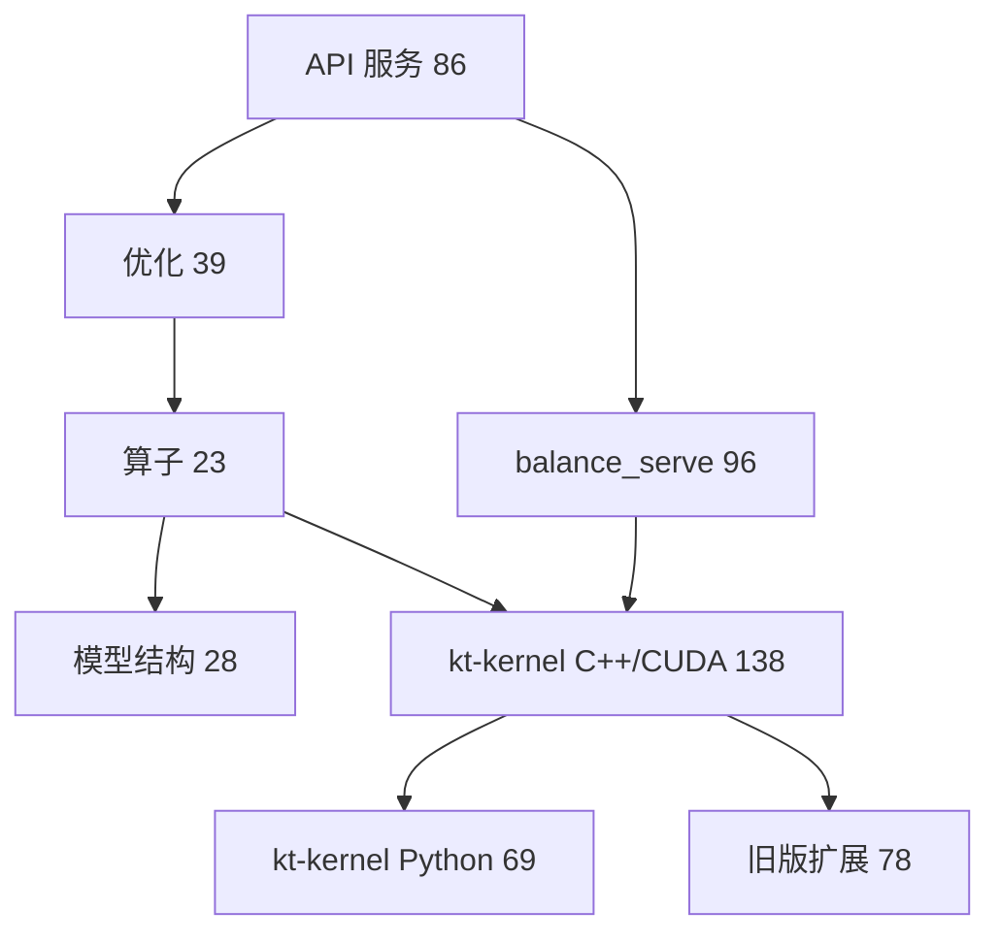

# KTransformers 新人上手指南（ONBOARDING）

> 知识图谱生成 · ktransformers @ 31985f40 · 2026-09-20 · 672 文件（13 层 666）
> 语言 python/cpp/cuda/cmake/yaml；依赖 PyTorch/llama.cpp/FlashInfer/CUDA。省略前缀均指 archive/ktransformers/。

## 1. 项目概览

KTransformers 是清华 KVCache.AI 团队的 MoE 大模型 **CPU+GPU 异构单机推理/微调框架**。核心思想：把 Transformer 层"拆开安放"——**Attention 留在 GPU，MoE experts 下沉到 CPU 内存甚至 DISK**，单台服务器即可跑起 DeepSeek 级百亿参数 MoE。

核心卖点：experts 放进 CPU 内存（mmap/GGUF 量化）后显存骤降，61 层可按层号正则分多卡；YAML 声明式组装；AMX/AVX2 模板化 GEMM + NUMA 线程池；ktransformers[sft] 支持 CPU 上 int8/fp8 微调。

**2026 新版双层架构**：

| 组成 | 角色 |
|---|---|
| ktransformers.py + version.py | 顶层薄入口：版本 0.7.0.post1 + has_sft_support() |
| kt-kernel/ | 新版 C++/CUDA 运行时内核（138 文件，最大层）+ python/（kt-cli 与 SFT） |
| archive/ktransformers/ | 旧版 Python 装配层，已归档但仍是框架思想主教材 |

## 2. 架构分层

13 层：

1. **API 服务（86）**：FastAPI OpenAI/Ollama/Assistants 端点 + schemas/crud、balance_serve Python 端调度。
2. **算子（23）**：attention/linear/experts/gate/RoPE/layernorm 算子，桥接 cpuinfer/flashinfer/triton/ascend。
3. **优化（39）**：optimize.py 规则引擎 + 按模型/多 GPU/NPU/XPU 组织的 25 份 YAML。
4. **模型结构（28）**：configuration+modeling 双件套贴近 HF 原版；custom_cache.py 统一 KV Cache。
5. **框架核心（18）**：local_chat CLI、权重加载三件套、CUDA/NPU Graph runner。
6. **kt-kernel C++/CUDA 内核（138）**：AMX/AVX2 MoE GEMM、llamafile、kvcache 模板头文件库 + cpu_backend 线程池，经 ext_bindings.cpp 暴露。
7. **kt-kernel Python（69）**：kt-cli 八子命令（chat/bench/config/doctor/model/quant/run/sft）+ SFT 运行时。
8. **balance_serve C++（96）**：kvc2 分页 KV Cache 引擎 + sched 调度器（Prometheus TTFT/TBT）。
9. **旧版扩展（78）**：前身 ktransformers_ext + custom_marlin 的 GPTQ Marlin GPU 内核。
10. **官网前端（35）**：Vue.js 文档站，无后端依赖。
11. **构建部署（37）**：两套 setup/pyproject/CMake、Dockerfile(.xpu)、install 脚本。
12. **CI/CD（12）**：PyPI/book/镜像/release 流水线、sglang 子模块同步。
13. **文档（7）**：三份中英 README 与 mdBook book.toml。

## 3. 核心概念

- **YAML 配置化组装**：optimize_rules/*.yaml 用 match（模块名正则）+ replace（K 系算子）+ device 声明"哪个模块放哪块硬件"。DeepSeek-V3-Chat.yaml 为单卡基线：MLA 上 GPU、experts 留 CPU；multi-gpu 变体分 61 层到多卡。
- **TransformerLayer 注入**：框架不重写模型而是"换器官"——base_operator.py 的 BaseInjectedModule 用 __getattr__/__setattr__ 透传未覆写属性给原始 HF 模块，替换算子只实现 forward/load。
- **算子三大家族**：attention.py（MLA 多后端）、linear.py（Torch/Q8/FP8/Marlin/CPUInfer）、experts.py（KExperts+各模型 SparseMoeBlock，fan-out 55，全仓牵连最广）。
- **backend 抽象**：服务端 BackendInterfaceBase 下 ktransformers/transformers/balance_serve 三实现。
- **optimize 规则引擎**：optimize.py 读 YAML + GGUF 量化信息，为每层生成算子级 CPU/GPU 放置配置并注入装载。
- **OpenAI 兼容 API**：逐项参数校验 + SSE 流式；Ollama 协议转译；schemas/base.py 为响应模型公共基类。
- **AMX/AVX2/CUDA kernel**：AMX dpb133 + GemmKernel133/224 是量化 MoE 计算核心；AVX2 bf16-moe 为无 AMX 降级路径；CUDA 侧 dequant/marlin/topk_softmax。

## 4. 推荐学习路径（15 步导览）

1. **全景**：README.md / README_ZH.md——三层结构与特性日志。
2. **框架核心**：ktransformers.py + version.py + 归档占位 __init__.py（0.4.1）。
3. **YAML 范式**：DeepSeek-V3-Chat.yaml、-multi-gpu.yaml、Qwen2-57B-A14B-Instruct.yaml。
4. **模型结构**：modeling_deepseek_v3.py、modeling_qwen3_moe.py、custom_cache.py。
5. **权重装载**：custom_loader.py（mmap 惰性加载）、custom_gguf.py（Q2_K~Q8_0 反量化）。
6. **算子注入**：base_operator.py 代理 + models.py backbone 算子 + RoPE.py 子类。
7. **三大算子**：attention/linear/experts——基类给骨架，这里给肌肉。
8. **优化与卸载**：optimize.py 生成配置；cpuinfer.py 提交 KV cache 与注意力给 C++。
9. **API 出口**：server/main.py → api/openai/endpoints/chat.py → schemas/base.py。
10. **kt-kernel CPU 运行时**：cpu_backend/ 的 cpuinfer.h、worker_pool.h、task_queue.h、shared_mem_buffer.cpp。
11. **模板化 CPU 算子**：amx/moe.hpp（CRTP 各量化变体）、amx_kernels.hpp、avx2/bf16-moe.hpp、llamafile/moe.hpp。
12. **GPU 内核**：dequant.cu、gptq_marlin.cu、moe_topk_softmax_kernels.cu，经 ext_bindings.cpp 暴露。
13. **Python 绑定层**：kt-cli main.py、commands/run.py（组装 SGLang 服务器）、experts.py 分派后端。
14. **balance_serve**：sched/scheduler.cpp（Query 状态机）、kvc2/gpu_cache.cpp、forward_batch.py。
15. **构建发布**：kt-kernel/setup.py、CMakeLists.txt、release-pypi.yml——两产品线在 version.py 合流。

前 9 步纯 Python，10 步起进入 C++/CUDA 与产品化。

## 5. 文件地图

| 层 | 关键文件 |
|---|---|
| API 服务 | server/main.py、api/openai/endpoints/chat.py、schemas/base.py |
| 优化 | optimize/optimize.py + optimize_rules/（各模型/多 GPU/npu/xpu） |
| 算子 | operators/{attention,linear,experts,RoPE}.py、base_operator.py |
| 模型结构 | models/modeling_{deepseek_v3,qwen3_moe,qwen3_next}.py、custom_cache.py |
| 框架核心 | util/{custom_loader,custom_gguf,utils}.py、local_chat.py |
| kt-kernel C++ | kt-kernel/ext_bindings.cpp、operators/amx/、cpu_backend/、cuda/ |
| kt-kernel Python | kt-kernel/python/cli/main.py、python/experts.py、python/sft/ |
| balance_serve | archive/csrc/balance_serve/sched/scheduler.cpp、kvc2/src/gpu_cache.cpp |

## 6. 复杂度热点（top 10，按依赖度）

| # | 文件 | 度 |
|---|---|---|
| 1 | operators/experts.py（先读 KExperts 抽象） | 70 |
| 2 | models/modeling_deepseek_v3.py（对照 HF 原版 diff） | 60 |
| 3 | models/modeling_deepseek.py（V2 基线） | 58 |
| 4 | kt-kernel/python/cli/utils/environment.py（硬件画像） | 52 |
| 5 | models/modeling_qwen2_moe.py | 50 |
| 6 | util/utils.py（prefill_and_generate 主循环） | 49 |
| 7 | models/modeling_qwen3_moe.py | 48 |
| 8 | models/modeling_qwen3_next.py（线性/full attention 混合） | 48 |
| 9 | server/backend/interfaces/balance_serve.py（Engine 子进程） | 46 |
| 10 | operators/RoPE.py（10 个注入子类） | 45 |

热点集中于模型宿主/MoE 算子/服务调度三类辐射中心，改动前先 grep 引用。

## 7. 构建与调试

- **两条产品线**：根 setup.py/pyproject.toml 打薄包；kt-kernel/setup.py 探测 CPU 特性（cmake/DetectCPU.cmake）与 CUDA/CANN 工具链，转发 30+ 个 CPUINFER_* 变量给 CMake；两包共享 version.py。
- **kt-kernel CMake**：LLAMA_* 指令集 + KTRANSFORMERS_CPU_* 选项，强制 CUDA/SYCL/ROCm/MUSA/MACA/Ascend 六种 GPU 后端互斥。
- **SFT 与 benchmark**：pip install ktransformers[sft]（sft/backend.py 探测 INT8/FP8）；kt-cli bench，旧基准在 archive/csrc/ktransformers_ext/bench。
- **容器/CI**：archive/Dockerfile（pytorch 2.5.1-cuda12.1）；release-pypi.yml 构建 sglang-kt/kt-kernel 等 wheel。
- **调试**：Python 侧 local_chat.py/kt-cli chat；C++ 侧跑 amx test 与 kvc2 测试套件。

## 8. 常见坑与本地约定

- **archive/ 的历史**：经典 Python 包已整体挪入 archive/ktransformers/（占位 __init__.py 仅剩 0.4.1），现行版本 0.7.0.post1 在根 version.py，勿被两个版本号迷惑。
- **同名文件双份**：dequant.cu、ext_bindings.cpp、amx.hpp、cpuinfer.h 在 kt-kernel/ 与 archive/csrc/ktransformers_ext/ 各一份（新旧两代扩展），改内核前先确认目标。
- **third_party 子模块**：clone 必须 --recursive；sglang 是关键子模块，有独立 CI（sync-sglang-submodule.yml）同步，kt run 底层组装 SGLang + kt-kernel 服务器。
- **CPU offload 数值边界**：Qwen2 规则里 experts 是"prefill cuda + generate CPU"混合路径，同层权重会在设备/精度域间切换；GGUF 各量化档反量化出口不同（custom_gguf.py vs dequant.cu），FP8/W8A8/Marlin int4 又是另一套。排查数值问题先比对 layernorm.py 的 forward_native 保底路径；KV cache 也有 fp16/q4 档。
- **硬件分叉**：AMX/AVX2/AVX512/ARM/Ascend/XPU 走不同条件编译分支，复现结果先跑 kt-cli doctor。
- **CMake 后端互斥**：六种 GPU 后端不能同开，报"找不到符号"先查是否混装两 backend 产物。
