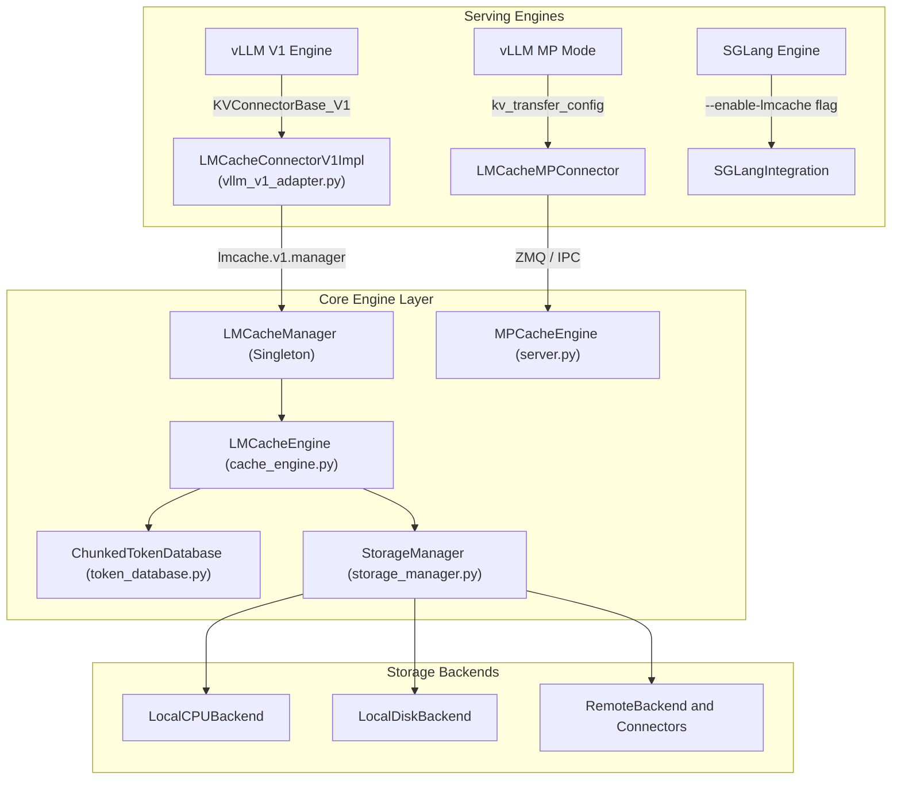
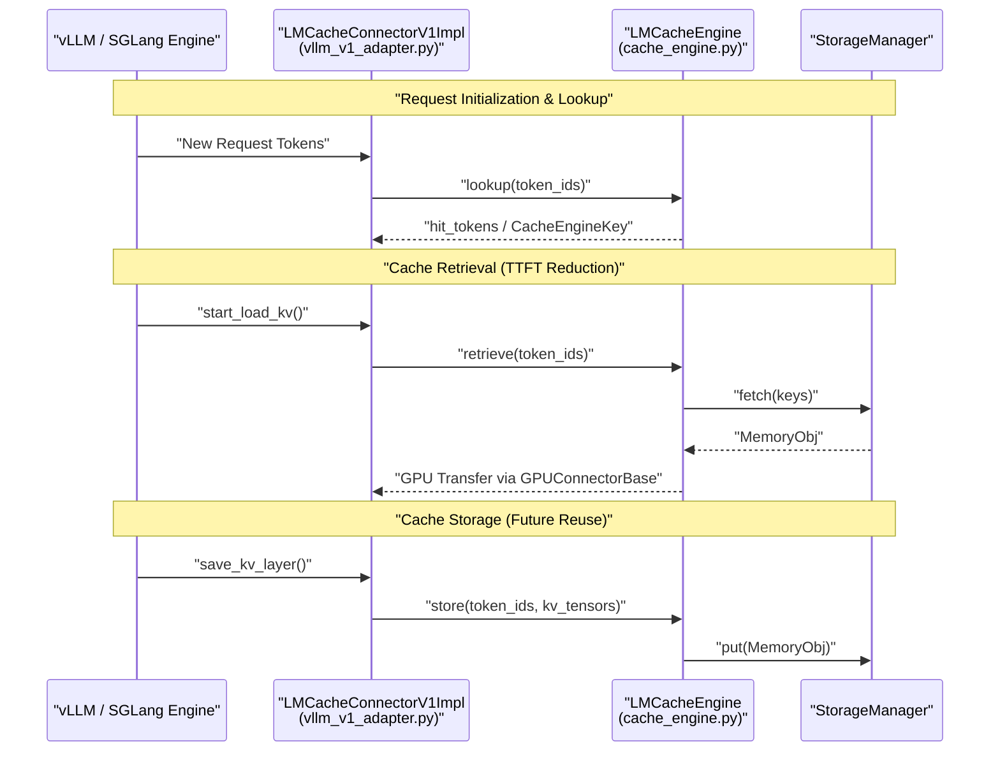

<!-- source: DeepWiki mcp.deepwiki.com · repo LMCache/LMCache · page 1 Overview · fetched 2026-10-21 -->

# Overview

Relevant source files

The following files were used as context for generating this wiki page:

- [README.md](README.md)
- [docs/source/_static/custom.css](docs/source/_static/custom.css)
- [docs/source/_static/custom.js](docs/source/_static/custom.js)
- [docs/source/_templates/versioning.html](docs/source/_templates/versioning.html)
- [docs/source/api_reference/multimodality.rst](docs/source/api_reference/multimodality.rst)
- [docs/source/community/blogs.rst](docs/source/community/blogs.rst)
- [docs/source/community/faq.rst](docs/source/community/faq.rst)
- [docs/source/community/index.rst](docs/source/community/index.rst)
- [docs/source/community/meetings.rst](docs/source/community/meetings.rst)
- [docs/source/conf.py](docs/source/conf.py)
- [docs/source/getting_started/quickstart/index.rst](docs/source/getting_started/quickstart/index.rst)
- [docs/source/getting_started/quickstart/multimodality.rst](docs/source/getting_started/quickstart/multimodality.rst)
- [docs/source/getting_started/quickstart/offload_kv_cache.rst](docs/source/getting_started/quickstart/offload_kv_cache.rst)
- [docs/source/index.rst](docs/source/index.rst)
- [docs/source/llms.txt](docs/source/llms.txt)
- [docs/source/locale/zh_CN/LC_MESSAGES/community/faq.po](docs/source/locale/zh_CN/LC_MESSAGES/community/faq.po)
- [docs/source/locale/zh_CN/LC_MESSAGES/community/index.po](docs/source/locale/zh_CN/LC_MESSAGES/community/index.po)
- [requirements/docs.txt](requirements/docs.txt)
- [requirements/lint.txt](requirements/lint.txt)

## Purpose and Scope

This document provides a high-level introduction to LMCache, explaining its role in the LLM inference stack, core architectural components, and operational principles. It is intended to orient new users and developers to the system before diving into specific subsystems.

For detailed information on installation, quickstart examples, and basic configuration, see [Getting Started](#1.1) [docs/source/getting_started/quickstart.rst:1-155](). For documentation on the command-line interface, available subcommands, and usage patterns, see [CLI Reference](#1.2). For deep dives into storage backends, integration with serving engines, and configuration, refer to the respective child pages.

Sources: [README.md:51-56](), [docs/source/index.rst:20-21](), [docs/source/getting_started/quickstart.rst:1-155]()

## What is LMCache?

LMCache is a **KV cache management layer** for LLM inference [README.md:53-53](). It transforms the typically transient key-value (KV) cache generated during LLM inference into reusable, persistent **AI-native knowledge** that can be stored, monitored, and shared across multiple serving engine instances [README.md:53-56](). 

LMCache decouples KV cache management from specific inference engines by operating as an independent server process (`lmcache server`) [docs/source/getting_started/quickstart.rst:46-49](). This isolation eliminates fate-sharing—meaning cache survives engine crashes or restarts—and facilitates KV cache reuse across engine instances and requests with overlapping context [README.md:67-67](), [README.md:75-76]().

The primary benefits of LMCache include **reduced time-to-first-token (TTFT)** and **improved throughput** for workloads with long contexts, agentic multi-turn dialogue, or retrieval-augmented generation (RAG) patterns [README.md:53-54]().

### Key Features

- **Engine-independent deployment**: LMCache runs as a standalone daemon managing KV caches without dependency on the inference engine process [README.md:67-67](), [docs/source/getting_started/quickstart.rst:46-49]().

- **Persistent, tiered KV cache storage**: Offloads KV caches from GPU memory to a multi-tier hierarchy including CPU RAM, local disk, and various remote storage backends, enabling efficient reuse over requests, sessions, and different engine instances [README.md:69-70]().

- **Production-quality observability**: Implements a comprehensive observability stack with Kubernetes-compatible metrics, request and token-level cache hits, lifecycle tracking, and user-specific usage monitoring [README.md:71-72]().

- **Flexible, pluggable backends**: Supports diverse storage backends such as CPU RAM, SSD local storage, Redis/Valkey, Mooncake, InfiniStore, S3-compatible storage, NIXL, and NVIDIA GDS through unified interfaces [README.md:73-74]().

- **Non-prefix KV reuse**: Goes beyond traditional prefix caching by reusing cached KV blocks at arbitrary prompt positions, using the CacheBlend mechanism to selectively recompute tokens for quality and correctness [README.md:75-76]().

- **Disaggregated prefill and KV transfer**: Enables KV cache transfer between prefill and decode workers over high-speed interconnects (NVLink, RDMA) or TCP via transport layers like NIXL [README.md:77-78]().

- **Pluggable KV transformations (SERDE)**: Provides flexible serialization/deserialization interfaces to implement compression, token dropping, and custom KV cache formats [README.md:79]().

- **Multimodal model support**: Extends caching beyond language models to audio, image, and video encoders integrated in engines like vLLM V1 [README.md:46]().

Sources: [README.md:31-80](), [docs/source/index.rst:57-70](), [docs/source/getting_started/quickstart.rst:46-49]()

## System Architecture Overview

The system architecture of LMCache bridges the gap between high-level serving engines and low-level storage and GPU memory management. The following diagrams map natural language concepts and system components to concrete code entities and files to aid developers in navigating the codebase.

### Diagram: LMCache Component Architecture

Sources: [README.md:67-74](), [docs/source/index.rst:57-70](), [docs/source/getting_started/quickstart.rst:23-29]()

### Diagram: Serving Engine Request Lifecycle (High-Level)

Sources: [README.md:33-75](), [docs/source/getting_started/quickstart/offload_kv_cache.rst:54-64](), [docs/source/getting_started/quickstart/offload_kv_cache.rst:157-164](), [docs/source/getting_started/quickstart.rst:21-29]()

## Core Components

- **LMCacheEngine**: Managed via `LMCacheEngine` (`lmcache.v1.cache_engine`), handling in-process KV cache operations, token chunking, and storage backend interaction [docs/source/getting_started/quickstart/offload_kv_cache.rst:89-92]().
- **Token Database and Chunking**: `ChunkedTokenDatabase` breaks token sequences into fixed-size chunks (default 256 tokens) [docs/source/getting_started/quickstart/offload_kv_cache.rst:40-40](); `SegmentTokenDatabase` supports separator-based splitting for non-prefix reuse [README.md:75]().
- **Storage Manager and Backends**: Coordinated by `StorageManager`, spanning `LocalCPUBackend`, `LocalDiskBackend`, and `RemoteBackend` plugins [README.md:69-74](), [docs/source/getting_started/quickstart/offload_kv_cache.rst:42-42]().

Sources: [README.md:69-74](), [docs/source/getting_started/quickstart/offload_kv_cache.rst:40-42](), [docs/source/getting_started/quickstart/offload_kv_cache.rst:89-92]()

## Integration with Serving Engines and Getting Started

LMCache supports vLLM (in-process `LMCacheConnectorV1` and multi-process `LMCacheMPConnector`), SGLang via `--enable-lmcache`, and TensorRT-LLM [README.md:55-56](), [docs/source/getting_started/quickstart.rst:23-29](). 

For comprehensive installation instructions, quickstart workflows, Docker containers, ROCm support, and vLLM version compatibility matrices, please review [Getting Started](#1.1). For details on the command-line interface tools, subcommands (`mock`, `metrics`, `bench`, `kvcache`, `query`, `describe`, `trace`, `server`, `coordinator`, `tool`), and execution options, see the [CLI Reference](#1.2).

Sources: [README.md:55-56](), [docs/source/getting_started/quickstart.rst:1-155]()

---

