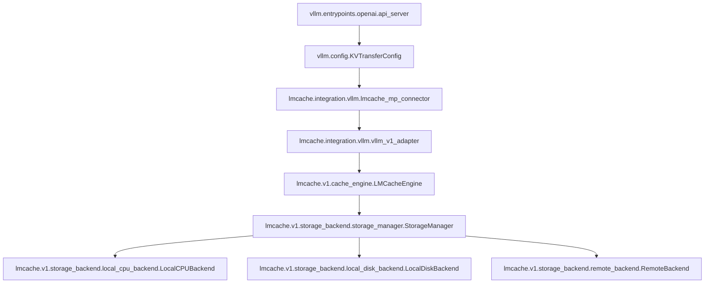
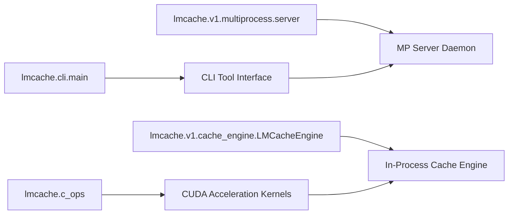

<!-- source: DeepWiki mcp.deepwiki.com · repo LMCache/LMCache · page 1.1 Getting Started · fetched 2026-10-21 -->

# Getting Started

<details>
<summary>Relevant source files</summary>

The following files were used as context for generating this wiki page:

- [.buildkite/k3_harness/resolve-pinned-sglang.sh](.buildkite/k3_harness/resolve-pinned-sglang.sh)
- [.buildkite/k3_tests/multiprocess/README.md](.buildkite/k3_tests/multiprocess/README.md)
- [.buildkite/k3_tests/multiprocess/scripts/engines/sglang.sh](.buildkite/k3_tests/multiprocess/scripts/engines/sglang.sh)
- [.github/scripts/pin-tested-sglang.sh](.github/scripts/pin-tested-sglang.sh)
- [.github/workflows/build_sglang_image.yml](.github/workflows/build_sglang_image.yml)
- [docker/Dockerfile](docker/Dockerfile)
- [docker/Dockerfile.sglang](docker/Dockerfile.sglang)
- [docker/Dockerfile.standalone](docker/Dockerfile.standalone)
- [docker/README.md](docker/README.md)
- [docker/example_run.sh](docker/example_run.sh)
- [docs/design/integration/sglang/assets/unified-radix-cache-runtime-flow.svg](docs/design/integration/sglang/assets/unified-radix-cache-runtime-flow.svg)
- [docs/design/integration/sglang/lmcache-unified-radix-cache.md](docs/design/integration/sglang/lmcache-unified-radix-cache.md)
- [docs/source/getting_started/installation.rst](docs/source/getting_started/installation.rst)
- [docs/source/getting_started/quickstart.rst](docs/source/getting_started/quickstart.rst)
- [docs/source/production/docker_deployment.rst](docs/source/production/docker_deployment.rst)
- [examples/sgl_integration/README.md](examples/sgl_integration/README.md)

</details>


## Purpose and Scope

This page provides a comprehensive guide for new users to install, configure, and quickly run LMCache. It covers installation options including PyPI pip installs and Docker images, with special attention to hardware-specific variants such as ROCm, Intel XPU, and Moore Threads MUSA [docs/source/getting_started/installation.rst:6-143](). You will learn how to launch LMCache with the recommended Multiprocess (MP) server mode and the alternative in-process mode for vLLM integration [docs/source/getting_started/quickstart.rst:23-29](). The page also includes configuration highlights, architecture data flows mapped to code modules, and a compatibility matrix detailing LMCache support across different vLLM versions and hardware platforms [docs/source/getting_started/installation.rst:17-126]().

Sources: [docs/source/getting_started/quickstart.rst:1-29](), [docs/source/getting_started/installation.rst:6-143]()

---

## Installation Guide

LMCache supports Linux with Python 3.9–3.13 and a variety of hardware accelerators including NVIDIA (Compute 7.0+), AMD Instinct (ROCm-enabled), Intel GPU/XPU, and Moore Threads MUSA [docs/source/getting_started/installation.rst:6-143]().

### Prerequisites

- **Operating System:** Linux
- **Python:** Version 3.9 to 3.13 [docs/source/getting_started/installation.rst:6]()
- **Hardware:**
  - NVIDIA GPUs with Compute Capability >= 7.0 (e.g., T4, A100, H100) [docs/source/getting_started/installation.rst:6]()
  - AMD GPUs with ROCm support (gfx942 for MI300X/MI325X, gfx950 for MI350X/MI355X) [docs/source/getting_started/installation.rst:69-70]()
  - Intel XPU accelerators [docs/source/getting_started/installation.rst:101-104]()
  - Moore Threads MUSA GPUs [docs/source/getting_started/installation.rst:137-140]()
- **Package Manager:** `uv` is recommended for virtual environment and dependency management [docs/source/getting_started/installation.rst:6]()

### Standard Installation

Install LMCache with vLLM and dependencies using `uv` or pip for an NVIDIA CUDA environment [docs/source/getting_started/quickstart.rst:17-19]():

```bash
uv venv --python 3.12
source .venv/bin/activate
uv pip install lmcache vllm
```

Optionally, add NIXL support (for disaggregated prefill and P2P sharing):

```bash
uv pip install lmcache[nixl]
```

To target specific CUDA versions (such as CUDA 12.9), refer to the GitHub releases [docs/source/getting_started/installation.rst:46-60]():

```bash
VERSION=0.4.3
uv venv --python 3.12
source .venv/bin/activate
uv pip install lmcache==${VERSION} \
    --extra-index-url https://download.pytorch.org/whl/cu129 \
    --find-links https://github.com/LMCache/LMCache/releases/expanded_assets/v${VERSION}-cu129 \
    --index-strategy unsafe-best-match
```

### ROCm and Hardware-Specific Wheels

- **ROCm (AMD Instinct GPUs):** Published on GitHub releases and ABI compatible with upstream vLLM ROCm images [docs/source/getting_started/installation.rst:67-73]():

```bash
docker run -it --device /dev/kfd --device /dev/dri \
    --group-add video --security-opt seccomp=unconfined \
    --entrypoint bash vllm/vllm-openai-rocm:v0.25.0

VERSION=0.5.3
pip install lmcache==${VERSION}+rocm7.2 --no-deps \
    --find-links https://github.com/LMCache/LMCache/releases/expanded_assets/v${VERSION}-rocm
```

- **Intel XPU:** ABI-matched wheels for Intel GPUs running on associated vLLM XPU container images [docs/source/getting_started/installation.rst:101-119]():

```bash
docker run -it --device /dev/dri --shm-size=4g \
    --entrypoint bash vllm/vllm-openai-xpu:v0.26.0

VERSION=0.5.3
pip install lmcache==${VERSION}+xpu --no-deps \
    --no-index \
    --find-links https://github.com/LMCache/LMCache/releases/expanded_assets/v${VERSION}-xpu
```

- **Moore Threads MUSA:** Distributed via GitHub Releases due to specialized SDK distribution requirements [docs/source/getting_started/installation.rst:137-144]().

Sources: [docs/source/getting_started/installation.rst:6-144](), [docs/source/getting_started/quickstart.rst:17-19]()

---

## Quickstart Examples

LMCache integrates with inference engines through dedicated connector mechanisms.

### 1. Multiprocess (MP) Mode — Recommended

In MP mode, LMCache runs as a standalone server daemon handling KV cache requests asynchronously from the inference engine via `LMCacheMPConnector` [docs/source/getting_started/quickstart.rst:23-26]().

**Start the LMCache server:** [docs/source/getting_started/quickstart.rst:47-49]()
```bash
lmcache server \
    --host localhost --port 5555 \
    --l1-size-gb 20 --eviction-policy LRU --chunk-size 16
```

**Start vLLM with the MP connector:** [docs/source/getting_started/quickstart.rst:67-69]()
```bash
vllm serve Qwen/Qwen3-8B \
    --port 8000 --kv-transfer-config \
    '{"kv_connector":"LMCacheMPConnector", "kv_role":"kv_both", "kv_connector_extra_config": {"lmcache.mp.host": "localhost", "lmcache.mp.port": 5555}}'
```

### 2. In-Process Mode

LMCache runs embedded inside the inference engine process via `LMCacheConnectorV1` [docs/source/getting_started/quickstart.rst:27-29]():

```bash
vllm serve Qwen/Qwen3-8B \
    --kv-transfer-config '{"kv_connector":"LMCacheConnectorV1","kv_role":"kv_both"}'
```

Sources: [docs/source/getting_started/quickstart.rst:23-69]()

---

## Basic Configuration Reference

Configuration options can be specified via YAML files or environment variables [docs/source/getting_started/quickstart.rst:109-138]().

| YAML Key          | Environment Variable      | Default | Description                              |
|-------------------|---------------------------|---------|------------------------------------------|
| `chunk_size`      | `LMCACHE_CHUNK_SIZE`       | 256     | Number of tokens per chunk in cache hashing [docs/source/getting_started/quickstart/offload_kv_cache.rst:39-40]() |
| `local_cpu`       | `LMCACHE_LOCAL_CPU`         | False   | Enable local CPU RAM storage backend [docs/source/getting_started/quickstart/offload_kv_cache.rst:41-42]() |
| `max_local_cpu_size`| `LMCACHE_MAX_LOCAL_CPU_SIZE`| N/A     | Maximum CPU RAM size in GB [docs/source/getting_started/quickstart/offload_kv_cache.rst:43-44]() |
| `remote_url`      | `LMCACHE_REMOTE_URL`        | N/A     | URL for remote storage backend           |

Sources: [docs/source/getting_started/quickstart/offload_kv_cache.rst:39-44]()

---

## Docker Deployment

LMCache provides multiple Docker images catering to different deployment topologies [docker/README.md:5-158]():
- `lmcache/vllm-openai:latest`: Full integration with vLLM and NIXL support [docker/README.md:7-13]()
- `lmcache/standalone:latest`: Standalone LMCache server daemon image [docker/README.md:71-76]()
- `lmcache/vllm-openai:lightweight`: Quick setup using PyPI wheels [docker/README.md:112-117]()

Example container execution:
```bash
docker run --runtime nvidia --gpus all \
  --ipc=host \
  lmcache/vllm-openai:latest \
  Qwen/Qwen3-8B \
  --kv-transfer-config \
  '{"kv_connector":"LMCacheConnectorV1","kv_role":"kv_both"}'
```

Sources: [docker/README.md:5-158]()

---

## Architecture and Data Flow

### Diagram: LMCache KV Cache Data Flow Architecture


Sources: [docs/source/getting_started/quickstart.rst:23-67](), [docs/source/index.rst:54-70]()

### Diagram: Component Lifecycle and Code Entity Mapping


Sources: [docs/source/getting_started/quickstart.rst:46-48](), [docs/source/getting_started/quickstart.rst:152-155]()

---

## vLLM Compatibility Matrix

| Target                  | Status     | Notes                                                                                      |
|-------------------------|------------|--------------------------------------------------------------------------------------------|
| **vLLM v1 (CUDA)**      | ✅ Production | Primary integration via `LMCacheConnectorV1` and `LMCacheMPConnector` [docs/source/getting_started/quickstart.rst:21-29]() |
| **vLLM ROCm**           | ✅ Validated | Supported on AMD MI300X GPUs using ROCm builds [docs/source/getting_started/installation.rst:67-73]() |
| **vLLM XPU**            | ✅ Validated | Supports Intel GPUs with XPU wheels and containers [docs/source/getting_started/installation.rst:101-119]() |
| **vLLM Nightly**        | ✅ Supported | Builds daily against development branches for continuous validation [docker/Dockerfile:72]() |

Sources: [docs/source/getting_started/installation.rst:17-126](), [docker/Dockerfile:72](), [docs/source/getting_started/quickstart.rst:21-29]()

---

