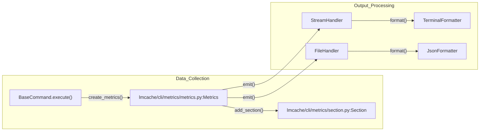

<!-- source: DeepWiki mcp.deepwiki.com · repo LMCache/LMCache · page 1.2 CLI Reference · fetched 2026-10-21 -->

# CLI Reference

<details>
<summary>Relevant source files</summary>

The following files were used as context for generating this wiki page:

- [docs/design/cli/commands.md](docs/design/cli/commands.md)
- [docs/design/cli/commands/describe.md](docs/design/cli/commands/describe.md)
- [docs/design/cli/commands/kvcache-command.md](docs/design/cli/commands/kvcache-command.md)
- [docs/design/cli/commands/query-command.md](docs/design/cli/commands/query-command.md)
- [docs/design/cli/framework-and-metrics.md](docs/design/cli/framework-and-metrics.md)
- [docs/source/cli/describe.rst](docs/source/cli/describe.rst)
- [docs/source/cli/index.rst](docs/source/cli/index.rst)
- [docs/source/cli/kvcache.rst](docs/source/cli/kvcache.rst)
- [docs/source/cli/query.rst](docs/source/cli/query.rst)
- [docs/source/developer_guide/cli.rst](docs/source/developer_guide/cli.rst)
- [examples/serde/fp8/run_serde_fp8_example.sh](examples/serde/fp8/run_serde_fp8_example.sh)
- [lmcache/cli/__init__.py](lmcache/cli/__init__.py)
- [lmcache/cli/commands/__init__.py](lmcache/cli/commands/__init__.py)
- [lmcache/cli/commands/base.py](lmcache/cli/commands/base.py)
- [lmcache/cli/commands/bench/__init__.py](lmcache/cli/commands/bench/__init__.py)
- [lmcache/cli/commands/describe.py](lmcache/cli/commands/describe.py)
- [lmcache/cli/commands/kvcache.py](lmcache/cli/commands/kvcache.py)
- [lmcache/cli/commands/mock.py](lmcache/cli/commands/mock.py)
- [lmcache/cli/commands/ping.py](lmcache/cli/commands/ping.py)
- [lmcache/cli/commands/query/_coordinator.py](lmcache/cli/commands/query/_coordinator.py)
- [lmcache/cli/commands/query/_request.py](lmcache/cli/commands/query/_request.py)
- [lmcache/cli/commands/query/coordinator_command.py](lmcache/cli/commands/query/coordinator_command.py)
- [lmcache/cli/http.py](lmcache/cli/http.py)
- [lmcache/cli/main.py](lmcache/cli/main.py)
- [lmcache/cli/metrics/__init__.py](lmcache/cli/metrics/__init__.py)
- [lmcache/cli/metrics/formatter.py](lmcache/cli/metrics/formatter.py)
- [lmcache/cli/metrics/metrics.py](lmcache/cli/metrics/metrics.py)
- [lmcache/cli/metrics/section.py](lmcache/cli/metrics/section.py)
- [tests/cli/commands/query/test_request.py](tests/cli/commands/query/test_request.py)
- [tests/cli/commands/test_directed_registration.py](tests/cli/commands/test_directed_registration.py)
- [tests/cli/test_describe.py](tests/cli/test_describe.py)
- [tests/cli/test_ping.py](tests/cli/test_ping.py)
- [tests/v1/cli/test_query_coordinator.py](tests/v1/cli/test_query_coordinator.py)

</details>


The `lmcache` command-line interface (CLI) provides a unified entry point for operators and developers to manage, monitor, and test the LMCache ecosystem. It replaces fragmented module execution patterns with a structured subcommand architecture discovered dynamically at runtime [lmcache/cli/commands/__init__.py:1-8](), [docs/source/cli/index.rst:4-6]().

## Overview

The CLI is designed with a pluggable command discovery system using `discover_subclasses`, allowing for easy extension of management capabilities [lmcache/cli/commands/__init__.py:11-35](), [docs/source/developer_guide/cli.rst:11-27](). It serves as the primary tool for:

*   Launching the multi-process cache server (`server`) [docs/source/cli/index.rst:52-54]().
*   Launching the multi-process coordinator (`coordinator`) [docs/source/cli/index.rst:55-56]().
*   Performing liveness checks (`ping`) and detailed status diagnostics (`describe`) [docs/source/cli/index.rst:57-60]().
*   Running sustained benchmarks via `bench` [docs/source/cli/index.rst:65-68]().
*   Making single-shot queries to inference engines or coordinators (`query`) [docs/source/cli/index.rst:61-64]().
*   Managing KV cache state on servers (`kvcache`) [docs/source/cli/index.rst:69-70]().
*   Managing per-salt cache quotas (`quota`) [docs/source/cli/index.rst:71-72]().
*   Inspecting and replaying storage trace files (`trace`) [docs/source/cli/index.rst:73-74]().
*   Running offline analysis tools like the cache simulator (`tool`) [docs/source/cli/index.rst:75-76]().
*   Providing mock servers or operations for testing (`mock`) [docs/source/cli/index.rst:4-7]().
*   Collecting and formatting metrics for diagnostics (`metrics`) [docs/source/cli/index.rst:80-88]().

Sources: [lmcache/cli/commands/__init__.py:1-8](), [docs/source/cli/index.rst:1-77](), [docs/source/developer_guide/cli.rst:11-27]()

## CLI Architecture & Auto-Discovery Framework

The CLI framework is implemented with two core classes in `lmcache/cli/commands/base.py`:

- `BaseCommand`: Abstract base class for leaf commands performing actual actions.
- `CompositeCommand`: A subclass for commands that group sub-subcommands dynamically (e.g., `bench`, `tool`) [docs/source/developer_guide/cli.rst:11-19]().

An auto-discovery mechanism dynamically finds command classes by scanning submodules and packages at runtime. This design allows adding new commands or subcommands by simply creating new `.py` files or sub-packages with `BaseCommand` subclasses, without any manual registration [docs/source/developer_guide/cli.rst:20-27]().

### Command Discovery and Execution Flow

1. **Top-Level Discovery:** When starting, `lmcache/cli/commands/__init__.py` invokes `discover_subclasses()` over its own package. It scans direct submodules and loads all concrete `BaseCommand` subclasses, excluding utility or abstract modules [lmcache/cli/commands/__init__.py:15-38](), [docs/source/developer_guide/cli.rst:39-64]().

2. **Nested Subcommands:** `CompositeCommand` subclasses found at top level (e.g., `bench`, `query`, `tool`, `trace`) discover their child commands similarly by scanning their own sub-packages when registering with `argparse`, supporting multi-level nested subcommands automatically [docs/source/developer_guide/cli.rst:82-102]().

3. **Execution:** The main CLI entry point creates the top-level parser, registers all discovered commands, parses user arguments, then dispatches to the relevant command’s `execute()` method.

Title: "CLI Component Architecture and Subclass Discovery"
```mermaid
graph TD
    subgraph "Entry_Point_Space"
        MAIN["lmcache/cli/main.py:main()"]
        REGISTRY["lmcache/cli/commands/__init__.py:ALL_COMMANDS"]
        DISCO_TOP["lmcache.v1.utils.subclass_discovery:discover_subclasses"]
    end

    subgraph "Code_Entity_Space"
        BASE["lmcache/cli/commands/base.py:BaseCommand"]
        COMP["lmcache/cli/commands/base.py:CompositeCommand"]
        SERVER_CMD["lmcache/cli/commands/server.py:ServerCommand"]
        COORD_CMD["lmcache/cli/commands/coordinator.py:CoordinatorCommand"]
        QUERY_COMP["lmcache/cli/commands/query/__init__.py:QueryCommand"]
        BENCH_COMP["lmcache/cli/commands/bench/__init__.py:BenchCommand"]
        KV_CMD["lmcache/cli/commands/kvcache.py:KVCacheCommand"]
        PING_CMD["lmcache/cli/commands/ping.py:PingCommand"]
        TRACE_COMP["lmcache/cli/commands/trace/__init__.py:TraceCommand"]
        TOOL_COMP["lmcache/cli/commands/tool/__init__.py:ToolCommand"]
        MOCK_CMD["lmcache/cli/commands/mock.py:MockCommand"]

        BENCH_SERVER["lmcache/cli/commands/bench/server_bench/command.py:ServerBenchCommand"]
        BENCH_L2["lmcache/cli/commands/bench/l2_adapter_bench/command.py:L2AdapterBenchCommand"]
        BENCH_ENGINE["lmcache/cli/commands/bench/engine_bench/command.py:EngineBenchCommand"]
    end

    MAIN -->|"imports"| REGISTRY
    REGISTRY -->|"populated_by"| DISCO_TOP

    DISCO_TOP -->|"instantiates"| SERVER_CMD
    DISCO_TOP -->|"instantiates"| COORD_CMD
    DISCO_TOP -->|"instantiates"| KV_CMD
    DISCO_TOP -->|"instantiates"| PING_CMD
    DISCO_TOP -->|"instantiates"| QUERY_COMP
    DISCO_TOP -->|"instantiates"| BENCH_COMP
    DISCO_TOP -->|"instantiates"| TRACE_COMP
    DISCO_TOP -->|"instantiates"| TOOL_COMP
    DISCO_TOP -->|"instantiates"| MOCK_CMD

    SERVER_CMD --|> BASE
    COORD_CMD --|> BASE
    KV_CMD --|> BASE
    PING_CMD --|> BASE
    MOCK_CMD --|> BASE
    
    QUERY_COMP --|> COMP
    BENCH_COMP --|> COMP
    TRACE_COMP --|> COMP
    TOOL_COMP --|> COMP
    COMP --|> BASE

    BENCH_COMP -->|"register() discovers"| BENCH_SERVER
    BENCH_COMP -->|"register() discovers"| BENCH_L2
    BENCH_COMP -->|"register() discovers"| BENCH_ENGINE
    BENCH_SERVER --|> BASE
    BENCH_L2 --|> BASE
    BENCH_ENGINE --|> BASE

    MAIN -->|"calls_register()"| BASE
    BASE -->|"calls add_arguments()"| ADD_ARGS["SubCommand.add_arguments()"]
    MAIN -->|"dispatches_to"| EXEC["SubCommand.execute()"]
```
Sources: [lmcache/cli/commands/__init__.py:11-38](), [docs/source/developer_guide/cli.rst:31-52](), [lmcache/cli/commands/base.py:14-43]()

### Key Classes and Their Responsibilities

| Class                | Role                                                                     | Definition Reference                   |
|----------------------|--------------------------------------------------------------------------|--------------------------------------|
| `BaseCommand`        | Abstract base for leaf CLI commands implementing actual functionality.   | [lmcache/cli/commands/base.py:17]()  |
| `CompositeCommand`   | Groups subcommands and auto-discovers nested commands for multi-level CLI navigation. | [lmcache/cli/commands/base.py:43]()  |
| `ServerCommand`      | Launches the LMCache multi-process cache server with ZMQ, HTTP frontend.| [lmcache/cli/commands/server.py:14]() |
| `CoordinatorCommand` | Launches the coordinator service tracking MP server fleets.              | [lmcache/cli/commands/coordinator.py:14]() |
| `BenchCommand`       | Groups benchmarks for engine, server, and L2 storage adapters.           | [lmcache/cli/commands/bench/__init__.py:14]() |
| `QueryCommand`       | Handles single-shot inference or fleet queries for coordinators.         | [lmcache/cli/commands/query/__init__.py:14]() |
| `DescribeCommand`    | Displays detailed status diagnostics for cache services or inference engines. | [lmcache/cli/commands/describe.py:20]() |
| `PingCommand`        | Lightweight liveness checker for LMCache and inference engines.          | [lmcache/cli/commands/ping.py:70]() |
| `KVCacheCommand`     | Manages KV cache lifecycle operations like clearing on servers.          | [lmcache/cli/commands/kvcache.py:13]() |
| `TraceCommand`       | Manages trace file inspection and replay for debugging and benchmarking. | [lmcache/cli/commands/trace/__init__.py:17]() |
| `ToolCommand`        | Runs offline tools such as cache simulators and analyzers.               | [lmcache/cli/commands/tool/__init__.py:17]() |
| `MockCommand`        | Provides mocks for testing workflows without hardware dependencies.       | [lmcache/cli/commands/mock.py:14]() |

Sources: [lmcache/cli/commands/base.py:14-43](), [lmcache/cli/commands/server.py:14-23](), [lmcache/cli/commands/bench/__init__.py:14-21](), [lmcache/cli/commands/describe.py:20-40](), [lmcache/cli/commands/ping.py:70-108](), [lmcache/cli/commands/trace/__init__.py:17-24]()

## Metrics Collection and Formatting Subsystem

The CLI commands leverage a centralized metrics subsystem implemented in `lmcache/cli/metrics/metrics.py`. This subsystem supports hierarchical collection of metrics data decoupled from rendering, enabling commands to emit either terminal-friendly tables or JSON machine-readable output through formatter handlers [lmcache/cli/metrics/metrics.py:30-180]().

Commands construct their metric sets using methods such as `add_section()`, `add_list_section()`, and `add_table()` and then invoke `emit()` to output results through the registered sinks [lmcache/cli/metrics/metrics.py:70-131]().

Title: "Metrics Data Flow and Output Formatting"

Sources: [lmcache/cli/metrics/metrics.py:32-180](), [docs/source/cli/index.rst:80-88]()

## Subcommand Reference and Usage Patterns

### `lmcache server`

Starts the multi-process LMCache server. This command initializes the entire stack, including message queue backends (ZMQ or gRPC), storage managers, HTTP admin frontend, worker pools, and GPU memory transfer mechanisms [lmcache/cli/commands/server.py:14-31](). Requires the full LMCache package with CUDA extensions installed [docs/source/cli/index.rst:28-32]().

Typical usage pattern:
```bash
lmcache server --config config.yaml
```
Sources: [lmcache/cli/commands/server.py:14-31](), [docs/source/cli/index.rst:28-32]()

---

### `lmcache coordinator`

Launches the multi-process coordinator service, which is responsible for fleet-wide instance registry, instance heartbeats, and maintaining a global key directory for distributed cache coherence [docs/source/cli/index.rst:54-55]().

Usage example:
```bash
lmcache coordinator --http-port 9300
```
Sources: [docs/source/cli/index.rst:54-55]()

---

### `lmcache describe`

Provides detailed runtime status introspection for either:

- **`kvcache`**: The multi-process LMCache KV cache service. This fetches `/status` JSON from the LMCache HTTP admin API and renders a comprehensive report including health status, L1 memory usage, registered model metadata, kernel group state, and L2 adapter details [lmcache/cli/commands/describe.py:154-175](), [docs/source/cli/describe.rst:4-65](), [docs/design/cli/commands/describe.md:1-145]().

- **`engine`**: The underlying inference engine (usually vLLM). This inspects endpoints `/v1/models`, `/health`, and `/metrics` for model info, context window size, health, and running requests count [docs/source/cli/describe.rst:66-97]().

Example command:
```bash
lmcache describe kvcache --url http://localhost:8000 --format json
```

The output can be rendered as human-readable terminal tables or JSON suitable for programmatic consumption.

Sources: [lmcache/cli/commands/describe.py:154-175](), [docs/source/cli/describe.rst:1-195](), [docs/design/cli/commands/describe.md:1-145]()

---

### `lmcache ping`

Performs fast liveness probes to check if an LMCache service or an inference engine is responsive. Internally does HTTP GET to `/healthcheck` (for `kvcache`) or `/health` (for `engine`) and measures round-trip time with potential error reporting [lmcache/cli/commands/ping.py:25-63]().

Example:
```bash
lmcache ping kvcache --url http://localhost:8080
```
The command exits with non-zero status if the target is unreachable or unhealthy.

Sources: [lmcache/cli/commands/ping.py:25-63]()

---

### `lmcache query`

Issues single-shot queries:

- To an inference engine (`query engine`), sending inference requests.
- To the MP coordinator (`query coordinator`), to inspect fleet-wide state and cache directories via read-only HTTP API calls.

The coordinator queries format aligned tables or JSON summarizing instances, usage, health, and key directory contents [docs/source/cli/index.rst:60-63](), [lmcache/cli/commands/query/_coordinator.py:126-208]().

Usage:
```bash
lmcache query engine --url http://localhost:8000 --prompt "Hello"
```
Sources: [docs/source/cli/index.rst:60-63](), [lmcache/cli/commands/query/_coordinator.py:126-208]()

---

### `lmcache bench`

Runs sustained benchmarks targeting:

- **`engine`**: vLLM inference engine throughput features varied cache reuse workloads.
- **`server`**: Full LMCache MP server stress tests with multi-rank concurrency.
- **`l2`**: Benchmarks individual L2 storage adapters for throughput and latency.

Benchmarks are implemented as leaf commands auto-discovered within `bench/` subpackage [docs/source/cli/index.rst:64-67](), [lmcache/cli/commands/bench/__init__.py:14-21]().

Example:
```bash
lmcache bench server --concurrency 8 --duration 60
```

Sources: [docs/source/cli/index.rst:60-67](), [lmcache/cli/commands/bench/__init__.py:14-21]()

---

### `lmcache kvcache`

Offers commands to manipulate in-memory KV cache state on a running server instance, such as clearing cache entries or refreshing cache metadata [docs/source/cli/index.rst:68-69]().

Usage:
```bash
lmcache kvcache clear --url http://localhost:8080
```
Sources: [docs/source/cli/index.rst:68-69]()

---

### `lmcache quota`

Manages per-salt cache quotas for capacity control and fair usage enforcement across tenants or clients [docs/source/cli/index.rst:70-71]().

Example:
```bash
lmcache quota set --salt user123 --limit 10000 --url http://localhost:8080
```
Sources: [docs/source/cli/index.rst:70-71]()

---

### `lmcache trace`

Manages the inspection and replay of LMCache storage trace files (`.lct`) which capture all `StorageManager` API calls in a live server run. Subcommands include:

- `info`: Summarize trace file metadata and operation counts.
- `replay`: Re-execute recorded operations in a controlled environment to reproduce behavior.
- `replay-events`: Replay cache-event streams to a running coordinator.

The trace records are produced by `lmcache server --trace-level` options. This command requires the full LMCache install due to dependencies on internal tracing components [lmcache/cli/commands/trace/__init__.py:1-24](), [docs/source/cli/trace.rst:1-185]().

Usage:
```bash
lmcache trace info path/to/trace.lct
lmcache trace replay path/to/trace.lct --l1-size-gb 10 --eviction-policy LRU
```
Sources: [lmcache/cli/commands/trace/__init__.py:1-24](), [docs/source/cli/trace.rst:1-185]()

---

### `lmcache tool`

Groups offline tools such as the cache simulator, providing analysis utilities that do not require a running server [docs/source/cli/index.rst:74-75]().

Example:
```bash
lmcache tool cache-simulator simulate --config config.yaml
```
Sources: [docs/source/cli/index.rst:74-75]()

---

### `lmcache mock`

Provides mock implementations and stub backend servers to facilitate testing of LMCache client interactions without requiring actual GPU hardware or full server setups [docs/source/cli/index.rst:4-7]().

Usage pattern:
```bash
lmcache mock server
```
Sources: [docs/source/cli/index.rst:4-7]()

---

## Summary

The `lmcache` CLI supports robust lifecycle management, observability, and testing capabilities via a well-structured, dynamically extensible subcommand hierarchy. It integrates the server runtime bootstrap, fleet coordination, cache inspection tools, benchmarking, trace replay, and offline analytics under a single entry point, designed for fast operation, scriptability, and consistent output formatting.

---

# Appendix: Example Workflow for `lmcache describe kvcache`

The `describe kvcache` command fetches the `/status` endpoint of a running LMCache server to produce a rich status overview. It uses the `DescribeCommand` and `KVCacheDescriber` classes to parse and format the output [lmcache/cli/commands/describe.py:150-175]().

Typical information surfaced by this command includes:

- **Health, endpoint URLs, engine type, chunk size**.
- **L1 cache capacity and usage** in GB with usage percent.
- **Eviction policy and cached object count.**
- **Registered models** with per-model info:
  - Model name, GPU world size, GPU IDs.
  - Number of layers, blocks, and cache size per token.
- **Kernel groups**:
  - Kernel group index, engine group index, object group index.
  - Slots per block, data type, MLA flag.
  - Attention backend active.
  - Engine KV shape description.
- **L2 adapters** including type, health, backend, stored object count, and pool usage.

Sample CLI usage:
```bash
lmcache describe kvcache --url http://localhost:8080
```
Sample output snippet:
```
============ LMCache KV Cache Service ============
Health:                                  OK
URL:                                     http://localhost:8080
Engine type:                             BlendEngine
Chunk size:                              256
L1 capacity (GB):                        60.00
L1 used (GB):                           42.30 (70.5%)
Eviction policy:                         LRU
Cached objects:                         1024
Active sessions:                          3
-- Model: llama ----------------------------
World size:                              1
GPU IDs:                                0
Num layers:                            32
Num blocks:                         2048
Cache size per token:              163840
--- Kernel group 0 -------------------------
Dtype:                             torch.float16
MLA:                                 False
Attention backend:     vLLM non-MLA flash attention
Engine KV shape:         NL x [2, NB, BS, NH, HS]
Engine KV tensor shape:  32 x [2, 2048, 16, 8, 128]
----------------------------------------------
```

Sources: [lmcache/cli/commands/describe.py:154-175](), [docs/source/cli/describe.rst:2-150](), [tests/cli/test_describe.py:1-207]()

---

This completes the detailed reference documentation for the `lmcache` command-line interface.

---

