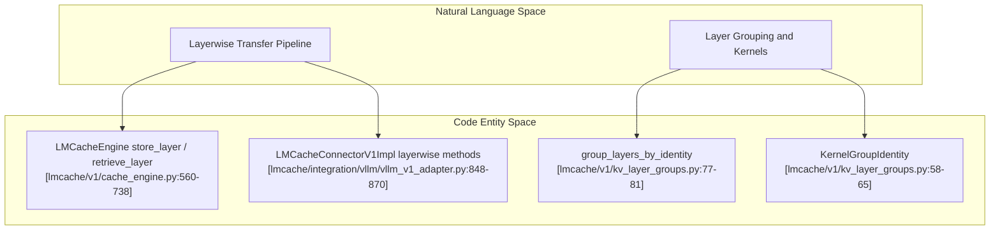
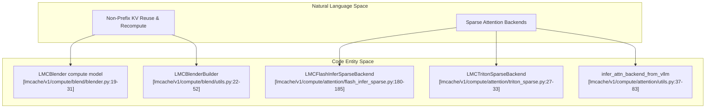

<!-- source: DeepWiki mcp.deepwiki.com · repo LMCache/LMCache · page 10 Advanced Features · fetched 2026-10-21 -->

# Advanced Features

Relevant source files

The following files were used as context for generating this wiki page:

- [lmcache/v1/compute/attention/__init__.py](lmcache/v1/compute/attention/__init__.py)
- [lmcache/v1/compute/attention/abstract.py](lmcache/v1/compute/attention/abstract.py)
- [lmcache/v1/compute/attention/flash_attn.py](lmcache/v1/compute/attention/flash_attn.py)
- [lmcache/v1/compute/attention/flash_infer_sparse.py](lmcache/v1/compute/attention/flash_infer_sparse.py)
- [lmcache/v1/compute/attention/metadata.py](lmcache/v1/compute/attention/metadata.py)
- [lmcache/v1/compute/attention/triton_kernels/__init__.py](lmcache/v1/compute/attention/triton_kernels/__init__.py)
- [lmcache/v1/compute/attention/triton_kernels/block_sparse_attention.py](lmcache/v1/compute/attention/triton_kernels/block_sparse_attention.py)
- [lmcache/v1/compute/attention/triton_sparse.py](lmcache/v1/compute/attention/triton_sparse.py)
- [lmcache/v1/compute/attention/utils.py](lmcache/v1/compute/attention/utils.py)
- [lmcache/v1/compute/blend/blender.py](lmcache/v1/compute/blend/blender.py)
- [lmcache/v1/compute/blend/utils.py](lmcache/v1/compute/blend/utils.py)
- [lmcache/v1/compute/models/base.py](lmcache/v1/compute/models/base.py)
- [lmcache/v1/compute/models/llama.py](lmcache/v1/compute/models/llama.py)
- [lmcache/v1/compute/models/qwen3.py](lmcache/v1/compute/models/qwen3.py)
- [lmcache/v1/compute/models/utils.py](lmcache/v1/compute/models/utils.py)

This page provides a high-level overview of specialized and advanced features in LMCache that extend core KV cache management beyond standard prefix store and retrieve operations. These features include layerwise KV transfer, cache blending, serialization formats, Multi-Level Attention (MLA) support, multimodal integration, and model architecture recipes. Each feature is opt-in via configuration flags and integrates through the core engine and multiprocess subsystems.

For storage backends, see [Storage Architecture](#4); for GPU data transfer mechanisms, see [GPU Memory Transfer](#6).

---

## 10.1 Layerwise KV Transfer

Standard KV cache offload typically transfers all transformer layers in a single blocking operation. Layerwise KV transfer breaks down this process into fine-grained, per-layer GPU-to-CPU copies interleaved with model forward execution. This approach significantly reduces idle GPU memory wait times by overlapping data transfer with computation.

Layers are grouped using kernel compatibility heuristics via `KernelGroupIdentity` and `group_layers_by_identity` functions to optimize transfer kernel invocations. The pipeline uses Python generator-based coroutines to manage the asynchronous transfer steps and CUDA stream synchronizations for efficient concurrency.

### Layerwise Transfer Code Mapping

Sources: [lmcache/v1/kv_layer_groups.py:58-81](), [lmcache/v1/cache_engine.py:560-738](), [lmcache/integration/vllm/vllm_v1_adapter.py:848-870]()

For configuration details and the generator pipeline, see [Layerwise KV Transfer](#10.1).

---

## 10.2 Cache Blending

Cache blending (`CacheBlend`) enables KV cache reuse even when prompt tokens are not strict prefixes—such as concatenated or reordered document chunks—by recomputing a subset of tokens at non-prefix boundaries. This is crucial for Retrieval-Augmented Generation (RAG) and similar workflows where input sequences concatenate multiple textual chunks.

Blending works by marking chunk boundaries with a special separator string (`LMCACHE_BLEND_SPECIAL_STR`), enabling LMCache to store and retrieve KV caches for individual chunks. The system coordinates via `LMCBlender` [lmcache/v1/compute/blend/blender.py:19-31]() and `LMCBlenderBuilder` [lmcache/v1/compute/blend/utils.py:22-52](), recomputing tokens at chunk boundaries based on configurable recomputation ratios to ensure output fidelity.

Sparse attention kernels such as `LMCFlashInferSparseBackend` [lmcache/v1/compute/attention/flash_infer_sparse.py:180-185]() and `LMCTritonSparseBackend` [lmcache/v1/compute/attention/triton_sparse.py:27-33](), managed via `infer_attn_backend_from_vllm` [lmcache/v1/compute/attention/utils.py:37-83](), optionally improve generation quality by applying specialized attention masks tuned for blending scenarios.

### Cache Blending Code Mapping

Sources: [lmcache/v1/compute/blend/blender.py:19-31](), [lmcache/v1/compute/blend/utils.py:22-52](), [lmcache/v1/compute/attention/flash_infer_sparse.py:180-185](), [lmcache/v1/compute/attention/triton_sparse.py:27-33](), [lmcache/v1/compute/attention/utils.py:37-83]()

For configuration usage and examples, see [Cache Blending](#10.2).

---

## 10.3 KV Cache Serialization and Compression

LMCache supports flexible serialization and compression strategies for KV cache remote storage and inter-process communication. Several serializers are implemented, including `naive` (raw), `cachegen`, `fp8` (floating-point 8-bit quantization), and `kivi`, with support for dynamic factory creation via `CreateSerde`.

Distributed serde wrappers handle multi-node coordination and format conversions. The `kv_codec` format defines the binary layout used for compressed and serialized KV data.

Usage of FP8 quantization halves disk storage requirements and is particularly effective for Hopper-era GPUs such as H100.

For details, see [KV Cache Serialization and Compression](#10.3).

Sources: [lmcache/v1/config.py:119](), [examples/README.md:78]()

---

## 10.4 Multi-Level Attention (MLA) Support

MLA models, like those using DeepSeek-V3 architectures, compress KV states into multi-level memory formats. LMCache automatically detects MLA mode and manages a specialized in-memory layout (`KV_MLA_FMT`) optimized for these models.

A unique feature is `remote_enable_mla_worker_id_as0`, which enables global sharing of certain cache keys across worker instances (usually worker ID 0), reducing duplication in distributed setups.

This MLA support enhances performance and cache efficiency on supported architectures by leveraging rank-aware key sharing and optimized memory access patterns.

For details on MLA detection and memory formats, see [Multi-Level Attention (MLA) Support](#10.4).

Sources: [lmcache/v1/memory_management.py:97](), [lmcache/v1/storage_backend/remote_backend.py:75-82]()

---

## 10.5 Multimodal Support

LMCache extends KV caching to multimodal models processing audio, image, or video inputs. Feature extraction replaces placeholder tokens with content-derived hash keys ensuring consistent cache lookups.

The caching mechanism supports token dropping and other custom token state management needed for sliding-window or compressed context scenarios in multimedia models.

For details on multimodal model integration, hash-based keying, and token dropping, see [Multimodal Support](#10.5).

Sources: [lmcache/integration/vllm/vllm_v1_adapter.py:111-193]()

---

## 10.6 Model Recipes

LMCache includes validated model architecture "recipes" ensuring compatibility and optimal performance with popular open-weight models. Recipes document engine-specific layout options, tensor formats, and enable hybrid or multi-backend KV caching strategies.

Examples include `LMCLlamaModel` [lmcache/v1/compute/models/llama.py:6-9]() and `LMCQwen3Model` [lmcache/v1/compute/models/qwen3.py:6-24]() inheriting from `LMCBaseModel` [lmcache/v1/compute/models/base.py:18-61]() and instantiated through the `infer_model_from_vllm` utility [lmcache/v1/compute/models/utils.py:14-35](), adapting LMCache to vLLM-native models transparently alongside model tracking via `VLLMModelTracker` [lmcache/v1/compute/models/utils.py:38-69]().

The `kv_cache_calculator/` example provides a web-based UI tool to estimate KV cache sizes in GB given a model's architecture, data type, and token count, aiding cache tier sizing before deployment.

For detailed recipes, configuration tabs, and tooling, see [Model Recipes](#10.6).

Sources: [examples/README.md:15-16](), [lmcache/v1/compute/models/utils.py:14-69](), [lmcache/v1/compute/models/llama.py:6-9](), [lmcache/v1/compute/models/qwen3.py:6-24](), [lmcache/v1/compute/models/base.py:18-61]()

---

This page summarizes advanced features that build upon core LMCache capabilities to improve latency, efficiency, and flexibility in KV cache serving for large language models. Each section corresponds to a dedicated child page with in-depth technical detail, usage guidelines, and code examples.

# References

- Layerwise KV Transfer: See [Layerwise KV Transfer](#10.1)
- Cache Blending: See [Cache Blending](#10.2)
- KV Cache Serialization: See [KV Cache Serialization and Compression](#10.3)
- Multi-Level Attention: See [Multi-Level Attention (MLA) Support](#10.4)
- Multimodal Support: See [Multimodal Support](#10.5)
- Model Recipes: See [Model Recipes](#10.6)

---

