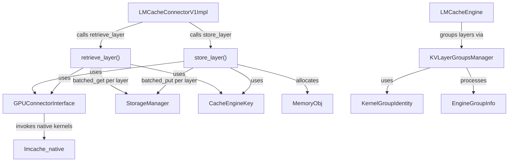
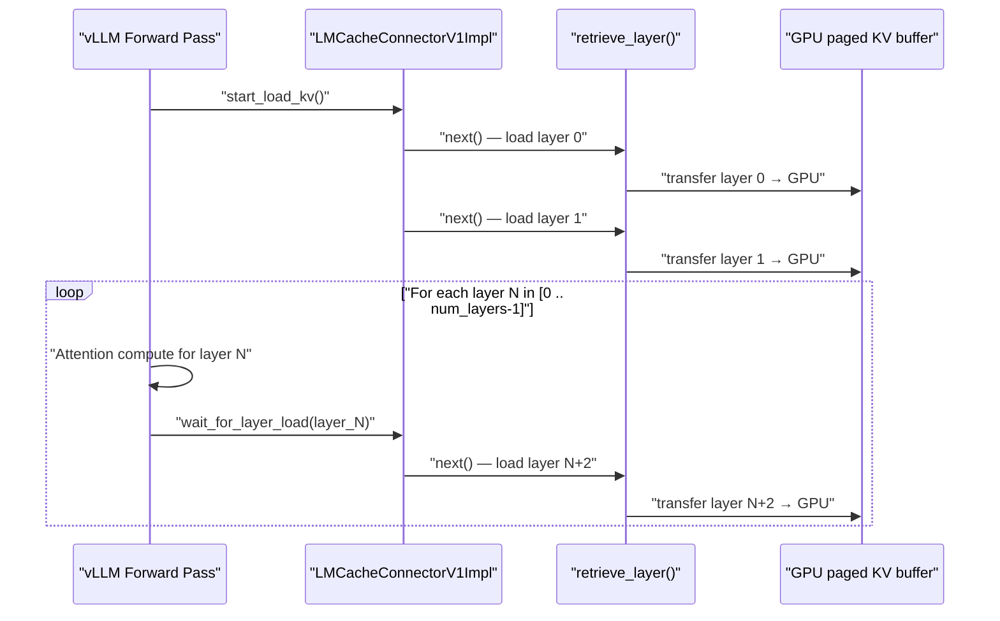
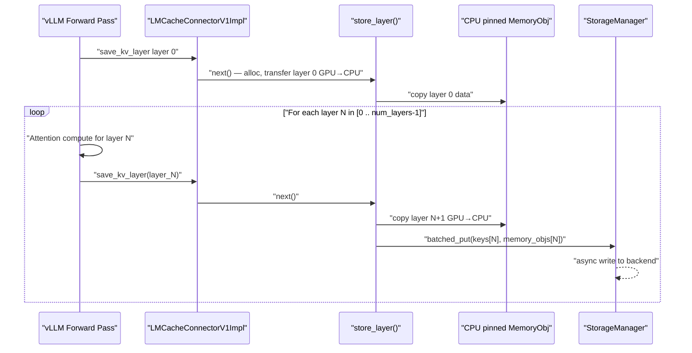
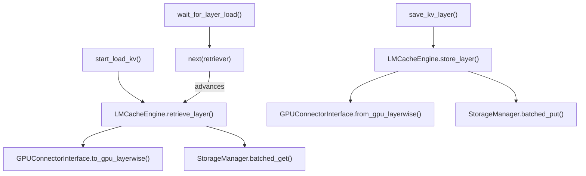

<!-- source: DeepWiki mcp.deepwiki.com · repo LMCache/LMCache · page 10.1 Layerwise KV Transfer · fetched 2026-10-21 -->

# Layerwise KV Transfer

<details>
<summary>Relevant source files</summary>

The following files were used as context for generating this wiki page:

- [benchmarks/musa/README.md](benchmarks/musa/README.md)
- [benchmarks/musa/bench_inprocess_transfer.py](benchmarks/musa/bench_inprocess_transfer.py)
- [docs/design/integration/vllm/kv_cache_group_edits.md](docs/design/integration/vllm/kv_cache_group_edits.md)
- [lmcache/integration/vllm/kv_cache_group_edits.py](lmcache/integration/vllm/kv_cache_group_edits.py)
- [lmcache/integration/vllm/kv_cache_groups.py](lmcache/integration/vllm/kv_cache_groups.py)
- [lmcache/usage_context.py](lmcache/usage_context.py)
- [lmcache/v1/gpu_connector/__init__.py](lmcache/v1/gpu_connector/__init__.py)
- [lmcache/v1/gpu_connector/gpu_connectors.py](lmcache/v1/gpu_connector/gpu_connectors.py)
- [lmcache/v1/gpu_connector/hpu_connector.py](lmcache/v1/gpu_connector/hpu_connector.py)
- [lmcache/v1/gpu_connector/kv_format/contiguity.py](lmcache/v1/gpu_connector/kv_format/contiguity.py)
- [lmcache/v1/gpu_connector/musa_connectors.py](lmcache/v1/gpu_connector/musa_connectors.py)
- [lmcache/v1/gpu_connector/utils.py](lmcache/v1/gpu_connector/utils.py)
- [lmcache/v1/gpu_connector/xpu_connectors.py](lmcache/v1/gpu_connector/xpu_connectors.py)
- [lmcache/v1/kv_layer_groups.py](lmcache/v1/kv_layer_groups.py)
- [lmcache/v1/multiprocess/group_view.py](lmcache/v1/multiprocess/group_view.py)
- [tests/benchmarks/test_musa_inprocess_benchmark.py](tests/benchmarks/test_musa_inprocess_benchmark.py)
- [tests/v1/gpu_connector/test_utils_shape_desc.py](tests/v1/gpu_connector/test_utils_shape_desc.py)
- [tests/v1/test_gpu_connector.py](tests/v1/test_gpu_connector.py)
- [tests/v1/test_kv_cache_groups.py](tests/v1/test_kv_cache_groups.py)
- [tests/v1/test_kv_layer_groups_manager.py](tests/v1/test_kv_layer_groups_manager.py)
- [tests/v1/test_mem_kernels.py](tests/v1/test_mem_kernels.py)
- [tests/v1/test_musa_connector.py](tests/v1/test_musa_connector.py)
- [tests/v1/test_musa_native.py](tests/v1/test_musa_native.py)
- [tests/v1/test_musa_support.py](tests/v1/test_musa_support.py)
- [tests/v1/test_vllm_kv_cache_group_edits.py](tests/v1/test_vllm_kv_cache_group_edits.py)
- [tests/v1/test_vllm_kv_cache_groups.py](tests/v1/test_vllm_kv_cache_groups.py)
- [tests/v1/utils.py](tests/v1/utils.py)

</details>


This page covers LMCache's layerwise Key-Value (KV) cache transfer mechanism, detailing its configuration, implementation, data flow, and interaction with GPU connectors and storage layers. Layerwise KV transfer breaks down the storage and retrieval of KV cache into per-transformer-layer operations, enabling overlap of IO with GPU computation to reduce latency during inference.

For a broader perspective, refer to **6. GPU Memory Transfer** for general GPU-CPU data movement patterns and to **2.1. LMCache Engine V1** for non-layerwise bulk transfer operations. Integration details with vLLM are documented under **3.1.3. Load and Save Operations**.

Sources: [lmcache/v1/cache_engine.py:340-531](), [lmcache/v1/config.py:121-125](), [lmcache/v1/kv_layer_groups.py:1-81](), [lmcache/v1/multiprocess/group_view.py:26-65](), [lmcache/integration/vllm/vllm_v1_adapter.py:640-770]()

---

## Overview

In the default (non-layerwise) KV cache transfer path, LMCache moves the entire KV cache for all transformer layers in one batched operation, either before inference (loading) or after inference (storing). This approach can cause blocking IO and increased latency.

The layerwise KV transfer approach decomposes the cache transfer by layers or layer groups, allowing pipeline parallelism with the transformer model's forward pass:

- **Retrieve (Load)**: While the transformer computes layer *N−1*, LMCache asynchronously loads layer *N*'s KV cache data from storage into GPU memory.
- **Store (Save)**: While the transformer computes layer *N+1*, LMCache copies layer *N*'s KV cache data from GPU memory to pinned CPU memory and triggers asynchronous storage backend writes.

This overlap reduces the wall-clock transfer time, improving throughput and responsiveness for large models with costly KV cache IO.

Enabling layerwise transfer is done by setting `use_layerwise=True` in the `LMCacheEngineConfig`. LMCache validates that the configured GPU connector supports layerwise operations during engine initialization by calling `assert_layerwise_gpu_connector` [lmcache/v1/gpu_connector/utils.py:71-94](). Additionally, platform restrictions apply, such as rejecting layerwise transfer on HPU builds [lmcache/v1/gpu_connector/__init__.py:52-57]() and XPU builds [lmcache/v1/gpu_connector/__init__.py:115-132]().

Sources: [lmcache/v1/cache_engine.py:340-531](), [lmcache/v1/config.py:121-125](), [lmcache/v1/gpu_connector/utils.py:71-94](), [lmcache/v1/gpu_connector/__init__.py:52-57](), [lmcache/v1/gpu_connector/__init__.py:115-132]()

---

## Configuration

| Parameter | Type | Default | Description |
|---|---|---|---|
| `use_layerwise` | bool | False | Enables layerwise KV transfer. |

This flag controls whether LMCache performs KV cache transfer in one bulk operation or pipelines it layer-by-layer during model execution.

Sources: [lmcache/v1/config.py:121-125](), [lmcache/v1/cache_engine.py:171]()

---

## Layer Groups and Metadata (`KVLayerGroupsManager`)

Layerwise KV transfer must correctly handle heterogeneous transformer architectures and cache layouts:

- Hybrid attention models mixing different KV cache groupings,
- Multi-Level Attention (MLA) key-only index caches,
- Sliding-window attention,
- Mamba/linear-attention snapshot layers.

LMCache abstracts these complexities by organizing KV cache layers into *kernel groups* and *object groups* managed by `KVLayerGroupsManager` [tests/v1/test_kv_layer_groups_manager.py:41-47](). This class builds kernel dispatch units that map to compatible batches of layers for transfer kernels.

Key concepts:

- **KernelGroupIdentity**: A tuple uniquely identifying a set of layers that can be transferred together using the same kernel parameters [lmcache/v1/kv_layer_groups.py:59-67](). It includes:

  ```
  (kv_size, num_heads, head_size, block_size, engine_group_idx, dtype, engine_kv_format)
  ```

  Here:
  - `engine_group_idx` identifies the distinct paged-block address space (e.g., a vLLM KV cache group) ensuring that layers from different engine groups don't get merged, even if shapes match.
  - `engine_kv_format` distinguishes different tensor layouts that may coexist within the same engine group.

- **EngineGroupInfo**: Represents one engine-level KV cache group with fields:
  - `engine_group_id`: Unique integer ID,
  - `layer_indices`: Indices of layers belonging to this group,
  - `tokens_per_block`: Number of logical tokens per block/page,
  - `sw_size_tokens`: Sliding window attention token size,
  - Other flags like `recurrent_state` indicating the type of state held.

- **group_layers_by_identity**: A function that partitions registered KV tensors into layer groups by their unique `LayerGroupIdentity` [lmcache/v1/kv_layer_groups.py:78-155](). It respects `EXCLUDED_ENGINE_GROUP` sentinel values to exclude cross-layer KV-sharing layers from grouping [lmcache/v1/kv_layer_groups.py:75-136]().

This layered grouping abstraction drives the granularity and correctness of the layerwise transfer pipeline.

Sources: [lmcache/v1/kv_layer_groups.py:59-155](), [lmcache/v1/multiprocess/group_view.py:26-65](), [tests/v1/test_kv_layer_groups_manager.py:41-47]()

---

## Key Data Structures and Generators

### Layerwise Transfer API in `LMCacheEngine`

Layerwise data transfer is implemented using Python generator coroutines, which allow incremental transfer and interleaving with the hosting serving engine's execution loop.

- **`store_layer` generator**: Yields control after scheduling transfers per layer from GPU to CPU and starting storage backend writes [lmcache/v1/cache_engine.py:350-410]().
- **`retrieve_layer` generator**: Yields control after scheduling retrievals per layer from storage to GPU [lmcache/v1/cache_engine.py:465-520]().

The generators are advanced externally by the serving engine integration handler on each layer boundary.

### Integration State

In the vLLM integration (`LMCacheConnectorV1Impl`), active generators for requests are stored in:

- `layerwise_retrievers`: Maps request IDs to `retrieve_layer` generator instances.
- `_layerwise_save_storers`: Maps request IDs to `store_layer` generator instances.

These dictionaries allow request-scoped management and coordination of layered pipeline stages [lmcache/integration/vllm/vllm_v1_adapter.py:403-404]().

Sources: [lmcache/v1/cache_engine.py:350-530](), [lmcache/integration/vllm/vllm_v1_adapter.py:400-410]()

---

## Component Diagram

### Layerwise KV Transfer — Code Component Relationship



Sources: [lmcache/v1/cache_engine.py:340-531](), [lmcache/integration/vllm/vllm_v1_adapter.py:400-410](), [lmcache/v1/kv_layer_groups.py:1-81](), [lmcache/v1/multiprocess/group_view.py:26-65]()

---

## Load (Retrieval) Path

### `LMCacheEngine.retrieve_layer`

The `retrieve_layer` method is a generator that loads KV cache data layer-by-layer from storage into GPU memory [lmcache/v1/cache_engine.py:465-520](). For each layer:

1. It calls `storage_manager.batched_get` to fetch a `MemoryObj` containing the KV data.
2. It uses `gpu_connector.to_gpu_layerwise` to copy the layer's data into the GPU KV cache at the correct offset.
3. Yields control back to the caller to allow interleaving with model computation.

This generator thus pipelines data retrieval with inference.

### vLLM Integration: `start_load_kv`

In vLLM, `start_load_kv` initializes retrieval for a given request [lmcache/integration/vllm/vllm_v1_adapter.py:642-710]().

- It creates the `retrieve_layer` generator per request.
- Pre-fetches the first two layers by advancing the generator twice to enable double-buffered transfer overlapping with compute.

### vLLM Integration: `wait_for_layer_load`

Before executing each transformer layer, vLLM calls `wait_for_layer_load` [lmcache/integration/vllm/vllm_v1_adapter.py:734-755]().

- This advances each request's retrieval generator to schedule the next layer's retrieval concurrently with the ongoing layer's attention computation.

Sources: [lmcache/v1/cache_engine.py:465-520](), [lmcache/integration/vllm/vllm_v1_adapter.py:640-770]()

---

## Retrieval Timeline

### Layerwise retrieval overlapped with vLLM forward pass



Sources: [lmcache/integration/vllm/vllm_v1_adapter.py:640-770](), [lmcache/v1/cache_engine.py:465-520]()

---

## Store Path

### `LMCacheEngine.store_layer`

The `store_layer` method is a generator that pipelines storing KV cache layer-by-layer from GPU memory to CPU pinned memory and then asynchronously to backend storage [lmcache/v1/cache_engine.py:350-410]().

Initialization phase:

1. Uses `token_database.process_tokens` to identify chunks/tokens to store and generate cache keys [lmcache/v1/cache_engine.py:361-365]().
2. Allocates `MemoryObj` pinned CPU buffers for each layer's data of size `kv_size` [lmcache/v1/cache_engine.py:378-382]().
3. Initiates layer 0's transfer from GPU to CPU via `gpu_connector.from_gpu_layerwise` [lmcache/v1/cache_engine.py:387-391]().

Pipelined loop:

- Upon `yield`, control returns to the serving engine to compute the current layer.
- On the next `next()` call, GPU→CPU transfer for the next layer starts and an asynchronous `storage_manager.batched_put` writes the prior layer to backend storage [lmcache/v1/cache_engine.py:410-417]().

### vLLM Integration: `save_kv_layer`

vLLM calls `save_kv_layer` after each transformer layer completes [lmcache/integration/vllm/vllm_v1_adapter.py:808-840]().

- This method advances the `store_layer` generator for that request to trigger the next step of KV cache storage.

Sources: [lmcache/integration/vllm/vllm_v1_adapter.py:808-840](), [lmcache/v1/cache_engine.py:350-410]()

---

## Store Timeline

### Layerwise store overlapped with vLLM forward pass



Sources: [lmcache/integration/vllm/vllm_v1_adapter.py:808-840](), [lmcache/v1/cache_engine.py:350-410]()

---

## GPU Connector and CUDA Stream Synchronization

Layerwise transfer enforces constraints on the GPU connector to ensure it supports:

- Layer-by-layer segmented transfers,
- Generator-based control flow with `send()`/`next()` semantics,
- Synchronization of CUDA streams to maintain correct ordering between transfers and computation.

LMCache asserts the GPU connector supports layerwise transfer at runtime via `assert_layerwise_gpu_connector` [lmcache/v1/gpu_connector/utils.py:71-94]().

When `save_only_first_rank` is enabled (common in MLA mode), a dedicated `broadcast_stream` is used to synchronize data across worker ranks before layer writes [lmcache/v1/cache_engine.py:123-127](). This stream is typically derived from the connector's `load_stream`, ensuring data is properly propagated before asynchronous storage.

The `StorageManager` uses methods like `allocate_and_copy_objects` to asynchronously move data between devices with proper stream synchronization and calls `stream.synchronize()` once the copy is complete to ensure consistency before backend writes [lmcache/v1/storage_backend/storage_manager.py:64-120]().

This CUDA stream management ensures that layerwise KV transfers do not interfere with ongoing GPU computation, enabling smooth pipelining.

Sources: [lmcache/v1/gpu_connector/utils.py:71-94](), [lmcache/v1/cache_engine.py:123-127](), [lmcache/v1/storage_backend/storage_manager.py:64-120]()

---

## Summary of Call Graph

### Layerwise store/retrieve call graph (with code entities)



Sources: [lmcache/integration/vllm/vllm_v1_adapter.py:640-840](), [lmcache/v1/cache_engine.py:340-530]()

---

# Summary

The layerwise KV cache transfer feature in LMCache breaks KV data storage and retrieval into per-transformer-layer chunks. It uses generator-based APIs in `LMCacheEngine` (`store_layer` and `retrieve_layer`), works with `KVLayerGroupsManager` to identify layer groups by cache layout, and requires GPU connectors that support segmented layer transfer. This pipeline design enables significant IO/compute overlap during inference, reducing effective latency and improving throughput in large LLM serving scenarios like vLLM.

Sources: [lmcache/v1/cache_engine.py:340-530](), [lmcache/v1/kv_layer_groups.py:1-155]()

---

# References

- LMCache Engine layerwise store/gen API: `lmcache/v1/cache_engine.py` lines 340-530.
- GPU connector interfaces and layerwise assertions: `lmcache/v1/gpu_connector/gpu_connectors.py` and `lmcache/v1/gpu_connector/utils.py`.
- Layer grouping and kernel dispatch units: `lmcache/v1/kv_layer_groups.py`.
- Engine group metadata and views: `lmcache/v1/multiprocess/group_view.py`.
- vLLM integration adapter handling layerwise transfer: `lmcache/integration/vllm/vllm_v1_adapter.py`.
- StorageManager batched put/get and stream synchronization: `lmcache/v1/storage_backend/storage_manager.py`.

Sources: All above.

---

