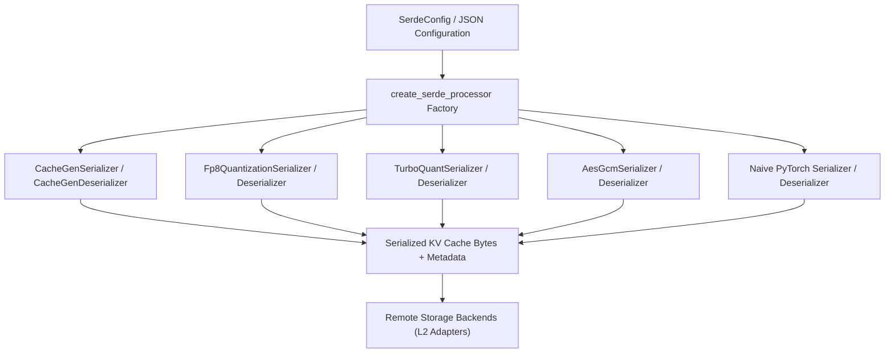

<!-- source: DeepWiki mcp.deepwiki.com · repo LMCache/LMCache · page 10.3 KV Cache Serialization and Compression · fetched 2026-10-21 -->

# KV Cache Serialization and Compression

<details>
<summary>Relevant source files</summary>

The following files were used as context for generating this wiki page:

- [docs/design/v1/distributed/serde/aesgcm.md](docs/design/v1/distributed/serde/aesgcm.md)
- [docs/design/v1/distributed/serde/turboquant.md](docs/design/v1/distributed/serde/turboquant.md)
- [docs/source/mp/serde.rst](docs/source/mp/serde.rst)
- [examples/serde/aesgcm/README.md](examples/serde/aesgcm/README.md)
- [examples/serde/aesgcm/run_serde_aesgcm_example.sh](examples/serde/aesgcm/run_serde_aesgcm_example.sh)
- [examples/serde/turboquant/README.md](examples/serde/turboquant/README.md)
- [examples/serde/turboquant/bench_serde_baselines.py](examples/serde/turboquant/bench_serde_baselines.py)
- [examples/serde/turboquant/bench_turboquant.py](examples/serde/turboquant/bench_turboquant.py)
- [lmcache/storage_backend/serde/__init__.py](lmcache/storage_backend/serde/__init__.py)
- [lmcache/storage_backend/serde/cachegen_basics.py](lmcache/storage_backend/serde/cachegen_basics.py)
- [lmcache/storage_backend/serde/cachegen_decoder.py](lmcache/storage_backend/serde/cachegen_decoder.py)
- [lmcache/storage_backend/serde/cachegen_encoder.py](lmcache/storage_backend/serde/cachegen_encoder.py)
- [lmcache/storage_backend/serde/serde.py](lmcache/storage_backend/serde/serde.py)
- [lmcache/v1/distributed/serde/__init__.py](lmcache/v1/distributed/serde/__init__.py)
- [lmcache/v1/distributed/serde/aesgcm.py](lmcache/v1/distributed/serde/aesgcm.py)
- [lmcache/v1/distributed/serde/key_provider.py](lmcache/v1/distributed/serde/key_provider.py)
- [lmcache/v1/distributed/serde/turboquant/__init__.py](lmcache/v1/distributed/serde/turboquant/__init__.py)
- [lmcache/v1/distributed/serde/turboquant/decode_kernel.py](lmcache/v1/distributed/serde/turboquant/decode_kernel.py)
- [lmcache/v1/distributed/serde/turboquant/store_kernel.py](lmcache/v1/distributed/serde/turboquant/store_kernel.py)
- [lmcache/v1/distributed/serde/turboquant/turboquant.py](lmcache/v1/distributed/serde/turboquant/turboquant.py)
- [tests/benchmarks/test_benchmark.py](tests/benchmarks/test_benchmark.py)
- [tests/benchmarks/test_cachegen.py](tests/benchmarks/test_cachegen.py)
- [tests/test_serde.py](tests/test_serde.py)
- [tests/v1/distributed/serde/test_aesgcm.py](tests/v1/distributed/serde/test_aesgcm.py)
- [tests/v1/distributed/serde/test_turboquant.py](tests/v1/distributed/serde/test_turboquant.py)

</details>


## Purpose and Scope

This document details LMCache's KV cache serialization and compression subsystem. Its function is to transform raw KV cache tensors used by large language models (LLMs) into compact byte streams for efficient remote storage and network transmission. The serialization preserves tensor metadata such as shape, dtype, and memory format, while supporting configurable serialization and compression options.

LMCache supports multiple serialization methods selectable via the `remote_serde` configuration option or per-adapter `serde` settings. The system also includes a factory mechanism (`create_serde_processor`), distributed serialization wrappers for asynchronous and debug instrumentation, and protocol-level metadata encoding referred to as the `kv_codec` format.

Sources: `[lmcache/storage_backend/serde/serde.py:16-75]`, `[lmcache/storage_backend/serde/cachegen_encoder.py:16-182]`, `[lmcache/storage_backend/serde/cachegen_decoder.py:16-191]`, `[lmcache/v1/distributed/serde/__init__.py:15-75]`


---

## Serialization Architecture

The serialization subsystem provides a standardized abstraction for converting `torch.Tensor` objects into byte streams (`bytes`) and back. It relies on the following components:

- **Serializer (abstract base class)**: Defines the interface for serializers implementing `to_bytes(t: torch.Tensor) -> bytes` [lmcache/storage_backend/serde/serde.py:16-30]().

- **Deserializer (abstract base class)**: Defines the interface for deserializers implementing `from_bytes(bs: bytes) -> torch.Tensor` [lmcache/storage_backend/serde/serde.py:46-61]().

- **Debug Wrappers**: `SerializerDebugWrapper` and `DeserializerDebugWrapper` wrap serializers and deserializers to provide logging of execution time and NVTX annotations for GPU profiling [lmcache/storage_backend/serde/serde.py:33-75]().

- **Concrete Implementations**: Various serialization formats implement these interfaces, including CacheGen, FP8 quantization, TurboQuant, AES-GCM encryption, and naive PyTorch serialization.

### System Components and Code Mapping

```mermaid
graph TB
    subgraph "NaturalLanguageSpace"
        TensorInput["Input KV Tensor"]
        SerializerProc["Serializer / Deserializer abstraction"]
        FormatImpl["Format-specific Implementations (CacheGen, FP8, TurboQuant, AESGCM, Naive)"]
    end
    
    subgraph "CodeEntitySpace"
        SerializerClass["Serializer (lmcache/storage_backend/serde/serde.py)"]
        DeserializerClass["Deserializer (lmcache/storage_backend/serde/serde.py)"]
        CacheGenEnc["CacheGenSerializer (lmcache/storage_backend/serde/cachegen_encoder.py)"]
        CacheGenDec["CacheGenDeserializer (lmcache/storage_backend/serde/cachegen_decoder.py)"]
        FP8Serializer["Fp8QuantizationSerializer (lmcache/v1/distributed/serde/fp8.py)"]
        FP8Deserializer["Fp8QuantizationDeserializer (lmcache/v1/distributed/serde/fp8.py)"]
        TurboSerializer["TurboQuantSerializer (lmcache/v1/distributed/serde/turboquant/turboquant.py)"]
        TurboDeserializer["TurboQuantDeserializer (lmcache/v1/distributed/serde/turboquant/turboquant.py)"]
        AESGcmSerializer["AesGcmSerializer (lmcache/v1/distributed/serde/aesgcm.py)"]
        AESGcmDeserializer["AesGcmDeserializer (lmcache/v1/distributed/serde/aesgcm.py)"]
        NaiveSerializer["NaiveSerializer (default PyTorch)"]
        NaiveDeserializer["NaiveDeserializer (default PyTorch)"]
        SerdeFactory["create_serde_processor factory (lmcache/v1/distributed/serde/factory.py)"]
        MetaStruct["LMCacheMetadata (lmcache/v1/metadata.py)"]
    end

    TensorInput --> SerializerClass
    SerializerClass --> FormatImpl
    DeserializerClass --> FormatImpl

    FormatImpl --> CacheGenEnc
    FormatImpl --> CacheGenDec
    FormatImpl --> FP8Serializer
    FormatImpl --> FP8Deserializer
    FormatImpl --> TurboSerializer
    FormatImpl --> TurboDeserializer
    FormatImpl --> AESGcmSerializer
    FormatImpl --> AESGcmDeserializer
    FormatImpl --> NaiveSerializer
    FormatImpl --> NaiveDeserializer

    SerdeFactory --> FormatImpl
    SerdeFactory --> MetaStruct
```



This diagram shows how the conceptual KV cache serialization maps to concrete implementations in the codebase including CacheGen, FP8, TurboQuant, AES-GCM, and naive serialization, all managed by a serde processor factory that creates instances from configuration.

Sources: `[lmcache/storage_backend/serde/serde.py:16-75]`, `[lmcache/storage_backend/serde/cachegen_encoder.py:16-182]`, `[lmcache/storage_backend/serde/cachegen_decoder.py:16-191]`, `[lmcache/v1/distributed/serde/__init__.py:15-75]`, `[lmcache/v1/metadata.py]`


### Core Classes and Interfaces

| Class                  | Location                                         | Description                                              |
|------------------------|--------------------------------------------------|----------------------------------------------------------|
| `Serializer`           | `[lmcache/storage_backend/serde/serde.py:16-30]` | Abstract base class defining `to_bytes(torch.Tensor)->bytes` interface. |
| `Deserializer`         | `[lmcache/storage_backend/serde/serde.py:46-61]` | Abstract base class defining `from_bytes(bytes)->torch.Tensor` interface. |
| `SerializerDebugWrapper`   | `[lmcache/storage_backend/serde/serde.py:33-43]` | Wrapper adding timing logging and NVTX annotations to serializers.  |
| `DeserializerDebugWrapper` | `[lmcache/storage_backend/serde/serde.py:64-75]` | Wrapper adding timing logging and NVTX annotations to deserializers. |
| `CacheGenSerializer`   | `[lmcache/storage_backend/serde/cachegen_encoder.py:139-182]` | Custom compression format optimized for LLM KV cache encoding on GPUs. |
| `CacheGenDeserializer` | `[lmcache/storage_backend/serde/cachegen_decoder.py:116-191]` | Decoder complement to CacheGenSerializer, performing GPU-accelerated decoding. |
| `Fp8QuantizationSerializer` / `Deserializer` | `[lmcache/v1/distributed/serde/fp8.py]` | Serialize/de-serialize tensors quantized to custom 8-bit float format for compression. |
| `TurboQuantSerializer` / `Deserializer`     | `[lmcache/v1/distributed/serde/turboquant/turboquant.py]` | GPU-accelerated encode/decode of KV cache using Triton with configurable presets. |
| `AesGcmSerializer` / `Deserializer`         | `[lmcache/v1/distributed/serde/aesgcm.py]` | Authenticated AES-GCM encryption layer wrapping serialized cache bytes for secure at-rest encryption. |
| `NaiveSerializer` / `Deserializer`          | Default PyTorch serialization (pickle/torch.save) without compression. |

Sources: `[lmcache/storage_backend/serde/serde.py:16-75]`, `[lmcache/storage_backend/serde/cachegen_encoder.py:139-182]`, `[lmcache/storage_backend/serde/cachegen_decoder.py:116-191]`, `[lmcache/v1/distributed/serde/__init__.py:15-75]`


---

## Serialization Formats (`remote_serde`)

LMCache supports multiple serialization and compression formats, selectable globally or per L2 adapter with the `remote_serde` or `serde` configuration key.

| Format      | Description                                                                                             | Use Cases / Notes                                                     |
|-------------|---------------------------------------------------------------------------------------------------------|----------------------------------------------------------------------|
| `naive`     | Default PyTorch serialization (pickle/torch.save)                                                      | Simple fallback, universal compatibility, no compression.           |
| `cachegen`  | Custom GPU-accelerated compression optimized for LLM KV caches with model-aware quantization and entropy coding. | Major compression ratio, fast encoding/decoding on GPU.              |
| `fp8`       | Quantizes tensors to 8-bit float types (e.g. `float8_e4m3fn`) and recovers float tensors on decode.     | Good compression ratio with moderate loss, hardware accelerated on supported devices. |
| `kivi`      | Hybrid quantization format with specialized key/value compression.                                     | Intermediate compression type, specific to some KV settings.         |
| `turboquant`| GPU-accelerated compression using Triton kernels with presets combining FP8 keys and 3/4-bit value quantization. | Triton-based high-performance compressor with several preset configs, e.g. `turboquant_k8v4`. |
| `aesgcm`    | Authenticated AES-GCM encryption wrapper encrypting KV cache bytes on remote storage.                   | Secure at-rest encryption with per-tenant keys derived from master key. |

### Example adapter serde config

```json
{
  "l2-adapter": {
    "type": "fs",
    "base_path": "/data/lmcache/l2",
    "serde": {
      "type": "fp8",
      "fp8_dtype": "float8_e4m3fn",
      "max_workers": 2
    }
  }
}
```

This structure enables flexible selection and configuration of serde formats per remote storage adapter.

Sources: `[docs/source/mp/serde.rst:1-209]`, `[tests/benchmarks/test_benchmark.py:120-121]`


---

## CacheGen: Architecture and Implementation

CacheGen serialization is an efficient compression format specialized for large LLM KV caches processed on GPU.

### Data Flow and Pipeline Overview

```mermaid
graph TD
    subgraph CacheGen_Encoding
        RawKV["Raw KV Tensor (shape: [num_layers, 2, num_tokens, num_heads, head_size])"]
        SplitKV["_split_kv() splits KV tensor into K and V"]
        Quant["torch_quant_vectorized() quantizes per layer"]
        CDFComp["compute_cdf() computes cumulative distribution functions for entropy encoding"]
        GPUEncode["device_ops.encode_fast_prefsum() GPU-accelerated entropy coder"]
        EncodeOutput["CacheGenGPUEncoderOutput dataclass with encoded bytes and metadata"]
        
        RawKV --> SplitKV --> Quant --> CDFComp --> GPUEncode --> EncodeOutput
    end
    
    subgraph CacheGen_Decoding
        EncBytes["CacheGenGPUEncoderOutput bytes"]
        DecodeChunk["decode_chunk() decodes byte streams to tensors"]
        Dequant["do_dequantize() restores float tensors from quantized form"]
        KVReconstructed["Reconstructed KV Tensor (float)"]
        
        EncBytes --> DecodeChunk --> Dequant --> KVReconstructed
    end
```



- **Encoding Steps:**

  1. Split original KV blob tensor into separate key and value tensors with merged heads [_split_kv()] [lmcache/storage_backend/serde/cachegen_encoder.py:85-101]().
  
  2. Quantize keys and values per layer range using configurable bins using `torch_quant_vectorized()` [lmcache/storage_backend/serde/cachegen_encoder.py:26-71]().

  3. Compute CDFs for entropy coding based on quantized distributions [lmcache/storage_backend/serde/cachegen_encoder.py:184-198]().

  4. Encode using GPU-accelerated prefix sum entropy encoding via `device_ops.encode_fast_prefsum()` [lmcache/storage_backend/serde/cachegen_encoder.py:140-182]().

- **Decoding is the reverse**, using GPU accelerated entropy decoding and float recovery [lmcache/storage_backend/serde/cachegen_decoder.py:58-113]().

### Quantization Strategy

- Key and value layer groups are quantized according to `CacheGenConfig`, tuned per known model families with different bins per layer strata (e.g., first 10 layers have 32 bins, next 20 layers 16 bins). This balances compression and accuracy [lmcache/storage_backend/serde/cachegen_basics.py:32-136]().

- Each layer's tensor is quantized relative to per-layer max absolute values, using fixed bins (int8) shifted to be zero-centered [lmcache/storage_backend/serde/cachegen_encoder.py:26-71]().

- The cumulative distribution functions calculated from quantized values are used for efficient entropy coding [lmcache/storage_backend/serde/cachegen_encoder.py:184-198]().

- The serialized output is encapsulated in `CacheGenGPUEncoderOutput` holding bytestream bytes, start indices, CDF tensors, max tensor values per layer, and metadata like `num_heads` and `head_size` [lmcache/storage_backend/serde/cachegen_basics.py:139-201]().

Sources: `[lmcache/storage_backend/serde/cachegen_encoder.py:26-71, 139-182]`, `[lmcache/storage_backend/serde/cachegen_decoder.py:32-113]`, `[lmcache/storage_backend/serde/cachegen_basics.py:32-136]`


---

## Distributed Serde Wrappers and `create_serde_processor` Factory

LMCache supports distributed and asynchronous serialization/deserialization through a factory-based dynamic codec instantiation design and wrapper classes.

- **`create_serde_processor` Factory:** A centralized registry and factory creating serde processor instances (serializer + deserializer) by serde `type` strings and config dictionaries, enabling pluggable serde implementations [lmcache/v1/distributed/serde/factory.py] and exposed via the `create_serde_processor` interface [lmcache/v1/distributed/serde/__init__.py:15-75]().

- **Distributed Wrappers:** To enable parallel processing, asynchronous execution, or instrumentation for profiling, LMCache offers wrappers around the base serializers/deserializers which can be layered without modifying the core logic.

- **Debug instrumentation wrappers (`SerializerDebugWrapper`, `DeserializerDebugWrapper`)** log serialization/deserialization times and integrate NVTX annotations for GPU profiling [lmcache/storage_backend/serde/serde.py:33-75]().

- **Integration:** These serde processors are used per remote/L2 adapter enabling multi-tenant, multi-format, and asynchronous serialization customized per storage backend [tests/v1/distributed/serde/test_serde_e2e.py:38-41]().

This layered factory and wrapper design achieves flexibility, modularity, and operational observability.

Sources: `[lmcache/storage_backend/serde/serde.py:33-75]`, `[lmcache/v1/distributed/serde/__init__.py:15-75]`, `[tests/v1/distributed/serde/test_serde_e2e.py:38-41]`


---

## KV Codec Format

The serialized KV cache data, regardless of serialization format, follows a codec encoding scheme detailed below that captures both data and metadata:

- **Serialized bytes (payload):** Compressed or encoded bytes specific to the selected serde format (e.g., CacheGen's entropy-coded bytestream, FP8 quantized bytes, or TurboQuant's packed bytes).

- **Metadata:** Includes shape parameters, data type, layout information (number of layers, tokens, heads, head size), and any compression quantization parameters.

- **KV Dtype and Memory Format:** LMCache expects consistent tensor shapes and dtypes matching the model's key/value cache layout. The `kv_codec` format maintains this consistency and allows versioning for future codec evolutions.

- **Techniques:** Format-specific codecs may use layerwise quantization specs, chunking (e.g., CacheGen's max tokens per chunk = 256), preamble bytes, and encoding of start indices or CDFs for entropy decoding [lmcache/storage_backend/serde/cachegen_basics.py:18-201](), [lmcache/storage_backend/serde/cachegen_decoder.py:116-151]().

- **Extensions:** Serde layers such as AES-GCM add encryption metadata and keys wrapped around base codec bytes transparently.

This codec layering supports interoperability between LMCache components and remote backends.

Sources: `[lmcache/storage_backend/serde/cachegen_basics.py:18-201]`, `[lmcache/storage_backend/serde/cachegen_decoder.py:116-151]`, `[lmcache/v1/distributed/serde/aesgcm.py]`


---

## Summary Table: Serialization Formats

| Format      | Compression Ratio         | Backend Target      | Key Implementationnotes                                    |
|-------------|--------------------------|---------------------|------------------------------------------------------------|
| naive       | ~1x (Raw, no compression)| CPU/GPU Storage     | PyTorch pickle-based serialization, simplest, universal.  |
| cachegen    | ~4–8x                    | GPU-accelerated      | Model-aware quantization, GPU-accelerated entropy coder.  |
| fp8         | ~2x                      | CPU/GPU              | 8-bit floating point quantization, lossily compressed.    |
| turboquant  | ~2–4x                    | GPU accelerated      | Triton kernel-based quantization and decode with presets. |
| kivi        | Hybrid                   | CPU/GPU              | Key/value hybrid quantization scheme.                      |
| aesgcm      | No compress, encryption  | Any (secure storage) | Authenticated encryption wrapper atop another serde.      |


---

# Summary Diagram: Serialization Formats and Distributed Adapter Integration



This diagram illustrates the workflow from serde configuration through creation of format-specific serializers and deserializers, which produce serialized bytes stored in remote backends.

Sources: `[lmcache/storage_backend/serde/cachegen_encoder.py:139-182]`, `[lmcache/v1/distributed/serde/__init__.py:15-75]`, `[docs/source/mp/serde.rst:1-209]`


---

# End of Section 10.3: KV Cache Serialization and Compression

---

