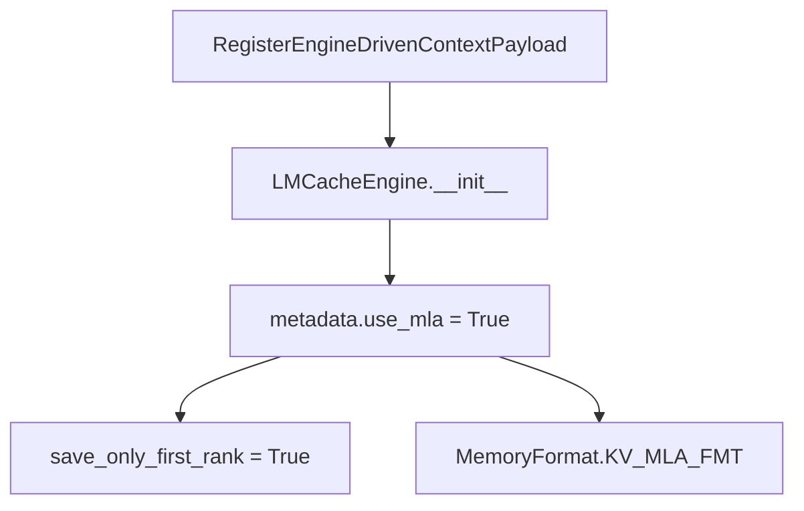
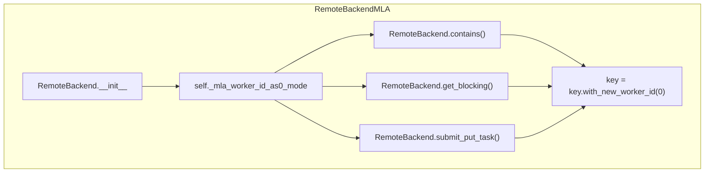
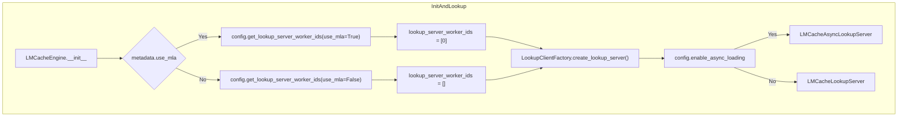
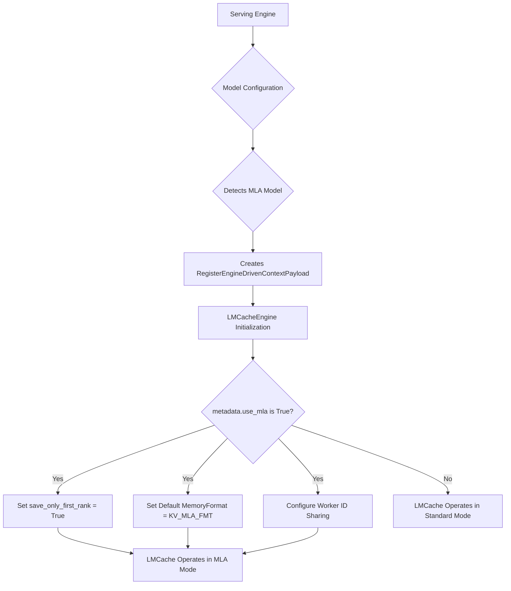
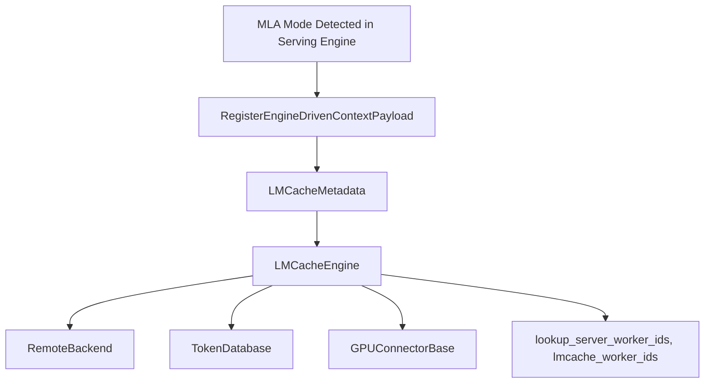
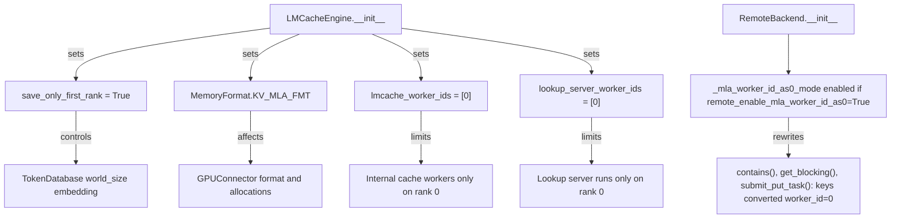

<!-- source: DeepWiki mcp.deepwiki.com · repo LMCache/LMCache · page 10.4 Multi-Level Attention (MLA) Support · fetched 2026-10-21 -->

# Multi-Level Attention (MLA) Support

<details>
<summary>Relevant source files</summary>

The following files were used as context for generating this wiki page:

- [docs/source/kv_cache/storage_backends/nixl.rst](docs/source/kv_cache/storage_backends/nixl.rst)
- [lmcache/observability.py](lmcache/observability.py)
- [lmcache/v1/memory_management.py](lmcache/v1/memory_management.py)
- [lmcache/v1/storage_backend/__init__.py](lmcache/v1/storage_backend/__init__.py)
- [lmcache/v1/storage_backend/abstract_backend.py](lmcache/v1/storage_backend/abstract_backend.py)
- [lmcache/v1/storage_backend/local_cpu_backend.py](lmcache/v1/storage_backend/local_cpu_backend.py)
- [lmcache/v1/storage_backend/local_disk_backend.py](lmcache/v1/storage_backend/local_disk_backend.py)
- [lmcache/v1/storage_backend/nixl_storage_backend.py](lmcache/v1/storage_backend/nixl_storage_backend.py)
- [lmcache/v1/storage_backend/remote_backend.py](lmcache/v1/storage_backend/remote_backend.py)
- [lmcache/v1/storage_backend/storage_manager.py](lmcache/v1/storage_backend/storage_manager.py)
- [tests/disagg/README.md](tests/disagg/README.md)
- [tests/disagg/test_nixl_cache_engine.py](tests/disagg/test_nixl_cache_engine.py)
- [tests/disagg/test_nixl_channel.py](tests/disagg/test_nixl_channel.py)
- [tests/disagg/test_nixl_storage_backend.py](tests/disagg/test_nixl_storage_backend.py)
- [tests/test_observability.py](tests/test_observability.py)
- [tests/v1/data/nixl.yaml](tests/v1/data/nixl.yaml)
- [tests/v1/data/nixl_multipath.yaml](tests/v1/data/nixl_multipath.yaml)
- [tests/v1/storage_backend/test_fs_connector.py](tests/v1/storage_backend/test_fs_connector.py)
- [tests/v1/storage_backend/test_local_cpu_backend.py](tests/v1/storage_backend/test_local_cpu_backend.py)
- [tests/v1/storage_backend/test_local_disk_backend.py](tests/v1/storage_backend/test_local_disk_backend.py)
- [tests/v1/storage_backend/test_storage_manager.py](tests/v1/storage_backend/test_storage_manager.py)
- [tests/v1/test_address_manager.py](tests/v1/test_address_manager.py)
- [tests/v1/test_memory_management.py](tests/v1/test_memory_management.py)
- [tests/v1/test_nixl_batched_contains.py](tests/v1/test_nixl_batched_contains.py)
- [tests/v1/test_nixl_doca_memos.py](tests/v1/test_nixl_doca_memos.py)
- [tests/v1/test_nixl_multipath.py](tests/v1/test_nixl_multipath.py)
- [tests/v1/test_nixl_put_refcount.py](tests/v1/test_nixl_put_refcount.py)
- [tests/v1/test_nixl_storage.py](tests/v1/test_nixl_storage.py)
- [tests/v1/test_remote_mla_worker_id_as0.py](tests/v1/test_remote_mla_worker_id_as0.py)

</details>


## Purpose and Scope

This page documents LMCache's support for Multi-Level Attention (MLA), an advanced attention mechanism architecture that compresses Key-Value (KV) cache representations into a single combined tensor instead of separate Key and Value tensors. MLA reduces memory footprint and storage bandwidth significantly while preserving attention quality.

This page covers detailed aspects including:
- MLA mode detection through metadata and engine integrations.
- The specialized `KV_MLA_FMT` memory format and its usage.
- The `remote_enable_mla_worker_id_as0` feature enabling worker ID rewriting for shared key usage.
- Worker rank 0 key sharing strategies for distributed TPU/TP environments.
- Relevant configuration options and their defaults.
- Core functions, classes, and data flow related to MLA support within LMCache.

Sources: [lmcache/v1/memory_management.py:98-99](), [lmcache/v1/storage_backend/remote_backend.py:75-82](), [lmcache/v1/config.py:301-305]()

---

## Overview

Multi-Level Attention is implemented in some newer transformer architectures (e.g., DeepSeek-V2/V3) that compress KV caches into a single-layer tensor versus traditional dual K/V cache tensors.

| Aspect | Traditional MHA KV Cache | MLA KV Cache |
| :-------------------| :-----------------------------------| :-----------------------------------|
| KV Storage | Separate Key and Value tensors | Single combined KV tensor |
| Shape (1st dim) | 2 (Key + Value) | 1 (Compressed combined tensor) |
| MemoryFormat | `KV_2LTD` (two layers) | `KV_MLA_FMT` (single layer) |
| Head size | Model's number of attention heads | Set to 1 for MLA; heads compressed |
| Typical usage | Most standard transformer models | Specialized MLA-enabled models |

LMCache detects MLA mode during engine initialization and metadata registration and reconfigures downstream cache key formats, storage, and distributed synchronization accordingly.

Sources: [lmcache/v1/memory_management.py:98-99]()

---

## GPU KV Format and Memory Layout

### MemoryFormat Enum and MLA Detection

LMCache employs the `MemoryFormat` enum to differentiate the physical tensor layout of KV caches.

- `KV_2LTD`: Traditional two-layer K+V cache layout.
- `KV_MLA_FMT`: Single compressed KV tensor layout for MLA [lmcache/v1/memory_management.py:98-99]().

The detection and assignment of MLA format occur primarily by reading:
- `metadata.use_mla` flag propagated during engine initialization.
- Engine-driven context metadata, especially the `RegisterEngineDrivenContextPayload` which carries the `use_mla` status.

When MLA is detected, LMCache forces the cache format to `KV_MLA_FMT` across memory allocation, cache keying, and GPU connector layers.

#### Diagram: MemoryFormat Logic for MLA


Sources: [lmcache/v1/memory_management.py:98-99]()

### Cache Engine Usage

- In `LMCacheEngine`, the MLA state is read from `metadata.use_mla`.
- The `save_only_first_rank` flag is set to True when MLA is used, so only the rank 0 worker saves the compressed KV cache slices.
- This flag is respected in the storage manager and remote backend interactions to prevent redundant saves by parallel ranks.
- `MemoryFormat.KV_MLA_FMT` is the configured memory format for KV memory objects allocated in MLA mode [lmcache/v1/memory_management.py:98-99]().

Sources: [lmcache/v1/memory_management.py:98-99]()

### Token Database and Parallel Strategy

- `TokenDatabase` instances infer the MLA usage via `save_only_first_rank` and adapt the distributed world size in cache keys accordingly.
- vLLM integration inspects the model config (e.g., presence of MLA in model config JSON) and sets `mla_only` flag resulting in parallel strategy adjustment for distributed training and inference workers.

---

## Worker ID Sharing and Coordination in MLA

MLA models typically run with multiple TPU/TP workers that share the functionally compressed KV tensor. LMCache adapts storage and remote access behavior to optimize for this sharing.

### `remote_enable_mla_worker_id_as0`: Shared Rank 0 Key Mode

- When enabled (default activated if MLA is true), the `RemoteBackend` rewrites all worker IDs in cache keys to worker 0 before storage operations (`contains`, `get_blocking`, `put`) [lmcache/v1/storage_backend/remote_backend.py:75-82,169-171]().
- This optimization avoids storing multiple copies of identical compressed KV chunks for all workers, as rank 0 stores the canonical copy and all other ranks look up using keys rewritten to worker 0.
- The feature is toggled by the `remote_enable_mla_worker_id_as0` boolean config flag (default to `True` when MLA is detected) [lmcache/v1/storage_backend/remote_backend.py:75-82]().

#### Diagram: MLA Key Redirection in RemoteBackend


Sources: [lmcache/v1/storage_backend/remote_backend.py:75-82,169-171]()

### Worker Initialization and Lookup Coordination

- In MLA mode, only worker 0 spawns background workers such as cache workers to avoid duplication.
- Internal cache workers (`lmcache_worker_ids`) default to `[0]` for MLA runs, restricting workload to one canonical worker.
- Lookup servers are similarly restricted to run on rank 0 when MLA is enabled, controlled by `lookup_server_worker_ids` which defaults to `[0]`.
- The `LookupClientFactory` routes to a single lookup server instance accordingly.

#### Diagram: Lookup Client and Server Initialization with MLA


Sources: [lmcache/v1/storage_backend/remote_backend.py:75-82]()

---

## Configuration Reference

| Config Key | Type | Default / Typical Value | Description |
| :--------------------------------| :--------| :--------------------------------| :------------------------------------------------------------------------------------------------------------------------------------------------------------------------------------------------------------------------------------------------------------------------------------------------------------------------------------------------------------------------------------------------------------------------------------------------------------------------------------------------------------------------------------------------------------------------------------------------------------------------------------------------------------------------------------------------------------------------------------------------------------------------------------------------------------------------------------------------------------------------------------------------------------------------------------------------------------------------------------------------------------------------------------------------------------------------------------------------------------------------------------------------------------------------------------------------------------------------------------------------------------------------------------------------------------------------------------------------------------------------------------------------------------------------------------------------------------------------------------------------------------------------------------------------------------------------------------------------------------------------------------------------------------------------------------------------------------------------------------------------------------------------------------------------------------------------------------------------------------------------------------------------------------------------------------------------------------------------------------------------------------------------------------------------------------------------------------------------------------------------------------------------------------------------------------------------------------------------------------------------------------------------------------------------------------------------------------------------------------------------------------------------------------------------------------------------------------------------------------------------------------------------------------------------------------------------------------------------------------------------------------------------------------------------------------------------------------------------------------------------------------------------------------------------------------------------------------------------------------------------------------------------------------------------------------------------------------------------------------------------------------------------------------------------------------------------------------------------------------------------------------------------------------------------------------------------------------------------------------------------------------------------------------------------------------------------------------------------------------------------------------------------------------------------------------------------------------------------------------------------------------------------------------------------------------------------------------------------------------------------------------------------------------------------------------------------------------------------------------------------------------------------------------------------------------------------------------------------------------------------------------------------------------------------------------------------------------------------------------------------------------------------------------------------------------------------------------------------------------------------------------------------------------------------------------------------------------------------------------------------------------------------------------------------------------------------------------------------------------------------------------------------------------------------------------------------------------------------------------------------------------------------------------------------------------------------------------------------------------------------------------------------------------------------------------------------------------------------------------------------------------------------------------------------------------------------------------------------------------------------------------------------------------------------------------------------------------------------------------------------------------------------------------------------------------------------------------------------------------------------------------------------------------------------------------------------------------------------------------------------------------------------------------------------------------------------------------------------------------------------------------------------------------------------------------------------------------------------------------------------------------------------------------------------------------------------------------------------------------------------------------------------------------------------------------------------------------------------------------------------------------------------------------------------------------------------------------------------------------------------------------------------------------------------------------------------------------------------------------------------------------------------------------------------------------------------------------------------------------------------------------------------------------------------------------------------------------------------------------------------------------------------------------------------------------------------------------------------------------------------------------------------------------------------------------------------------------------------------------------------------------------------------------------------------------------------------------------------------------------------------------------------------------------------------------------------------------------------------------------------------------------------------------------------------------------------------------------------------------------------------------------------------------------------------------------------------------------------------------------------------------------------------------------------------------------------------------------------------------------------------------------------------------------------------------------------------------------------------------------------------------------------------------------------------------------------------------------------------------------------------------------------------------------------------------------------------------------------------------------------------------------------------------------------------------------------------------------------------------------------------------------------------------------------------------------------------------------------------------------------------------------------------------------------------------------------------------------------------------------------------------------------------------------------------------------------------------------------------------------------------------------------------------------------------------------------------------------------------------------------------------------------------------------------------------------------------------------------------------------------------------------------------------------------------------------------------------------------------------------------------------------------------------------------------------------------------------------------------------------------------------------------------------------------------------------------------------------------------------------------------------------------------------------------------------------------------------------------------------------------------------------------------------------------------------------------------------------------------------------------------------------------------------------------------------------------------------------------------------------------------------------------------------------------------------------------------------------------------------------------------------------------------------------------------------------------------------------------------------------------------------------------------------------------------------------------------------------------------------------------------------------------------------------------------------------------------------------------------------------------------------------------------------------------------------------------------------------------------------------------------------------------------------------------------------------------------------------------------------------------------------------------------------------------------------------------------------------------------------------------------------------------------------------------------------------------------------------------------------------------------------------------------------------------------------------------------------------------------------------------------------------------------------------------------------------------------------------------------------------------------------------------------------------------------------------------------------------------------------------------------------------------------------------------------------------------------------------------------------------------------------------------------------------------------------------------------------------------------------------------------------------------------------------------------------------------------------------------------------------------------------------------------------------------------------------------------------------------------------------------------------------------------------------------------------------------------------------------------------------------------------------------------------------------------------------------------------------------------------------------------------------------------------------------------------------------------------------------------------------------------------------------------------------------------------------------------------------------------------------------------------------------------------------------------------------------------------------------------------------------------------------------------------------------------------------------------------------------------------------------------------------------------------------------------------------------------------------------------------------------------------------------------------------------------------------------------------------------------------------------------------------------------------------------------------------------------------------------------------------------------------------------------------------------------------------------------------------------------------------------------------------------------------------------------------------------------------------------------------------------------------------------------------------------------------------------------------------------------------------------------------------------------------------------------------------------------------------------------------------------------------------------------------------------------------------------------------------------------------------------------------------------------------------------------------------------------------------------------------------------------------------------------------------------------------------------------------------------------------------------------------------------------------------------------------------------------------------------------------------------------------------------------------------------------------------------------------------------------------------------------------------------------------------------------------------------------------------------------------------------------------------------------------------------------------------------------------------------------------------------------------------------------------------------------------------------------------------------------------------------------------------------------------------------------------------------------------------------------------------------------------------------------------------------------------------------------------------------------------------------------------------------------------------------------------------------------------------------------------------------------------------------------------------------------------------------------------------------------------------------------------------------------------------------------------------------------------------------------------------------------------------------------------------------------------------------------------------------------------------------------------------------------------------------------------------------------------------------------------------------------------------------------------------------------------------------------------------------------------------------------------------------------------------------------------------------------------------------------------------------------------------------------------------------------------------------------------------------------------------------------------------------------------------------------------------------------------------------------------------------------------------------------------------------------------------------------------------------------------------------------------------------------------------------------------------------------------------------------------------------------------------------------------------------------------------------------------------------------------------------------------------------------------------------------------------------------------------------------------------------------------------------------------------------------------------------------------------------------------------------------------------------------------------------------------------------------------------------------------------------------------------------------------------------------------------------------------------------------------------------------------------------------------------------------------------------------------------------------------------------------------------------------------------------------------------------------------------------------------------------------------------------------------------------------------------------------------------------------------------------------------------------------------------------------------------------------------------------------------------------------------------------------------------------------------------------------------------------------------------------------------------------------------------------------------------------------------------------------------------------------------------------------------------------------------------------------------------------------------------------------------------------------------------------------------------------------------------------------------------------------------------------------------------------------------------------------------------------------------------------------------------------------------------------------------------------------------------------------------------------------------------------------------------------------------------------------------------------------------------------------------------------------------------------------------------------------------------------------------------------------------------------------------------------------------------------------------------------------------------------------------------------------------------------------------------------------------------------------------------------------------------------------------------------------------------------------------------------------------------------------------------------------------------------------------------------------------------------------------------------------------------------------------------------------------------------------------------------------------------------------------------------------------------------------------------------------------------------------------------------------------------------------------------------------------------------------------------------------------------------------------------------------------------------------------------------------------------------------------------------------------------------------------------------------------------------------------------------------------------------------------------------------------------------------------------------------------------------------------------------------------------------------------------------------------------------------------------------------------------------------------------------------------------------------------------------------------------------------------------------------------------------------------------------------------------------------------------------------------------------------------------------------------------------------------------------------------------------------------------------------------------------------------------------------------------------------------------------------------------------------------------------------------------------------------------------------------------------------------------------------------------------------------------------------------------------------------------------------------------------------------------------------------------------------------------------------------------------------------------------------------------------------------------------------------------------------------------------------------------------------------------------------------------------------------------------------------------------------------------------------------------------------------------------------------------------------------------------------------------------------------------------------------------------------------------------------------------------------------------------------------------------------------------------------------------------------------------------------------------------------------------------------------------------------------------------------------------------------------------------------------------------------------------------------------------------------------------------------------------------------------------------------------------------------------------------------------------------------------------------------------------------------------------------------------------------------------------------------------------------------------------------------------------------------------------------------------------------------------------------------------------------------------------------------------------------------------------------------------------------------------------------------------------------------------------------------------------------------------------------------------------------------------------------------------------------------------------------------------------------------------------------------------------------------------------------------------------------------------------------------------------------------------------------------------------------------------------------------------------------------------------------------------------------------------------------------------------------------------------------------------------------------------------------------------------------------------------------------------------------------------------------------------------------------------------------------------------------------------------------------------------------------------------------------------------------------------------------------------------------------------------------------------------------------------------------------------------------------------------------------------------------------------------------------------------------------------------------------------------------------------------------------------------------------------------------------------------------------------------------------------------------------------------------------------------------------------------------------------------------------------------------------------------------------------------------------------------------------------------------------------------------------------------------------------------------------------------------------------------------------------------------------------------------------------------------------------------------------------------------------------------------------------------------------------------------------------------------------------------------------------------------------------------------------------------------------------------------------------------------------------------------------------------------------------------------------------------------------------------------------------------------------------------------------------------------------------------------------------------------------------------------------------------------------------------------------------------------------------------------------------------------------------------------------------------------------------------------------------------------------------------------------------------------------------------------------------------------------------------------------------------------------------------------------------------------------------------------------------------------------------------------------------------------------------------------------------------------------------------------------------------------------------------------------------------------------------------------------------------------------------------------------------------------------------------------------------------------------------------------------------------------------------------------------------------------------------------------------------------------------------------------------------------------------------------------------------------------------------------------------------------------------------------------------------------------------------------------------------------------------------------------------------------------------------------------------------------------------------------------------------------------------------------------------------------------------------------------------------------------------------------------------------------------------------------------------------------------------------------------------------------------------------------------------------------------------------------------------------------------------------------------------------------------------------------------------------------------------------------------------------------------------------------------------------------------------------------------------------------------------------------------------------------------------------------------------------------------------------------------------------------------------------------------------------------------------------------------------------------------------------------------------------------------------------------------------------------------------------------------------------------------------------------------------------------------------------------------------------------------------------------------------------------------------------------------------------------------------------------------------------------------------------------------------------------------------------------------------------------------------------------------------------------------------------------------------------------------------------------------------------------------------------------------------------------------------------------------------------------------------------------------------------------------------------------------------------------------------------------------------------------------------------------------------------------------------------------------------------------------------------------------------------------------------------------------------------------------------------------------------------------------------------------------------------------------------------------------------------------------------------------------------------------------------------------------------------------------------------------------------------------------------------------------------------------------------------------------------------------------------------------------------------------------------------------------------------------------------------------------------------------------------------------------------------------------------------------------------------------------------------------------------------------------------------------------------------------------------------------------------------------------------------------------------------------------------------------------------------------------------------------------------------------------------------------------------------------------------------------------------------------------------------------------------------------------------------------------------------------------------------------------------------------------------------------------------------------------------------------------------------------------------------------------------------------------------------------------------------------------------------------------------------------------------------------------------------------------------------------------------------------------------------------------------------------------------------------------------------------------------------------------------------------------------------------------------------------------------------------------------------------------------------------------------------------------------------------------------------------------------------------------------------------------------------------------------------------------------------------------------------------------------------------------------------------------------------------------------------------------------------------------------------------------------------------------------------------------------------------------------------------------------------------------------------------------------------------------------------------------------------------------------------------------------------------------------------------------------------------------------------------------------------------------------------------------------------------------------------------------------------------------------------------------------------------------------------------------------------------------------------------------------------------------------------------------------------------------------------------------------------------------------------------------------------------------------------------------------------------------------------------------------------------------------------------------------------------------------------------------------------------------------------------------------------------------------------------------------------------------------------------------------------------------------------------------------------------------------------------------------------------------------------------------------------------------------------------------------------------------------------------------------------------------------------------------------------------------------------------------------------------------------------------------------------------------------------------------------------------------------------------------------------------------------------------------------------------------------------------------------------------------------------------------------------------------------------------------------------------------------------------------------------------------------------------------------------------------------------------------------------------------------------------------------------------------------------------------------------------------------------------------------------------------------------------------------------------------------------------------------------------------------------------------------------------------------------------------------------------------------------------------------------------------------------------------------------------------------------------------------------------------------------------------------------------------------------------------------------------------------------------------------------------------------------------------------------------------------------------------------------------------------------------------------------------------------------------------------------------------------------------------------------------------------------------------------------------------------------------------------------------------------------------------------------------------------------------------------------------------------------------------------------------------------------------------------------------------------------------------------------------------------------------------------------------------------------------------------------------------------------------------------------------------------------------------------------------------------------------------------------------------------------------------------------------------------------------------------------------------------------------------------------------------------------------------------------------------------------------------------------------------------------------------------------------------------------------------------------------------------------------------------------------------------------------------------------------------------------------------------------------------------------------------------------------------------------------------------------------------------------------------------------------------------------------------------------------------------------------------------------------------------------------------------------------------------------------------------------------------------------------------------------------------------------------------------------------------------------------------------------------------------------------------------------------------------------------------------------------------------------------------------------------------------------------------------------------------------------------------------------------------------------------------------------------------------------------------------------------------------------------------------------------------------------------------------------------------------------------------------------------------------------------------------------------------------------------------------------------------------------------------------------------------------------------------------------------------------------------------------------------------------------------------------------------------------------------------------------------------------------------------------------------------------------------------------------------------------------------------------------------------------------------------------------------------------------------------------------------------------------------------10.4. Multi-Level Attention (MLA) Support

Multi-Level Attention (MLA) is an advanced attention mechanism that compresses Key-Value (KV) cache representations into a single combined tensor instead of separate Key and Value tensors. This reduces memory footprint and storage bandwidth significantly while preserving attention quality. LMCache provides explicit support for MLA models, ensuring efficient caching and retrieval.

### MLA Mode Detection

LMCache detects MLA mode during engine initialization and metadata registration. The primary indicator is the `use_mla` flag within the `LMCacheMetadata` object [lmcache/v1/memory_management.py:98-99](). This flag is typically set based on the model's configuration, often propagated through an `RegisterEngineDrivenContextPayload` during the LMCache engine's initialization.

The `LMCacheEngine` [lmcache/v1/storage_backend/remote_backend.py:75-82]() checks `metadata.use_mla` to determine if MLA-specific logic should be applied. If `metadata.use_mla` is `True`, several internal flags and configurations are adjusted:
- `save_only_first_rank` is set to `True`. This ensures that in a distributed setup, only the rank 0 worker is responsible for saving the compressed KV cache slices, preventing redundant storage operations.
- The default `MemoryFormat` for KV cache objects is set to `KV_MLA_FMT` [lmcache/v1/memory_management.py:98-99]().

#### Diagram: MLA Mode Detection and Initial Configuration


Sources: [lmcache/v1/memory_management.py:98-99](), [lmcache/v1/storage_backend/remote_backend.py:75-82]()

### `remote_enable_mla_worker_id_as0`

The `remote_enable_mla_worker_id_as0` configuration option is crucial for optimizing remote storage interactions in MLA mode. This boolean flag, when enabled, instructs the `RemoteBackend` to rewrite the `worker_id` in `CacheEngineKey` objects to `0` for all remote storage operations (e.g., `contains`, `get_blocking`, `submit_put_task`) [lmcache/v1/storage_backend/remote_backend.py:75-82,169-171]().

By default, `remote_enable_mla_worker_id_as0` is implicitly `True` if `metadata.use_mla` is `True` and the `world_size` is greater than 1, and the current `worker_id` is not 0 [lmcache/v1/storage_backend/remote_backend.py:75-82](). This ensures that:
1.  Only worker 0 stores the canonical compressed KV cache chunks.
2.  All other workers (worker_id > 0) attempting to access these chunks will have their `CacheEngineKey` automatically adjusted to query for worker 0's data.

This mechanism prevents redundant storage of identical KV chunks across multiple workers in a distributed environment, as all workers share the same logical KV cache for MLA.

#### Diagram: `remote_enable_mla_worker_id_as0` Data Flow

```mermaid
graph TD
    A[Worker N (N > 0)] --> B[CacheEngineKey(..., worker_id=N, ...)]
    B --> C[RemoteBackend.contains(key)]
    C --> D{_mla_worker_id_as0_mode is True?}
    D -- Yes --> E[key.with_new_worker_id(0)]
    E --> F[RemoteConnector.exists_sync(key_with_worker_id_0)]
    D -- No --> G[RemoteConnector.exists_sync(original_key)]
    F --> H[Remote Storage]
    G --> H
```
Sources: [lmcache/v1/storage_backend/remote_backend.py:75-82,169-171]()

### `KV_MLA_FMT` Memory Format

The `MemoryFormat.KV_MLA_FMT` enum value [lmcache/v1/memory_management.py:98-99]() explicitly designates the memory layout for Multi-Level Attention KV caches. Unlike `KV_2LTD` which implies separate Key and Value tensors, `KV_MLA_FMT` signifies a single, combined tensor.

When `KV_MLA_FMT` is used:
- The `token_dim()` method for `MemoryFormat` returns `2` [lmcache/v1/memory_management.py:125-126](), indicating how token dimensions are interpreted for this specific format.
- Memory allocators and GPU connectors are aware of this format and handle the single tensor structure appropriately during allocation, transfer, and deallocation.

This specialized format is critical for correctly interpreting and managing the compressed KV cache data, ensuring compatibility with MLA-enabled models.

Sources: [lmcache/v1/memory_management.py:98-99,125-126]()

### Worker ID 0 Key Sharing

In a distributed setup with MLA enabled, the `worker_id=0` plays a central role in KV cache management. This is a direct consequence of `remote_enable_mla_worker_id_as0` and the `save_only_first_rank` flag.

- **Storage**: Only the worker with `worker_id=0` is responsible for writing MLA KV cache chunks to remote storage. This is enforced by `save_only_first_rank` and the `RemoteBackend`'s `_mla_worker_id_as0_mode` logic.
- **Retrieval**: All workers, regardless of their actual `worker_id`, will attempt to retrieve MLA KV cache chunks using a `CacheEngineKey` with `worker_id=0`. The `RemoteBackend` automatically performs this key transformation for non-zero workers.
- **Internal Workers**: For MLA runs, internal LMCache workers (e.g., cache workers, lookup servers) are typically restricted to run only on `worker_id=0` to centralize coordination and avoid redundant operations. This is configured via `lmcache_worker_ids` and `lookup_server_worker_ids` settings.

This coordinated approach ensures that the shared MLA KV cache is managed efficiently, minimizing storage overhead and maximizing cache hit rates across the distributed system.

#### Diagram: MLA Worker 0 Key Sharing in Action

```mermaid
graph TD
    subgraph DistributedSystem
        W0[Worker 0]
        W1[Worker 1]
        WN[Worker N]
        RS[Remote Storage]
    end

    W0 -- "Stores KV_MLA_FMT with worker_id=0" --> RS
    W1 -- "Requests KV_MLA_FMT with worker_id=1" --> RB1[RemoteBackend (W1)]
    WN -- "Requests KV_MLA_FMT with worker_id=N" --> RBN[RemoteBackend (WN)]

    RB1 -- "Rewrites key to worker_id=0" --> RS
    RBN -- "Rewrites key to worker_id=0" --> RS

    RS -- "Serves KV_MLA_FMT data" --> RB1
    RS -- "Serves KV_MLA_FMT data" --> RBN
    RS -- "Serves KV_MLA_FMT data" --> W0
```
Sources: [lmcache/v1/storage_backend/remote_backend.py:75-82,169-171]()

### Natural Language to Code Entity Mapping

#### Natural Language Space to Code Entity Space for MLA Detection


Sources: [lmcache/v1/memory_management.py:98-99](), [lmcache/v1/storage_backend/remote_backend.py:75-82]()

#### Key Paths and Flag Propagation in MLA Handling


Sources: [lmcache/v1/memory_management.py:98-99](), [lmcache/v1/storage_backend/remote_backend.py:75-82,169-171]()

---

