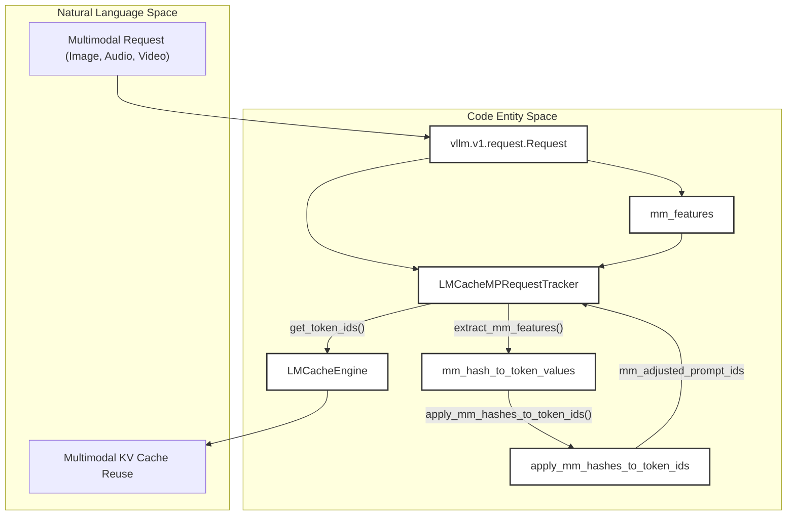
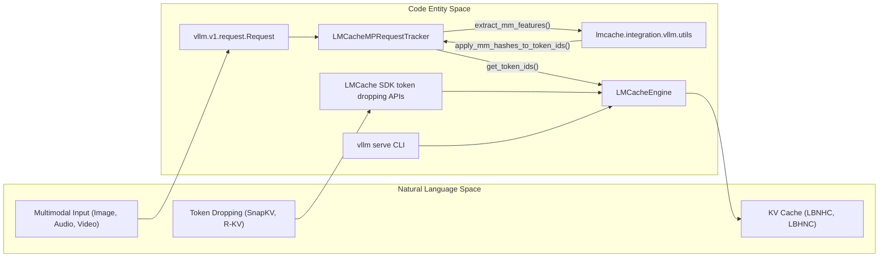

<!-- source: DeepWiki mcp.deepwiki.com · repo LMCache/LMCache · page 10.5 Multimodal Support · fetched 2026-10-21 -->

# Multimodal Support

<details>
<summary>Relevant source files</summary>

The following files were used as context for generating this wiki page:

- [docs/design/integration/vllm/hybrid-kv-cache-groups.md](docs/design/integration/vllm/hybrid-kv-cache-groups.md)
- [examples/token_dropping/README.md](examples/token_dropping/README.md)
- [examples/token_dropping/random_token_dropping.ipynb](examples/token_dropping/random_token_dropping.ipynb)
- [examples/token_dropping/rkv_colab.ipynb](examples/token_dropping/rkv_colab.ipynb)
- [examples/token_dropping/rkv_token_dropping.ipynb](examples/token_dropping/rkv_token_dropping.ipynb)
- [examples/token_dropping/rkv_variants/rkv_variant_buffered_cpu.ipynb](examples/token_dropping/rkv_variants/rkv_variant_buffered_cpu.ipynb)
- [examples/token_dropping/rkv_variants/rkv_variant_cpu_exact.ipynb](examples/token_dropping/rkv_variants/rkv_variant_cpu_exact.ipynb)
- [examples/token_dropping/rkv_variants/rkv_variant_gpu_exact.ipynb](examples/token_dropping/rkv_variants/rkv_variant_gpu_exact.ipynb)
- [examples/token_dropping/snapkv_colab.ipynb](examples/token_dropping/snapkv_colab.ipynb)
- [examples/token_dropping/snapkv_token_dropping.ipynb](examples/token_dropping/snapkv_token_dropping.ipynb)
- [lmcache/integration/tensorrt_llm/tensorrt_mp_adapter.py](lmcache/integration/tensorrt_llm/tensorrt_mp_adapter.py)
- [lmcache/integration/vllm/lmcache_mp_connector.py](lmcache/integration/vllm/lmcache_mp_connector.py)
- [lmcache/integration/vllm/lmcache_mp_metadata.py](lmcache/integration/vllm/lmcache_mp_metadata.py)
- [lmcache/integration/vllm/vllm_multi_process_adapter.py](lmcache/integration/vllm/vllm_multi_process_adapter.py)
- [tests/v1/multiprocess/test_qstore.py](tests/v1/multiprocess/test_qstore.py)
- [tests/v1/test_mp_connector_kv_roles.py](tests/v1/test_mp_connector_kv_roles.py)
- [tests/v1/test_mp_connector_mm_keys.py](tests/v1/test_mp_connector_mm_keys.py)
- [tests/v1/test_mp_nonblocking_lookup.py](tests/v1/test_mp_nonblocking_lookup.py)
- [tests/v1/test_mp_tracker_mamba_skipped_slots.py](tests/v1/test_mp_tracker_mamba_skipped_slots.py)
- [tests/v1/test_tensorrt_mp_adapter.py](tests/v1/test_tensorrt_mp_adapter.py)
- [tests/v1/test_vllm_mp_adapter.py](tests/v1/test_vllm_mp_adapter.py)

</details>


This page provides a detailed technical reference on LMCache's support for multimodal models—handling audio, image, and video input modalities. It covers how LMCache integrates multimodal requests, substitutes multimodal hashes into token streams to ensure correct cache key derivation, and demonstrates token dropping strategies for efficient KV cache management.

---

## 1. Overview and Supported Modalities

LMCache manages KV cache for multimodal models that operate on inputs beyond text, including audio, images, and video. It integrates with serving engines like vLLM to cache and reuse KV states for multimodal requests, thereby reducing time-to-first-token and improving serving efficiency.

The following modalities and example models are supported:

| Modality | Example Models | Code / Integration Source |
|----------|----------------|---------------------------|
| **Audio** | Ultravox (`fixie-ai/ultravox-v0_5-llama-3_2-1b`) | [docs/source/api_reference/multimodality.rst:38-41]() |
| **Image** | Llava (`llava-hf/llava-1.5-7b-hf`), Phi-3.5-vision (`microsoft/Phi-3.5-vision-instruct`) | [docs/source/api_reference/multimodality.rst:56-76]() |
| **Video** | Llava-OneVision (`llava-hf/llava-onevision-qwen2-7b-ov-hf`) | [docs/source/api_reference/multimodality.rst:91-94]() |

The multimodal keys identification is critical to ensure distinct cache keys for different multimodal items in the batch.

Sources: [docs/source/api_reference/multimodality.rst:38-94](), [docs/source/index.rst:36-38]()

---

## 2. Cache Keying with Multimodal Hashes

### Problem Statement

vLLM emits identical **placeholder token IDs** for every multimodal item. This causes raw token IDs and naive token-based chunk hashing to produce identical cache keys for distinct multimodal inputs, leading to **cross-image contamination** of KV cache entries.

### LMCache Solution

LMCache avoids this by substituting these placeholder token IDs with unique, deterministic token sequences derived from the multimodal identifier (`mm_hash`) before hashing tokens to produce cache keys.

### Key Functions and Contract

- `mm_hash_to_token_values(identifier, length)`: 
  - Converts a multimodal identifier (e.g., a SHA-256 hex hash string) into a sequence of `length` 31-bit integer values that replace placeholder tokens.
  - Ensures **full entropy**, **position dependence**, and **prefix stability** so token substitutions provide high collision resistance and consistent keying.
  - Values are capped to 31 bits to fit within signed int32 token ID representations used downstream.

- `apply_mm_hashes_to_token_ids(token_ids, mm_hashes, mm_positions)`:
  - In-place overwriting of contiguous spans of placeholder token IDs with the deterministic token values produced by `mm_hash_to_token_values`.
  - Requires the full prompt or a prefix, as substitution relies on absolute placeholder offsets.

- `LMCacheMPRequestTracker` (class):
  - Reads the `Request` object from vLLM which contains `prompt_token_ids` and multimodal feature metadata `mm_features`.
  - Extracts multimodal hashes and applies substitutions to produce `mm_adjusted_prompt_ids`.
  - Supplies `get_token_ids()` that returns the token ID sequence with multimodal substitutions applied.
  - Tracks request configurations and manages KV request state.

### Example: Placeholder Token Substitution

A prompt containing placeholder tokens `[1, 2, 99, 99, 99, 3, 4]` with a multimodal identifier `"0xabcd"` and a placeholder span at indices 2 to 4 will be substituted with unique token values derived from `"0xabcd"` over the length 3, replacing the `99`s. This yields a modified token ID list with unique multimodal tokens replacing the placeholders for accurate cache key derivation.

Sources: [lmcache/integration/vllm/lmcache_mp_metadata.py:100-104](), [lmcache/integration/vllm/lmcache_mp_metadata.py:82-104](), [tests/v1/test_mp_connector_mm_keys.py:112-138]()

---

### Code Workflow Diagram: Multimodal Request Lifecycle Mapping



- The vLLM `Request` carries multimodal feature metadata in `mm_features` [tests/v1/test_mp_connector_mm_keys.py:60-84]().
- `LMCacheMPRequestTracker` intercepts requests, uses the multimodal identifier hashes, and applies the substitution to the prompt tokens [lmcache/integration/vllm/lmcache_mp_metadata.py:83-104]().
- The result is passed to `LMCacheEngine` which stores/looks up KV cache entries keyed with these modified tokens.
  
This process ensures distinct cache keys per multimodal input, avoiding collisions and cross-contamination.

Sources: [lmcache/integration/vllm/lmcache_mp_metadata.py:82-101](), [tests/v1/test_mp_connector_mm_keys.py:112-138]()

---

## 3. Memory Formats for Multimodal Data

LMCache defines specialized memory formats for efficient storage and identification of multimodal encoder outputs and hidden states:

| Format Name | Description |
|-------------|-------------|
| `EC_TD` (Encoder Cache Tensor Format) | Format for encoder outputs such as image/audio features, shaped `[num_tokens, hidden_dim]`. Used for encoder cache storage. |
| `HS_TD` (Hidden State Store Format) | A logically separate tensor format for storage of decoder or multimodal hidden states. |

These formats are distinguished internally to aid tracking, compression, and efficient cache management.

Sources: [lmcache/v1/memory_management.py:102-112]()

---

## 4. Token Dropping: LMCache SDK Integration Examples

Long input prompts produce excessively large KV caches that consume GPU memory and reduce the batch sizes and overall decode throughput. LMCache provides *token dropping* functionality to reduce KV cache size by selecting a subset of tokens to keep, thus increasing batch size and decode speed.

The token dropping algorithms implemented and demonstrated with LMCache SDK include:

| Notebook / Strategy | Description | Requires Query Tensor? |
|--------------------|-------------|-----------------------|
| `random_token_dropping.ipynb` | Randomly drops a subset of past tokens, using KV cache only, no query tensor required. | No |
| `snapkv_token_dropping.ipynb` | SnapKV method: keeps first and last windows plus tokens most attended to by recent queries; uses query tensor for importance scoring. | Yes |
| `rkv_token_dropping.ipynb` | R-KV: SnapKV importance term minus a redundancy term to keep attended-to and novel tokens; uses query tensor. | Yes |
| `rkv_variants/rkv_variant_cpu_exact.ipynb` | R-KV exact, linear time variant on CPU with efficient redundancy computation. | Yes |
| `rkv_variants/rkv_variant_gpu_exact.ipynb` | R-KV exact, linear time variant on GPU tiled to reduce memory usage. | Yes |
| `rkv_variants/rkv_variant_buffered_cpu.ipynb` | R-KV approximate chunked variant on CPU with slightly reduced accuracy but faster compression. | Yes |

### Using Query Tensors for Token Dropping

Most query-dependent token dropping algorithms (SnapKV, R-KV) require transfer of intermediate query tensors from the model to the LMCache server. This is enabled by:

- Starting LMCache server with `--enable transfer_query` flag [examples/token_dropping/rkv_token_dropping.ipynb:102]().
- Passing `{"lmcache.mp.transfer_intermediate_tensors": true}` in KV connector extra config for the vLLM `LMCacheMPConnector` [examples/token_dropping/rkv_token_dropping.ipynb:127]().
  
This allows the LMCache SDK to retrieve, optimize, and reseed KV entries before resuming decoding for improved throughput.

### Typical Setup Steps (Example)

1. Start LMCache server with shared memory and transfer query enabled:

```bash
lmcache server \
  --l1-size-gb 400 \
  --eviction-policy LRU \
  --chunk-size 256 \
  --port 6555 \
  --http-port 8080 \
  --shm-name lmcache_sdk \
  --no-l1-use-lazy \
  --enable transfer_query \
  --supported-transfer-mode auto
```

2. Start vLLM serving your multimodal model with KV transfer configured:

```bash
LMCACHE_TRANSFER_INTERMEDIATE_TENSORS=true \
vllm serve Qwen/Qwen3-8B \
  --port 8000 \
  --served-model-name Qwen/Qwen3-8B \
  --no-enable-prefix-caching \
  --enforce-eager \
  --gpu-memory-utilization 0.65 \
  --kv-transfer-config '{
      "kv_connector":"LMCacheMPConnector",
      "kv_role":"kv_both",
      "kv_connector_extra_config":{
        "lmcache.mp.port":6555,
        "lmcache.mp.transfer_intermediate_tensors":true
      }
    }' \
  --trust-remote-code \
  --return-tokens-as-token-ids
```

3. Use the included notebooks from `examples/token_dropping/` folder to run token dropping experiments and observe decode throughput gains [examples/token_dropping/rkv_token_dropping.ipynb:1-72]().

Sources: [examples/token_dropping/rkv_token_dropping.ipynb:1-135](), [examples/token_dropping/rkv_variants/rkv_variant_gpu_exact.ipynb:1-72](), [examples/token_dropping/rkv_variants/rkv_variant_cpu_exact.ipynb:1-72](), [examples/token_dropping/rkv_variants/rkv_variant_buffered_cpu.ipynb:1-72]()

---

## 5. Natural Language to Code Entity Mapping

The multimodal support domain maps to the following key code entities and natural language conceptual entities:



This diagram shows how multimodal inputs flow through the vLLM request interface, are tracked and token-substituted by LMCache request tracker utilities, stored in `LMCacheEngine`, and optimized by token dropping via the LMCache SDK, deployed alongside vLLM serving.

Sources: [lmcache/integration/vllm/lmcache_mp_metadata.py:82-104](), [tests/v1/test_mp_connector_mm_keys.py:100-140](), [examples/token_dropping/rkv_token_dropping.ipynb:20-60]()

---

## References and Sources

- Multimodal request metadata and substitution: [lmcache/integration/vllm/lmcache_mp_metadata.py:30-102]()
- Tests on placeholder token substitution and tracker: [tests/v1/test_mp_connector_mm_keys.py:98-140]()
- Token dropping example notebooks and README with setups: [examples/token_dropping/rkv_token_dropping.ipynb:1-135](), [examples/token_dropping/rkv_variants/rkv_variant_cpu_exact.ipynb:30-37](), [examples/token_dropping/rkv_variants/rkv_variant_gpu_exact.ipynb:30-37](), [examples/token_dropping/rkv_variants/rkv_variant_buffered_cpu.ipynb:30-37]()
- Memory formats in LMCache: [lmcache/v1/memory_management.py:101-112]()

---

This concludes the comprehensive technical documentation of LMCache's multimodal integration, cache keying strategy with multimodal hashes, and token dropping approaches to optimize KV cache usage for large multimodal requests.

---

