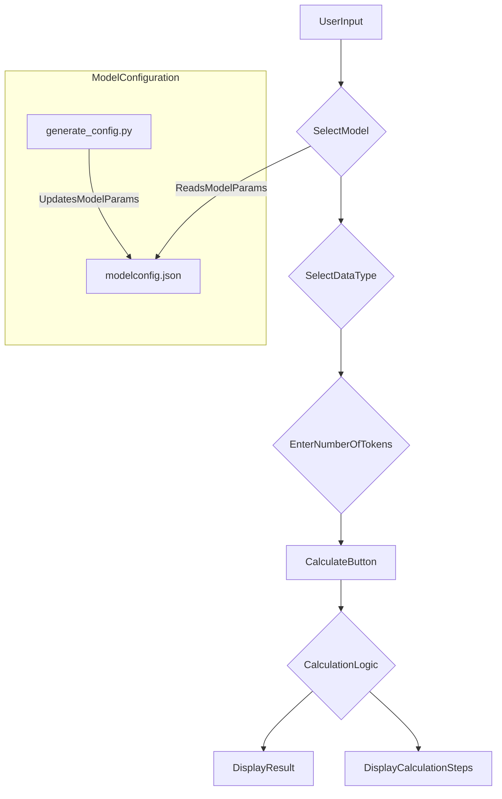

<!-- source: DeepWiki mcp.deepwiki.com · repo LMCache/LMCache · page 10.6 Model Recipes · fetched 2026-10-21 -->

# Model Recipes

<details>
<summary>Relevant source files</summary>

The following files were used as context for generating this wiki page:

- [docs/design/v1/mp_coordinator/blend_index.md](docs/design/v1/mp_coordinator/blend_index.md)
- [docs/source/mp/chunk_size_negotiation.rst](docs/source/mp/chunk_size_negotiation.rst)
- [docs/source/mp/hybrid_models.rst](docs/source/mp/hybrid_models.rst)
- [docs/source/recipes/deepseek_v41_flash.rst](docs/source/recipes/deepseek_v41_flash.rst)
- [docs/source/recipes/deepseek_v4_flash.rst](docs/source/recipes/deepseek_v4_flash.rst)
- [docs/source/recipes/devstral.rst](docs/source/recipes/devstral.rst)
- [docs/source/recipes/gemma3.rst](docs/source/recipes/gemma3.rst)
- [docs/source/recipes/gemma4.rst](docs/source/recipes/gemma4.rst)
- [docs/source/recipes/glm5_2.rst](docs/source/recipes/glm5_2.rst)
- [docs/source/recipes/glm5_3.rst](docs/source/recipes/glm5_3.rst)
- [docs/source/recipes/gpt_oss.rst](docs/source/recipes/gpt_oss.rst)
- [docs/source/recipes/index.rst](docs/source/recipes/index.rst)
- [docs/source/recipes/kimi_k3.rst](docs/source/recipes/kimi_k3.rst)
- [docs/source/recipes/kimi_linear.rst](docs/source/recipes/kimi_linear.rst)
- [docs/source/recipes/llama.rst](docs/source/recipes/llama.rst)
- [docs/source/recipes/minimax_m2.rst](docs/source/recipes/minimax_m2.rst)
- [docs/source/recipes/minimax_m3.rst](docs/source/recipes/minimax_m3.rst)
- [docs/source/recipes/mixtral.rst](docs/source/recipes/mixtral.rst)
- [docs/source/recipes/phi3.rst](docs/source/recipes/phi3.rst)
- [docs/source/recipes/qwen3.rst](docs/source/recipes/qwen3.rst)
- [docs/source/recipes/qwen3_5.rst](docs/source/recipes/qwen3_5.rst)
- [docs/source/recipes/qwen3_8_flash_next.rst](docs/source/recipes/qwen3_8_flash_next.rst)
- [examples/kv_cache_calculator/README.md](examples/kv_cache_calculator/README.md)
- [examples/kv_cache_calculator/generate_config.py](examples/kv_cache_calculator/generate_config.py)
- [examples/kv_cache_calculator/kv_cache_calculator.html](examples/kv_cache_calculator/kv_cache_calculator.html)
- [examples/kv_cache_calculator/modelconfig.json](examples/kv_cache_calculator/modelconfig.json)
- [examples/kv_cache_calculator/requirement.txt](examples/kv_cache_calculator/requirement.txt)
- [tests/benchmarks/test_xpu_connector_benchmark.py](tests/benchmarks/test_xpu_connector_benchmark.py)
- [tests/benchmarks/test_xpu_kernels_microbench.py](tests/benchmarks/test_xpu_kernels_microbench.py)
- [tests/benchmarks/test_xpu_layerwise_connector_benchmark.py](tests/benchmarks/test_xpu_layerwise_connector_benchmark.py)
- [tests/v1/test_xpu_connector.py](tests/v1/test_xpu_connector.py)

</details>


## Purpose and Scope

This page documents validated model architecture recipes for LMCache, establishing specific configuration and launch commands for serving engines (primarily vLLM) to ensure optimal KV cache management, hybrid attention handling, and metadata serialization. Each recipe focuses on LMCache-specific configurations that diverge from engine defaults.

Sources: [docs/source/recipes/index.rst:6-8]()

## Recipe Architecture Overview

LMCache recipes establish end-to-end configuration patterns for complex model topologies. They assume that base LMCache installations and engine network wiring (e.g., ports and remote hosts) are already configured.

### Data Flow for Recipe Deployment

The following diagram bridges natural language configuration parameters from recipe files to code entities within the LMCache multiprocess server and the vLLM serving engine:

**Model Recipe Execution Flow**
```mermaid
graph TD
    subgraph "Natural_Language_Space"
        "Recipe_File"["Recipe File (e.g., minimax_m2.rst)"]
    end

    subgraph "Code_Entity_Space"
        "LM_Server"["LMCacheServer / lmcache server"]
        "VLLM_Serve"["vllm serve entrypoint"]
        "KV_Config"["kv_transfer_config JSON"]
        "Connector"["LMCacheMPConnector"]
        "Mamba_Mode"["mamba_cache_mode = align"]
        "Batch_Tokens"["max_num_batched_tokens = 2N-1"]
    end

    "Recipe_File" -->|"Defines Server CLI Args"| "LM_Server"
    "Recipe_File" -->|"Defines Engine CLI Args"| "VLLM_Serve"
    "LM_Server" -->|"Configures storage and L1/L2 tiers"| "KV_Config"
    "VLLM_Serve" -->|"Instantiates with kv_transfer_config"| "Connector"
    "Connector" -->|"Configures Mamba caching and batching"| "Mamba_Mode"
    "Connector" -->|"Sets scheduler budget"| "Batch_Tokens"
    "Connector" <==>|"ZMQ/IPC Transport"| "LM_Server"
```
Sources: [docs/source/recipes/index.rst:6-14](), [docs/source/mp/hybrid_models.rst:108-132](), [docs/source/recipes/qwen3_5.rst:54-68]()

---

## Hybrid KV Cache and Hybrid Memory Allocator (HMA)

Models with heterogeneous attention architectures, such as Gemma 4, GLM 5.2, or Kimi K3, employ vLLM's hybrid KV cache manager to partition model layers into distinct KV cache groups. LMCache reinterprets recurrent state caches of linear-attention variants (e.g., Mamba, GDN, KDA) as opaque physical cache pages at registration time [docs/source/mp/hybrid_models.rst:4-11]().

The mapping from vLLM attention and KV cache group specifications into LMCache engine groups and object groups is illustrated below:

**HMA Data Flow and Code Entity Mapping**
```mermaid
graph LR
    subgraph "vLLM_Engine_Layer"
        "KVCacheConfig"["KVCacheConfig"]
        "KVCacheGroupSpec"["KVCacheGroupSpec"]
        "MambaSpec"["MambaSpec / SlidingWindowSpec"]
    end

    subgraph "LMCache_Integration_Logic"
        "Group_Info_Func"["create_engine_group_infos_from_vllm"]
        "SW_Resolve"["_resolve_per_layer_sw_sizes"]
        "Identity_Group"["group_layers_by_identity"]
    end

    subgraph "Server_Side_Entities"
        "EngineGroupInfo"["EngineGroupInfo"]
        "ObjectGroupInfo"["ObjectGroupInfo"]
        "Transfer_Logic"["lmcache_driven_transfer.py"]
    end

    "KVCacheConfig" --> "Group_Info_Func"
    "KVCacheGroupSpec" --> "Group_Info_Func"
    "MambaSpec" --> "SW_Resolve"
    "SW_Resolve" --> "Group_Info_Func"
    "Group_Info_Func" --> "Identity_Group"
    "Identity_Group" --> "EngineGroupInfo"
    "EngineGroupInfo" --"Registration"--> "ObjectGroupInfo"
    "ObjectGroupInfo" --> "Transfer_Logic"
```
This pipeline enables LMCache to manage multiple KV cache groups independently, each with potentially different physical block sizes and transfer layouts, supporting hybrid models seamlessly [docs/source/mp/hybrid_models.rst:128-134]().

Sources: [docs/source/mp/hybrid_models.rst:4-11](), [docs/source/mp/hybrid_models.rst:128-134]()

---

## Validated Architectures

The following model architectures have been validated end-to-end with LMCache across serving engines:

| Architecture                      | Example Model             | vLLM Supported | SGLang Supported | TRT-LLM Supported | Recipe Reference                         |
|----------------------------------|--------------------------|:--------------:|:----------------:|:-----------------:|----------------------------------------|
| `MiniMaxM2ForCausalLM`            | `MiniMax-M2`              | ✓              | —                | ✓                 | [minimax_m2.rst]()                      |
| `MiniMaxM3`                      | `MiniMax-M3`              | ✓              | —                | —                 | [minimax_m3.rst]()                      |
| `Gemma4ForConditionalGeneration` | `google/gemma-4-31B-it`   | ✓              | —                | ✓                 | [gemma4.rst]()                         |
| `Gemma3ForConditionalGeneration` | `google/gemma-3-4b-it`    | ✓              | —                | ✓                 | [gemma3.rst]()                         |
| `Qwen3_5ForConditionalGeneration`| `Qwen/Qwen3.6-27B`        | ✓              | —                | ✓                 | [qwen3_5.rst]()                        |
| `LlamaForCausalLM`                | `Meta-Llama-3.1-8B`       | ✓              | —                | ✓                 | [llama.rst]()                         |
| `GlmMoeDsaForCausalLM`            | `GLM-5.2-FP8`              | ✓              | —                | ✓                 | [glm5_2.rst]()                        |
| `MixtralForCausalLM`              | `Mixtral-8x7B-v0.1`       | ✓              | —                | ✓                 | [mixtral.rst]()                       |
| `Phi3ForCausalLM`                 | `Phi-4-mini-instruct`     | ✓              | —                | ✓                 | [phi3.rst]()                          |
| `DeepSeekV4`                     | `DeepSeek-V4-Flash`       | ✓              | —                | —                 | [deepseek_v4_flash.rst]()             |
| `KimiK3`                         | `moonshotai/Kimi-K3`      | ✓              | —                | ✓                 | [kimi_k3.rst]()                        |

Sources: [docs/source/mp/hybrid_models.rst:22-55](), [docs/source/recipes/qwen3_5.rst:12-16](), [docs/source/recipes/minimax_m2.rst:6-11](), [docs/source/recipes/glm5_2.rst:12-15](), [docs/source/recipes/kimi_k3.rst:15-22]()

---

## Specific Model Recipes

### Qwen 3.5 / 3.6 / 3.8 series (Mamba Hybrids)

These models interleave Mamba / Gated-DeltaNet (GDN) linear-attention layers with full-attention layers, requiring specific chunk sizes and batching parameters [docs/source/recipes/qwen3_5.rst:6-10]().

- **Validated Models:** `Qwen/Qwen3.8-27B`, `Qwen/Qwen3.6-27B`, `Qwen/Qwen3.5-0.8B` [docs/source/recipes/qwen3_5.rst:16-18]().
- **Unified Block Size (N):** Obtained from vLLM startup logs (`"Setting attention block size to N tokens"`). For example, 784 tokens for Qwen3.6-27B and 544 for Qwen3.5-0.8B [docs/source/recipes/qwen3_5.rst:34-52]().
- **LMCache Server:** Set `--chunk-size` to N and enable `--separate-object-groups` [docs/source/recipes/qwen3_5.rst:54-55]().
- **vLLM:** Set `--max-num-batched-tokens` to `2N-1` to allow concurrent decode / prefill scheduling [docs/source/recipes/qwen3_5.rst:55-59]().
- **Other Flags:** Use `--mamba-cache-mode align` and `--enable-prefix-caching` [docs/source/recipes/qwen3_5.rst:71-72]().
- **CacheBlend:** Not supported due to byte-opaque hybrid cache pages [docs/source/recipes/qwen3_5.rst:125-125]().
- **Generation Behavior:** Not bit-exact between cache and fresh runs, due to the specific GDN backend behavior [docs/source/recipes/qwen3_5.rst:144-147]().

Example vLLM launch command for Qwen3.6-27B [docs/source/recipes/qwen3_5.rst:70-75]():
```bash
vllm serve Qwen/Qwen3.6-27B \
    --enable-prefix-caching \
    --mamba-cache-mode align \
    --max-num-batched-tokens 1567 \
    --kv-transfer-config \
    '{"kv_connector":"LMCacheMPConnector", "kv_role":"kv_both"}'
```

Example LMCache server launch [docs/source/recipes/qwen3_5.rst:65-66]():
```bash
lmcache server --chunk-size 784 --separate-object-groups \
    --l1-size-gb 100 --eviction-policy LRU
```

Sources: [docs/source/recipes/qwen3_5.rst:6-67](), [docs/source/mp/hybrid_models.rst:142-197]()

---

### Kimi K3

Moonshot AI's flagship hybrid Mixture-of-Experts model interleaves Kimi Delta Attention (KDA) linear-attention layers with Multi-head Latent Attention (MLA) full-attention layers [docs/source/recipes/kimi_k3.rst:6-10]().

- **Validated Models:** `moonshotai/Kimi-K3` (NVIDIA B300 and AMD MI355X) [docs/source/recipes/kimi_k3.rst:18-21]().
- **Unified Block Size (N):** `768` at tensor-parallel size 8 [docs/source/recipes/kimi_k3.rst:53-64]().
- **Required Flags:** `--mamba-cache-mode align`, `--enable-prefix-caching`, `--separate-object-groups` on server, and `VLLM_ENABLE_K3_LATENT_MOE_TAIL_FUSION=1` [docs/source/recipes/kimi_k3.rst:91-116]().

Example vLLM launch for Kimi K3 [docs/source/recipes/kimi_k3.rst:93-107]():
```bash
export VLLM_ENABLE_K3_LATENT_MOE_TAIL_FUSION=1

vllm serve moonshotai/Kimi-K3 \
    --trust-remote-code \
    --load-format dummy \
    --moe-backend auto \
    --gpu-memory-utilization 0.95 \
    --tensor-parallel-size 8 \
    --no-enable-flashinfer-autotune \
    --enable-auto-tool-choice \
    --tool-call-parser kimi_k3 \
    --reasoning-parser kimi_k3 \
    --enable-prefix-caching \
    --mamba-cache-mode align \
    --max-num-batched-tokens 1500 \
    --kv-transfer-config \
    '{"kv_connector":"LMCacheMPConnector","kv_role":"kv_both","kv_connector_extra_config":{"lmcache.mp.port":6555}}'
```

Sources: [docs/source/recipes/kimi_k3.rst:6-156]()

---

### Gemma 4

Gemma 4 models interleave sliding-window and full-attention layers with different physical block sizes per attention type [docs/source/recipes/gemma4.rst:143-148]().

- **Validated Models:** `google/gemma-4-31B-it`, `google/gemma-4-12B-it`, `google/gemma-4-E4B-it` [docs/source/recipes/gemma4.rst:9-11]().
- **Block Sizes:** Different for sliding (256 dim) and full-attention (512 dim) heads [docs/source/recipes/gemma4.rst:144-146]().
- **Cross-Layer KV Sharing:** Supported, where some layers reuse KV caches from others [docs/source/recipes/gemma4.rst:149-151]().
- **MTP Support:** Speculative decoding supported with multiple speculative tokens [docs/source/recipes/gemma4.rst:89-96]().
- **Special Flags:** Requires `--attention-backend TRITON_ATTN` when enabling MTP to avoid FlashAttention limits on head dimension [docs/source/recipes/gemma4.rst:113-121]().

Example vLLM launch with MTP for Gemma 4 [docs/source/recipes/gemma4.rst:38-42](), [docs/source/recipes/gemma4.rst:107-111]():
```bash
vllm serve google/gemma-4-31B-it \
    --tensor-parallel-size 2 \
    --kv-transfer-config \
    '{"kv_connector":"LMCacheMPConnector", "kv_role":"kv_both"}' \
    --speculative-config \
    '{"method":"mtp","model":"google/gemma-4-31B-it-assistant","num_speculative_tokens":1}' \
    --attention-backend TRITON_ATTN
```

Sources: [docs/source/recipes/gemma4.rst:6-151]()

---

## Feature Support Status

This table summarizes CacheBlend and CacheGen compression support across model families:

```mermaid
graph LR
    subgraph "Standard_Attention_Models"
        "Llama"["Llama / Mistral"]
        "Gemma"["Gemma 3 / 4"]
    end

    subgraph "Linear_Attention_Hybrids"
        "Qwen35"["Qwen 3.5 / 3.6"]
        "Kimi"["Kimi K3 / Linear"]
    end

    "Llama" --- "CB_L"["CacheBlend: Validated"]
    "Gemma" --- "CB_G"["CacheBlend: Not Validated"]
    "Linear_Attention_Hybrids" --- "CB_Q"["CacheBlend: Not Supported (Opaque)"]
    "Linear_Attention_Hybrids" --- "CG_Q"["CacheGen: Not Supported (Opaque)"]
```
Sources: [docs/source/recipes/qwen3_5.rst:111-129](), [docs/source/mp/hybrid_models.rst:71-97]()

---

## Implementation Details and Caveats

### Mamba / Linear-Attention State Handling

LMCache reinterprets recurrent states of Mamba, GDN, and KDA layers as opaque physical pages, enabling prefix caching with hybrid KV cache managers [docs/source/mp/hybrid_models.rst:145-157]().

- **Batching Performance:** Setting `max_num_batched_tokens` to exactly the unified block size `N` causes serialization of prefill and decode; setting it to `2N-1` improves batching by allowing interleaving [docs/source/recipes/qwen3_5.rst:92-104]().
- **Generation Non-Idempotence:** Cached runs are not bit-exact with fresh runs due to GDN backend batch-invariance limitations [docs/source/recipes/qwen3_5.rst:144-147]().
- **Object Groups:** LMCache can bucket layers by physical identity into distinct object groups during KV cache registration to optimize transfer and storage [docs/source/mp/hybrid_models.rst:120-128]().

Sources: [docs/source/recipes/qwen3_5.rst:75-104](), [docs/source/mp/hybrid_models.rst:120-157]()

---

## KV Cache Calculator Tool

The KV Cache Calculator is a web-based utility that estimates the KV cache memory footprint for supported LLM models based on their architectural parameters and configuration choices.

### Model Configuration

`examples/kv_cache_calculator/modelconfig.json` contains validated model parameters [examples/kv_cache_calculator/modelconfig.json:1-201]():

- `hidden_size`: Hidden state dimensionality [examples/kv_cache_calculator/modelconfig.json:3]()
- `num_attention_heads`: Number of attention heads [examples/kv_cache_calculator/modelconfig.json:4]()
- `num_hidden_layers`: Number of transformer layers [examples/kv_cache_calculator/modelconfig.json:5]()
- `num_key_value_heads`: Number of KV attention heads [examples/kv_cache_calculator/modelconfig.json:6]()
- Optional fields:
  - `kv_lora_rank`: For DeepSeek MLA models [examples/kv_cache_calculator/modelconfig.json:49]()
  - `qk_rope_head_dim`: For DeepSeek MLA models [examples/kv_cache_calculator/modelconfig.json:50]()
  - `head_dim`: Explicit head dimension for specific models (Qwen3, GLM4, Hunyuan) [examples/kv_cache_calculator/modelconfig.json:77]()
  - `cla_share_factor`: For Hunyuan-Large cross-layer sharing [examples/kv_cache_calculator/modelconfig.json:199]()

Excerpt snippet [examples/kv_cache_calculator/modelconfig.json:1-13](), [examples/kv_cache_calculator/modelconfig.json:44-51]():
```json
{
    "meta-llama/Llama-3.1-8B-Instruct": {
        "hidden_size": 4096,
        "num_attention_heads": 32,
        "num_hidden_layers": 32,
        "num_key_value_heads": 8
    },
    "deepseek-ai/DeepSeek-V3": {
        "hidden_size": 7168,
        "num_attention_heads": 128,
        "num_hidden_layers": 61,
        "num_key_value_heads": 128,
        "kv_lora_rank": 512,
        "qk_rope_head_dim": 64
    }
}
```
Sources: [examples/kv_cache_calculator/modelconfig.json:1-201]()

### Calculation Logic

The KV cache size is estimated by:

$$
KV_{size} = 2 \times \text{num\_layers} \times \text{num\_kv\_heads} \times \text{head\_dim} \times \text{num\_tokens} \times \text{dtype\_bytes}
$$

Where:
- `2` accounts for Key and Value tensors.
- `num_layers`, `num_kv_heads` from model config [examples/kv_cache_calculator/generate_config.py:30-34]().
- `head_dim` equals `hidden_size / num_attention_heads` or explicit `head_dim` if provided [examples/kv_cache_calculator/generate_config.py:57]().
- `num_tokens` input by user [examples/kv_cache_calculator/kv_cache_calculator.html:202-204]().
- `dtype_bytes` varies by data type (`float16=2 bytes`, `int8=1 byte`, etc.) [examples/kv_cache_calculator/kv_cache_calculator.html:192-197]().

Special cases:
- DeepSeek MLA models compute `head_dim` as `qk_rope_head_dim + kv_lora_rank` [examples/kv_cache_calculator/generate_config.py:39-44]().
- Hunyuan-Large divides the number of layers by `cla_share_factor` [examples/kv_cache_calculator/generate_config.py:61-62]().

`examples/kv_cache_calculator/generate_config.py` fetches these configurations automatically using the Hugging Face `transformers.AutoConfig` interface and prints JSON formatted data for merging into `modelconfig.json` [examples/kv_cache_calculator/generate_config.py:7-35]().

Sources: [examples/kv_cache_calculator/generate_config.py:10-63](), [examples/kv_cache_calculator/kv_cache_calculator.html:192-204]()

### Usage and Interface

`examples/kv_cache_calculator/kv_cache_calculator.html` provides a lightweight web interface that lets users select a model, data type, and sequence length tokens count [examples/kv_cache_calculator/kv_cache_calculator.html:180-204](). It then calculates and displays the KV cache size and detailed calculation steps dynamically [examples/kv_cache_calculator/kv_cache_calculator.html:126-148]().

**KV Cache Calculator Workflow**


The tool encourages contributions to extend supported models by linking to its GitHub repository [examples/kv_cache_calculator/kv_cache_calculator.html:211-213]().

Sources: [examples/kv_cache_calculator/kv_cache_calculator.html:1-214](), [examples/kv_cache_calculator/modelconfig.json:1-201](), [examples/kv_cache_calculator/generate_config.py:1-83]()

---

# Summary

This page outlines the framework LMCache uses to support diverse LLM model architectures through tested recipes. Support covers uniform attention models, hybrid attention models mixing sliding-window and full-attention, linear-attention hybrids such as Mamba/GDN, and multi-query or grouped query attention variants. Recipes help users configure the LMCache server, vLLM, and other engines with correct chunk sizes, batching, and connector options.

The KV cache calculator complements this by providing a tool for estimating cache memory requirements based on these validated model parameters.

By following these recipes, users can reliably deploy LMCache with supported models, optimizing prefix caching, KV reuse, and multi-level attention handling across engines and hardware configurations.

Sources:
- [docs/source/recipes/index.rst:6-14]()
- [docs/source/mp/hybrid_models.rst:4-197]()
- [docs/source/recipes/qwen3_5.rst:6-136]()
- [docs/source/recipes/gemma4.rst:6-121]()
- [docs/source/recipes/kimi_k3.rst:6-156]()
- [examples/kv_cache_calculator/modelconfig.json:1-201]()
- [examples/kv_cache_calculator/generate_config.py:10-63]()
- [examples/kv_cache_calculator/kv_cache_calculator.html:1-526]()

---

