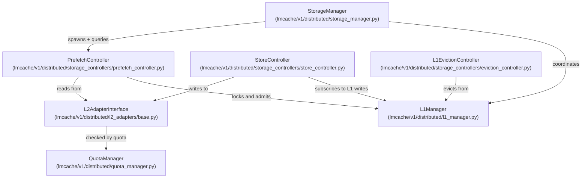
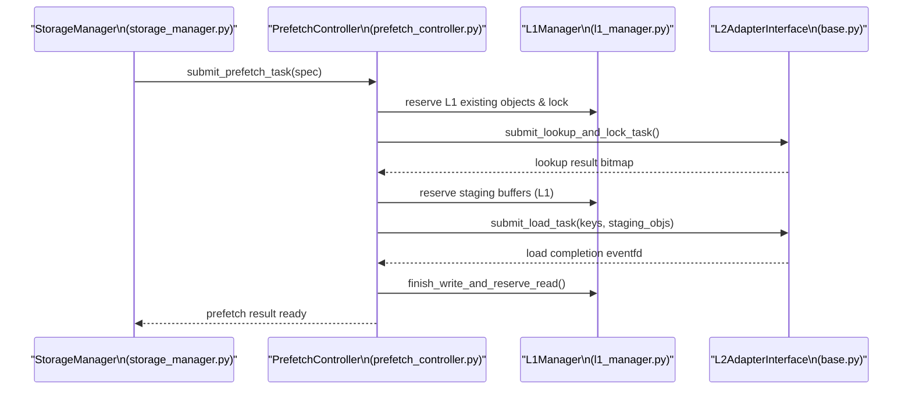

<!-- source: DeepWiki mcp.deepwiki.com · repo LMCache/LMCache · page 11 Distributed Storage Manager · fetched 2026-10-21 -->

# Distributed Storage Manager

Relevant source files

The following files were used as context for generating this wiki page:

- [docs/design/v1/distributed/l1_manager_interface.md](docs/design/v1/distributed/l1_manager_interface.md)
- [lmcache/v1/distributed/api.py](lmcache/v1/distributed/api.py)
- [lmcache/v1/distributed/internal_api.py](lmcache/v1/distributed/internal_api.py)
- [lmcache/v1/distributed/l1_manager.py](lmcache/v1/distributed/l1_manager.py)
- [lmcache/v1/distributed/l2_adapters/serde_wrapper.py](lmcache/v1/distributed/l2_adapters/serde_wrapper.py)
- [lmcache/v1/distributed/storage_controller.py](lmcache/v1/distributed/storage_controller.py)
- [lmcache/v1/distributed/storage_controllers/adapter_lifecycle.py](lmcache/v1/distributed/storage_controllers/adapter_lifecycle.py)
- [lmcache/v1/distributed/storage_controllers/eviction_controller.py](lmcache/v1/distributed/storage_controllers/eviction_controller.py)
- [lmcache/v1/distributed/storage_controllers/prefetch_controller.py](lmcache/v1/distributed/storage_controllers/prefetch_controller.py)
- [lmcache/v1/distributed/storage_controllers/store_controller.py](lmcache/v1/distributed/storage_controllers/store_controller.py)
- [lmcache/v1/distributed/storage_manager.py](lmcache/v1/distributed/storage_manager.py)
- [lmcache/v1/mp_observability/trace/codecs.py](lmcache/v1/mp_observability/trace/codecs.py)
- [tests/v1/distributed/l2_adapters/test_p2p_l2_adapter_integration.py](tests/v1/distributed/l2_adapters/test_p2p_l2_adapter_integration.py)
- [tests/v1/distributed/serde/test_serde_e2e.py](tests/v1/distributed/serde/test_serde_e2e.py)
- [tests/v1/distributed/serde/test_serde_fs_e2e.py](tests/v1/distributed/serde/test_serde_fs_e2e.py)
- [tests/v1/distributed/test_dax_l2_adapter.py](tests/v1/distributed/test_dax_l2_adapter.py)
- [tests/v1/distributed/test_distributed_storage_manager.py](tests/v1/distributed/test_distributed_storage_manager.py)
- [tests/v1/distributed/test_l1_interface.py](tests/v1/distributed/test_l1_interface.py)
- [tests/v1/distributed/test_l1_l2_state_metrics.py](tests/v1/distributed/test_l1_l2_state_metrics.py)
- [tests/v1/distributed/test_l1_manager.py](tests/v1/distributed/test_l1_manager.py)
- [tests/v1/distributed/test_object_key_parallel.py](tests/v1/distributed/test_object_key_parallel.py)
- [tests/v1/distributed/test_prefetch_controller.py](tests/v1/distributed/test_prefetch_controller.py)
- [tests/v1/distributed/test_runtime_adapters.py](tests/v1/distributed/test_runtime_adapters.py)
- [tests/v1/distributed/test_storage_manager_l2_keys.py](tests/v1/distributed/test_storage_manager_l2_keys.py)
- [tests/v1/mp_observability/trace/test_codecs.py](tests/v1/mp_observability/trace/test_codecs.py)
- [tests/v1/multiprocess/test_query_lookup_hits.py](tests/v1/multiprocess/test_query_lookup_hits.py)

## Purpose and Scope

The `StorageManager` serves as the central coordination layer for multi-tier cache storage in LMCache's multiprocess (MP) mode. It integrates local fast memory (L1) and various slower, persistent L2 storage backends into a unified system, managing asynchronous data flow, consistency, locking, and eviction policies [lmcache/v1/distributed/storage_manager.py:2-4]().

This page provides a high-level overview of the distributed storage architecture, encompassing the two-tier storage model, specialized background controllers for prefetching, storing, and eviction, and lock management. Details on each component are delegated to child pages:

- [L1 Manager and Lock System](#11.1)
- [Prefetch Controller](#11.2)
- [Store, Eviction and Quota Controllers](#11.3)
- [L2 Adapters](#11.4)

Sources: [lmcache/v1/distributed/storage_manager.py:2-4]()

---

## Architectural Overview

The `StorageManager` orchestrates L1 caching through `L1Manager`, controls asynchronous object prefetching from and storing to L2 backends via `PrefetchController` and `StoreController`, and manages cache capacity constraints with eviction controllers and quota management. Each of these components operates mostly in background threads, leveraging event-driven I/O via adapter-specific event file descriptors (`eventfds`) to scale without active polling [lmcache/v1/distributed/storage_manager.py:171-174](), [lmcache/v1/distributed/storage_controllers/store_controller.py:3-10](), [lmcache/v1/distributed/storage_controllers/prefetch_controller.py:3-17]().

The following diagram maps the high-level storage components to their concrete Python classes in the codebase:

Sources:
[lmcache/v1/distributed/storage_manager.py:171-174](),
[lmcache/v1/distributed/storage_controllers/prefetch_controller.py:3-17](),
[lmcache/v1/distributed/storage_controllers/store_controller.py:3-158](),
[lmcache/v1/distributed/storage_controllers/eviction_controller.py:36-108]()

---

## Subsystem Overviews

### 11.1 L1 Manager and Lock System

The L1 tier is managed by the `L1Manager` class, which implements an object lifecycle state machine for cached memory chunks [lmcache/v1/distributed/l1_manager.py:144-189](). The cache distinguishes between *resident objects* visible to readers, and *staging objects* owned by writers (tagged by a string, e.g., `_L1_WRITE_TAG = "storage_manager"`), which are invisible until explicitly committed [lmcache/v1/distributed/storage_manager.py:93-95](), [lmcache/v1/distributed/l1_manager.py:144-189]().

Concurrency control uses `TTLLock` primitives for fine-grained *write locks* (exclusive) and *read locks* (shared, count-based with TTL) to coordinate readers and writers without blocking [lmcache/v1/distributed/l1_manager.py:88-106](). Operations such as `reserve_read`, `finish_read`, `reserve_write`, and `finish_write` are atomic and batch-oriented [lmcache/v1/distributed/l1_manager.py:49-86]().

The `L1Manager` supports local memory backends including DRAM and device-DAX arenas for persistent memory (`DevDaxL1MemoryManager`) [lmcache/v1/distributed/l1_manager.py:23-31]().

For deep technical details and state diagrams, see the child page [L1 Manager and Lock System](#11.1).

Sources:
[lmcache/v1/distributed/storage_manager.py:93-95](),
[lmcache/v1/distributed/l1_manager.py:23-31](),
[lmcache/v1/distributed/l1_manager.py:49-189]()

---

### 11.2 Prefetch Controller

The `PrefetchController` handles asynchronous prefetching of data from L2 backends into L1 memory [lmcache/v1/distributed/storage_controllers/prefetch_controller.py:3-17](). Prefetch requests express object keys as a 2D grid (`Bitmap2D`): rows represent object groups, and columns represent key chunks [lmcache/v1/distributed/storage_controllers/prefetch_controller.py:3-17](), [lmcache/v1/distributed/storage_controllers/utils.py:54-55]().

The controller coordinates a two-phase *lookup* and *load* pipeline:
- **Lookup phase:** Queries all L2 adapters for presence and locks the found objects atomically [lmcache/v1/distributed/storage_controllers/prefetch_controller.py:3-17]().
- **Load phase:** Allocates staging buffers in L1, then submits *load* commands to L2 adapters [lmcache/v1/distributed/storage_controllers/prefetch_controller.py:3-17]().
- **Admission:** Admits loaded objects into L1 cache with appropriate read locks [lmcache/v1/distributed/storage_controllers/prefetch_controller.py:3-17]().

The following interaction diagram shows the flow between `StorageManager`, `PrefetchController`, `L1Manager`, and `L2AdapterInterface`:

Sources:
[lmcache/v1/distributed/storage_manager.py:101-164](),
[lmcache/v1/distributed/storage_controllers/prefetch_controller.py:3-17](),
[lmcache/v1/distributed/storage_controllers/utils.py:54-55]()

For detailed design, request states, and locking semantics see the child page [Prefetch Controller](#11.2).

---

### 11.3 Store, Eviction and Quota Controllers

Background controller threads maintain cache persistence and capacity:

- **StoreController:** Listens for L1 write completions via `StoreListener`, then asynchronously submits store tasks to L2 adapters via `submit_store_task` to replicate L1 data [lmcache/v1/distributed/storage_controllers/store_controller.py:3-158]().
- **Eviction Controllers:** Hierarchical controllers manage cache tiers:
  - `L1EvictionController` keeps L1 memory usage within configured watermarks (`trigger_watermark`, `eviction_ratio`) [lmcache/v1/distributed/storage_controllers/eviction_controller.py:88-193]().
  - `L2EvictionController` manages eviction from slower L2 backends based on policies like LRU, ARC, isolated LRU, or noop [lmcache/v1/distributed/storage_controllers/eviction_controller.py:57-59]().
- **QuotaManager:** Tracks per-user storage quotas and coordinates with eviction [lmcache/v1/distributed/storage_manager.py:54]().

For comprehensive understanding of storage persistence, eviction policies, and quota management, refer to the child page [Store, Eviction and Quota Controllers](#11.3).

Sources:
[lmcache/v1/distributed/storage_controllers/store_controller.py:3-158](),
[lmcache/v1/distributed/storage_controllers/eviction_controller.py:57-59](),
[lmcache/v1/distributed/storage_controllers/eviction_controller.py:88-193](),
[lmcache/v1/distributed/storage_manager.py:54]()

---

### 11.4 L2 Adapters

The L2 tier abstracts persistent and distributed backend storage implementations behind the `L2AdapterInterface` [lmcache/v1/distributed/l2_adapters/base.py:43](). Supported adapters include NixlStore (static/dynamic), S3, Mooncake, Device-DAX (`DaxL2Adapter`), local filesystem (`LocalDiskBackend`), native connectors, plugin backends, HuggingFace buckets, and raw block devices [lmcache/v1/distributed/l2_adapters/dax_l2_adapter.py:39-43](), [tests/v1/distributed/test_prefetch_controller.py:45-48]().

Adapters expose a consistent asynchronous interface with separate eventfds for store, lookup-and-lock, and load operations [tests/v1/distributed/test_dax_l2_adapter.py:214-219](). Transparent serde and compression are added via `SerdeL2AdapterWrapper` [lmcache/v1/distributed/l2_adapters/serde_wrapper.py:3-27]().

For an in-depth view of the adapter abstraction and individual implementations, see the child page [L2 Adapters](#11.4).

Sources:
[lmcache/v1/distributed/l2_adapters/base.py:43](),
[lmcache/v1/distributed/l2_adapters/dax_l2_adapter.py:39-43](),
[lmcache/v1/distributed/l2_adapters/serde_wrapper.py:3-27](),
[tests/v1/distributed/test_dax_l2_adapter.py:214-219]()

---

# References to Child Pages

- [L1 Manager and Lock System](#11.1)  
- [Prefetch Controller](#11.2)  
- [Store, Eviction and Quota Controllers](#11.3)  
- [L2 Adapters](#11.4)

---

