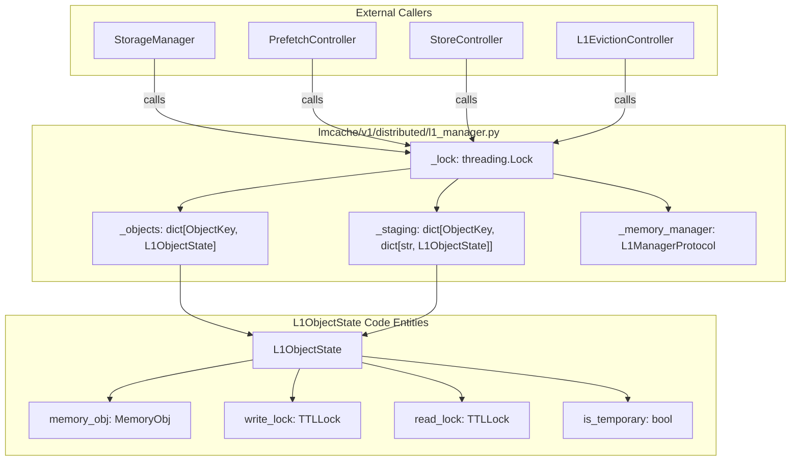
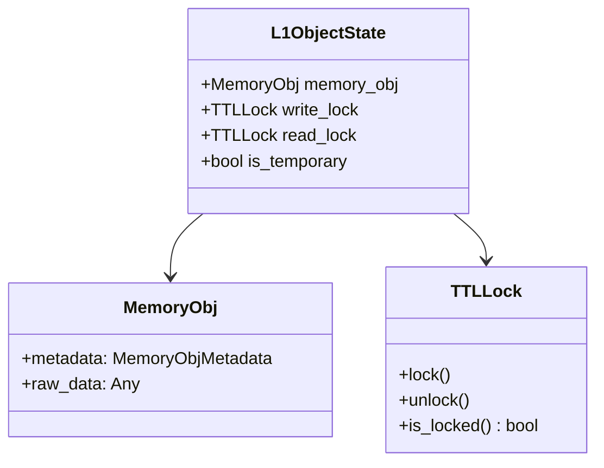
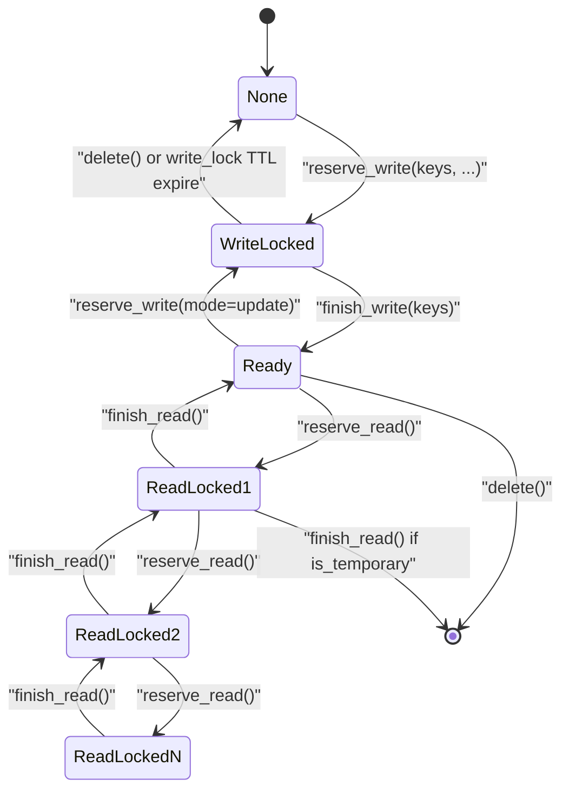
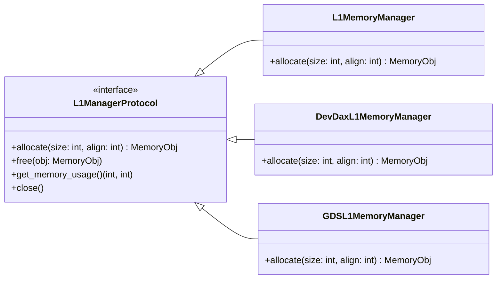

<!-- source: DeepWiki mcp.deepwiki.com · repo LMCache/LMCache · page 11.1 L1 Manager and Lock System · fetched 2026-10-21 -->

# L1 Manager and Lock System

Relevant source files

The following files were used as context for generating this wiki page:

- [docs/design/v1/distributed/l1_manager_interface.md](docs/design/v1/distributed/l1_manager_interface.md)
- [docs/source/mp/multi_l1.rst](docs/source/mp/multi_l1.rst)
- [lmcache/cli/commands/bench/l2_adapter_bench/command.py](lmcache/cli/commands/bench/l2_adapter_bench/command.py)
- [lmcache/cli/commands/bench/l2_adapter_bench/data.py](lmcache/cli/commands/bench/l2_adapter_bench/data.py)
- [lmcache/v1/distributed/api.py](lmcache/v1/distributed/api.py)
- [lmcache/v1/distributed/config.py](lmcache/v1/distributed/config.py)
- [lmcache/v1/distributed/internal_api.py](lmcache/v1/distributed/internal_api.py)
- [lmcache/v1/distributed/l1_manager.py](lmcache/v1/distributed/l1_manager.py)
- [lmcache/v1/distributed/l2_adapters/serde_wrapper.py](lmcache/v1/distributed/l2_adapters/serde_wrapper.py)
- [lmcache/v1/distributed/memory_manager/devdax_l1_memory_manager.py](lmcache/v1/distributed/memory_manager/devdax_l1_memory_manager.py)
- [lmcache/v1/distributed/memory_manager/l1_memory_manager.py](lmcache/v1/distributed/memory_manager/l1_memory_manager.py)
- [lmcache/v1/distributed/storage_controller.py](lmcache/v1/distributed/storage_controller.py)
- [lmcache/v1/distributed/storage_controllers/adapter_lifecycle.py](lmcache/v1/distributed/storage_controllers/adapter_lifecycle.py)
- [lmcache/v1/distributed/storage_controllers/eviction_controller.py](lmcache/v1/distributed/storage_controllers/eviction_controller.py)
- [lmcache/v1/distributed/storage_controllers/prefetch_controller.py](lmcache/v1/distributed/storage_controllers/prefetch_controller.py)
- [lmcache/v1/distributed/storage_controllers/store_controller.py](lmcache/v1/distributed/storage_controllers/store_controller.py)
- [lmcache/v1/distributed/storage_manager.py](lmcache/v1/distributed/storage_manager.py)
- [lmcache/v1/memory_allocators/devdax_memory_allocator.py](lmcache/v1/memory_allocators/devdax_memory_allocator.py)
- [lmcache/v1/memory_allocators/lazy_memory_allocator.py](lmcache/v1/memory_allocators/lazy_memory_allocator.py)
- [lmcache/v1/mp_observability/trace/codecs.py](lmcache/v1/mp_observability/trace/codecs.py)
- [tests/cli/commands/bench/l2_adapter_bench/test_data.py](tests/cli/commands/bench/l2_adapter_bench/test_data.py)
- [tests/v1/distributed/l2_adapters/test_p2p_l2_adapter_integration.py](tests/v1/distributed/l2_adapters/test_p2p_l2_adapter_integration.py)
- [tests/v1/distributed/serde/test_serde_e2e.py](tests/v1/distributed/serde/test_serde_e2e.py)
- [tests/v1/distributed/serde/test_serde_fs_e2e.py](tests/v1/distributed/serde/test_serde_fs_e2e.py)
- [tests/v1/distributed/test_dax_l2_adapter.py](tests/v1/distributed/test_dax_l2_adapter.py)
- [tests/v1/distributed/test_devdax_l1_allocator.py](tests/v1/distributed/test_devdax_l1_allocator.py)
- [tests/v1/distributed/test_distributed_storage_manager.py](tests/v1/distributed/test_distributed_storage_manager.py)
- [tests/v1/distributed/test_l1_interface.py](tests/v1/distributed/test_l1_interface.py)
- [tests/v1/distributed/test_l1_l2_state_metrics.py](tests/v1/distributed/test_l1_l2_state_metrics.py)
- [tests/v1/distributed/test_l1_manager.py](tests/v1/distributed/test_l1_manager.py)
- [tests/v1/distributed/test_l1_memory_manager.py](tests/v1/distributed/test_l1_memory_manager.py)
- [tests/v1/distributed/test_l1_mlock.py](tests/v1/distributed/test_l1_mlock.py)
- [tests/v1/distributed/test_object_key_parallel.py](tests/v1/distributed/test_object_key_parallel.py)
- [tests/v1/distributed/test_prefetch_controller.py](tests/v1/distributed/test_prefetch_controller.py)
- [tests/v1/distributed/test_runtime_adapters.py](tests/v1/distributed/test_runtime_adapters.py)
- [tests/v1/distributed/test_storage_manager_l2_keys.py](tests/v1/distributed/test_storage_manager_l2_keys.py)
- [tests/v1/mp_observability/trace/test_codecs.py](tests/v1/mp_observability/trace/test_codecs.py)
- [tests/v1/multiprocess/test_query_lookup_hits.py](tests/v1/multiprocess/test_query_lookup_hits.py)

## Purpose and Scope

This page explains in technical detail the implementation and roles of the `L1Manager` and the `TTLLock`-based state machine in LMCache (`[lmcache/v1/distributed/l1_manager.py:1-61]()`). It covers concurrency and lifecycle management of L1 cache objects, reserve/finish read and write operations, integration with L1 memory managers (including Device-DAX), and temporary object handling (`[lmcache/v1/distributed/l1_manager.py:88-189]()`, `[tests/v1/distributed/test_devdax_l1_allocator.py:168-220]()`).

This is a leaf page focused on LMCache's distributed storage manager subsystem dealing primarily with L1 tier locking, object lifecycle, and memory allocation (`[lmcache/v1/distributed/storage_manager.py:93-170]()`).

Sources:  
`[lmcache/v1/distributed/l1_manager.py:1-189]()`  
`[lmcache/v1/distributed/storage_manager.py:93-170]()`  
`[tests/v1/distributed/test_devdax_l1_allocator.py:168-220]()`

---

## Architecture Overview

The `L1Manager` implements an object lifecycle and lock state machine for managing L1 cache entries resident in fast memory tiers (DRAM, Device-DAX, or GDS) (`[lmcache/v1/distributed/l1_manager.py:144-187]()`). It coordinates concurrent operations requested by subsystems such as `StorageManager`, `PrefetchController`, `StoreController`, and `L1EvictionController` (`[lmcache/v1/distributed/storage_manager.py:101-175]()`).

Synchronization is anchored by a global `threading.Lock` (`self._lock`) protecting the object state maps and staging structures (`[lmcache/v1/distributed/l1_manager.py:113-117]()`). Every resident and staging object is bound to two atomic `TTLLock` instances (`[lmcache/v1/distributed/l1_manager.py:90-106]()`):
- `write_lock`: Exclusive writer reservation used during staging.
- `read_lock`: Multi-reader concurrency lock with time-to-live (TTL) expiry.

### Diagram: L1Manager Code Entity Space Integration

Sources:  
`[lmcache/v1/distributed/l1_manager.py:17-46]()`  
`[lmcache/v1/distributed/storage_manager.py:101-175]()`

---

## L1ObjectState Structure

Each cached object in L1 is represented internally by the `L1ObjectState` dataclass (`[lmcache/v1/distributed/l1_manager.py:89-106]()`):

| Field | Type | Description |
|---|---|---|
| `memory_obj` | `MemoryObj` | Allocated memory backing the object in L1 memory (`[lmcache/v1/distributed/l1_manager.py:95]()`). |
| `write_lock` | `TTLLock` | Exclusive writer reservation lock held during staging (`[lmcache/v1/distributed/l1_manager.py:98]()`). |
| `read_lock` | `TTLLock` | Read lock supporting concurrent readers with TTL (`[lmcache/v1/distributed/l1_manager.py:101]()`). |
| `is_temporary` | `bool` | Flag indicating whether the object should be deleted upon last reader release (`[lmcache/v1/distributed/l1_manager.py:104]()`). |

### Class Diagram: L1ObjectState and Dependencies

Sources:  
`[lmcache/v1/distributed/l1_manager.py:89-106]()`

---

## TTLLock-based Lock System

`TTLLock` is a C++ implemented primitive (`[lmcache/v1/distributed/l1_manager.py:14]()`) featuring automatic expiration semantics. Leases expire after configured TTL intervals to prevent permanent deadlocks caused by abnormal client termination:
- `write_ttl_seconds`: Controls write lock expiration timeouts (`[lmcache/v1/distributed/config.py:96]()`, `[tests/v1/distributed/test_distributed_storage_manager.py:84-95]()`).
- `read_ttl_seconds`: Controls read lock expiration timeouts (`[lmcache/v1/distributed/config.py:95]()`, `[tests/v1/distributed/test_distributed_storage_manager.py:85-96]()`).

Sources:  
`[lmcache/v1/distributed/l1_manager.py:11-15]()`  
`[lmcache/v1/distributed/config.py:95-96]()`  
`[tests/v1/distributed/test_distributed_storage_manager.py:82-96]()`

---

## Object Lifecycle State Machine

Objects transition through states managed by explicit `reserve_*` and `finish_*` API calls (`[lmcache/v1/distributed/l1_manager.py:144-187]()`).

### Diagram: Object State Transitions and Code Methods

### State Definitions

- **None**: Object is not present in resident storage (`[lmcache/v1/distributed/l1_manager.py:154]()`).
- **WriteLocked (Staging)**: Staged by a single writer under a specific tag; readers cannot observe staging objects (`[lmcache/v1/distributed/l1_manager.py:149-164]()`).
- **Ready (Resident)**: Object is admitted into resident storage and available for read operations (`[lmcache/v1/distributed/l1_manager.py:163-167]()`).
- **ReadLocked (count=N)**: Object is currently held by $N$ concurrent reader references (`[lmcache/v1/distributed/l1_manager.py:171-184]()`).
- **Temporary Objects**: Objects marked with `is_temporary=True` are purged immediately when their read count reaches zero (`[lmcache/v1/distributed/l1_manager.py:104]()`).

Sources:  
`[lmcache/v1/distributed/l1_manager.py:144-187]()`

---

## Core Locking and Lifecycle Operations

All operations are synchronized via the `@l1_mgr_synchronized` decorator, acquiring `self._lock` (`[lmcache/v1/distributed/l1_manager.py:108-117]()`).

### `reserve_read`
Reserves read locks for a batch of keys, incrementing the reader count and returning a mapping of keys to `L1OperationResult` (`[lmcache/v1/distributed/l1_manager.py:63-85]()`). The `read_locks` parameter is validated and clamped by `MAX_READ_LOCK_COUNT = 128` (`[lmcache/v1/distributed/l1_manager.py:51-85]()`).

### `finish_read`
Releases read locks on supplied keys, decrementing reference counts and purging temporary objects if counts reach zero (`[lmcache/v1/distributed/l1_manager.py:53-55]()`).

### `reserve_write`
Allocates staging objects for each key associated with the caller's tag, isolating uncommitted data from readers (`[lmcache/v1/distributed/l1_manager.py:121-144]()`).

### `finish_write`
Transitions objects from staging to the resident set, releases write locks, and notifies registered `L1ManagerListener` instances (such as `StoreController`) (`[lmcache/v1/distributed/storage_controllers/store_controller.py:70-134]()`).

### `finish_write_and_reserve_read`
Performs an atomic transition from write-locked staging to read-locked resident state, utilized by `PrefetchController` to eliminate race conditions during prefetch handoffs (`[lmcache/v1/distributed/storage_controllers/prefetch_controller.py:6-16]()`).

### `delete`
Removes unreserved keys from resident storage, returning `L1Error.KEY_IS_LOCKED` if active locks prevent deletion (`[lmcache/v1/distributed/error.py:39-40]()`).

Sources:  
`[lmcache/v1/distributed/l1_manager.py:51-144]()`  
`[lmcache/v1/distributed/storage_controllers/prefetch_controller.py:6-16]()`  
`[lmcache/v1/distributed/storage_controllers/store_controller.py:70-134]()`  
`[lmcache/v1/distributed/error.py:39-40]()`

---

## L1 Memory Managers and Device-DAX Integration

`L1Manager` delegates memory allocation to concrete implementations of `L1ManagerProtocol` (`[lmcache/v1/distributed/l1_manager.py:24-31]()`).

### Class Diagram: L1 Memory Managers

- **`L1MemoryManager`**: Standard DRAM-backed memory manager (`[lmcache/v1/distributed/memory_manager/l1_memory_manager.py]()`).
- **`DevDaxL1MemoryManager`**: Manages Device-DAX arenas backed by block devices for zero-copy persistent memory mapping (`[lmcache/v1/distributed/memory_manager/devdax_l1_memory_manager.py:30-59]()`).
- **`GDSL1MemoryManager`**: GPU Direct Storage memory manager (`[lmcache/v1/distributed/l1_manager.py:25]()`).

### Device-DAX Constraints
When `devdax_path` is specified in `L1MemoryManagerConfig`, lazy allocation (`use_lazy`) must be explicitly disabled (`False`), and `shm_name` must be empty (`[tests/v1/distributed/test_devdax_l1_allocator.py:168-202]()`).

Sources:  
`[lmcache/v1/distributed/l1_manager.py:24-31]()`  
`[lmcache/v1/distributed/memory_manager/l1_memory_manager.py]()`  
`[lmcache/v1/distributed/memory_manager/devdax_l1_memory_manager.py:30-59]()`  
`[tests/v1/distributed/test_devdax_l1_allocator.py:168-202]()`

---

## Temporary Objects

Temporary objects (`is_temporary=True`) provide ephemeral storage that is automatically reclaimed as soon as all active reader references are released via `finish_read`, avoiding manual cleanup overhead for transient buffers (`[lmcache/v1/distributed/l1_manager.py:104]()`, `[lmcache/v1/distributed/l1_manager.py:148-170]()`).

Sources:  
`[lmcache/v1/distributed/l1_manager.py:104]()`  
`[lmcache/v1/distributed/l1_manager.py:148-170]()`

---

## Multi-Reader Lock Counts and Clamping

Concurrent reader tracking relies on atomic increments/decrements. The `read_locks` parameter in `reserve_read` and `finish_read` is bounded by `MAX_READ_LOCK_COUNT` (128) to prevent thread starvation and excessive global lock hold times (`[lmcache/v1/distributed/l1_manager.py:49-85]()`).

Sources:  
`[lmcache/v1/distributed/l1_manager.py:49-85]()`

---

## Observability and Lock Listeners

- **Metrics**: Memory utilization ratios are exposed via OpenTelemetry gauges (`[lmcache/v1/distributed/l1_manager.py:120-138]()`).
- **Listeners**: `L1ManagerListener` provides non-blocking callbacks (`on_l1_keys_write_finished`) to notify components like `StoreController` about write completion events (`[lmcache/v1/distributed/storage_controllers/store_controller.py:70-134]()`).

Sources:  
`[lmcache/v1/distributed/l1_manager.py:120-138]()`  
`[lmcache/v1/distributed/storage_controllers/store_controller.py:70-134]()`

---

# Summary

The `L1Manager` and `TTLLock` system coordinate atomic state transitions, thread-safe staging buffers, and multi-reader concurrency across LMCache's distributed storage tiers. By integrating flexible memory allocators including Device-DAX and supporting automatic cleanup of temporary objects, the subsystem ensures high-performance, crash-safe KV cache management.

---

