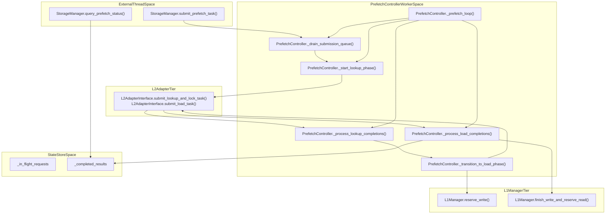
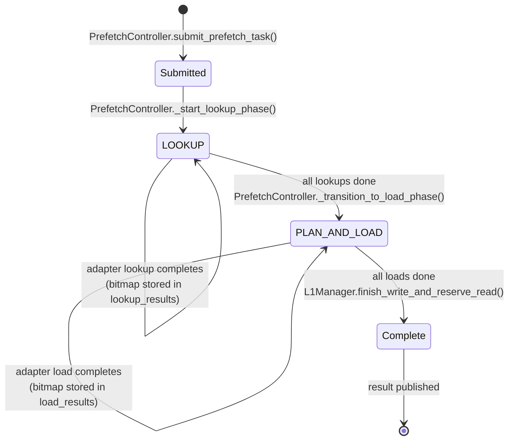

<!-- source: DeepWiki mcp.deepwiki.com · repo LMCache/LMCache · page 11.2 Prefetch Controller · fetched 2026-10-21 -->

# Prefetch Controller

Relevant source files

The following files were used as context for generating this wiki page:

- [docs/design/v1/distributed/l1_manager_interface.md](docs/design/v1/distributed/l1_manager_interface.md)
- [docs/design/v1/distributed/l2_adapters/overall.md](docs/design/v1/distributed/l2_adapters/overall.md)
- [lmcache/v1/distributed/api.py](lmcache/v1/distributed/api.py)
- [lmcache/v1/distributed/internal_api.py](lmcache/v1/distributed/internal_api.py)
- [lmcache/v1/distributed/l1_manager.py](lmcache/v1/distributed/l1_manager.py)
- [lmcache/v1/distributed/l2_adapters/serde_wrapper.py](lmcache/v1/distributed/l2_adapters/serde_wrapper.py)
- [lmcache/v1/distributed/storage_controller.py](lmcache/v1/distributed/storage_controller.py)
- [lmcache/v1/distributed/storage_controllers/__init__.py](lmcache/v1/distributed/storage_controllers/__init__.py)
- [lmcache/v1/distributed/storage_controllers/adapter_lifecycle.py](lmcache/v1/distributed/storage_controllers/adapter_lifecycle.py)
- [lmcache/v1/distributed/storage_controllers/eviction_controller.py](lmcache/v1/distributed/storage_controllers/eviction_controller.py)
- [lmcache/v1/distributed/storage_controllers/prefetch_controller.py](lmcache/v1/distributed/storage_controllers/prefetch_controller.py)
- [lmcache/v1/distributed/storage_controllers/prefetch_policy.py](lmcache/v1/distributed/storage_controllers/prefetch_policy.py)
- [lmcache/v1/distributed/storage_controllers/store_controller.py](lmcache/v1/distributed/storage_controllers/store_controller.py)
- [lmcache/v1/distributed/storage_controllers/store_policy.py](lmcache/v1/distributed/storage_controllers/store_policy.py)
- [lmcache/v1/distributed/storage_controllers/utils.py](lmcache/v1/distributed/storage_controllers/utils.py)
- [lmcache/v1/distributed/storage_manager.py](lmcache/v1/distributed/storage_manager.py)
- [lmcache/v1/mp_observability/trace/codecs.py](lmcache/v1/mp_observability/trace/codecs.py)
- [tests/v1/distributed/l2_adapters/test_p2p_l2_adapter_integration.py](tests/v1/distributed/l2_adapters/test_p2p_l2_adapter_integration.py)
- [tests/v1/distributed/serde/test_serde_e2e.py](tests/v1/distributed/serde/test_serde_e2e.py)
- [tests/v1/distributed/serde/test_serde_fs_e2e.py](tests/v1/distributed/serde/test_serde_fs_e2e.py)
- [tests/v1/distributed/test_dax_l2_adapter.py](tests/v1/distributed/test_dax_l2_adapter.py)
- [tests/v1/distributed/test_distributed_storage_manager.py](tests/v1/distributed/test_distributed_storage_manager.py)
- [tests/v1/distributed/test_l1_interface.py](tests/v1/distributed/test_l1_interface.py)
- [tests/v1/distributed/test_l1_l2_state_metrics.py](tests/v1/distributed/test_l1_l2_state_metrics.py)
- [tests/v1/distributed/test_l1_manager.py](tests/v1/distributed/test_l1_manager.py)
- [tests/v1/distributed/test_multimodel.py](tests/v1/distributed/test_multimodel.py)
- [tests/v1/distributed/test_object_key_parallel.py](tests/v1/distributed/test_object_key_parallel.py)
- [tests/v1/distributed/test_prefetch_controller.py](tests/v1/distributed/test_prefetch_controller.py)
- [tests/v1/distributed/test_prefetch_policy.py](tests/v1/distributed/test_prefetch_policy.py)
- [tests/v1/distributed/test_runtime_adapters.py](tests/v1/distributed/test_runtime_adapters.py)
- [tests/v1/distributed/test_storage_controller_utils.py](tests/v1/distributed/test_storage_controller_utils.py)
- [tests/v1/distributed/test_storage_manager_l2_keys.py](tests/v1/distributed/test_storage_manager_l2_keys.py)
- [tests/v1/distributed/test_store_controller.py](tests/v1/distributed/test_store_controller.py)
- [tests/v1/distributed/test_store_policy.py](tests/v1/distributed/test_store_policy.py)
- [tests/v1/mp_observability/trace/test_codecs.py](tests/v1/mp_observability/trace/test_codecs.py)
- [tests/v1/multiprocess/test_query_lookup_hits.py](tests/v1/multiprocess/test_query_lookup_hits.py)

## Purpose and Scope

The `PrefetchController` manages asynchronous prefetching of KV cache entries from slower L2 storage backends into faster L1 cache (typically CPU DRAM or near-CPU memory). It runs within the distributed storage manager (`StorageManager`) as a dedicated background thread, facilitating parallel participation of multiple L2 adapters. This controller implements a two-phase pipeline — a **LOOKUP** stage that searches and locks keys in L2 followed by a **PLAN_AND_LOAD** stage that decides which keys to load and commits them in L1 [lmcache/v1/distributed/storage_controllers/prefetch_controller.py:3-16](), [lmcache/v1/distributed/storage_manager.py:56-62]().

The controller supports flexible fetching policies, such as prefix-trimming of hits versus loading all found keys to handle partial L1 allocation failure. It also manages multi-reader scenarios for models like Multi-Level Attention (MLA) by allowing multiple read locks per prefetched key [lmcache/v1/distributed/storage_controllers/prefetch_controller.py:3-16]().

Sources: `[lmcache/v1/distributed/storage_controllers/prefetch_controller.py:3-16]`, `[lmcache/v1/distributed/storage_manager.py:56-62]`

---

## Architecture Overview

The `PrefetchController` integrates into LMCache's storage subsystem between the `StorageManager` API and backend L1/L2 storage. Requests submitted via `StorageManager.submit_prefetch_task()` enter a queue processed by the controller thread. Using the L2 adapter interfaces (`L2AdapterInterface`), it issues parallel `lookup_and_lock` queries, waits for their completion, then plans and issues load tasks backed by L1 buffer allocations. Finally, it admits loaded objects into L1 and reports results [lmcache/v1/distributed/storage_controllers/prefetch_controller.py:200-286](), [lmcache/v1/distributed/storage_manager.py:150-170]().

### Component Interaction and Code Entity Mapping

Sources: `[lmcache/v1/distributed/storage_controllers/prefetch_controller.py:200-286]`, `[lmcache/v1/distributed/storage_manager.py:150-170]`

---

## Request Lifecycle

A prefetch request processes through distinct phases tracked in `InFlightPrefetchRequest` instances [lmcache/v1/distributed/storage_controllers/prefetch_controller.py:178-208]()：

Sources: `[lmcache/v1/distributed/storage_controllers/prefetch_controller.py:178-208]`, `[lmcache/v1/distributed/storage_controllers/prefetch_controller.py:442-631]`

---

## Two-Phase Pipeline

### Lookup Phase

In the **LOOKUP** phase, `PrefetchController._start_lookup_phase()` collects grouped object keys and dispatches `submit_lookup_and_lock_task()` concurrently across all live L2 adapters [lmcache/v1/distributed/storage_controllers/prefetch_controller.py:442-470](). Event file descriptors (`get_lookup_and_lock_event_fd`) signal readiness, allowing `PrefetchController._process_lookup_completions()` to aggregate adapter output into per-adapter `Bitmap` structures [lmcache/v1/distributed/storage_controllers/prefetch_controller.py:471-501]().

### Load Phase

In the **PLAN_AND_LOAD** phase (`PrefetchController._transition_to_load_phase()`), combined lookup bitmaps are processed by the configured `PrefetchPolicy` [lmcache/v1/distributed/storage_controllers/prefetch_controller.py:502-584](). The controller invokes `L1Manager.reserve_write()` using a unique request write tag (`_get_prefetch_write_tag`) and issues `submit_load_task()` to populate the reserved L1 staging objects [lmcache/v1/distributed/storage_controllers/prefetch_controller.py:516-560](). When loads complete, `PrefetchController._process_load_completions()` invokes `L1Manager.finish_write_and_reserve_read()` to transition states into active L1 read locks [lmcache/v1/distributed/storage_controllers/prefetch_controller.py:598-631]().

Sources: `[lmcache/v1/distributed/storage_controllers/prefetch_controller.py:442-631]`, `[lmcache/v1/distributed/l1_manager.py:137-194]`

---

## Fetching Policies and Prefix-Trimming

The controller evaluates matching chunks based on the `FetchingPolicy` parameter defined in `PrefetchTaskSpec` [lmcache/v1/distributed/api.py:27-38]()：

| Policy | Behavior | Typical Use Case |
| :--- | :--- | :--- |
| `prefix` | Retains only the longest leading run of contiguous chunks starting from chunk 0. | Standard LLM KV caching prefix token reuse. |
| `full` | Retains all successfully loaded chunks regardless of intervening gaps. | Graceful handling of partial L1 allocation failures. |

Prefix-trimming calculations are executed via `PrefetchPolicy.load_trim()` during the transition from lookup to load [lmcache/v1/distributed/storage_controllers/prefetch_controller.py:141-153](), [lmcache/v1/distributed/storage_controllers/prefetch_policy.py:115-164]().

Sources: `[lmcache/v1/distributed/storage_controllers/prefetch_controller.py:141-153]`, `[lmcache/v1/distributed/api.py:27-38]`, `[lmcache/v1/distributed/storage_controllers/prefetch_policy.py:115-164]`

---

## Multi-Reader Support via `num_kv_readers`

For models utilizing Multi-Level Attention (MLA) or parallel tensor workers sharing identical prefetched keys, `num_kv_readers` configures how many read locks are acquired per key [lmcache/v1/distributed/storage_controllers/prefetch_controller.py:194-196](). `L1Manager.finish_write_and_reserve_read()` handles these requirements atomically upon load completion [lmcache/v1/distributed/storage_controllers/prefetch_controller.py:626-631](), [lmcache/v1/distributed/l1_manager.py:95-119]().

Sources: `[lmcache/v1/distributed/storage_controllers/prefetch_controller.py:194-196]`, `[lmcache/v1/distributed/l1_manager.py:95-119]`

---

## Observability and Monitoring

`PrefetchController` communicates state transitions via the global `EventBus`, emitting metadata events such as `L2_PREFETCH_LOOKUP_SUBMITTED`, `L2_PREFETCH_LOOKUP_COMPLETED`, `L2_PREFETCH_LOAD_SUBMITTED`, and `L2_PREFETCH_LOAD_COMPLETED` [lmcache/v1/distributed/storage_controllers/prefetch_controller.py:50-61](). OpenTelemetry gauges record staging memory footprints and in-flight transfer counts [lmcache/v1/distributed/storage_controllers/prefetch_controller.py:270-282]().

Sources: `[lmcache/v1/distributed/storage_controllers/prefetch_controller.py:50-61]`, `[lmcache/v1/distributed/storage_controllers/prefetch_controller.py:270-282]`

---

## Thread Safety and Concurrency

The background thread executing `_prefetch_loop()` monitors all active L2 adapter event file descriptors via `select.poll()` with `PREFETCH_LOOP_POLL_TIMEOUT_MS` [lmcache/v1/distributed/storage_controllers/prefetch_controller.py:73-75](), [lmcache/v1/distributed/storage_controllers/prefetch_controller.py:250-286](). Internal collections like `_in_flight_requests` and task registries are protected under a thread mutex lock (`self._lock`) [lmcache/v1/distributed/storage_controllers/prefetch_controller.py:210-248]().

Sources: `[lmcache/v1/distributed/storage_controllers/prefetch_controller.py:73-75]`, `[lmcache/v1/distributed/storage_controllers/prefetch_controller.py:210-286]`

---

## Implementation Details

### Key Classes and Methods

- `PrefetchController.submit_prefetch_task(self, spec: PrefetchTaskSpec) -> PrefetchRequestId`: Enqueues request specifications into the controller queue [lmcache/v1/distributed/storage_controllers/prefetch_controller.py:292-328]().
- `PrefetchController._start_lookup_phase(self, request: InFlightPrefetchRequest) -> None`: Initiates adapter-level lookups and registers poll handlers [lmcache/v1/distributed/storage_controllers/prefetch_controller.py:442-470]().
- `PrefetchController._transition_to_load_phase(self, request: InFlightPrefetchRequest) -> None`: Applies `PrefetchPolicy`, reserves L1 space, and initiates L2 load tasks [lmcache/v1/distributed/storage_controllers/prefetch_controller.py:502-584]().
- `PrefetchController._process_load_completions(self) -> None`: Receives load completion signals, transitions locks on `L1Manager`, and populates `_completed_results` [lmcache/v1/distributed/storage_controllers/prefetch_controller.py:598-631]().
- `PrefetchController.query_prefetch_result(self, request_id: PrefetchRequestId) -> PrefetchResult | None`: Fetches completed results for external callers [lmcache/v1/distributed/storage_controllers/prefetch_controller.py:351-364]().

Sources: `[lmcache/v1/distributed/storage_controllers/prefetch_controller.py:292-631]`

---

