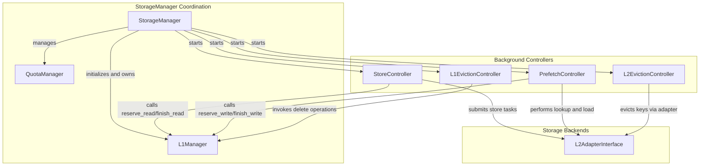
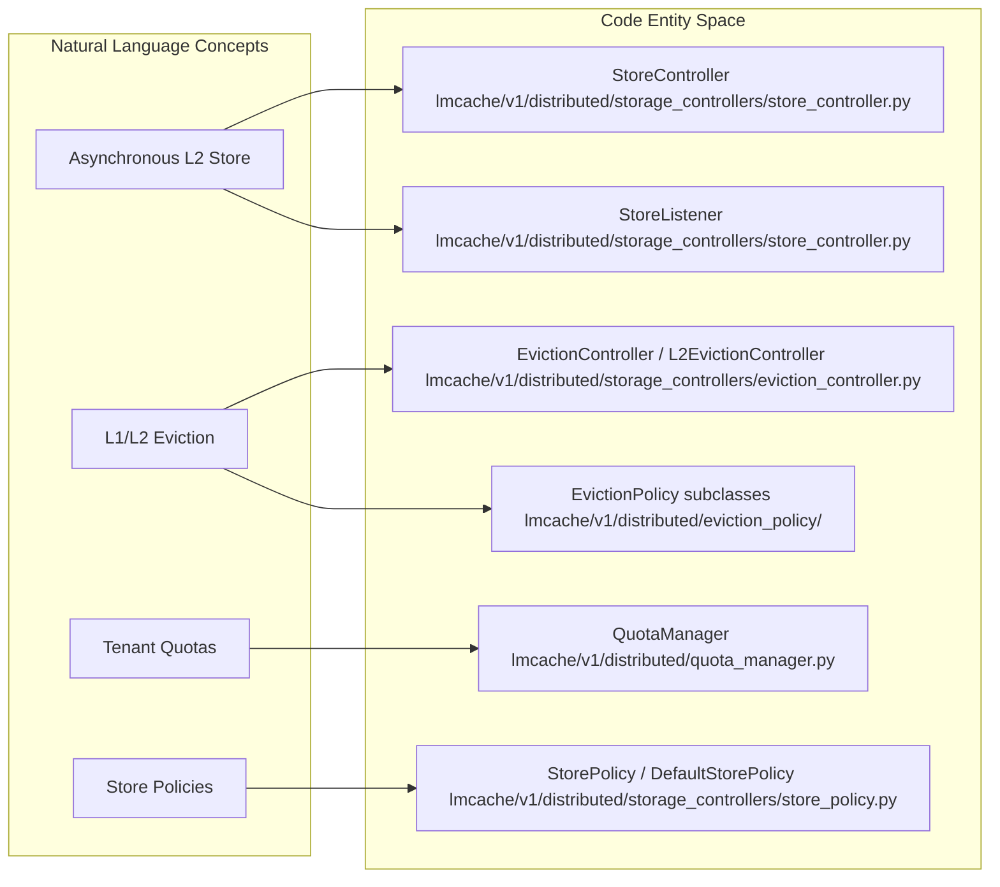
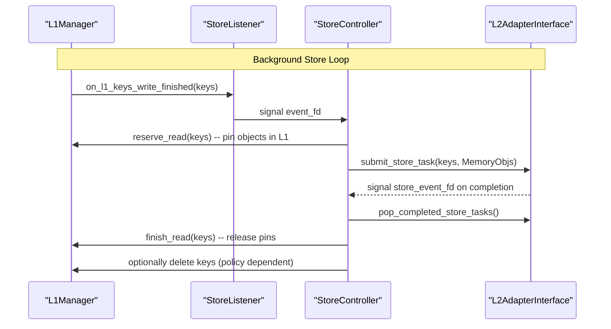

<!-- source: DeepWiki mcp.deepwiki.com · repo LMCache/LMCache · page 11.3 Store, Eviction and Quota Controllers · fetched 2026-10-21 -->

# Store, Eviction and Quota Controllers

<details>
<summary>Relevant source files</summary>

The following files were used as context for generating this wiki page:

- [docs/design/v1/distributed/l2_adapters/l2_eviction.md](docs/design/v1/distributed/l2_adapters/l2_eviction.md)
- [docs/design/v1/distributed/l2_adapters/overall.md](docs/design/v1/distributed/l2_adapters/overall.md)
- [docs/source/mp/l2_storage/index.rst](docs/source/mp/l2_storage/index.rst)
- [lmcache/v1/distributed/eviction.py](lmcache/v1/distributed/eviction.py)
- [lmcache/v1/distributed/eviction_policy/__init__.py](lmcache/v1/distributed/eviction_policy/__init__.py)
- [lmcache/v1/distributed/eviction_policy/arc.py](lmcache/v1/distributed/eviction_policy/arc.py)
- [lmcache/v1/distributed/eviction_policy/factory.py](lmcache/v1/distributed/eviction_policy/factory.py)
- [lmcache/v1/distributed/eviction_policy/lru.py](lmcache/v1/distributed/eviction_policy/lru.py)
- [lmcache/v1/distributed/eviction_policy/noop.py](lmcache/v1/distributed/eviction_policy/noop.py)
- [lmcache/v1/distributed/storage_controllers/__init__.py](lmcache/v1/distributed/storage_controllers/__init__.py)
- [lmcache/v1/distributed/storage_controllers/prefetch_policy.py](lmcache/v1/distributed/storage_controllers/prefetch_policy.py)
- [lmcache/v1/distributed/storage_controllers/store_policy.py](lmcache/v1/distributed/storage_controllers/store_policy.py)
- [lmcache/v1/distributed/storage_controllers/utils.py](lmcache/v1/distributed/storage_controllers/utils.py)
- [tests/v1/distributed/test_arc_eviction_policy.py](tests/v1/distributed/test_arc_eviction_policy.py)
- [tests/v1/distributed/test_fs_l2_adapter_delete.py](tests/v1/distributed/test_fs_l2_adapter_delete.py)
- [tests/v1/distributed/test_lru_eviction_policy.py](tests/v1/distributed/test_lru_eviction_policy.py)
- [tests/v1/distributed/test_multimodel.py](tests/v1/distributed/test_multimodel.py)
- [tests/v1/distributed/test_prefetch_policy.py](tests/v1/distributed/test_prefetch_policy.py)
- [tests/v1/distributed/test_storage_controller_utils.py](tests/v1/distributed/test_storage_controller_utils.py)
- [tests/v1/distributed/test_store_controller.py](tests/v1/distributed/test_store_controller.py)
- [tests/v1/distributed/test_store_policy.py](tests/v1/distributed/test_store_policy.py)

</details>


The store and eviction controllers are background threads responsible for managing cache lifecycle operations within LMCache’s distributed storage manager. The `StoreController` (`lmcache/v1/distributed/storage_controllers/store_controller.py`) asynchronously propagates newly-written objects from the L1 cache tier to L2 storage backends, ensuring data persistence. The eviction controllers monitor memory usage watermarks and enforce eviction policies to keep cache usage within configured limits for both L1 and L2 caches. Additionally, the quota management subsystem maintains per-user quota constraints to implement tenant isolation and resource control.

For details on the `PrefetchController` which asynchronously preloads data into L1, see section [11.2 Prefetch Controller](11.2). For the general distributed storage architecture and coordination, see [Distributed Storage Manager](11).

---

## Architecture Overview

These controllers are coordinated by the `StorageManager` class (`lmcache/v1/distributed/storage_manager.py`), which orchestrates the L1 and L2 cache tiers, eviction, and quota modules. Controllers run as background daemon threads to avoid impacting LLM serving latency.


Sources: [lmcache/v1/distributed/storage_manager.py:93-170](), [lmcache/v1/distributed/storage_controllers/store_controller.py:196-210](), [lmcache/v1/distributed/storage_controllers/prefetch_controller.py:28-182]()

### Natural Language to Code Entity Mapping

This diagram bridges natural language functional concepts to exact Python classes and methods in the codebase:


Sources: [lmcache/v1/distributed/storage_controllers/store_controller.py:1-150](), [lmcache/v1/distributed/storage_controllers/eviction_controller.py:30-150](), [lmcache/v1/distributed/quota_manager.py:10-100](), [lmcache/v1/distributed/storage_controllers/store_policy.py:18-150]()

---

## StoreController

The `StoreController` (`lmcache/v1/distributed/storage_controllers/store_controller.py`) is responsible for asynchronously propagating completed L1 writes to one or more L2 adapters. This background service ensures persisted copies exist downstream for durability and capacity extension.

### StoreController Implementation and Data Flow

- **`StoreListener` Registration:**  
  The controller registers a `StoreListener` with `L1Manager` which receives notifications (`on_l1_keys_write_finished`) whenever L1 completes key writes [lmcache/v1/distributed/storage_controllers/store_controller.py:70-158](). The `StoreListener` enqueues these keys and signals an eventfd [tests/v1/distributed/test_store_controller.py:184-187]().

- **Event-Driven Loop:**  
  The `StoreController` runs a dedicated background thread with a `select.poll()` loop that waits on:  
  1. The eventfd signaled by `StoreListener` when new keys complete writing in L1 [docs/design/v1/distributed/l2_adapters/overall.md:148-153]().  
  2. Per-adapter store completion eventfds notifying when L2 store tasks finish [docs/design/v1/distributed/l2_adapters/overall.md:150-153]().

- **Key Processing and Grouping:**  
  When new keys arrive, they are grouped by a shape key (model name and `kv_rank`) to batch store tasks by compatible layout [docs/design/v1/distributed/l2_adapters/overall.md:166-170]().

- **Reserve L1 Read Locks:**  
  Prior to submitting store tasks, the controller reserves L1 read locks on all keys to pin the buffers, preventing eviction or overwrites during asynchronous L2 transfer [docs/design/v1/distributed/l2_adapters/overall.md:130-134]().

- **Submit Store Tasks:**  
  For each L2 adapter, the controller calls `submit_store_task` passing keys and their associated `MemoryObj`s for the underlying L2 persistence operation [docs/design/v1/distributed/l2_adapters/overall.md:66-72]().

- **Task Completion Handling:**  
  On receiving store completion events, the controller queries results, releases L1 read locks (via `finish_read`), and calls the current store policy which may decide to delete keys from L1 to free space [docs/design/v1/distributed/l2_adapters/overall.md:150-165]().

### Asynchronous Store Task Flow Diagram


Sources: [lmcache/v1/distributed/storage_controllers/store_controller.py:15-201](), [docs/design/v1/distributed/l2_adapters/overall.md:46-120]()

### Store Policies

The store controller uses pluggable policies (`lmcache/v1/distributed/storage_controllers/store_policy.py`) to define which adapters receive data and post-store L1 cleanup behavior:

| Store Policy      | Implementation           | Description                                                                       |
|-------------------|--------------------------|-----------------------------------------------------------------------------------|
| **default**       | `DefaultStorePolicy`     | Stores all keys to all L2 adapters, keeps keys resident in L1 for hot access [lmcache/v1/distributed/storage_controllers/store_policy.py:113-150]().     |
| **skip_l1**       | `BufferOnlyStorePolicy`  | Stores to all L2 adapters, but deletes keys from L1 immediately after store [lmcache/v1/distributed/storage_controllers/store_policy.py:152-179]().      |

These policies implement the strategy for efficient balance between fast-access L1 caching and durable or scaled L2 persistence [lmcache/v1/distributed/storage_controllers/store_policy.py:20-56]().

Sources: [lmcache/v1/distributed/storage_controllers/store_controller.py:15-201](), [lmcache/v1/distributed/storage_controllers/store_policy.py:20-56]()

---

## Eviction Controllers

LMCache implements eviction through two controllers specialized for each caching tier: `L1EvictionController` and `L2EvictionController` (`lmcache/v1/distributed/storage_controllers/eviction_controller.py`). Both inherit from a common eviction controller interface driven by configurable watermarks and eviction policies [docs/design/v1/distributed/l2_adapters/l2_eviction.md:13-22]().

### Common Eviction Controller Logic

- Both controllers run in their own background threads [docs/design/v1/distributed/l2_adapters/l2_eviction.md:22]().
- They periodically fetch memory usage statistics from their managed cache tier.
- When usage exceeds the configured `trigger_watermark` and stays above thresholds after evictions, eviction actions are triggered [docs/design/v1/distributed/l2_adapters/l2_eviction.md:144-149]().
- Eviction policies compute `EvictionAction`s (`lmcache/v1/distributed/internal_api.py`), specifying keys to remove and their targeted eviction destination [docs/design/v1/distributed/l2_adapters/l2_eviction.md:146-149]().
- Evicted keys are removed from the associated storage backend by invoking deletion APIs [docs/design/v1/distributed/l2_adapters/l2_eviction.md:50-55]().

### L1 Eviction Controller

- Monitors L1 memory usage and staging memory through `L1Manager.get_memory_usage()` and `get_staging_memory_usage()` [lmcache/v1/distributed/storage_controllers/eviction_controller.py:160-190]().
- When the trigger watermark is hit, calls L1 eviction policy's `get_eviction_actions()` to select keys for removal [lmcache/v1/distributed/eviction.py:135-140]().
- Applies eviction actions by deleting keys in the `L1Manager`.
- Supports TTL-based eviction of staged writes exposed via `write_ttl_seconds` [lmcache/v1/distributed/l1_manager.py:130-178]().
- Incorporates L1-specific concurrency and locking semantics using `TTLLock` within `L1ObjectState` [lmcache/v1/distributed/l1_manager.py:40-70]().

### L2 Eviction Controller

- Manages eviction across multiple L2 adapters concurrently [docs/design/v1/distributed/l2_adapters/l2_eviction.md:13-16]().
- Tracks usage state per adapter using `L2AdapterEvictionState` that includes adapter references, eviction config, and a listener bridge [docs/design/v1/distributed/l2_adapters/l2_eviction.md:113-124]().
- Iterates all L2 adapters to compare usage against watermarks; triggers eviction action computation on triggers [docs/design/v1/distributed/l2_adapters/l2_eviction.md:144-149]().
- Delegates eviction of keys by calling L2 adapter deletion interfaces [docs/design/v1/distributed/l2_adapters/l2_eviction.md:50-55]().
- Supports eviction policies enabling cache salt (tenant) isolation [lmcache/v1/distributed/eviction.py:32-43]().

Sources: [lmcache/v1/distributed/storage_controllers/eviction_controller.py:40-200](), [lmcache/v1/distributed/eviction.py:15-192](), [docs/design/v1/distributed/l2_adapters/l2_eviction.md:10-155]()

---

## Eviction Policies and Quota Management

LMCache implements an extensible policy framework for eviction with different strategies and integrates per-user quota enforcement.

### Eviction Policy Implementations

Supported policies (`lmcache/v1/distributed/eviction_policy/`) include:

| Eviction Policy  | Code Entity               | Description                                                                                   |
|------------------|---------------------------|-----------------------------------------------------------------------------------------------|
| LRU              | `LRUEvictionPolicy`       | Tracks recency order using an `OrderedDict`, evicts least recently used keys first [lmcache/v1/distributed/eviction_policy/lru.py:20-36]() |
| ARC              | `ARCEvictionPolicy`       | Adaptive Replacement Cache balancing recency and frequency, using `T1`, `T2`, `B1`, `B2` lists [lmcache/v1/distributed/eviction_policy/arc.py:18-41]() |
| IsolatedLRU      | `IsolatedLRUEvictionPolicy` | Supports eviction scoped per user/tenant isolation (cache salt) [lmcache/v1/distributed/eviction_policy/isolated_lru.py]() |
| noop             | `NoOpEvictionPolicy`      | Does no eviction, disabling eviction behavior [lmcache/v1/distributed/eviction_policy/noop.py]() |

Policies are injected into eviction controllers via `EvictionConfig` and instantiated using a factory pattern (`lmcache/v1/distributed/eviction_policy/factory.py`) [lmcache/v1/distributed/eviction_policy/factory.py:14-35]().

### Quota Manager for Per-User Isolation

- `QuotaManager` maintains a thread-safe mapping from **cache_salt** strings (tenant identifiers) to byte quotas [lmcache/v1/distributed/quota_manager.py:37-138]().
- Enforces resource limits on tenants to avoid noisy neighbor effects.
- Integrates with eviction policies supporting `support_isolation=True` [lmcache/v1/distributed/eviction.py:32-43]().
- Supports runtime modification via set, delete, and clear quota operations, applying at the next eviction cycle.

Quota enforcement and eviction interact: eviction controllers use per-salt quotas when configured to limit memory pressure specifically for tenants with assigned constraints.

Sources: [lmcache/v1/distributed/eviction.py:21-175](), [lmcache/v1/distributed/eviction_policy/factory.py:14-35](), [lmcache/v1/distributed/quota_manager.py:10-138]()

---

## Memory State Transitions within L1Manager

`L1Manager` manages an internal state machine to guarantee cache consistency and safety during concurrent operations including reads, writes, and eviction. 

Objects transition through these states controlled by `TTLLock` read/write locks to synchronize access:

```mermaid
stateDiagram-v2
    direction TB
    [*] --> None
    None --> WriteLocked : "L1Manager.reserve_write(key, tag)"
    WriteLocked --> Ready : "L1Manager.finish_write(keys)"
    Ready --> ReadLocked : "L1Manager.reserve_read(keys)"
    ReadLocked --> Ready : "L1Manager.finish_read(keys)"
    Ready --> [*] : "L1Manager.delete(keys)"
    
    note right of WriteLocked
      "Write lock protects staging write buffer"
    end
```
Sources: [lmcache/v1/distributed/l1_manager.py:128-188](), [lmcache/v1/distributed/storage_controllers/store_controller.py:70-194]()

---

## Summary

The `StoreController` coordinates asynchronous L2 writes of completed L1 objects, carefully reserving and releasing reads to maintain data consistency. The eviction controller family watches memory watermarks to trigger eviction using pluggable policies, including multi-tenant isolation-aware strategies. Quota management integrates user-level limits into eviction decisions. These components work under the coordination of `StorageManager` and with the internal state machine of `L1Manager` to provide robust, scalable, and configurable multi-tier cache lifecycle management in LMCache.

---

## References

- StorageManager coordination and controller lifecycle: [lmcache/v1/distributed/storage_manager.py:93-170]()
- StoreController and StoreListener async L2 writing: [lmcache/v1/distributed/storage_controllers/store_controller.py:15-201]()
- StorePolicy implementations: [lmcache/v1/distributed/storage_controllers/store_policy.py:10-56]()
- EvictionController logic, L1/L2 monitoring and eviction: [lmcache/v1/distributed/storage_controllers/eviction_controller.py:30-195](), [lmcache/v1/distributed/eviction.py:1-192]()
- Eviction policies (LRU, ARC, isolated LRU, noop): [lmcache/v1/distributed/eviction_policy/lru.py:10-60](), [lmcache/v1/distributed/eviction_policy/arc.py:18-41](), [lmcache/v1/distributed/eviction_policy/isolated_lru.py:10-43](), [lmcache/v1/distributed/eviction_policy/noop.py:20-30]()
- QuotaManager per-user quota enforcement: [lmcache/v1/distributed/quota_manager.py:10-138]()
- L1Manager object state transitions: [lmcache/v1/distributed/l1_manager.py:128-188]()

---

