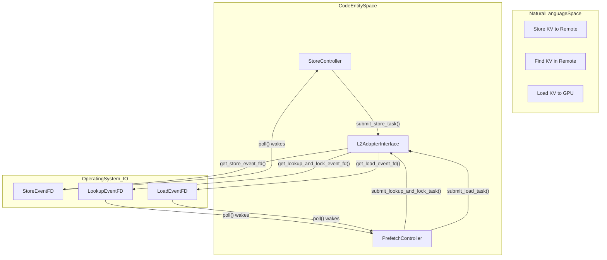

<!-- source: DeepWiki mcp.deepwiki.com · repo LMCache/LMCache · page 11.4 L2 Adapters · fetched 2026-10-21 -->

# L2 Adapters

<details>
<summary>Relevant source files</summary>

The following files were used as context for generating this wiki page:

- [.github/CODEOWNERS](.github/CODEOWNERS)
- [csrc/storage_backends/fs/connector.cpp](csrc/storage_backends/fs/connector.cpp)
- [csrc/storage_backends/fs/connector.h](csrc/storage_backends/fs/connector.h)
- [csrc/storage_backends/hf3fs/connector.cpp](csrc/storage_backends/hf3fs/connector.cpp)
- [csrc/storage_backends/hf3fs/connector.h](csrc/storage_backends/hf3fs/connector.h)
- [csrc/storage_backends/hf3fs/hf3fs_absl_init.cpp](csrc/storage_backends/hf3fs/hf3fs_absl_init.cpp)
- [csrc/storage_backends/hf3fs/pybind.cpp](csrc/storage_backends/hf3fs/pybind.cpp)
- [csrc/storage_backends/hf3fs/sharded_flat_hash_set.h](csrc/storage_backends/hf3fs/sharded_flat_hash_set.h)
- [csrc/storage_backends/keys.h](csrc/storage_backends/keys.h)
- [docs/design/v1/distributed/l2_adapters/l2_per_user_quota.md](docs/design/v1/distributed/l2_adapters/l2_per_user_quota.md)
- [docs/design/v1/distributed/l2_adapters/nixl_store.md](docs/design/v1/distributed/l2_adapters/nixl_store.md)
- [docs/source/developer_guide/extending_lmcache/remote_storage_plugins.rst](docs/source/developer_guide/extending_lmcache/remote_storage_plugins.rst)
- [docs/source/kv_cache/storage_backends/hfbucket.rst](docs/source/kv_cache/storage_backends/hfbucket.rst)
- [docs/source/kv_cache/storage_backends/resp.rst](docs/source/kv_cache/storage_backends/resp.rst)
- [docs/source/kv_cache/storage_backends/s3.rst](docs/source/kv_cache/storage_backends/s3.rst)
- [docs/source/mp/l2_storage/hf3fs.rst](docs/source/mp/l2_storage/hf3fs.rst)
- [docs/source/mp/l2_storage/nixl.rst](docs/source/mp/l2_storage/nixl.rst)
- [docs/source/mp/l2_storage/remote_and_distributed.rst](docs/source/mp/l2_storage/remote_and_distributed.rst)
- [docs/source/mp/l2_storage/supported_storages.rst](docs/source/mp/l2_storage/supported_storages.rst)
- [docs/source/mp/l2_storage/wqs.rst](docs/source/mp/l2_storage/wqs.rst)
- [examples/kv_cache_reuse/remote_backends/resp/README.md](examples/kv_cache_reuse/remote_backends/resp/README.md)
- [examples/kv_cache_reuse/remote_backends/resp/resp.yaml](examples/kv_cache_reuse/remote_backends/resp/resp.yaml)
- [examples/lmc_external_native_connector/csrc/connector.cpp](examples/lmc_external_native_connector/csrc/connector.cpp)
- [examples/lmc_external_native_connector/csrc/connector.h](examples/lmc_external_native_connector/csrc/connector.h)
- [lmcache/v1/distributed/l2_adapters/base.py](lmcache/v1/distributed/l2_adapters/base.py)
- [lmcache/v1/distributed/l2_adapters/config.py](lmcache/v1/distributed/l2_adapters/config.py)
- [lmcache/v1/distributed/l2_adapters/fault_inject_l2_adapter.py](lmcache/v1/distributed/l2_adapters/fault_inject_l2_adapter.py)
- [lmcache/v1/distributed/l2_adapters/fs_l2_adapter.py](lmcache/v1/distributed/l2_adapters/fs_l2_adapter.py)
- [lmcache/v1/distributed/l2_adapters/fs_native_l2_adapter.py](lmcache/v1/distributed/l2_adapters/fs_native_l2_adapter.py)
- [lmcache/v1/distributed/l2_adapters/hf3fs_l2_adapter.py](lmcache/v1/distributed/l2_adapters/hf3fs_l2_adapter.py)
- [lmcache/v1/distributed/l2_adapters/hfbucket_l2_adapter.py](lmcache/v1/distributed/l2_adapters/hfbucket_l2_adapter.py)
- [lmcache/v1/distributed/l2_adapters/mock_l2_adapter.py](lmcache/v1/distributed/l2_adapters/mock_l2_adapter.py)
- [lmcache/v1/distributed/l2_adapters/native_connector_l2_adapter.py](lmcache/v1/distributed/l2_adapters/native_connector_l2_adapter.py)
- [lmcache/v1/distributed/l2_adapters/native_plugin_l2_adapter.py](lmcache/v1/distributed/l2_adapters/native_plugin_l2_adapter.py)
- [lmcache/v1/distributed/l2_adapters/nixl_store_agents/__init__.py](lmcache/v1/distributed/l2_adapters/nixl_store_agents/__init__.py)
- [lmcache/v1/distributed/l2_adapters/nixl_store_agents/dynamic_nixl_store_agent.py](lmcache/v1/distributed/l2_adapters/nixl_store_agents/dynamic_nixl_store_agent.py)
- [lmcache/v1/distributed/l2_adapters/nixl_store_agents/file_dynamic_nixl_store_agent.py](lmcache/v1/distributed/l2_adapters/nixl_store_agents/file_dynamic_nixl_store_agent.py)
- [lmcache/v1/distributed/l2_adapters/nixl_store_dynamic_l2_adapter.py](lmcache/v1/distributed/l2_adapters/nixl_store_dynamic_l2_adapter.py)
- [lmcache/v1/distributed/l2_adapters/nixl_store_l2_adapter.py](lmcache/v1/distributed/l2_adapters/nixl_store_l2_adapter.py)
- [lmcache/v1/distributed/l2_adapters/resp_l2_adapter.py](lmcache/v1/distributed/l2_adapters/resp_l2_adapter.py)
- [lmcache/v1/distributed/l2_adapters/s3_l2_adapter.py](lmcache/v1/distributed/l2_adapters/s3_l2_adapter.py)
- [lmcache/v1/storage_backend/connector/hfbucket_adapter.py](lmcache/v1/storage_backend/connector/hfbucket_adapter.py)
- [lmcache/v1/storage_backend/connector/hfbucket_connector.py](lmcache/v1/storage_backend/connector/hfbucket_connector.py)
- [setup_extensions/storage_backend_profiles/hf3fs.py](setup_extensions/storage_backend_profiles/hf3fs.py)
- [tests/v1/distributed/test_fault_inject_l2_adapter.py](tests/v1/distributed/test_fault_inject_l2_adapter.py)
- [tests/v1/distributed/test_fs_l2_adapter_keys.py](tests/v1/distributed/test_fs_l2_adapter_keys.py)
- [tests/v1/distributed/test_fs_native_l2_adapter_config.py](tests/v1/distributed/test_fs_native_l2_adapter_config.py)
- [tests/v1/distributed/test_hfbucket_l2_adapter.py](tests/v1/distributed/test_hfbucket_l2_adapter.py)
- [tests/v1/distributed/test_l2_adapter_base.py](tests/v1/distributed/test_l2_adapter_base.py)
- [tests/v1/distributed/test_mock_l2_adapter.py](tests/v1/distributed/test_mock_l2_adapter.py)
- [tests/v1/distributed/test_native_connector_l2_adapter.py](tests/v1/distributed/test_native_connector_l2_adapter.py)
- [tests/v1/distributed/test_nixl_store_dynamic_l2_adapter.py](tests/v1/distributed/test_nixl_store_dynamic_l2_adapter.py)
- [tests/v1/distributed/test_nixl_store_l2_adapter.py](tests/v1/distributed/test_nixl_store_l2_adapter.py)
- [tests/v1/distributed/test_report_status.py](tests/v1/distributed/test_report_status.py)
- [tests/v1/distributed/test_resp_env_vars.py](tests/v1/distributed/test_resp_env_vars.py)
- [tests/v1/distributed/test_s3_l2_adapter.py](tests/v1/distributed/test_s3_l2_adapter.py)
- [tests/v1/storage_backend/test_hfbucket_connector.py](tests/v1/storage_backend/test_hfbucket_connector.py)

</details>


LMCache employs a multi-tier storage architecture where Level 2 (L2) storage serves as the secondary, typically remote or persistent, cache layer [lmcache/v1/distributed/l2_adapters/base.py:119-129](). The L2 adapter abstraction provides a non-blocking interface that allows LMCache to interact with diverse storage backends—ranging from local filesystems and S3 buckets to high-performance RDMA-based stores like Mooncake and Nixl—using a unified event-driven contract [lmcache/v1/distributed/l2_adapters/base.py:80-119]().

Sources: `lmcache/v1/distributed/l2_adapters/base.py:80-129`

## L2 Adapter Interface

All L2 adapters implement the `L2AdapterInterface` abstract base class defined in `lmcache/v1/distributed/l2_adapters/base.py` [lmcache/v1/distributed/l2_adapters/base.py:80-119](). This interface is designed for non-blocking, polling-based I/O across three primary operations: **Store**, **Lookup and Lock**, and **Load** [lmcache/v1/distributed/l2_adapters/base.py:84-105]().

### Event-Driven Design
To support efficient polling in background controller threads, each adapter exposes three distinct Linux event file descriptors (`eventfd`) [lmcache/v1/distributed/l2_adapters/base.py:147-150](). These must be distinct to prevent poll-based dispatch misrouting [lmcache/v1/distributed/l2_adapters/base.py:150-154]():
*   **Store Event FD**: Signaled via `get_store_event_fd()` when a batch of store tasks completes [lmcache/v1/distributed/l2_adapters/base.py:157-169]().
*   **Lookup and Lock Event FD**: Signaled via `get_lookup_and_lock_event_fd()` when key existence check and L2-side pinning finishes [lmcache/v1/distributed/l2_adapters/base.py:172-180]().
*   **Load Event FD**: Signaled via `get_load_event_fd()` when data transfer from L2 into L1 memory buffers completes [lmcache/v1/distributed/l2_adapters/base.py:183-195]().

### Key Operations
| Operation | Method | Description |
| :--- | :--- | :--- |
| **Store** | `submit_store_task` | Asynchronously transfers `MemoryObj` data from L1 to L2 [lmcache/v1/distributed/l2_adapters/base.py:206-218](). |
| **Lookup** | `submit_lookup_and_lock_task` | Atomically checks key existence and "locks" (pins) the object in L2 to prevent eviction during prefetch [lmcache/v1/distributed/l2_adapters/base.py:238-249](). |
| **Load** | `submit_load_task` | Transfers data from L2 into provided L1 `MemoryObj` buffers [lmcache/v1/distributed/l2_adapters/base.py:278-290](). |
| **Evict** | `delete` | Removes specific keys from L2 storage [lmcache/v1/distributed/l2_adapters/base.py:315-324](). |

Sources: `lmcache/v1/distributed/l2_adapters/base.py:80-324`

---

## Architecture and Data Flow

L2 adapters are driven by background controllers in multiprocess mode, primarily the `StoreController` and the `PrefetchController`.

### Controller Interaction Diagram
The following diagram bridges the Natural Language space to the Code Entity space for L2 control flows.

**Title: L2 Adapter Controller Interaction**

Sources: `lmcache/v1/distributed/l2_adapters/base.py:147-195`, `lmcache/v1/distributed/l2_adapters/nixl_store_l2_adapter.py:143-150`, `lmcache/v1/distributed/l2_adapters/nixl_store_dynamic_l2_adapter.py:152-159`, `lmcache/v1/distributed/l2_adapters/mock_l2_adapter.py:143-150`

---

## Available L2 Adapters

LMCache provides adapters optimized for different storage mediums and deployment topographies.

### 1. Nixl Store Adapters (`nixl_store` and `nixl_store_dynamic`)
High-performance DMA adapters leveraging the NVIDIA Interconnect Library (NIXL) [docs/design/v1/distributed/l2_adapters/nixl_store.md:1-14]().
*   `NixlStoreL2Adapter` (`nixl_store`): Pre-allocates a fixed descriptor pool using `NixlObjPool` [lmcache/v1/distributed/l2_adapters/nixl_store_l2_adapter.py:77-89]() and manages transfers via `NixlStorageAgent` [lmcache/v1/distributed/l2_adapters/nixl_store_l2_adapter.py:141-144](). Supports backends like `POSIX`, `GDS`, `GDS_MT`, `HF3FS`, `OBJ`, and `AZURE_BLOB` [docs/source/mp/l2_storage/nixl.rst:29-63]().
*   `DynamicNixlStoreL2Adapter` (`nixl_store_dynamic`): Opens and registers files dynamically per operation, supporting cross-restart persistence via `FileDynamicNixlStorageAgent` [lmcache/v1/distributed/l2_adapters/nixl_store_dynamic_l2_adapter.py:3-12,47-50,60-84]().

### 2. S3 Adapter (`s3_l2_adapter`)
*   `S3L2Adapter` wraps `awscrt.s3.S3Client` using AWS CRT Python bindings for high-throughput object storage [lmcache/v1/distributed/l2_adapters/s3_l2_adapter.py:2-12]().
*   Provides deterministic object naming through `_object_key_to_string` and resolves credentials via static parameters or `boto3` delegation [lmcache/v1/distributed/l2_adapters/s3_l2_adapter.py:146-188,196-215]().

### 3. Mooncake Store Adapter (`mooncake_store_l2_adapter`)
*   `MooncakeStoreL2Adapter` integrates with the Mooncake distributed storage engine for disaggregated cache transfers [.github/CODEOWNERS:50-51]().

### 4. DAX and Raw Block Adapters
*   **DAX Adapter (`dax`)**: Interacts with direct-access persistent memory / CXL expanders via `dax_backend.py` [.github/CODEOWNERS:109-112]().
*   **Raw Block Adapter (`raw_block`)**: Exposes low-overhead block-level operations through C++ storage backends and Rust implementations [.github/CODEOWNERS:68-75,105-106]().

### 5. HF3FS Adapter (`hf3fs`)
*   `HF3FS_L2Adapter` provides distributed file system integration utilizing `csrc/storage_backends/hf3fs/` connector implementations [docs/source/mp/l2_storage/hf3fs.rst]().

### 6. RESP Adapter (`resp_l2_adapter`)
*   `RespL2Adapter` connects to Redis or Valkey key-value stores for cluster metadata and cache persistence [.github/CODEOWNERS:25]().

### 7. Filesystem Adapters (`fs` and `fs_native`)
*   `FSL2Adapter` uses `aiofiles` for asynchronous file I/O, supporting `O_DIRECT` bypass via `use_odirect` [lmcache/v1/distributed/l2_adapters/fs_l2_adapter.py:3-15,190-202]().
*   `FSNativeL2Adapter` (`fs_native`) wraps the native C++ filesystem connector for high-speed POSIX operations [lmcache/v1/distributed/l2_adapters/fs_native_l2_adapter.py:3-7,140-187]().

### 8. Native, Plugin, and HFBucket Adapters
*   `NativeConnectorL2Adapter` (`native_connector_l2_adapter`) wraps any pybind-exposed C++ `IStorageConnector` to conform to `L2AdapterInterface` [lmcache/v1/distributed/l2_adapters/native_connector_l2_adapter.py:3-7,74-91]().
*   **Plugin Adapters**: `NativePluginL2Adapter` and plugin types dynamically load external shared libraries via `ConnectorAdapter` interfaces [docs/source/mp/l2_storage/plugin.rst](), [lmcache/v1/distributed/l2_adapters/native_plugin_l2_adapter.py:3-10]().
*   `HFBucketL2Adapter` (`hfbucket`) integrates with Hugging Face Bucket storage endpoints [lmcache/v1/distributed/l2_adapters/hfbucket_l2_adapter.py:182-189]().
*   **Testing Adapters**: `MockL2Adapter` simulates bandwidth-limited RAM storage [lmcache/v1/distributed/l2_adapters/mock_l2_adapter.py:108-115](), while `FaultInjectL2Adapter` introduces simulated latencies and errors [lmcache/v1/distributed/l2_adapters/fault_inject_l2_adapter.py:1-20]().

Sources: `lmcache/v1/distributed/l2_adapters/nixl_store_l2_adapter.py:141-210`, `lmcache/v1/distributed/l2_adapters/s3_l2_adapter.py:2-188`, `lmcache/v1/distributed/l2_adapters/fs_l2_adapter.py:167-215`, `docs/design/v1/distributed/l2_adapters/nixl_store.md:1-19`, `docs/source/mp/l2_storage/nixl.rst:29-63`, `lmcache/v1/distributed/l2_adapters/nixl_store_dynamic_l2_adapter.py:3-12,47-50,60-84`, `lmcache/v1/distributed/l2_adapters/fs_native_l2_adapter.py:3-7,59-71,140-187`, `lmcache/v1/distributed/l2_adapters/native_connector_l2_adapter.py:3-7,9-18,74-91`, `docs/source/mp/l2_storage/plugin.rst`, `lmcache/v1/distributed/l2_adapters/native_plugin_l2_adapter.py:3-10`, `lmcache/v1/distributed/l2_adapters/hfbucket_l2_adapter.py:182-189`, `lmcache/v1/distributed/l2_adapters/mock_l2_adapter.py:108-115`, `lmcache/v1/distributed/l2_adapters/fault_inject_l2_adapter.py:1-20`, `.github/CODEOWNERS:25`, `.github/CODEOWNERS:50-51`, `.github/CODEOWNERS:68-75`, `.github/CODEOWNERS:105-106`, `.github/CODEOWNERS:109-112`, `docs/source/mp/l2_storage/hf3fs.rst`

---

## Factory Pattern and Configuration

LMCache uses a factory pattern to instantiate L2 adapters dynamically from CLI configurations specified via `--l2-adapter` [lmcache/v1/distributed/l2_adapters/config.py:4-9]().

### Configuration Registry
Adapters register their config classes and creation functions using `register_l2_adapter_type` and `register_l2_adapter_factory` [lmcache/v1/distributed/l2_adapters/config.py:54-69]().
*   `L2AdapterConfigBase` defines common parameters including `eviction_config`, `persist_config`, and `serde_config` [lmcache/v1/distributed/l2_adapters/config.py:156-173]().
*   `_ensure_config_loaded` handles lazy module imports on demand [lmcache/v1/distributed/l2_adapters/config.py:77-93]().

### Configuration & Factory Mapping Diagram
The following diagram illustrates the relationship between config specifications and factory instantiation.

**Title: L2 Adapter Factory and Configuration Hierarchy**
```mermaid
graph TD
    subgraph "NaturalLanguageSpace"
        JSONCfg["CLI JSON Spec (--l2-adapter)"]
    end

    subgraph "CodeEntitySpace"
        BaseCfg[L2AdapterConfigBase]
        SubCfg1[S3L2AdapterConfig]
        SubCfg2[NixlStoreL2AdapterConfig]
        SubCfg3[MockL2AdapterConfig]
        Factory[L2AdapterFactory]
        
        JSONCfg --> BaseCfg
        BaseCfg <|-- SubCfg1
        BaseCfg <|-- SubCfg2
        BaseCfg <|-- SubCfg3
        
        SubCfg1 --> Factory
        SubCfg2 --> Factory
        SubCfg3 --> Factory
        
        Factory --> InstS3[S3L2Adapter]
        Factory --> InstNixl[NixlStoreL2Adapter]
        Factory --> InstMock[MockL2Adapter]
    end
```
Sources: `lmcache/v1/distributed/l2_adapters/config.py:132-201`, `lmcache/v1/distributed/l2_adapters/mock_l2_adapter.py:62-92`, `lmcache/v1/distributed/l2_adapters/factory.py:1-40`, `lmcache/v1/distributed/l2_adapters/s3_l2_adapter.py:1270-1297`, `lmcache/v1/distributed/l2_adapters/nixl_store_l2_adapter.py:1020-1041`

---

## Capacity Tracking, Serde, and Fault Injection

### Capacity Tracking & Usage Reporting
`L2AdapterInterface` provides centralized byte accounting via `get_usage()`, returning an immutable `AdapterUsage` snapshot [lmcache/v1/distributed/l2_adapters/base.py:37-78]():
*   `total_bytes_used`: Aggregate bytes tracked across storage buckets [lmcache/v1/distributed/l2_adapters/base.py:53-54]().
*   `bytes_by_cache_salt`: Granular usage breakdown per isolation key [lmcache/v1/distributed/l2_adapters/base.py:60-65]().
*   `usage_fraction`: Ratio in `[0, 1]` (`-1.0` if capacity is unlimited) [lmcache/v1/distributed/l2_adapters/base.py:68-78]().
This feeds directly into `EvictionController` decision-making [lmcache/v1/distributed/storage_controllers/eviction_controller.py:160-191]().

### Per-Adapter Serde Wrapping
Adapters can be wrapped with `SerdeL2AdapterWrapper` when `serde_config` is defined in `L2AdapterConfigBase`, enabling format serializers like FP8 quantization or compression to execute transparently around store and load methods [lmcache/v1/distributed/l2_adapters/config.py:183-201]().

### Fault Injection
`FaultInjectL2Adapter` wraps concrete adapters to simulate failures, dropped messages, or injected latencies for resilience validation [lmcache/v1/distributed/l2_adapters/fault_inject_l2_adapter.py:1-20]().

Sources: `lmcache/v1/distributed/l2_adapters/base.py:37-78`, `lmcache/v1/distributed/l2_adapters/config.py:156-201`, `lmcache/v1/distributed/l2_adapters/fault_inject_l2_adapter.py:1-20`, `lmcache/v1/distributed/storage_controllers/eviction_controller.py:160-191`

---

