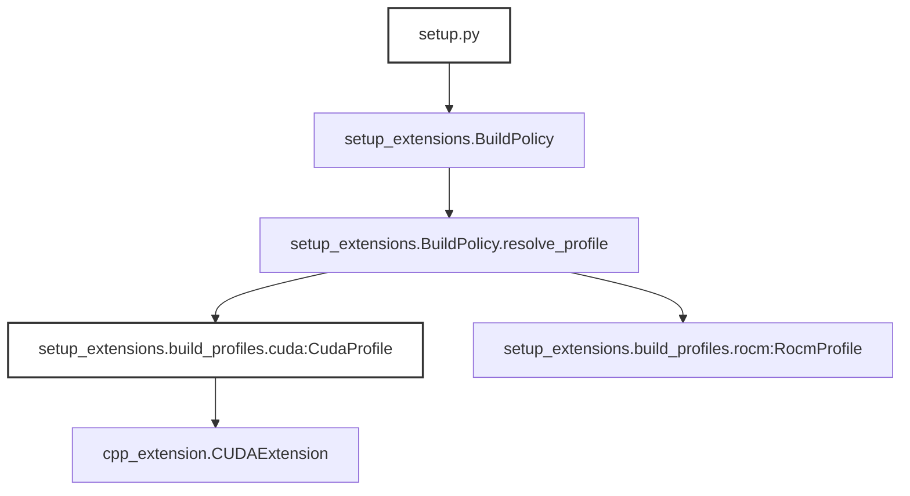
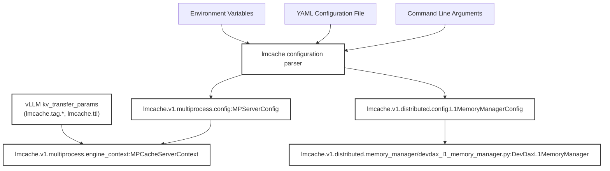
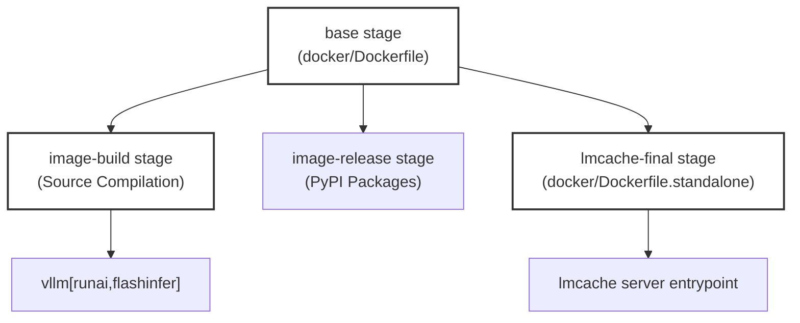

<!-- source: DeepWiki mcp.deepwiki.com · repo LMCache/LMCache · page 12 Configuration and Deployment · fetched 2026-10-21 -->

# Configuration and Deployment

Relevant source files

The following files were used as context for generating this wiki page:

- [.github/workflows/build_sglang_image.yml](.github/workflows/build_sglang_image.yml)
- [docker/Dockerfile](docker/Dockerfile)
- [docker/Dockerfile.sglang](docker/Dockerfile.sglang)
- [docker/Dockerfile.standalone](docker/Dockerfile.standalone)
- [docker/README.md](docker/README.md)
- [docker/example_run.sh](docker/example_run.sh)
- [docs/source/getting_started/installation.rst](docs/source/getting_started/installation.rst)
- [docs/source/production/docker_deployment.rst](docs/source/production/docker_deployment.rst)

This page serves as a high-level guide for installing, configuring, and deploying LMCache across diverse environments. It bridges the physical setup of inference systems with LMCache’s modular extension architecture, providing a central hub for installation methods, configuration management, container deployment, Kubernetes orchestration, and production best practices. 

For deep technical details, refer to the dedicated child pages:
- [Installation Guide](#12.1) — Document installation methods (pip, TestPyPI, source, Docker), ROCm/XPU/MUSA/MACA support, and vLLM compatibility matrix.
- [Configuration Reference](#12.2) — Comprehensive reference of all configuration options, organized by category (general, blending, P2P, controller, PD, MP server, L1/L2).
- [Docker Deployment](#12.3) — Explain Docker images (`vllm-openai`, lightweight, standalone, ROCm variants), build args, nightly builds, and container configuration.
- [Kubernetes Operator](#12.4) — Document the LMCache Kubernetes Operator (`operator/`): `LMCacheEngine`/`CacheBlendEngine` CRDs, reconciliation into DaemonSet/Service/ConfigMap, pod-injecting webhooks, RBAC config, e2e tests, and Prometheus integration.
- [Production Deployment Patterns](#12.5) — Best practices for production: multi-instance coordination, storage tier selection, health monitoring, performance tuning, MP server and P2P fleet configuration, and Dynamo coordination.

Sources: [docs/source/getting_started/installation.rst:1-144](), [docker/README.md:1-202]()

---

## 12.1 Installation Guide

LMCache supports multiple installation targets depending on hardware platforms, package release channels, and source builds. The installation system relies on platform-specific build profiles to compile required C++/CUDA/ROCm extensions. 

For comprehensive prerequisites, the vLLM compatibility matrix, and step-by-step instructions, see [Installation Guide](#12.1).

| Requirement | Specification | Code Pointer |
|-------------|--------------|--------------|
| OS | Linux | [docs/source/getting_started/installation.rst:6-6]() |
| Python | 3.9–3.13 | [docs/source/getting_started/installation.rst:6-6]() |
| GPU Backend | NVIDIA CUDA (7.0+), AMD ROCm, Intel XPU, Moore Threads MUSA | [docs/source/getting_started/installation.rst:6-6](), [docs/source/getting_started/installation.rst:66-69](), [docs/source/getting_started/installation.rst:100-102](), [docs/source/getting_started/installation.rst:136-138]() |
| Package Manager | `uv` (recommended) | [docs/source/getting_started/installation.rst:6-6]() |

Installation can be performed via PyPI for stable releases, or from source using build profiles. The `setup.py` script resolves the appropriate `BuildProfile` (e.g., `CudaProfile` in `setup_extensions/build_profiles/cuda.py`) to compile platform extensions and dependencies.

Title: Installation Build Profile Mapping

Sources: [docs/source/getting_started/installation.rst:1-144]()

---

## 12.2 Configuration Reference

LMCache centralizes its parameter definitions into structured dataclasses and configuration modules. Configuration parameters control ZMQ bindings, worker threading pools, cache sizes, eviction policies, and protocol modes. This includes settings for the multi-process (MP) server, L1/L2 distributed storage managers, and specific features like blending.

For a complete enumeration and reference of all available configuration options, see [Configuration Reference](#12.2).

Configuration can be applied at different levels:
- **Request-scoped**: vLLM clients can attach LMCache metadata via the `kv_transfer_params` field in requests. These are forwarded across MP scheduler and worker IPC paths, allowing server-side features to inspect request metadata throughout the lifecycle. For example, `lmcache.tag.tenant` or `lmcache.ttl` can be specified.
- **CLI Arguments**: Command-line arguments are parsed and used to configure various components. For instance, the MP server configuration is defined in `lmcache/v1/multiprocess/config.py` and includes arguments like `--transport`, `--instance-id`, `--host`, `--port`, `--chunk-size`, `--max-workers`, `--engine-type`, and `--supported-transfer-mode`.
- **Environment Variables**: Environment variables can also be used to set configuration values.
- **YAML Files**: Configuration can be loaded from YAML files, typically specified via `LMCACHE_CONFIG_FILE`.

The `L1MemoryManagerConfig` dataclass defines parameters for the L1 memory manager, including `size_in_bytes`, `use_lazy`, `init_size_in_bytes`, `align_bytes`, `shm_name`, `use_hugepages`, and `devdax_path`. The `DevDaxMemoryAllocator` is used when `devdax_path` is configured, allowing L1 memory to be backed by Device-DAX.

Title: Configuration Loading Pipeline

Sources: [lmcache/v1/multiprocess/config.py:50-159](), [lmcache/v1/distributed/config.py:169-192]()

---

## 12.3 Docker Deployment

Containerized deployments package LMCache for integration with vLLM OpenAI servers, standalone multiprocessing servers, and lightweight runtimes. The Dockerfiles support multiple build targets ranging from source-compiled images with NIXL support to lightweight PyPI installations. 

For detailed container specifications, environment variables, and run examples, see [Docker Deployment](#12.3).

Build workflows produce distinct container assets, including `image-build`, `image-release`, and standalone images (`docker/Dockerfile.standalone`). Essential container configurations involve network and IPC settings, such as `--ipc host` or utilizing isolated IPC configurations for environments lacking shared `/dev/shm` access. The `--isolated-ipc` flag for the MP server configures IPC mechanisms to work in containers that do not share host IPC namespace or `/dev/shm`.

Title: Docker Build Stages and Container Architecture

Sources: [docker/Dockerfile:17-169](), [docker/Dockerfile.standalone:14-150](), [docker/README.md:1-202]()

---

## 12.4 Kubernetes Operator

For large-scale container orchestrations, LMCache provides a Kubernetes Operator (`operator/`) that automates lifecycle management through Custom Resource Definitions (CRDs) such as `LMCacheEngine` and `CacheBlendEngine`. The operator reconciles declarative configurations into underlying Kubernetes resources like DaemonSets, Deployments, Services, and ConfigMaps using builder modules. 

For comprehensive operator manifests, webhook injection rules, and Prometheus monitoring setups, see [Kubernetes Operator](#12.4).

The operator architecture ensures proper host IPC mapping for CUDA IPC zero-copy memory transfers and coordinates multi-instance discovery. For details on how storage tiers and controllers coordinate within cluster nodes, see [Distributed Storage Manager](#11).

Sources: 

---

## 12.5 Production Deployment Patterns

Production environments require robust strategies for multi-instance coordination, storage tier selection, health monitoring, and performance tuning. Best practices include running LMCache in multiprocess (MP) mode to decouple cache management from inference engines, configuring affinity pools, and establishing NIXL-based transfer channels. 

For detailed deployment patterns, multi-node configurations, and fleet coordination via the MP Coordinator, see [Production Deployment Patterns](#12.5).

MP server architectures utilize request handling structures and affinity worker pools to bind `STORE` and `RETRIEVE` requests to consistent worker threads, eliminating GPU transfer lock contention. Combining a DaemonSet for LMCache servers with standard Deployment pods for vLLM instances achieves optimal resource isolation and shared caching efficiency.

The L1 memory manager can be configured to use Device-DAX (Direct Access) memory for improved performance, especially in hybrid DRAM + Device-DAX configurations. The `DevDaxL1MemoryManager` handles allocation from Device-DAX devices. This allows for runtime reconfiguration, including adding and removing Device-DAX capacity without restarting the LMCache process. The `DevDaxMemoryAllocator` manages the arena pool, which can include both DRAM and Device-DAX arenas.

Title: Device-DAX L1 Memory Manager Architecture

```mermaid
graph TD
    L1Manager["lmcache.v1.distributed.l1_manager:L1Manager"] --> DevDaxL1MemoryManager["lmcache.v1.distributed.memory_manager.devdax_l1_memory_manager:DevDaxL1MemoryManager"]
    DevDaxL1MemoryManager --> DevDaxMemoryAllocator["lmcache.v1.memory_allocators.devdax_memory_allocator:DevDaxMemoryAllocator"]
    DevDaxMemoryAllocator --> _DevDaxArena["lmcache.v1.memory_allocators.devdax_memory_allocator:_DevDaxArena"]
    DevDaxMemoryAllocator --> TensorMemoryAllocator["lmcache.v1.memory_allocators.tensor_memory_allocator:TensorMemoryAllocator"]
    DevDaxMemoryAllocator --> MixedMemoryAllocator["lmcache.v1.memory_allocators.mixed_memory_allocator:MixedMemoryAllocator"]
    DevDaxMemoryAllocator -- "add_device()" --> DevDaxArenaStatus["lmcache.v1.memory_allocators.devdax_memory_allocator:DevDaxArenaStatus"]
    DevDaxMemoryAllocator -- "remove_device()" --> DevDaxArenaStatus
    DevDaxMemoryAllocator -- "get_arena_status()" --> DevDaxArenaStatus
    DevDaxL1MemoryManager -- "get_backend_type()" --> L1BackendTypeDEVDAX["lmcache.v1.distributed.api:L1BackendType.DEVDAX"]
    DevDaxL1MemoryManager -- "get_backend_type()" --> L1BackendTypeDRAM["lmcache.v1.distributed.api:L1BackendType.DRAM"]

    style L1Manager fill:#fff,stroke:#333,stroke-width:2px;
    style DevDaxL1MemoryManager fill:#fff,stroke:#333,stroke-width:2px;
    style DevDaxMemoryAllocator fill:#fff,stroke:#333,stroke-width:2px;
    style _DevDaxArena fill:#fff,stroke:#333,stroke-width:2px;
    style TensorMemoryAllocator fill:#fff,stroke:#333,stroke-width:2px;
    style MixedMemoryAllocator fill:#fff,stroke:#333,stroke-width:2px;
    style DevDaxArenaStatus fill:#fff,stroke:#333,stroke-width:2px;
    style L1BackendTypeDEVDAX fill:#fff,stroke:#333,stroke-width:2px;
    style L1BackendTypeDRAM fill:#fff,stroke:#333,stroke-width:2px;
```

Sources: [lmcache/v1/distributed/memory_manager/devdax_l1_memory_manager.py:25-34](), [lmcache/v1/memory_allocators/devdax_memory_allocator.py:135-157]()

---

