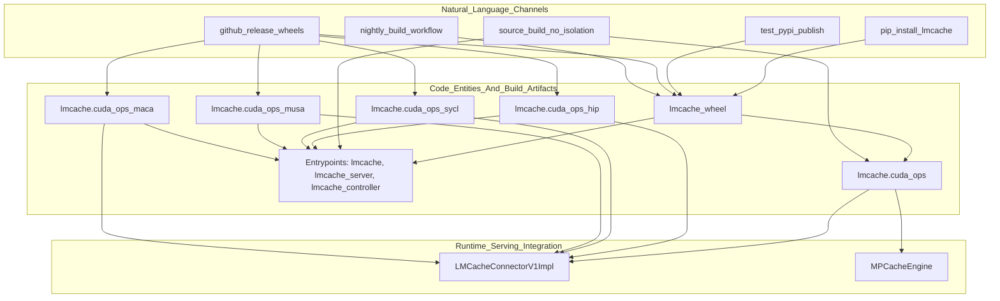
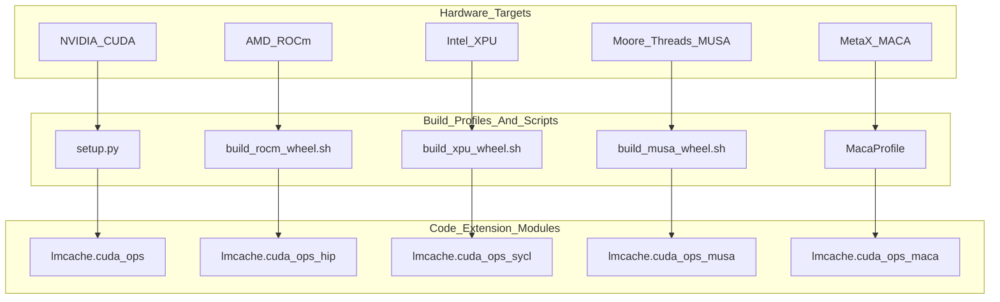
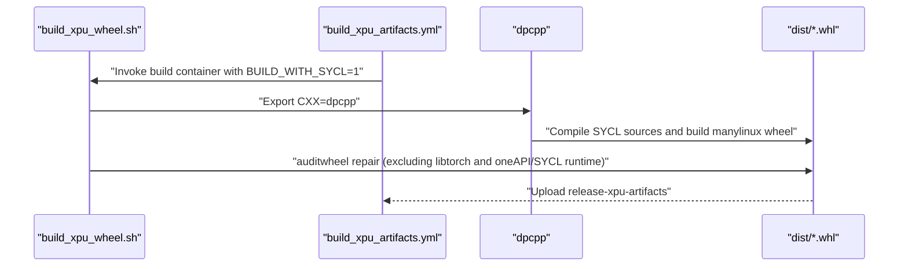
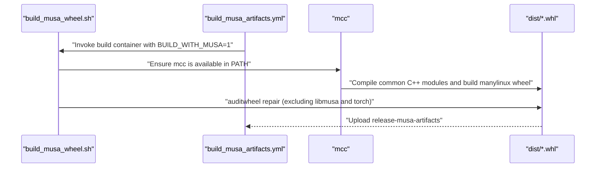
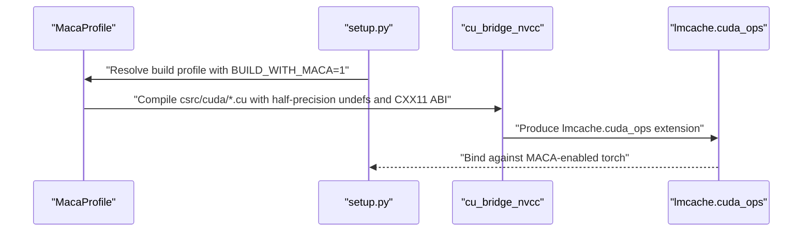

<!-- source: DeepWiki mcp.deepwiki.com · repo LMCache/LMCache · page 12.1 Installation Guide · fetched 2026-10-21 -->

# Installation Guide

<details>
<summary>Relevant source files</summary>

The following files were used as context for generating this wiki page:

- [.github/scripts/build_musa_wheel.sh](.github/scripts/build_musa_wheel.sh)
- [.github/scripts/build_rocm_wheel.sh](.github/scripts/build_rocm_wheel.sh)
- [.github/scripts/build_xpu_wheel.sh](.github/scripts/build_xpu_wheel.sh)
- [.github/workflows/build_musa_artifacts.yml](.github/workflows/build_musa_artifacts.yml)
- [.github/workflows/build_sglang_image.yml](.github/workflows/build_sglang_image.yml)
- [docker/Dockerfile](docker/Dockerfile)
- [docker/Dockerfile.sglang](docker/Dockerfile.sglang)
- [docker/Dockerfile.standalone](docker/Dockerfile.standalone)
- [docker/README.md](docker/README.md)
- [docker/example_run.sh](docker/example_run.sh)
- [docs/source/getting_started/installation.rst](docs/source/getting_started/installation.rst)
- [docs/source/production/docker_deployment.rst](docs/source/production/docker_deployment.rst)
- [lmcache/v1/multiprocess/transport/grpc_impl/_proto_gen/_generate.py](lmcache/v1/multiprocess/transport/grpc_impl/_proto_gen/_generate.py)
- [pyproject.toml](pyproject.toml)
- [requirements/bench.txt](requirements/bench.txt)
- [requirements/build.txt](requirements/build.txt)
- [requirements/common.txt](requirements/common.txt)
- [requirements/cuda.txt](requirements/cuda.txt)
- [requirements/cuda12_core.txt](requirements/cuda12_core.txt)
- [requirements/cuda13_core.txt](requirements/cuda13_core.txt)
- [requirements/proto.txt](requirements/proto.txt)
- [tests/v1/multiprocess/transport/test_proto_generator.py](tests/v1/multiprocess/transport/test_proto_generator.py)

</details>


## Purpose and Scope

This page documents supported installation methods for LMCache: stable PyPI releases, TestPyPI/GitHub release wheels, source builds, Docker images, and multi-hardware accelerator environments (ROCm, XPU, MUSA, MACA). It also outlines the build system configuration, packaging pipelines, and vLLM compatibility matrix.

---

## System Requirements

LMCache is engineered for high-performance KV cache management across Linux-based GPU and specialized accelerator infrastructures.

| Requirement | Supported Specification |
|---|---|
| Operating System | Linux `[docs/source/getting_started/installation.rst:6-6]()` |
| Python Version | Python 3.9 – 3.13 `[pyproject.toml:44-44]()` |
| NVIDIA GPU | Compute capability 7.0+ (V100, T4, A100, L4, H100, B200, etc.) `[docs/source/getting_started/installation.rst:6-6]()` |
| AMD ROCm GPU | Instinct **gfx942** (MI300X / MI325X) and **gfx950** (MI350X / MI355X) `[docs/source/getting_started/installation.rst:67-69]()` |
| Intel Accelerator | Intel XPU via oneAPI / SYCL runtime `[docs/source/getting_started/installation.rst:102-103]()` |
| Moore Threads Accelerator | MUSA-compatible devices via TorchMUSA `[docs/source/getting_started/installation.rst:138-142]()` |
| MACA Accelerator | MACA-compatible devices via TorchMACA `[setup_extensions/build_profiles/maca.py:43-69]()` |
| CUDA Runtime | CUDA 12.1+ `[docs/source/getting_started/installation.rst:6-6]()` |
| Package Tooling | `uv` (recommended for rapid dependency resolution) `[docs/source/getting_started/installation.rst:6-6]()` |

Sources: `[docs/source/getting_started/installation.rst:6-6]`, `[pyproject.toml:44-44]`, `[docs/source/getting_started/installation.rst:67-69]`, `[docs/source/getting_started/installation.rst:102-103]`, `[docs/source/getting_started/installation.rst:138-142]`, `[setup_extensions/build_profiles/maca.py:43-69]()`

---

## Installation Pipeline & Code Entity Architecture

The following diagram bridges natural language installation channels to concrete code entities, build scripts, and runtime modules (`lmcache.cuda_ops`, `LMCacheConnectorV1Impl`, and CLI entrypoints).

**Title: Installation Flow to Code Entity Mapping**



Sources: `[.github/workflows/publish.yml:35-142]()`, `[.github/workflows/nightly_build.yml:12-140]()`, `[docs/source/getting_started/installation.rst:16-144]()`, `[pyproject.toml:47-50]()`, `[setup_extensions/build_profiles/maca.py:43-118]()`

---

## Hardware Acceleration and Extension Binding Architecture

The following diagram illustrates how specialized hardware deployment targets map to specific build profiles and compiled Python extension packages within the codebase.

**Title: Hardware Acceleration to Code Entity Binding**



Sources: `[.github/scripts/build_rocm_wheel.sh:1-88]()`, `[.github/scripts/build_xpu_wheel.sh:1-88]`, `[.github/scripts/build_musa_wheel.sh:1-183]`, `[setup_extensions/build_profiles/maca.py:43-118]()`

---

## 1. Installing via Pip and PyPI

The standard stable release of LMCache on PyPI targets modern Python runtimes and unpinned PyTorch packages, allowing seamless integration into serving engine environments `[docs/source/getting_started/installation.rst:24-31]()`, `[requirements/common.txt:35-46]()`.

```bash
uv venv --python 3.12
source .venv/bin/activate
uv pip install lmcache
```

### Optional Extras
*   **NIXL Support**: Required for disaggregated prefill and high-performance P2P KV sharing `[docs/source/getting_started/installation.rst:39-44]()`:
    ```bash
    uv pip install lmcache[nixl]
    ```

*   **TestPyPI**: Staging releases are automatically published via `[.github/workflows/publish.yml:159-174]()` upon successful PR verification on the `dev` branch.

Sources: `[.github/workflows/publish.yml:159-174]()`, `[docs/source/getting_started/installation.rst:20-45]`, `[requirements/common.txt:35-46]()`

---

## 2. Installing CUDA 12.9 and Nightly Release Wheels

Custom CUDA 12.9 builds and automated rolling nightly packages are published to dedicated GitHub Release assets rather than the public PyPI registry `[docs/source/getting_started/installation.rst:46-60]()`, `[.github/workflows/nightly_build.yml:53-114]()`.

### Stable CUDA 12.9 Release
Install by targeting the PyTorch CUDA index and pointing pip to GitHub Release expanded assets `[docs/source/getting_started/installation.rst:46-60]()`:

```bash
VERSION=0.4.3  # replace with target release
uv pip install lmcache==${VERSION} \
    --extra-index-url https://download.pytorch.org/whl/cu129 \
    --find-links https://github.com/LMCache/LMCache/releases/expanded_assets/v${VERSION}-cu129 \
    --index-strategy unsafe-best-match
```

### Nightly Builds
Automated workflows (`.github/workflows/nightly_build.yml`) compile rolling wheels daily from the `dev` branch `[.github/workflows/nightly_build.yml:53-114]()`:

```bash
uv pip install lmcache --pre \
  --extra-index-url https://download.pytorch.org/whl/cu130 \
  --find-links https://github.com/LMCache/LMCache/releases/expanded_assets/nightly \
  --index-strategy unsafe-best-match
```

Sources: `[.github/workflows/nightly_build.yml:53-114]`, `[docs/source/getting_started/installation.rst:46-60]()`

---

## 3. Installing from Source

Source installation is recommended for developers and contributors. Using `--no-build-isolation` forces `setuptools` `[pyproject.toml:13-20]()` to build C++/CUDA extensions against the pre-installed local `torch` package, preventing ABI mismatches `[pyproject.toml:4-6]()`.

```bash
git clone https://github.com/LMCache/LMCache.git
cd LMCache

uv venv --python 3.12
source .venv/bin/activate

uv pip install -r requirements/build.txt
uv pip install vllm
LMCACHE_CUDA_MAJOR=12 uv pip install -e . --no-build-isolation
```

Sources: `[pyproject.toml:1-20]`, `[requirements/build.txt:1-13]`, `[docs/source/getting_started/installation.rst:222-229]()`

---

## 4. Multi-Hardware Support (ROCm, XPU, MUSA, & MACA)

LMCache supports specialized hardware runtimes via customized wheels and container environments.

### AMD ROCm Support
The ROCm wheel targets AMD Instinct **gfx942** and **gfx950** architectures as a fat binary `[.github/scripts/build_rocm_wheel.sh:19-21]()`. It compiles using `BUILD_WITH_HIP=1` and `hipcc` `[.github/scripts/build_rocm_wheel.sh:67-68]()`, binding directly against host runtime libraries inside upstream vLLM ROCm containers `[docs/source/getting_started/installation.rst:74-86]()`.

**Title: ROCm Build Pipeline Execution Flow**

```mermaid
sequenceDiagram
    participant Script as "build_rocm_wheel.sh"
    participant Workflow as "build_rocm_artifacts.yml"
    participant Compiler as "hipcc"
    participant Artifacts as "dist/*.whl"

    Workflow->>Script: "Invoke build container with BUILD_WITH_HIP=1"
    Script->>Compiler: "Export CXX=hipcc and PYTORCH_ROCM_ARCH=gfx942;gfx950"
    Compiler->>Artifacts: "Compile hipified sources and build manylinux wheel"
    Script->>Artifacts: "auditwheel repair (excluding libamdhip64 and torch)"
    Artifacts-->>Workflow: "Upload release-rocm-artifacts"
```

```bash
docker run -it --device /dev/kfd --device /dev/dri \
    --group-add video --security-opt seccomp=unconfined \
    --entrypoint bash vllm/vllm-openai-rocm:v0.25.0

VERSION=0.5.3  # replace with target release
pip install lmcache==${VERSION}+rocm7.2 --no-deps \
    --find-links https://github.com/LMCache/LMCache/releases/expanded_assets/v${VERSION}-rocm
```

Sources: `[.github/scripts/build_rocm_wheel.sh:1-88]`, `[.github/workflows/build_rocm_artifacts.yml:1-144]`, `[docs/source/getting_started/installation.rst:66-99]()`

### Intel XPU Support
The Intel XPU wheel is ABI-matched to the upstream `vllm/vllm-openai-xpu:v0.26.0` image, which includes `torch 2.12.0+xpu` and the oneAPI/SYCL runtime `[docs/source/getting_started/installation.rst:102-103]()`. The build process uses `BUILD_WITH_SYCL=1` and `dpcpp` as the C++ compiler.

**Title: Intel XPU Build Pipeline Execution Flow**



```bash
docker run -it --device /dev/dri --shm-size=4g \
    --entrypoint bash vllm/vllm-openai-xpu:v0.26.0

VERSION=0.5.3  # replace with target release
pip install lmcache==${VERSION}+xpu --no-deps \
    --no-index \
    --find-links https://github.com/LMCache/LMCache/releases/expanded_assets/v${VERSION}-xpu
```

Sources: `[.github/scripts/build_xpu_wheel.sh:1-88]`, `[.github/workflows/build_xpu_artifacts.yml:1-144]`, `[docs/source/getting_started/installation.rst:100-135]()`

### Moore Threads MUSA Support
The MUSA wheel is built within a validated TorchMUSA/MUSA SDK image `[docs/source/getting_started/installation.rst:138-142]()`. It includes common native extensions and Python MUSA integration. The build uses `BUILD_WITH_MUSA=1`.

**Title: MUSA Build Pipeline Execution Flow**



```bash
docker run -it --device /dev/musa0 --entrypoint bash your_musa_image:tag

VERSION=0.5.3  # replace with target release
pip install lmcache==${VERSION}+musa --no-deps \
    --no-index \
    --find-links https://github.com/LMCache/LMCache/releases/expanded_assets/v${VERSION}-musa
```

Sources: `[.github/scripts/build_musa_wheel.sh:1-183]`, `[.github/workflows/build_musa_artifacts.yml:1-144]`, `[docs/source/getting_started/installation.rst:136-178]()`

### MACA Support
The MACA wheel is built via `MacaProfile` in `setup_extensions/build_profiles/maca.py`, detecting MACA through `torch.utils.cpp_extension.MACA_HOME` and compiling CUDA-style `.cu` files using MetaX's cu-bridge `nvcc`-compatible wrapper (`BUILD_WITH_MACA=1`) `[setup_extensions/build_profiles/maca.py:43-118]()`. The compiled extension registers as `lmcache.cuda_ops` to integrate seamlessly with `CudaDeviceOps` `[setup_extensions/build_profiles/maca.py:19-21]`, `[setup_extensions/build_profiles/maca.py:103-103]()`.

**Title: MACA Build Pipeline Execution Flow**



```bash
export BUILD_WITH_MACA=1
python setup.py bdist_wheel
```

Sources: `[setup_extensions/build_profiles/maca.py:43-118]()`

---

## 5. Docker Deployment

Containerized deployments integrate LMCache directly into serving engine images:
*   **Full Integration with vLLM**: The main `Dockerfile` builds LMCache from source and integrates it with the vLLM OpenAI server, including full NIXL support `[docker/README.md:8-20]()`.
    ```bash
    # Build with nightly vLLM
    docker build \
      --build-arg CUDA_VERSION=13.0 \
      --build-arg UBUNTU_VERSION=24.04 \
      --target image-build \
      --tag lmcache/vllm-openai:latest \
      --file docker/Dockerfile .
    ```
    To run, use `docker run` with appropriate volume mounts for Hugging Face cache `[docker/README.md:54-68]()`.

*   **LMCache Only (Standalone)**: `Dockerfile.standalone` builds LMCache from source without vLLM, useful for running LMCache in standalone mode `[docker/README.md:89-97]()`.
    ```bash
    docker build \
      --build-arg CUDA_VERSION=13.0 \
      --build-arg UBUNTU_VERSION=24.04 \
      --target lmcache-final \
      --tag lmcache/standalone:latest \
      --file docker/Dockerfile.standalone .
    ```
    Run the LMCache server:
    ```bash
    docker run --runtime nvidia --gpus all -it \
      lmcache/standalone:latest \
      /opt/venv/bin/lmcache server \
      --l1-size-gb 60 \
      --eviction-policy LRU \
      --max-workers 4 \
      --max-gpu-workers 2 \
      --port 6555
    ```

*   **Lightweight Setup**: `Dockerfile.lightweight` extends the official vLLM image and installs LMCache from PyPI, offering a quick start without NIXL support `[docker/README.md:130-145]()`.
    ```bash
    docker build \
      --tag lmcache/vllm-openai:lightweight \
      --file docker/Dockerfile.lightweight .
    ```

*   **SGLang Integration**: `Dockerfile.sglang` integrates LMCache with SGLang, supporting LMCache MP mode `[docker/README.md:172-176]()`.
    ```bash
    docker build \
      --build-arg LMCACHE_VERSION=v0.5.6 \
      --build-arg EXPECTED_TORCH=2.13.0 \
      --tag lmcache/sglang:v0.5.6 \
      --file docker/Dockerfile.sglang .
    ```

*   **ROCm Containers**: Run inside `vllm/vllm-openai-rocm` using `--no-deps` to preserve host ROCm driver linkages `[docs/source/getting_started/installation.rst:74-86]()`.
*   **Intel XPU Containers**: Run inside `vllm/vllm-openai-xpu` with `--no-index` to prevent pip from pulling conflicting CUDA packages `[docs/source/getting_started/installation.rst:107-127]()`.
*   **MUSA Containers**: Run inside a TorchMUSA/MUSA SDK image, using `--no-deps` and `--no-index` to bind to the container's pre-installed TorchMUSA runtime `[docs/source/getting_started/installation.rst:143-178]()`.
*   **MACA Containers**: Run inside a TorchMACA/MACA SDK image, using `--no-deps` and `--no-index` to bind to the container's pre-installed TorchMACA runtime `[setup_extensions/build_profiles/maca.py:23-26]()`.

Sources: `[docs/source/getting_started/installation.rst:74-127]`, `[docs/source/getting_started/installation.rst:143-178]`, `[setup_extensions/build_profiles/maca.py:23-26]()`, `[docker/README.md:8-20]`, `[docker/README.md:54-68]`, `[docker/README.md:89-97]`, `[docker/README.md:130-145]`, `[docker/README.md:172-176]`

---

## 6. vLLM Compatibility Matrix

LMCache integrates with inference engines through version-matched connector classes and runtime transport interfaces.

| Serving Engine & Version | Serving Architecture | Integration Connector Class |
|---|---|---|
| vLLM >= 0.7.0 | **vLLM V1 Engine** | `LMCacheConnectorV1Impl` `[docs/source/getting_started/installation.rst:11-13]()` |
| Any vLLM Version | **Multiprocess Server** | `MPCacheEngine` `[docs/source/getting_started/installation.rst:11-13]()` |

Sources: `[docs/source/getting_started/installation.rst:11-13]()`

---

## 7. Verification

Verify that console entrypoints `[pyproject.toml:47-50]()` and native extension modules initialize correctly:

```bash
# 1. Verify CLI entrypoints
lmcache --help
lmcache_server --help
lmcache_controller --help

# 2. Check native extension module initialization
python -c "import lmcache.cuda_ops; print('LMCache native ops initialized successfully')"
```

Sources: `[pyproject.toml:47-50]`, `[docs/source/getting_started/installation.rst:34-36]()`

---

