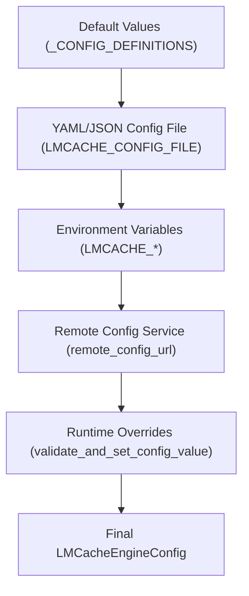
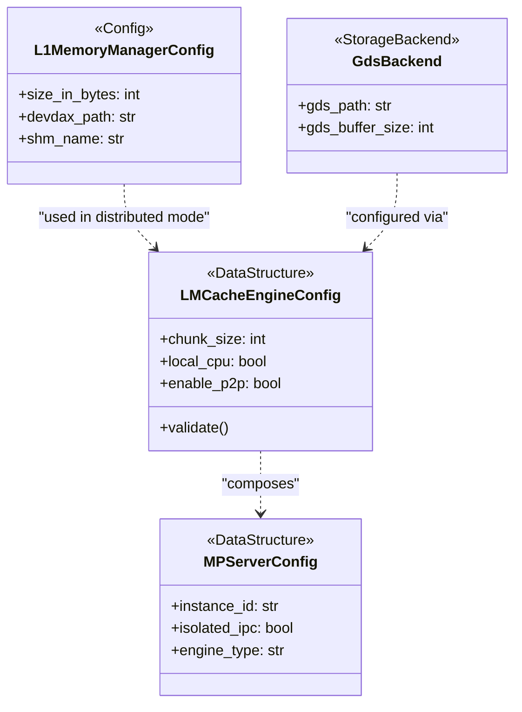
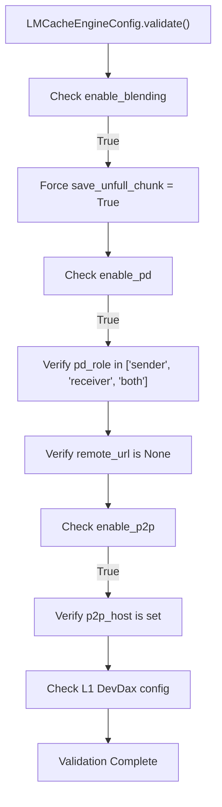

<!-- source: DeepWiki mcp.deepwiki.com · repo LMCache/LMCache · page 12.2 Configuration Reference · fetched 2026-10-21 -->

# Configuration Reference

Relevant source files

The following files were used as context for generating this wiki page:

- [docs/source/api_reference/configurations.rst](docs/source/api_reference/configurations.rst)
- [docs/source/kv_cache/multiprocess_mode.rst](docs/source/kv_cache/multiprocess_mode.rst)
- [docs/source/kv_cache/storage_backends/cpu_ram.rst](docs/source/kv_cache/storage_backends/cpu_ram.rst)
- [docs/source/kv_cache/storage_backends/gds.rst](docs/source/kv_cache/storage_backends/gds.rst)
- [docs/source/kv_cache/storage_backends/local_storage.rst](docs/source/kv_cache/storage_backends/local_storage.rst)
- [docs/source/kv_cache/storage_backends/redis.rst](docs/source/kv_cache/storage_backends/redis.rst)
- [docs/source/kv_cache/storage_backends/weka.rst](docs/source/kv_cache/storage_backends/weka.rst)
- [docs/source/mp/configuration.rst](docs/source/mp/configuration.rst)
- [docs/source/mp/deployment.rst](docs/source/mp/deployment.rst)
- [docs/source/mp/index.rst](docs/source/mp/index.rst)
- [examples/multi_process/lmcache-daemonset.yaml](examples/multi_process/lmcache-daemonset.yaml)
- [examples/multi_process/vllm-deployment.yaml](examples/multi_process/vllm-deployment.yaml)
- [lmcache/v1/multiprocess/modules/management.py](lmcache/v1/multiprocess/modules/management.py)
- [lmcache/v1/multiprocess/transport/base.py](lmcache/v1/multiprocess/transport/base.py)
- [lmcache/v1/storage_backend/gds_backend.py](lmcache/v1/storage_backend/gds_backend.py)
- [tests/v1/data/gds.yaml](tests/v1/data/gds.yaml)
- [tests/v1/data/hipfile.yaml](tests/v1/data/hipfile.yaml)
- [tests/v1/data/hipfile_gds.yaml](tests/v1/data/hipfile_gds.yaml)
- [tests/v1/multiprocess/test_client.py](tests/v1/multiprocess/test_client.py)
- [tests/v1/multiprocess/test_grpc_transport.py](tests/v1/multiprocess/test_grpc_transport.py)
- [tests/v1/multiprocess/test_protocols.py](tests/v1/multiprocess/test_protocols.py)
- [tests/v1/storage_backend/test_gds_backend.py](tests/v1/storage_backend/test_gds_backend.py)
- [tests/v1/test_cache_engine.py](tests/v1/test_cache_engine.py)
- [tests/v1/test_gds.py](tests/v1/test_gds.py)

This page provides a comprehensive and detailed reference for all LMCache configuration options, organized by category. It is intended for advanced users who want to understand the precise configuration parameters, their defaults, interdependencies, and how the underlying system interprets them. This documentation covers general engine settings, blending, peer-to-peer sharing (P2P), controller coordination, disaggregated prefill (PD), multiprocess server (MP server) flags, and multi-tier storage (L1/L2) configurations. It explains relevant classes, data flow, and key files where these options are defined or used.

Sources: `[docs/source/mp/configuration.rst:1-157]`, `[lmcache/v1/config.py:1-776]`, `[lmcache/v1/config_base.py:1-213]`, `[docs/source/api_reference/configurations.rst:1-130]`, `[lmcache/v1/multiprocess/config.py:23-145]`, `[lmcache/v1/storage_backend/gds_backend.py:1-220]`, `[docs/source/kv_cache/storage_backends/local_storage.rst:1-179]`

---

## Configuration System Overview

LMCache's configuration system is centralized on the class `LMCacheEngineConfig`, which governs all core cache engine options. This class is created dynamically via a factory function (`create_config_class` in `config_base.py`) that injects common methods for loading from YAML/JSON configuration files, environment variables, and runtime overrides.

- `LMCacheEngineConfig` carries typed parameters with sensible defaults and converters for environment variables, ensuring a robust and consistent configuration.
- It exposes a `validate()` method that enforces correctness and compatibility among flags, e.g., disallowing incompatible combinations like enabling both P2P and PD modes simultaneously or checking cache blending dependencies.
- The static dictionary `_CONFIG_DEFINITIONS` holds the canonical set of supported options, defaults, and environment variable mappings.

The configuration class supports hierarchical loading and overrides allowing:
- YAML/JSON config files specified by environment variable `LMCACHE_CONFIG_FILE`,
- Environment variables prefixed by `LMCACHE_`, and
- Remote config fetch and runtime overrides exposed to components such as vLLM or HTTP servers.

Sources: `[lmcache/v1/config.py:1-776]`, `[lmcache/v1/config_base.py:1-213]`

---

## Configuration Loading and Precedence

LMCache configurations are resolved by merging multiple sources with clear precedence to produce final runtime values. This system allows flexible deployment setups using files, environment variables, remote services, and runtime API overrides in vLLM.

**Precedence order:**
1. **Runtime overrides:** values passed dynamically per-request or via API (`kv_transfer_params` in vLLM).
2. **Remote config:** fetched and merged from a central config URL.
3. **Environment variables:** prefixed `LMCACHE_` env vars override file settings.
4. **File-based config:** loaded from YAML/JSON file.
5. **Built-in defaults:** fallback to `_CONFIG_DEFINITIONS` hardcoded values.

Sources: `[lmcache/v1/config.py:752-776]`, `[lmcache/v1/config_base.py:11-12]`, `[lmcache/v1/config_base.py:142-183]`

---

## Configuration Categories Reference

### 1. General Engine Options

These parameters configure core LMCache engine behavior, memory tiers, serialization, and cache policies.

| YAML Key                | Env Variable                 | Default          | Description                                                                                   |
|------------------------ |---------------------------- |----------------- |--------------------------------------------------------------------------------------------- |
| `chunk_size`             | `LMCACHE_CHUNK_SIZE`          | `256`             | Number of tokens per cache chunk. Fundamental chunking unit for caching.                     |
| `local_cpu`              | `LMCACHE_LOCAL_CPU`            | `true`            | Enable CPU RAM caching in pinned memory.                                                    |
| `max_local_cpu_size`     | `LMCACHE_MAX_LOCAL_CPU_SIZE`   | `5.0`             | CPU cache size limit in GB.                                                                 |
| `local_cpu_use_hugepages`| `LMCACHE_LOCAL_CPU_USE_HUGEPAGES` | `false`      | Use Linux hugepages (2 MB) for CPU pinned memory. Incompatible with P2P and shared mem.     |
| `local_disk`             | `LMCACHE_LOCAL_DISK`           | `None`            | Path(s) for local disk offloading. Can be a comma-separated list.                           |
| `local_disk_path_sharding` | `LMCACHE_LOCAL_DISK_PATH_SHARDING` | `"by_gpu"`  | Selection strategy when multiple disk paths configured; currently "by_gpu" only.           |
| `max_local_disk_size`    | `LMCACHE_MAX_LOCAL_DISK_SIZE`  | `0.0`             | Maximum disk cache size in GB.                                                              |
| `remote_url`             | `LMCACHE_REMOTE_URL`           | `None`            | URL of remote storage backend (e.g., Redis, Mooncake).                                      |
| `remote_serde`           | `LMCACHE_REMOTE_SERDE`         | `"naive"`         | Serialization format for remote storage: `"naive"`, `"cachegen"`, `"fp8"`, `"kivi"`.       |
| `save_decode_cache`      | `LMCACHE_SAVE_DECODE_CACHE`    | `false`           | Whether to store decoded KV cache.                                                          |
| `use_layerwise`          | `LMCACHE_USE_LAYERWISE`        | `false`           | Enable layerwise pipelining for KV transfers.                                              |
| `pre_caching_hash_algorithm` | `LMCACHE_PRE_CACHING_HASH_ALGORITHM` | `"builtin"` | Hash algorithm for prefix caching.                                                         |
| `save_unfull_chunk`      | `LMCACHE_SAVE_UNFULL_CHUNK`    | `false`           | Whether to save partial (unfull) chunks.                                                   |
| `blocking_timeout_secs`  | `LMCACHE_BLOCKING_TIMEOUT_SECS`| `10`              | Timeout for blocking cache operations, in seconds.                                         |
| `py_enable_gc`           | `LMCACHE_PY_ENABLE_GC`         | `true`            | Enable Python garbage collection.                                                          |
| `cache_policy`           | `LMCACHE_CACHE_POLICY`         | `"LRU"`           | Cache eviction policy (e.g., `"LRU"`, `"LFU"`, `"FIFO"`, `"MRU"`).                          |
| `numa_mode`              | `LMCACHE_NUMA_MODE`            | `null`            | NUMA-aware memory allocation mode: `"auto"`, `"manual"`, or `null`.                        |
| `external_lookup_client` | `LMCACHE_EXTERNAL_LOOKUP_CLIENT` | `null`         | External KV store URI to delegate lookup operations.                                       |
| `priority_limit`         | `LMCACHE_PRIORITY_LIMIT`       | `null`            | Only cache requests with priority ≤ limit (int). Not used in PD disaggregation mode.       |
| `min_retrieve_tokens`    | `LMCACHE_MIN_RETRIEVE_TOKENS` | `0`               | Minimum tokens hits required to perform a retrieve operation.                               |
| `store_location`         | `LMCACHE_STORE_LOCATION`       | `null`            | Restrict store operations to specific backend by class name.                               |
| `retrieve_locations`     | `LMCACHE_RETRIEVE_LOCATIONS`   | `null`            | Restrict retrieve operations to specific backend list.                                    |
| `extra_config`           | `LMCACHE_EXTRA_CONFIG`         | `{}` (empty dict) | Misc. extra config parameters like NUMA GPU mappings, disk I/O thread count, etc.          |
| `enable_lazy_memory_allocator` | `LMCACHE_ENABLE_LAZY_MEMORY_ALLOCATOR` | `false` | Enable lazy memory allocation with gradual expansions.                                    |
| `lazy_memory_initial_ratio` | `LMCACHE_LAZY_MEMORY_INITIAL_RATIO` | `0.2`     | Initial fraction for lazy memory allocator.                                                |

Sources: `[lmcache/v1/config.py:62-500]`, `[docs/source/api_reference/configurations.rst:33-130]`

---

### 2. Blending Options

Blending enables the CacheBlend module for advanced KV cache reuse beyond prefixes, allowing sub-sequence matching and fingerprint deduplication.

| Option                     | Default      | Description                                                                               |
|----------------------------|--------------|-------------------------------------------------------------------------------------------|
| `--engine-type`            | `"default"`   | Select `"blend"` to compose the CacheBlend `BlendModule`. Requires `lmcache_driven` or `auto` transfer mode. |
| `enable_blending`          | `false`      | Enable sub-sequence-aware blending. Forces `save_unfull_chunk = True` to save partial chunks. |
| `--enable-segmented-prefix` | `false`    | Retain gapped contiguous prefix on mid-prefix L2 retrieve failure (internal MP server flag). |
| `--enable-dedup-content`   | `false`      | Avoid fingerprint registration for chunks with content already indexed (reduces overhead).  |

Sources: `[lmcache/v1/multiprocess/config.py:49-68]`, `[lmcache/v1/config.py:522-528]`

---

### 3. P2P (Peer-to-Peer) Options

Peer-to-peer options configure peer discovery and data sharing in a distributed node setup. These are controlled by parameters grouped in `P2PConfig`.

| Option                | Default      | Description                                                     |
|-----------------------|--------------|-----------------------------------------------------------------|
| `advertise_url`       | `""`          | Host:port the local transfer-channel server advertises to peers; non-empty enables P2P. |
| `listen_url`          | `""`          | Host:port bound for incoming P2P transfers.                    |
| `lookup_timeout`      | `30.0`        | Timeout in seconds after which a peer lookup is treated as a miss. |
| `load_timeout`        | `30.0`        | Timeout in seconds after which a peer load attempt fails.      |
| `transfer_engine`     | `"nixl"`     | Transfer engine to use for P2P, e.g., `"nixl"`.                 |

Sources: `[lmcache/v1/multiprocess/config.py:157-178]`

---

### 4. Controller and Instance Coordination Options

These options facilitate cluster-wide coordination such as instance identities, registration timeouts, and integration with the LMCache Coordinator service.

| Option                      | Default         | Description                                                  |
|-----------------------------|-----------------|--------------------------------------------------------------|
| `--instance-id`             | UUIDv4 generated| Stable ID for the MP server instance, used for coordinator membership and telemetry resource tagging. |
| `lmcache_instance_id`       | `"default"`     | Identifier for engine-level coordination and cache grouping.|
| `worker_reap_timeout_seconds` | `120.0`       | Silence timeout after which a worker's KV registration is reaped. |
| `worker_registration_grace_seconds` | `3600.0` | Grace period before a worker registration without ping is removed. |
| `--coordinator-url`         | `""`            | URL for the LMCache Coordinator; if empty, coordinator features are disabled. |
| `--coordinator-advertise-ip` | `""`          | IP address advertised to the coordinator service.            |
| `--coordinator-heartbeat-interval` | `5.0`     | Interval in seconds for heartbeats to the coordinator.       |
| `--coordinator-event-reporting` | `false`     | Enable event reporting of L2 cache events to the coordinator.|
| `--coordinator-event-flush-interval` | `1.0`   | Flush interval in seconds for batching events to the coordinator. |

Sources: `[lmcache/v1/multiprocess/config.py:97-113]`, `[lmcache/v1/multiprocess/http_server.py:127-137]`, `[lmcache/v1/mp_coordinator/config.py:100-103]`, `[tests/v1/storage_backend/test_gds_backend.py:56]`

---

### 5. PD (Disaggregated Prefill) Options

Disaggregated prefill mode separates prefill and decode stages across nodes/processes.

| Option              | Default     | Description                                                    |
|---------------------|-------------|----------------------------------------------------------------|
| `enable_pd`        | `false`     | Enable Disaggregated Prefill mode.                             |
| `pd_role`          | `"none"`    | Role in PD setup: `"sender"`, `"receiver"`, or `"both"`.     |
| `store_location` / `retrieve_locations` | `null` | Limit backends used for store/retrieve; `PDBackend` is one-way (prefiller → decoder) only. |
| `pd_peer_host`     | `"localhost"` | Host of peer node in PD mode.                                 |
| `pd_peer_init_port` | `7300`      | Initial port for peer PD communication.                        |
| `pd_peer_alloc_port` | `7400`     | Allocation port for PD peer communication.                     |
| `pd_buffer_size`   | `2147483648` | Transfer buffer size in bytes (default 2 GB).                 |
| `pd_buffer_device` | `"cuda"`   | Device for PD transfer buffer, either `cuda` or `cpu`.         |

Sources: `[lmcache/v1/config.py:543-551]`, `[tests/v1/data/test_config.yaml:7-14]`

---

### 6. MP Server Configuration (`lmcache server` CLI args)

This section enumerates the command-line arguments accepted by the LMCache multiprocess server, which runs as a standalone service interacting with vLLM and other clients.

| Argument | Default | Description                                                                                        |
|----------|---------|--------------------------------------------------------------------------------------------------|
| `--transport`              | `"zmq"`        | Request transport protocol used (`zmq` or `grpc`).                                             |
| `--instance-id`            | *(unset, UUIDv4)* | Stable identity string for the MP server instance, shared with telemetry.                     |
| `--host`                   | `"localhost"` | Host address to bind to.                                                                        |
| `--port`                   | `5555`        | Port to bind the request server to.                                                            |
| `--chunk-size`             | `256`         | Minimum chunk size of KV cache operations (in tokens); negotiable by connectors.                |
| `--null-block-id`          | `0`           | Engine block ID denoting absent KV data (use `-1` if `0` is valid block).                       |
| `--max-workers`            | `1`           | Base number of worker threads for both GPU and CPU pools.                                      |
| `--max-gpu-workers`        | inherits `--max-workers` | Worker threads dedicated to GPU tasks (STORE, RETRIEVE).                                  |
| `--max-cpu-workers`        | inherits `--max-workers` | Worker threads dedicated to CPU tasks (LOOKUP, etc.).                                     |
| `--grpc-server-workers`    | `32`          | Number of gRPC request dispatch threads (if using `grpc` transport).                           |
| `--hash-algorithm`         | `"blake3"`    | Hash algorithm for token hashing (`builtin`, `sha256_cbor`, `blake3`).                         |
| `--engine-type`            | `"default"`   | Backend engine type; `"blend"` composes CacheBlend module for advanced reuse.                   |
| `--supported-transfer-mode` | `"lmcache_driven"` | Worker → server transfer paths mode (`lmcache_driven`, `engine_driven`, `auto`).           |
| `--isolated-ipc`           | `false`       | Enable isolated IPC (no shared `/dev/shm`), uses raw CUDA IPC handles and timeline semaphore events (vLLM only). |
| `--runtime-plugin-locations` | `[]`        | Paths to runtime plugin scripts/directories launched alongside server.                         |
| `--runtime-plugin-config`  | `"{}"`       | JSON string of extra config variables passed to runtime plugins.                              |
| `--script-allowed-imports` | `[]`         | Space-separated list of Python modules allowed for import in runtime `/run_script` API.       |
| `--run-script-api-enabled` | `false`      | Enable `POST /run_script` HTTP endpoint, allowing in-process Python execution (unsafe).       |
| `--enable`                | `[]`          | Experimental transfer modules to enable.                                                      |
| `--separate-object-groups` | `false`      | Split kernel groups into one object group per sliding-window size (blend-related).             |

Sources: `[docs/source/mp/configuration.rst:60-159]`, `[lmcache/v1/multiprocess/config.py:23-145]`, `[docs/source/mp/configuration.rst:58-149]`

---

### 7. L1 and L2 Storage Configuration

LMCache supports multi-tiered storage with L1 memory managers for CPU DRAM, device DAX, or NVMe-backed GDS slabs, and L2 adapters for persistent offloading.

| Option                         | Default        | Description                                                       |
|-------------------------------|----------------|-------------------------------------------------------------------|
| `--l1-size-gb`                 | (required)     | Total size of L1 memory (GB), e.g., CPU DRAM or DAX slab.          |
| `--l1-use-lazy`                | `true`         | Enable lazy initialization for L1 memory manager.                 |
| `--l1-init-size-in-bytes`      | `20 << 30` (20GB) | Initial size for lazy allocator.                                 |
| `--l1-align-bytes`             | `0x1000` (4KB) | Alignment unit for L1 allocations in bytes.                      |
| `--l1-shm-name`                | `lmcache_l1_pool_{pid}` | POSIX SHM segment name for L1 pool; empty disables SHM.    |
| `--l1-use-hugepages`           | `false`        | Allocate L1 pool from pre-allocated 2 MiB hugepages.              |
| `--l1-devdax-path`             | `None`         | Device-DAX path for L1 backing arena.                             |
| `--l1-devdax-size-in-bytes`   | `None`         | Size of Device-DAX arena in bytes.                               |
| `gds_path`                    | `None`         | Paths to GDS-ready mounts for zero-copy GPU-Direct Storage I/O.  |
| `gds_path_sharding`           | `"by_gpu"`     | Strategy for selecting paths if multiple `gds_path` are configured. |
| `gds_buffer_size`             | `None`         | Size of VRAM buffer pre-registered for GDS operations in MiB.    |
| `disk_io_threads`             | `4`            | Number of worker threads for parallel disk I/O.                  |
| `--l2-adapter`                | `""` (empty)   | JSON string specifying multi-backend L2 adapter config.          |
| `--l2-store-policy`           | `"default"`    | Policy for storing data to L2 storage.                           |
| `--l2-prefetch-policy`        | `"default"`    | Policy for prefetching from L2 storage.                         |
| `--l2-prefetch-max-in-flight`| `8`            | Max simultaneous L2 prefetch requests.                          |
| `nixl_backends`               | `[UCX, GDS]`   | List of active Nixl backends, e.g., UCX, GDS, POSIX file.        |

The **GdsBackend** supports GPU Direct Storage with NVIDIA cuFile or AMD hipFile libraries and is configured primarily through `gds_path`, `gds_buffer_size`, and `extra_config.disk_io_threads`. It supports multi-path (multi-device) NVMe striping with `"by_gpu"` sharding allowing GPUs to utilize separate NVMe drives for efficient high-throughput storage.

Architecture of Local Disk Backend involves:
- Metadata dictionary mapping `CacheEngineKey` to on-disk metadata.
- A priority queue worker pool for concurrent disk operations (prefetch, delete, put).
- Integration with CPU RAM backend for cached allocations.

Sources: `[lmcache/v1/config.py:197-207]`, `[lmcache/v1/distributed/config.py:105-193]`, `[tests/v1/storage_backend/test_gds_backend.py:54]`, `[docs/source/kv_cache/storage_backends/local_storage.rst:1-179]`, `[docs/source/kv_cache/storage_backends/gds.rst:1-140]`, `[lmcache/v1/storage_backend/gds_backend.py:218-220]`

---

## Configuration Logic and Architecture

### Code-to-System Mapping Diagram

This diagram connects the conceptual configuration categories to specific code classes and modules.

Sources: `[lmcache/v1/config.py:736-749]`, `[lmcache/v1/multiprocess/config.py:23-145]`, `[lmcache/v1/distributed/config.py:105-193]`, `[lmcache/v1/storage_backend/gds_backend.py:218-220]`

---

### Feature-Specific Validation Logic Diagram

The `validate()` method enforces constraints such as:

- Enabling blending forces partial chunk saving.
- PD (`enable_pd`) disables certain backends and requires role correctness.
- P2P requires host configuration.
- Hybrid L1 DAX allocation inferred from L2 DAX adapter presence.

Sources: `[lmcache/v1/config.py:504-577]`, `[lmcache/v1/config_base.py:1-213]`, `[lmcache/v1/distributed/config.py:47-161]`

---

## Observability and Monitoring Configuration

LMCache supports detailed Prometheus metrics collection, event tracing, and an internal API server for diagnostics.

| Argument                        | Default           | Description                                                        |
|--------------------------------|-------------------|--------------------------------------------------------------------|
| `--lookup-hash-log-dir`         | `""`              | Directory for JSONL lookup hash logs.                              |
| `--lookup-hash-log-rotation-interval` | `21600`      | Hash log rotation interval in seconds (6 hours).                   |
| `--lookup-hash-log-max-size`    | `104857600`       | Maximum file size in bytes before rotating logs.                   |
| `--prometheus-port`             | `9090`            | Port for the Prometheus metrics endpoint.                          |
| `--disable-prometheus`          | `false`           | Disable Prometheus metrics serving.                                |
| `--internal-api-server-enabled` | `false`           | Enable internal diagnostics API server.                            |
| `--internal-api-server-port`    | `8080`            | Port for internal API server.                                      |
| `--trace-events-level`          | `"info"`          | Minimum event level for tracing (`debug`, `info`, `warn`, `error`).|
| `--trace-events-file`           | `""`              | File to save recorded trace events.                               |

Sources: `[lmcache/v1/multiprocess/config.py:200-206]`, `[lmcache/v1/mp_observability/config.py:33-49]`

---

# Summary

LMCache configuration is extensive and hierarchically structured to support flexible, multi-tier caching deployments in complex AI serving environments. Key configuration classes and CLI arguments govern cache chunk sizing, backend selection, caching policies, multi-process coordination, and advanced features like blending and P2P sharing. The configuration system ensures correctness through validation, supports multiple environments (file/env/remote/runtime), and integrates observability for production readiness.

This page should be used as the technical reference for all configuration items, linking to the corresponding code modules for deeper understanding and validation.

---

# Additional Notes

- Per-request request-scoped metadata can be added in vLLM using `kv_transfer_params` keys prefixed by `lmcache.` but generally act as metadata and do not affect core cache behavior unless explicitly supported by the server features.

- The multiprocess server (`lmcache server`) exposes many CLI flags for runtime control, including transport protocol, worker thread counts, isolation options, and plugin loading.

- The storage backends for L1/L2 tiers can be complex and include CPU RAM, local disk, remote stores, and GPU Direct Storage optimized backends.

---

For a full list of parameters and defaults, see `[lmcache/v1/config.py]` and `[docs/source/mp/configuration.rst]`.

# End of Configuration Reference

---

