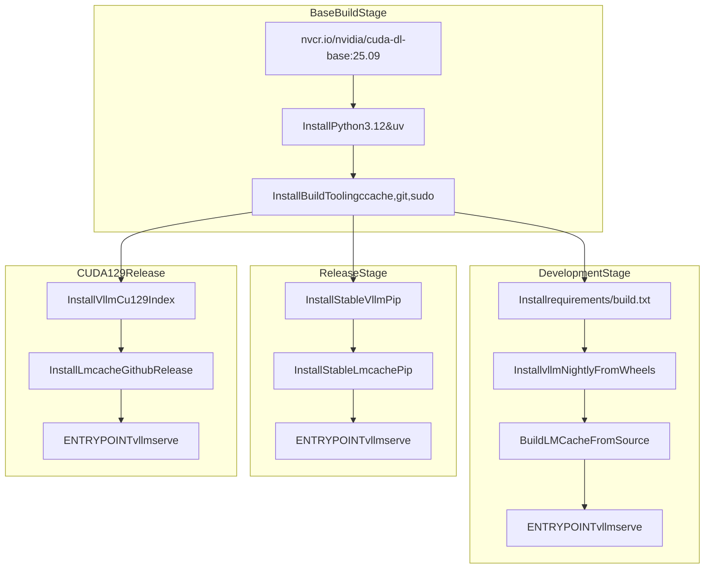
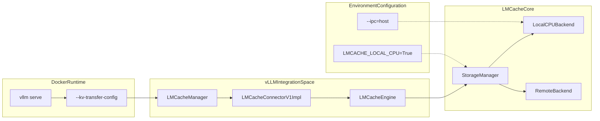
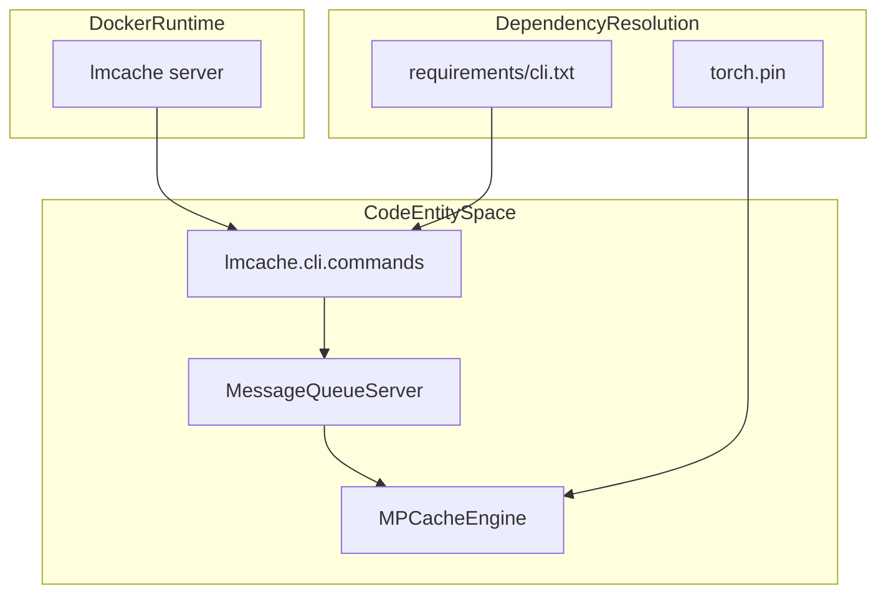

<!-- source: DeepWiki mcp.deepwiki.com · repo LMCache/LMCache · page 12.3 Docker Deployment · fetched 2026-10-21 -->

# Docker Deployment

<details>
<summary>Relevant source files</summary>

The following files were used as context for generating this wiki page:

- [.buildkite/k3_harness/resolve-pinned-vllm.sh](.buildkite/k3_harness/resolve-pinned-vllm.sh)
- [.github/workflows/build_sglang_image.yml](.github/workflows/build_sglang_image.yml)
- [docker/Dockerfile](docker/Dockerfile)
- [docker/Dockerfile.lightweight](docker/Dockerfile.lightweight)
- [docker/Dockerfile.rocm](docker/Dockerfile.rocm)
- [docker/Dockerfile.rocm-lightweight](docker/Dockerfile.rocm-lightweight)
- [docker/Dockerfile.sglang](docker/Dockerfile.sglang)
- [docker/Dockerfile.standalone](docker/Dockerfile.standalone)
- [docker/README.md](docker/README.md)
- [docker/example_build.sh](docker/example_build.sh)
- [docker/example_run.sh](docker/example_run.sh)
- [docs/source/getting_started/installation.rst](docs/source/getting_started/installation.rst)
- [docs/source/production/docker_deployment.rst](docs/source/production/docker_deployment.rst)
- [tests/v1/test_mp_connector_layout_preference.py](tests/v1/test_mp_connector_layout_preference.py)

</details>


This page explains the Docker deployment architecture for LMCache, covering official container images (`vllm-openai`, lightweight, standalone, SGLang, and ROCm variants), build arguments, nightly builds, multi-stage container configuration, and runtime integration with serving frameworks.

## Available Docker Images

LMCache publishes several specialized container image variants designed to simplify the deployment of KV cache management alongside LLM serving engines and standalone caching nodes.

| Image Tag Type | Purpose | Base Image / Environment |
|:---|:---|:---|
| `image-release` | Stable release of LMCache and vLLM (Default). | NVIDIA CUDA 13.0 + Ubuntu 24.04 [docker/Dockerfile:9-12](), [docker/Dockerfile:122-146]() |
| `image-release-cu129`| Stable release with CUDA 12.9 support. | NVIDIA CUDA 12.9 + Ubuntu 24.04 [docker/Dockerfile:156-170]() |
| `image-build` | Bleeding-edge builds from source. | Latest vLLM nightly + LMCache source. [docker/Dockerfile:56-117]() |
| `standalone` | Cache server without vLLM dependency. | Optimized image for `MPCacheEngine` and standalone server. [docker/Dockerfile.standalone:1-159]() |
| `lightweight` | Quick setup using pre-built PyPI packages. | Extends official `vllm/vllm-openai:latest` [docker/Dockerfile.lightweight:1-5]() |
| `sglang` | SGLang integration via LMCache MP mode. | Official `lmsysorg/sglang` release + LMCache wheel [docker/README.md:172-178]() |
| `rocm` | ROCm support for AMD Instinct GPUs. | ROCm base image + vLLM-ROCm + LMCache HIP extensions [docker/Dockerfile.rocm:1-126]() |

Sources: [docker/Dockerfile:9-170](), [docker/Dockerfile.standalone:1-159](), [docker/Dockerfile.lightweight:1-5](), [docker/README.md:172-178](), [docker/Dockerfile.rocm:1-126]()

## Nightly Builds and CI/CD Integration

LMCache maintains a rolling nightly release cycle to provide users with the latest features, bug fixes, and performance optimizations from the `dev` branch.

### Nightly Wheel Generation and Container Images
Nightly pipelines build wheels for multiple hardware backends (CUDA 13.0, CUDA 12.9, ROCm) and publish multi-platform container images (`linux/amd64` and `linux/arm64`) to DockerHub under rolling tags such as `lmcache/vllm-openai:latest-nightly` and `lmcache/standalone:latest` [docker/README.md:201-222](). The `image-build` target in `docker/Dockerfile` is used for these nightly builds, integrating LMCache from source with vLLM nightly [docker/Dockerfile:56-117]().

Sources: [docker/README.md:201-222](), [docker/Dockerfile:56-117]()

## Image Architecture and Build Stages

The LMCache Dockerfile uses a multi-stage build process to handle dependencies efficiently. It leverages `uv` for rapid dependency resolution [docker/Dockerfile:33-36]() and `ccache` to accelerate C++ kernel compilation [docker/Dockerfile:29-30]().

### Docker Build Flow

Title: "LMCache Multi-Stage Docker Build Pipeline"

Sources: [docker/Dockerfile:17-170]()

## Image Variants and Features

### 1. Full Integration Image (`Dockerfile`)
The recommended image for production deployments with vLLM. It includes all dependencies for high-performance features, including NIXL support for Prefill-Decode Disaggregation (PD) [docker/README.md:7-19]().
*   **Parallelism Tuning**: The build automatically resolves `MAX_JOBS` and `NVCC_THREADS` based on available host memory and CPU resources to prevent out-of-memory errors during compilation [docker/Dockerfile:71-76]().
*   **CUDA 12.9 Support**: The `image-release-cu129` stage fetches pre-built wheels from GitHub releases for environments requiring CUDA 12.x [docker/Dockerfile:156-170]().

### 2. Standalone Image (`Dockerfile.standalone`)
Designed for running LMCache as an independent caching service (`lmcache server`) [docker/README.md:89-100]().
*   **Runtime Dependencies**: Includes `ray` and `nvidia-ml-py` for distributed cache management and GPU monitoring [docker/Dockerfile.standalone:54-57]().
*   **Torch Pinning**: Uses a `torch-resolver` stage to ensure the `torch` version matches the exact version vLLM relies upon for that CUDA tag, preventing ABI mismatches [docker/Dockerfile.standalone:67-90]().

### 3. Lightweight Image (`Dockerfile.lightweight`)
Extends the official vLLM image and installs LMCache directly from PyPI. This variant offers fast build times but lacks NIXL support [docker/Dockerfile.lightweight:1-5](), [docker/README.md:130-145]().

### 4. SGLang Image (`Dockerfile.sglang`)
Extends the official `lmsysorg/sglang` image and installs the matching LMCache wheel from PyPI. Runs SGLang with `--enable-lmcache` connected to a standalone LMCache server [docker/README.md:172-178](). The build process includes checks to ensure ABI compatibility between SGLang's PyTorch version and LMCache's compiled extensions [docker/Dockerfile.sglang:33-51]().

### 5. ROCm Image (`Dockerfile.rocm`)
This Dockerfile builds an LMCache image integrated with vLLM-ROCm for AMD Instinct GPUs (MI300X/MI325X, MI350X/MI355X) [docker/Dockerfile.rocm:1-2]().
*   **HIP Extensions**: LMCache is built with HIP extensions (`BUILD_WITH_HIP=1`, `CXX=hipcc`) instead of CUDA [docker/Dockerfile.rocm:70-71]().
*   **ROCm Architectures**: Targets specific AMD GPU architectures using `PYTORCH_ROCM_ARCH` (e.g., `gfx942,gfx950`) [docker/Dockerfile.rocm:43-45]().
*   **vLLM-ROCm Integration**: Installs vLLM-ROCm wheels from `wheels.vllm.ai` for the specified ROCm version [docker/Dockerfile.rocm:78-88]().
*   **No NIXL/FlashInfer**: NIXL and FlashInfer are currently skipped as they are not available on ROCm [docker/Dockerfile.rocm:13-14]().

Sources: [docker/Dockerfile:56-170](), [docker/Dockerfile.standalone:1-159](), [docker/Dockerfile.lightweight:1-5](), [docker/README.md:7-178](), [docker/Dockerfile.sglang:33-51](), [docker/Dockerfile.rocm:1-126]()

## Configuration and Deployment

Deploying LMCache containers requires specific runtime flags to enable hardware acceleration, IPC sharing, and environment variables.

### Runtime Configuration Parameters
| Parameter | Description |
|:---|:---|
| `--ipc=host` | Required for high-performance memory sharing and CUDA IPC [docker/README.md:62]() |
| `--runtime nvidia` | Enables NVIDIA GPU access within the container [docker/README.md:59]() |
| `LMCACHE_CUDA_MAJOR` | Environment variable used during build to select the correct CUDA toolkit major version [docker/Dockerfile:98]() |
| `TORCH_CUDA_ARCH_LIST` | Controls which GPU architectures are targeted by compiled kernels [docker/Dockerfile:50-51]() |
| `PYTORCH_ROCM_ARCH` | Controls which AMD GPU architectures are targeted by compiled kernels for ROCm builds [docker/Dockerfile.rocm:43-45]() |

### Deployment Example (vLLM Integration)
```bash
docker run --runtime nvidia --gpus all \
    --env "HF_TOKEN=<YOUR_TOKEN>" \
    --env "LMCACHE_CHUNK_SIZE=256" \
    --env "LMCACHE_LOCAL_CPU=True" \
    --volume ~/.cache/huggingface:/home/lmcache/.cache/huggingface \
    --network host \
    $IMAGE \
    meta-llama/Llama-3.1-8B-Instruct --kv-transfer-config \
    '{"kv_connector":"LMCacheConnectorV1","kv_role":"kv_both"}'
```
Note: The official CUDA vLLM and standalone images run as `lmcache` (uid 1000) by default. Hugging Face caches are expected under `/home/lmcache/.cache/huggingface` [docker/README.md:70-73]().

Sources: [docs/source/production/docker_deployment.rst:15-31](), [docker/README.md:59-73](), [docker/Dockerfile:50-51](), [docker/Dockerfile:98](), [docker/Dockerfile.rocm:43-45]()

## Deployment Data Flow

The following diagrams map container startup paths to specific code entities and configurations, bridging Natural Language Space to Code Entity Space.

### Container Initialization Flow

Title: "Docker Entrypoint to Code Entity Mapping"

Sources: [docker/Dockerfile:120](), [docs/source/production/docker_deployment.rst:15-31]()

### Standalone Server Startup

Title: "Standalone Image Startup Path"

Sources: [docker/Dockerfile.standalone:54-57](), [docker/Dockerfile.standalone:157-159]()

Sources: [docker/Dockerfile:120](), [docker/Dockerfile.standalone:54-57](), [docker/Dockerfile.standalone:157-159](), [docs/source/production/docker_deployment.rst:15-31]()

## Custom Build Instructions

Users can customize image builds by passing build arguments to `docker build`.

```bash
docker build \
  --build-arg CUDA_VERSION=12.9 \
  --build-arg max_jobs=4 \
  --build-arg VLLM_VERSION=nightly \
  --target image-build \
  --tag lmcache/vllm-openai:custom \
  --file docker/Dockerfile .
```

| Argument | Default | Description |
|:---|:---|:---|
| `CUDA_VERSION` | `13.0` | CUDA toolkit version [docker/Dockerfile:9](). |
| `UBUNTU_VERSION`| `24.04` | Base OS version [docker/Dockerfile:10](). |
| `max_jobs` | `2` | Parallel jobs for `Ninja` build [docker/Dockerfile:71](). |
| `nvcc_threads` | `auto` | Threads used by `nvcc` during compilation [docker/Dockerfile:75](). |
| `VLLM_VERSION` | `nightly` | Version of vLLM to install [docker/Dockerfile:79](). |
| `ROCM_VERSION` | `7.0` | ROCm toolkit version for ROCm images [docker/Dockerfile.rocm:15](). |
| `PYTORCH_ROCM_ARCH` | `gfx942,gfx950` | AMD GPU architectures for ROCm builds [docker/Dockerfile.rocm:43-45](). |

Sources: [docker/Dockerfile:9-79](), [docker/Dockerfile.rocm:15](), [docker/Dockerfile.rocm:43-45]()

---

