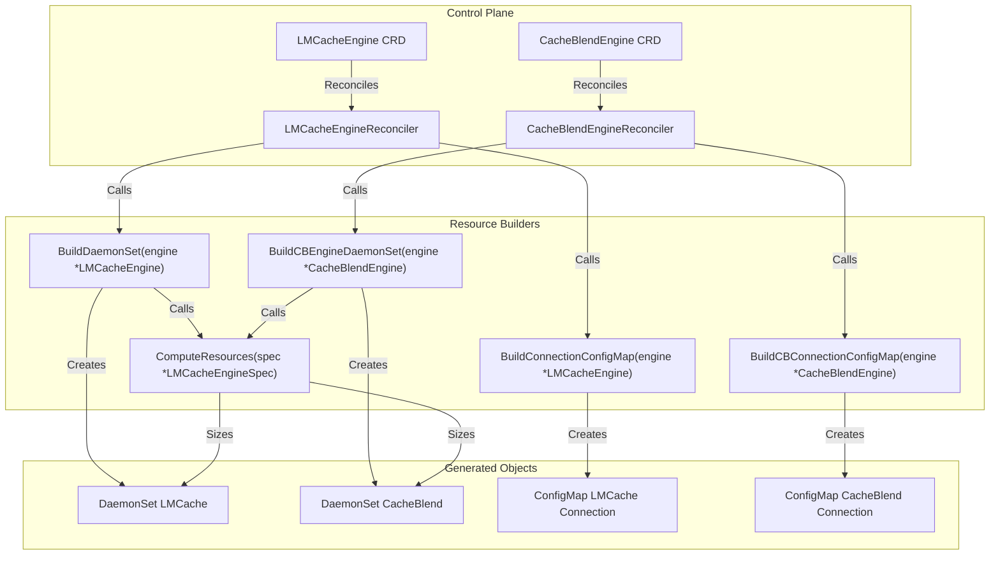
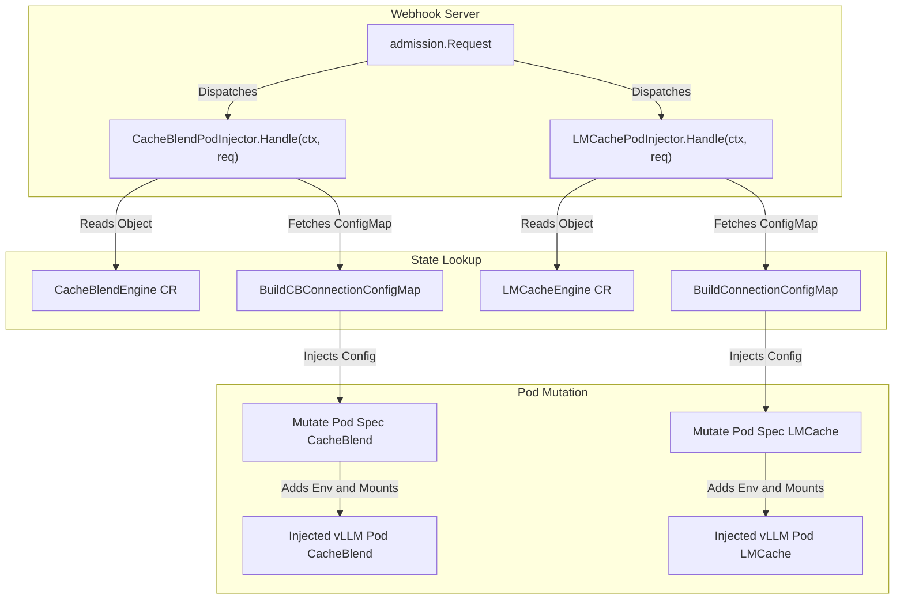
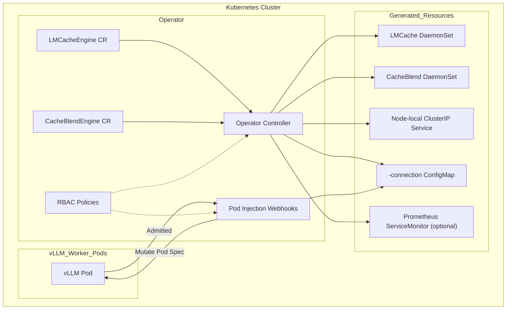

<!-- source: DeepWiki mcp.deepwiki.com · repo LMCache/LMCache · page 12.4 Kubernetes Operator · fetched 2026-10-21 -->

# Kubernetes Operator

Relevant source files

The following files were used as context for generating this wiki page:

- [docs/source/mp/operator.rst](docs/source/mp/operator.rst)
- [operator/DESIGN.md](operator/DESIGN.md)
- [operator/README.md](operator/README.md)
- [operator/api/v1alpha1/cacheblendengine_types.go](operator/api/v1alpha1/cacheblendengine_types.go)
- [operator/api/v1alpha1/lmcacheengine_types.go](operator/api/v1alpha1/lmcacheengine_types.go)
- [operator/api/v1alpha1/zz_generated.deepcopy.go](operator/api/v1alpha1/zz_generated.deepcopy.go)
- [operator/config/crd/bases/lmcache.lmcache.ai_cacheblendengines.yaml](operator/config/crd/bases/lmcache.lmcache.ai_cacheblendengines.yaml)
- [operator/config/crd/bases/lmcache.lmcache.ai_lmcacheengines.yaml](operator/config/crd/bases/lmcache.lmcache.ai_lmcacheengines.yaml)
- [operator/config/samples/lmcache_v1alpha1_cacheblendengine.yaml](operator/config/samples/lmcache_v1alpha1_cacheblendengine.yaml)
- [operator/config/samples/lmcache_v1alpha1_lmcacheengine.yaml](operator/config/samples/lmcache_v1alpha1_lmcacheengine.yaml)
- [operator/config/samples/vllm_lmcache_deployment.yaml](operator/config/samples/vllm_lmcache_deployment.yaml)
- [operator/internal/controller/cacheblendengine_controller.go](operator/internal/controller/cacheblendengine_controller.go)
- [operator/internal/controller/cacheblendengine_controller_test.go](operator/internal/controller/cacheblendengine_controller_test.go)
- [operator/internal/resources/cacheblend_engine.go](operator/internal/resources/cacheblend_engine.go)
- [operator/internal/resources/cacheblend_engine_test.go](operator/internal/resources/cacheblend_engine_test.go)
- [operator/internal/resources/configmap.go](operator/internal/resources/configmap.go)
- [operator/internal/resources/daemonset.go](operator/internal/resources/daemonset.go)
- [operator/internal/resources/resources_test.go](operator/internal/resources/resources_test.go)
- [operator/internal/webhook/cacheblend_pod_injector.go](operator/internal/webhook/cacheblend_pod_injector.go)
- [operator/internal/webhook/cacheblend_pod_injector_envtest_test.go](operator/internal/webhook/cacheblend_pod_injector_envtest_test.go)
- [operator/internal/webhook/cacheblend_pod_injector_test.go](operator/internal/webhook/cacheblend_pod_injector_test.go)
- [operator/internal/webhook/lmcache_inject_builders.go](operator/internal/webhook/lmcache_inject_builders.go)
- [operator/internal/webhook/lmcache_pod_injector.go](operator/internal/webhook/lmcache_pod_injector.go)
- [operator/internal/webhook/lmcache_pod_injector_test.go](operator/internal/webhook/lmcache_pod_injector_test.go)
- [operator/internal/webhook/pod_inject_common.go](operator/internal/webhook/pod_inject_common.go)
- [operator/internal/webhook/pod_inject_common_test.go](operator/internal/webhook/pod_inject_common_test.go)
- [operator/test/e2e/cacheblend_integration_smoke_test.go](operator/test/e2e/cacheblend_integration_smoke_test.go)
- [operator/test/e2e/lmcache_injection_smoke_test.go](operator/test/e2e/lmcache_injection_smoke_test.go)
- [operator/test/e2e/smoke_helpers_test.go](operator/test/e2e/smoke_helpers_test.go)
- [operator/test/utils/fixtures/vllm_cacheblend_deployment.yaml](operator/test/utils/fixtures/vllm_cacheblend_deployment.yaml)

The LMCache Kubernetes Operator automates the deployment and lifecycle management of LMCache multiprocess cache servers and cache-blending engines. Instead of manually managing raw Kubernetes manifests, cluster administrators declare custom resources of kind `LMCacheEngine` or `CacheBlendEngine`. The operator controller reconciles these CRs into fully configured DaemonSets, ClusterIP Services, ConfigMaps, and Prometheus `ServiceMonitor` resources, ensuring consistent, best-practice deployments tailored for GPU caching workloads [operator/api/v1alpha1/lmcacheengine_types.go:25-31](), [docs/source/mp/operator.rst:4-8](), [operator/README.md:3]().

---

## 1. Custom Resource Definitions (CRDs)

The operator defines two primary Kubernetes CRDs in the `lmcache.lmcache.ai/v1alpha1` API group — `LMCacheEngine` and `CacheBlendEngine` — that represent the declarative configuration of single-node LMCache servers and cache blending extensions respectively [operator/config/crd/bases/lmcache.lmcache.ai_lmcacheengines.yaml:9](), [operator/config/crd/bases/lmcache.lmcache.ai_cacheblendengines.yaml:9]().

### Key CRD Specifications

| CRD Kind          | Description | Key Spec Sub-Structs & Fields |
|-------------------|-------------|-------------------------------|
| **LMCacheEngine**  | Represents the LMCache multiprocess server on each GPU node | - `ServerSpec`: configs like port, chunk size, max workers, hashAlgorithm   - `L1BackendSpec`: L1 cache size (`sizeGB`)   - `EvictionSpec`: policy, triggerWatermark, evictionRatio   - `PrometheusSpec`: metrics enabling, port, and ServiceMonitor config   - `L2BackendSpec`: backend selection and parameters   - `InjectionSpec`: optional payload staging for vLLM pods [operator/api/v1alpha1/lmcacheengine_types.go:54-194]() |
| **CacheBlendEngine** | Extends LMCacheEngine for cache blending with additional tuning | - Reuses most LMCacheEngine specs   - Adds `BlendSpec`: checkLayer, recompRatio, partialBucket tuning for cache blending   - Supports separate injection logic for vLLM [operator/api/v1alpha1/lmcacheengine_types.go:57-74](), [operator/api/v1alpha1/cacheblendengine_types.go:180-198]() |

Both CRDs allow overriding container image, resource requests, pod annotations, affinity rules, and security contexts to fit cluster policies.

---

## 2. Reconciliation Engine & Resource Mapping

The Kubernetes controller watches for `LMCacheEngine` and `CacheBlendEngine` CR objects and reconciles their desired state into Kubernetes primitives like DaemonSets, Services, and ConfigMaps.

### DaemonSet & Service Builders

- **LMCacheEngine DaemonSet**  
  The function `BuildDaemonSet(engine *lmcachev1alpha1.LMCacheEngine) *appsv1.DaemonSet` builds a DaemonSet that deploys exactly one LMCache server pod per matched GPU node. It configures the pod template with GPU-related runtime classes, environment variables (`NVIDIA_VISIBLE_DEVICES=all`), security contexts, and auto-computes resource requests and limits based on the specified L1 cache size (`l1.sizeGB`) [operator/internal/resources/daemonset.go:89-92]().

- **CacheBlendEngine DaemonSet**  
  The cache blending engine projects the `CacheBlendEngine` spec onto an `LMCacheEngineSpec` using `cbSpecToEngineSpec` and uses `BuildCBEngineDaemonSet` to create a DaemonSet running the blend engine. Additional CLI flags such as `--engine-type blend` and `--l1-align-bytes 16777216` are appended to the LMCache server arguments to activate blend-specific features [operator/internal/resources/cacheblend_engine.go:66-136]().

- **Node-Local Service**  
  The operator creates a node-local ClusterIP Service with `internalTrafficPolicy=Local` so that the vLLM pods can reliably access the LMCache engine on the same node without using `hostNetwork`. This service hosts the LMCache server container port (default 5555) [operator/internal/resources/daemonset.go:91-92](), [operator/internal/resources/cacheblend_engine.go:140-144]().

### Connection ConfigMaps

- The operator creates a `<engine-name>-connection` ConfigMap carrying the `kv-transfer-config` JSON. This configuration enables vLLM pods to discover and connect to the LMCache engine via the node-local Service. For disaggregated Prefill-Decode use-cases, the ConfigMap can hold multiple connector entries (`kv_producer` and `kv_consumer`) [operator/internal/resources/configmap.go:100-103](), [operator/internal/resources/resources_test.go:37-39]().

### Resource Labeling and Defaults

- The operator applies standard labels (`app.kubernetes.io/name=lmcache`, `app.kubernetes.io/instance=<engine-name>`) to all resources it creates, enabling convenient `kubectl` queries and Prometheus label matching [operator/internal/resources/resources_test.go:115-143]().
- RuntimeClass defaults to `nvidia` for NVIDIA GPU nodes unless explicitly overridden.
- `privileged` mode defaults to false but can be enabled if required for GPU visibility.
- Host IPC and `/dev/shm` sharing mount modes depend on the chosen IPC strategy (described later).

---

### Diagram: Control Plane Reconciliation Flow to Code Entities

Sources: [operator/internal/resources/daemonset.go:89-92](), [operator/internal/resources/cacheblend_engine.go:66-137](), [operator/internal/resources/resources_test.go:180-203](), [operator/internal/resources/configmap.go:100-103]()

---

## 3. Pod-Injecting Webhooks & Admission Control

To streamline vLLM pod deployments that depend on LMCache, the operator runs mutating admission webhooks that automatically inject connection configuration and necessary volume mounts into vLLM pods that opt-in via annotations. This removes manual pod spec editing and reduces misconfiguration risk [docs/source/mp/operator.rst:152-161]().

### Webhook Types

- **LMCachePodInjector:** Injects configuration for standard `LMCacheEngine` connections.
- **CacheBlendPodInjector:** Injects configuration for `CacheBlendEngine` connections, including blend-specific flags and mount points [operator/internal/webhook/lmcache_pod_injector.go:82-151](), [operator/internal/webhook/cacheblend_pod_injector.go:82-151]().

### Injection Mechanism

- **Opt-in Annotations:** vLLM pods carry labels and annotations identifying the target LMCache engine by name.
- The webhook handler reads the referenced engine's CR, retrieves the connection ConfigMap, and mutates the pod spec to:
  - Mount the ConfigMap as a volume or set the kv-transfer-config JSON inline as an environment variable.
  - Inject sidecar volumes or emptyDirs as needed for compatible IPC.
  - Set environment variables like `PYTHONHASHSEED` to ensure deterministic string hashing in Python clients.
- For Prefill-Decode (PD) use cases, the webhook respects the pod annotation `lmcache.ai/pd-role` to inject role-specific connection configs (`kv_producer` or `kv_consumer`) [operator/api/v1alpha1/lmcacheengine_types.go:33-40]().

---

### Diagram: Webhook Admission Flow to Code Entities

Sources: [operator/internal/webhook/cacheblend_pod_injector.go:82-151](), [operator/internal/webhook/lmcache_pod_injector.go:82-151](), [operator/api/v1alpha1/lmcacheengine_types.go:33-40](), [operator/internal/resources/configmap.go:100-103]()

---

## 4. IPC Modes and Hardware Integration

LMCache relies on performant inter-process communication (IPC) mechanisms between the LMCache server pod and client vLLM pods on the same Kubernetes node. The operator manages IPC wiring based on the `spec.isolatedIPC` boolean and the detected GPU vendor.

### IPC Wiring Strategies

| IPC Mode                        | Description                                                                                                          | Pod Configuration Details                     | Compatible GPUs                               |
|--------------------------------|----------------------------------------------------------------------------------------------------------------------|-----------------------------------------------|-----------------------------------------------|
| **Isolated IPC (default NVIDIA)** | Uses driver-level CUDA IPC handles that rendezvous in the kernel driver directly. No pod shares host IPC namespace or `/dev/shm` mount. | - LMCache server runs with `--isolated-ipc` flag   - No `hostIPC`   - Webhook injects a pod-private memory-backed `/dev/shm` for vLLM workers   - Baseline Kubernetes Pod Security Standard compliant | NVIDIA GPUs (default) [docs/source/mp/operator.rst:112-124]() |
| **Legacy `/dev/shm` Sharing**      | Both LMCache server and vLLM pods must share the same host `/dev/shm` tmpfs or IPC namespace for CUDA IPC handles.    | - Server pod mounts host `/dev/shm` via hostPath or uses `hostIPC: true`   - Webhook mounts same for vLLM pods | AMD GPUs (ROCm) [docs/source/mp/operator.rst:125-134](), [operator/README.md:24-27]() |

`spec.isolatedIPC` defaults to true for `gpuVendor: nvidia` and false for `gpuVendor: amd`. Explicit overrides take precedence.

### Runtime Class and Environment Variables

- NVIDIA clusters typically use the Kubernetes `nvidia` RuntimeClass for GPU-aware pod scheduling.
- The LMCache pods set critical environment variables:
  - `NVIDIA_VISIBLE_DEVICES=all`
  - `NVIDIA_DRIVER_CAPABILITIES=all`
- Privileged mode defaults to disabled but can be enabled via `spec.privileged` if cluster requires (for example, ROCm or special hardware permissions) [operator/internal/resources/daemonset.go:30-177](), [operator/README.md:16-30]().

| GPU Vendor | Default IPC Mode   | RuntimeClass          | Key Env Vars                       |
|------------|--------------------|-----------------------|----------------------------------|
| `nvidia`   | Isolated IPC (`true`) | `nvidia`              | `NVIDIA_VISIBLE_DEVICES=all`, `NVIDIA_DRIVER_CAPABILITIES=all` |
| `amd`      | Legacy `/dev/shm` (`false`) | None (unset)           | ROCm-specific runtime configurations |

---

## 5. Prometheus and Observability Integration

The operator fully supports exposing Prometheus metrics from LMCache servers with declarative configuration:

- **Metrics Exposure:** Enabling `spec.prometheus.enabled` (default `true`) activates metrics serving on the LMCache server on port `9090` by default [operator/api/v1alpha1/lmcacheengine_types.go:186-194]().
- **ServiceMonitor Support:**  
  When `spec.prometheus.serviceMonitor.enabled` is set to `true`, the operator creates a Prometheus Operator `ServiceMonitor` custom resource. This enables automatic discovery and scraping of LMCache metrics without users manually configuring Prometheus scrape targets or endpoints [operator/api/v1alpha1/lmcacheengine_types.go:169-184](), [operator/DESIGN.md:81-96]().

This integration significantly simplifies monitoring in Kubernetes environments using kube-prometheus-stack or prometheus-operator.

---

## 6. RBAC Configuration and End-to-End Testing

### RBAC Permissions

The LMCache operator requires Kubernetes ClusterRole permissions to manage:

- Custom Resource Definitions: `lmcacheengines`, `cacheblendengines` (including status subresources)
- Core Kubernetes resources: `pods`, `services`, `configmaps`, `daemonsets`
- Validation and mutation webhooks

These permissions enable the operator to reconcile resources, validate custom resources, and mutate vLLM pods on admission.

### End-to-End Tests

Integration and smoke tests under the `operator/test/e2e/` directory exercise the operator controller and webhook functionality end-to-end:

- Tests like `cacheblend_integration_smoke_test.go` verify reconciliation and cache blend engine behavior.
- Tests like `lmcache_injection_smoke_test.go` validate webhook pod mutation for connection injection.

These tests run against real Kubernetes clusters (typically k3s in CI) to catch regressions and ensure reliable operator behavior.

---

# Summary Diagram: Kubernetes Operator Architecture

---

# References

- [LMCache CRD Types](operator/api/v1alpha1/lmcacheengine_types.go)  
- [DaemonSet and Resource Builders](operator/internal/resources/daemonset.go)  
- [CacheBlend Engine Builders](operator/internal/resources/cacheblend_engine.go)  
- [ConfigMap Builders](operator/internal/resources/configmap.go)  
- [Pod Injection Webhooks](operator/internal/webhook/cacheblend_pod_injector.go), [LMCache Pod Injector](operator/internal/webhook/lmcache_pod_injector.go)  
- [Operator Design Overview](operator/DESIGN.md)  
- [Operator User Guide](docs/source/mp/operator.rst)  
- [Operator README](operator/README.md)  
- [E2E Tests](operator/test/e2e/cacheblend_integration_smoke_test.go), (operator/test/e2e/lmcache_injection_smoke_test.go)  

---

This page completes the detailed documentation of the LMCache Kubernetes Operator, covering its custom resources, reconciliation patterns, webhook injection mechanisms, IPC considerations, Prometheus integration, and deployment best practices.

---

