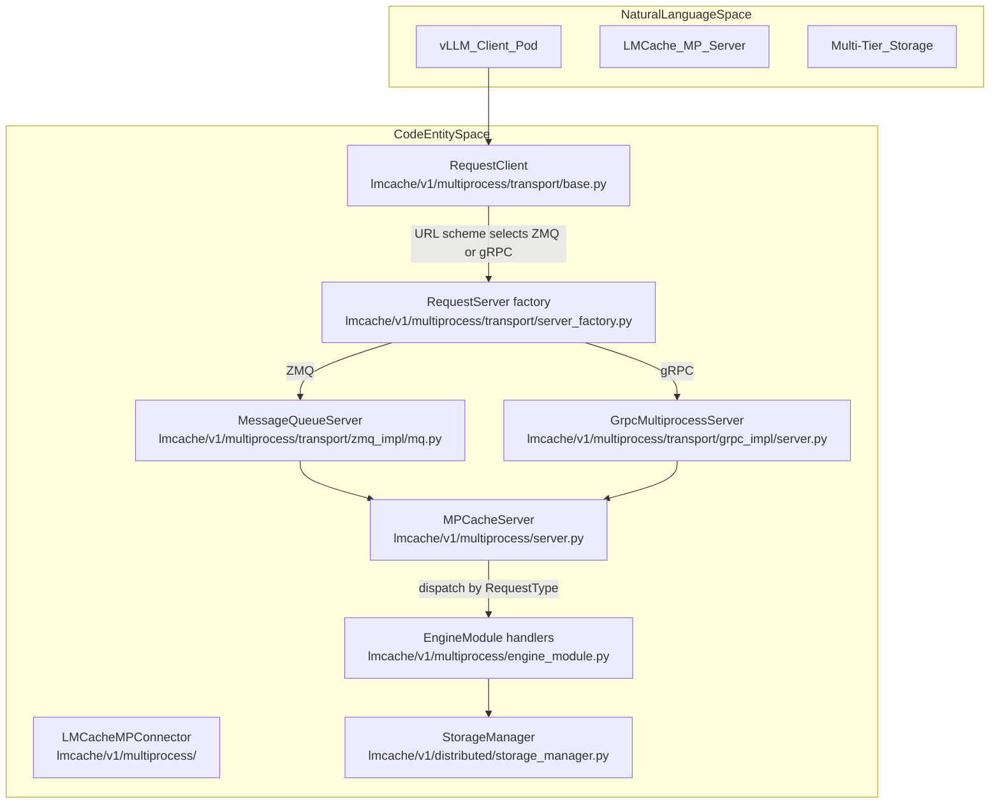
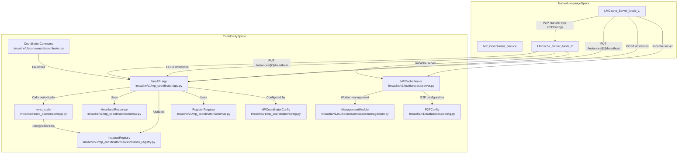
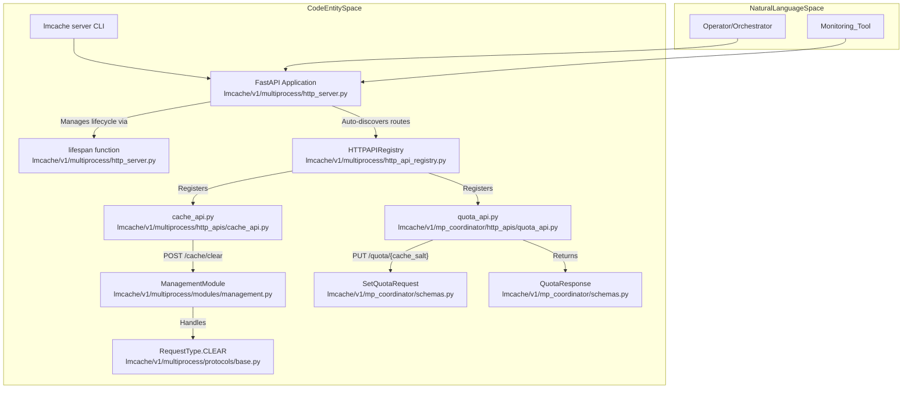

<!-- source: DeepWiki mcp.deepwiki.com · repo LMCache/LMCache · page 12.5 Production Deployment Patterns · fetched 2026-10-21 -->

# Production Deployment Patterns

<details>
<summary>Relevant source files</summary>

The following files were used as context for generating this wiki page:

- [docs/design/v1/mp_coordinator/README.md](docs/design/v1/mp_coordinator/README.md)
- [docs/source/cli/coordinator.rst](docs/source/cli/coordinator.rst)
- [docs/source/kv_cache/multiprocess_mode.rst](docs/source/kv_cache/multiprocess_mode.rst)
- [docs/source/mp/configuration.rst](docs/source/mp/configuration.rst)
- [docs/source/mp/coordinator.rst](docs/source/mp/coordinator.rst)
- [docs/source/mp/deployment.rst](docs/source/mp/deployment.rst)
- [docs/source/mp/index.rst](docs/source/mp/index.rst)
- [docs/source/production/observability/frontend.rst](docs/source/production/observability/frontend.rst)
- [docs/source/production/observability/health_monitor.rst](docs/source/production/observability/health_monitor.rst)
- [docs/source/production/observability/index.rst](docs/source/production/observability/index.rst)
- [docs/source/production/observability/internal_api_server.rst](docs/source/production/observability/internal_api_server.rst)
- [docs/source/production/observability/periodic_thread_api.rst](docs/source/production/observability/periodic_thread_api.rst)
- [examples/multi_process/lmcache-daemonset.yaml](examples/multi_process/lmcache-daemonset.yaml)
- [examples/multi_process/vllm-deployment.yaml](examples/multi_process/vllm-deployment.yaml)
- [lmcache/cli/commands/coordinator.py](lmcache/cli/commands/coordinator.py)
- [lmcache/v1/health_monitor/base.py](lmcache/v1/health_monitor/base.py)
- [lmcache/v1/health_monitor/checks/remote_backend_check.py](lmcache/v1/health_monitor/checks/remote_backend_check.py)
- [lmcache/v1/health_monitor/constants.py](lmcache/v1/health_monitor/constants.py)
- [lmcache/v1/internal_api_server/common/periodic_thread_api.py](lmcache/v1/internal_api_server/common/periodic_thread_api.py)
- [lmcache/v1/mp_coordinator/__main__.py](lmcache/v1/mp_coordinator/__main__.py)
- [lmcache/v1/mp_coordinator/config.py](lmcache/v1/mp_coordinator/config.py)
- [lmcache/v1/mp_coordinator/http_apis/dependencies.py](lmcache/v1/mp_coordinator/http_apis/dependencies.py)
- [lmcache/v1/mp_coordinator/http_apis/instances_api.py](lmcache/v1/mp_coordinator/http_apis/instances_api.py)
- [lmcache/v1/mp_coordinator/registrar.py](lmcache/v1/mp_coordinator/registrar.py)
- [lmcache/v1/mp_coordinator/schemas.py](lmcache/v1/mp_coordinator/schemas.py)
- [lmcache/v1/multiprocess/modules/management.py](lmcache/v1/multiprocess/modules/management.py)
- [lmcache/v1/multiprocess/transport/base.py](lmcache/v1/multiprocess/transport/base.py)
- [tests/cli/commands/test_coordinator.py](tests/cli/commands/test_coordinator.py)
- [tests/cli/commands/test_server.py](tests/cli/commands/test_server.py)
- [tests/v1/internal_api_server/test_run_script.py](tests/v1/internal_api_server/test_run_script.py)
- [tests/v1/mp_coordinator/test_api.py](tests/v1/mp_coordinator/test_api.py)
- [tests/v1/mp_coordinator/test_config.py](tests/v1/mp_coordinator/test_config.py)
- [tests/v1/mp_coordinator/test_main.py](tests/v1/mp_coordinator/test_main.py)
- [tests/v1/mp_coordinator/test_registrar.py](tests/v1/mp_coordinator/test_registrar.py)
- [tests/v1/multiprocess/test_client.py](tests/v1/multiprocess/test_client.py)
- [tests/v1/multiprocess/test_grpc_transport.py](tests/v1/multiprocess/test_grpc_transport.py)
- [tests/v1/multiprocess/test_protocols.py](tests/v1/multiprocess/test_protocols.py)
- [tests/v1/test_health_monitor.py](tests/v1/test_health_monitor.py)
- [tests/v1/test_health_monitor_fallback_recovery.py](tests/v1/test_health_monitor_fallback_recovery.py)

</details>


## Purpose and Scope
This page details best practices and architectural patterns for deploying LMCache in production environments. It covers single-instance vs. multi-process (MP) deployments, multi-tier storage configuration, health monitoring setups with fallback mechanisms, performance tuning parameters, multi-instance coordination, P2P fleet configuration, and containerized architectures using Kubernetes (`DaemonSet + Deployment`) and isolated IPC modes.

Sources: `[docs/source/mp/deployment.rst:1-125]()`, `[docs/source/mp/index.rst:9-35]()`

---

## Architecture Selection: Single-Instance vs. Multiprocess (MP) Mode

LMCache supports two primary deployment topologies. For single-node environments requiring process isolation and high resource sharing among multiple vLLM instances, Multiprocess (MP) mode running `MPCacheServer` is recommended. This mode runs LMCache as a standalone service that vLLM instances connect to via configurable ZMQ or gRPC transport.

### Multiprocess Code Entity Architecture

Sources: `[docs/source/mp/index.rst:9-10]()`, `[docs/source/mp/index.rst:63-95]()`, `[lmcache/v1/multiprocess/transport/base.py]()`, `[lmcache/v1/multiprocess/transport/server_factory.py]()`, `[lmcache/v1/multiprocess/transport/zmq_impl/mq.py]()`, `[lmcache/v1/multiprocess/transport/grpc_impl/server.py]()`, `[lmcache/v1/multiprocess/server.py]()`, `[lmcache/v1/multiprocess/engine_module.py]()`, `[lmcache/v1/distributed/storage_manager.py]()`

---

## Multi-Instance Coordination and P2P Fleet Configuration

For scaled-out deployments spanning multiple nodes, LMCache supports centralized coordination and peer-to-peer (P2P) cache sharing. The MP coordinator service (`lmcache coordinator`) tracks active MP server instances through heartbeats and manages instance registries.

The `P2PBackend` enables data transfer between servers using advertise URLs and transfer channels, facilitating distributed cache retrieval across nodes. The `MPCacheServer` uses `ManagementModule` to manage worker liveness and reap stale instances.

The coordinator is a FastAPI service launched with `lmcache coordinator`. It listens on `http://0.0.0.0:9300` by default. MP servers register via `POST /instances` and send heartbeats via `PUT /instances/{id}/heartbeat`. The coordinator evicts instances that haven't sent a heartbeat within `instance_timeout` seconds (default 30s), handled by the eviction routine.

It also manages fleet-wide L2 eviction, warm prefetch dispatch, and CacheBlend fragment lookup. It can be configured to index stored chunk content for fleet CacheBlend reuse via `--enable-blend-lookup`.

### Multi-Instance Fleet Coordination

Sources: `[docs/source/mp/coordinator.rst:19-20]()`, `[docs/source/mp/coordinator.rst:46-49]()`, `[docs/source/mp/coordinator.rst:51-53]()`, `[docs/source/mp/coordinator.rst:81-85]()`, `[docs/design/v1/mp_coordinator/README.md:4-8]()`, `[docs/design/v1/mp_coordinator/README.md:29-30]()`, `[lmcache/cli/commands/coordinator.py]()`, `[lmcache/v1/mp_coordinator/app.py:75-90]()`, `[lmcache/v1/mp_coordinator/config.py]()`, `[lmcache/v1/mp_coordinator/schemas.py]()`, `[lmcache/v1/multiprocess/config.py:90-91]()`, `[docs/source/mp/index.rst:109-110]()`

---

## Containerized Deployment and Isolated IPC

For Kubernetes and Docker environments, LMCache utilizes a **DaemonSet + Deployment** pattern with one LMCache server per node (DaemonSet) serving multiple vLLM pods (Deployment).

When running containers without a shared host IPC namespace (`--ipc host`), the `--isolated-ipc` flag configures CUDA IPC to use raw CUDA IPC memory handles and timeline-semaphore events instead of PyTorch storage IPC which requires a shared `/dev/shm`. This setting must be enabled on both server and client for compatibility.

The Kubernetes operator sets `spec.isolatedIPC` to true by default to enable container-safe IPC without `--ipc host`.

### Isolated IPC Configuration Flow
```mermaid
graph TD
    subgraph "NaturalLanguageSpace"
        DockerContainer[""Docker_Container_Isolation""]
        KubernetesPod[""Kubernetes_Pod_Security""]
    end

    subgraph "CodeEntitySpace"
        LMCacheServer[""lmcache server<br/>--isolated-ipc""]
        VLLMClient[""vllm serve<br/>kv_connector_extra_config: {lmcache.mp.isolated_ipc: true}""]
        MPServerConfig[""MPServerConfig<br/>lmcache/v1/multiprocess/config.py""]
        CudaIPCWrapper[""CudaIPCWrapper<br/>docs/design/v1/platform/devices/cuda/ipc_wrapper.md""]
        TimelineSemaphoreEventIPC[""TimelineSemaphoreEventIPC<br/>docs/design/v1/platform/devices/cuda/timeline_semaphore_event_ipc.md""]
    end

    DockerContainer --> LMCacheServer
    KubernetesPod --> LMCacheServer
    LMCacheServer -- "Sets isolated_ipc=True in" --> MPServerConfig
    LMCacheServer -- "Enables" --> CudaIPCWrapper
    LMCacheServer -- "Enables" --> TimelineSemaphoreEventIPC
    VLLMClient -- "Configures isolated_ipc=True" --> MPServerConfig
    VLLMClient -- "Configures" --> CudaIPCWrapper
    VLLMClient -- "Configures" --> TimelineSemaphoreEventIPC
```
Sources: `[docs/source/mp/deployment.rst:60-105]()`, `[docs/source/mp/deployment.rst:83-93]()`, `[docs/source/mp/deployment.rst:124-125]()`, `[lmcache/v1/multiprocess/config.py:80-83]()`

---

## Health Monitoring and Fallback Setup

LMCache maintains cluster reliability through a `HealthMonitor` that periodically runs registered `HealthCheck` instances. A key example is `RemoteBackendHealthCheck`, which pings remote storage connectors to verify availability and responsiveness.

When a `RemoteBackend` health check fails, the system uses a configurable `FallbackPolicy` to decide how to proceed:

- **RECOMPUTE (default):** Cache operations bypass remote storage, forcing recomputation.
- **LOCAL_CPU:** Fall back to a local CPU backend with a hot cache enabled.

The health monitor runs as a `PeriodicThread` and automatically discovers health checks in the system. Checks track failure timestamps to avoid flapping and delay recovery attempts.

### Health Monitor and Fallback Architecture
```mermaid
graph TD
    subgraph "CodeEntitySpace"
        HM[""HealthMonitor<br/>lmcache/v1/health_monitor/base.py""]
        HC[""HealthCheck<br/>lmcache/v1/health_monitor/base.py""]
        RBHC[""RemoteBackendHealthCheck<br/>lmcache/v1/health_monitor/checks/remote_backend_check.py""]
        FP[""FallbackPolicy<br/>lmcache/v1/health_monitor/constants.py""]
        LMCacheManager[""LMCacheManager<br/>lmcache/v1/manager.py""]
        StorageManager[""StorageManager<br/>lmcache/v1/storage_backend/storage_manager.py""]
        RemoteBackend[""RemoteBackend<br/>lmcache/v1/storage_backend/remote_backend.py""]
    end

    HM -- "Discovers and Instantiates" --> HC
    HC <|-- RBHC
    RBHC -- "Determines" --> FP
    HM -- "Monitors" --> LMCacheManager
    LMCacheManager -- "Contains" --> StorageManager
    StorageManager -- "Contains" --> RemoteBackend
    RBHC -- "Checks" --> RemoteBackend
```
Sources: `[lmcache/v1/health_monitor/base.py:36-73]()`, `[lmcache/v1/health_monitor/base.py:146-183]()`, `[lmcache/v1/health_monitor/base.py:154-155]()`, `[lmcache/v1/health_monitor/base.py:191-196]()`, `[lmcache/v1/health_monitor/checks/remote_backend_check.py:44-79]()`, `[lmcache/v1/health_monitor/checks/remote_backend_check.py:51-55]()`, `[lmcache/v1/health_monitor/constants.py:14-32]()`

---

## Storage Tier Selection and Performance Tuning

Production deployments balance L1 (hot DRAM or NVMe slab) and L2 (remote or persistent) storage tiers. Fine tuning of the MP server includes worker thread allocation, chunk sizing, and timeout thresholds.

The `lmcache server` entry point allows configuring:

- L1 cache size via CLI (e.g., `--l1-size-gb`).
- Chunk size to balance overhead and hit rate (default `256`).
- Worker thread pools for CPU and GPU work (`--max-workers`, `--max-gpu-workers`, `--max-cpu-workers`).
- Isolated IPC enablement for container deployments.
- Worker reap timeout to clean silent GPU workers.
- Hash algorithm choice (`blake3` recommended).

The `MPServerConfig` dataclass encapsulates many such parameters.

| Parameter                     | Recommended Value | Description                                                                                      |
|------------------------------|-------------------|--------------------------------------------------------------------------------------------------|
| `--l1-size-gb`                | 20-100+ GB        | L1 DRAM cache size for the MP server.                                                           |
| `--chunk-size`                | 256               | Tokens per KV chunk; balances lookup overhead and hit rate.                                     |
| `--max-workers`               | 4-8               | Worker threads for CPU/GPU affine pools.                                                        |
| `--isolated-ipc`              | true/false        | Use container-safe CUDA IPC handles without shared `/dev/shm`.                                 |
| `--worker-reap-timeout-seconds` | 120.0            | Timeout to reap leaked GPU contexts from silent workers.                                        |
| `--hash-algorithm`            | blake3            | Token hash algorithm for operations; `blake3` recommended for self-contained hashing.            |

Sources: `[docs/source/mp/deployment.rst:23]()`, `[docs/source/mp/deployment.rst:84]()`, `[docs/source/mp/index.rst:53-56]()`, `[lmcache/v1/multiprocess/config.py:20-22]()`, `[lmcache/v1/multiprocess/config.py:33-34]()`, `[lmcache/v1/multiprocess/config.py:36-37]()`, `[lmcache/v1/multiprocess/config.py:51-52]()`, `[lmcache/v1/multiprocess/config.py:80-83]()`, `[lmcache/v1/multiprocess/config.py:113-116]()`, `[lmcache/v1/multiprocess/modules/management.py:142-149]()`, `[lmcache/v1/multiprocess/protocols/base.py]()`

---

## HTTP API for Operations and Monitoring

The `lmcache server` exposes a FastAPI HTTP frontend alongside the ZMQ or gRPC request endpoint. This API targets operators, orchestrators (e.g., Kubernetes), and monitoring tools rather than the inference data path.

Routes are auto-discovered and merged by `HTTPAPIRegistry`. Important endpoints include:

- **Liveness and Health**: `/` (static liveness), `/healthcheck` (K8s probe).
- **Inspection and Status**: `/status` (engine diagnostics), `/config`, `/version`.
- **Cache Management**: `/cache/objects` (list and delete keys), `/cache/prefetches` (submit and poll warm prefetches), `/cache/clear` (clear L1 cache), `/cache/checksums`.
- **Quota Management**: `/quota` endpoints for listing, setting, updating and removing per-tenant quotas.
- **Runtime L2 Reconfiguration**: Backend reconfigure and status endpoints.

The `lifespan` function within the HTTP server module manages the full startup and shutdown lifecycle, including:

- Spawning the MP request server (ZMQ or gRPC).
- Initializing the `MPCacheServer` and core services.
- Launching runtime plugins if configured.
- Optional registration with the MP coordinator.

### HTTP API Endpoint Overview

Sources: `[docs/source/mp/http_api.rst:4-5]()`, `[docs/source/mp/http_api.rst:6-8]()`, `[docs/source/mp/http_api.rst:13-15]()`, `[docs/source/mp/http_api.rst:95-100]()`, `[docs/source/mp/http_api.rst:112-131]()`, `[docs/source/mp/http_api.rst:143-165]()`, `[docs/source/mp/http_api.rst:176-186]()`, `[docs/source/mp/http_api.rst:198-204]()`, `[lmcache/v1/multiprocess/http_apis/cache_api.py]()`, `[lmcache/v1/multiprocess/http_server.py:68-178]()`, `[lmcache/v1/multiprocess/modules/management.py:162-169]()`, `[lmcache/v1/multiprocess/protocols/base.py]()`, `[lmcache/v1/mp_coordinator/schemas.py:127-137]()`, `[lmcache/v1/mp_coordinator/schemas.py:139-151]()`

---

This page covers the crucial production deployment patterns needed to operate LMCache at scale safely and efficiently. Use the multiprocess standalone server for isolation and shared caching, register your servers with the MP coordinator for fleet-wide management, configure storage tiers per workload needs, enable health monitoring with fallback policies to maintain reliability, and leverage container-friendly IPC modes for Kubernetes or Docker environments. The HTTP API and configuration options provide powerful hooks for orchestration, observability, and tuning.

For detailed reference and examples, consult the linked source files and the multiprocess coordinate service documentation.

# End of 12.5 Production Deployment Patterns

---

