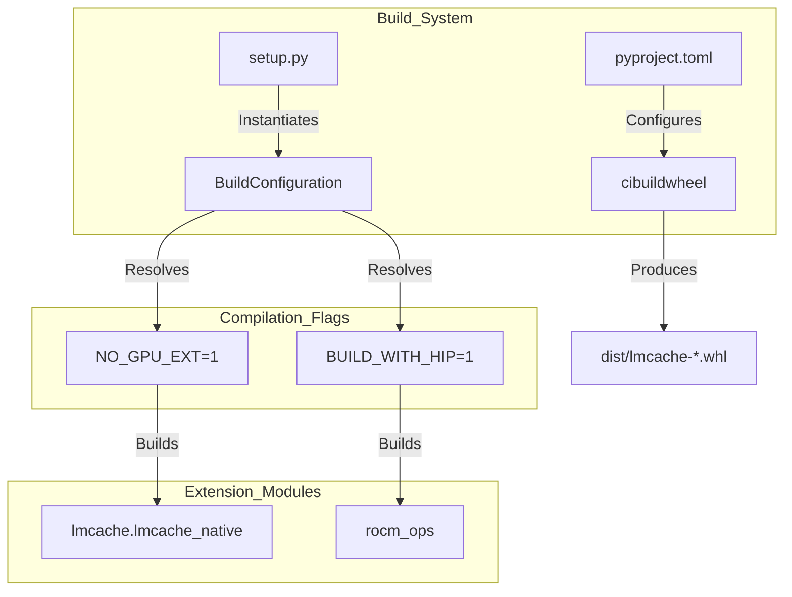
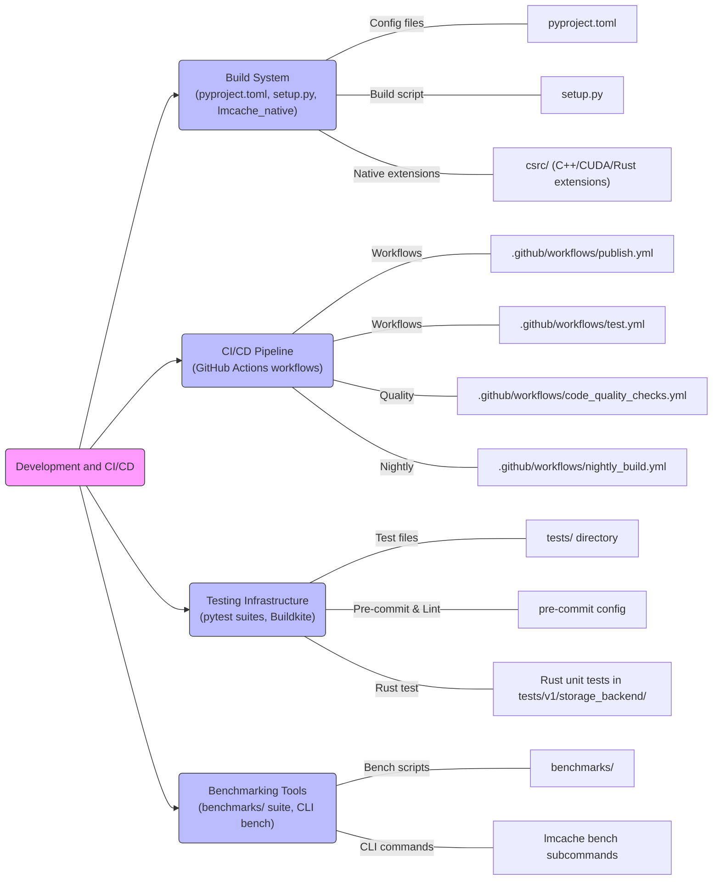
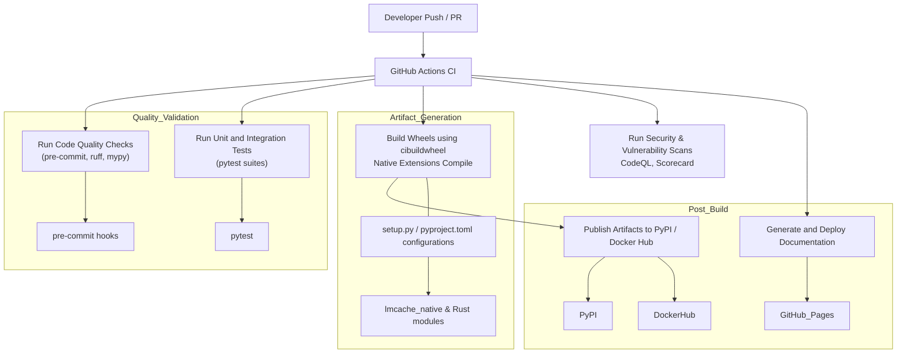

<!-- source: DeepWiki mcp.deepwiki.com · repo LMCache/LMCache · page 13 Development and CI/CD · fetched 2026-10-21 -->

# Development and CI/CD

Relevant source files

The following files were used as context for generating this wiki page:

- [.buildkite/correctness/README.md](.buildkite/correctness/README.md)
- [.buildkite/correctness/pipeline.mmlu.yml](.buildkite/correctness/pipeline.mmlu.yml)
- [.github/ISSUE_TEMPLATE/blank_issue.md](.github/ISSUE_TEMPLATE/blank_issue.md)
- [.github/ISSUE_TEMPLATE/bug_report.md](.github/ISSUE_TEMPLATE/bug_report.md)
- [.github/ISSUE_TEMPLATE/feature_request.md](.github/ISSUE_TEMPLATE/feature_request.md)
- [.github/PULL_REQUEST_TEMPLATE.md](.github/PULL_REQUEST_TEMPLATE.md)
- [CONTRIBUTING.md](CONTRIBUTING.md)
- [DCO](DCO)
- [MAINTAINERS.md](MAINTAINERS.md)
- [docs/source/developer_guide/contributing.rst](docs/source/developer_guide/contributing.rst)

This document provides a high-level overview of LMCache's development infrastructure, encompassing the build system, continuous integration and continuous deployment (CI/CD) pipelines, testing frameworks, and benchmarking tools. LMCache supports multiple hardware accelerators such as CUDA, ROCm, XPU, MUSA, and SYCL, and maintains compatibility across Python versions 3.10 through 3.13. Distribution is managed via PyPI, TestPyPI, and Docker Hub to support diverse user environments [docs/source/developer_guide/contributing.rst:1-127]().

For detailed guidance on each area, please refer to the following dedicated child pages:  
- [Build System](#13.1)  
- [CI/CD Pipeline](#13.2)  
- [Testing Infrastructure](#13.3)  
- [Benchmarking Tools](#13.4)  

---

## Build System

The LMCache build system compiles Python extension modules alongside performant C++/CUDA and Rust native components essential for optimized key-value cache operations. Configuration is conventionally specified in `pyproject.toml` and `setup.py`, where build profiles target various platforms and accelerator backends [docs/source/developer_guide/contributing.rst:114-119]().

Several environment flags influence build behavior:  
- `NO_GPU_EXT=1` disables GPU extensions.  
- `NO_NATIVE_EXT=1` disables native C++/CUDA extensions.  
- `BUILD_WITH_HIP=1` triggers ROCm-compatible builds.  

The most prominent native extension is `lmcache.lmcache_native`, which is compiled for CUDA (NVIDIA), ROCm (AMD), and other supported platforms. The build supports granularity via profiles for CUDA, ROCm, SYCL, MUSA, MACA, and RBLN [AGENTS.md:37-51]().

Automated wheel building is orchestrated using `cibuildwheel` integrated with GitHub Actions. This setup generates cross-platform wheel distributions, including CPU-only, ARM64, and AMD64 CUDA variants, facilitating easy package installation on diverse hardware configurations.

For a comprehensive explanation of LMCache's build subsystem, configurations, extension modules, and profiling, see [Build System](#13.1).

Sources: [docs/source/developer_guide/contributing.rst:114-119](), [AGENTS.md:37-51](), [.github/workflows/nightly_build.yml:12-141]()

---

## CI/CD Pipeline

LMCache employs GitHub Actions as the cornerstone for its CI/CD pipelines, automating processes such as code validation, multi-platform builds, artifact publishing, security scans, and documentation deployment. The workflows are split by responsibility to isolate failures efficiently and accelerate feedback loops [\.github/workflows/publish.yml:1-172](), [\.github/workflows/test.yml:1-195]().

Key workflows include:  
- **Publish Workflow:** Handles release builds across platforms, publishing packages, and orchestrating tests.  
- **Test Workflow:** Runs unit and integration tests, covering CPU-only and multi-accelerator scenarios.  
- **Code Quality Checks:** Enforces code style, linting, static analysis, and formatting via tools such as `ruff` and `mypy`.  
- **Nightly Builds:** Generates pre-release wheels for CUDA builds on both amd64 and arm64 architectures regularly.  
- **Security and Quality Scans:** CodeQL, Scorecard, and Actionlint assessments run continuously to detect potential vulnerabilities and workflow misconfigurations.  
- **Documentation Build:** Sphinx docs are built and deployed automatically to GitHub Pages upon relevant changes.

```mermaid
graph TD
    subgraph "GitHub_Actions_Workflows"
        publish_wf["publish.yml"]
        test_wf["test.yml"]
        code_quality_wf["code_quality_checks.yml"]
        nightly_wf["nightly_build.yml"]
        codeql_wf["codeql.yml"]
        scorecard_wf["scorecard.yml"]
        actionlint_wf["actionlint.yml"]
        build_doc_wf["build_doc.yml"]
    end

    subgraph "Build_Artifacts"
        build_main["build-main"]
        build_cli["build-cli"]
        build_cu129["build-cu129"]
        build_rocm["build-rocm"]
    end

    subgraph "Quality_Checks"
        test_job["test"]
        code_quality_job["code-quality"]
        rust_unit_tests["rust-unit-tests"]
        raw_block_tests["raw-block-tests"]
        codeql_analyze["CodeQL Analyze"]
        scorecard_analysis["Scorecard Analysis"]
        actionlint_check["Actionlint Check"]
    end

    subgraph "Nightly_Builds"
        nightly_wheels["nightly-wheels"]
        publish_cu129_arm64["publish-nightly-cu129-arm64"]
        publish_cu130_arm64["publish-nightly-cu130-arm64"]
    end

    subgraph "Documentation"
        build_docs["build-docs"]
        deploy_docs["deploy-docs"]
    end

    publish_wf --> build_main
    publish_wf --> build_cli
    publish_wf --> build_cu129
    publish_wf --> build_rocm
    publish_wf --> test_job
    publish_wf --> code_quality_job

    test_wf --> test_job
    test_wf --> rust_unit_tests
    test_wf --> raw_block_tests

    code_quality_wf --> code_quality_job

    nightly_wf --> nightly_wheels
    nightly_wheels --> publish_cu129_arm64
    nightly_wheels --> publish_cu130_arm64

    codeql_wf --> codeql_analyze
    scorecard_wf --> scorecard_analysis
    actionlint_wf --> actionlint_check
    build_doc_wf --> build_docs
    build_docs --> deploy_docs

    test_job -- "CPU only unit tests" --> pytest_node["pytest -m 'not (cuda or musa or xpu or npu or neuron or rbln)'"]
    raw_block_tests -- "Rust extension tests" --> raw_node["pytest tests/v1/storage_backend/test_raw_block_*.py"]
```

Notably, the release pipeline triggers build jobs producing binaries for mainline, CLI, CUDA 12.9, and ROCm backends, alongside running tests and code quality validations on pull requests and push events. Nightly wheels allow users to access the latest pre-release features. Parallelized testing includes dedicated Rust unit tests and Python integration for raw block storage backend. Documentation workflows ensure freshly updated manuals are always accessible.

For a detailed exploration of LMCache's full CI/CD workflow architectures, usage patterns, and release process, see [CI/CD Pipeline](#13.2).

Sources: [.github/workflows/publish.yml:1-172](), [.github/workflows/test.yml:1-195](), [.github/workflows/code_quality_checks.yml:1-68](), [.github/workflows/nightly_build.yml:1-179](), [.github/workflows/codeql.yml:1-112](), [.github/workflows/scorecard.yml:1-84](), [.github/workflows/actionlint.yml:1-52](), [.github/workflows/build_doc.yml:1-104]()

---

## Testing Infrastructure

Testing underpins the quality and stability of LMCache, covering Python versions 3.10 through 3.13 and integrating a broad spectrum of hardware configurations. Tests are organized using `pytest`, with the capability to selectively ignore or include test subsets to accommodate different backends and environments [\.github/workflows/test.yml:63-117]().

The suite includes:  
- Unit tests for core functionality and API correctness.  
- Integration tests spanning multiprocess, distributed, and storage backend scenarios.  
- Specialized tests focused on Rust extension modules for backend storage support.  
- Code quality checks integrated via `pre-commit`, `ruff` static analysis, formatting tools, and type checking with `mypy` [\.github/workflows/code_quality_checks.yml:39-68]().

The testing infrastructure coordinates smoothly with the CI pipelines to gate merge requests, requiring all coverage and formatting standards to pass before merging pull requests.

For a complete breakdown of test suite organization, pytest configuration, Buildkite harness usage, and utility scripts, see [Testing Infrastructure](#13.3).

Sources: [docs/source/developer_guide/contributing.rst:1-127](), [.github/workflows/test.yml:63-195](), [.github/workflows/code_quality_checks.yml:39-68]()

---

## Benchmarking Tools

LMCache offers a comprehensive benchmarking suite focused on measuring Key-Value cache serving performance. The `benchmarks/` directory houses scenarios such as:  
- Long-document question answering (long_doc_qa).  
- Multi-round question answering workloads (multi_round_qa).  
- Retrieval-Augmented Generation (rag).  
- Storage backend I/O microbenchmarks.  

In addition, the CLI extends `bench` subcommands that include:  
- `server_bench` to test overall server throughput and latency.  
- `engine_bench` for core engine performance profiling.  
- `l2_adapter_bench` to evaluate L2 storage adapters.

These tools assist contributors and users in assessing optimizations and hardware impacts systematically.

For deeper insight into benchmark design, use cases, and interpretation of results, see [Benchmarking Tools](#13.4).

Sources: [docs/source/developer_guide/contributing.rst:1-127]()

---

# Diagram: Linking Natural Language Topics to Key Code Artifacts

---

# Diagram: High-Level Workflow of CI/CD Pipeline and Build System Associations

---

For getting started with contributing, please consult the [Contributing Guide](docs/source/developer_guide/contributing.rst) and the [CONTRIBUTING.md](CONTRIBUTING.md) document, which cover branching workflows, signing commits, testing locally, and PR submission best practices.

# End of Development and CI/CD

Sources:  
[docs/source/developer_guide/contributing.rst:1-127](), [CONTRIBUTING.md:1-176](), [.github/workflows/publish.yml:1-172](), [.github/workflows/test.yml:1-195](), [.github/workflows/code_quality_checks.yml:1-68](), [.github/workflows/nightly_build.yml:1-179](), [AGENTS.md:37-51]()

---

