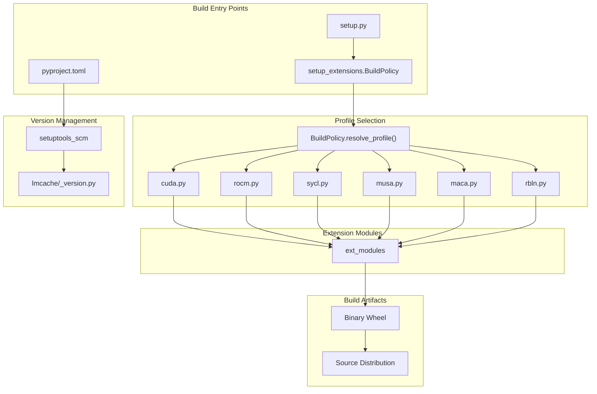
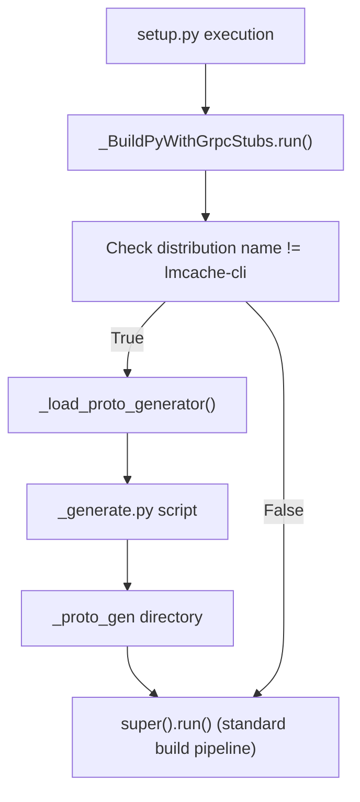
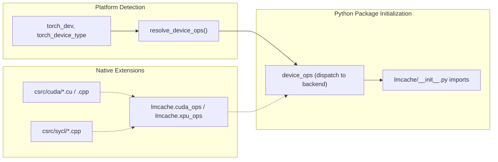
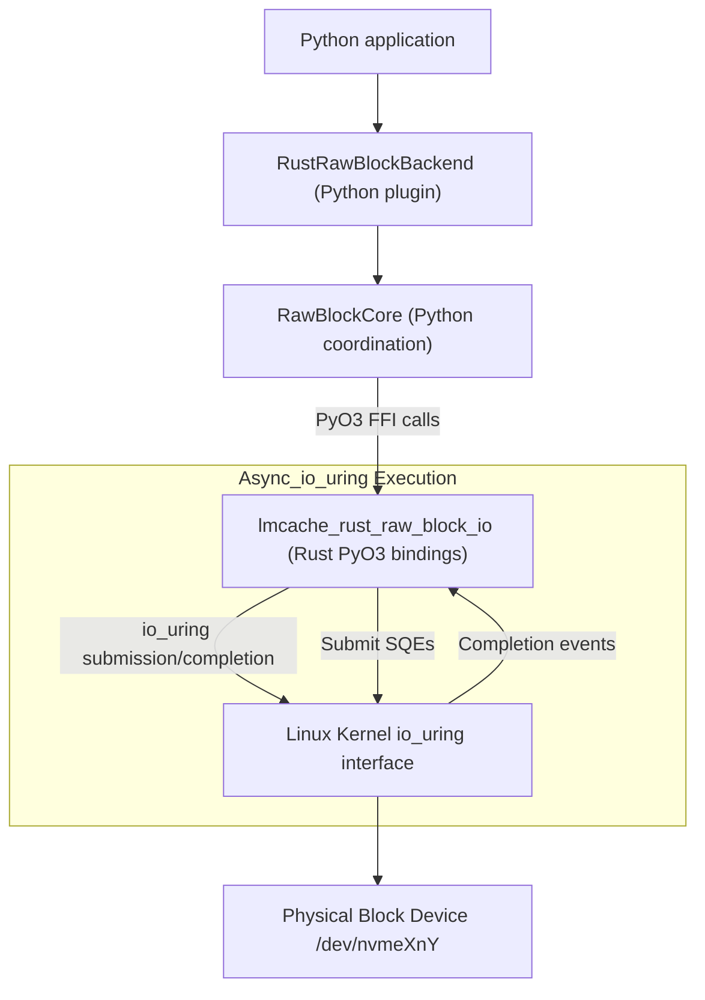

<!-- source: DeepWiki mcp.deepwiki.com · repo LMCache/LMCache · page 13.1 Build System · fetched 2026-10-21 -->

# Build System

Relevant source files

The following files were used as context for generating this wiki page:

- [.github/scripts/build_musa_wheel.sh](.github/scripts/build_musa_wheel.sh)
- [.github/scripts/build_rocm_wheel.sh](.github/scripts/build_rocm_wheel.sh)
- [.github/scripts/build_xpu_wheel.sh](.github/scripts/build_xpu_wheel.sh)
- [.github/workflows/build_musa_artifacts.yml](.github/workflows/build_musa_artifacts.yml)
- [.gitignore](.gitignore)
- [csrc/storage_backends/README.md](csrc/storage_backends/README.md)
- [csrc/sycl/mem_kernels_sycl.cpp](csrc/sycl/mem_kernels_sycl.cpp)
- [csrc/sycl/mem_kernels_sycl.h](csrc/sycl/mem_kernels_sycl.h)
- [csrc/sycl/mp_mem_kernels_sycl.cpp](csrc/sycl/mp_mem_kernels_sycl.cpp)
- [csrc/sycl/pybind_sycl.cpp](csrc/sycl/pybind_sycl.cpp)
- [docs/source/developer_guide/extending_lmcache/native_connectors.rst](docs/source/developer_guide/extending_lmcache/native_connectors.rst)
- [examples/lmc_external_native_connector/setup.py](examples/lmc_external_native_connector/setup.py)
- [lmcache/__init__.py](lmcache/__init__.py)
- [lmcache/v1/multiprocess/transport/grpc_impl/_proto_gen/_generate.py](lmcache/v1/multiprocess/transport/grpc_impl/_proto_gen/_generate.py)
- [pyproject.toml](pyproject.toml)
- [requirements/bench.txt](requirements/bench.txt)
- [requirements/build.txt](requirements/build.txt)
- [requirements/common.txt](requirements/common.txt)
- [requirements/cuda.txt](requirements/cuda.txt)
- [requirements/cuda12_core.txt](requirements/cuda12_core.txt)
- [requirements/cuda13_core.txt](requirements/cuda13_core.txt)
- [requirements/maca_core.txt](requirements/maca_core.txt)
- [requirements/proto.txt](requirements/proto.txt)
- [setup.py](setup.py)
- [setup_extensions/build_profiles/cuda.py](setup_extensions/build_profiles/cuda.py)
- [setup_extensions/build_profiles/maca.py](setup_extensions/build_profiles/maca.py)
- [setup_extensions/build_profiles/rocm.py](setup_extensions/build_profiles/rocm.py)
- [setup_extensions/build_profiles/sycl.py](setup_extensions/build_profiles/sycl.py)
- [setup_extensions/common_cpp.py](setup_extensions/common_cpp.py)
- [setup_extensions/storage_backend_profiles/aerospike.py](setup_extensions/storage_backend_profiles/aerospike.py)
- [tests/v1/multiprocess/transport/test_proto_generator.py](tests/v1/multiprocess/transport/test_proto_generator.py)
- [tests/v1/test_xpu_sglang_connector.py](tests/v1/test_xpu_sglang_connector.py)

## Purpose and Scope

This page details the LMCache build system responsible for compiling native extensions, generating gRPC stubs, and packaging the Python distribution. The system is designed with a policy-driven strategy to build platform-specific extension modules (CUDA, ROCm, SYCL, MUSA, MACA, RBLN) via modular build profiles. It incorporates declarative metadata (in `pyproject.toml`), imperative setup logic (`setup.py`), automated binary wheel builds (`cibuildwheel`), native C++/CUDA/SYCL/MUSA sources under `csrc/`, gRPC stub generation for multiprocessing transport, and a high-performance Rust raw block backend crate [setup.py:2-90](), [pyproject.toml:1-20]().

---

## Build System Overview and Configuration

The LMCache build system integrates modern Python packaging standards and extension compilation workflows:

- **Declarative Build Metadata:** `pyproject.toml` defines minimal PEP 517 build requirements locking specific versions for reproducible builds, including `ninja`, `setuptools`, `grpcio`, `torch==2.13.0`, and related tools. It also describes project metadata, dependencies, and entry points for CLI commands like `lmcache`, `lmcache_server`, and `lmcache_controller` [pyproject.toml:1-20]().

- **Imperative Build Logic:** The `setup.py` script orchestrates the build process by instantiating a `BuildPolicy` that resolves the active build profile reflecting the target platform/environment. It collects extension modules, custom command classes, and dependency requirements accordingly. The build process auto-generates gRPC stubs before regular packaging using a custom `build_py` command subclass [setup.py:62-90]().

### Build Logic and Profile Resolution

The `BuildPolicy` abstraction detects the platform type by checking environment variables or tooling presence and loads the corresponding `BuildProfile` subclass from the `setup_extensions/build_profiles` directory.

Typical profiles include:

- CUDA GPU (default, nvcc compiler)
- ROCm GPU (hipcc compiler with hipify)
- SYCL / Intel XPU (icpx compiler)
- MUSA (Moore Threads compiler)
- MACA (MetaX compiler, cu-bridge wrapper)
- RBLN (Radeon Blaze compiler - implicit)

The resolved profile then returns extension modules and build configurations which `setup.py` applies for compilation.

### Build Process Flow

Sources: `[setup.py:2-90]()`, `[pyproject.toml:1-20]()`, `[setup_extensions/build_profiles/cuda.py:18-189]()`, `[setup_extensions/build_profiles/rocm.py:1-166]()`, `[setup_extensions/build_profiles/sycl.py:1-92]()`

---

## Multi-Platform Extension Build Profiles

LMCache supports a range of hardware platforms via dedicated build profiles, each encapsulating platform-specific compiler flags, sources, and dependencies. This modular design allows easy addition of new platform support with zero changes to `setup.py` following the strategy pattern [setup.py:2-7]().

| Platform | Env Flag or Detection | Compiler    | Description / Key Features                                                                                               |
|----------|-----------------------|-------------|--------------------------------------------------------------------------------------------------------------------------|
| **CUDA** | `BUILD_WITH_CUDA=1` or default | `nvcc`      | Builds `lmcache.cuda_ops` with all CUDA C++ and `.cu` kernels and utilities. Auto parallelism tuning (jobs/threads) and C++11 ABI handling [setup_extensions/build_profiles/cuda.py:60-95]() |
| **ROCm** | `BUILD_WITH_HIP=1` | `hipcc`      | Hipifies CUDA sources to ROCm HIP using `torch.utils.hipify`, applies symbol remapping patches, and compiles with ROCm toolchain. Produces `lmcache.cuda_ops` [setup_extensions/build_profiles/rocm.py:27-104]() |
| **SYCL** | `BUILD_WITH_SYCL=1`  | `icpx`      | Builds Intel XPU backend `lmcache.xpu_ops` with DPC++ compiler, SYCL kernels, and host memory registration. Requires Intel oneAPI [setup_extensions/build_profiles/sycl.py:28-92]() |
| **MUSA** | `BUILD_WITH_MUSA=1` | `mcc` (Moore Threads) | Moore Threads GPU support with separate CI build pipeline [.github/scripts/build_musa_wheel.sh]() |
| **MACA** | `BUILD_WITH_MACA=1` | `maca-cxx`  | MetaX MACA GPU backend using `torch.utils.cpp_extension` wrappers to compile and bridge CUDA calls for MACA devices [setup_extensions/build_profiles/maca.py:47-117]() |
| **RBLN** | Implicit detection   | TBD         | Radeon Blaze GPU backend (details in `setup_extensions/build_profiles/rbln.py`)                                          |

Each profile returns the corresponding list of `setuptools.Extension` modules and build command classes for compilation integration [setup_extensions/build_profiles/cuda.py:114-164](), [setup_extensions/build_profiles/rocm.py:120-162]().

Sources: `[setup_extensions/build_profiles/cuda.py:18-189]()`, `[setup_extensions/build_profiles/rocm.py:1-166]()`, `[setup_extensions/build_profiles/sycl.py:21-92]()`, `[setup_extensions/build_profiles/maca.py:47-117]()`

---

## gRPC Stub Generation

The LMCache multiprocessing transport layer extensively uses gRPC for inter-process communication. To automate updating gRPC Python bindings, `setup.py` includes a custom build command `_BuildPyWithGrpcStubs` that runs before packaging [setup.py:62-71]().

The process works as follows:

- The custom `build_py` command, when invoked during packaging, loads the gRPC proto stub generator script from:  
  `lmcache/v1/multiprocess/transport/grpc_impl/_proto_gen/_generate.py`  
- It executes the `generate()` function, regenerating `.py` files for protobuf services and messages.
- This ensures up-to-date stubs without checked-in generated files, reducing merge conflicts.
- If building the `lmcache-cli` distribution, stub generation is skipped.

Sources: `[setup.py:40-71]()`

---

## `cibuildwheel` and CI Binary Distribution

The LMCache project uses `cibuildwheel` to automate binary wheel builds for multiple Python versions and architectures, targeting manylinux Linux platforms [pyproject.toml:190-195](). This process builds isolated environments and fixes versions of critical build dependencies such as `torch==2.13.0` to ensure compatibility with serving engines like vLLM.

Platform-specific scripts, e.g., `.github/scripts/build_rocm_wheel.sh`, provide tailored environment setup for ROCm builds:

- Configure ROCm environment variables, set compilers (`hipcc`), and target architectures (`gfx942`, `gfx950`).
- Install matching ROCm PyTorch binaries explicitly before building LMCache.
- Build wheel with `setup.py bdist_wheel`.
- Repair wheels using `auditwheel` to bundle compatible dependencies while excluding system-bound ROCm or CUDA drivers.
- Validate code-object architectures embedded in the wheel for correctness.

This approach supports reliable CI/CD workflows and distribution channel requirements.

Sources: `[pyproject.toml:190-195]()`, `[.github/scripts/build_rocm_wheel.sh:1-88]()`

---

## `csrc` Native Extension Modules

Performance-critical code is implemented in C++ and platform-specific kernels under `csrc/`:

- `csrc/cuda/` holds CUDA memory kernels, Cascade-AC codec, rotary position embedding kernels, and event recorders.
- `csrc/sycl/` contains SYCL implementation for Intel XPU with analogous kernels and memory registration.
- Other backends (e.g., MUSA, MACA) have sources integrated via respective build profiles.

The CUDA extension `lmcache.cuda_ops` is built from these sources and linked dynamically into the Python package [setup_extensions/build_profiles/cuda.py:125-139]().

At runtime, `lmcache/__init__.py` detects the system device type and resolves the GPU compute operations entry point `device_ops`. If native backends cannot be loaded, the package enters a CLI-only mode without GPU acceleration [lmcache/__init__.py:7-34]().

Sources: `[lmcache/__init__.py:7-34]()`, `[setup_extensions/build_profiles/cuda.py:125-139]()`, `[csrc/sycl/pybind_sycl.cpp:1-138]()`

---

## Rust Raw Block Backend Crate

LMCache includes a Rust crate under `rust/` that implements a raw block backend optimized for direct block storage I/O. This backend facilitates async buffered operations with Linux kernel support (`io_uring`) and optionally uses `O_DIRECT` to bypass page cache layers [rust/raw_block/src/lib.rs:4-17]().

The Rust module exposes Python bindings via PyO3 in `lmcache_rust_raw_block_io`, enabling Python side code to allocate buffers, submit asynchronous I/O tasks, and poll completions [lmcache/v1/storage_backend/raw_block/core.py:183-206](), [lmcache/v1/storage_backend/plugins/rust_raw_block_backend.py:79-158]().

Sources: `[rust/raw_block/src/lib.rs:4-17]()`, `[lmcache/v1/storage_backend/raw_block/core.py:183-206]()`, `[lmcache/v1/storage_backend/plugins/rust_raw_block_backend.py:79-158]()`

---

# Summary

The LMCache build system implements a sophisticated platform-adaptive build strategy incorporating:

- Declarative metadata and dependency locking via `pyproject.toml`.
- Imperative extension compilation driven by `setup.py` and modular `BuildProfile` classes.
- Support for multiple GPU platforms (CUDA, ROCm, SYCL, MUSA, MACA, RBLN) via separate build profiles.
- Automated generation of gRPC Python bindings for multiprocess transport via a custom build command.
- Continuous integration binary wheel builds using `cibuildwheel` and platform-specific scripts.
- High-performance native modules compiled from `csrc/` directories with fallback device operation delegation.
- A Rust crate for advanced raw block storage backend integration.

This architecture affords LMCache flexibility, performance, and reproducibility in deployment across complex hardware and software ecosystems.

---

---

