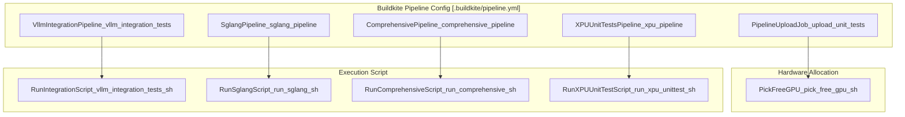

<!-- source: DeepWiki mcp.deepwiki.com · repo LMCache/LMCache · page 13.2 CI/CD Pipeline · fetched 2026-10-21 -->

# CI/CD Pipeline

Relevant source files

The following files were used as context for generating this wiki page:

- [.buildkite/README.md](.buildkite/README.md)
- [.buildkite/cases/integration-cases.txt](.buildkite/cases/integration-cases.txt)
- [.buildkite/k3_harness/setup-lmcache-only-env.sh](.buildkite/k3_harness/setup-lmcache-only-env.sh)
- [.buildkite/k3_harness/setup-sglang-env.sh](.buildkite/k3_harness/setup-sglang-env.sh)
- [.buildkite/k3_tests/common_scripts/helpers.sh](.buildkite/k3_tests/common_scripts/helpers.sh)
- [.buildkite/k3_tests/common_scripts/path-filter.sh](.buildkite/k3_tests/common_scripts/path-filter.sh)
- [.buildkite/k3_tests/common_scripts/upload-pipeline.sh](.buildkite/k3_tests/common_scripts/upload-pipeline.sh)
- [.buildkite/k3_tests/xpu/Dockerfile.ci](.buildkite/k3_tests/xpu/Dockerfile.ci)
- [.buildkite/k3_tests/xpu/download-wheel.py](.buildkite/k3_tests/xpu/download-wheel.py)
- [.buildkite/k3_tests/xpu/install_xpu_dpcpp_compiler.sh](.buildkite/k3_tests/xpu/install_xpu_dpcpp_compiler.sh)
- [.buildkite/k3_tests/xpu/multiprocess/pipeline.yml](.buildkite/k3_tests/xpu/multiprocess/pipeline.yml)
- [.buildkite/k3_tests/xpu/unittests/BK_WEB_SETUP.md](.buildkite/k3_tests/xpu/unittests/BK_WEB_SETUP.md)
- [.buildkite/k3_tests/xpu/unittests/pipeline.yml](.buildkite/k3_tests/xpu/unittests/pipeline.yml)
- [.buildkite/k3_tests/xpu/unittests/run.sh](.buildkite/k3_tests/xpu/unittests/run.sh)
- [.buildkite/pipeline.yml](.buildkite/pipeline.yml)
- [.buildkite/pipelines/comprehensive-tests.yml](.buildkite/pipelines/comprehensive-tests.yml)
- [.buildkite/scripts/bare-machine-cleanup.sh](.buildkite/scripts/bare-machine-cleanup.sh)
- [.buildkite/scripts/end-to-end-test.sh](.buildkite/scripts/end-to-end-test.sh)
- [.buildkite/scripts/should-run-comprehensive.sh](.buildkite/scripts/should-run-comprehensive.sh)
- [.buildkite/vllm-integration-tests.yml](.buildkite/vllm-integration-tests.yml)
- [.github/actions/build-artifacts/action.yml](.github/actions/build-artifacts/action.yml)
- [.github/actions/publish-artifacts/action.yml](.github/actions/publish-artifacts/action.yml)
- [.github/scripts/cpu_device_test.sh](.github/scripts/cpu_device_test.sh)
- [.github/scripts/cpu_server_bench_test.sh](.github/scripts/cpu_server_bench_test.sh)
- [.github/scripts/cpu_vllm_e2e_test.sh](.github/scripts/cpu_vllm_e2e_test.sh)
- [.github/scripts/download_gh_release_model.sh](.github/scripts/download_gh_release_model.sh)
- [.github/scripts/nightly-collect-verify-result.py](.github/scripts/nightly-collect-verify-result.py)
- [.github/scripts/run-cpu-e2e-validation.sh](.github/scripts/run-cpu-e2e-validation.sh)
- [.github/workflows/actionlint.dockerfile](.github/workflows/actionlint.dockerfile)
- [.github/workflows/actionlint.yml](.github/workflows/actionlint.yml)
- [.github/workflows/build_cli_artifacts.yml](.github/workflows/build_cli_artifacts.yml)
- [.github/workflows/build_cpu_artifacts.yml](.github/workflows/build_cpu_artifacts.yml)
- [.github/workflows/build_cu129_artifacts.yml](.github/workflows/build_cu129_artifacts.yml)
- [.github/workflows/build_doc.yml](.github/workflows/build_doc.yml)
- [.github/workflows/build_main_artifacts.yml](.github/workflows/build_main_artifacts.yml)
- [.github/workflows/build_rocm_artifacts.yml](.github/workflows/build_rocm_artifacts.yml)
- [.github/workflows/build_rocm_torch210_artifacts.yml](.github/workflows/build_rocm_torch210_artifacts.yml)
- [.github/workflows/build_xpu_artifacts.yml](.github/workflows/build_xpu_artifacts.yml)
- [.github/workflows/code_quality_checks.yml](.github/workflows/code_quality_checks.yml)
- [.github/workflows/codeql.yml](.github/workflows/codeql.yml)
- [.github/workflows/cpu_device.yml](.github/workflows/cpu_device.yml)
- [.github/workflows/matchers/actionlint.json](.github/workflows/matchers/actionlint.json)
- [.github/workflows/nightly_build.yml](.github/workflows/nightly_build.yml)
- [.github/workflows/pr_full_build.yml](.github/workflows/pr_full_build.yml)
- [.github/workflows/publish.yml](.github/workflows/publish.yml)
- [.github/workflows/scorecard.yml](.github/workflows/scorecard.yml)
- [.github/workflows/stale_bot.yml](.github/workflows/stale_bot.yml)
- [.github/workflows/test.yml](.github/workflows/test.yml)

This page documents the comprehensive CI/CD infrastructure for LMCache, detailing the GitHub Actions workflows that govern testing, code quality checks, artifact builds, publishing, nightly container images, CPU device tests, and documentation deployment. Additionally, it covers the Buildkite GPU pipelines used for hardware-dependent integration and kernel validation.

---

## Workflow Overview

LMCache primarily relies on **GitHub Actions** workflows running on `ubuntu-latest` runners to manage the entire development lifecycle — from pull request validation and unit testing to artifact building and PyPI publishing.

### Key GitHub Actions Workflow Files

| Workflow File | Purpose | Triggers |
|---------------|---------|----------|
| `.github/workflows/test.yml` | Run unit and integration tests (CPU, Rust, raw-block storage) | Push/PR to `dev`, `release-**`, `workflow_call`, `workflow_dispatch` |
| `.github/workflows/code_quality_checks.yml` | Run code quality and pre-commit checks | Push/PR, `workflow_call` |
| `.github/workflows/publish.yml` | Orchestrates build and publish pipeline to PyPI/TestPyPI | Push to `dev`, `release-**`, tags (`v*`), release published |
| `.github/workflows/build_doc.yml` | Build and deploy online documentation | Push to `dev` (docs or code paths) |
| `.github/workflows/nightly_build.yml` | Nightly container and wheel builds | Scheduled daily, manual triggers |
| `.github/workflows/cpu_device.yml` | Run CPU backend integration and benchmark tests | `workflow_call`, `workflow_dispatch`, PRs to `dev|release-**` |
| `.github/workflows/scorecard.yml` | Supply-chain security Scorecard analysis | Push to `dev`, weekly cron |
| `.github/workflows/codeql.yml` | Advanced CodeQL static analysis | Push/PR to `dev`, weekly cron |
| `.github/workflows/actionlint.yml` | Lint GitHub workflow YAML files | Push/PR to `dev|release-**` (workflow files only) |
| `.github/workflows/stale_bot.yml` | Close stale issues/PRs | Daily cron |

Sources: [.github/workflows/publish.yml:3-16](), [.github/workflows/test.yml:3-13](), [.github/workflows/code_quality_checks.yml:3-7](), [.github/workflows/build_doc.yml:3-13](), [.github/workflows/nightly_build.yml:4-5](), [.github/workflows/cpu_device.yml:6-23](), [.github/workflows/scorecard.yml:6-15](), [.github/workflows/codeql.yml:14-20](), [.github/workflows/actionlint.yml:3-18](), [.github/workflows/stale_bot.yml:3-6]()

---

## Trigger and Dependency Map

The `publish.yml` workflow orchestrates the release process and depends on successful completion of `test.yml` and `code_quality_checks.yml`. It incorporates a change detection job (`changes`) using `dorny/paths-filter` to prevent unnecessary builds when unrelated files change (e.g., documentation).

```mermaid
flowchart TD
    push_dev["push_to_dev"]
    push_release["push_to_release_branch"]
    pr_dev["pr_to_dev_or_release"]
    gh_release["github_release_published"]
    cron_nightly["cron_nightly_build"]
    cron_stale["cron_stale_bot"]
    workflow_dispatch["workflow_dispatch"]
    workflow_call["workflow_call"]

    test_yml["TestWorkflow_test_yml"]
    cq_yml["CodeQualityWorkflow_code_quality_checks_yml"]
    publish_yml["PublishWorkflow_publish_yml"]
    build_doc_yml["BuildDocWorkflow_build_doc_yml"]
    nightly_yml["NightlyBuildWorkflow_nightly_build_yml"]
    cpu_device_yml["CpuDeviceWorkflow_cpu_device_yml"]
    actionlint_yml["ActionLintWorkflow_actionlint_yml"]
    stale_bot_yml["StaleBotWorkflow_stale_bot_yml"]

    push_dev --> test_yml
    push_dev --> cq_yml
    push_dev --> publish_yml
    push_dev --> build_doc_yml
    push_dev --> cpu_device_yml
    push_dev --> actionlint_yml

    push_release --> test_yml
    push_release --> publish_yml
    push_release --> cpu_device_yml
    push_release --> actionlint_yml

    pr_dev --> test_yml
    pr_dev --> cq_yml
    pr_dev --> publish_yml
    pr_dev --> cpu_device_yml
    pr_dev --> actionlint_yml

    gh_release --> publish_yml
    cron_nightly --> nightly_yml
    cron_stale --> stale_bot_yml

    workflow_dispatch --> test_yml
    workflow_dispatch --> cpu_device_yml
    workflow_call --> test_yml
    workflow_call --> cq_yml
    workflow_call --> cpu_device_yml

    publish_yml -->|"uses"| test_yml
    publish_yml -->|"uses"| cq_yml
    publish_yml -->|"needs: changes"| build_main["BuildMainJob_build_main_artifacts_yml"]
    publish_yml -->|"needs: changes"| build_cli["BuildCliJob_build_cli_artifacts_yml"]
    publish_yml -->|"needs: changes"| build_cu129["BuildCu129Job_build_cu129_artifacts_yml"]
```

Sources: [.github/workflows/publish.yml:35-109](), [.github/workflows/test.yml:3-13](), [.github/workflows/code_quality_checks.yml:3-7](), [.github/workflows/build_doc.yml:3-13](), [.github/workflows/cpu_device.yml:6-23](), [.github/workflows/actionlint.yml:3-18](), [.github/workflows/stale_bot.yml:3-6]()

---

## Test Workflows

### Standard Unit Tests (`test.yml`)

This workflow runs comprehensive unit and integration tests on Linux, covering multiple Python versions and hardware configurations, triggered on push and pull request events.

- **Job: changes** detects relevant LMCache source changes using path filters.
- **Matrix**: Python 3.10 to 3.13 on `ubuntu-latest`.
- **CPU-only Unit Tests** exclude CUDA/MUSA/XPU/NPU/Neuron tests and run with `pytest`.
- **Rust Unit Tests** for the `raw_block` Rust crate run in separate jobs.
- **Raw Block Temp-file Tests** build and test Rust extension via `maturin` and Python, running multiple test scripts.

See the layered job structure for efficient parallel execution and caching of dependencies.

Sources: [.github/workflows/test.yml:3-195]()

### CPU Device Tests (`cpu_device.yml`)

Runs integration tests for CPU devices with benchmarks and end-to-end tests against vLLM.

- Triggered by `workflow_call`, `workflow_dispatch`, and PRs.
- Runs on Linux (`ubuntu-22.04`) and macOS.
- Employs a model matrix, testing 'opt-125m' and 'deepseek-v2-lite' with tuned LMCache and vLLM parameters.
- Uses environment variables to configure vLLM model loading, HF overrides, and transport modes.
- Test orchestration done via `.github/scripts/run-cpu-e2e-validation.sh`, which handles model download, LMCache and vLLM startup, logging, and teardown.

This validates both server and client integration on CPU-only systems.

Sources: [.github/workflows/cpu_device.yml:1-176](), [.github/scripts/run-cpu-e2e-validation.sh:1-135]()

---

## Code Quality Workflow

The `code_quality_checks.yml` workflow ensures code quality compliance using `pre-commit` on Python 3.13 runners.

- Runs linting, formatting, spell check, and static type checks using pre-commit hooks.
- Employs hardened runner security policies.
- Uses a change detector job to only trigger on relevant LMCache source changes.

Sources: [.github/workflows/code_quality_checks.yml:39-68]()

---

## Buildkite GPU CI Pipeline

### Overview

LMCache employs **Buildkite** pipelines for GPU-dependent integration tests and CUDA/ROCm kernel validations that cannot be run on GitHub-hosted runners.

This includes:

- vLLM integration tests.
- SGLang integration testing.
- Comprehensive multi-process and multi-device scenarios.
- Unit tests specific to Intel XPU hardware.

These pipelines run on dedicated hardware with NVIDIA or AMD GPUs.

### Pipeline Execution Structure

The `.github/scripts/run-cpu-e2e-validation.sh` and other helper scripts support test execution, setup, and result gathering within these pipelines.

Sources: [.buildkite/pipeline.yml:1-8]()

---

## Publish Workflow (`publish.yml`)

Handles the release process:

- Detects code changes relevant to LMCache using path filtering.
- Runs tests and code quality workflows as prerequisites.
- Builds artifacts in modular reusable workflows to separate failures per target.

### Artifact Build Jobs

| Job Name | Description | Artifact Name |
|----------|-------------|---------------|
| `build-main` | Build standard Linux wheels (amd64, arm64) and source distribution | `release-artifacts` (amd64), `release-artifacts-arm64` |
| `build-cli` | Build pure-Python CLI package | `release-cli-artifacts` |
| `build-cu129` | Build CUDA 12.9 wheels | `release-artifacts` |
| `build-rocm` | Build AMD ROCm wheels | `release-rocm-artifacts` |
| `build-xpu` | Build Intel XPU SYCL wheels | `release-xpu-artifacts` |
| `build-musa` | Build Moore Threads MUSA wheels | `release-musa-artifacts` |
| `build-rocm-torch210` | Build ROCm wheels pinned to PyTorch 2.10 stack | `release-rocm-torch210-artifacts` |

### Implementation Details

- Uses OpenID Connect (OIDC) for secure authentication when publishing to PyPI.
- On pushes to `dev`, artifacts are published to TestPyPI.
- Artifacts uploaded as GitHub Actions artifacts for later use.
- Each build job is a reusable workflow called from `publish.yml` for modularity.

Sources: [.github/workflows/publish.yml:34-142]()

---

## Nightly Build Workflow (`nightly_build.yml`)

Automates daily scheduled nightly builds and releases from the `dev` branch.

- Builds CUDA 13.0 and CUDA 12.9 wheels on `amd64` and `arm64` architectures.
- Uses `cibuildwheel` with pinned docker images to build CPU and GPU wheels.
- Publishes nightly wheels as GitHub pre-release assets under tags like `nightly` and `nightly-cu129`.
- Includes additional jobs for publishing arm64 wheels after Linux builds.
- Builds XPU wheels for Intel architectures via the reusable XPU build workflow.
- Resolves immutable XPU runtime images to ensure repeatability.
- Nightly artifacts also include smoke-test verification step.

Sources: [.github/workflows/nightly_build.yml:4-173]()

---

## Documentation Deployment Workflow (`build_doc.yml`)

Automates building and publishing LMCache’s Sphinx documentation.

- Triggered on changes to docs, source code, or examples on the `dev` branch.
- Builds multi-version documentation including Chinese localization (`zh_CN`).
- Uses `sphinx-multiversion` to build multiple versions concurrently.
- Deploys to the GitHub Pages repository `LM-Cache-Website/lm-cache-website.github.io` via push.
- Uploads built docs as artifacts between build and deploy jobs.

Sources: [.github/workflows/build_doc.yml:1-106]()

---

## Security and Quality Analysis

- **Scorecard Workflow (`scorecard.yml`)**: Runs supply chain security scans weekly and on pushes to `dev`.
- **CodeQL Workflow (`codeql.yml`)**: Performs static analysis of Python and GitHub Actions scripts weekly and on push/PR to `dev`.
- **Actionlint Workflow (`actionlint.yml`)**: Lints GitHub Actions YAML files for syntax correctness and best practices on push and PRs.
- **Stale Bot (`stale_bot.yml`)**: Monitors and automatically closes stale issues and pull requests daily to keep the repository clean.

These workflows incorporate hardened runner policies to enforce secure execution with minimal privileges.

Sources: [.github/workflows/scorecard.yml:5-84](), [.github/workflows/codeql.yml:12-112](), [.github/workflows/actionlint.yml:1-52](), [.github/workflows/stale_bot.yml:1-51]()

---

# Summary Mermaid Diagram Mapping Github Actions to Code Concepts

This diagram links GitHub Actions workflow components to their core functionalities and representative scripts.

```mermaid
flowchart TD
    subgraph "GitHub Actions Workflows"
        test_yml["test.yml (Unit & Integration tests)"]
        code_quality["code_quality_checks.yml (Pre-commit)"]
        publish_yml["publish.yml (Build & Publish)"]
        nightly_yml["nightly_build.yml (Nightly wheels)"]
        cpu_device_yml["cpu_device.yml (CPU Device tests)"]
        build_doc_yml["build_doc.yml (Documentation build)"]
        scorecard_yml["scorecard.yml (Supply Chain Security)"]
        codeql_yml["codeql.yml (Static analysis)"]
        stale_bot_yml["stale_bot.yml (Issue/PR cleanup)"]
    end

    subgraph "Scripts & Reusable Workflows"
        run_cpu_e2e["run-cpu-e2e-validation.sh (CPU test orchestration)"]
        build_artifacts_action["build-artifacts/action.yml (Reusable build workflow)"]
        publish_artifacts_action["publish-artifacts/action.yml (Publishing helper)"]
        paths_filter["dorny/paths-filter (Change detection)"]
    end

    subgraph "Artifact Builds"
        main_build["build_main_artifacts.yml"]
        cli_build["build_cli_artifacts.yml"]
        cu129_build["build_cu129_artifacts.yml"]
        rocm_build["build_rocm_artifacts.yml"]
        xpu_build["build_xpu_artifacts.yml"]
        musa_build["build_musa_artifacts.yml"]
        rocm_torch210_build["build_rocm_torch210_artifacts.yml"]
    end

    test_yml --> run_cpu_e2e
    publish_yml --> paths_filter
    publish_yml --> main_build
    publish_yml --> cli_build
    publish_yml --> cu129_build
    publish_yml --> rocm_build
    publish_yml --> xpu_build
    publish_yml --> musa_build
    publish_yml --> rocm_torch210_build
    main_build --> build_artifacts_action
    cli_build --> build_artifacts_action
    publish_yml --> publish_artifacts_action
    cpu_device_yml --> run_cpu_e2e
    code_quality --> paths_filter
    test_yml --> paths_filter
```

Sources: [.github/workflows/publish.yml:35-109](), [.github/workflows/test.yml:3-195](), [.github/workflows/code_quality_checks.yml:3-68](), [.github/scripts/run-cpu-e2e-validation.sh:1-135](), [.github/actions/build-artifacts/action.yml:1-80](), [.github/actions/publish-artifacts/action.yml:1-48]()

---

# Release Process Summary

1. **Change Detection**: On every push/PR, the `publish.yml` workflow runs a `changes` job to detect whether LMCache code or related GitHub Actions files changed. If not, build jobs are skipped to save resources.

2. **Quality Gates**: The `publish.yml` workflow requires successful completion of the `test.yml` and `code_quality_checks.yml` before proceeding.

3. **Artifact Builds**: Builds are split by platform/target in reusable workflows (`build_main_artifacts.yml`, `build_cli_artifacts.yml`, etc.) to isolate failures. Each produces wheels and source distributions as appropriate.

4. **Publishing**: On tagged commits (`v*`) and release event triggers, wheels and source distributions are published to PyPI using secure OIDC tokens. On dev pushes, TestPyPI is populated with pre-release versions.

5. **Nightly Builds**: Nightly scheduled job builds and publishes pre-releases regularly to capture bleeding edge changes, supporting CUDA 13.0, CUDA 12.9, and XPU variants.

6. **Documentation**: Concurrent documentation build and deployment ensure up-to-date online docs with multi-version and localization support.

7. **Security Checks**: Scorecard and CodeQL workflows run regularly to secure the supply chain and codebase.

Sources: [.github/workflows/publish.yml:3-172](), [.github/workflows/nightly_build.yml:3-173](), [.github/workflows/build_doc.yml:3-106](), [.github/workflows/codeql.yml:12-112]()

---

# Conclusion

The LMCache CI/CD pipeline is a robust multi-platform system combining:

- **GitHub Actions** for code quality, testing, releases, documentation, and security audits.
- Modular, reusable workflows for artifact building across CPU, CUDA, ROCm, XPU, and other device targets.
- Scheduling and triggered builds for nightly images supporting continuous integration with the latest code.
- **Buildkite pipelines** for GPU hardware-dependent integration testing across vLLM, SGLang, and multi-process environments with real hardware and device kernels.

This pipeline enforces high code quality and fast feedback, automated release management, and reproducible deployment artifacts, essential for maintaining LMCache as a production-ready LLM KV cache engine extension.

Sources: Entire repository CI/CD workflow files listed above.

---

