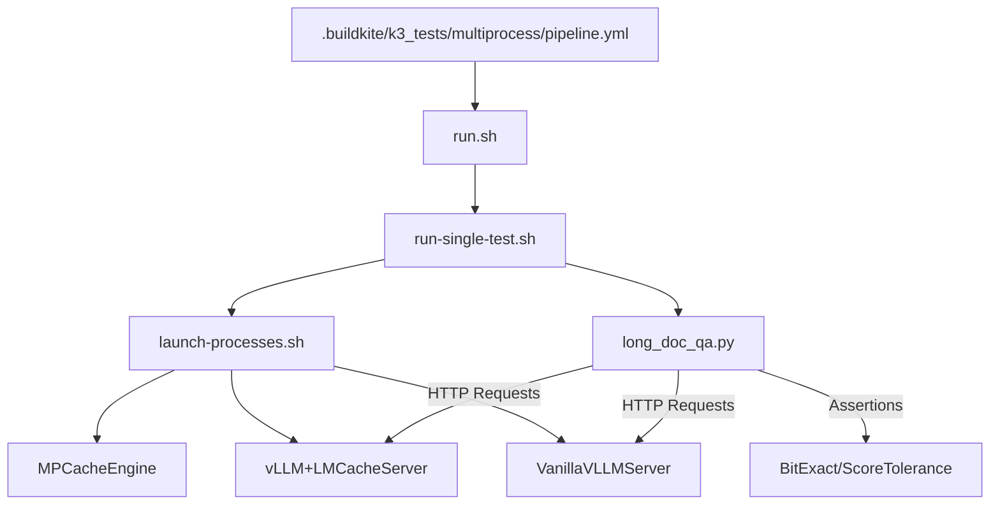
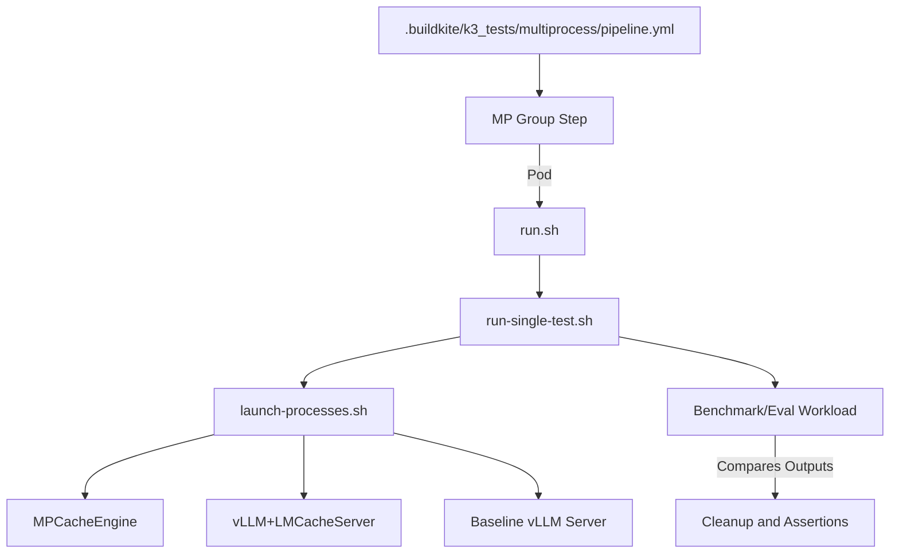
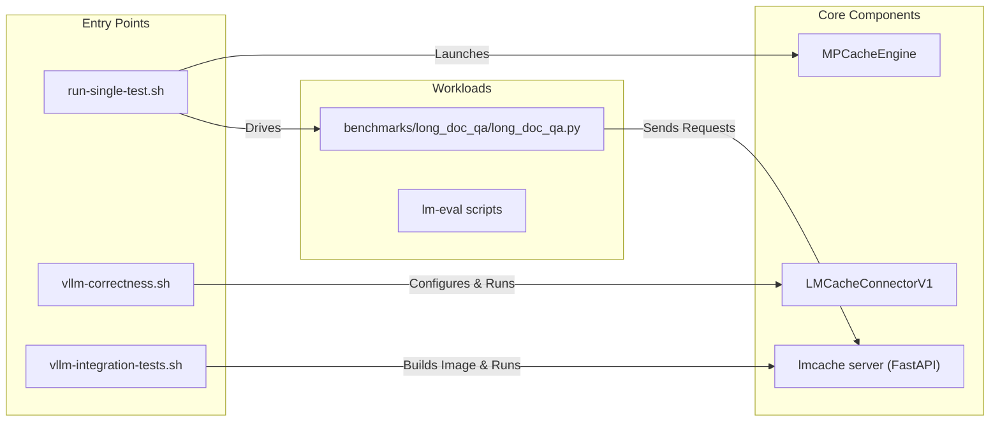

<!-- source: DeepWiki mcp.deepwiki.com · repo LMCache/LMCache · page 13.3 Testing Infrastructure · fetched 2026-10-21 -->

# Testing Infrastructure

<details>
<summary>Relevant source files</summary>

The following files were used as context for generating this wiki page:

- [.buildkite/cases/comprehensive-cases.txt](.buildkite/cases/comprehensive-cases.txt)
- [.buildkite/configs/async.yaml](.buildkite/configs/async.yaml)
- [.buildkite/configs/dummy.yaml](.buildkite/configs/dummy.yaml)
- [.buildkite/configs/layerwise.yaml](.buildkite/configs/layerwise.yaml)
- [.buildkite/configs/lmcache_configs/local_cpu_mla.yaml](.buildkite/configs/lmcache_configs/local_cpu_mla.yaml)
- [.buildkite/configs/local_cpu.yaml](.buildkite/configs/local_cpu.yaml)
- [.buildkite/configs/local_cpu_mla.yaml](.buildkite/configs/local_cpu_mla.yaml)
- [.buildkite/configs/local_cpu_with_v3.yaml](.buildkite/configs/local_cpu_with_v3.yaml)
- [.buildkite/configs/local_disk.yaml](.buildkite/configs/local_disk.yaml)
- [.buildkite/configs/local_disk_with_v3.yaml](.buildkite/configs/local_disk_with_v3.yaml)
- [.buildkite/configs/multi_device.yaml](.buildkite/configs/multi_device.yaml)
- [.buildkite/configs/p2p.yaml](.buildkite/configs/p2p.yaml)
- [.buildkite/configs/p2p_with_v3.yaml](.buildkite/configs/p2p_with_v3.yaml)
- [.buildkite/configs/pd.yaml](.buildkite/configs/pd.yaml)
- [.buildkite/correctness/pipeline.correctness.steps.yml](.buildkite/correctness/pipeline.correctness.steps.yml)
- [.buildkite/correctness/pipeline.correctness.yml](.buildkite/correctness/pipeline.correctness.yml)
- [.buildkite/k3_harness/README.md](.buildkite/k3_harness/README.md)
- [.buildkite/k3_harness/ci-base.Dockerfile](.buildkite/k3_harness/ci-base.Dockerfile)
- [.buildkite/k3_harness/gpu-monitor.sh](.buildkite/k3_harness/gpu-monitor.sh)
- [.buildkite/k3_harness/install-agent-stack.sh](.buildkite/k3_harness/install-agent-stack.sh)
- [.buildkite/k3_harness/setup-env.sh](.buildkite/k3_harness/setup-env.sh)
- [.buildkite/k3_harness/setup-gpu-monitor.sh](.buildkite/k3_harness/setup-gpu-monitor.sh)
- [.buildkite/k3_tests/comprehensive/pipeline.yml](.buildkite/k3_tests/comprehensive/pipeline.yml)
- [.buildkite/k3_tests/comprehensive/run.sh](.buildkite/k3_tests/comprehensive/run.sh)
- [.buildkite/k3_tests/comprehensive/scripts/run-single-config.sh](.buildkite/k3_tests/comprehensive/scripts/run-single-config.sh)
- [.buildkite/k3_tests/correctness/run.sh](.buildkite/k3_tests/correctness/run.sh)
- [.buildkite/k3_tests/correctness/scripts/run-correctness.sh](.buildkite/k3_tests/correctness/scripts/run-correctness.sh)
- [.buildkite/k3_tests/integration/run.sh](.buildkite/k3_tests/integration/run.sh)
- [.buildkite/k3_tests/integration/scripts/run-integration.sh](.buildkite/k3_tests/integration/scripts/run-integration.sh)
- [.buildkite/k3_tests/multiprocess/pipeline.yml](.buildkite/k3_tests/multiprocess/pipeline.yml)
- [.buildkite/k3_tests/multiprocess/run.sh](.buildkite/k3_tests/multiprocess/run.sh)
- [.buildkite/k3_tests/multiprocess/scripts/cleanup.sh](.buildkite/k3_tests/multiprocess/scripts/cleanup.sh)
- [.buildkite/k3_tests/multiprocess/scripts/launch-processes.sh](.buildkite/k3_tests/multiprocess/scripts/launch-processes.sh)
- [.buildkite/k3_tests/multiprocess/scripts/run-mp-test.sh](.buildkite/k3_tests/multiprocess/scripts/run-mp-test.sh)
- [.buildkite/k3_tests/multiprocess/scripts/run-single-test.sh](.buildkite/k3_tests/multiprocess/scripts/run-single-test.sh)
- [.buildkite/k3_tests/multiprocess/scripts/wait-for-servers.sh](.buildkite/k3_tests/multiprocess/scripts/wait-for-servers.sh)
- [.buildkite/k3_tests/unit/buildkite-pipeline.yml](.buildkite/k3_tests/unit/buildkite-pipeline.yml)
- [.buildkite/k3_tests/unit/pipeline.yml](.buildkite/k3_tests/unit/pipeline.yml)
- [.buildkite/k3_tests/unit/run.sh](.buildkite/k3_tests/unit/run.sh)
- [.buildkite/k3_tests/xpu/multiprocess/buildkite-pipeline.yml](.buildkite/k3_tests/xpu/multiprocess/buildkite-pipeline.yml)
- [.buildkite/operator/integration/pipeline.yaml](.buildkite/operator/integration/pipeline.yaml)
- [.buildkite/pipelines/clean.yml](.buildkite/pipelines/clean.yml)
- [.buildkite/pipelines/multiprocessing-test.yml](.buildkite/pipelines/multiprocessing-test.yml)
- [.buildkite/scripts/clean.sh](.buildkite/scripts/clean.sh)
- [.buildkite/scripts/multiprocessing-test/README.md](.buildkite/scripts/multiprocessing-test/README.md)
- [.buildkite/scripts/multiprocessing-test/build-mp-docker-image.sh](.buildkite/scripts/multiprocessing-test/build-mp-docker-image.sh)
- [.buildkite/scripts/multiprocessing-test/cleanup.sh](.buildkite/scripts/multiprocessing-test/cleanup.sh)
- [.buildkite/scripts/multiprocessing-test/common.sh](.buildkite/scripts/multiprocessing-test/common.sh)
- [.buildkite/scripts/multiprocessing-test/launch-containers.sh](.buildkite/scripts/multiprocessing-test/launch-containers.sh)
- [.buildkite/scripts/multiprocessing-test/run-fault-tolerance.sh](.buildkite/scripts/multiprocessing-test/run-fault-tolerance.sh)
- [.buildkite/scripts/multiprocessing-test/run-lm-eval.sh](.buildkite/scripts/multiprocessing-test/run-lm-eval.sh)
- [.buildkite/scripts/multiprocessing-test/run-long-doc-qa.sh](.buildkite/scripts/multiprocessing-test/run-long-doc-qa.sh)
- [.buildkite/scripts/multiprocessing-test/run-mp-test.sh](.buildkite/scripts/multiprocessing-test/run-mp-test.sh)
- [.buildkite/scripts/multiprocessing-test/run-vllm-bench.sh](.buildkite/scripts/multiprocessing-test/run-vllm-bench.sh)
- [.buildkite/scripts/multiprocessing-test/test-launch.sh](.buildkite/scripts/multiprocessing-test/test-launch.sh)
- [.buildkite/scripts/multiprocessing-test/wait-for-vllm.sh](.buildkite/scripts/multiprocessing-test/wait-for-vllm.sh)
- [.buildkite/scripts/pick-free-gpu.sh](.buildkite/scripts/pick-free-gpu.sh)
- [.buildkite/scripts/vllm-correctness.sh](.buildkite/scripts/vllm-correctness.sh)
- [.buildkite/scripts/vllm-integration-tests.sh](.buildkite/scripts/vllm-integration-tests.sh)
- [.github/scripts/download_model.sh](.github/scripts/download_model.sh)
- [.github/scripts/install_lmcache_cpu.sh](.github/scripts/install_lmcache_cpu.sh)
- [.github/scripts/install_vllm_cpu.sh](.github/scripts/install_vllm_cpu.sh)
- [MANIFEST.in](MANIFEST.in)
- [benchmarks/long_doc_qa/long_doc_qa.py](benchmarks/long_doc_qa/long_doc_qa.py)
- [docs/design/v1/platform/devices/supa/README.md](docs/design/v1/platform/devices/supa/README.md)
- [lmcache/v1/platform/devices/supa/__init__.py](lmcache/v1/platform/devices/supa/__init__.py)
- [lmcache/v1/platform/devices/supa/device_ops.py](lmcache/v1/platform/devices/supa/device_ops.py)
- [pytest.ini](pytest.ini)
- [requirements/nixl.txt](requirements/nixl.txt)
- [tests/v1/platform/devices/supa/test_supa_support.py](tests/v1/platform/devices/supa/test_supa_support.py)

</details>


## Purpose and Scope

The LMCache testing infrastructure provides a comprehensive and robust framework to validate the correctness, performance, and integration of the LMCache key-value cache management system. It spans unit tests for core system components, integration tests with serving engines like vLLM and SGLang, multi-process correctness and concurrency tests, and a fully featured Buildkite continuous integration (CI) harness that uses physical GPUs in Kubernetes pods for realistic, production-like test scenarios.

This infrastructure tests LMCache across its diverse storage backends (CPU memory, local disk, remote caches like Redis and Mooncake, P2P sharing, and the NIXL distributed system), and integrations with serving engines. It covers complex scenarios like hybrid KV cache groups, disaggregated prefill, layerwise transfer, blending, and fault tolerance.

Sources:  
`[.buildkite/scripts/vllm-integration-tests.sh:1-22]`,  
`[.buildkite/k3_tests/multiprocess/pipeline.yml:1-7]`

---

## Test Organization

Tests in the LMCache codebase are categorized into layered suites to ensure thorough verification from individual component correctness to end-to-end system behavior.

| Test Category        | Location                            | Purpose                                                                                 |
|---------------------|-----------------------------------|-----------------------------------------------------------------------------------------|
| **Unit Tests**       | `tests/v1/`                       | Validate core engine components like `LMCacheEngine`, storage backends, cache keys, etc.|
| **Integration Tests**| `.buildkite/scripts/vllm-integration-tests.sh` | Compare LMCache-enabled vLLM server outputs against vanilla vLLM using standard configs.|
| **Multiprocess Tests**| `.buildkite/k3_tests/multiprocess/` | Native multiprocess testing orchestrated in Kubernetes pods to validate concurrency, transfers, and interprocess communication. |
| **Correctness Tests**| `.buildkite/scripts/vllm-correctness.sh` | Bit-exactness and concurrency correctness tests, including hybrid KV cache retrieval and high concurrency scenarios with ShareGPT dataset.|

In addition, automated path-filter scripts ensure consistent mapping of tests to categories and CI workflows.

Sources:  
`[.buildkite/k3_tests/common_scripts/path-filter.sh:1-124]`  
`[.buildkite/scripts/vllm-integration-tests.sh:1-7]`  
`[.buildkite/k3_tests/multiprocess/scripts/run-single-test.sh:1-42]`  
`[.buildkite/scripts/vllm-correctness.sh:1-12]`

---

## Buildkite CI Harness

LMCache leverages Buildkite as its CI platform to run GPU-accelerated tests for realistic validation. The harness includes automated GPU resource allocation, container orchestration for integration tests, and native multiprocess execution within Kubernetes pods.

### Integration Test Workflow

The integration tests focus mainly on the LMCache integration with vLLM. These run in Docker containers built locally combining the current LMCache source and the latest vLLM nightly build. Key steps:

1. **Image Build**  
   `build_lmcache_vllmopenai_image` builds a container image embedding both LMCache and vLLM nightly [`.buildkite/scripts/vllm-integration-tests.sh:99-103`].

2. **GPU Selection**  
   `pick-free-gpu.sh` scans GPUs via `nvidia-smi` filtering by free memory and utilization thresholds, exporting `CUDA_VISIBLE_DEVICES` accordingly, to isolate test builds and prevent conflicts [`.buildkite/scripts/pick-free-gpu.sh:1-36`].

3. **Container Launch & Service Readiness**  
   The script `run_lmcache_vllmopenai_container` starts the vLLM server with LMCache, passing environment variables and mounting config files. The `wait_for_openai_api_server` polls the `/v1/models` endpoint until the given model is ready [`.buildkite/scripts/vllm-integration-tests.sh:124-189`].

4. **Disaggregated Prefill Setup**  
   The `run_pd_lmcache` launches separate prefiller and decoder containers on distinct GPUs to test the disaggregated KV prefill (PD) feature [`.buildkite/scripts/vllm-integration-tests.sh:191-216`].

Sources:  
`[.buildkite/scripts/vllm-integration-tests.sh:99-216]`,  
`[.buildkite/scripts/pick-free-gpu.sh:1-36]`

---

### Buildkite CI Data Flow Diagram



Sources:  
`[.buildkite/k3_tests/multiprocess/pipeline.yml:114-120]`  
`[.buildkite/k3_tests/multiprocess/run.sh:1-65]`  
`[.buildkite/k3_tests/multiprocess/scripts/run-single-test.sh:1-42]`  
`[.buildkite/k3_tests/multiprocess/scripts/launch-processes.sh:39-86]`

---

### K3 Harness for Multiprocess Tests

The multiprocess (MP) test harness runs LMCache multi-process tests in isolated K8s pods, called "k3" jobs, using `buildkite-agent-k8s-plugin` for GPU allocation. Each pod runs a dedicated test workload with assigned GPU count.

- **GPU Grouping:** The `.buildkite/k3_tests/multiprocess/pipeline.yml` defines groups by GPU load:  
  - 4-GPU tests (e.g., `dsv4_flash_tp`) run first due to resource intensity.  
  - 2-GPU tests (e.g., `vllm_bench`) run next, running LMCache+vLLM on GPU0 and a baseline on GPU1.  
  - 1-GPU tests cover general cases.  

- **Retry Policies:** The pipeline configures automatic retries for flaky tests on exit codes like agent loss (-1) or other failure codes [`.buildkite/k3_tests/multiprocess/pipeline.yml:10-15`].

- **Test Entrypoint:** `run.sh` sets up environment variables and then delegates to `run-single-test.sh` which orchestrates launch of:  
  - The MPCacheEngine server  
  - The inference engine server using LMCache (e.g., vLLM with LMCache integration)  
  - Optionally, a baseline inference engine server without LMCache for correctness comparisons [`.buildkite/k3_tests/multiprocess/run.sh:1-65`].  

Sources:  
`[.buildkite/k3_tests/multiprocess/pipeline.yml:1-152]`  
`[.buildkite/k3_tests/multiprocess/run.sh:1-65]`  
`[.buildkite/k3_tests/multiprocess/scripts/run-single-test.sh:1-42]`  

---

### Multiprocess Test Execution Flow Diagram



Sources:  
`[.buildkite/k3_tests/multiprocess/pipeline.yml:114-122]`  
`[.buildkite/k3_tests/multiprocess/run.sh:60-65]`  
`[.buildkite/k3_tests/multiprocess/scripts/run-single-test.sh:1-42]`  
`[.buildkite/k3_tests/multiprocess/scripts/launch-processes.sh:79-111]`

---

## Test Suites

### Integration Test Suites

The integration tests, primarily orchestrated via the `vllm-integration-tests.sh` script, run LMCache with vLLM using realistic workloads defined in YAML config files under `.buildkite/configs/`.

- Example config: `pd.yaml` specifies a long document QA workload (`long_doc_qa`), blending in Disaggregated Prefill (PD) features [`.buildkite/configs/pd.yaml:1-71`].
- Configs specify environment variables for Docker containers (prefiller and decoder), LMCache feature flags (e.g., `LMCACHE_ENABLE_PD`), GPU assignments, and vLLM CLI arguments including LMCache KV cache connector configurations.
- They validate end-to-end LMCache operation with disaggregated prefill buffers, ensuring the system correctness and performance.

Additional comprehensive configs cover other features and backends, such as:
- `local_cpu.yaml`, `local_disk.yaml` for respective backends
- `p2p.yaml` for peer-to-peer sharing
- `layerwise.yaml` for layerwise KV transfer correctness

Sources:  
`[.buildkite/configs/pd.yaml:1-71]`  
`[.buildkite/cases/comprehensive-cases.txt:1-11]`

---

### Multiprocess Test Suites

The MP test suites run native multiprocess workloads under Kubernetes pods managed by the K3 harness.

- Tests include:
  - `dsv4_flash_tp`: Slot-compression and L1 KV cache correctness on a Flash Infer model with tensor parallelism = 4 [`.buildkite/k3_tests/multiprocess/scripts/run-single-test.sh:102-113`].
  - `hma_lm_eval_gemma4` and `hma_lm_eval_qwen3_5`: Hybrid memory allocator and hybrid attention model tests exercising complex cache group behaviors [`.buildkite/k3_tests/multiprocess/scripts/run-single-test.sh:76-101`].
  - `deadlock`: Stress test for deadlock conditions under high concurrency [`.buildkite/k3_tests/multiprocess/scripts/run-single-test.sh:114-123`].
  - `lazy_offload`: Validates lazy offload policies and chunk tracking with small chunk sizes [`.buildkite/k3_tests/multiprocess/scripts/run-single-test.sh:124-131`].

Each test configures environment variables such as `MODEL`, `CHUNK_SIZE`, concurrency settings, and transport scheme to drive specific scenarios.

Sources:  
`[.buildkite/k3_tests/multiprocess/scripts/run-single-test.sh:76-134]`

---

### Correctness Test Suite

The correctness suite, invoked via the `vllm-correctness.sh` script, performs exhaustive validations on LMCache + vLLM hybrid KV cache behavior:

- Uses a large curated ShareGPT chat dataset converted to OpenAI format.
- Tests:
  - Single request correctness of LMCache hybrid retrieval [`.buildkite/scripts/vllm-correctness.sh:9-11`].
  - Batch concurrency and preemption correctness on high-concurrency workloads [`.buildkite/scripts/vllm-correctness.sh:29-31`, `.buildkite/scripts/vllm-correctness.sh:163-170`].
- Uses an environment with pinned dependencies (vLLM nightly, LMCache editable install) and available GPU resources.
- Ensures bit-exact or near bit-exact outputs compared to baseline vLLM to detect regressions.

Sources:  
`[.buildkite/scripts/vllm-correctness.sh:9-31]`  
`[.buildkite/scripts/vllm-correctness.sh:163-170]`

---

## Test Utilities and Mocks

### Test Entity Mapping Diagram

The testing infrastructure involves key code components linked to test entry points and workloads.



Sources:  
`[.buildkite/k3_tests/multiprocess/scripts/run-single-test.sh:1-42]`  
`[.buildkite/scripts/vllm-correctness.sh:185-198]`  
`[benchmarks/long_doc_qa/long_doc_qa.py:94-108]`  
`[.buildkite/scripts/vllm-integration-tests.sh:124-189]`

---

## Benchmarking Infrastructure

The testing infrastructure leverages specialized benchmarking tools to provide performance metrics under real conditions.

- **long_doc_qa.py**:  
  Adapted from the official vLLM long-document QA benchmark, this Python script generates prompts from large documents and measures throughput and latency. It supports various repeat modes, output lengths, concurrency controls, and outputs detailed timing statistics. It interacts with the LMCache-enabled vLLM server via OpenAI-compatible HTTP APIs [benchmarks/long_doc_qa/long_doc_qa.py:1-108].

- **pick-free-gpu.sh**:  
  A utility Bash script to automatically select free GPUs on the CI host. It queries `nvidia-smi` to find GPUs matching free memory and utilization constraints and exports `CUDA_VISIBLE_DEVICES`. This ensures test runs avoid GPU conflicts and maximize resource utilization [`.buildkite/scripts/pick-free-gpu.sh:1-36`].

Sources:  
`[benchmarks/long_doc_qa/long_doc_qa.py:1-108]`  
`[.buildkite/scripts/pick-free-gpu.sh:1-36]`

---

# Summary

The LMCache testing infrastructure provides multi-layer assurance of correctness and performance, combining:

- Unit tests for core components in `tests/v1/`
- Integration tests with vLLM and other engines running in Docker containers
- Native multiprocess tests orchestrated by the Buildkite K3 harness using Kubernetes pods with GPU resource management
- Exhaustive correctness tests verifying bit-exact hybrid cache retrieval and concurrency handling
- Benchmarking and automated GPU allocation utilities for realistic and repeatable performance evaluation

This comprehensive system helps detect regressions early, validate new features under diverse hardware and software configurations, and maintain high reliability under production-like workloads.

---

# Appendix: Key Buildkite Pipeline Configuration Snippets

```yaml
# Multiprocess test grouped by GPU count:
steps:
  - group: "4-GPU"
    steps:
      - label: "dsv4_flash_tp"
        matrix:
          inference_engine: ["vllm", "sglang"]
          request_transport: ["zmq"]
        resources:
          limits:
            nvidia.com/gpu: 4
        retry:
          automatic:
            - exit_status: -1
              limit: 2
            - exit_status: "*"
              limit: 2
  - group: "2-GPU"
    steps:
      - label: "vllm_bench"
        matrix:
          inference_engine: ["vllm"]
          request_transport: ["zmq", "grpc"]
        resources:
          limits:
            nvidia.com/gpu: 2
        retry:
          automatic:
            - exit_status: -1
              limit: 3
```

```bash
# Multiprocess test launch snippet: start LMCache server, engine with LMCache and baseline
lmcache_args=(
    server
    --transport "$LMCACHE_REQUEST_TRANSPORT"
    --l1-size-gb "$CPU_BUFFER_SIZE"
    --eviction-policy LRU
    --max-workers "$MAX_WORKERS"
    --port "$LMCACHE_PORT"
)

env "${server_environment[@]}" lmcache "${lmcache_args[@]}" > lmcache.log 2>&1 &

# Start inference engine with LMCache
engine_launch lmcache "$ENGINE_PORT" "$GPU_FOR_ENGINE" "$ENGINE_LOG_FILE"

# Optionally start baseline inference engine
engine_launch baseline "$ENGINE_BASELINE_PORT" "$GPU_FOR_BASELINE" "$ENGINE_BASELINE_LOG_FILE"
```

Sources:  
`[.buildkite/k3_tests/multiprocess/pipeline.yml:10-15]`  
`[.buildkite/k3_tests/multiprocess/scripts/launch-processes.sh:39-86]`

---

