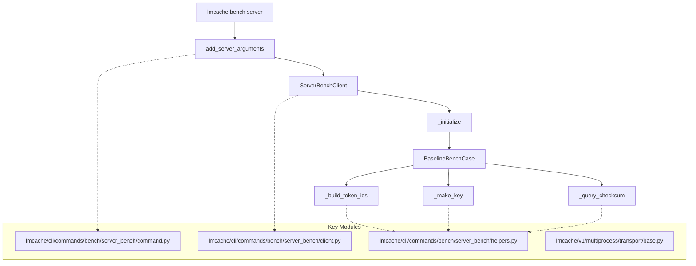
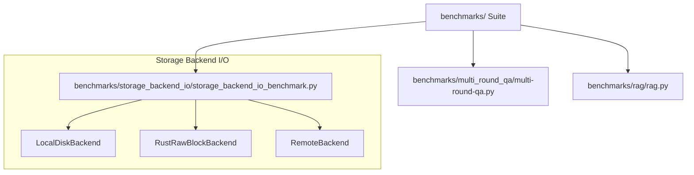

<!-- source: DeepWiki mcp.deepwiki.com · repo LMCache/LMCache · page 13.4 Benchmarking Tools · fetched 2026-10-21 -->

# Benchmarking Tools

Relevant source files

The following files were used as context for generating this wiki page:

- [.claude/skills/hybrid-benchmarking/SKILL.md](.claude/skills/hybrid-benchmarking/SKILL.md)
- [benchmarks/multi_round_qa/data_preprocessing.py](benchmarks/multi_round_qa/data_preprocessing.py)
- [benchmarks/multi_round_qa/multi-round-qa.py](benchmarks/multi_round_qa/multi-round-qa.py)
- [benchmarks/multi_round_qa/utils.py](benchmarks/multi_round_qa/utils.py)
- [benchmarks/rag/README.md](benchmarks/rag/README.md)
- [benchmarks/rag/launch_lmcache.sh](benchmarks/rag/launch_lmcache.sh)
- [benchmarks/rag/launch_vllm.sh](benchmarks/rag/launch_vllm.sh)
- [benchmarks/rag/precompute.py](benchmarks/rag/precompute.py)
- [benchmarks/rag/rag.py](benchmarks/rag/rag.py)
- [benchmarks/rag/utils.py](benchmarks/rag/utils.py)
- [docs/design/cli/commands/bench/engine_bench/bench-engine.md](docs/design/cli/commands/bench/engine_bench/bench-engine.md)
- [docs/source/cli/bench.rst](docs/source/cli/bench.rst)
- [lmcache/cli/commands/bench/engine_bench/command.py](lmcache/cli/commands/bench/engine_bench/command.py)
- [lmcache/cli/commands/bench/engine_bench/config.py](lmcache/cli/commands/bench/engine_bench/config.py)
- [lmcache/cli/commands/bench/engine_bench/interactive/schema.py](lmcache/cli/commands/bench/engine_bench/interactive/schema.py)
- [lmcache/cli/commands/bench/engine_bench/quality/__init__.py](lmcache/cli/commands/bench/engine_bench/quality/__init__.py)
- [lmcache/cli/commands/bench/engine_bench/quality/alignment.py](lmcache/cli/commands/bench/engine_bench/quality/alignment.py)
- [lmcache/cli/commands/bench/engine_bench/quality/dataset.py](lmcache/cli/commands/bench/engine_bench/quality/dataset.py)
- [lmcache/cli/commands/bench/engine_bench/quality/prompts.py](lmcache/cli/commands/bench/engine_bench/quality/prompts.py)
- [lmcache/cli/commands/bench/engine_bench/quality/scoring.py](lmcache/cli/commands/bench/engine_bench/quality/scoring.py)
- [lmcache/cli/commands/bench/engine_bench/request_sender.py](lmcache/cli/commands/bench/engine_bench/request_sender.py)
- [lmcache/cli/commands/bench/engine_bench/workloads/__init__.py](lmcache/cli/commands/bench/engine_bench/workloads/__init__.py)
- [lmcache/cli/commands/bench/engine_bench/workloads/kv_tier_pressure.py](lmcache/cli/commands/bench/engine_bench/workloads/kv_tier_pressure.py)
- [lmcache/cli/commands/bench/engine_bench/workloads/long_doc_qa.py](lmcache/cli/commands/bench/engine_bench/workloads/long_doc_qa.py)
- [lmcache/cli/commands/bench/engine_bench/workloads/rag_qa_quality.py](lmcache/cli/commands/bench/engine_bench/workloads/rag_qa_quality.py)
- [lmcache/cli/commands/bench/server_bench/client.py](lmcache/cli/commands/bench/server_bench/client.py)
- [lmcache/cli/commands/bench/server_bench/command.py](lmcache/cli/commands/bench/server_bench/command.py)
- [lmcache/cli/commands/bench/server_bench/helpers.py](lmcache/cli/commands/bench/server_bench/helpers.py)
- [lmcache/integration/sglang/multi_process_adapter.py](lmcache/integration/sglang/multi_process_adapter.py)
- [tests/cli/commands/bench/engine_bench/interactive/test_schema.py](tests/cli/commands/bench/engine_bench/interactive/test_schema.py)
- [tests/cli/commands/bench/engine_bench/interactive/test_state.py](tests/cli/commands/bench/engine_bench/interactive/test_state.py)
- [tests/cli/commands/bench/engine_bench/quality/test_alignment.py](tests/cli/commands/bench/engine_bench/quality/test_alignment.py)
- [tests/cli/commands/bench/engine_bench/quality/test_dataset.py](tests/cli/commands/bench/engine_bench/quality/test_dataset.py)
- [tests/cli/commands/bench/engine_bench/quality/test_scoring.py](tests/cli/commands/bench/engine_bench/quality/test_scoring.py)
- [tests/cli/commands/bench/engine_bench/test_config.py](tests/cli/commands/bench/engine_bench/test_config.py)
- [tests/cli/commands/bench/engine_bench/test_request_sender.py](tests/cli/commands/bench/engine_bench/test_request_sender.py)
- [tests/cli/commands/bench/engine_bench/workloads/test_create_workload.py](tests/cli/commands/bench/engine_bench/workloads/test_create_workload.py)
- [tests/cli/commands/bench/engine_bench/workloads/test_kv_tier_pressure.py](tests/cli/commands/bench/engine_bench/workloads/test_kv_tier_pressure.py)
- [tests/cli/commands/bench/engine_bench/workloads/test_rag_qa_quality.py](tests/cli/commands/bench/engine_bench/workloads/test_rag_qa_quality.py)
- [tests/cli/commands/bench/test_bench_command.py](tests/cli/commands/bench/test_bench_command.py)
- [tests/cli/commands/bench/test_server_bench.py](tests/cli/commands/bench/test_server_bench.py)
- [tests/v1/test_sglang_mp_adapter.py](tests/v1/test_sglang_mp_adapter.py)

This wiki page documents the benchmarking infrastructure within the LMCache codebase [docs/source/cli/bench.rst:6-24](). The scope includes both the user-facing command-line interface (CLI) benchmarking subcommands (`lmcache bench engine`, `lmcache bench server`, and `lmcache bench l2`) [docs/source/cli/bench.rst:6-24]() and the specialized evaluation and microbenchmark suites located in the `benchmarks/` directory (such as `long_doc_qa`, `multi_round_qa`, `rag`, and `storage_backend_io`). These tools evaluate performance, storage I/O throughput, multiprocess cache server interactions, and end-to-end LLM inference behavior under various KV cache reuse patterns.

Sources: [docs/source/cli/bench.rst:6-24]()

---

## `lmcache bench` CLI Subcommands

The `lmcache bench` command exposes three primary subcommands, each designed to test a distinct layer of the LMCache execution stack [docs/source/cli/bench.rst:6-24]().

```mermaid
graph TD
    A["lmcache bench"] --> B["lmcache bench engine"]
    A --> C["lmcache bench server"]
    A --> D["lmcache bench l2"]
    
    subgraph "lmcache bench engine"
        B1["EngineBenchConfig (lmcache/cli/commands/bench/engine_bench/config.py)"]
        B2["BaseWorkload (lmcache/cli/commands/bench/engine_bench/workloads/base.py)"]
        B3["RequestSender (lmcache/cli/commands/bench/engine_bench/request_sender.py)"]
        B --> B1
        B --> B2
        B --> B3
    end
    
    subgraph "lmcache bench server"
        C1["BenchRunSpec (lmcache/cli/commands/bench/server_bench/config.py)"]
        C2["ServerBenchClient (lmcache/cli/commands/bench/server_bench/client.py)"]
        C3["RequestClient (lmcache/v1/multiprocess/transport/base.py)"]
        C --> C1
        C --> C2
        C --> C3
    end
    
    subgraph "lmcache bench l2"
        D1["create_l2_adapter (lmcache/v1/distributed/l2_adapters/__init__.py)"]
        D2["bench_store / bench_lookup / bench_load (lmcache/cli/commands/bench/l2_adapter_bench/runner.py)"]
        D --> D1
        D --> D2
    end
```

**Diagram: `lmcache bench` CLI Subcommands and Core Components**

Sources: [docs/source/cli/bench.rst:6-24](), [lmcache/cli/commands/bench/engine_bench/config.py](), [lmcache/cli/commands/bench/engine_bench/workloads/base.py](), [lmcache/cli/commands/bench/engine_bench/request_sender.py](), [lmcache/cli/commands/bench/server_bench/config.py:48](), [lmcache/cli/commands/bench/server_bench/client.py](), [lmcache/v1/multiprocess/transport/base.py](), [lmcache/cli/commands/bench/l2_adapter_bench/runner.py]()

### `engine` Benchmarking

The `lmcache bench engine` subcommand measures sustained performance against an OpenAI-compatible inference engine (such as vLLM) [docs/source/cli/bench.rst:35-37](). It computes Time To First Token (TTFT), decoding speed, and request throughput [docs/source/cli/bench.rst:37-38](). One specific workload, `rag-qa-quality`, measures answer *correctness* instead of speed [docs/source/cli/bench.rst:38-39]().

#### Configuration and Orchestration
The `engine` subcommand offers flexible configuration options:
1. **CLI arguments**: All options can be passed directly on the command line [docs/source/cli/bench.rst:46]().
2. **Interactive mode**: Running `lmcache bench engine` without required arguments initiates a step-by-step prompt-guided setup [docs/source/cli/bench.rst:48-49]().
3. **Config file**: Configurations can be saved to a JSON file and replayed using `--config` [docs/source/cli/bench.rst:50-51]().

The orchestration flow involves:
* **Configuration Parsing**: `parse_args_to_config` [lmcache/cli/commands/bench/engine_bench/config.py:309]() maps CLI flags into an `EngineBenchConfig` instance [docs/design/cli/commands/bench/engine_bench/bench-engine.md:84-89]().
* **Interactive TUI**: If required parameters are omitted and `--no-interactive` is absent, the TUI invokes a guided terminal setup [docs/design/cli/commands/bench/engine_bench/bench-engine.md:11-16](). The `lmcache.cli.commands.bench.engine_bench.interactive.schema` module defines `ConfigItem` objects that declaratively describe each configurable parameter, including its key, display name, description, input type, default, and conditions for display [lmcache/cli/commands/bench/engine_bench/interactive/schema.py:34-62]().
* **Workload Factory**: Concrete workload classes extending `BaseWorkload` [lmcache/cli/commands/bench/engine_bench/workloads/base.py:155]() are instantiated based on the workload type by `create_workload` [lmcache/cli/commands/bench/engine_bench/workloads/__init__.py:123]().
* **Async Request Dispatch**: `RequestSender` [lmcache/cli/commands/bench/engine_bench/request_sender.py:125]() handles asynchronous OpenAI API streaming and metrics capture [docs/design/cli/commands/bench/engine_bench/bench-engine.md:131-135]().
* **Statistics and Monitoring**: `StatsCollector` records thread-safe metrics [docs/design/cli/commands/bench/engine_bench/bench-engine.md:108-115](), while `ProgressMonitor` provides live terminal updates via a background daemon thread [docs/design/cli/commands/bench/engine_bench/bench-engine.md:143-145]().

#### Supported Workloads
The engine suite provides seven workloads [docs/source/cli/bench.rst:147-151]():
1. **`long-doc-qa`**: Repeated questions over long documents to test cache hit ratios [docs/source/cli/bench.rst:149]().
2. **`multi-round-chat`**: Multi-turn chat sessions with configurable concurrency and QPS [docs/source/cli/bench.rst:149]().
3. **`long-doc-permutator`**: Tests blended-prefix reuse by querying identical context documents under permuted orderings [docs/source/cli/bench.rst:149]().
4. **`prefix-suffix-tuner`**: A two-pass sequential tiering demonstration workload [docs/source/cli/bench.rst:150]().
5. **`rag-qa-quality`**: Evaluates answer accuracy (F1 score) on real QA datasets with independently cached documents [docs/source/cli/bench.rst:150]().
6. **`random-prefill`**: Fires prefill-only requests simultaneously [docs/source/cli/bench.rst:151]().
7. **`kv-tier-pressure`**: Retrieval over a corpus too large to cache, exercising the storage tier [lmcache/cli/commands/bench/engine_bench/interactive/schema.py:115-119]().

Sources: [docs/source/cli/bench.rst:35-51](), [docs/source/cli/bench.rst:147-151](), [lmcache/cli/commands/bench/engine_bench/config.py:309](), [lmcache/cli/commands/bench/engine_bench/workloads/base.py:155](), [lmcache/cli/commands/bench/engine_bench/request_sender.py:125](), [docs/design/cli/commands/bench/engine_bench/bench-engine.md:84-145](), [lmcache/cli/commands/bench/engine_bench/interactive/schema.py:34-119](), [lmcache/cli/commands/bench/engine_bench/workloads/__init__.py:123]()

### `server` Benchmarking

The `lmcache bench server` command runs end-to-end sanity tests against a running LMCache Multi-Process (MP) cache server over ZMQ and HTTP [docs/source/cli/bench.rst:17-20](). It exercises the full data path: `LOOKUP`, `QUERY_PREFETCH_STATUS`, `RETRIEVE`, `STORE`, and HTTP `CHECKSUM` validation [lmcache/cli/commands/bench/server_bench/command.py:10-16]().

**Diagram: `lmcache bench server` Architecture and Code Entities**

Sources: [docs/source/cli/bench.rst:17-20](), [lmcache/cli/commands/bench/server_bench/command.py:10-193](), [lmcache/cli/commands/bench/server_bench/client.py:143-162](), [lmcache/v1/multiprocess/transport/base.py](), [lmcache/cli/commands/bench/server_bench/helpers.py:59-184]()

#### Key Components
* **Argument Parsing**: `add_server_arguments` [lmcache/cli/commands/bench/server_bench/command.py:85]() registers flags such as `--rpc-url`, `--mode` (`cpu` / `gpu`), `--transfer-mode`, `--tp-size`, and `--kvcache-shape-spec` [lmcache/cli/commands/bench/server_bench/command.py:95-193](). The `--kvcache-shape-spec` argument allows defining one or more KV layer groups, specifying `kv_size`, number of blocks (`NB`), block size (`BS`), number of heads (`NH`), head size (`HS`), `dtype`, and number of layers [lmcache/cli/commands/bench/server_bench/command.py:161-182]().
* **Client Management**: `ServerBenchClient` [lmcache/cli/commands/bench/server_bench/client.py:143]() manages mock worker connections, CUDA/POSIX-SHM KV tensor allocations, and ZMQ communication via `RequestClient` [lmcache/v1/multiprocess/transport/base.py]().
* **Data Structures**: `BenchResult` [lmcache/cli/commands/bench/server_bench/cases/base.py:31]() encapsulates execution outcomes.
* **Transfer Context**: The transfer context abstraction manages CPU/GPU KV data transport modes, supporting zero-copy transfers via CUDA IPC and POSIX shared memory [lmcache/cli/commands/bench/server_bench/command.py:101-125](). The `_require_full_install` helper [lmcache/cli/commands/bench/server_bench/helpers.py:59]() ensures that `torch`, `zmq`, and `lmcache.v1.*` dependencies are available.

Sources: [docs/source/cli/bench.rst:17-20](), [lmcache/cli/commands/bench/server_bench/command.py:85-193](), [lmcache/cli/commands/bench/server_bench/client.py:143](), [lmcache/v1/multiprocess/transport/base.py](), [lmcache/cli/commands/bench/server_bench/helpers.py:59-184](), [lmcache/cli/commands/bench/server_bench/cases/base.py:31]()

### `l2` Benchmarking

The `lmcache bench l2` command profiles L2 storage adapters directly for store, lookup, and load operations [docs/source/cli/bench.rst:21-23]().

#### Key Components
* **Argument Parsing**: `add_l2_arguments` [lmcache/cli/commands/bench/l2_adapter_bench/command.py:29]() registers arguments like `--l2-adapter` for specifying the adapter configuration, `--num-keys`, `--in-flight`, `--data-size-kb`, and `--rounds` [lmcache/cli/commands/bench/l2_adapter_bench/command.py:36-104]().
* **Adapter Creation**: The `run_l2_adapter_bench` function [lmcache/cli/commands/bench/l2_adapter_bench/command.py:184]() instantiates the backend from a JSON definition supplied via `--l2-adapter` [lmcache/cli/commands/bench/l2_adapter_bench/command.py:37-49]().
* **Test Data Generators**: Functions like `create_l1_memory_desc`, `make_aligned_tensor`, `make_memory_objects`, and `make_object_keys` prepare buffers and memory objects [lmcache/cli/commands/bench/l2_adapter_bench/command.py:195-199]().
* **Runners**: `bench_store`, `bench_lookup`, and `bench_load` execute the benchmark loops [lmcache/cli/commands/bench/l2_adapter_bench/command.py:202-204]().
* **Profiling Integration**: Profiling can be enabled to capture CPU/system profiles as SVG flame graphs using `--flamegraph` and `--flamegraph-mode` [lmcache/cli/commands/bench/l2_adapter_bench/command.py:126-164]().

Sources: [docs/source/cli/bench.rst:21-23](), [lmcache/cli/commands/bench/l2_adapter_bench/command.py:29-204]()

---

## `benchmarks/` Suite and Microbenchmarks

In addition to the CLI tool, the repository includes a standalone `benchmarks/` suite and test-level microbenchmarks.

**Diagram: `benchmarks/` Suite Organization**

Sources: [benchmarks/storage_backend_io/storage_backend_io_benchmark.py:8-12]()

### Storage Backend I/O Benchmark (`storage_backend_io`)
Located at `benchmarks/storage_backend_io/storage_backend_io_benchmark.py`, this suite benchmarks different storage backends (`LocalDiskBackend`, `RustRawBlockBackend`, `RemoteBackend`, etc.) under high write/read concurrency [benchmarks/storage_backend_io/storage_backend_io_benchmark.py:8-12](). 

Key functions include:
* `_start_loop` / `_stop_loop`: Manages background asyncio event loops for concurrent operations [benchmarks/storage_backend_io/storage_backend_io_benchmark.py:77-90]().
* `_build_metadata`: Sets up mock `LMCacheMetadata` structures with configurable chunk sizes and KV tensor dimensions [benchmarks/storage_backend_io/storage_backend_io_benchmark.py:92-112]().
* `_make_memory_objs`: Allocates memory objects (either aligned for `O_DIRECT` or standard via `AdHocMemoryAllocator`) [benchmarks/storage_backend_io/storage_backend_io_benchmark.py:114-168]().
* `_compute_required_buffer_gb`: Calculates necessary buffer sizing based on KV geometry [benchmarks/storage_backend_io/storage_backend_io_benchmark.py:188-205]().

Sources: [benchmarks/storage_backend_io/storage_backend_io_benchmark.py:8-205]()

### Other Suites (`multi_round_qa`, `rag`)
* **`multi_round_qa`**: Evaluates multi-turn conversational workloads, tracking per-user conversation history and telemetry [benchmarks/multi_round_qa/multi-round-qa.py:88-111](). The `WorkloadConfig` [benchmarks/multi_round_qa/multi-round-qa.py:19-51]() defines parameters like `num_users`, `system_prompt_len`, `qps`, and `num_rounds`. `RequestExecutor` [benchmarks/multi_round_qa/multi-round-qa.py:124]() handles asynchronous requests to the OpenAI API.
* **`rag`**: Evaluates retrieval-augmented generation workloads and answer quality (F1 score) over datasets sourced from HuggingFace Hub [benchmarks/rag/rag.py:19-20](). The `WorkloadConfig` [benchmarks/rag/rag.py:43-68]() includes `qps`, `model`, `dataset`, `prompt_build_method`, and `max_tokens`. `RequestExecutor` [benchmarks/rag/rag.py:149]() manages asynchronous requests for both chat completions and standard completions.

Sources: [benchmarks/storage_backend_io/storage_backend_io_benchmark.py:8-12](), [benchmarks/multi_round_qa/multi-round-qa.py:19-124](), [benchmarks/rag/rag.py:19-149]()

---

