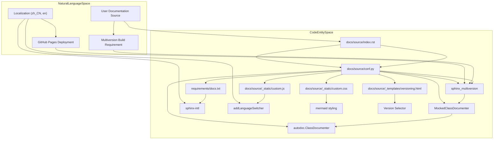
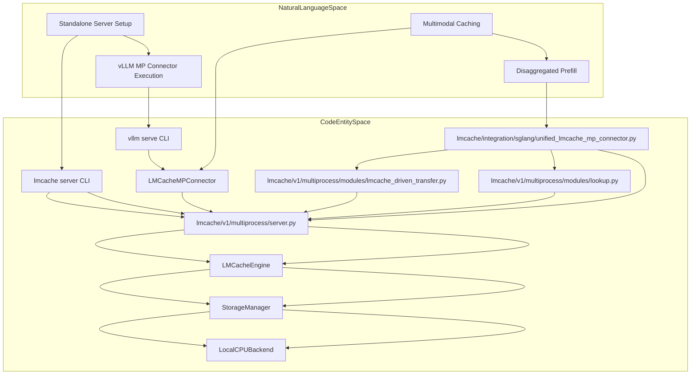

<!-- source: DeepWiki mcp.deepwiki.com · repo LMCache/LMCache · page 14 Documentation and Resources · fetched 2026-10-21 -->

# Documentation and Resources

Relevant source files

The following files were used as context for generating this wiki page:

- [docs/source/_static/custom.css](docs/source/_static/custom.css)
- [docs/source/_static/custom.js](docs/source/_static/custom.js)
- [docs/source/_templates/versioning.html](docs/source/_templates/versioning.html)
- [docs/source/api_reference/multimodality.rst](docs/source/api_reference/multimodality.rst)
- [docs/source/community/blogs.rst](docs/source/community/blogs.rst)
- [docs/source/community/meetings.rst](docs/source/community/meetings.rst)
- [docs/source/conf.py](docs/source/conf.py)
- [docs/source/getting_started/quickstart/index.rst](docs/source/getting_started/quickstart/index.rst)
- [docs/source/getting_started/quickstart/multimodality.rst](docs/source/getting_started/quickstart/multimodality.rst)
- [docs/source/getting_started/quickstart/offload_kv_cache.rst](docs/source/getting_started/quickstart/offload_kv_cache.rst)
- [docs/source/index.rst](docs/source/index.rst)
- [docs/source/llms.txt](docs/source/llms.txt)
- [requirements/docs.txt](requirements/docs.txt)
- [requirements/lint.txt](requirements/lint.txt)

## Purpose and Scope

This page provides a high-level overview of LMCache’s documentation infrastructure, practical example resources, and community engagement channels. LMCache’s documentation suite is crafted to assist developers and operators in effectively using the KV cache management system to reduce time-to-first-token (TTFT) and maximize throughput in large language model (LLM) inference workflows. It covers the documentation build system, multilingual support, quickstart tutorials, integration examples, and community-driven collaboration tools [docs/source/index.rst:34-36]().

For comprehensive details, please refer to the child pages:
- [Documentation System](#14.1)
- [Quickstart and Examples](#14.2)
- [Community and Contributing](#14.3)

Sources: [docs/source/index.rst:34-36]()

---

## Documentation System

LMCache’s documentation is built using **Sphinx**, employing the `sphinxawesome_theme` for a modern and accessible UI [docs/source/conf.py:78](). The configuration includes critical extensions such as:

- `sphinx.ext.autodoc` for automated API reference generation
- `sphinxcontrib.mermaid` for rendering architectural and process diagrams directly from Mermaid code blocks
- `sphinx_multiversion` to maintain documentation across multiple release versions and branches, with whitelisting configured for tags and branches [docs/source/conf.py:29-41,175-178]()
- Localization support for English and Chinese (`zh_CN`) through dedicated JavaScript and CSS that enable a language switcher in the UI [docs/source/_static/custom.js:92-139](), [docs/source/_static/custom.css:73-111]()

The documentation sources and build pipeline track the main development branches for up-to-date content while preserving older stable versions. The build process deploys static sites to GitHub Pages to ensure broad accessibility.

### Documentation Build Pipeline (NLS to Code Entity Space)

**Key Configuration Snapshot:**
- Theme: `sphinxawesome_theme`
- Extensions: autodoc, intersphinx, githubpages, viewcode, napoleon, autosectionlabel, mermaid, sphinx_multiversion, sphinxcontrib.images, sphinx_design
- Versioning: includes tags matching regex `^v\d+\.\d+.*$` and branches `dev` and `main`
- Language localization: English and Chinese with UI language switcher and fallback handling

For detailed instructions on doc writing, localization, build setup, and deployment, see [Documentation System](#14.1).

Sources: [docs/source/conf.py:1-188](), [requirements/docs.txt:1-17](), [docs/source/_static/custom.js:6-139](), [docs/source/_static/custom.css:73-111](), [docs/source/_templates/versioning.html:1-17]()

---

## Quickstart and Examples

LMCache provides a series of practical examples, walkthroughs, and tutorial scripts aimed at demonstrating key system capabilities, including offline and online inference with KV cache offloading, multiprocess (MP) server deployment, disaggregated prefill, and multimodal model acceleration (handling audio, images, and videos) [docs/source/getting_started/quickstart.rst:21-70](), [docs/source/getting_started/quickstart/index.rst:13-60](), [docs/source/api_reference/multimodality.rst:38-107](). These resources help users quickly adopt LMCache in different production contexts.

Users can run LMCache as a standalone daemon process (`lmcache server`), or integrate it into serving engines like vLLM via connectors (e.g., `LMCacheMPConnector`) for transparent KV cache management, persistence, and reuse [docs/source/getting_started/quickstart.rst:23-30]().

### Quickstart and Serving Integration Flow (NLS to Code Entity Space)

**Core Example Categories:**
- **Multiprocess Mode:** Deploy LMCache’s multiprocess server with vLLM’s MP connector for live KV cache sharing and tiered storage
- **Multimodal Support:** Example pipelines handling audio (Ultravox), vision (Llava, Phi-3.5-vision), and video caching
- **KV Cache Offloading and Sharing:** Tutorials demonstrating CPU offload usage, shared prefixes, and prefill reuse to improve efficiency
- **SGLang Integration:** Usage of LMCache with SGLang serving engine via unified Radix cache and multiprocess connector

For step-by-step scripts, simulation tools, and advanced feature demos, see [Quickstart and Examples](#14.2).

Sources: [docs/source/getting_started/quickstart.rst:21-70](), [docs/source/getting_started/quickstart/index.rst:13-60](), [docs/source/api_reference/multimodality.rst:38-107](), [docs/design/integration/sglang/lmcache-unified-radix-cache.md:103-112]()

---

## Community and Contributing

LMCache is a community-driven open-source project welcoming contributors and users through multiple communication and collaboration channels. The project maintains an active **Slack workspace**, regular **bi-weekly community meetings** on Tuesdays, and monthly Office Hours focused on specific topics [docs/source/index.rst:84-98](), [docs/source/community/meetings.rst:11-26]().

For developers, contribution guidelines, coding standards, and governance policies are documented and enforced via linting and automated test suites (see `requirements/lint.txt`) [requirements/lint.txt:1-2](). The repository contains files like `AGENTS.md` highlighting agent skills and `CODEOWNERS` for maintainership, reinforcing structured collaboration.

For details on joining the Slack, meeting schedules, contribution process, and governance models, see [Community and Contributing](#14.3).

Sources: [docs/source/index.rst:84-98](), [docs/source/community/meetings.rst:11-26](), [requirements/lint.txt:1-2]()

---

## Child Pages

For deep dives into each major documentation and resource subsystem, visit the respective child pages:

- [Documentation System](#14.1)  
  Covers Sphinx configuration, multiversion builds, Chinese localization, and site deployment strategies.

- [Quickstart and Examples](#14.2)  
  Guides users through practical examples: offline/online KV cache offloading, session management, multiprocess server usage, SDK, plugins, simulators, and tokens dropping.

- [Community and Contributing](#14.3)  
  Details on community meetings, Slack workspace, onboarding guides, contribution workflows, agent skill descriptions, and project governance documentation.

---

This high-level overview is designed to orient new users and contributors to the rich set of auxiliary resources supporting LMCache’s complex, multi-module codebase for KV cache management in large-scale LLM inference.

Sources:  
[docs/source/index.rst:34-36](), [docs/source/conf.py:1-188](), [requirements/docs.txt:1-17](), [docs/source/_static/custom.js:6-139](), [docs/source/_static/custom.css:73-111](), [docs/source/getting_started/quickstart.rst:21-70](), [docs/source/getting_started/quickstart/index.rst:13-60](), [docs/source/api_reference/multimodality.rst:38-107](), [docs/source/community/meetings.rst:11-26](), [requirements/lint.txt:1-2]()

---

