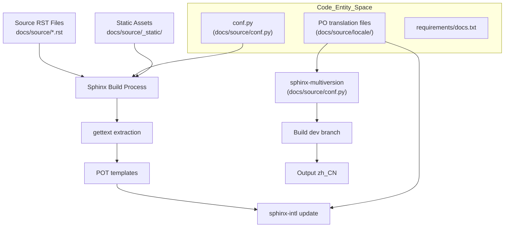
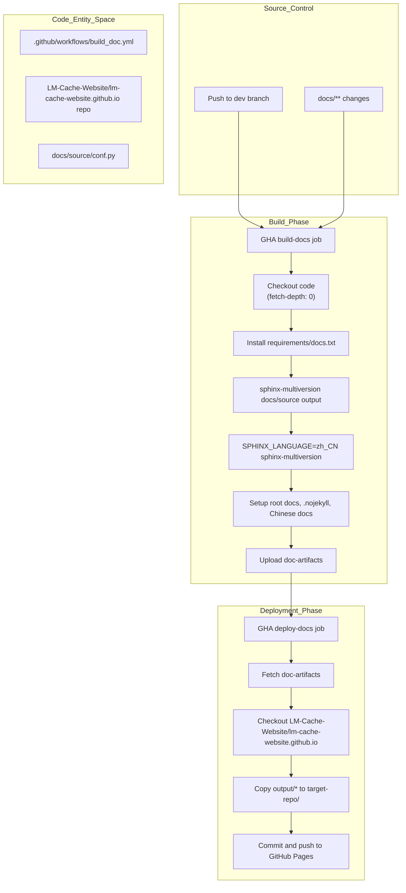
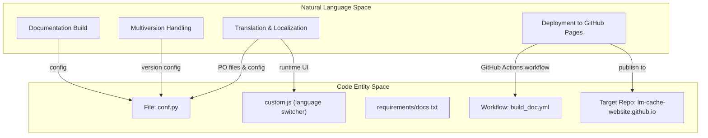
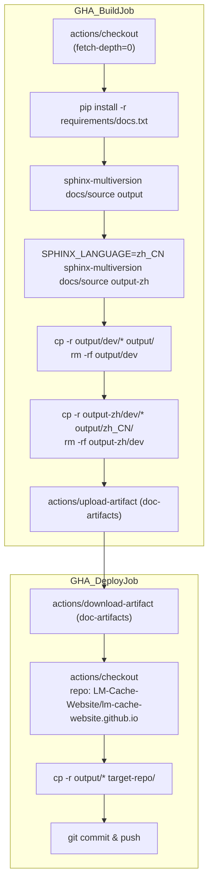

<!-- source: DeepWiki mcp.deepwiki.com · repo LMCache/LMCache · page 14.1 Documentation System · fetched 2026-10-21 -->

# Documentation System

<details>
<summary>Relevant source files</summary>

The following files were used as context for generating this wiki page:

- [.github/workflows/actionlint.dockerfile](.github/workflows/actionlint.dockerfile)
- [.github/workflows/actionlint.yml](.github/workflows/actionlint.yml)
- [.github/workflows/build_doc.yml](.github/workflows/build_doc.yml)
- [.github/workflows/code_quality_checks.yml](.github/workflows/code_quality_checks.yml)
- [.github/workflows/codeql.yml](.github/workflows/codeql.yml)
- [.github/workflows/matchers/actionlint.json](.github/workflows/matchers/actionlint.json)
- [.github/workflows/nightly_build.yml](.github/workflows/nightly_build.yml)
- [.github/workflows/publish.yml](.github/workflows/publish.yml)
- [.github/workflows/scorecard.yml](.github/workflows/scorecard.yml)
- [.github/workflows/stale_bot.yml](.github/workflows/stale_bot.yml)
- [.github/workflows/test.yml](.github/workflows/test.yml)
- [docs/source/_static/custom.css](docs/source/_static/custom.css)
- [docs/source/_static/custom.js](docs/source/_static/custom.js)
- [docs/source/_templates/versioning.html](docs/source/_templates/versioning.html)
- [docs/source/api_reference/multimodality.rst](docs/source/api_reference/multimodality.rst)
- [docs/source/community/blogs.rst](docs/source/community/blogs.rst)
- [docs/source/community/meetings.rst](docs/source/community/meetings.rst)
- [docs/source/conf.py](docs/source/conf.py)
- [docs/source/getting_started/quickstart/index.rst](docs/source/getting_started/quickstart/index.rst)
- [docs/source/getting_started/quickstart/multimodality.rst](docs/source/getting_started/quickstart/multimodality.rst)
- [docs/source/getting_started/quickstart/offload_kv_cache.rst](docs/source/getting_started/quickstart/offload_kv_cache.rst)
- [docs/source/index.rst](docs/source/index.rst)
- [docs/source/llms.txt](docs/source/llms.txt)
- [requirements/docs.txt](requirements/docs.txt)
- [requirements/lint.txt](requirements/lint.txt)

</details>


## Purpose and Scope

This page details the Sphinx-based documentation system used to build, version, localize, and deploy LMCache's technical documentation. It covers the core documentation stack, the multi-versioning build pipeline using `sphinx-multiversion`, Simplified Chinese (`zh_CN`) localization via `sphinx-intl`, runtime UI enhancements, and automated publishing to GitHub Pages.

Sources: `[docs/source/conf.py:1-189]`, `[requirements/docs.txt:1-18]`, `[docs/source/_static/custom.js:1-165]`

---

## Documentation Stack

LMCache employs **Sphinx** as its core documentation engine, enriched with multiple extensions to support a modern, versioned, and localized documentation website.

| Component           | Purpose                                          | Configuration File                        |
|---------------------|-------------------------------------------------|------------------------------------------|
| Sphinx              | Core documentation generation engine             | `[docs/source/conf.py:2-8]()`            |
| sphinx-multiversion  | Multi-branch and multi-tag documentation versioning | `[docs/source/conf.py:172-188]()`        |
| sphinx-intl          | Internationalization (i18n) and gettext translation support | `[requirements/docs.txt:14]()`            |
| sphinxawesome_theme  | Responsive, modern documentation theme           | `[docs/source/conf.py:78-122]()`          |
| sphinxcontrib-mermaid| Mermaid.js diagram rendering                      | `[docs/source/conf.py:36]()`              |
| sphinx-design        | Enhanced UI components (tabs, cards, dropdowns)  | `[docs/source/conf.py:40-41]()`           |

The complete set of Python dependencies required for building the documentation is defined in `[requirements/docs.txt:1-18]`:
- `sphinx>=6,<9` `[requirements/docs.txt:1]()`
- `sphinx-multiversion==0.2.4` `[requirements/docs.txt:13]()`
- `sphinx-intl==2.3.1` `[requirements/docs.txt:14]()`
- `sphinxawesome_theme==5.3.2` `[requirements/docs.txt:10]()`
- `sphinxcontrib-mermaid==2.0.2` `[requirements/docs.txt:12]()`

Sources: `[requirements/docs.txt:1-18]`, `[docs/source/conf.py:29-41]`

---

## Build Pipeline

The LMCache documentation build process creates multiple versions of the documentation from the RST source files. It also supports building localized versions (English and Simplified Chinese).

### Documentation Generation and Translation Flow



- The Sphinx build reads sources files (`.rst`), configuration (`conf.py`), and static assets.
- Translatable strings are extracted by a gettext builder to POT templates.
- Translation PO files are updated and maintained under `locale/`.
- `sphinx-intl` assists in keeping these translation files in sync.
- `sphinx-multiversion` builds multiple versions from tags and branches.
- The English and Chinese versions are built separately, allowing parallel output directories.

**Build Commands:**
- English docs: `sphinx-multiversion docs/source output`
- Chinese docs: `SPHINX_LANGUAGE=zh_CN sphinx-multiversion docs/source output-zh`

Sources: `[docs/source/conf.py:69-188]`, `[requirements/docs.txt:1-18]`, `[.github/workflows/build_doc.yml:44-45]`

---

## Localization (zh_CN) and Runtime UI

LMCache supports Simplified Chinese (`zh_CN`) localization using standard Sphinx gettext workflows combined with runtime JavaScript for language switching.

- **String Extraction**: Sphinx `gettext` builder extracts all translatable strings from RST sources into `.pot` files.
- **Translation Management**: `sphinx-intl update` synchronizes `.po` translations in `docs/source/locale/` with `.pot` templates.
- **Language Config**: The `conf.py` reads the environment variable `SPHINX_LANGUAGE` to switch languages dynamically:
  ```python
  language = os.environ.get("SPHINX_LANGUAGE", "en")
  locale_dirs = ["locale/"]
  gettext_compact = False
  ```
- **Runtime Language Switcher**: The custom JavaScript in `_static/custom.js` detects if the current page is under `/zh_CN/` and toggles language:
  - If on Chinese docs, it shows a button to switch to English `/`.
  - If on English docs, it shows a button to switch to Chinese `/zh_CN/`.
  - It gracefully handles edge cases and invalid URLs.

Sources: `[docs/source/conf.py:69-71]`, `[requirements/docs.txt:14]`, `[docs/source/_static/custom.js:1-165]`

---

## Deployment Lifecycle

LMCache documentation is published automatically to GitHub Pages via GitHub Actions using a two-job workflow: building multi-versioned docs and deploying them into a GitHub Pages repository.

### GitHub Pages Deployment Workflow



- **Trigger**: The workflow triggers on pushes to the `dev` branch when files in `docs/`, `lmcache/`, `examples/`, or the workflow file change.
- **Build Job (`build-docs`)**:
  - Checks out full repository history (`fetch-depth: 0`) for accurate `sphinx-multiversion` operation.
  - Installs Python dependencies for documentation as specified in `requirements/docs.txt`.
  - Runs `sphinx-multiversion` twice — once for the English docs and once for the Chinese docs (`SPHINX_LANGUAGE=zh_CN`).
  - Copies the `dev` branch docs to the root output directory and Chinese docs to `output/zh_CN/`.
  - Marks the site with `.nojekyll` to allow files starting with underscores.
  - Uploads the output as an artifact for passing to the deployment job.
- **Deploy Job (`deploy-docs`)**:
  - Retrieves the built documentation artifact.
  - Checks out a separate GitHub Pages repository `LM-Cache-Website/lm-cache-website.github.io` using a deploy token.
  - Copies the docs to the repository folder and commits if changes exist.
  - Pushes to the `main` branch, which triggers serving of the docs from GitHub Pages.

- **Versioning**:
  - `sphinx-multiversion` is configured to whitelist tags of form `v*` and branches `dev` and `main`.
  - The dev branch docs serve as the "latest" root-level docs.
  - Chinese localization is duplicated under `/zh_CN`.

Sources: `[docs/source/conf.py:172-188]`, `[requirements/docs.txt:1-18]`, `[.github/workflows/build_doc.yml:1-107]`

---

## Sphinx Configuration

The Sphinx configuration file `docs/source/conf.py` manages project-wide documentation settings.

### Core Settings

- **Project Metadata**:
  ```python
  project = "LMCache"
  copyright = "2024, The LMCache Team"
  author = "The LMCache Team"
  ```
- **Extensions**:
  Sphinx extensions include:
  - autodoc, intersphinx, githubpages, viewcode, napoleon, autosectionlabel
  - sphinxcontrib.mermaid for diagram rendering
  - sphinx_multiversion for multi-version support
  - sphinxcontrib.images and sphinx_design for UI enhancements
- **Theme**: 
  - Uses `sphinxawesome_theme`
  - Custom CSS (`custom.css`) and JavaScript (`custom.js`) injected
  - Theme options provide GitHub links in the header

### Build Behavior

- `autodoc_mock_imports` lists packages to mock during doc build, enabling lightweight builds without requiring heavy or GPU-dependent native bindings (`torch`, `vllm`, `redis`, `zmq`, etc.).
- `intersphinx_mapping` provides links to external API docs (Python stdlib, PyTorch, NumPy, psutil).

### Multiversion Configuration

- Tag whitelist regex: `^v\d+\.\d+.*$`
- Branch whitelist regex: `^(dev|main)$`
- Released versions: `^tags/v.*$`
- `smv_latest_version = "dev"`: points latest documentation to the dev branch output.

Sources: `[docs/source/conf.py:1-189]`, `[requirements/docs.txt:1-18]`, `[docs/source/_static/custom.js:1-165]`

---

# Summary

The LMCache documentation system relies on a robust Sphinx configuration enhanced by `sphinx-multiversion` to produce versioned documentation for multiple branches and tags, with parallel support for Simplified Chinese localization managed using `sphinx-intl`. This system is fully automated using GitHub Actions that build, upload, and deploy documentation to a dedicated GitHub Pages repository, ensuring that the latest and historical versions of the documentation remain accessible and well-maintained.

# Additional Mermaid Diagram: Natural Language to Code Entities


Sources: `[docs/source/conf.py:1-189]`, `[.github/workflows/build_doc.yml:1-107]`, `[docs/source/_static/custom.js:1-165]`

---

# Additional Mermaid Diagram: Build and Deployment Flow with File and Component Names



Sources: `[.github/workflows/build_doc.yml:1-107]`, `[docs/source/conf.py:172-188]`

---

# References

- Sphinx configuration: `[docs/source/conf.py:1-189]()`
- Documentation dependencies: `[requirements/docs.txt:1-17]()`
- GitHub Actions workflow: `[.github/workflows/build_doc.yml:1-106]()`
- Runtime language switcher JavaScript: `[docs/source/_static/custom.js:1-165]()`

This completes the detailed technical documentation on LMCache's Documentation System.

---

