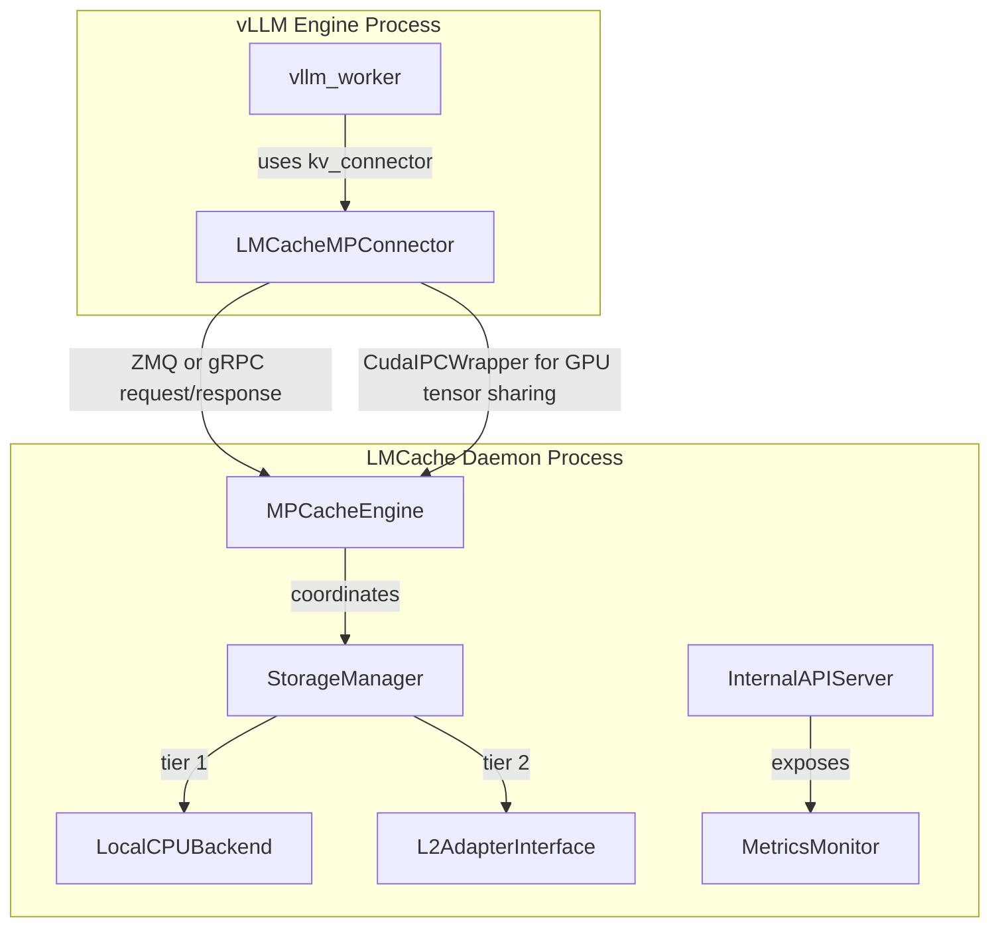
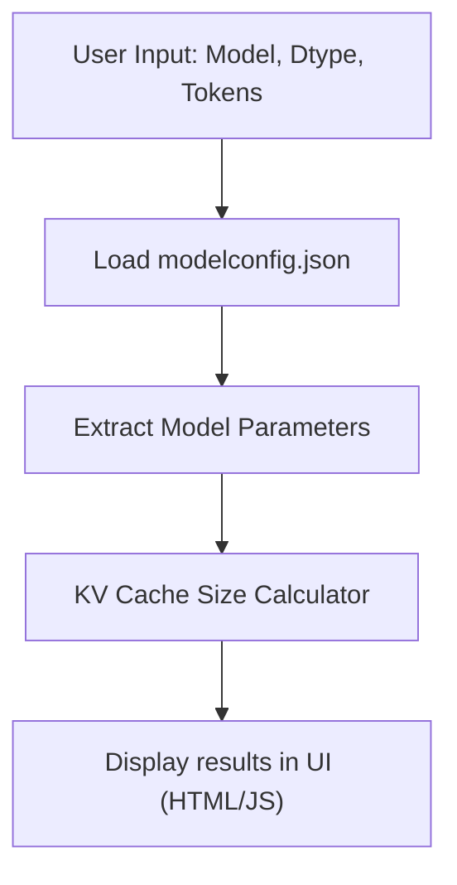
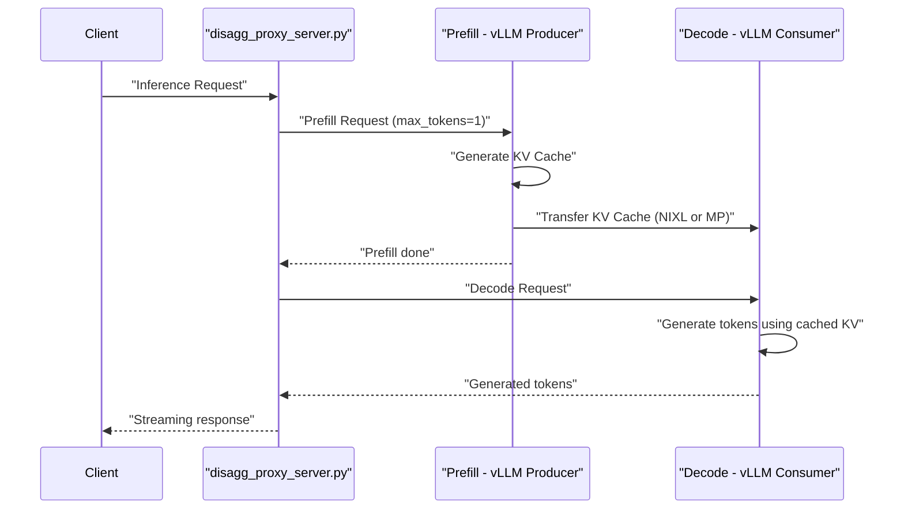
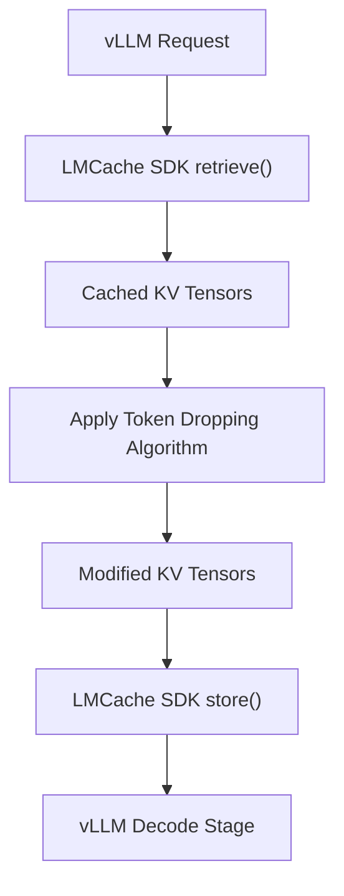

<!-- source: DeepWiki mcp.deepwiki.com · repo LMCache/LMCache · page 14.2 Quickstart and Examples · fetched 2026-10-21 -->

# Quickstart and Examples

<details>
<summary>Relevant source files</summary>

The following files were used as context for generating this wiki page:

- [.buildkite/k3_harness/resolve-pinned-sglang.sh](.buildkite/k3_harness/resolve-pinned-sglang.sh)
- [.buildkite/k3_tests/multiprocess/README.md](.buildkite/k3_tests/multiprocess/README.md)
- [.buildkite/k3_tests/multiprocess/scripts/engines/sglang.sh](.buildkite/k3_tests/multiprocess/scripts/engines/sglang.sh)
- [.github/scripts/pin-tested-sglang.sh](.github/scripts/pin-tested-sglang.sh)
- [docs/design/integration/sglang/assets/unified-radix-cache-runtime-flow.svg](docs/design/integration/sglang/assets/unified-radix-cache-runtime-flow.svg)
- [docs/design/integration/sglang/lmcache-unified-radix-cache.md](docs/design/integration/sglang/lmcache-unified-radix-cache.md)
- [docs/source/getting_started/quickstart.rst](docs/source/getting_started/quickstart.rst)
- [examples/README.md](examples/README.md)
- [examples/frontend/README.md](examples/frontend/README.md)
- [examples/frontend/frontend.py](examples/frontend/frontend.py)
- [examples/kv_cache_calculator/README.md](examples/kv_cache_calculator/README.md)
- [examples/kv_cache_calculator/generate_config.py](examples/kv_cache_calculator/generate_config.py)
- [examples/kv_cache_calculator/kv_cache_calculator.html](examples/kv_cache_calculator/kv_cache_calculator.html)
- [examples/kv_cache_calculator/modelconfig.json](examples/kv_cache_calculator/modelconfig.json)
- [examples/kv_cache_calculator/requirement.txt](examples/kv_cache_calculator/requirement.txt)
- [examples/kv_cache_reuse/share_across_engines/README.md](examples/kv_cache_reuse/share_across_engines/README.md)
- [examples/kv_cache_reuse/share_across_engines/lmcache.yaml](examples/kv_cache_reuse/share_across_engines/lmcache.yaml)
- [examples/kv_cache_reuse/share_across_engines/verify.sh](examples/kv_cache_reuse/share_across_engines/verify.sh)
- [examples/online_session/README.md](examples/online_session/README.md)
- [examples/online_session/openai_chat_completion_client.py](examples/online_session/openai_chat_completion_client.py)
- [examples/sgl_integration/README.md](examples/sgl_integration/README.md)
- [tests/benchmarks/test_xpu_connector_benchmark.py](tests/benchmarks/test_xpu_connector_benchmark.py)
- [tests/benchmarks/test_xpu_kernels_microbench.py](tests/benchmarks/test_xpu_kernels_microbench.py)
- [tests/benchmarks/test_xpu_layerwise_connector_benchmark.py](tests/benchmarks/test_xpu_layerwise_connector_benchmark.py)
- [tests/v1/test_xpu_connector.py](tests/v1/test_xpu_connector.py)

</details>


This page serves as a comprehensive guide to LMCache's example scenarios and quickstart workflows. It details offline inference setups, online session measurement, disaggregated prefill deployments, observability stacks, SDK integrations, external L2/native plugins, the KV cache calculator tool, token dropping, and the cache simulator.

Sources: `[examples/README.md:1-86]`, `[docs/source/getting_started/quickstart.rst:1-153]`

---

## Overview of Example Scenarios

LMCache ships with documentation and runnable scripts covering various primary use cases, categorized by operational tiers:

| Scenario                             | Location                                  | Engines | Requirements                              |
|------------------------------------|-------------------------------------------|---------|-------------------------------------------|
| KV cache offload to CPU / disk     | `[examples/README.md:27-27]()`            | vLLM    | 1 GPU; optional NVMe                       |
| Online Session TTFT measurement    | `[examples/README.md:28-28]()`            | vLLM    | 1 GPU                                     |
| KV cache sharing (Centralized)     | `[examples/README.md:41-41]()`            | vLLM    | 2 GPUs (same node), `PYTHONHASHSEED=0`    |
| P2P cache sharing                  | `[examples/README.md:42-43]()`            | vLLM    | 2+ GPUs, NIXL, UCX RDMA                   |
| Disaggregated prefill (1P1D)        | `[examples/README.md:38-38]()`            | vLLM    | 2 GPUs + NIXL / MP backend                 |
| Multi-node (xPyD) Disaggregation  | `[examples/README.md:71-71]()`            | vLLM    | 3+ GPUs + NIXL                             |
| KV Cache Calculator                | `[examples/README.md:17-17]()`            | Web UI  | Browser UI                                |
| Multi-round QA Benchmark           | `[benchmarks/multi_round_qa/multi-round-qa.py:1-220]()` | vLLM    | GPU cluster                               |

Sources: `[examples/README.md:15-86]`, `[benchmarks/multi_round_qa/multi-round-qa.py:1-220]`

---

## Installation and Compatibility

LMCache can be installed via standard Python package managers. It supports multiple deployment modes and hardware platforms including CUDA, ROCm, and XPU.

```bash
# Install using pip
pip install lmcache vllm
```

### Deployment Modes with vLLM

LMCache supports two main deployment modes when integrated with vLLM:

1. **Multiprocess (MP) mode (recommended):** LMCache runs as a standalone service (`lmcache server`). Multiple vLLM instances connect to it via `LMCacheMPConnector`. This supports better scaling, concurrent usage sharing a single cache instance, and exposes management and observability endpoints. [docs/source/getting_started/quickstart.rst:13-93]()

2. **In-process mode (legacy):** LMCache runs inside the vLLM process via `LMCacheConnectorV1`. This mode is suited for quick single-node experiments but less recommended for production due to limited scalability and features. [docs/source/getting_started/quickstart.rst:151-153]()

Sources: `[docs/source/getting_started/quickstart.rst:6-93]`

---

## Quickstart: Multiprocess (MP) Mode

The recommended mode for production deployments separates cache management into a standalone LMCache server process.

### Component Architecture: MP Mode (Natural Language to Code Entities)



This diagram shows the separation:

- `vllm_worker` uses the `LMCacheMPConnector` to send requests and receive cached KV data.
- The `MPCacheEngine` in the `lmcache server` handles lookup/store requests, coordinating with the storage backends through `StorageManager`.
- Management and observability endpoints are served by `InternalAPIServer` which feeds into metrics monitoring.

Sources: `[docs/source/getting_started/quickstart.rst:37-65]`, `[examples/README.md:38-43]`

---

### Starting the LMCache Server

The LMCache server manages tiered storage, evictions, and remote lookups:

```bash
lmcache server \
    --host localhost --port 5555 \
    --l1-size-gb 20 --eviction-policy LRU --chunk-size 256
```

- `--l1-size-gb` sets in-memory cache capacity.
- `--eviction-policy` can be `LRU` or other policies.
- `--chunk-size` controls the granularity of KV cache chunks stored.

Sources: `[docs/source/getting_started/quickstart.rst:44-49]`

---

### Running vLLM with the MP Connector

Launch vLLM specifying LMCacheMPConnector with connection details:

```bash
vllm serve Qwen/Qwen3-8B \
    --port 8000 --kv-transfer-config \
    '{"kv_connector":"LMCacheMPConnector", "kv_role":"kv_both", "kv_connector_extra_config": {"lmcache.mp.host": "localhost", "lmcache.mp.port": 5555}}'
```

- `kv_role: kv_both` enables both store and retrieve.
- Connection to LMCache server is through the host and port specified.
- Choose transport implicitly by prefixing with `tcp://` or `grpc://` as needed.

Sources: `[docs/source/getting_started/quickstart.rst:67-89]`

---

## Tools and Utilities

### KV Cache Calculator

An interactive web-based KV cache size calculator helps estimate GPU memory and cache tier requirements based on model architecture details, dtype, and token count.

- Model parameters (e.g., `hidden_size`, `num_attention_heads`, `num_hidden_layers`) are read from `modelconfig.json`.
- Special parameters like `kv_lora_rank` for DeepSeek models and `cla_share_factor` for Hunyuan-Large are also supported.
- The tool is implemented in HTML and JS in `examples/kv_cache_calculator/` and uses the data from `modelconfig.json` and `generate_config.py`.

**KV Cache Calculator Data Flow**



Sources: `[examples/kv_cache_calculator/modelconfig.json:1-201]`, `[examples/kv_cache_calculator/generate_config.py:1-84]`, `[examples/kv_cache_calculator/kv_cache_calculator.html:1-221]`

---

### Cache Simulator

The LMCache CLI tool includes a `cache-simulator` subcommand that replays lookup logs to estimate expected cache hit rates and performance before deploying cluster-wide. This aids in workload characterization and planning.

Sources: `[examples/README.md:56-56]`

---

## Example: Disaggregated Prefill (PD) Architecture

This classic disaggregated prefill pattern splits prefilling and decoding phases across separate GPUs or nodes, to improve throughput and utilization.

**PD Disaggregation Sequence (1 Prefill + 1 Decode)**



**Key Points:**

- The prefiller processes the initial prompt and generates KV cache.
- The cache is transferred efficiently to the decoder using NIXL/UCX RDMA or multiprocess queues.
- The proxy server manages forwarding and prefill/decode request coordination.
- Configuration requires sync on transfer mode and roles (`kv_role = kv_producer` / `kv_consumer`).
- The proxy uses a `WeightedSemaphore` to limit in-flight tokens and manage buffer capacity.

Sources: `[examples/disagg_prefill/disagg_proxy_server.py:30-40,154-181]`, `[docs/source/getting_started/quickstart.disaggregated_prefill.rst:190-190]`

---

## Benchmarking Agentic Workloads with Multi-Round QA

LMCache includes scripts for multi-round QA benchmarking to measure TTFT reduction across simulated agentic dialogue sessions.

- `WorkloadConfig` defines user counts, round counts, prompt lengths.
- `RequestExecutor` performs async calls to vLLM + LMCache setup, collects timing data.
- `UserSession` maintains dialogue history with statistics per session and round.

Sources: `[benchmarks/multi_round_qa/multi-round-qa.py:1-220]`

---

## Observability and Verification

LMCache generates informative logs and exposes observability endpoints:

- **Log Samples:**

  Prefiller logs for store throughput:

  ```
  LMCache INFO: Store 5271 tokens takes: 6.5000 ms, throughput: 98.9889 GB/s
  ```

  Decoder logs request-level hit counts:

  ```
  LMCache INFO: Reqid: ..., Total tokens 5170, LMCache hit tokens: 5170
  ```

- **Metrics Stack:**

  The `examples/observability/` directory offers a docker-compose setup that starts OpenTelemetry collectors, Prometheus for metric scraping, and Grafana with prebuilt dashboards showing hit rates, throughput, and waterfall traces.

Sources: `[examples/README.md:53-53]`, `[docs/source/getting_started/quickstart.disaggregated_prefill.rst:185-190]`

---

## External Plugins and SDK

### Token Dropping with LMCache SDK

Token dropping helps reduce KV cache size to improve decode throughput by pruning less important tokens.

- The SDK exposes cached KV tensors for retrieval, modification, and storing back.
- Algorithms include:
  - Random token dropping.
  - SnapKV (keeping first/last windows plus important tokens).
  - R-KV variants approximating redundancy-aware pruning.
- Query tensors can be used to rank token importance. LMCache provides a patch to expose these intermediate tensors from vLLM.
- Installation requires building LMCache from source ensuring native extensions are compiled correctly.

**Token Dropping Workflow**



Sources: `[examples/token_dropping/README.md:1-155]`

---

### External L2 Adapter Plugin

Demonstrates how to add a custom external L2 adapter plugin dynamically:

- Implement the required interface `L2AdapterInterface`.
- Register the adapter via the `L2AdapterFactory` using `add_pending_module`.
- See the minimal example in `examples/lmc_external_l2_adapter/src/lmc_external_l2_adapter/adapter.py`.

Sources: `[lmcache/v1/distributed/l2_adapters/__init__.py:1-68]`, `[examples/lmc_external_l2_adapter/src/lmc_external_l2_adapter/adapter.py]`

---

### External Native Connector Plugin

Shows how to implement custom native (C++/CUDA) connectors for LMCache:

- The C++ core is implemented in `csrc/pybind.cpp`, exposing bindings.
- The Python wrapper is in `connector.py`.
- Build system handled by `setup.py` and `pyproject.toml`.

Sources: `[examples/lmc_external_native_connector/csrc/pybind.cpp]`, `[examples/lmc_external_native_connector/src/lmc_external_native_connector/connector.py]`, `[examples/lmc_external_native_connector/setup.py]`, `[examples/lmc_external_native_connector/pyproject.toml]`

---

## Troubleshooting Guide

| Issue                        | Cause                             | Resolution                                                                                           |
|------------------------------|----------------------------------|----------------------------------------------------------------------------------------------------|
| Cache lookup misses          | Inconsistent hashing              | Ensure `PYTHONHASHSEED=0` is set in all environments for hash consistency during chunk hashing.     |
| Slow KV transfer             | Transport mode mismatch           | Verify transport mode and environment variables like `UCX_TLS` include `cuda_ipc,cuda_copy,tcp`.   |
| PD buffer size errors        | Buffer size not aligned           | Align buffer sizes to `chunk_size * KV item size` and verify semaphore limits.                     |
| User-controlled caching fail | Incorrect request kv_transfer_params | Confirm request JSON includes correct `kv_transfer_params`, e.g., `{"lmcache.skip_save": true}`.   |

Sources: `[docs/source/getting_started/quickstart.rst:41-41]`, `[docs/source/getting_started/quickstart.disaggregated_prefill.rst:99-190]`, `[examples/disagg_prefill/disagg_proxy_server.py:174-190]`, `[examples/cache_interface/README.md:59-61]`

---

# Summary

This page provides a practical, hands-on overview of LMCache's example scenarios ranging from single-node local cache reuse to multi-node disaggregated prefill architectures, along with tools for sizing and simulating cache usage, and SDK-based extensions. The multiprocess deployment with vLLM is the recommended path for production use due to its scalability and observability features.

Readers should explore examples grouped by their hardware environment and goals, starting from local cache reuse, then advancing to disaggregated prefill, P2P sharing, and finally production observability and custom extension demos.

Sources: `[examples/README.md:1-86]`, `[docs/source/getting_started/quickstart.rst:1-153]`, `[examples/kv_cache_calculator/modelconfig.json:1-201]`, `[examples/kv_cache_calculator/generate_config.py:1-84]`, `[examples/disagg_prefill/disagg_proxy_server.py:30-181]`, `[benchmarks/multi_round_qa/multi-round-qa.py:1-220]`, `[examples/token_dropping/README.md:1-155]`

---

