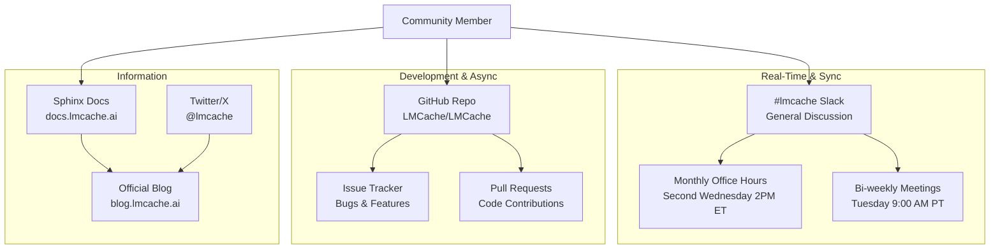
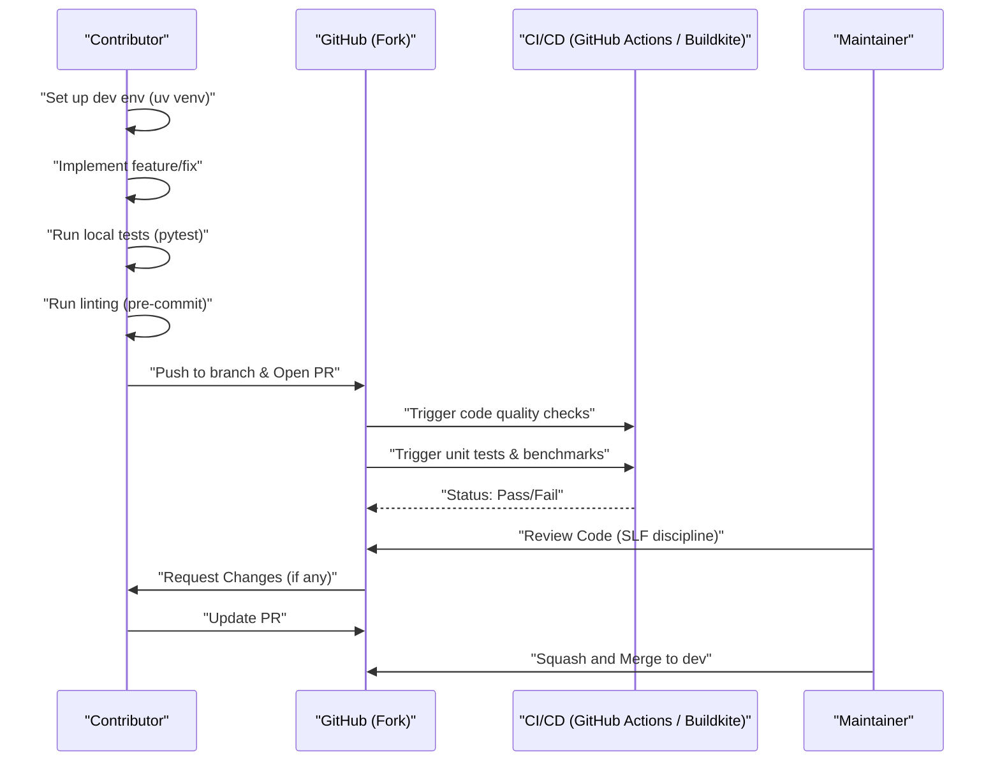
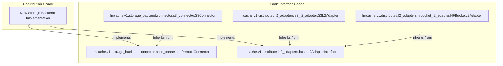

<!-- source: DeepWiki mcp.deepwiki.com · repo LMCache/LMCache · page 14.3 Community and Contributing · fetched 2026-10-21 -->

# Community and Contributing

<details>
<summary>Relevant source files</summary>

The following files were used as context for generating this wiki page:

- [.buildkite/correctness/README.md](.buildkite/correctness/README.md)
- [.buildkite/correctness/pipeline.mmlu.yml](.buildkite/correctness/pipeline.mmlu.yml)
- [.claude/skills/create-pr/SKILL.md](.claude/skills/create-pr/SKILL.md)
- [.claude/skills/pr-review/SKILL.md](.claude/skills/pr-review/SKILL.md)
- [.claude/skills/pre-pr-check/SKILL.md](.claude/skills/pre-pr-check/SKILL.md)
- [.cursor/BUGBOT.md](.cursor/BUGBOT.md)
- [.gemini/styleguide.md](.gemini/styleguide.md)
- [.github/ISSUE_TEMPLATE/blank_issue.md](.github/ISSUE_TEMPLATE/blank_issue.md)
- [.github/ISSUE_TEMPLATE/bug_report.md](.github/ISSUE_TEMPLATE/bug_report.md)
- [.github/ISSUE_TEMPLATE/feature_request.md](.github/ISSUE_TEMPLATE/feature_request.md)
- [.github/PULL_REQUEST_TEMPLATE.md](.github/PULL_REQUEST_TEMPLATE.md)
- [AGENTS.md](AGENTS.md)
- [CLAUDE.md](CLAUDE.md)
- [CONTRIBUTING.md](CONTRIBUTING.md)
- [DCO](DCO)
- [MAINTAINERS.md](MAINTAINERS.md)
- [README.md](README.md)
- [docs/coding_standards.md](docs/coding_standards.md)
- [docs/design/README.md](docs/design/README.md)
- [docs/design/tools/controller_benchmark/README.md](docs/design/tools/controller_benchmark/README.md)
- [docs/source/community/faq.rst](docs/source/community/faq.rst)
- [docs/source/community/index.rst](docs/source/community/index.rst)
- [docs/source/developer_guide/contributing.rst](docs/source/developer_guide/contributing.rst)
- [docs/source/locale/zh_CN/LC_MESSAGES/community/faq.po](docs/source/locale/zh_CN/LC_MESSAGES/community/faq.po)
- [docs/source/locale/zh_CN/LC_MESSAGES/community/index.po](docs/source/locale/zh_CN/LC_MESSAGES/community/index.po)

</details>


## Purpose and Scope

This page provides comprehensive guidance on engaging with the LMCache community, project governance, and contributing code, documentation, or infrastructure improvements to the project. It covers communication channels, contribution workflows, community meetings, project governance, developer guidelines, AI coding agent policies (`AGENTS.md`), CODEOWNERS mapping, and technical coding standards. LMCache is an LLM serving engine extension designed to reduce Time To First Token (TTFT) and increase throughput by storing and reusing KV caches across multiple tiers including GPU, CPU, disk, and remote storage [AGENTS.md:13-14]().

For technical documentation on build systems and CI/CD pipelines, see **Build System** (chapter 13.1) and **CI/CD Pipeline** (chapter 13.2).

Sources: [AGENTS.md:13-14](), [docs/source/developer_guide/contributing.rst:1-10]()

---

## Community Resources and Communication Channels

LMCache maintains multiple channels for community engagement, support, and collaboration.

### Community Interaction Flow

Title: "LMCache Community Engagement Channels"

Sources: [docs/source/developer_guide/contributing.rst:13-15]()

### Primary Communication Channels

| Channel                | Purpose                                     | Link                                                                                                    |
|------------------------|---------------------------------------------|---------------------------------------------------------------------------------------------------------|
| **Slack Workspace**     | Real-time discussion, support, collaboration | [#lmcache Slack](https://join.slack.com/t/lmcacheworkspace/shared_invite/zt-3zxjao8h0-lRfBfnLqbALOtLsWn2ITxA) |
| **GitHub Issues**       | Bug reports, feature requests, task tracking | [LMCache Issues](https://github.com/LMCache/LMCache/issues)                                             |
| **Twitter / X**         | Project updates and announcements            | [@lmcache](https://x.com/lmcache)                                                                       |
| **Onboarding Issues**   | Good first issues for new contributors       | [Issue #3372](https://github.com/LMCache/LMCache/issues/3372)                                           |
| **Roadmap**             | Future project direction and planning        | [Issue #2923](https://github.com/LMCache/LMCache/issues/2923)                                           |

Sources: [docs/source/developer_guide/contributing.rst:11-15](), [CONTRIBUTING.md:6-7]()

---

## Contributing to LMCache

### Contribution Workflow

LMCache follows the **Fork and Pull** development model. The default branch is `dev`; all new branches and pull requests are created against `dev` [docs/source/developer_guide/contributing.rst:39-40](), [CONTRIBUTING.md:22-22](), [AGENTS.md:17-17]().

Title: "LMCache Pull Request and Review Lifecycle"

Sources: [docs/source/developer_guide/contributing.rst:39-47](), [CONTRIBUTING.md:22-22](), [CONTRIBUTING.md:77-78](), [AGENTS.md:17-17]()

### Development Environment Setup

The project recommends using `uv` for Python environment and dependency management [CONTRIBUTING.md:26-43](), [AGENTS.md:21-47]().

```bash
# Create and activate virtual environment
uv venv --python 3.12
source .venv/bin/activate

# Install dependencies and serving engines
uv pip install torch               # prerequisite for CUDA extensions
uv pip install vllm sglang

# Install LMCache in editable mode (development)
uv pip install -e . --no-build-isolation

# Install lint and test dependencies
uv pip install -r requirements/lint.txt
uv pip install -r requirements/test.txt

# Optional: build without native extensions
NO_NATIVE_EXT=1 pip install -e .

# Optional: ROCm build
BUILD_WITH_HIP=1 pip install -e .
```
Sources: [CONTRIBUTING.md:26-43](), [docs/source/developer_guide/contributing.rst:113-122](), [AGENTS.md:23-47]()

### Technical Standards and Review Checklist

Contributions must meet project-wide standards:

1. **Type Hints:** All functions and methods require explicit type annotations for arguments and return values [CONTRIBUTING.md:135-136](), [AGENTS.md:132-134]().

2. **Docstrings:** Every public function and method must have clear docstrings specifying behavior, parameters, return values, and exceptions [CONTRIBUTING.md:139-144](), [AGENTS.md:136-144]().

3. **SLF Discipline (Private Member Access):** Contributors must not access private members (`_`-prefixed attributes) of other classes, enforced as a strict project-wide coding standard and verified by CI in critical modules [CONTRIBUTING.md:126-128](), [AGENTS.md:126-128]().

4. **Import Ordering:** Imports must follow the order: Standard Library → Third Party → First Party (`lmcache`) → Local Modules [CONTRIBUTING.md:121-132](), [AGENTS.md:108-124]().

5. **DCO Compliance:** All commits require a `Signed-off-by` line certifying agreement with the Developer Certificate of Origin. Use `git commit -s` for automatic sign-off [docs/source/developer_guide/contributing.rst:68-76]().

6. **Code Quality Tools:** Use `ruff` for linting and formatting, `mypy` for type checks, `isort` for import organization, and `codespell` for spelling errors [CONTRIBUTING.md:103-113](), [AGENTS.md:82-91]().

7. **SPDX License Header:** Every Python source file must begin with the header `# SPDX-License-Identifier: Apache-2.0` [CONTRIBUTING.md:115](), [AGENTS.md:106]().

Sources: [CONTRIBUTING.md:103-153](), [AGENTS.md:82-134](), [docs/source/developer_guide/contributing.rst:68-76]()

### PR Prefixing and Templates

To clarify the purpose of pull requests, use the following prefixes in PR titles [docs/source/developer_guide/contributing.rst:49-59]():

| Prefix      | Meaning                               |
|-------------|-------------------------------------|
| `[Bugfix]`  | Bug fixes                           |
| `[Build]`   | Build fixes or improvements         |
| `[CI]`      | Continuous integration changes      |
| `[Core]`    | Core LMCache logic changes (e.g. `LMCacheEngine`, `Backend`) |
| `[Doc]`     | Documentation updates               |
| `[Misc]`    | Miscellaneous changes               |
| `[Model]`   | New model support or improvements   |
| `[Test]`    | Unit tests                         |

Pull requests also should confirm if they contain user-facing changes and/or tests using the PR template [.github/PULL_REQUEST_TEMPLATE.md:9-12]().

Sources: [docs/source/developer_guide/contributing.rst:49-59](), [.github/PULL_REQUEST_TEMPLATE.md:9-12]()

---

## AGENTS.md Guidelines and AI Coding Agent Skills

`AGENTS.md` is a policy file specifying rules for AI coding assistants (e.g., Copilot, Claude Code, Cursor) interacting with the repository [AGENTS.md:1-3]().

- It is **human-owned**: AI agents must not autonomously modify `AGENTS.md` without explicit user request [AGENTS.md:5-9]().
- It defines testing and documentation principles, including writing tests against public interfaces and avoiding private member access except where necessary [AGENTS.md:76-81]().
- Documentation surfaces governed include:
  1. **User Docs** in `docs/source/` (Sphinx / reStructuredText) [AGENTS.md:150-158]().
  2. **Design Docs** in `docs/design/` following the package structure of `lmcache/` [AGENTS.md:159-164]().
  3. **Module-level READMEs** symlinked from `docs/design/<path>/README.md` [AGENTS.md:165-167]().

These policies ensure code quality and collaborative maintenance while leveraging AI agents effectively.

Sources: [AGENTS.md:1-167]()

---

## Project Governance and CODEOWNERS

### Maintainers and Committers

LMCache is stewarded by a group of maintainers from academia and industry who hold commit rights [MAINTAINERS.md:1-14]().

**Current Maintainers:**
- Yihua Cheng (UChicago & Tensormesh) [MAINTAINERS.md:5-5]()
- Jiayi Yao (UChicago) [MAINTAINERS.md:6-6]()
- Kuntai Du (UChicago & Tensormesh) [MAINTAINERS.md:7-7]()
- Martin Hickey (IBM) [MAINTAINERS.md:8-8]()
- Hunter Zhang (Bytedance) [MAINTAINERS.md:9-9]()
- Baolong Mao (Tensormesh) [MAINTAINERS.md:10-10]()
- Chunxiao Zheng (Tensormesh) [MAINTAINERS.md:11-11]()
- Shaoting Feng (UChicago) [MAINTAINERS.md:12-12]()
- Samuel Shen (UChicago & Tensormesh) [MAINTAINERS.md:13-13]()
- Dongjoo Seo (Samsung) [MAINTAINERS.md:14-14]()

Sources: [MAINTAINERS.md:1-14]()

### Becoming a Committer

To become a committer, contributors must meet criteria:

1. Successfully have **more than 5 important features** merged [CONTRIBUTING.md:14-14]().
2. Have contributed for **longer than 3 months** [CONTRIBUTING.md:15-15]().
3. Be **nominated by an existing committer** [CONTRIBUTING.md:16-16]().

Sources: [CONTRIBUTING.md:12-19]()

### CODEOWNERS Routing

The `.github/CODEOWNERS` file sets up automated reviewer assignment by path ownership for pull requests. It routes code reviews to domain experts including:

- Core engine modules
- GPU and framework connectors
- Storage backends and distributed adapters
- Multiprocess architecture modules

This ensures changes receive thorough expert review [`.github/CODEOWNERS:1-126`](). 

Sources: [.github/CODEOWNERS:1-126]()

---

## Testing Requirements

New features and bug fixes **must** include corresponding tests verifying correctness and stability. Tests should focus on the public API and documented behavior rather than internal implementation [CONTRIBUTING.md:69-75](), [AGENTS.md:73-77]().

### Running Tests Locally

The standard LMCache test suite corresponds to CI workflows but ignores environment-dependent or distributed test subsets which require specialized setups [CONTRIBUTING.md:45-62](), [AGENTS.md:51-66]().

```bash
# Run the main test suite
pytest -xvs --ignore=tests/disagg \
  --ignore=tests/v1/multiprocess/ \
  --ignore=tests/v1/distributed/ \
  --ignore=tests/skipped \
  --ignore=tests/v1/storage_backend/test_eic.py

# Run tests for a specific engine
pytest -xvs tests/v1/test_cache_engine.py
```
Sources: [CONTRIBUTING.md:45-62](), [AGENTS.md:51-66]()

---

## Code Entity Association

The following diagrams map user-facing contribution domains to core code entities, facilitating contributor understanding of the codebase structure and workflows.

### Contribution Domain to Code Entity Mapping

```mermaid
graph LR
    subgraph NaturalLanguage ["Natural Language Space"]
        Bugfix["[Bugfix]"]
        Core["[Core]"]
        Model["[Model]"]
        Doc["[Doc]"]
        CI["[CI]"]
        MP["Multiprocess"]
        Dist["Distributed / L2"]
        GPUConn["GPU connector"]
        StorageBE["Storage backends"]
        Integration["Integration"]
        CExt["C extensions"]
        CLI["CLI"]
        Docs["Documentation"]
        Examples["Examples"]
        Infra["CI / Infrastructure"]
        Operator["Operator"]
        Rust["Rust"]
        CXL["CXL / Maru / DAX"]
        ROCm["ROCm / AMD Instinct"]
        Packaging["Packaging"]
    end

    subgraph CodeEntity ["Code Entity Space"]
        LMCacheEngine_py["lmcache/v1/cache_engine.py"]
        CacheController_dir["lmcache/v1/cache_controller/"]
        OffloadServer_dir["lmcache/v1/offload_server/"]
        MemoryManagement_py["lmcache/v1/memory_management.py"]
        Multiprocess_dir["lmcache/v1/multiprocess/"]
        MPCoordinator_dir["lmcache/v1/mp_coordinator/"]
        MPObservability_dir["lmcache/v1/mp_observability/"]
        Distributed_dir["lmcache/v1/distributed/"]
        L2Adapters_dir["lmcache/v1/distributed/l2_adapters/"]
        GPUConnector_dir["lmcache/v1/gpu_connector/"]
        Platform_dir["lmcache/v1/platform/"]
        LookupClient_dir["lmcache/v1/lookup_client/"]
        StorageBackend_dir["lmcache/v1/storage_backend/"]
        IntegrationVLLM_dir["lmcache/integration/vllm/"]
        IntegrationSGLang_dir["lmcache/integration/sglang/"]
        IntegrationTRTLLM_dir["lmcache/integration/tensorrt_llm/"]
        CExt_dir["csrc/"]
        Tests_dir["tests/"]
        CLI_dir["lmcache/cli/"]
        DocsSource_dir["docs/source/"]
        Examples_dir["examples/"]
        GitHub_dir[".github/"]
        Buildkite_dir[".buildkite/"]
        Operator_dir["operator/"]
        Rust_dir["rust/"]
        MaruBackend_py["lmcache/v1/storage_backend/maru_backend.py"]
        DaxBackend_py["lmcache/v1/storage_backend/plugins/dax_backend.py"]
        ROCmWorkflows_yml[".github/workflows/build_rocm_artifacts.yml"]
        SetupExtensions_py["setup_extensions/build_profiles/rocm.py"]
        Pyproject_toml["pyproject.toml"]
        Setup_py["setup.py"]
    end

    Core --> LMCacheEngine_py
    Core --> CacheController_dir
    Core --> OffloadServer_dir
    Core --> MemoryManagement_py
    MP --> Multiprocess_dir
    MP --> MPCoordinator_dir
    MP --> MPObservability_dir
    Dist --> Distributed_dir
    Dist --> L2Adapters_dir
    GPUConn --> GPUConnector_dir
    GPUConn --> Platform_dir
    LookupClient_dir --> StorageBackend_dir
    StorageBE --> StorageBackend_dir
    Integration --> IntegrationVLLM_dir
    Integration --> IntegrationSGLang_dir
    Integration --> IntegrationTRTLLM_dir
    CExt --> CExt_dir
    Bugfix --> Tests_dir
    CLI --> CLI_dir
    Doc --> DocsSource_dir
    Examples --> Examples_dir
    CI --> GitHub_dir
    CI --> Buildkite_dir
    Infra --> GitHub_dir
    Infra --> Buildkite_dir
    Operator --> Operator_dir
    Rust --> Rust_dir
    CXL --> MaruBackend_py
    CXL --> DaxBackend_py
    ROCm --> ROCmWorkflows_yml
    ROCm --> SetupExtensions_py
    Packaging --> Pyproject_toml
    Packaging --> Setup_py
```


Sources: [.github/CODEOWNERS:4-126]()

### Storage Backend Implementation Interface

This diagram shows the interface relation for storage backend implementations, illustrating the layered software contracts.


Sources: [lmcache/v1/storage_backend/connector/base_connector.py:1-25](), [lmcache/v1/distributed/l2_adapters/base.py:1-40](), [lmcache/v1/distributed/l2_adapters/s3_l2_adapter.py:43-47](), [lmcache/v1/distributed/l2_adapters/hfbucket_l2_adapter.py:32-36]()

---

## License and Legal

LMCache is licensed under the **Apache License 2.0**, which governs use and distribution [docs/source/developer_guide/contributing.rst:17-20](). All Python source files include the required `# SPDX-License-Identifier: Apache-2.0` header as the first line to comply with licensing [CONTRIBUTING.md:115](), [AGENTS.md:106]().

Furthermore, contributor commits must comply with the Developer Certificate of Origin (DCO), signing off commits with a `Signed-off-by` line certifying agreement [docs/source/developer_guide/contributing.rst:68-76]().

Sources: [docs/source/developer_guide/contributing.rst:17-25](), [CONTRIBUTING.md:115-115](), [docs/source/developer_guide/contributing.rst:68-76]()

---

This concludes the detailed and technical wiki page on LMCache Community and Contributing guidelines, offering engineers full transparency on communication, governance, contribution processes, technical standards, AI agent policies, and code entity mappings.

---

