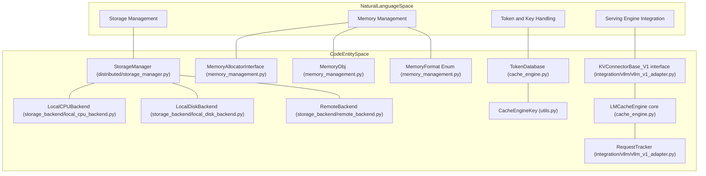
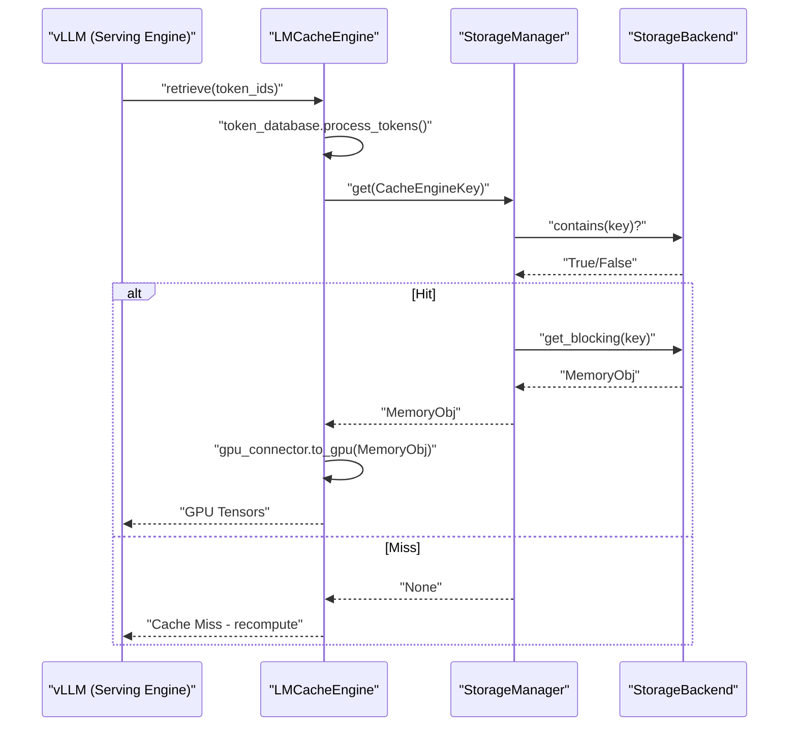

<!-- source: DeepWiki mcp.deepwiki.com · repo LMCache/LMCache · page 15 Glossary · fetched 2026-10-21 -->

# Glossary

<details>
<summary>Relevant source files</summary>

The following files were used as context for generating this wiki page:

- [docs/design/v1/distributed/l1_manager_interface.md](docs/design/v1/distributed/l1_manager_interface.md)
- [docs/design/v1/multiprocess/transport/request_transport.md](docs/design/v1/multiprocess/transport/request_transport.md)
- [docs/source/cli/server.rst](docs/source/cli/server.rst)
- [lmcache/observability.py](lmcache/observability.py)
- [lmcache/v1/distributed/api.py](lmcache/v1/distributed/api.py)
- [lmcache/v1/distributed/internal_api.py](lmcache/v1/distributed/internal_api.py)
- [lmcache/v1/distributed/l1_manager.py](lmcache/v1/distributed/l1_manager.py)
- [lmcache/v1/distributed/l2_adapters/serde_wrapper.py](lmcache/v1/distributed/l2_adapters/serde_wrapper.py)
- [lmcache/v1/distributed/storage_controller.py](lmcache/v1/distributed/storage_controller.py)
- [lmcache/v1/distributed/storage_controllers/adapter_lifecycle.py](lmcache/v1/distributed/storage_controllers/adapter_lifecycle.py)
- [lmcache/v1/distributed/storage_controllers/eviction_controller.py](lmcache/v1/distributed/storage_controllers/eviction_controller.py)
- [lmcache/v1/distributed/storage_controllers/prefetch_controller.py](lmcache/v1/distributed/storage_controllers/prefetch_controller.py)
- [lmcache/v1/distributed/storage_controllers/store_controller.py](lmcache/v1/distributed/storage_controllers/store_controller.py)
- [lmcache/v1/distributed/storage_manager.py](lmcache/v1/distributed/storage_manager.py)
- [lmcache/v1/memory_management.py](lmcache/v1/memory_management.py)
- [lmcache/v1/mp_observability/trace/codecs.py](lmcache/v1/mp_observability/trace/codecs.py)
- [lmcache/v1/multiprocess/config.py](lmcache/v1/multiprocess/config.py)
- [lmcache/v1/multiprocess/custom_types.py](lmcache/v1/multiprocess/custom_types.py)
- [lmcache/v1/multiprocess/engine_context.py](lmcache/v1/multiprocess/engine_context.py)
- [lmcache/v1/multiprocess/http_server.py](lmcache/v1/multiprocess/http_server.py)
- [lmcache/v1/multiprocess/modules/lookup.py](lmcache/v1/multiprocess/modules/lookup.py)
- [lmcache/v1/multiprocess/request_handler.py](lmcache/v1/multiprocess/request_handler.py)
- [lmcache/v1/multiprocess/rpc.py](lmcache/v1/multiprocess/rpc.py)
- [lmcache/v1/multiprocess/server.py](lmcache/v1/multiprocess/server.py)
- [lmcache/v1/multiprocess/session.py](lmcache/v1/multiprocess/session.py)
- [lmcache/v1/multiprocess/transport/grpc_impl/method_registry.py](lmcache/v1/multiprocess/transport/grpc_impl/method_registry.py)
- [lmcache/v1/multiprocess/transport/zmq_impl/mq.py](lmcache/v1/multiprocess/transport/zmq_impl/mq.py)
- [lmcache/v1/storage_backend/__init__.py](lmcache/v1/storage_backend/__init__.py)
- [lmcache/v1/storage_backend/abstract_backend.py](lmcache/v1/storage_backend/abstract_backend.py)
- [lmcache/v1/storage_backend/local_cpu_backend.py](lmcache/v1/storage_backend/local_cpu_backend.py)
- [lmcache/v1/storage_backend/local_disk_backend.py](lmcache/v1/storage_backend/local_disk_backend.py)
- [lmcache/v1/storage_backend/remote_backend.py](lmcache/v1/storage_backend/remote_backend.py)
- [lmcache/v1/storage_backend/storage_manager.py](lmcache/v1/storage_backend/storage_manager.py)
- [tests/test_observability.py](tests/test_observability.py)
- [tests/v1/distributed/l2_adapters/test_p2p_l2_adapter_integration.py](tests/v1/distributed/l2_adapters/test_p2p_l2_adapter_integration.py)
- [tests/v1/distributed/serde/test_serde_e2e.py](tests/v1/distributed/serde/test_serde_e2e.py)
- [tests/v1/distributed/serde/test_serde_fs_e2e.py](tests/v1/distributed/serde/test_serde_fs_e2e.py)
- [tests/v1/distributed/test_dax_l2_adapter.py](tests/v1/distributed/test_dax_l2_adapter.py)
- [tests/v1/distributed/test_distributed_storage_manager.py](tests/v1/distributed/test_distributed_storage_manager.py)
- [tests/v1/distributed/test_l1_interface.py](tests/v1/distributed/test_l1_interface.py)
- [tests/v1/distributed/test_l1_l2_state_metrics.py](tests/v1/distributed/test_l1_l2_state_metrics.py)
- [tests/v1/distributed/test_l1_manager.py](tests/v1/distributed/test_l1_manager.py)
- [tests/v1/distributed/test_object_key_parallel.py](tests/v1/distributed/test_object_key_parallel.py)
- [tests/v1/distributed/test_prefetch_controller.py](tests/v1/distributed/test_prefetch_controller.py)
- [tests/v1/distributed/test_runtime_adapters.py](tests/v1/distributed/test_runtime_adapters.py)
- [tests/v1/distributed/test_storage_manager_l2_keys.py](tests/v1/distributed/test_storage_manager_l2_keys.py)
- [tests/v1/mp_observability/trace/test_codecs.py](tests/v1/mp_observability/trace/test_codecs.py)
- [tests/v1/multiprocess/test_cache_server.py](tests/v1/multiprocess/test_cache_server.py)
- [tests/v1/multiprocess/test_config.py](tests/v1/multiprocess/test_config.py)
- [tests/v1/multiprocess/test_custom_types.py](tests/v1/multiprocess/test_custom_types.py)
- [tests/v1/multiprocess/test_ext_server_module.py](tests/v1/multiprocess/test_ext_server_module.py)
- [tests/v1/multiprocess/test_free_locks.py](tests/v1/multiprocess/test_free_locks.py)
- [tests/v1/multiprocess/test_lookup_wait_prefetch.py](tests/v1/multiprocess/test_lookup_wait_prefetch.py)
- [tests/v1/multiprocess/test_mq.py](tests/v1/multiprocess/test_mq.py)
- [tests/v1/multiprocess/test_mq_handler_helpers.py](tests/v1/multiprocess/test_mq_handler_helpers.py)
- [tests/v1/multiprocess/test_query_lookup_hits.py](tests/v1/multiprocess/test_query_lookup_hits.py)
- [tests/v1/multiprocess/test_session.py](tests/v1/multiprocess/test_session.py)
- [tests/v1/multiprocess/test_unified_touch.py](tests/v1/multiprocess/test_unified_touch.py)
- [tests/v1/storage_backend/test_local_cpu_backend.py](tests/v1/storage_backend/test_local_cpu_backend.py)
- [tests/v1/storage_backend/test_local_disk_backend.py](tests/v1/storage_backend/test_local_disk_backend.py)
- [tests/v1/storage_backend/test_storage_manager.py](tests/v1/storage_backend/test_storage_manager.py)
- [tests/v1/test_address_manager.py](tests/v1/test_address_manager.py)
- [tests/v1/test_memory_management.py](tests/v1/test_memory_management.py)

</details>


This page provides definitions for codebase-specific terminology, domain concepts, and technical jargon used within the LMCache project. It serves as a reference for onboarding engineers to understand the mapping between high-level concepts and their implementation in the codebase.

---

## Core Concepts

### KV Cache
The Key-Value (KV) cache stores the intermediate states of an LLM's attention mechanism, enabling reuse of previously computed key and value tensors during autoregressive decoding to reduce latency. LMCache extends this caching with multi-tier storage and network distribution capabilities, supporting multiple backends and integration with serving engines like vLLM.

- **Implementation**: Central logic in `LMCacheEngine` and related classes handle store/retrieve operations [lmcache/v1/cache_engine.py:83-98]().

### Chunking
Chunks are fixed-size slices of token sequences or KV cache tensors, typically with size 256 tokens as default. Chunking enables fine-grained caching of partial contexts and memory-efficient management.

- **Token Databases**: Interfaces that implement chunking by splitting input tokens or computing hash values per chunk.
  - `ChunkedTokenDatabase`: Operates on fixed-sized chunks [lmcache/v1/cache_engine.py:64-68]().

### Cache Blending
Cache Blending allows composing multiple cached KV contexts from different input prefixes or documents to serve requests that do not exactly match stored prefixes. This supports non-prefix sub-sequence reuse in attention.

- **Key Classes**: `LMCBlenderBuilder` builds blended cache structures.
- **Configuration**: `enable_blending` flag activates this feature.
- **Multiprocess Modules**: `LMCacheDrivenTransferModule`, `EngineDrivenTransferModule` implement blend logic in the server [lmcache/v1/multiprocess/server.py:176-182]().

### Disaggregated Prefill (PD)
A deployment pattern where the "prefill" phase of a multi-round query (compute KV cache for the prompt) is handled on different GPU nodes separately from the "decode" phase (generating new tokens). PD reduces resource pressure and latency.

- **Configuration**: `pd_role` / `nixl_role` flags enable and control PD behavior [lmcache/v1/config.py:66-66]().

---

## Code Entity Mapping Diagrams

### Natural Language to Code Entity Mapping

This diagram links high-level LMCache system concepts to the code entities (classes, files) implementing those concepts.



Sources: [lmcache/v1/storage_backend/storage_manager.py:23-46](), [lmcache/v1/storage_backend/local_cpu_backend.py:42-99](), [lmcache/v1/storage_backend/local_disk_backend.py:119-197](), [lmcache/v1/storage_backend/remote_backend.py:27-177](), [lmcache/v1/memory_management.py:25-75,77-112](), [lmcache/v1/cache_engine.py:60-100](), [lmcache/utils.py:30-31](), [lmcache/integration/vllm/vllm_v1_adapter.py:14-18,65-80,103-139]()

---

### LMCacheEngine Request Data Flow

This diagram relates the request lifecycle and data flow from a serving engine (vLLM) through LMCache components and down to storage backends.

```mermaid
graph TD
    subgraph "Serving Layer (vLLM Integration)"
        VLLM_REQ["Incoming vLLM Request (token IDs)"]
        VLLM_SCHED["vLLM SchedulerOutput"]
        KV_CONN["KVConnectorBase_V1 Interface"]
        CONN_IMPL["LMCacheConnectorV1Impl"]
    end

    subgraph "Core LMCache Engine"
        LMC_ENGINE["LMCacheEngine (cache_engine.py)"]
        LMC_METADATA["LMCacheMetadata"]
        TOKEN_DB["TokenDatabase"]
        GPU_CONN["GPUConnectorBase (multiprocess/gpu_connectors)"]
        REQ_TRACKER["RequestTracker (vllm_v1_adapter.py)"]
        LOAD_SPEC["LoadSpec Dataclass"]
        SAVE_SPEC["SaveSpec Dataclass"]
    end

    subgraph "Storage Backends & Manager"
        STORAGE_MGR["StorageManager (storage_backend/storage_manager.py)"]
        LOCAL_CPU["LocalCPUBackend (local_cpu_backend.py)"]
        LOCAL_DISK["LocalDiskBackend (local_disk_backend.py)"]
        REMOTE["RemoteBackend (remote_backend.py)"]
        MEM_OBJ["MemoryObj instance (memory_management.py)"]
        CACHE_KEY["CacheEngineKey (utils.py)"]
    end

    VLLM_REQ --> VLLM_SCHED
    VLLM_SCHED --> CONN_IMPL["new_request()"]
    CONN_IMPL --> REQ_TRACKER["create RequestTracker"]
    CONN_IMPL --> LOAD_SPEC["calculate LoadSpec"]
    CONN_IMPL --> SAVE_SPEC["calculate SaveSpec"]

    CONN_IMPL -->|retrieve()| LMC_ENGINE
    LMC_ENGINE --> TOKEN_DB["process tokens"]
    LMC_ENGINE --> STORAGE_MGR["get(CacheEngineKey)"]
    
    STORAGE_MGR --> LOCAL_CPU
    STORAGE_MGR --> LOCAL_DISK
    STORAGE_MGR --> REMOTE
    
    LOCAL_CPU -- "MemoryObj" --> STORAGE_MGR
    LOCAL_DISK -- "MemoryObj" --> STORAGE_MGR
    REMOTE -- "MemoryObj" --> STORAGE_MGR
    
    STORAGE_MGR -- "MemoryObj" --> LMC_ENGINE
    LMC_ENGINE --> GPU_CONN["to_gpu(MemoryObj)"]
    GPU_CONN --> KV_CONN["GPU Tensors"]
    KV_CONN --> VLLM_REQ

    CONN_IMPL -->|store()| LMC_ENGINE
    LMC_ENGINE --> GPU_CONN["from_gpu(GPU Tensors)"]
    GPU_CONN -- "MemoryObj" --> LMC_ENGINE
    LMC_ENGINE --> STORAGE_MGR["put(CacheEngineKey, MemoryObj)"]

    LMC_METADATA --> LMC_ENGINE
```

Sources: [lmcache/integration/vllm/vllm_v1_adapter.py:100-197](), [lmcache/v1/cache_engine.py:80-115](), [lmcache/v1/storage_backend/storage_manager.py:23-121](), [lmcache/v1/storage_backend/local_cpu_backend.py:127-136](), [lmcache/v1/storage_backend/local_disk_backend.py:119-132](), [lmcache/v1/storage_backend/remote_backend.py:27-64](), [lmcache/v1/memory_management.py:55-80](), [lmcache/utils.py:30-31]()

---

## Technical Terms & Abbreviations

| Term                  | Definition                                                                                              | Code Pointer                                                                  |
|:----------------------|:-----------------------------------------------------------------------------------------------------|:------------------------------------------------------------------------------|
| **MLA**               | Multi-Head Latent Attention, a specialized memory format supporting multi-head KV cache keys.         | `MemoryFormat.KV_MLA_FMT` [lmcache/v1/memory_management.py:97-99]()          |
| **TTFT**              | Time To First Token - the primary latency metric LMCache reduces by caching KV states effectively.    | Usage in metrics/logging [docs/source/index.rst:36-36]()                      |
| **Hot Cache**         | The in-memory CPU cache storage layer for immediate KV cache entries, a first level cache.            | `LocalCPUBackend.hot_cache` [lmcache/v1/storage_backend/local_cpu_backend.py:63-63]() |
| **MemoryObj**         | Abstraction representing a memory buffer holding KV cache data with metadata and lifecycle controls.  | `MemoryObj` class [lmcache/v1/memory_management.py:25-75]()                   |
| **Slot Mapping**      | Mapping between logical token slots and physical memory layout, enabling aligned and compressed storage. | `compress_slot_mapping()` [lmcache/utils.py:127-142]()                       |
| **NIXL**              | High-performance networking-based remote storage backend used for P2P and disaggregated prefill.      | Configuration: `pd_peer_host` [lmcache/v1/config.py:60-64]()                  |
| **GDS**               | GPU Direct Storage - a backend enabling direct transfers from storage to GPU memory.                   | `CuFileMemoryAllocator` [lmcache/v1/cache_engine.py:47-47]()                  |
| **EC**                | Encoder Cache for multimodal models, caching of encoder outputs for images/audio/video tokens.        | `MemoryFormat.EC_TD` [lmcache/v1/memory_management.py:101-104]()             |
| **HS**                | Hidden-State store, a cache for intermediate hidden state tensors distinguishable from encoder cache. | `MemoryFormat.HS_TD` [lmcache/v1/memory_management.py:106-112]()             |
| **IPC**               | Inter-Process Communication, enabling zero-copy tensor sharing in multiprocess server mode.           | `set_isolated_ipc()` [lmcache/v1/multiprocess/server.py:75-75]()             |
| **LoadSpec**          | Dataclass used to specify token ranges that can be loaded from LMCache for a request.                 | `LoadSpec` [lmcache/integration/vllm/vllm_v1_adapter.py:65-73]()              |
| **SaveSpec**          | Dataclass used to specify token ranges allowed to be saved into LMCache from a request.               | `SaveSpec` [lmcache/integration/vllm/vllm_v1_adapter.py:76-80]()              |
| **RequestTracker**    | Tracks the state of a vLLM request including tokens retrieved, blocks allocated, and request metadata. | `RequestTracker` [lmcache/integration/vllm/vllm_v1_adapter.py:103-139]()     |
| **WeightedSemaphore** | An async semaphore managing chunk budget concurrency to prevent memory exhaustion and deadlocks.      | `WeightedSemaphore` [lmcache/v1/storage_backend/storage_manager.py:123-131]()|
| **AsyncMultiSerializer** | Serializes allocation and prefetch requests using a `WeightedSemaphore` to avoid race conditions.   | `AsyncMultiSerializer` [lmcache/v1/storage_backend/storage_manager.py:168-184]()|
| **O_DIRECT**          | File system flag enabling direct disk I/O, bypassing cache for predictable I/O latency.               | `LocalDiskBackend.use_odirect` [lmcache/v1/storage_backend/local_disk_backend.py:169-172]() |

Sources:  
[lmcache/v1/memory_management.py:25-112](), [lmcache/v1/storage_backend/local_cpu_backend.py:42-135](), [lmcache/utils.py:127-142](), [lmcache/v1/config.py:60-64](), [lmcache/v1/cache_engine.py:40-50](), [lmcache/integration/vllm/vllm_v1_adapter.py:65-139](), [lmcache/v1/storage_backend/storage_manager.py:123-184](), [lmcache/v1/storage_backend/local_disk_backend.py:169-172](), [lmcache/v1/multiprocess/server.py:75-75]()

---

## Data Flow & Architecture Overview

The `LMCacheEngine` is the core coordinator managing request processing, token splitting, and KV cache fetching/storing operations. It interfaces upwards to the serving engines (e.g., vLLM) and manages a distributed multi-tier storage system below.

### KV Cache Retrieval Flow



### Notes on Components

- StorageManager orchestrates multiple backends: `LocalCPUBackend`, `LocalDiskBackend`, `RemoteBackend`.
- MemoryObj encapsulates data with metadata such as format and pinning.
- GPUConnectorBase adapts memory formats to and from device memory compatible with serving engines.
- RequestTracker holds per-request metadata for tracking KV lifecycle in vLLM integration.

Sources: [lmcache/v1/cache_engine.py:83-98](), [lmcache/v1/storage_backend/storage_manager.py:23-46](), [lmcache/v1/storage_backend/local_cpu_backend.py:127-136]()

---

## Glossary Details

### Memory Formats

LMCache supports multiple tensor layout formats optimizing for different attention backends and hardware characteristics.

| Format       | Logical Shape and Description                                                        | Code Definition Location                     |
|--------------|-------------------------------------------------------------------------------------|----------------------------------------------|
| `KV_2LTD`    | `[num_tokens, 2, hidden_dim]` standard key-value layout for prefix caching          | `MemoryFormat.KV_2LTD` [lmcache/v1/memory_management.py:82-85]() |
| `KV_T2D`     | `[2, num_tokens, hidden_dim]` alternate layout variant                             | `MemoryFormat.KV_T2D` [lmcache/v1/memory_management.py:86-89]() |
| `KV_MLA_FMT` | `[1, num_layers, num_tokens, aligned_head_size]` Memory layout for MLA (Multi-Head Latent Attention) | `MemoryFormat.KV_MLA_FMT` [lmcache/v1/memory_management.py:97-99]() |
| `EC_TD`      | `[num_tokens, hidden_dim]` Encoder Cache layout used for multimodal models          | `MemoryFormat.EC_TD` [lmcache/v1/memory_management.py:101-104]() |
| `HS_TD`      | Same shape as EC but for hidden-state storage, logically distinct                   | `MemoryFormat.HS_TD` [lmcache/v1/memory_management.py:106-112]() |

Sources: [lmcache/v1/memory_management.py:77-112]()

---

### Configuration System

LMCache configuration, represented by `LMCacheEngineConfig`, supports modular setup via YAML files, environment variables, and CLI flags. Configuration aliases transition old flags to new ones for backward compatibility.

- Alias example: `enable_xpyd` is aliased to `enable_pd` (disaggregated prefill) [lmcache/v1/config.py:57-71]().

Sources: [lmcache/v1/config.py:1-71]()

---

### Request Tracking in vLLM V1 Integration

Request state and lifecycle management is handled by `RequestTracker` which maintains:

- Prompt length, token IDs for blocks.
- Mapping of request to allocated device memory blocks.
- Supports load and save specifications via `LoadSpec` and `SaveSpec` dataclasses to describe allowed tokens to load or save.

Sources: [lmcache/integration/vllm/vllm_v1_adapter.py:65-139]()

---

### Storage Synchronization Primitives

- `WeightedSemaphore`: Async concurrency control that limits number of KV cache chunks read or written concurrently to avoid memory overcommit and deadlocks.
- `AsyncMultiSerializer`: Uses `WeightedSemaphore` to serialize batched request allocations, preventing race conditions during asynchronous storage operations.

Sources: [lmcache/v1/storage_backend/storage_manager.py:123-184]()

---

### Multiprocess Server Components

LMCache supports a multiprocess service mode managing KV cache as an independent service:

- `MPCacheServer`: Compositor managing pluggable `EngineModule`s forming the cache server functionality.
- `EngineModule`: Base class for modular engine components.
- Modules support distributed transport services (gRPC, ZMQ), cache events, blending, transfer policies, and P2P sharing.

Sources: [lmcache/v1/multiprocess/server.py:99-118]()

---

### Observability and Monitoring

- `LMCStatsMonitor`: Singleton collector gathering statistics on retrieval/store requests, hit rates, latencies, and memory usage.
- `PrometheusLogger`: Exposes key internal metrics for external Prometheus scraping.
- Various profiling context managers are used in metrics collection to time token processing and transfers.

Sources: [lmcache/observability.py:37-38](), [lmcache/v1/storage_backend/local_cpu_backend.py:113-122]()

---

### Build and Deployment Utilities

- `cdiv`: Utility function for ceiling division commonly used for chunk calculations.
- NVTX annotations: Used for profiling integration with NVIDIA tools, applied in critical performance paths.

Sources: [lmcache/utils.py:19-31](), [lmcache/utils.py:98-100]()

---

This glossary should serve as a practical reference to understand key terms and code mappings in LMCache when onboarding new developers or engineers. For detailed function and class usage, please refer to corresponding files and inline code comments.