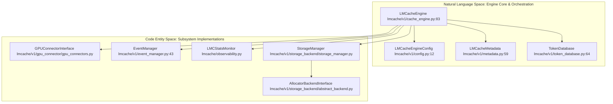
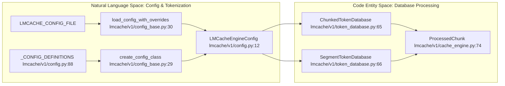

<!-- source: DeepWiki mcp.deepwiki.com · repo LMCache/LMCache · page 2 Core Engine Architecture · fetched 2026-10-21 -->

# Core Engine Architecture

Relevant source files

The following files were used as context for generating this wiki page:

- [lmcache/integration/vllm/utils.py](lmcache/integration/vllm/utils.py)
- [lmcache/integration/vllm/vllm_v1_adapter.py](lmcache/integration/vllm/vllm_v1_adapter.py)
- [lmcache/utils.py](lmcache/utils.py)
- [lmcache/v1/cache_engine.py](lmcache/v1/cache_engine.py)
- [lmcache/v1/config.py](lmcache/v1/config.py)
- [lmcache/v1/lookup_client/abstract_client.py](lmcache/v1/lookup_client/abstract_client.py)
- [lmcache/v1/lookup_client/chunk_statistics_lookup_client.py](lmcache/v1/lookup_client/chunk_statistics_lookup_client.py)
- [lmcache/v1/lookup_client/factory.py](lmcache/v1/lookup_client/factory.py)
- [lmcache/v1/lookup_client/hit_limit_lookup_client.py](lmcache/v1/lookup_client/hit_limit_lookup_client.py)
- [lmcache/v1/lookup_client/lmcache_async_lookup_client.py](lmcache/v1/lookup_client/lmcache_async_lookup_client.py)
- [lmcache/v1/lookup_client/lmcache_lookup_client.py](lmcache/v1/lookup_client/lmcache_lookup_client.py)
- [lmcache/v1/lookup_client/lmcache_lookup_client_bypass.py](lmcache/v1/lookup_client/lmcache_lookup_client_bypass.py)
- [lmcache/v1/lookup_client/mooncake_lookup_client.py](lmcache/v1/lookup_client/mooncake_lookup_client.py)
- [lmcache/v1/offload_server/zmq_server.py](lmcache/v1/offload_server/zmq_server.py)
- [lmcache/v1/rpc_utils.py](lmcache/v1/rpc_utils.py)
- [lmcache/v1/token_database.py](lmcache/v1/token_database.py)
- [tests/v1/lookup_client/test_chunk_statistics_lookup_client.py](tests/v1/lookup_client/test_chunk_statistics_lookup_client.py)
- [tests/v1/test_token_database.py](tests/v1/test_token_database.py)

## Purpose and Scope

This page provides a high-level overview of the central LMCache V1 engine architecture, which orchestrates the interaction between LLM serving frameworks and the multi-tier cache storage system. It introduces the core `LMCacheEngine` class [lmcache/v1/cache_engine.py:83](), the configuration subsystem [lmcache/v1/config.py:3](), token processing databases [lmcache/v1/token_database.py:64](), and metadata structures crucial to cache key generation and management [lmcache/v1/metadata.py:59]().

Each subsection here summarizes key components and conceptual flows, linking to more detailed child pages covering deeper technical insights:

- [LMCache Engine V1](#2.1) — Delve into `LMCacheEngine`, its store/retrieve operations, and layerwise variants.
- [Configuration System](#2.2) — Detailed explanation of `LMCacheEngineConfig` class, configuration sources hierarchy, options, and validation.
- [Token Database and Chunking](#2.3) — Explore token chunking implementations, chunk-based hashing, and separator-based splitting.
- [Cache Keys and Metadata](#2.4) — Define `CacheEngineKey` structure, hash usage, and metadata fields like model name and worker ID.

Sources: [lmcache/v1/cache_engine.py:83-98](), [lmcache/v1/config.py:1-9](), [lmcache/v1/token_database.py:64-68]()

---

## LMCacheEngine Overview

The heart of LMCache is the `LMCacheEngine` class [lmcache/v1/cache_engine.py:83](). This engine acts as the main orchestrator that transforms GPU KV caches from serving engines into CPU-resident `MemoryObj`s [lmcache/v1/cache_engine.py:86](), which it then asynchronously stores in multi-tier backends. Conversely, it retrieves memory objects from storage, transfers them back to GPU formats via specialized GPU connectors [lmcache/v1/cache_engine.py:90](), and supports intelligent KV prefetching to optimize latency.

The `LMCacheEngine` integrates multiple subsystems:

- **Configuration** via an `LMCacheEngineConfig` instance [lmcache/v1/cache_engine.py:110]().
- **Metadata management** (`LMCacheMetadata`) to capture runtime and model characteristics [lmcache/v1/cache_engine.py:111]().
- **Token databases** (`TokenDatabase`) to handle chunking and hashing of token streams [lmcache/v1/cache_engine.py:112]().
- **GPU Connectors** (`GPUConnectorInterface`) for format-specific conversions [lmcache/v1/cache_engine.py:113]().
- **Event management** (`EventManager`) and metrics for observability [lmcache/v1/cache_engine.py:169]().
- **Storage management orchestration** (`StorageManager`) working with various backends [lmcache/v1/cache_engine.py:179]().

### LMCache Engine Core Architecture (`LMCacheEngine`)

Sources: [lmcache/v1/cache_engine.py:83-180](), [lmcache/utils.py:35-42](), [lmcache/observability.py:20-120]()

This engine design abstracts cache management details from underlying serving engines and storage layers, enabling flexible integration and support for advanced usage scenarios, including layerwise KV transfer and multi-GPU coordination.

For detailed implementation of the engine methods and orchestration logic, see [LMCache Engine V1](#2.1).

Sources: [lmcache/v1/cache_engine.py:83-180](), [lmcache/utils.py:35-42](), [lmcache/observability.py:20-120]()

---

## Configuration System

LMCache’s configuration is built upon a dynamic, extensible system centered around the `LMCacheEngineConfig` class [lmcache/v1/config.py:3](). Configuration values are loaded and merged from multiple hierarchical sources:

- YAML config files, typically specified via `LMCACHE_CONFIG_FILE` environment variable [lmcache/v1/utils.py:182]().
- Environment variables.
- Command-line parameters and runtime overrides.
- Remote configuration services (optional) [lmcache/v1/utils.py:171]().

The configuration class is generated dynamically using `create_config_class()` [lmcache/v1/config_base.py:29](), based on a centralized dictionary of configuration schema and default values (`_CONFIG_DEFINITIONS`) [lmcache/v1/config.py:88]().

### Configuration Loading and Token Database Flow

Sources: [lmcache/v1/config.py:88-245](), [lmcache/v1/config_base.py:29-32](), [lmcache/v1/token_database.py:64-68]()

This layered design provides flexible runtime adaptability and supports feature flags such as layerwise KV transfer, blending (multi-subsequence matching), P2P sharing, and controller integration.

For complete details on configuration loading priorities, options, validation, and runtime overrides, see [Configuration System](#2.2).

Sources: [lmcache/v1/config.py:88-245](), [lmcache/v1/config_base.py:29-32](), [lmcache/v1/token_database.py:64-68]()

---

## Token Database and Chunking

Token processing in LMCache is managed by the `TokenDatabase` abstraction [lmcache/v1/token_database.py:67](), responsible for splitting prompt tokens into manageable segments or chunks for hashing and caching.

Two main implementations support different cache strategies:

- **ChunkedTokenDatabase** [lmcache/v1/token_database.py:65](): Divides token streams into fixed-size blocks based on the `chunk_size` configuration [lmcache/v1/config.py:90](), facilitating uniform block hashing and bulk transfer.

- **SegmentTokenDatabase** [lmcache/v1/token_database.py:66](): Splits token sequences using configurable separator tokens (e.g., the blending special string `blend_special_str` [lmcache/v1/config.py:158]()) to enable cache blending features that handle subsequence reuse beyond prefixes.

These token databases emit chunks that are converted into cache keys and memory objects for storage, enabling fine-grained cache retrieval and partial reuse.

For further details on chunk-based hashing algorithms, data structures, and token database interfaces, see [Token Database and Chunking](#2.3).

Sources: [lmcache/v1/token_database.py:64-68](), [lmcache/v1/config.py:90](), [lmcache/v1/config.py:158]()

---

## Cache Keys and Metadata

LMCache utilizes `CacheEngineKey` objects [lmcache/utils.py:36]() as unique identifiers for cached KV entries. These keys encapsulate:

- Chunk hashes derived from token spans.
- Model names and runtime parameters.
- Distributed system attributes such as world size and worker ID.
- Data types and optional custom tags for fine-tuned cache differentiation.

Runtime and model metadata is stored in `LMCacheMetadata` [lmcache/v1/metadata.py:59](), which tracks system-wide constants including:

- Use of multi-level attention (MLA).
- Role (worker or scheduler).
- Device and accelerator details.

This metadata influences cache key generation, cache routing, and backend selection rules.

Together, keys and metadata enable consistent, collision-resistant cache lookups across workers and storage tiers.

For comprehensive information on hash generation, cache key construction, and metadata fields, see [Cache Keys and Metadata](#2.4).

Sources: [lmcache/utils.py:36](), [lmcache/v1/metadata.py:59](), [lmcache/v1/memory_management.py:52-57]()

---

# Summary

This page outlined the core LMCache engine architecture focusing on the main orchestrator class, configuration system, token processing strategies, and cache key/metadata management. These subsystems collectively enable scalable, efficient KV cache operations atop flexible storage backends, supporting advanced features like layerwise transfer, blending, and distributed coordination.

For detailed technical depth, please explore the dedicated child pages referenced throughout this overview.

Sources:  
[lmcache/v1/cache_engine.py:83-180](),  
[lmcache/v1/config.py:1-245](),  
[lmcache/v1/token_database.py:64-68](),  
[lmcache/utils.py:36-40](),  
[lmcache/v1/metadata.py:59-90](),  
[lmcache/v1/config_base.py:29-32]()

---

