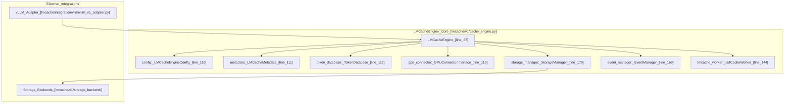
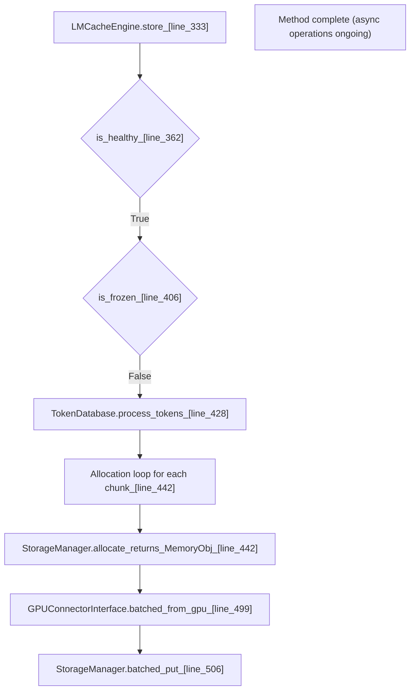
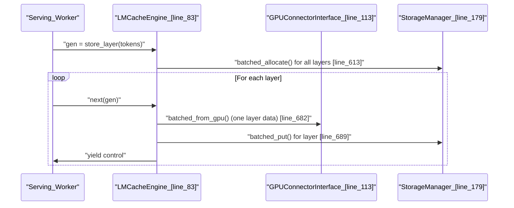
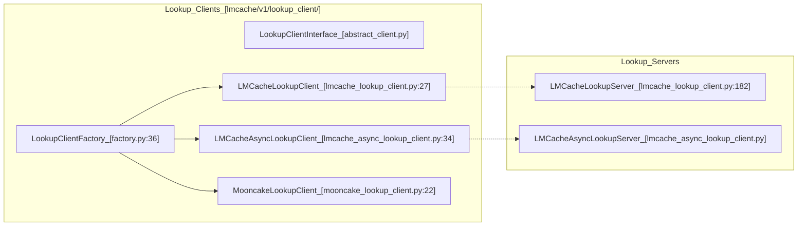

<!-- source: DeepWiki mcp.deepwiki.com · repo LMCache/LMCache · page 2.1 LMCache Engine V1 · fetched 2026-10-21 -->

# LMCache Engine V1

Relevant source files

The following files were used as context for generating this wiki page:

- [lmcache/integration/vllm/utils.py](lmcache/integration/vllm/utils.py)
- [lmcache/integration/vllm/vllm_v1_adapter.py](lmcache/integration/vllm/vllm_v1_adapter.py)
- [lmcache/utils.py](lmcache/utils.py)
- [lmcache/v1/cache_engine.py](lmcache/v1/cache_engine.py)
- [lmcache/v1/config.py](lmcache/v1/config.py)
- [lmcache/v1/lookup_client/abstract_client.py](lmcache/v1/lookup_client/abstract_client.py)
- [lmcache/v1/lookup_client/chunk_statistics_lookup_client.py](lmcache/v1/lookup_client/chunk_statistics_lookup_client.py)
- [lmcache/v1/lookup_client/factory.py](lmcache/v1/lookup_client/factory.py)
- [lmcache/v1/lookup_client/hit_limit_lookup_client.py](lmcache/v1/lookup_client/hit_limit_lookup_client.py)
- [lmcache/v1/lookup_client/lmcache_async_lookup_client.py](lmcache/v1/lookup_client/lmcache_async_lookup_client.py)
- [lmcache/v1/lookup_client/lmcache_lookup_client.py](lmcache/v1/lookup_client/lmcache_lookup_client.py)
- [lmcache/v1/lookup_client/lmcache_lookup_client_bypass.py](lmcache/v1/lookup_client/lmcache_lookup_client_bypass.py)
- [lmcache/v1/lookup_client/mooncake_lookup_client.py](lmcache/v1/lookup_client/mooncake_lookup_client.py)
- [lmcache/v1/offload_server/zmq_server.py](lmcache/v1/offload_server/zmq_server.py)
- [lmcache/v1/rpc_utils.py](lmcache/v1/rpc_utils.py)
- [lmcache/v1/token_database.py](lmcache/v1/token_database.py)
- [tests/v1/lookup_client/test_chunk_statistics_lookup_client.py](tests/v1/lookup_client/test_chunk_statistics_lookup_client.py)
- [tests/v1/test_token_database.py](tests/v1/test_token_database.py)

## Purpose and Scope

This document details the `LMCacheEngine` class [lmcache/v1/cache_engine.py:83-98](), which serves as the core orchestration unit for LMCache V1, an LLM-serving KV cache management engine. The engine manages the full lifecycle of KV caches, including converting and storing GPU-side KV caches into CPU-side memory objects and persistent backends, retrieving cached data back to the GPU for reuse, and prefetching tokens to optimize latency performance.

The scope covers initialization of core components, primary store and retrieve operations, layerwise variants supporting pipelined GPU caching, health monitoring, freeze modes for cache safety, and integration with the lookup client system.

Sources: [lmcache/v1/cache_engine.py:83-98]()

---

## LMCacheEngine Class Overview

The `LMCacheEngine` class is the central orchestrator of LMCache's KV caching system [lmcache/v1/cache_engine.py:83-98](). It coordinates operations across memory allocators, GPU connectors, storage managers, and token databases:

- **Store path**: Takes GPU KV caches from the serving engine, converts them into CPU-resident `MemoryObj` instances, and writes them asynchronously to `StorageBackendInterface` implementations [lmcache/v1/cache_engine.py:86-89]().
- **Retrieve path**: Fetches `MemoryObj` instances from storage backends, handles broadcasting across ranks when using Multi-Level Attention (MLA), and transfers data back to GPU KV caches via `GPUConnectorInterface` [lmcache/v1/cache_engine.py:91-93]().
- **Prefetching**: Supports asynchronous prefetch managed through backend coordination to prevent conflicts with active retrieval requests [lmcache/v1/cache_engine.py:95-97]().

### System Components and Code Entities

Title: LMCacheEngine Architecture and Code Mappings

Sources: [lmcache/v1/cache_engine.py:83-227](), [lmcache/integration/vllm/vllm_v1_adapter.py:43-47]()

| Responsibility       | Implementation Location                                                        |
|----------------------|--------------------------------------------------------------------------------|
| KV cache lifecycle   | `store()`, `retrieve()`, `store_layer()`, `retrieve_layer()` methods [lmcache/v1/cache_engine.py:330-1080]() |
| Memory management    | Delegated to `StorageManager` for backend coordination [lmcache/v1/cache_engine.py:179]() |
| GPU/CPU data transfer| Via `GPUConnectorInterface`; optimized for KV layout and platform [lmcache/v1/cache_engine.py:113]() |
| Token chunking       | Through `TokenDatabase` interface for chunked key generation [lmcache/v1/cache_engine.py:112]() |
| Async orchestration  | `EventManager` handles async events and waits [lmcache/v1/cache_engine.py:169]() |
| Health status & freeze| Managed internally for cache readiness and frozen state [lmcache/v1/cache_engine.py:230-330]() |

Sources: [lmcache/v1/cache_engine.py:83-227](), [lmcache/integration/vllm/vllm_v1_adapter.py:43-47]()

---

## Initialization

### Parameters of `LMCacheEngine.__init__()` [lmcache/v1/cache_engine.py:100-108]()

| Parameter         | Type                          | Role/Description                                                  |
|-------------------|-------------------------------|------------------------------------------------------------------|
| `config`          | `LMCacheEngineConfig`           | Configuration parameters loaded from YAML/env [lmcache/v1/config.py:88-217]() |
| `metadata`        | `LMCacheMetadata`               | Model & deployment metadata (`worker_id`, `world_size`, etc.) [lmcache/v1/metadata.py:11-78]() |
| `token_database`  | `TokenDatabase`                 | Converts token sequences into cache keys/chunks [lmcache/v1/token_database.py:64-90]() |
| `gpu_connector`   | `GPUConnectorInterface`         | Interface for GPU-side transfer with layout awareness [lmcache/v1/cache_engine.py:113]() |
| `broadcast_fn`    | `Callable[[torch.Tensor, int], None]` | Broadcast tensors across ranks (MLA) [lmcache/v1/cache_engine.py:114]() |
| `broadcast_object_fn` | `Callable[[Any, int], Any]`  | Broadcast generic Python objects [lmcache/v1/cache_engine.py:115]() |

### Key Initialization Details

- **`save_only_first_rank`**: Config flag for MLA to reduce redundant saves on non-leader ranks [lmcache/v1/cache_engine.py:117-120]().
- **`LMCacheWorker` (`lmcache_worker`)**: Optional background worker for coordinating distributed cache control, P2P communication, and eviction management [lmcache/v1/cache_engine.py:144-161]().
- **Event Manager**: Initializes `EventManager` to track asynchronous store/retrieve progress [lmcache/v1/cache_engine.py:169]().
- **Storage Manager**: Instantiates `StorageManager` to coordinate underlying storage tiers ([lmcache/v1/cache_engine.py:179](), [lmcache/v1/storage_backend/storage_manager.py]()).

Sources: [lmcache/v1/cache_engine.py:100-227](), [lmcache/v1/config.py:88-217]()

---

## Store Operation

The `store()` method saves KV caches from GPU memory into LMCache-managed storage backends asynchronously.

### Store Operation Data Flow

Title: Store Operation Execution Flow

- **Health and Freeze Checks**: Verifies engine health via `is_healthy()` and ensures the cache is not frozen via `is_frozen()` ([lmcache/v1/cache_engine.py:362-406]()).
- **Token Processing**: Calls `token_database.process_tokens()` to generate chunk metadata and `CacheEngineKey` instances from input tokens ([lmcache/v1/cache_engine.py:428]()).
- **Allocation and Transfer**: Allocates CPU buffers via `storage_manager.allocate()` and invokes `gpu_connector.batched_from_gpu()` to copy data from GPU memory ([lmcache/v1/cache_engine.py:442-499]()).
- **Asynchronous Persistence**: Submits memory objects for storage via `storage_manager.batched_put()` ([lmcache/v1/cache_engine.py:506]()).

Sources: [lmcache/v1/cache_engine.py:333-527](), [lmcache/v1/token_database.py:64-90]()

---

## Retrieve Operation

The `retrieve()` method fetches cached KV data from storage backends and restores it on the GPU for reuse.

### Retrieve Operation Highlights

- **Prefix-Aligned Lookup**: Retrieves chunks up to the requested prefix length, stopping at the first missing chunk to maintain semantic correctness of prefix caching ([lmcache/v1/cache_engine.py:885-890]()).
- **Storage Tier Priority**: Queries storage backends in order of latency (local CPU hot cache, local disk, remote storage) ([lmcache/v1/cache_engine.py:896-906]()).
- **MLA Broadcast**: In Multi-Level Attention mode, rank 0 performs the retrieval and broadcasts the retrieved data to other ranks ([lmcache/v1/cache_engine.py:781-796]()).
- **GPU Restoration**: Uses `gpu_connector.batched_to_gpu()` to transfer CPU memory objects back into GPU KV cache slots.

Sources: [lmcache/v1/cache_engine.py:706-870]()

---

## Layerwise Store and Retrieve Operations

Layerwise variants (`store_layer()` and `retrieve_layer()`) implement generator-based pipelines that overlap GPU compute with cache I/O layer-by-layer, improving throughput for deep models.

### Layerwise Generation Pattern

Title: Layerwise Pipeline Sequence

- `store_layer()` pre-allocates memory for all layers and yields control after processing each layer ([lmcache/v1/cache_engine.py:528-704]()).
- `retrieve_layer()` fetches and restores KV cache layer-by-layer using generators ([lmcache/v1/cache_engine.py:1006-1139]()).
- This pipeline design minimizes memory footprint peaks and enables execution overlap.

Sources: [lmcache/v1/cache_engine.py:528-704](), [lmcache/v1/cache_engine.py:1006-1139]()

---

## Health Monitoring and Freeze Mode

### Health Monitoring

- The engine uses `is_healthy()` to determine whether it is safe to execute cache operations ([lmcache/v1/cache_engine.py:252-268]()).
- Integrates with `HealthMonitor` to track backend liveness and handle failures gracefully.

### Freeze Mode

- Freeze mode switches the engine to read-only access, suppressing cache updates, evictions, and controller messages ([lmcache/v1/cache_engine.py:306-331]()).
- Useful for maintenance operations and preventing cache corruption during faults.

Sources: [lmcache/v1/cache_engine.py:230-331]()

---

## Lookup Client Integration

`LMCacheEngine` coordinates with lookup clients to check token availability and cache hits.

### Lookup Client System Mapping

Title: Lookup Client Code Entity Interaction

- Synchronous clients (`LMCacheLookupClient`) use ZMQ request-reply patterns for blocking hit queries ([lmcache/v1/lookup_client/lmcache_lookup_client.py:27-200]()).
- Asynchronous clients (`LMCacheAsyncLookupClient`) support non-blocking prefetching and pipelined checks ([lmcache/v1/lookup_client/lmcache_async_lookup_client.py:34-170]()).
- `LookupClientFactory` instantiates appropriate clients based on engine configuration ([lmcache/v1/lookup_client/factory.py:40-144]()).

Sources: [lmcache/v1/cache_engine.py:92-95](), [lmcache/v1/lookup_client/factory.py:40-144](), [lmcache/v1/lookup_client/lmcache_lookup_client.py:27-200](), [lmcache/v1/lookup_client/lmcache_async_lookup_client.py:34-170]()

---

## Summary

The LMCache V1 Engine (`LMCacheEngine`) manages KV cache lifecycles through:
- Asynchronous conversions between GPU tensors and CPU memory objects.
- Multi-tier backend orchestration via `StorageManager`.
- Layerwise pipelined execution for enhanced streaming throughput.
- Robust health monitoring, freeze modes, and client lookup coordination.

Sources:
- [lmcache/v1/cache_engine.py:83-1139]()
- [lmcache/v1/config.py:88-217]()
- [lmcache/v1/token_database.py:64-90]()
- [lmcache/integration/vllm/vllm_v1_adapter.py:43-47]()
- [lmcache/v1/lookup_client/factory.py:40-144]()

---

