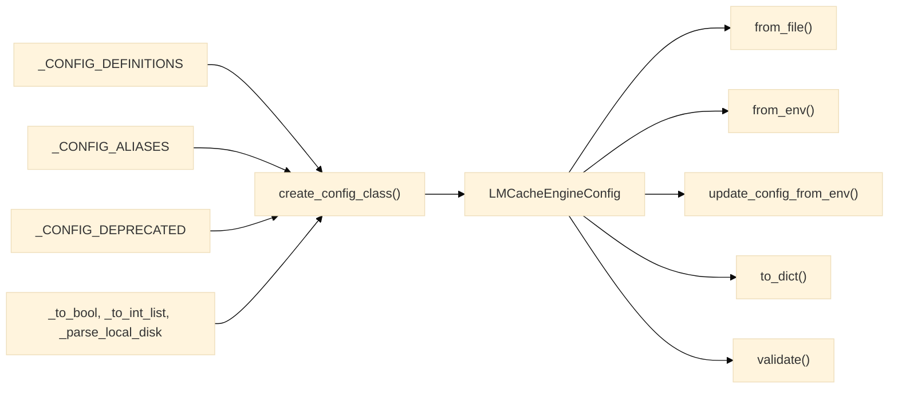
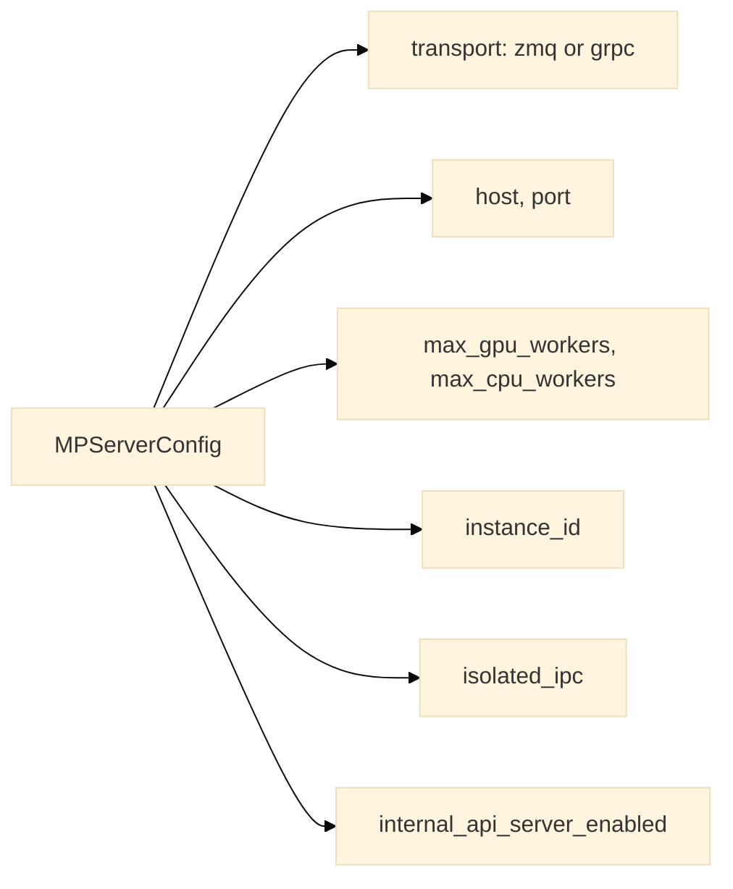

<!-- source: DeepWiki mcp.deepwiki.com · repo LMCache/LMCache · page 2.2 Configuration System · fetched 2026-10-21 -->

# Configuration System

<details>
<summary>Relevant source files</summary>

The following files were used as context for generating this wiki page:

- [docs/source/api_reference/configurations.rst](docs/source/api_reference/configurations.rst)
- [docs/source/developer_guide/architecture.rst](docs/source/developer_guide/architecture.rst)
- [docs/source/internal_api_server/common_apis.rst](docs/source/internal_api_server/common_apis.rst)
- [docs/source/internal_api_server/controller_apis.rst](docs/source/internal_api_server/controller_apis.rst)
- [docs/source/internal_api_server/internal_api_server.rst](docs/source/internal_api_server/internal_api_server.rst)
- [docs/source/kv_cache/storage_backends/cpu_ram.rst](docs/source/kv_cache/storage_backends/cpu_ram.rst)
- [docs/source/kv_cache/storage_backends/eic.rst](docs/source/kv_cache/storage_backends/eic.rst)
- [docs/source/kv_cache/storage_backends/gds.rst](docs/source/kv_cache/storage_backends/gds.rst)
- [docs/source/kv_cache/storage_backends/local_storage.rst](docs/source/kv_cache/storage_backends/local_storage.rst)
- [docs/source/kv_cache/storage_backends/redis.rst](docs/source/kv_cache/storage_backends/redis.rst)
- [docs/source/kv_cache/storage_backends/weka.rst](docs/source/kv_cache/storage_backends/weka.rst)
- [docs/source/production/observability/vllm_endpoint.rst](docs/source/production/observability/vllm_endpoint.rst)
- [lmcache/integration/sglang/sglang_adapter.py](lmcache/integration/sglang/sglang_adapter.py)
- [lmcache/integration/sglang/utils.py](lmcache/integration/sglang/utils.py)
- [lmcache/v1/config_base.py](lmcache/v1/config_base.py)
- [lmcache/v1/internal_api_server/vllm/conf_api.py](lmcache/v1/internal_api_server/vllm/conf_api.py)
- [lmcache/v1/storage_backend/gds_backend.py](lmcache/v1/storage_backend/gds_backend.py)
- [tests/v1/data/gds.yaml](tests/v1/data/gds.yaml)
- [tests/v1/data/hipfile.yaml](tests/v1/data/hipfile.yaml)
- [tests/v1/data/hipfile_gds.yaml](tests/v1/data/hipfile_gds.yaml)
- [tests/v1/data/test_config.yaml](tests/v1/data/test_config.yaml)
- [tests/v1/storage_backend/test_gds_backend.py](tests/v1/storage_backend/test_gds_backend.py)
- [tests/v1/test_cache_engine.py](tests/v1/test_cache_engine.py)
- [tests/v1/test_config.py](tests/v1/test_config.py)
- [tests/v1/test_gds.py](tests/v1/test_gds.py)

</details>


## Purpose and Scope

The Configuration System is the centralized mechanism for managing all LMCache engine and server settings [lmcache/v1/config.py:1-50](). It provides a flexible, hierarchical configuration loading system that supports YAML files, environment variables, remote configuration services, multiprocess (MP) server parameters, and runtime dynamic updates [lmcache/v1/config.py:15-80](), [lmcache/v1/config_base.py:1-46](). The configuration system is implemented primarily through the `LMCacheEngineConfig` class [lmcache/v1/config.py:1-236](), accompanied by `MPServerConfig` for multiprocess server settings [lmcache/v1/multiprocess/config.py:21-122](), and supported by utility functions for parsing and validation [lmcache/v1/config_base.py:50-220]().

Key implementation files include:
- `lmcache/v1/config.py` — `LMCacheEngineConfig` definition and parsing options [lmcache/v1/config.py:1-236]()
- `lmcache/v1/config_base.py` — Core configuration utilities, base classes, and `create_config_class()` factory [lmcache/v1/config_base.py:1-220]()
- `lmcache/v1/multiprocess/config.py` — `MPServerConfig` and multiprocess server parameters [lmcache/v1/multiprocess/config.py:1-175]()
- `lmcache/v1/internal_api_server/vllm/conf_api.py` — Runtime configuration API endpoints for dynamic config changes [lmcache/v1/internal_api_server/vllm/conf_api.py:1-147]()

Sources: `lmcache/v1/config_base.py:1-220]`, `lmcache/v1/multiprocess/config.py:1-175]`, `lmcache/v1/config.py:1-236]`, `lmcache/v1/internal_api_server/vllm/conf_api.py:1-147`()

---

## Configuration Loading Hierarchy

LMCache's configuration system loads settings from multiple sources in a well-defined precedence order to produce the final runtime configuration [tests/v1/test_config.py:18-105]().

### Data Flow and Precedence (Code Entity Space Bridge)

The following diagram bridges natural language configuration concepts to concrete code execution paths and functions in the codebase:

```mermaid
%%{init: {'theme': 'base', 'themeVariables': { 'fontSize': '16px', 'fontFamily': 'arial' }}}%%
flowchart TD
    Start[""Start Initialization""]
    CheckEnv[""Check Env: os.environ[LMCACHE_CONFIG_FILE]""]
    LoadYAML[""Load YAML: LMCacheEngineConfig.from_file()""]
    LoadEnv[""Load Env: LMCacheEngineConfig.from_env()""]
    ApplyEnv[""Apply Overrides: update_config_from_env()""]
    CheckRemote[""Check Remote Config URL""]
    FetchRemote[""Fetch Remote: fetch_remote_config()""]
    ApplyRemote[""Apply Remote: apply_remote_configs()""]
    Validate[""Validate Config: validate()""]
    FinalConfig[""Final Instance: LMCacheEngineConfig""]

    Start --> CheckEnv
    CheckEnv -->|"File Present"| LoadYAML
    CheckEnv -->|"No File"| LoadEnv
    LoadYAML --> ApplyEnv
    LoadEnv --> CheckRemote
    ApplyEnv --> CheckRemote
    CheckRemote -->|"Enabled"| FetchRemote
    CheckRemote -->|"Disabled"| Validate
    FetchRemote --> ApplyRemote
    ApplyRemote --> Validate
    Validate --> FinalConfig
```
Sources: `tests/v1/test_config.py:18-105]`, `lmcache/v1/config_base.py:1-46]`, `lmcache/v1/config.py:15-80`()

- **YAML file config:** When the `LMCACHE_CONFIG_FILE` environment variable is set, the configuration is loaded from the YAML file using `LMCacheEngineConfig.from_file()` [tests/v1/test_config.py:18-20]().
- **Environment variables:** If no file is present, the config loads from environment variables matching `LMCACHE_*` prefixes via `LMCacheEngineConfig.from_env()` [tests/v1/test_config.py:23-25]().
- **Environment overrides:** After file or env load, environment variables are applied as overrides through `update_config_from_env()` [tests/v1/test_config.py:94-100]().
- **Remote config:** If a remote config URL is configured, it is fetched and applied via `apply_remote_configs()` [tests/v1/config_base.py:13-15](), [tests/v1/test_config.py:12-14]().
- **Defaults:** Configuration keys missing are filled with default values defined in configuration definitions [lmcache/v1/config_base.py:218-250]().
- **Validation:** Final validation occurs before usage to ensure correctness [tests/v1/test_config.py:153-162]().

### Precedence Summary (High → Low):
1. Remote configuration service overrides (if enabled) [tests/v1/test_config.py:12-14]()
2. Environment variable overrides (`LMCACHE_*`) via `update_config_from_env()` [tests/v1/test_config.py:94-100]()
3. YAML configuration file settings via `from_file()` [tests/v1/test_config.py:18-20]()
4. Built-in default values via `from_defaults()` [tests/v1/test_config.py:78-85]()

Sources: `tests/v1/test_config.py:18-105]`, `lmcache/v1/config_base.py:1-46]`, `lmcache/v1/config.py:15-80`()

---

## LMCacheEngineConfig Implementation and Parsing

### Configuration Class Generation and Parsing

`LMCacheEngineConfig` is a dynamically generated dataclass created via the factory function `create_config_class()` in `lmcache/v1/config_base.py` [lmcache/v1/config_base.py:218-240](). It supports consistent type conversion, alias resolution, deprecation warning handling, environment overrides, and JSON/YAML loading [lmcache/v1/config_base.py:184-214]().


Sources: `lmcache/v1/config_base.py:50-220]`, `lmcache/v1/config.py:1-236]()`

- **`_CONFIG_DEFINITIONS`:** Holds all config keys, types, default values, and optional environment variable converters (`env_converter`) for safe casting [lmcache/v1/config_base.py:28-46]().
- **`_CONFIG_ALIASES`:** Maps deprecated or alternate config keys to current names [lmcache/v1/config_base.py:184-214]().
- **`_CONFIG_DEPRECATED`:** Tracks deprecated key warnings [lmcache/v1/config_base.py:184-214]().
- **Parsing utilities:** Helper functions like `_parse_local_disk`, `_to_int_list`, and `_parse_quoted_string` convert raw string inputs into typed Python objects [lmcache/v1/config_base.py:50-162]().
- **Class methods:**
  - `from_file()`: Load config from YAML/JSON file [tests/v1/test_config.py:19-19]()
  - `from_env()`: Load config from environment variables [tests/v1/test_config.py:24-24]()
  - `update_config_from_env()`: Update the instance with environment variable overrides [tests/v1/test_config.py:99-99]()
  - `validate()`: Check config correctness and constraints [lmcache/v1/config.py:1-236]()
  - `to_dict()`: Convert config to plain dictionary [lmcache/v1/config_base.py:167-168]()

Sources: `lmcache/v1/config_base.py:50-220]`, `lmcache/v1/config.py:1-236`()

---

## Configuration Options

The configuration options cover a wide range of system behaviors related to cache chunking, storage backends, persistence, network, and performance optimizations [docs/source/api_reference/configurations.rst:21-102]().

### Core Engine Settings

| Option | Environment Variable | Description | Default |
|---|---|---|---|
| `chunk_size` | `LMCACHE_CHUNK_SIZE` | Number of tokens per KV cache chunk [docs/source/api_reference/configurations.rst:33-35]() | 256 |
| `local_cpu` | `LMCACHE_LOCAL_CPU` | Enable CPU RAM caching of KV data [docs/source/api_reference/configurations.rst:36-38]() | true |
| `max_local_cpu_size` | `LMCACHE_MAX_LOCAL_CPU_SIZE` | Maximum size in GB for CPU cache [docs/source/api_reference/configurations.rst:39-41]() | 5.0 |
| `local_cpu_use_hugepages` | `LMCACHE_LOCAL_CPU_USE_HUGEPAGES` | Use Linux hugepages (2MB) for CPU pinned memory [docs/source/api_reference/configurations.rst:42-44]() | false |
| `local_disk` | `LMCACHE_LOCAL_DISK` | Paths (comma-separated) to local disk cache directories [docs/source/api_reference/configurations.rst:45-47]() | None |
| `local_disk_path_sharding` | `LMCACHE_LOCAL_DISK_PATH_SHARDING` | Sharding strategy across multiple disk paths ("by_gpu") [docs/source/api_reference/configurations.rst:48-50]() | "by_gpu" |
| `max_local_disk_size` | `LMCACHE_MAX_LOCAL_DISK_SIZE` | Max size in GB for disk cache [docs/source/api_reference/configurations.rst:51-53]() | 0.0 |
| `remote_url` | `LMCACHE_REMOTE_URL` | Remote KV cache storage URL ("redis://...", "lm://...", etc.) [docs/source/api_reference/configurations.rst:54-56]() | None |
| `remote_serde` | `LMCACHE_REMOTE_SERDE` | Remote serialization format ("naive", "cachegen") [docs/source/api_reference/configurations.rst:57-59]() | "naive" |
| `save_decode_cache` | `LMCACHE_SAVE_DECODE_CACHE` | Save decode KV cache [docs/source/api_reference/configurations.rst:60-62]() | false |
| `use_layerwise` | `LMCACHE_USE_LAYERWISE` | Enable layerwise pipelined KV cache retrieval/storage [docs/source/api_reference/configurations.rst:63-65]() | false |
| `save_unfull_chunk` | `LMCACHE_SAVE_UNFULL_CHUNK` | Save unfull (partial) chunks when storing [docs/source/api_reference/configurations.rst:66-71]() | false |
| `blocking_timeout_secs` | `LMCACHE_BLOCKING_TIMEOUT_SECS` | Timeout seconds for blocking cache operations [docs/source/api_reference/configurations.rst:72-74]() | 10 |
| `py_enable_gc` | `LMCACHE_PY_ENABLE_GC` | Enable Python GC during engine operations [docs/source/api_reference/configurations.rst:75-77]() | true |
| `cache_policy` | `LMCACHE_CACHE_POLICY` | Cache eviction policy ("LRU", "LFU", "FIFO") [docs/source/api_reference/configurations.rst:78-80]() | "LRU" |
| `numa_mode` | `LMCACHE_NUMA_MODE` | NUMA memory pinning mode (null/auto/manual) [docs/source/api_reference/configurations.rst:81-83]() | null |
| `extra_config` | `LMCACHE_EXTRA_CONFIG` | JSON dict for arbitrary backend-specific configs [docs/source/api_reference/configurations.rst:99-101]() | {} |

Sources: `tests/v1/test_config.py:22-105]`, `docs/source/api_reference/configurations.rst:23-130`()

---

## Multiprocess (MP) Server Configuration

For multiprocess deployments, `MPServerConfig` encapsulates server process parameters such as networking, thread pools, and instance identity [lmcache/v1/multiprocess/config.py:21-122]().


Sources: `lmcache/v1/multiprocess/config.py:21-122`()

- **Transport:** Network server transport layer type exposed (`zmq` or `grpc`) [lmcache/v1/multiprocess/config.py:21-122]().
- **Host/Port:** Address to bind the server for client connections [lmcache/v1/multiprocess/config.py:21-122]().
- **Max GPU/CPU workers:** Thread pool sizes for GPU (`STORE`, `RETRIEVE`) and CPU (`LOOKUP`) cache operations [lmcache/v1/multiprocess/config.py:21-122]().
- **Instance ID:** Stable string identifier for cluster membership and telemetry [lmcache/v1/multiprocess/config.py:21-122]().
- **Isolated IPC:** Enables operation in isolated container environments without shared IPC [lmcache/v1/multiprocess/config.py:21-122]().
- **Metrics:** Controls internal API server endpoints for observability [lmcache/v1/multiprocess/config.py:21-122]().

Sources: `lmcache/v1/multiprocess/config.py:21-122`()

---

## Runtime Configuration and Dynamic Updates

LMCache exposes an internal API server to inspect and modify configuration values at runtime [lmcache/v1/internal_api_server/vllm/conf_api.py:42-147]().

- **GET `/conf`:** Query config values, optionally filtered by comma-separated names [lmcache/v1/internal_api_server/vllm/conf_api.py:42-90]().
- **POST `/conf`:** Update config values dynamically with validation through `validate_and_set_config_value` [lmcache/v1/internal_api_server/vllm/conf_api.py:91-147](), [lmcache/v1/config_base.py:13-15]().

This enables adaptive tuning and troubleshooting without restarts, handled in the internal API server module `lmcache/v1/internal_api_server/vllm/conf_api.py` [lmcache/v1/internal_api_server/vllm/conf_api.py:1-147]().

Sources: `lmcache/v1/internal_api_server/vllm/conf_api.py:42-147]`, `lmcache/v1/config_base.py:13-15`()

---

## References and Source Files

- `lmcache/v1/config_base.py:1-220` — Base config utilities and class factory
- `lmcache/v1/config.py:1-236` — LMCacheEngineConfig class definition and parsing
- `lmcache/v1/multiprocess/config.py:1-175` — MPServerConfig and multiprocess server config
- `lmcache/v1/internal_api_server/vllm/conf_api.py:1-147` — Runtime config API endpoints
- `tests/v1/test_config.py:1-187` — Unit tests for configuration loading and env overrides
- `docs/source/api_reference/configurations.rst:1-130` — Configuration option documentation

Sources: `lmcache/v1/config_base.py:1-220]`, `lmcache/v1/config.py:1-236]`, `lmcache/v1/multiprocess/config.py:1-175]`, `lmcache/v1/internal_api_server/vllm/conf_api.py:1-147]`, `tests/v1/test_config.py:1-187]`, `docs/source/api_reference/configurations.rst:1-130`()

---

