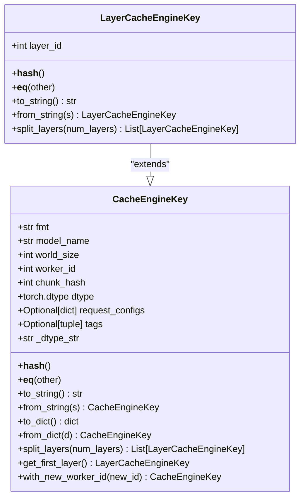
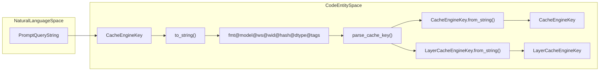
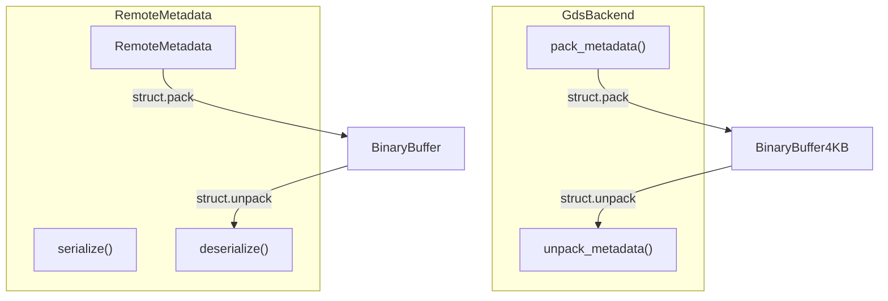
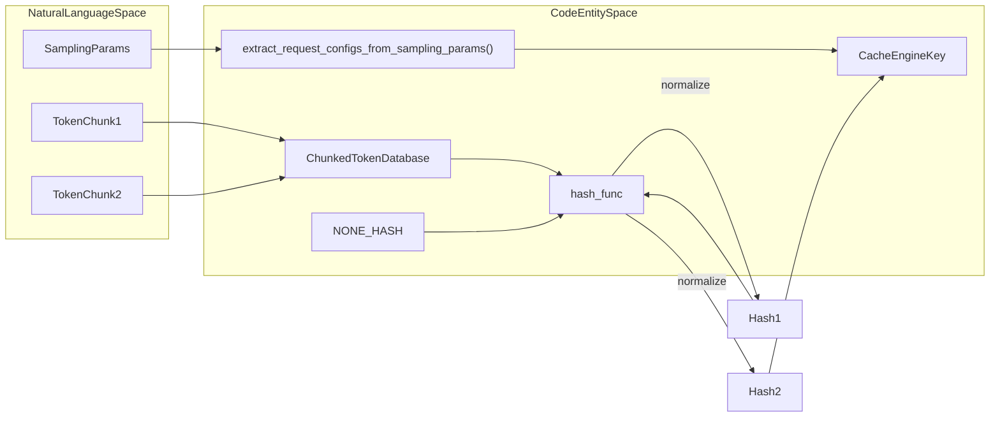

<!-- source: DeepWiki mcp.deepwiki.com · repo LMCache/LMCache · page 2.4 Cache Keys and Metadata · fetched 2026-10-21 -->

# Cache Keys and Metadata

<details>
<summary>Relevant source files</summary>

The following files were used as context for generating this wiki page:

- [examples/kubernetes/health_probe.py](examples/kubernetes/health_probe.py)
- [lmcache/integration/vllm/utils.py](lmcache/integration/vllm/utils.py)
- [lmcache/integration/vllm/vllm_v1_adapter.py](lmcache/integration/vllm/vllm_v1_adapter.py)
- [lmcache/utils.py](lmcache/utils.py)
- [lmcache/v1/cache_engine.py](lmcache/v1/cache_engine.py)
- [lmcache/v1/config.py](lmcache/v1/config.py)
- [lmcache/v1/distributed/serde/factory.py](lmcache/v1/distributed/serde/factory.py)
- [lmcache/v1/lookup_client/abstract_client.py](lmcache/v1/lookup_client/abstract_client.py)
- [lmcache/v1/lookup_client/chunk_statistics_lookup_client.py](lmcache/v1/lookup_client/chunk_statistics_lookup_client.py)
- [lmcache/v1/lookup_client/factory.py](lmcache/v1/lookup_client/factory.py)
- [lmcache/v1/lookup_client/hit_limit_lookup_client.py](lmcache/v1/lookup_client/hit_limit_lookup_client.py)
- [lmcache/v1/lookup_client/lmcache_async_lookup_client.py](lmcache/v1/lookup_client/lmcache_async_lookup_client.py)
- [lmcache/v1/lookup_client/lmcache_lookup_client.py](lmcache/v1/lookup_client/lmcache_lookup_client.py)
- [lmcache/v1/lookup_client/lmcache_lookup_client_bypass.py](lmcache/v1/lookup_client/lmcache_lookup_client_bypass.py)
- [lmcache/v1/lookup_client/mooncake_lookup_client.py](lmcache/v1/lookup_client/mooncake_lookup_client.py)
- [lmcache/v1/metadata.py](lmcache/v1/metadata.py)
- [lmcache/v1/offload_server/zmq_server.py](lmcache/v1/offload_server/zmq_server.py)
- [lmcache/v1/protocol.py](lmcache/v1/protocol.py)
- [lmcache/v1/rpc_utils.py](lmcache/v1/rpc_utils.py)
- [lmcache/v1/server/__main__.py](lmcache/v1/server/__main__.py)
- [lmcache/v1/standalone/__main__.py](lmcache/v1/standalone/__main__.py)
- [lmcache/v1/token_database.py](lmcache/v1/token_database.py)
- [tests/v1/lookup_client/test_chunk_statistics_lookup_client.py](tests/v1/lookup_client/test_chunk_statistics_lookup_client.py)
- [tests/v1/lookup_client/test_lmcache_lookup_client.py](tests/v1/lookup_client/test_lmcache_lookup_client.py)
- [tests/v1/standalone/test_parse_kvcache_shape_spec.py](tests/v1/standalone/test_parse_kvcache_shape_spec.py)
- [tests/v1/test_freeze_mode_integration.py](tests/v1/test_freeze_mode_integration.py)
- [tests/v1/test_remote_metadata.py](tests/v1/test_remote_metadata.py)
- [tests/v1/test_token_database.py](tests/v1/test_token_database.py)

</details>


Purpose and scope: This page explains the `CacheEngineKey` structure, its hash generation mechanism, related metadata fields including `model_name`, `world_size`, `worker_id`, `dtype`, and `tags`. It covers how these keys uniquely identify cached KV tensors, support distributed serving scenarios, and integrate with LMCache’s storage and retrieval subsystems.

For usage of keys in cache operations (lookup, retrieve, store), see the core engine in `lmcache/v1/cache_engine.py` [lmcache/v1/cache_engine.py:83-184](). For token chunking and hash generation, refer to `lmcache/v1/token_database.py` [lmcache/v1/token_database.py:31-112]() and the `extract_request_configs_from_sampling_params` utility in the vLLM integration [lmcache/integration/vllm/utils.py:130-151]().

---

## Overview

LMCache manages cached KV tensors using structured cache keys encapsulated primarily by the `CacheEngineKey` dataclass. These keys carry extensive metadata about the model, distributed processing configuration, token chunk identity, and data type, enabling precise cache partitioning and retrieval across local/multi-process and multi-tier storage backends.

### Key class hierarchy and integration points



- `CacheEngineKey` is the primary key for full-model KV caches.
- `LayerCacheEngineKey` extends `CacheEngineKey` with `layer_id`, supporting layerwise cache granularity used in asynchronous or pipelined KV transfer.

Sources: [lmcache/utils.py:332-577]()

---

## CacheEngineKey Structure

### Fields and Purpose

| Field            | Type                | Description                                                                                 |
|------------------|---------------------|---------------------------------------------------------------------------------------------|
| `fmt`            | `str`               | Memory format string identifier (e.g., `"vllm"`, `"huggingface"`) used for backend layout |
| `model_name`     | `str`               | The LLM model name string, e.g., `"meta-llama/Llama-2-7b-hf"`                               |
| `world_size`      | `int`               | Number of workers across distributed setting                                               |
| `worker_id`       | `int`               | Rank of the worker that owns this cache partition                                         |
| `chunk_hash`      | `int`               | Integer hash of the token chunk sequence pooled                                     |
| `dtype`           | `torch.dtype`       | PyTorch data type of cached tensors                                                        |
| `request_configs` | `Optional[dict]`    | Optional dictionary of request specific configs (e.g., tags for partitioning)               |
| `tags`            | `Optional[tuple]`   | Immutable tuple of `(key, value)` pairs extracted from `request_configs` with `"lmcache.tag."` prefix |
| `_dtype_str`      | `str`               | Cached string form of `dtype` for serialization                                            |

### Tags and Request Configs

- `request_configs` may contain arbitrary parameters.
- Keys starting with `"lmcache.tag."` denote user-defined tags extracted during key initialization.
- Tags are stored as a sorted tuple `(key, value)` to ensure hash and equality consistency.

### Hash and Equality

`CacheEngineKey`'s hash function combines all critical fields including tags and format to guarantee unique cache entry identification:

```python
def __hash__(self):
    return hash((
        self.fmt,
        self.model_name,
        self.world_size,
        self.worker_id,
        self.chunk_hash,
        self._dtype_str,
        self.tags,
    ))
```

Equality compares all these fields to avoid collisions and allow usage as dictionary keys in storage backends.

Sources: [lmcache/utils.py:332-369]()

---

## Cache Key Serialization Format

Keys serialize to a compact string format for storage and communication.

```
fmt@model_name@world_size@worker_id@chunk_hash@dtype_str[@tag_key%tag_value...]
```

- The `@` symbol delimits core fields.
- Tags are appended as `@key%value` components.
- Example:

```
vllm@meta-llama/Llama-2-7b-hf@4@0@a3f5b2c1@half@user_id%alice@session%2024-01-15
```

### Parsing Logic

The utility function `parse_cache_key` dynamically detects whether the key represents a full-model `CacheEngineKey` or a per-layer key (`LayerCacheEngineKey`) by inspecting the number of fields and presence of a layer identifier.



Sources: [lmcache/utils.py:316-329](), [lmcache/utils.py:385-448]()

---

## Data Type Mappings

LMCache supports various PyTorch dtypes and maps them to/from normalized strings for key serialization:

| PyTorch dtype               | String Name   | Protocol Int (Remote) |
|----------------------------|---------------|----------------------|
| `torch.float16` / `torch.half` | `"half"`      | 1 (half) / 2 (float16) |
| `torch.bfloat16`            | `"bfloat16"`  | 3                    |
| `torch.float32` / `torch.float` | `"float"`    | 4                    |
| `torch.int8`                | `"int8"`      | 6                    |
| `torch.float8_e4m3fn`       | `"fp8_e4m3"`  | 7                    |
| `torch.float8_e5m2`         | `"fp8_e5m2"`  | 8                    |

- The `_DTYPE_TO_STR` and `_STR_TO_DTYPE` mappings are defined in `lmcache/utils.py` to standardize these conversions.
- Remote backend protocol uses these integers in binary formats for compactness [lmcache/v1/protocol.py:41-53]().

Sources: [lmcache/utils.py:287-313](), [lmcache/v1/protocol.py:41-53]()

---

## LMCacheMetadata Class

This dataclass contains model-level metadata essential for engine configuration and key generation:

| Field              | Type         | Description                                                                      |
|--------------------|--------------|----------------------------------------------------------------------------------|
| `model_name`       | `str`        | Model name string used across components                                         |
| `world_size`        | `int`        | Number of distributed workers                                                    |
| `worker_id`         | `int`        | Rank identifier                                                                  |
| `kv_dtype`          | `torch.dtype`| Data type for KV caches                                                          |
| `kv_shape`          | `tuple`      | Shape of KV cache tensors `(num_layer, 2, chunk_size, num_kv_head, head_size)`   |
| `use_mla`           | `bool`       | Enabled Multi-Level Attention flag                                               |

This class is passed throughout engine initialization and is foundational for key derivation in multi-node distributed serving [lmcache/v1/metadata.py:20-73]().

Sources: [lmcache/v1/metadata.py:20-73]()

---

## LayerCacheEngineKey: Extension for Layerwise Caching

`LayerCacheEngineKey` inherits from `CacheEngineKey` and adds:

- `layer_id: int`: identifies the specific transformer layer chunk.

This enables specialized caching strategies in layerwise KV transfer scenarios supporting overlapped compute and I/O pipelines [lmcache/utils.py:500-504](), [lmcache/v1/cache_engine.py:171]().

### String Format

Layer keys serialize similarly, appending `layer_id` after `dtype`:

```
fmt@model_name@world_size@worker_id@chunk_hash@dtype_str@layer_id[@tag_key%tag_value...]
```

Sources: [lmcache/utils.py:526-534]()

---

## DiskCacheMetadata Structure

`DiskCacheMetadata` holds persistent storage info for on-disk cache entries:

| Field      | Type                 | Purpose                              |
|------------|----------------------|------------------------------------|
| `path`    | `str`                | On-disk file path                   |
| `size`    | `int`                | File size in bytes                  |
| `shape`   | `Optional[torch.Size]` | Tensor shape                       |
| `dtype`   | `Optional[torch.dtype]`| Tensor data type                   |
| `pin_count` | `int`                | Reference count for eviction policy |

This metadata supports synchronization and eviction for local disk backend [lmcache/utils.py:257-265]()

Sources: [lmcache/utils.py:257-265]()

---

## Remote and GDS Metadata Handling

### Binary Metadata Serialization

For remote backends and GPU Direct Storage (GDS), metadata is serialized as fixed-size binary buffers using Python’s `struct`:



- GDS backend reserves 4KB for metadata header at file start [lmcache/v1/storage_backend/gds_backend.py:50-123]().
- `RemoteMetadata` handles packing shape, dtype, and flags into binary blobs for efficient remote communication [lmcache/v1/protocol.py:164-209]().

Sources: [lmcache/v1/storage_backend/gds_backend.py:50-123](), [lmcache/v1/protocol.py:164-209]()

---

## Token Hash Generation and Request Config Extraction

Token chunk hashes (`chunk_hash` in keys) originate from classes implementing `TokenDatabase`. The `ChunkedTokenDatabase` computes progressively cumulative hashes to enable prefix caching optimization.

- Hash normalization converts diverse algorithms (e.g., `sha256_cbor`) into 64-bit integer hashes via `_normalize_hash_to_int` [lmcache/v1/token_database.py:31-112]().
- Request configurations and tags embedded in sampling parameters are extracted for key inclusion via `extract_request_configs_from_sampling_params()` [lmcache/integration/vllm/utils.py:130-151]().



Sources: [lmcache/v1/token_database.py:31-112](), [lmcache/integration/vllm/utils.py:130-151](), [lmcache/utils.py:332]()

---

## Summary Table of Key Classes and Metadata Components

| Name                    | Location                          | Usage                                       |
|-------------------------|---------------------------------|---------------------------------------------|
| `CacheEngineKey`        | `lmcache/utils.py:332-498`       | Full-model cache key                         |
| `LayerCacheEngineKey`   | `lmcache/utils.py:500-577`       | Per-layer cache key                          |
| `LMCacheMetadata`       | `lmcache/v1/metadata.py:20-73`   | Engine-wide metadata                         |
| `DiskCacheMetadata`     | `lmcache/utils.py:257-265`       | Persistent on-disk cache info                |
| `RemoteMetadata`        | `lmcache/v1/protocol.py:164-209` | Remote backend binary metadata serialization |
| `parse_cache_key`       | `lmcache/utils.py:316-329`       | Parse and detect key type                     |

---

This structured key and metadata design ensures precise cache partitioning, consistent hash-based retrieval, and flexible support for advanced features like Multi-Level Attention (MLA) sharding, multi-process sharing, and blended cache layers.

Sources:  
[lmcache/utils.py:257-577](), [lmcache/v1/cache_engine.py:83-184](), [lmcache/v1/token_database.py:31-112](), [lmcache/v1/metadata.py:20-73](), [lmcache/integration/vllm/utils.py:130-151](), [lmcache/v1/protocol.py:41-53](), [lmcache/v1/storage_backend/gds_backend.py:50-123](), [lmcache/v1/protocol.py:164-209]()

---

