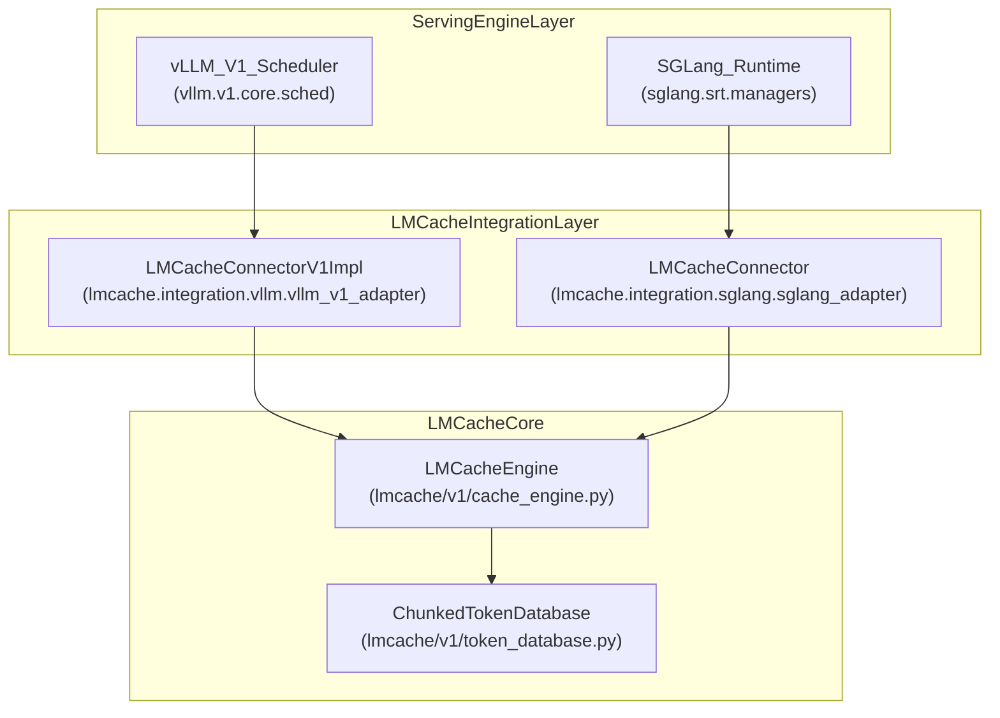
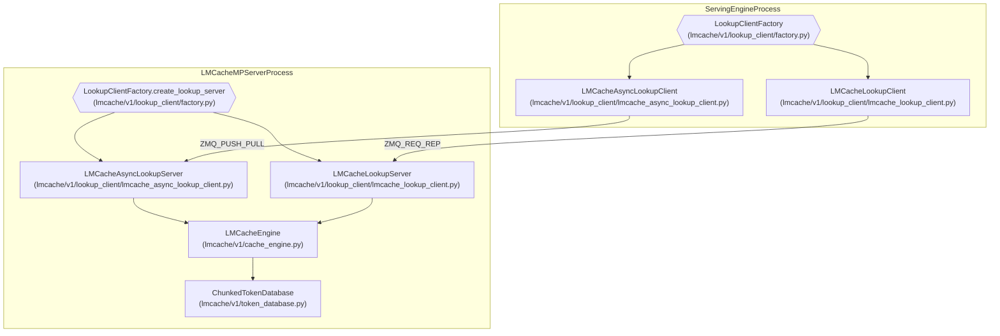

<!-- source: DeepWiki mcp.deepwiki.com · repo LMCache/LMCache · page 3 Integration with Serving Engines · fetched 2026-10-21 -->

# Integration with Serving Engines

Relevant source files

The following files were used as context for generating this wiki page:

- [docs/source/developer_guide/architecture.rst](docs/source/developer_guide/architecture.rst)
- [docs/source/internal_api_server/common_apis.rst](docs/source/internal_api_server/common_apis.rst)
- [docs/source/internal_api_server/controller_apis.rst](docs/source/internal_api_server/controller_apis.rst)
- [docs/source/internal_api_server/internal_api_server.rst](docs/source/internal_api_server/internal_api_server.rst)
- [docs/source/kv_cache/storage_backends/eic.rst](docs/source/kv_cache/storage_backends/eic.rst)
- [docs/source/production/observability/vllm_endpoint.rst](docs/source/production/observability/vllm_endpoint.rst)
- [lmcache/integration/sglang/sglang_adapter.py](lmcache/integration/sglang/sglang_adapter.py)
- [lmcache/integration/sglang/utils.py](lmcache/integration/sglang/utils.py)
- [lmcache/integration/vllm/utils.py](lmcache/integration/vllm/utils.py)
- [lmcache/integration/vllm/vllm_v1_adapter.py](lmcache/integration/vllm/vllm_v1_adapter.py)
- [lmcache/utils.py](lmcache/utils.py)
- [lmcache/v1/cache_engine.py](lmcache/v1/cache_engine.py)
- [lmcache/v1/config.py](lmcache/v1/config.py)
- [lmcache/v1/config_base.py](lmcache/v1/config_base.py)
- [lmcache/v1/internal_api_server/vllm/conf_api.py](lmcache/v1/internal_api_server/vllm/conf_api.py)
- [lmcache/v1/lookup_client/abstract_client.py](lmcache/v1/lookup_client/abstract_client.py)
- [lmcache/v1/lookup_client/chunk_statistics_lookup_client.py](lmcache/v1/lookup_client/chunk_statistics_lookup_client.py)
- [lmcache/v1/lookup_client/factory.py](lmcache/v1/lookup_client/factory.py)
- [lmcache/v1/lookup_client/hit_limit_lookup_client.py](lmcache/v1/lookup_client/hit_limit_lookup_client.py)
- [lmcache/v1/lookup_client/lmcache_async_lookup_client.py](lmcache/v1/lookup_client/lmcache_async_lookup_client.py)
- [lmcache/v1/lookup_client/lmcache_lookup_client.py](lmcache/v1/lookup_client/lmcache_lookup_client.py)
- [lmcache/v1/lookup_client/lmcache_lookup_client_bypass.py](lmcache/v1/lookup_client/lmcache_lookup_client_bypass.py)
- [lmcache/v1/lookup_client/mooncake_lookup_client.py](lmcache/v1/lookup_client/mooncake_lookup_client.py)
- [lmcache/v1/offload_server/zmq_server.py](lmcache/v1/offload_server/zmq_server.py)
- [lmcache/v1/rpc_utils.py](lmcache/v1/rpc_utils.py)
- [lmcache/v1/token_database.py](lmcache/v1/token_database.py)
- [tests/v1/data/test_config.yaml](tests/v1/data/test_config.yaml)
- [tests/v1/lookup_client/test_chunk_statistics_lookup_client.py](tests/v1/lookup_client/test_chunk_statistics_lookup_client.py)
- [tests/v1/test_config.py](tests/v1/test_config.py)
- [tests/v1/test_token_database.py](tests/v1/test_token_database.py)

## Purpose and Scope

This page provides a high-level overview of how LMCache integrates with various LLM serving engines to manage, offload, and share KV caches across requests and instances. LMCache acts as an extension layer supporting two primary deployment patterns:

- **In-process mode**, where LMCache runs inside the serving engine process [lmcache/v1/cache_engine.py:146-166]().
- **Multiprocess (MP) mode**, where LMCache operates as a standalone service [lmcache/integration/sglang/sglang_adapter.py:67-140]().

These integrations enable LMCache to improve time-to-first-token (TTFT) and throughput by caching and reusing KV states efficiently while supporting hardware platforms like NVIDIA CUDA, AMD ROCm, and Intel XPU [lmcache/v1/cache_engine.py:146-166](), [lmcache/utils.py:49-68]().

**For detailed subsystem documentation, see the child pages:**

- [vLLM V1 Integration](#3.1) — Complete vLLM V1 integration architecture, `KVConnectorBase_V1` interface, and request lifecycle.
- [SGLang Integration](#3.2) — SGLang integration via `--enable-lmcache`, differences from vLLM, and Radix Attention Cache coordination.
- [Multi-Process Cache Server](#3.3) — `MPCacheEngine`, `MessageQueueServer` architecture, ZMQ/gRPC transport, `BlendEngine`, and HTTP frontend.
- [TensorRT-LLM Integration](#3.4) — NVIDIA TensorRT-LLM integration via KV Cache Connector API, in-process and multi-process modes.
- [Encoder Cache (Non-KV Cache)](#3.5) — Encoder Cache (EC) feature for multimodal encoder outputs, `LMCacheECConnector`, and `kv_codec` quantization format.

Sources: [lmcache/v1/cache_engine.py:146-166](), [lmcache/utils.py:49-68](), [lmcache/integration/sglang/sglang_adapter.py:67-140]()

---

## Integration Architecture

### Connector Pattern

LMCache integrates with serving engines using a **connector pattern**, whereby each engine exposes extension hooks allowing LMCache to intercept and manage KV cache operations. For example, in vLLM V1, this is implemented through the `KVConnectorBase_V1` interface, which the `LMCacheConnectorV1Impl` class implements to capture token loading and saving during inference [lmcache/integration/vllm/vllm_v1_adapter.py:14-18](). The `LMCacheManager` singleton oversees overall lifecycle management, initializing components like the `LMCacheEngine` and lookup clients [lmcache/v1/cache_engine.py:83-108]().

#### Diagram: Integration Architecture Code Bridge

Sources: [lmcache/integration/vllm/vllm_v1_adapter.py:14-18](), [lmcache/integration/sglang/sglang_adapter.py:143-185](), [lmcache/v1/cache_engine.py:83-108](), [lmcache/v1/token_database.py:64-73]()

---

### Hardware-Specific Operations

For efficient data movement of KV cache tensors, LMCache defines a hardware interface (`GPUConnectorInterface`) specifying GPU-to-CPU memory transfers and vice versa. This encapsulation supports multiple device backends transparently [lmcache/v1/cache_engine.py:44]().

| Component           | Purpose                                   | Code Entity                        |
|---------------------|-------------------------------------------|----------------------------------|
| GPU Connector       | Handles paged memory transfer between GPU and LMCache | `GPUConnectorInterface` [lmcache/v1/cache_engine.py:44]() |
| Token Hashing       | Converts token sequences into cache keys  | `TokenDatabase` [lmcache/v1/token_database.py:64]()  |
| Configuration System| Manages LMCache engine configuration      | `LMCacheEngineConfig` [lmcache/v1/config.py:12-32]() |

Sources: [lmcache/v1/cache_engine.py:44](), [lmcache/v1/token_database.py:64-73](), [lmcache/v1/config.py:12-32]()

---

## Supported Serving Engines

### vLLM V1 Integration

LMCache’s integration with vLLM is based on `LMCacheConnectorV1Impl` that implements the `KVConnectorBase_V1` interface. This connector tracks request metadata such as token IDs and manages load and save specifications for KV caches at a layer block granularity. It supports both in-process mode inside the vLLM process as well as multi-process mode communicating with a standalone LMCache server [lmcache/integration/vllm/vllm_v1_adapter.py:14-18]().

For comprehensive information, see the child page: [vLLM V1 Integration](#3.1).

Sources: [lmcache/integration/vllm/vllm_v1_adapter.py:14-18]()

---

### SGLang Integration

SGLang integrates with LMCache via the `--enable-lmcache` flag and initializes the engine using `init_lmcache_engine` and `LMCacheConnector` within the SGLang runtime [lmcache/integration/sglang/sglang_adapter.py:67-185](). It handles model configs, tensor parallel sizes, and KV pools for both standard and Multi-head Latent Attention (MLA) models.

For detailed design and runtime flow, refer to [SGLang Integration](#3.2).

Sources: [lmcache/integration/sglang/sglang_adapter.py:67-185]()

---

### TensorRT-LLM Integration

NVIDIA’s TensorRT-LLM integrates with LMCache through the KV Cache Connector API. LMCache connectors operate in both in-process and multiprocess modes, bridging TensorRT-LLM’s runtime cache mechanisms with LMCache’s multi-tier storage hierarchy.

For complete architecture and configuration patterns, see [TensorRT-LLM Integration](#3.4).

Sources: [lmcache/v1/cache_engine.py:83-108]()

---

### Multi-Process Cache Server

LMCache provides a multiprocess cache server architecture where clients communicate with lookup servers using `LMCacheAsyncLookupClient` or `LMCacheLookupClient`, created via `LookupClientFactory` [lmcache/v1/lookup_client/factory.py:36-100](). The server handles lookup and transfer operations across distributed ranks [lmcache/v1/lookup_client/lmcache_lookup_client.py:182-207]().

#### Diagram: Multi-Process Lookup Client-Server Architecture Code Bridge

Sources: [lmcache/v1/lookup_client/factory.py:36-145](), [lmcache/v1/lookup_client/lmcache_async_lookup_client.py:34-105](), [lmcache/v1/lookup_client/lmcache_lookup_client.py:27-161](), [lmcache/v1/cache_engine.py:83-108](), [lmcache/v1/token_database.py:64-73]()

For in-depth details, see [Multi-Process Cache Server](#3.3).

---

### Encoder Cache (Non-KV Cache)

LMCache supports an Encoder Cache (EC) subsystem designed for multimodal models handling audio, images, and video data. EC caches encoder outputs to avoid redundant computations, configured via specialized configuration utilities [tests/v1/test_config.py:42-92]().

For details, see [Encoder Cache (Non-KV Cache)](#3.5).

Sources: [tests/v1/test_config.py:42-92]()

---

# Summary

LMCache integrates tightly with multiple LLM serving engines through connector abstractions and multiprocess communication layers. Its flexible architecture optimizes inference latency and cost across multiple deployment frameworks.

---

*Navigate to detailed integration pages for each serving engine:*

- [vLLM V1 Integration](#3.1)
- [SGLang Integration](#3.2)
- [Multi-Process Cache Server](#3.3)
- [TensorRT-LLM Integration](#3.4)
- [Encoder Cache (Non-KV Cache)](#3.5)

---

