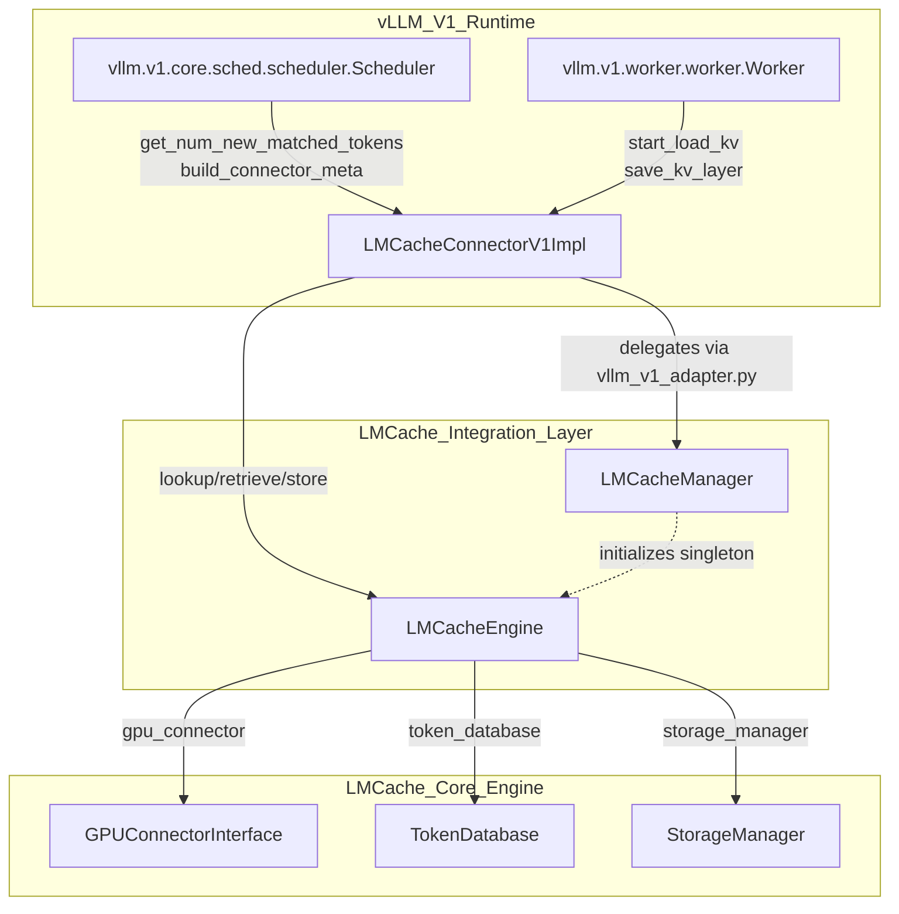
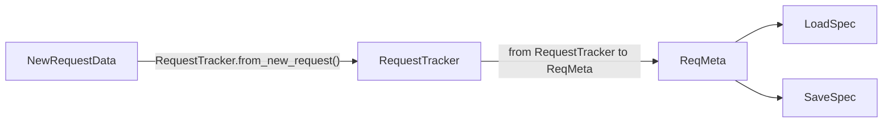

<!-- source: DeepWiki mcp.deepwiki.com · repo LMCache/LMCache · page 3.1 vLLM V1 Integration · fetched 2026-10-21 -->

# vLLM V1 Integration

Relevant source files

The following files were used as context for generating this wiki page:

- [lmcache/integration/vllm/utils.py](lmcache/integration/vllm/utils.py)
- [lmcache/integration/vllm/vllm_v1_adapter.py](lmcache/integration/vllm/vllm_v1_adapter.py)
- [lmcache/utils.py](lmcache/utils.py)
- [lmcache/v1/cache_engine.py](lmcache/v1/cache_engine.py)
- [lmcache/v1/config.py](lmcache/v1/config.py)
- [lmcache/v1/lookup_client/abstract_client.py](lmcache/v1/lookup_client/abstract_client.py)
- [lmcache/v1/lookup_client/chunk_statistics_lookup_client.py](lmcache/v1/lookup_client/chunk_statistics_lookup_client.py)
- [lmcache/v1/lookup_client/factory.py](lmcache/v1/lookup_client/factory.py)
- [lmcache/v1/lookup_client/hit_limit_lookup_client.py](lmcache/v1/lookup_client/hit_limit_lookup_client.py)
- [lmcache/v1/lookup_client/lmcache_async_lookup_client.py](lmcache/v1/lookup_client/lmcache_async_lookup_client.py)
- [lmcache/v1/lookup_client/lmcache_lookup_client.py](lmcache/v1/lookup_client/lmcache_lookup_client.py)
- [lmcache/v1/lookup_client/lmcache_lookup_client_bypass.py](lmcache/v1/lookup_client/lmcache_lookup_client_bypass.py)
- [lmcache/v1/lookup_client/mooncake_lookup_client.py](lmcache/v1/lookup_client/mooncake_lookup_client.py)
- [lmcache/v1/offload_server/zmq_server.py](lmcache/v1/offload_server/zmq_server.py)
- [lmcache/v1/rpc_utils.py](lmcache/v1/rpc_utils.py)
- [lmcache/v1/token_database.py](lmcache/v1/token_database.py)
- [tests/v1/lookup_client/test_chunk_statistics_lookup_client.py](tests/v1/lookup_client/test_chunk_statistics_lookup_client.py)
- [tests/v1/test_token_database.py](tests/v1/test_token_database.py)

## Purpose and Scope

This page documents the complete vLLM V1 integration architecture within LMCache, focusing on the interface `KVConnectorBase_V1` [lmcache/integration/vllm/vllm_v1_adapter.py:14-18](), request lifecycle management, and the orchestration between vLLM's KV transfer system and LMCache's caching engine (`LMCacheEngine`) [lmcache/v1/cache_engine.py:83-108](). It provides a high-level overview of the components involved and their interactions.

As a parent page, it links to five detailed child pages covering various aspects such as the connector implementation class, request lifecycle tracking, load/save operations, manager initialization, and hybrid KV cache group support:

- [LMCacheConnectorV1Impl](#3.1.1) — Detail the `LMCacheConnectorV1Impl` class, its interface methods, and integration with vLLM's KV transfer mechanism.
- [Request Lifecycle and Tracking](#3.1.2) — Explain `RequestTracker`, `ReqMeta`, `LoadSpec`/`SaveSpec` calculation, and request state transitions, plus lazy offload policies.
- [Load and Save Operations](#3.1.3) — Document `start_load_kv`, `wait_for_layer_load`, `save_kv_layer`, and `wait_for_save` methods and their interaction patterns.
- [LMCacheManager and Initialization](#3.1.4) — Explain `LMCacheManager` singleton pattern, start services, component initialization, and lifecycle management.
- [Hybrid KV Cache Groups and Layer Groups](#3.1.5) — Document `kv_layer_groups`, vLLM KV cache group edits, hybrid/DCP support, and group views used for hybrid attention models.

Sources: [lmcache/integration/vllm/vllm_v1_adapter.py:14-18](), [lmcache/v1/cache_engine.py:83-108]()

---

## Architecture Overview

LMCache integrates with vLLM V1 by implementing vLLM's KV transfer interface defined as `KVConnectorBase_V1` [lmcache/integration/vllm/vllm_v1_adapter.py:14-18](). The primary integration class, `LMCacheConnectorV1Impl`, acts as the bridge between vLLM's runtime scheduler and worker components and LMCache's core caching engine (`LMCacheEngine`) [lmcache/v1/cache_engine.py:83-108](). The connector manages cache lookup, retrieval, storage operations, and synchronization with LMCache's underlying storage backends and GPU connectors.

The core LMCache engine converts between vLLM's GPU KV cache tensors and memory-resident backend objects asynchronously. It supports prefetching, layered cache storage, and distributed retrieval.

Title: vLLM V1 Integration Architecture and Code Entities

Sources: [lmcache/integration/vllm/vllm_v1_adapter.py:14-18](), [lmcache/v1/cache_engine.py:83-108](), [lmcache/v1/manager.py:45-100]()

- **vLLM Runtime**: Scheduler and Worker invoke connector methods to manage KV caches during inference scheduling and generation.
- **LMCache Integration Layer**: `LMCacheConnectorV1Impl` delegates storage/retrieval requests to LMCache engine and lifecycle operations to `LMCacheManager` [lmcache/v1/manager.py:45-100]().
- **LMCache Core Engine**: Contains `LMCacheEngine` with GPU connector abstraction (`GPUConnectorInterface`), token database (`TokenDatabase`), and storage manager (`StorageManager`) [lmcache/v1/cache_engine.py:83-108]().

For a deep dive into the connector interface and implementation, see [LMCacheConnectorV1Impl](#3.1.1).

Sources: [lmcache/integration/vllm/vllm_v1_adapter.py:14-18](), [lmcache/v1/cache_engine.py:83-108](), [lmcache/v1/manager.py:45-100]()

---

## Request Lifecycle and State Tracking

The integration tracks each inference request passing through vLLM by mapping it to LMCache-specific metadata. This is crucial for correct cache lookup, enforcement of policies, and managing lazy offload or save behaviors.

- **RequestTracker**: Captures per-request state including prompt token IDs, token counts, allocated block IDs that represent cached segments, and multimodal hashes for hybrid models [lmcache/integration/vllm/vllm_v1_adapter.py:104-139]().
- **LoadSpec & SaveSpec**: Data classes specifying whether load/save operations are permitted by the scheduler at a given stage, and token counts relevant to cache hit or miss [lmcache/integration/vllm/vllm_v1_adapter.py:65-80]().
- **ReqMeta**: A packaging construct that consolidates request tracking data, load/save specs, and runtime flags for use during KV cache transfer calls.

Title: Request Tracking and Metadata Flow Code Entities

Sources: [lmcache/integration/vllm/vllm_v1_adapter.py:65-205]()

Key points:
- Requests are initialized from `NewRequestData` objects emitted by vLLM's scheduler via `RequestTracker.from_new_request()` [lmcache/integration/vllm/vllm_v1_adapter.py:142-148]().
- The tracker maintains token/block mappings and multimodal features to enable specialized caching [lmcache/integration/vllm/vllm_v1_adapter.py:110-126]().
- Load and save specs (`LoadSpec`, `SaveSpec`) enable coordinated decisions if tokens should be loaded from or persisted to the cache [lmcache/integration/vllm/vllm_v1_adapter.py:65-80]().

For comprehensive details on request lifecycle, state transitions, and lazy offload policies, see [Request Lifecycle and Tracking](#3.1.2).

Sources: [lmcache/integration/vllm/vllm_v1_adapter.py:65-205]()

---

## Load and Save Operations

The transfer of KV cache layers between GPU memory and backend storage occurs at specific points in vLLM’s inference pipeline. These operations translate to coroutine or asynchronous calls in `LMCacheConnectorV1Impl`, enabling efficient overlap with inference scheduling.

Important methods:
- **`start_load_kv`**: Initiates asynchronous loading of cached KV tensors from LMCache backends based on request metadata and load specs.
- **`wait_for_layer_load`**: Provides synchronization primitives or yields control until layer-wise loading is completed.
- **`save_kv_layer`**: Stores computed KV cache layers from GPU to LMCache backend asynchronously, controlled by save specs and request flags.
- **`wait_for_save`**: Awaits completion of save operations, ensuring consistency before continuing.

These methods interact with `LMCacheEngine` for underlying storage backend management and interact closely with GPU connectors for tensor transfers [lmcache/v1/cache_engine.py:83-108]().

For detailed method signatures, interaction patterns, and coroutine examples, refer to [Load and Save Operations](#3.1.3).

Sources: [lmcache/integration/vllm/vllm_v1_adapter.py:14-18](), [lmcache/v1/cache_engine.py:83-108]()

---

## LMCacheManager and Initialization

`LMCacheManager` implements the singleton pattern to manage the lifecycle and initialization of the LMCache engine components within the vLLM integration context. It orchestrates configuration loading, starting backend services, and ensures components like GPU connectors and storage managers are initialized consistently.

Key aspects:
- Configuration is fetched securely using `lmcache_get_or_create_config` that supports environment variables, YAML files, and remote config fetching, following singleton principles [lmcache/integration/vllm/utils.py:163-186]().
- Services such as controller workers, storage backends, and event managers are started and managed centrally by `LMCacheManager` [lmcache/v1/manager.py:45-100]().
- Lifecycle operations, including start and stop routines aligned with vLLM worker processes, are encapsulated in the manager.

For usage patterns, initialization sequences, and singleton management, see [LMCacheManager and Initialization](#3.1.4).

Sources: [lmcache/v1/manager.py:45-100](), [lmcache/integration/vllm/utils.py:163-186]()

---

## Hybrid KV Cache Groups and Layer Groups

To support complex scenarios such as hybrid attention models, multi-layered caching, and disaggregated prefill/decode (DCP) architectures, LMCache includes support for KV cache groups organized in `kv_layer_groups`.

Details:
- Group views enable folding multiple KV cache groups selectively per request or model instance.
- Hybrid attention models can leverage these groups to organize key/value tensors for different modalities or layers.
- vLLM KV cache group edits allow customizing how cache segments are aggregated or split for load/save operations [lmcache/integration/vllm/vllm_v1_adapter.py:162-180]().

This support enables fine-grained cache control and optimizations suitable for large-scale or multimodal model serving.

For granular details on group views, multi-group block folding, and hybrid/DCP integration, see [Hybrid KV Cache Groups and Layer Groups](#3.1.5).

Sources: [lmcache/integration/vllm/vllm_v1_adapter.py:162-180]()

---

## Next Steps

Explore the detailed child pages for implementation and operational specifics:

- **[LMCacheConnectorV1Impl](#3.1.1)** — Dive into the connector class, its interface methods, and vLLM KV transfer integration.
- **[Request Lifecycle and Tracking](#3.1.2)** — Understand request metadata classes, state transitions, and the lazy offload policy.
- **[Load and Save Operations](#3.1.3)** — Learn the asynchronous loading and saving patterns along with layerwise execution details.
- **[LMCacheManager and Initialization](#3.1.4)** — Examine singleton management, services startup, and configuration pulling.
- **[Hybrid KV Cache Groups and Layer Groups](#3.1.5)** — Study specialized group views for hybrid models and layer grouping.

---

