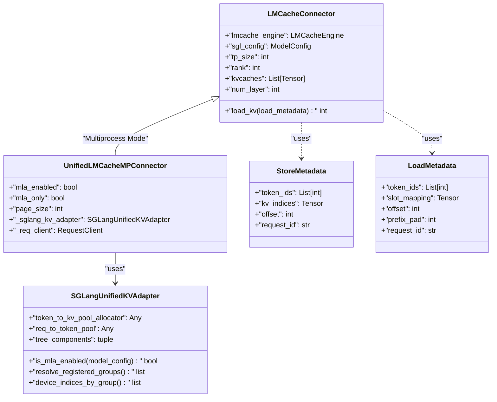
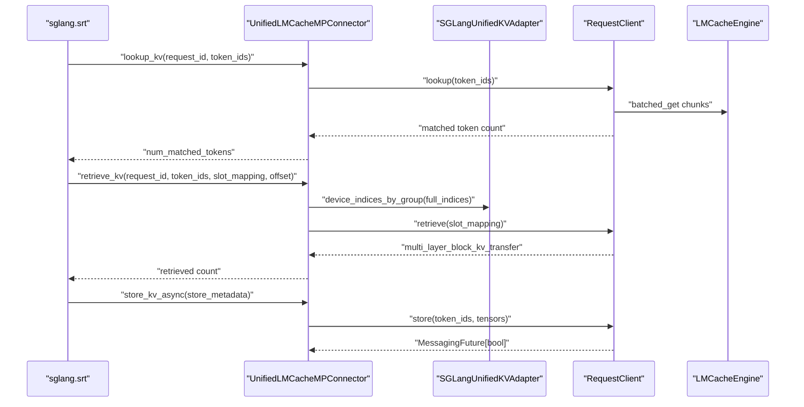

<!-- source: DeepWiki mcp.deepwiki.com · repo LMCache/LMCache · page 3.2 SGLang Integration · fetched 2026-10-21 -->

# SGLang Integration

Relevant source files

The following files were used as context for generating this wiki page:

- [docs/design/v1/multiprocess/kv_load_policy.md](docs/design/v1/multiprocess/kv_load_policy.md)
- [docs/source/developer_guide/architecture.rst](docs/source/developer_guide/architecture.rst)
- [docs/source/internal_api_server/common_apis.rst](docs/source/internal_api_server/common_apis.rst)
- [docs/source/internal_api_server/controller_apis.rst](docs/source/internal_api_server/controller_apis.rst)
- [docs/source/internal_api_server/internal_api_server.rst](docs/source/internal_api_server/internal_api_server.rst)
- [docs/source/kv_cache/storage_backends/eic.rst](docs/source/kv_cache/storage_backends/eic.rst)
- [docs/source/production/observability/vllm_endpoint.rst](docs/source/production/observability/vllm_endpoint.rst)
- [lmcache/integration/sglang/lmcache_mp_metadata.py](lmcache/integration/sglang/lmcache_mp_metadata.py)
- [lmcache/integration/sglang/sglang_adapter.py](lmcache/integration/sglang/sglang_adapter.py)
- [lmcache/integration/sglang/unified_kv_adapter.py](lmcache/integration/sglang/unified_kv_adapter.py)
- [lmcache/integration/sglang/unified_lmcache_mp_connector.py](lmcache/integration/sglang/unified_lmcache_mp_connector.py)
- [lmcache/integration/sglang/utils.py](lmcache/integration/sglang/utils.py)
- [lmcache/v1/config_base.py](lmcache/v1/config_base.py)
- [lmcache/v1/gpu_connector/kv_format/specs/nl_x_nb_bs_nh_hs.py](lmcache/v1/gpu_connector/kv_format/specs/nl_x_nb_bs_nh_hs.py)
- [lmcache/v1/internal_api_server/vllm/conf_api.py](lmcache/v1/internal_api_server/vllm/conf_api.py)
- [lmcache/v1/multiprocess/futures.py](lmcache/v1/multiprocess/futures.py)
- [lmcache/v1/multiprocess/kv_load_policy.py](lmcache/v1/multiprocess/kv_load_policy.py)
- [tests/v1/data/test_config.yaml](tests/v1/data/test_config.yaml)
- [tests/v1/multiprocess/test_futures.py](tests/v1/multiprocess/test_futures.py)
- [tests/v1/test_config.py](tests/v1/test_config.py)
- [tests/v1/test_unified_sglang_mp_connector.py](tests/v1/test_unified_sglang_mp_connector.py)

## Purpose and Scope

This page documents how LMCache integrates with the SGLang LLM serving engine via the `--enable-lmcache` flag and corresponding configuration options. It details configuration loading via `lmcache_get_config()` [lmcache/integration/sglang/utils.py:15-31](), engine initialization in `init_lmcache_engine()` [lmcache/integration/sglang/sglang_adapter.py:67-140](), adapter classes (`LMCacheConnector` and `UnifiedLMCacheMPConnector`), the SGLang unified KV adapter (`SGLangUnifiedKVAdapter`), differences from vLLM integration, and Radix Attention Cache coordination.

For vLLM integration, see [vLLM V1 Integration](). For the underlying engine, see [LMCache Engine V1]().

Sources: [lmcache/integration/sglang/sglang_adapter.py:67-212](), [lmcache/integration/sglang/utils.py:15-31](), [lmcache/integration/sglang/unified_lmcache_mp_connector.py:64-177](), [lmcache/integration/sglang/unified_kv_adapter.py:21-137]()

---

## Overview

LMCache attaches to SGLang as an external KV cache offloading layer. SGLang exposes its KV cache as separate key and value pool tensors per layer (`k_pool` and `v_pool`) or through its unified radix cache component structures. Adapter classes translate SGLang's pool-based APIs into operations on `LMCacheEngine` or standalone multiprocess request clients.

The integration supports both in-process embedded modes and multi-process decoupled modes. In multi-process mode, SGLang talks to a standalone LMCache server daemon via ZeroMQ or gRPC (`RequestClientFactory`), enabling process isolation and shared caching across multiple SGLang instances.

| File | Role / Code Entities |
|------|----------------------|
| `lmcache/integration/sglang/utils.py` | Config loading utility `lmcache_get_config()` and engine name constant `ENGINE_NAME` [lmcache/integration/sglang/utils.py:7-31]() |
| `lmcache/integration/sglang/sglang_adapter.py` | In-process adapter `LMCacheConnector`, `StoreMetadata`, `LoadMetadata`, and `init_lmcache_engine()` [lmcache/integration/sglang/sglang_adapter.py:50-140]() |
| `lmcache/integration/sglang/unified_lmcache_mp_connector.py` | Multi-process unified adapter `UnifiedLMCacheMPConnector`, request client binding, and asynchronous futures [lmcache/integration/sglang/unified_lmcache_mp_connector.py:64-177]() |
| `lmcache/integration/sglang/unified_kv_adapter.py` | SGLang KV pool adapter `SGLangUnifiedKVAdapter`, mapping `ComponentType` (`FULL`, `SWA`, `MAMBA`) to LMCache groups [lmcache/integration/sglang/unified_kv_adapter.py:21-137]() |

SGLang enables LMCache through the `--enable-lmcache` flag, while configuration is supplied via a YAML file specified by `--lmcache-config-file`.

Sources: [lmcache/integration/sglang/utils.py:7-31](), [lmcache/integration/sglang/sglang_adapter.py:50-140](), [lmcache/integration/sglang/unified_lmcache_mp_connector.py:64-177](), [lmcache/integration/sglang/unified_kv_adapter.py:21-137]()

---

## Configuration Loading and Engine Initialization

Configuration for SGLang mode is loaded through `lmcache_get_config()` in `lmcache/integration/sglang/utils.py` [lmcache/integration/sglang/utils.py:15-31](). If a config file path is provided, `LMCacheEngineConfig.from_file()` is invoked [lmcache/integration/sglang/utils.py:27](); otherwise, `LMCacheEngineConfig.from_defaults()` builds configuration from `LMCACHE_*` environment variables [lmcache/integration/sglang/utils.py:29]().

`init_lmcache_engine()` in `lmcache/integration/sglang/sglang_adapter.py` constructs the `LMCacheEngine` instance [lmcache/integration/sglang/sglang_adapter.py:67-140](). It inspects `model_config.num_hidden_layers` [lmcache/integration/sglang/sglang_adapter.py:105]() and determines MLA usage via `_model_uses_mla()` [lmcache/integration/sglang/sglang_adapter.py:107](). For MLA models, `kv_shape` is structured as `(num_layer, 1, chunk_size, 1, kv_head_dim)` [lmcache/integration/sglang/sglang_adapter.py:111](); for MHA models, it is structured as `(num_layer, 2, chunk_size, num_kv_head, head_dim)` [lmcache/integration/sglang/sglang_adapter.py:115]().

Sources: [lmcache/integration/sglang/utils.py:15-31](), [lmcache/integration/sglang/sglang_adapter.py:67-140]()

---

## Adapter Classes and Radix Attention Cache Coordination

### Diagram: SGLang Adapter Class Hierarchy and Code Entities

Sources: [lmcache/integration/sglang/sglang_adapter.py:49-65](), [lmcache/integration/sglang/sglang_adapter.py:143-208](), [lmcache/integration/sglang/unified_lmcache_mp_connector.py:64-177](), [lmcache/integration/sglang/unified_kv_adapter.py:21-137]()

---

### `LMCacheConnector` (In-Process Mode)

`LMCacheConnector` is the in-process connector used when LMCache is embedded into the same process as SGLang. It is initialized with:

- `sgl_config`: SGLang `ModelConfig` [lmcache/integration/sglang/sglang_adapter.py:146]().
- `tp_size`: Tensor parallel size [lmcache/integration/sglang/sglang_adapter.py:147]().
- `rank`: Local/global tensor parallel rank [lmcache/integration/sglang/sglang_adapter.py:148]().
- `k_pool`, `v_pool`: Lists of per-layer key and value tensors representing SGLang's KV caches [lmcache/integration/sglang/sglang_adapter.py:149-150]().
- `config_file`: Path to LMCache YAML configuration [lmcache/integration/sglang/sglang_adapter.py:151]().

The connector detects MLA usage and concatenates KV cache pools accordingly (`k_pool` alone if MLA, else `k_pool + v_pool`) for `kvcaches` [lmcache/integration/sglang/sglang_adapter.py:180](). It initializes the LMCache engine via `init_lmcache_engine()` and calls `post_init()` to bind the caches [lmcache/integration/sglang/sglang_adapter.py:168-183]().

The `load_kv()` method accepts `LoadMetadata`, converts token IDs and slot mappings to device tensors, and calls `lmcache_engine.retrieve()` to populate the KV caches from LMCache [lmcache/integration/sglang/sglang_adapter.py:189-207]().

Sources: [lmcache/integration/sglang/sglang_adapter.py:143-212]()

---

### `UnifiedLMCacheMPConnector` and `SGLangUnifiedKVAdapter` (Multi-Process Mode)

`UnifiedLMCacheMPConnector` is designed for multi-process mode, interacting with a standalone LMCache server daemon over ZeroMQ or gRPC transports [lmcache/integration/sglang/unified_lmcache_mp_connector.py:64-90](). 

It collaborates with `SGLangUnifiedKVAdapter` to map SGLang's unified radix cache components (`FULL`, `SWA`, `MAMBA`) into LMCache's group structures [lmcache/integration/sglang/unified_kv_adapter.py:21-137]().

Key mechanisms include:
- **Component Resolution**: `SGLangUnifiedKVAdapter.resolve_registered_groups()` inspects `tree_components` and `mamba_component` to organize full attention pools, sliding window attention (SWA) sub-pools, and recurrent state tensors [lmcache/integration/sglang/unified_kv_adapter.py:68-137]().
- **Geometry Validation**: It verifies that tokens per block are multiples of slots per block, and checks tensor continuity and device alignment across all registered KV tensors [lmcache/integration/sglang/unified_lmcache_mp_connector.py:113-170]().
- **Asynchronous Transport Clients**: `RequestClientFactory.create()` provisions the client to dispatch asynchronous lookups, retrievals, and store operations without blocking SGLang's event loop [lmcache/integration/sglang/unified_lmcache_mp_connector.py:88-90]().

Sources: [lmcache/integration/sglang/unified_lmcache_mp_connector.py:64-177](), [lmcache/integration/sglang/unified_kv_adapter.py:21-137]()

---

## Data Flow

### Diagram: SGLang Request KV Lifecycle and Code Entities

Sources: [lmcache/integration/sglang/unified_lmcache_mp_connector.py:64-177](), [lmcache/integration/sglang/unified_kv_adapter.py:147-162]()

---

## GPU Connectors for SGLang

The GPU connector for SGLang is selected via the factory method `CreateGPUConnector()` with engine type `EngineType.SGLANG` [lmcache/integration/sglang/sglang_adapter.py:130](). It supports different KV cache memory layouts:

| Property / Hint          | Structure                                                                          | Description                          |
|-------------------------|------------------------------------------------------------------------------------|------------------------------------|
| `kv_list_layout` = "k_v" | 2 lists (key and value) of length `num_layers` each                               | SGLang MHA pool layout              |
| `tokens_per_block`       | Folded memory buffer split by chunks, suitable for multi-process caching          | Managed through multi-process daemon|
| `use_mla` (MLA flag)     | Tensor shape: `(num_layers, 1, chunk_size, 1, kv_head_dim)`                       | MLA-style layout for SGLang MLA usage|

Sources: [lmcache/integration/sglang/sglang_adapter.py:108-111](), [lmcache/integration/sglang/unified_lmcache_mp_connector.py:113-177](), [lmcache/integration/sglang/unified_kv_adapter.py:21-137]()

---

## Differences from vLLM Integration

- **KV Layout**: vLLM uses unified paged memory via `VLLMPagedMem` connectors, exposing a single contiguous KV cache. SGLang exposes split key and value pools per layer (`k_pool` and `v_pool`) or unified radix cache pools managed via `SGLangUnifiedKVAdapter` [lmcache/integration/sglang/unified_kv_adapter.py:70-137]().
- **Initialization Entrypoint**: SGLang integration is opt-in with the `--enable-lmcache` flag and initialized with `init_lmcache_engine()` [lmcache/integration/sglang/sglang_adapter.py:67-140](). vLLM uses an extended `KVConnectorBase_V1` plugin pattern.
- **Multi-Process Adapter**: SGLang's MP adapter (`UnifiedLMCacheMPConnector`) integrates closely with SGLang's radix cache tree components (`ComponentType.FULL`, `ComponentType.SWA`, `ComponentType.MAMBA`) and returns asynchronous `MessagingFuture` objects [lmcache/integration/sglang/unified_lmcache_mp_connector.py:64-177](), [lmcache/integration/sglang/unified_kv_adapter.py:80-134]().

Sources: [lmcache/integration/sglang/sglang_adapter.py:67-140](), [lmcache/integration/sglang/unified_lmcache_mp_connector.py:64-177](), [lmcache/integration/sglang/unified_kv_adapter.py:80-134]()

---

## Limitations and Notes

- **MLA Support**: MLA models require a positive KV cache row width (`kv_head_dim`) set in initialization [lmcache/integration/sglang/sglang_adapter.py:109-111](). This dimension may differ from the model attention head dimension.
- **Multi-Process IPC Requirements**: The multi-process adapter demands platform support for memory handle transfer, timeline semaphore event IPC, and a shared cache context. Without these, zero-copy sharing cannot be completed.
- **Tensor Continuity**: LMCache MP requires contiguous SGLang NHD or MLA tensors during multi-layer block transfers [lmcache/integration/sglang/unified_lmcache_mp_connector.py:122-125]().

Sources: [lmcache/integration/sglang/sglang_adapter.py:109-111](), [lmcache/integration/sglang/unified_lmcache_mp_connector.py:122-125]()

---

# Summary

The SGLang integration in LMCache is a specialized extension activated via `--enable-lmcache`. It adapts SGLang's KV cache layout and radix cache components (`SGLangUnifiedKVAdapter`) through an in-process connector (`LMCacheConnector`) or a multi-process adapter (`UnifiedLMCacheMPConnector`) connecting remotely to an LMCache daemon. This integration manages tokens at chunk-level granularity, supports MLA and MHA attention variants, and ensures efficient GPU transfers with zero-copy IPC where available.

Sources: [lmcache/integration/sglang/sglang_adapter.py:67-212](), [lmcache/integration/sglang/unified_lmcache_mp_connector.py:64-177](), [lmcache/integration/sglang/unified_kv_adapter.py:21-137]()

---

# References

- `lmcache/integration/sglang/utils.py:7-31`
- `lmcache/integration/sglang/sglang_adapter.py:1-212`
- `lmcache/integration/sglang/unified_lmcache_mp_connector.py:1-177`
- `lmcache/integration/sglang/unified_kv_adapter.py:1-137`

---

