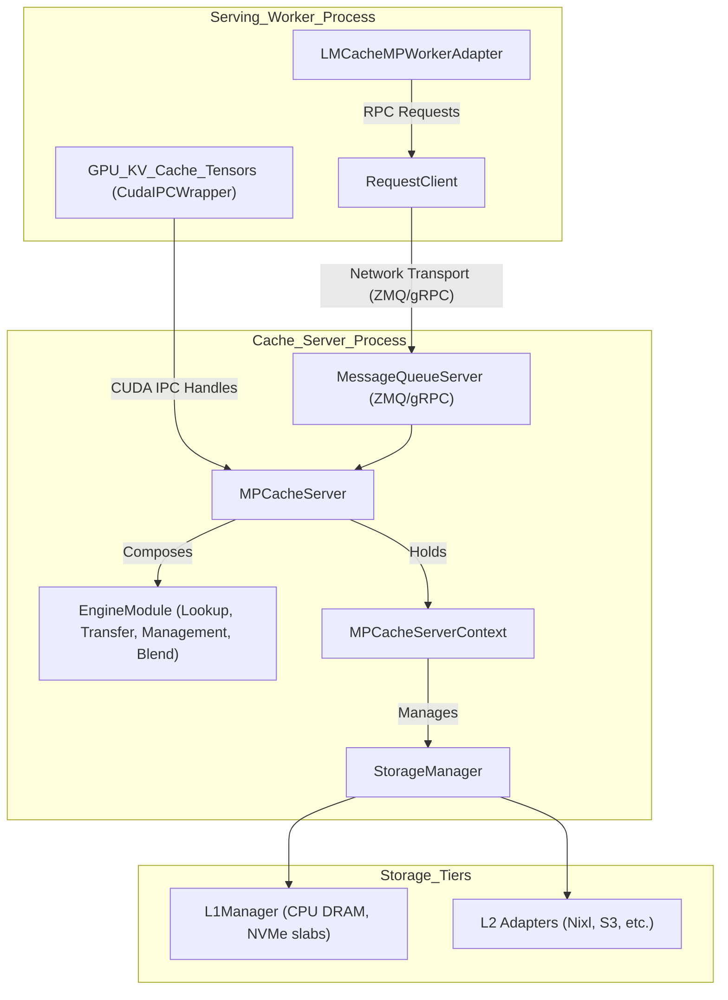
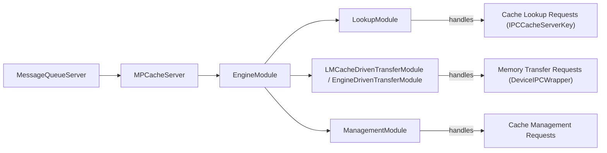

<!-- source: DeepWiki mcp.deepwiki.com · repo LMCache/LMCache · page 3.3 Multi-Process Cache Server · fetched 2026-10-21 -->

# Multi-Process Cache Server

Relevant source files

The following files were used as context for generating this wiki page:

- [docs/design/v1/multiprocess/transport/request_transport.md](docs/design/v1/multiprocess/transport/request_transport.md)
- [docs/source/cli/server.rst](docs/source/cli/server.rst)
- [docs/source/kv_cache/multiprocess_mode.rst](docs/source/kv_cache/multiprocess_mode.rst)
- [docs/source/mp/configuration.rst](docs/source/mp/configuration.rst)
- [docs/source/mp/deployment.rst](docs/source/mp/deployment.rst)
- [docs/source/mp/index.rst](docs/source/mp/index.rst)
- [examples/multi_process/lmcache-daemonset.yaml](examples/multi_process/lmcache-daemonset.yaml)
- [examples/multi_process/vllm-deployment.yaml](examples/multi_process/vllm-deployment.yaml)
- [lmcache/v1/multiprocess/config.py](lmcache/v1/multiprocess/config.py)
- [lmcache/v1/multiprocess/custom_types.py](lmcache/v1/multiprocess/custom_types.py)
- [lmcache/v1/multiprocess/engine_context.py](lmcache/v1/multiprocess/engine_context.py)
- [lmcache/v1/multiprocess/http_server.py](lmcache/v1/multiprocess/http_server.py)
- [lmcache/v1/multiprocess/modules/lookup.py](lmcache/v1/multiprocess/modules/lookup.py)
- [lmcache/v1/multiprocess/modules/management.py](lmcache/v1/multiprocess/modules/management.py)
- [lmcache/v1/multiprocess/request_handler.py](lmcache/v1/multiprocess/request_handler.py)
- [lmcache/v1/multiprocess/rpc.py](lmcache/v1/multiprocess/rpc.py)
- [lmcache/v1/multiprocess/server.py](lmcache/v1/multiprocess/server.py)
- [lmcache/v1/multiprocess/session.py](lmcache/v1/multiprocess/session.py)
- [lmcache/v1/multiprocess/transport/base.py](lmcache/v1/multiprocess/transport/base.py)
- [lmcache/v1/multiprocess/transport/grpc_impl/method_registry.py](lmcache/v1/multiprocess/transport/grpc_impl/method_registry.py)
- [lmcache/v1/multiprocess/transport/zmq_impl/mq.py](lmcache/v1/multiprocess/transport/zmq_impl/mq.py)
- [tests/v1/multiprocess/test_cache_server.py](tests/v1/multiprocess/test_cache_server.py)
- [tests/v1/multiprocess/test_client.py](tests/v1/multiprocess/test_client.py)
- [tests/v1/multiprocess/test_config.py](tests/v1/multiprocess/test_config.py)
- [tests/v1/multiprocess/test_custom_types.py](tests/v1/multiprocess/test_custom_types.py)
- [tests/v1/multiprocess/test_ext_server_module.py](tests/v1/multiprocess/test_ext_server_module.py)
- [tests/v1/multiprocess/test_free_locks.py](tests/v1/multiprocess/test_free_locks.py)
- [tests/v1/multiprocess/test_grpc_transport.py](tests/v1/multiprocess/test_grpc_transport.py)
- [tests/v1/multiprocess/test_lookup_wait_prefetch.py](tests/v1/multiprocess/test_lookup_wait_prefetch.py)
- [tests/v1/multiprocess/test_mq.py](tests/v1/multiprocess/test_mq.py)
- [tests/v1/multiprocess/test_mq_handler_helpers.py](tests/v1/multiprocess/test_mq_handler_helpers.py)
- [tests/v1/multiprocess/test_protocols.py](tests/v1/multiprocess/test_protocols.py)
- [tests/v1/multiprocess/test_session.py](tests/v1/multiprocess/test_session.py)
- [tests/v1/multiprocess/test_unified_touch.py](tests/v1/multiprocess/test_unified_touch.py)

This page documents the standalone multi-process cache server architecture introduced in LMCache v1. It covers the core `MPCacheServer` compositor [lmcache/v1/multiprocess/server.py:99-150](), the ZMQ/gRPC transport layers [lmcache/v1/multiprocess/config.py:25-56](), GPU shared memory management via CUDA IPC [tests/v1/multiprocess/test_cache_server.py:94-134](), the `BlendEngine` for content-based caching [lmcache/v1/multiprocess/config.py:57-81](), and the FastAPI HTTP frontend [lmcache/v1/multiprocess/http_server.py:68-180](). The multi-process cache server provides a scalable backend service that LLM serving engine workers communicate with over configured network transports [docs/source/mp/index.rst:10-13]().

For technical details on how serving engine workers connect and interact with this server, see [MPCacheEngine and Request Handlers](#3.3.1). For advanced IPC GPU sharing techniques, see [CUDA IPC and Zero-Copy Transfer](#3.3.2). The cache blending algorithms and kernels are covered in [BlendEngine and Content-Based Caching](#3.3.3). The HTTP frontend with FastAPI and management dashboard is documented in [MP HTTP API and Frontend Dashboard](#3.3.4). The distributed fleet coordination is explained in [MP Coordinator and Multi-Server Fleet](#3.3.5).

---

## Architecture Overview

In multi-process mode, LMCache runs as a standalone networked service separate from the serving engine process [docs/source/mp/index.rst:10-13](). Worker processes communicate using a request/response protocol over either ZeroMQ or gRPC transports, selectable by configuration [lmcache/v1/multiprocess/config.py:25-30](). The server composes multiple engine modules to provide caching, lookup, transfer, and management services [lmcache/v1/multiprocess/server.py:99-150]().

GPU KV cache tensors are shared between processes via CUDA IPC handles using wrappers such as `CudaIPCWrapper` [tests/v1/multiprocess/test_cache_server.py:117-130](). This method enables zero-copy GPU memory transfers directly between the engine and the MP server, enhancing efficiency.

At the core, the `MPCacheServer` holds an `MPCacheServerContext`, which manages components such as the `StorageManager` for multi-tier caching and shared state [lmcache/v1/multiprocess/server.py:99-123](), [lmcache/v1/multiprocess/server.py:131-139](). The `MessageQueueServer` presents the network interface by accepting incoming requests via ZMQ or gRPC and dispatching them to the appropriate `EngineModule` handlers [tests/v1/multiprocess/test_mq.py:133-164](), [docs/source/mp/index.rst:68-84]().

Title: System Layout and Component Architecture

Sources: [lmcache/v1/multiprocess/server.py:99-150](), [lmcache/v1/multiprocess/config.py:25-56](), [tests/v1/multiprocess/test_cache_server.py:94-134](), [docs/source/mp/index.rst:68-103](), [tests/v1/multiprocess/test_mq.py:133-164]()

---

## MPCacheEngine and Request Handlers

The `MPCacheServer` acts as a compositing container assembling a set of pluggable `EngineModule` instances, each implementing a key feature of the server functionality such as lookup, transfer, session management, and optionally blending for content-based caching [lmcache/v1/multiprocess/server.py:99-150](), [lmcache/v1/multiprocess/server.py:178-191]().

Title: Request Dispatch Flow

Sources: [lmcache/v1/multiprocess/server.py:99-191](), [tests/v1/multiprocess/test_mq.py:148-164](), [lmcache/v1/multiprocess/custom_types.py:26-51]()

For a deep dive into these modules, request types, session lifecycle, and concurrency controls, see the child page [MPCacheEngine and Request Handlers](#3.3.1).

---

## CUDA IPC and Zero-Copy Transfer

LMCache leverages CUDA Inter-Process Communication (IPC) to share GPU device memory buffers efficiently between the engine and MP server processes, eliminating unnecessary data copies.

The abstract `DeviceIPCWrapper` interface defines GPU memory handles that can be serialized and sent across process boundaries [lmcache/v1/multiprocess/custom_types.py:11-13](), while `CudaIPCWrapper` handles concrete PyTorch CUDA tensors [tests/v1/multiprocess/test_cache_server.py:117-130](). Synchronization is driven via timeline semaphore event IPC handles to safely order asynchronous GPU kernels between worker and server processes [tests/v1/multiprocess/test_cache_server.py:201-215](), [docs/source/mp/configuration.rst:124-138]().

For complete technical coverage of IPC wrappers, timeline semaphores, SHM contexts, and transfer mode intricacies, see [CUDA IPC and Zero-Copy Transfer](#3.3.2).

Sources: [lmcache/v1/multiprocess/custom_types.py:11-153](), [tests/v1/multiprocess/test_cache_server.py:117-130, 201-215](), [docs/source/mp/configuration.rst:124-138]()

---

## BlendEngine and Content-Based Caching

The `BlendEngine` extends LMCache to support content-based KV cache reuse, allowing the cache to match on subsequences within token streams rather than only strict prefix matches. Activated via `--engine-type blend` [docs/source/mp/configuration.rst:107-113](), it injects the `BlendModule` to track content fingerprints and manage blend kernels alongside the standard lookup and transfer modules [docs/source/mp/index.rst:125-135]().

For exhaustive documentation on blend kernel algorithms, modules, client APIs, and subsequence matching, see [BlendEngine and Content-Based Caching](#3.3.3).

Sources: [lmcache/v1/multiprocess/config.py:57-81](), [docs/source/mp/index.rst:125-135](), [docs/source/mp/configuration.rst:107-113]()

---

## MP HTTP API and Frontend Dashboard

The `lmcache server` entry point starts the multiprocess server with an embedded FastAPI application exposing operational and diagnostic endpoints alongside the configured RPC transport [docs/source/mp/index.rst:54-61](), [docs/source/mp/http_api.rst:4-8](). It provides routes for health checks (`/healthcheck`), cache clearing (`/cache/clear`), quota tracking (`/quota`), status inspection (`/status`), and dynamic runtime plugin initialization [docs/source/mp/http_api.rst:96-188](), [docs/source/mp/configuration.rst:139-149]().

For detailed API documentation, SDK usage patterns, runtime plugin integration, and the LMCache Frontend Dashboard UI, see [MP HTTP API and Frontend Dashboard](#3.3.4).

Sources: [lmcache/v1/multiprocess/http_server.py:68-177](), [docs/source/mp/http_api.rst:4-35](), [docs/source/mp/configuration.rst:139-149]()

---

## MP Coordinator and Multi-Server Fleet

The MP Coordinator enables management of a fleet of MP cache servers across multiple nodes, facilitating membership registries, key directory consistency, and distributed caching optimizations [docs/source/mp/index.rst:10-13](), [lmcache/v1/multiprocess/http_server.py:120-143](). Peer-to-peer sharing between MP servers is coordinated via the `P2PController` module for cross-node cooperation [lmcache/v1/multiprocess/server.py:67]().

For comprehensive insights on the MP Coordinator design, instance registry protocol, cache event subscriptions, and P2P sharing topology, see [MP Coordinator and Multi-Server Fleet](#3.3.5).

Sources: [lmcache/v1/multiprocess/server.py:67](), [docs/source/mp/index.rst:10-13](), [docs/source/cli/server.rst:98-102](), [lmcache/v1/multiprocess/http_server.py:120-143]()

---

# Summary

The LMCache Multi-Process Cache Server delivers a robust, scalable backend caching service designed for LLM serving engines in multi-process or multi-container scenarios [docs/source/mp/index.rst:10-13](). Its modular `MPCacheServer` core composes engine modules for lookup, transfer, content blending, and management [lmcache/v1/multiprocess/server.py:99-150](). Communication occurs over configurable ZMQ or gRPC transports, with efficient zero-copy GPU memory sharing via CUDA IPC [lmcache/v1/multiprocess/config.py:25-30](), [tests/v1/multiprocess/test_cache_server.py:117-130]().

For implementation details and operational guidance, refer to the following child pages:

- [MPCacheEngine and Request Handlers](#3.3.1)
- [CUDA IPC and Zero-Copy Transfer](#3.3.2)
- [BlendEngine and Content-Based Caching](#3.3.3)
- [MP HTTP API and Frontend Dashboard](#3.3.4)
- [MP Coordinator and Multi-Server Fleet](#3.3.5)

---

**End of Multi-Process Cache Server Overview**

---

