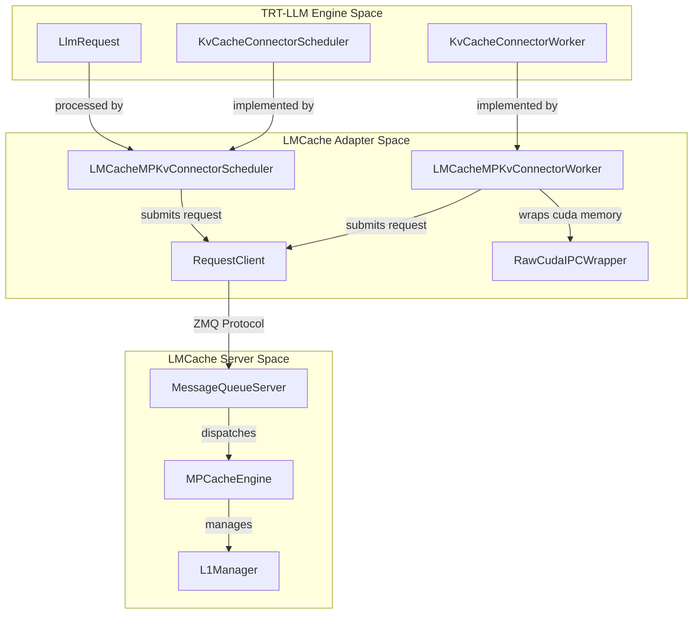
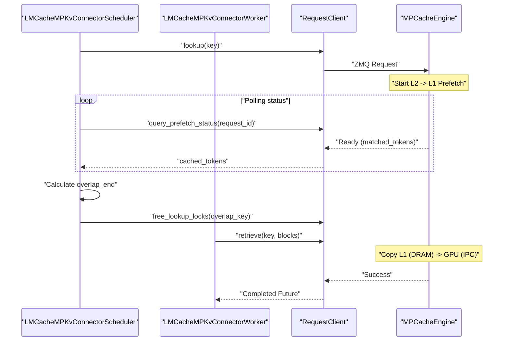

<!-- source: DeepWiki mcp.deepwiki.com · repo LMCache/LMCache · page 3.4 TensorRT-LLM Integration · fetched 2026-10-21 -->

# TensorRT-LLM Integration

<details>
<summary>Relevant source files</summary>

The following files were used as context for generating this wiki page:

- [docs/design/integration/vllm/hybrid-kv-cache-groups.md](docs/design/integration/vllm/hybrid-kv-cache-groups.md)
- [lmcache/integration/tensorrt_llm/tensorrt_mp_adapter.py](lmcache/integration/tensorrt_llm/tensorrt_mp_adapter.py)
- [lmcache/integration/vllm/lmcache_mp_connector.py](lmcache/integration/vllm/lmcache_mp_connector.py)
- [lmcache/integration/vllm/lmcache_mp_metadata.py](lmcache/integration/vllm/lmcache_mp_metadata.py)
- [lmcache/integration/vllm/vllm_multi_process_adapter.py](lmcache/integration/vllm/vllm_multi_process_adapter.py)
- [tests/v1/multiprocess/test_qstore.py](tests/v1/multiprocess/test_qstore.py)
- [tests/v1/test_mp_connector_kv_roles.py](tests/v1/test_mp_connector_kv_roles.py)
- [tests/v1/test_mp_connector_mm_keys.py](tests/v1/test_mp_connector_mm_keys.py)
- [tests/v1/test_mp_nonblocking_lookup.py](tests/v1/test_mp_nonblocking_lookup.py)
- [tests/v1/test_mp_tracker_mamba_skipped_slots.py](tests/v1/test_mp_tracker_mamba_skipped_slots.py)
- [tests/v1/test_tensorrt_mp_adapter.py](tests/v1/test_tensorrt_mp_adapter.py)
- [tests/v1/test_vllm_mp_adapter.py](tests/v1/test_vllm_mp_adapter.py)

</details>


## Purpose and Scope

This page documents the integration of LMCache with NVIDIA TensorRT-LLM (TRT-LLM) using the KV Cache Connector API. It explains the system architecture, implementation details for in-process and multi-process modes (`lmcache-mp`), how LMCache handles TRT-LLM’s specialized memory layouts and raw CUDA memory allocations via `RawCudaIPCWrapper`, cache load/save data flows, and configuration patterns.

Sources: [lmcache/integration/tensorrt_llm/tensorrt_mp_adapter.py:1-16]()

---

## Architecture Overview and Operational Modes

LMCache acts as an external KV cache manager for TRT-LLM to reduce redundant KV cache computations, accelerate Time-to-First-Token (TTFT), and enable persistent, multi-instance KV cache sharing across processes. The integration supports two operational modes:

- **In-Process Mode:** The LMCache engine runs directly within the same TRT-LLM process using `LMCacheEngine`. This is suitable for single-process evaluations where a standalone sidecar server is unnecessary.
- **Multi-Process Mode (`lmcache-mp`):** TRT-LLM worker processes communicate with a standalone LMCache server daemon via ZeroMQ request-reply transports and zero-copy CUDA IPC handles.

### Logical Component and Code Entity Mapping

The following diagram bridges natural language functional concepts to the exact code entities implementing them in the LMCache and TensorRT-LLM codebase:



Title: Component Mapping Diagram for TensorRT-LLM Integration

Sources: [lmcache/integration/tensorrt_llm/tensorrt_mp_adapter.py:23-50](), [lmcache/integration/tensorrt_llm/tensorrt_mp_adapter.py:77-90]()

---

## Multi-Process Implementation (`lmcache-mp`)

In multi-process mode, TRT-LLM delegates scheduling decisions and tensor buffer transfers to connector classes defined in the integration layer.

### Scheduler: `LMCacheMPKvConnectorScheduler`

The scheduler subclass `LMCacheMPKvConnectorScheduler` manages prefix lookups and lock reservations:
- **Prefix Lookup:** Issues `LOOKUP` requests over the `RequestClient` interface to find cached token sequences [lmcache/integration/tensorrt_llm/tensorrt_mp_adapter.py:165]().
- **Status Polling:** Periodically queries `QUERY_PREFETCH_STATUS` keyed by request ID to determine chunk residency in the server's DRAM cache [lmcache/integration/tensorrt_llm/tensorrt_mp_adapter.py:166-168]().
- **Lock Cleanup:** Explicitly releases unneeded read locks for overlapping computed tokens via `FREE_LOOKUP_LOCKS` to prevent lock leaking [lmcache/integration/tensorrt_llm/tensorrt_mp_adapter.py:180-190]().

### Worker: `LMCacheMPKvConnectorWorker`

The worker subclass `LMCacheMPKvConnectorWorker` coordinates tensor transfers and pool registration:
- **Zero-Copy Handle Sharing:** TRT-LLM allocates KV cache pools outside PyTorch's caching allocator via direct `cudaMalloc` calls (`at::for_blob`). Standard PyTorch IPC sharing fails on these allocations; hence, `RawCudaIPCWrapper` is utilized to expose raw CUDA IPC memory handles safely [lmcache/integration/tensorrt_llm/tensorrt_mp_adapter.py:10-15]().
- **Retrieve & Store Operations:** Coordinates high-performance memory transfers between server L1 cache (CPU DRAM) and worker GPU memory buffers.

Sources: [lmcache/integration/tensorrt_llm/tensorrt_mp_adapter.py:77-130]()

---

## Data Flow and Sequence

The interaction between TRT-LLM connectors and the multi-process LMCache engine follows an asynchronous request-polling-transfer pipeline:



Title: TensorRT-LLM Connector Request and Transfer Sequence

Sources: [lmcache/integration/tensorrt_llm/tensorrt_mp_adapter.py:150-190]()

---

## Memory Format and Allocation

TRT-LLM employs customized tensor shapes and layout specifications. LMCache normalizes these buffers to align with engine-agnostic chunk hashing and storage backends. Because TRT-LLM manages native memory pools without PyTorch allocator metadata, `RawCudaIPCWrapper` provides the necessary abstractions to export and import CUDA memory regions across process boundaries securely [lmcache/integration/tensorrt_llm/tensorrt_mp_adapter.py:10-15]().

Sources: [lmcache/integration/tensorrt_llm/tensorrt_mp_adapter.py:43-50]()

---

## Configuration Patterns

### Server URL Resolution

Client connectors resolve the target LMCache server address using the following fallback sequence:
1. `kv_connector_config.server_url` specified in TRT-LLM launch arguments [lmcache/integration/tensorrt_llm/tensorrt_mp_adapter.py:59-60]().
2. The `LMCACHE_SERVER_URL` environment variable [lmcache/integration/tensorrt_llm/tensorrt_mp_adapter.py:61-62]().
3. Default UNIX domain socket path: `ipc:///tmp/lmcache.sock` [lmcache/integration/tensorrt_llm/tensorrt_mp_adapter.py:53]().

Sources: [lmcache/integration/tensorrt_llm/tensorrt_mp_adapter.py:57-63]()

### Example Launch Configuration (Python API)

```python
from tensorrt_llm.llmapi.llm_args import TorchLlmArgs
from lmcache.integration.tensorrt_llm.tensorrt_mp_adapter import (
    LMCacheMPKvConnectorScheduler,
    LMCacheMPKvConnectorWorker,
)

llm_args = TorchLlmArgs(
    # ... standard TRT-LLM arguments ...
    kv_connector_config={
        "scheduler_cls": LMCacheMPKvConnectorScheduler,
        "worker_cls": LMCacheMPKvConnectorWorker,
        "server_url": "tcp://localhost:5555",
    }
)
```

Sources: [lmcache/integration/tensorrt_llm/tensorrt_mp_adapter.py:77-90]()

---

