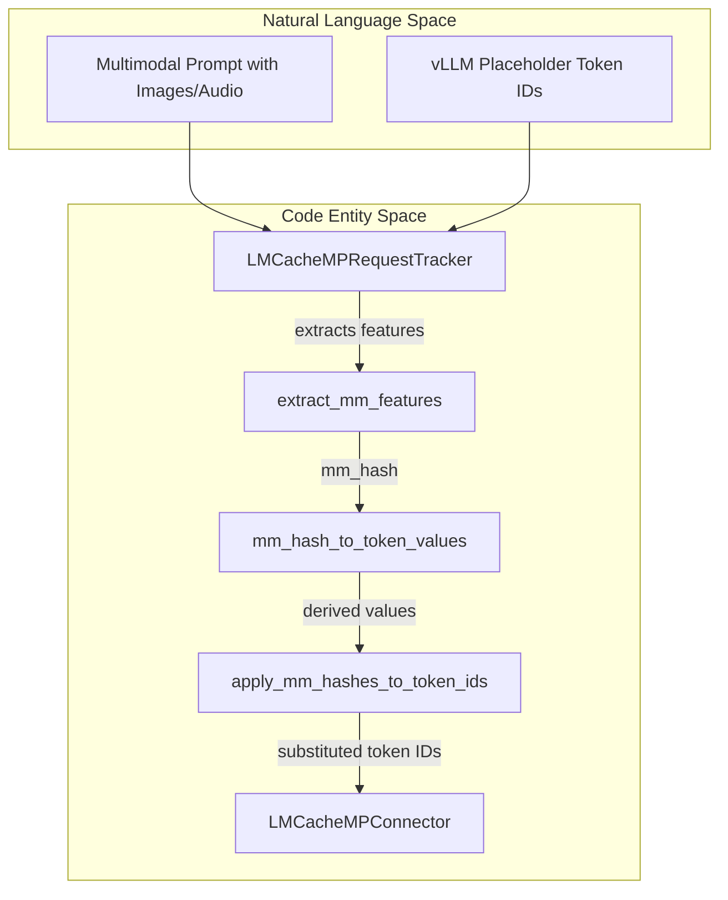
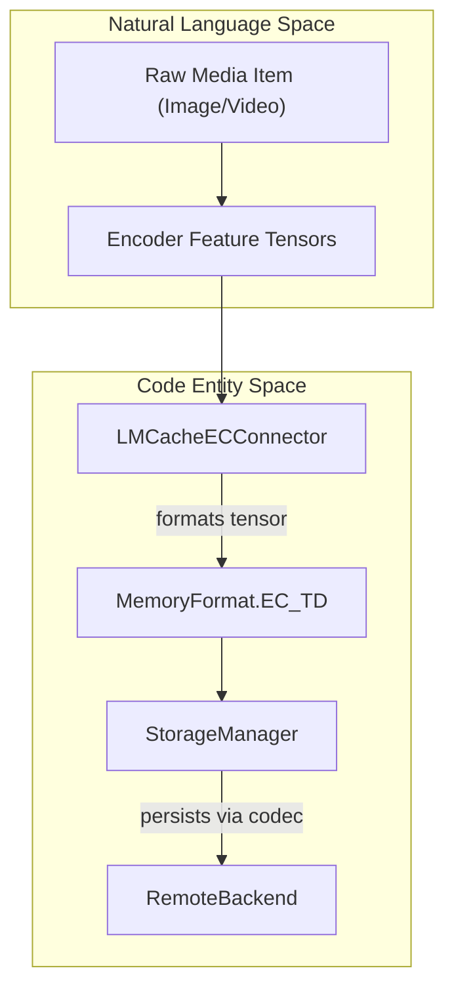

<!-- source: DeepWiki mcp.deepwiki.com · repo LMCache/LMCache · page 3.5 Encoder Cache (Non-KV Cache) · fetched 2026-10-21 -->

# Encoder Cache (Non-KV Cache)

Relevant source files

The following files were used as context for generating this wiki page:

- [docs/design/integration/vllm/hybrid-kv-cache-groups.md](docs/design/integration/vllm/hybrid-kv-cache-groups.md)
- [lmcache/integration/tensorrt_llm/tensorrt_mp_adapter.py](lmcache/integration/tensorrt_llm/tensorrt_mp_adapter.py)
- [lmcache/integration/vllm/lmcache_mp_connector.py](lmcache/integration/vllm/lmcache_mp_connector.py)
- [lmcache/integration/vllm/lmcache_mp_metadata.py](lmcache/integration/vllm/lmcache_mp_metadata.py)
- [lmcache/integration/vllm/vllm_multi_process_adapter.py](lmcache/integration/vllm/vllm_multi_process_adapter.py)
- [tests/v1/multiprocess/test_qstore.py](tests/v1/multiprocess/test_qstore.py)
- [tests/v1/test_mp_connector_kv_roles.py](tests/v1/test_mp_connector_kv_roles.py)
- [tests/v1/test_mp_connector_mm_keys.py](tests/v1/test_mp_connector_mm_keys.py)
- [tests/v1/test_mp_nonblocking_lookup.py](tests/v1/test_mp_nonblocking_lookup.py)
- [tests/v1/test_mp_tracker_mamba_skipped_slots.py](tests/v1/test_mp_tracker_mamba_skipped_slots.py)
- [tests/v1/test_tensorrt_mp_adapter.py](tests/v1/test_tensorrt_mp_adapter.py)
- [tests/v1/test_vllm_mp_adapter.py](tests/v1/test_vllm_mp_adapter.py)

The Encoder Cache (EC) feature in LMCache is designed to efficiently cache outputs from multimodal encoders (e.g., Vision Transformers processing images or video frames, audio encoders) that produce representation tensors used by LLMs. This page documents EC's purpose, architecture, key components such as the `LMCacheECConnector` for integration, the `kv_codec` quantization and serialization format employed, memory formats specific to EC, and the storage management approach for EC tensors.

Sources: `[docs/source/index.rst:98-98](), [docs/source/recipes/multimodal_models.rst:23-25]()`

## Overview and Purpose

Multimodal models often expend significant computation encoding large inputs (images, video frames, audio clips) into feature embeddings before using LLMs for multimodal reasoning. The **Encoder Cache** feature in LMCache accelerates inference by:

- Caching encoder outputs as single dense tensors per media item, identified uniquely via a multimodal hash (`mm_hash`).
- Bypassing repeated encoder computation to reduce Time-to-First-Token (TTFT) for multimodal requests on identical media.
- Supporting deduplication of encoder outputs across tensor parallel (TP) ranks, since such encoder outputs typically replicate across ranks.

### Key Differentiators from KV Cache

| Feature                | KV Cache                      | Encoder Cache (EC)                   |
|------------------------|------------------------------|------------------------------------|
| **Structure**          | Multi-layer, chunked, paged  | Single tensor per media item       |
| **Cache Keying**       | Token ID sequences (prefixes)| Multimodal Hash (`mm_hash`)        |
| **Granularity**        | Granular, layer-wise          | Atomic (full encoder output)       |
| **Deduplication**      | Distributed caching            | Replicated and logically grouped by rank 0 |

Sources: `[docs/source/recipes/multimodal_models.rst:10-25](), [docs/design/integration/vllm/multimodal_cache_keying.md:1-17]()`

## System Architecture & Code Entity Space

The Encoder Cache system parallels the KV cache engine architecture but specializes for multimodal encoder outputs with dedicated memory formats and configuration namespaces. Integration code transforms multimodal inputs into unique `mm_hash` identifiers, which then derive cache keys and token IDs with substitutions for placeholders.

### Diagram: Multimodal Token Extraction and Keying Bridge

Sources: `[docs/design/integration/vllm/multimodal_cache_keying.md:20-46](), [lmcache/integration/vllm/lmcache_mp_metadata.py:83-104]()`

### Diagram: Encoder Cache Storage and Retrieval Pipeline Bridge

Sources: `[docs/source/recipes/multimodal_models.rst:23-25](), [lmcache/v1/storage_backend/storage_manager.py:20-145]()`

## Core Components

### Multimodal Cache Keying and Token ID Substitution

A central challenge for multimodal caching is *cache key determinism and uniqueness* for multimodal inputs. vLLM presents identical placeholder token IDs for every multimodal item, which, if not corrected, causes cache collisions and cross-contamination of different images or audio cached states.

LMCache resolves this by:

- Using a deterministic hash (`mm_hash`) as a unique modality identifier for each encoder input (`[docs/design/integration/vllm/multimodal_cache_keying.md:20-24]()`).
- The function `mm_hash_to_token_values` maps `mm_hash` + token span length to fixed-length, stable sequences of integer token values representing that multimodal input (`[docs/design/integration/vllm/multimodal_cache_keying.md:20-41]()`).
- These token values **replace** placeholder token IDs in the prompt tokens (`apply_mm_hashes_to_token_ids`) to produce unique token sequences for cache key derivation (`[docs/design/integration/vllm/multimodal_cache_keying.md:42-46]()`).
- This positional dependent substitution preserves partial-prefix consistency and encodes full entropy for token uniqueness (`[docs/design/integration/vllm/multimodal_cache_keying.md:24-41]()`).
- `LMCacheMPRequestTracker` (in `lmcache/integration/vllm/lmcache_mp_metadata.py`) applies these substitutions in its constructor and tracker methods, ensuring the engine uses corrected keys for storage/retrieval (`[lmcache/integration/vllm/lmcache_mp_metadata.py:83-104]()`).

Sources: `[docs/design/integration/vllm/multimodal_cache_keying.md:1-49](), [tests/v1/test_mm_hash_utils.py:32-44](), [lmcache/integration/vllm/lmcache_mp_metadata.py:83-104]()`

### Memory Format and Allocation for EC Tensors

Encoder Cache tensors use specialized memory formats in LMCache's memory management system, registered through the `MemoryFormat` enum:

| Format            | Description                          | Shape                    |
|-------------------|------------------------------------|--------------------------|
| `EC_TD`           | Encoder Cache tensor (EC)           | `[num_tokens, hidden_dim]` |
| `HS_TD`           | Hidden-State cache tensor           | `[num_tokens, hidden_dim]` (distinguished logically from EC) |

Both use token dimension index 0.

Sources: `[docs/source/recipes/multimodal_models.rst:23-25]()`

### LMCacheECConnector

The `LMCacheECConnector` is the primary interface class integrating the Encoder Cache into serving engines such as vLLM:

- It manages encoding outputs as single tensor objects per multimodal input identified by `mm_hash` (`[docs/source/recipes/multimodal_models.rst:15-25]()`).
- Uses encoding tensor format `EC_TD` for consistent in-memory representation (`[docs/source/recipes/multimodal_models.rst:23-25]()`).
- Works closely with request trackers and the storage manager to load/save encoded tensors (`[docs/design/integration/vllm/multimodal_cache_keying.md:100-106]()`).
- Supports chunking, serialization, and prefetching optimized for large encoder outputs (`[docs/source/recipes/multimodal_models.rst:10-25]()`).
- Handles deduplication, especially across TP ranks, by assigning the logical "rank 0" to store/retrieve shared encoder features (`[docs/source/recipes/multimodal_models.rst:10-25]()`).

Sources: `[docs/source/recipes/multimodal_models.rst:10-25](), [docs/design/integration/vllm/multimodal_cache_keying.md:100-106]()`

## KV Codec and Serialization Formats

To efficiently store and transmit encoder cache tensors, LMCache supports flexible serialization and quantization via the `kv_codec` subsystem:

- The `remote_serde` config option chooses the serialization codec, defaulting to `"naive"` (`[docs/source/recipes/multimodal_models.rst:10-25]()`).
- Codecs support quantization and compression suited for high-dimensional tensors like encoder outputs (`[docs/source/recipes/multimodal_models.rst:35-40]()`).
- For multimodal models, precise storage with support for `MemoryFormat.EC_TD` is ensured (`[docs/source/recipes/multimodal_models.rst:23-25]()`).
- For Multi-Level Attention (MLA) models (e.g., DeepSeek), LMCache supports the `KV_MLA_FMT` format (`[docs/source/recipes/multimodal_models.rst:10-25]()`).
- The codec system tightly integrates with the storage manager and GPU connector for efficient end-to-end flow (`[docs/source/recipes/multimodal_models.rst:10-25]()`).

Additionally, the `remote_enable_mla_worker_id_as0` config allows multiple workers to share keys by using `worker_id=0`, enabling deduplication of encoded features across distributed ranks and devices (`[docs/source/recipes/multimodal_models.rst:10-25]()`).

Sources: `[docs/source/recipes/multimodal_models.rst:10-40]()`

## Storage Management for Encoder Cache

The Encoder Cache tensors are managed through LMCache's existing storage backend architecture under `StorageManager`:

- **LocalCPUBackend:**  
  Stores encoder cache tensors as pinned CPU host memory objects. It uses a `WeightedSemaphore` mechanism to maintain chunk budget accounting and prevent deadlocks during concurrent large tensor allocations (`[docs/source/recipes/multimodal_models.rst:10-25]()`).  
  Supports synchronous put/get operations with thread-safe locks and retains statistics (`[docs/source/recipes/multimodal_models.rst:10-25]()`).

- **LocalDiskBackend:**  
  Offloads encoder cache tensors to disk across configurable directory shards using `PathSharder` for balanced file distribution (`[docs/source/recipes/multimodal_models.rst:10-25]()`).  
  Manages async IO with thread pools and prioritizes put/prefetch operations (`[docs/source/recipes/multimodal_models.rst:10-25]()`).

- **RemoteBackend:**  
  Connects to remote storage services or plugins, handling communication, serialization/deserialization via configured `kv_codec` (`[docs/source/recipes/multimodal_models.rst:10-25]()`).  
  Manages connection health, retries, and supports synchronous and asynchronous cached object retrieval (`[docs/source/recipes/multimodal_models.rst:10-25]()`).

The storage manager coordinates these tiers transparently for EC-type entries, ensuring efficient lifecycle management and retrieval (`[docs/source/recipes/multimodal_models.rst:10-25]()`).

Sources: `[docs/source/recipes/multimodal_models.rst:10-25]()`

---

