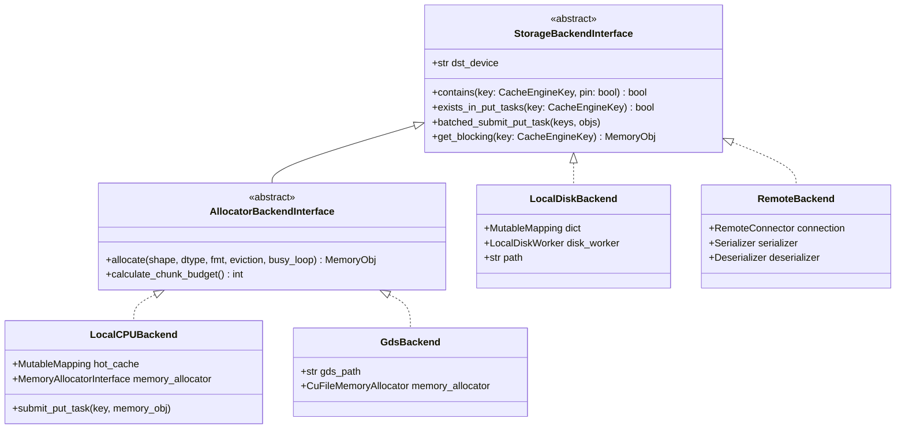
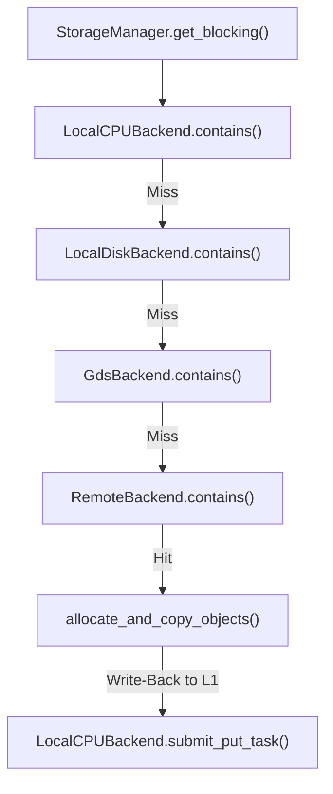

<!-- source: DeepWiki mcp.deepwiki.com · repo LMCache/LMCache · page 4 Storage Architecture · fetched 2026-10-21 -->

# Storage Architecture

Relevant source files

The following files were used as context for generating this wiki page:

- [docs/design/v1/distributed/l2_adapters/dax.md](docs/design/v1/distributed/l2_adapters/dax.md)
- [docs/source/kv_cache/storage_backends/dax.rst](docs/source/kv_cache/storage_backends/dax.rst)
- [docs/source/kv_cache/storage_backends/fs.rst](docs/source/kv_cache/storage_backends/fs.rst)
- [docs/source/kv_cache/storage_backends/index.rst](docs/source/kv_cache/storage_backends/index.rst)
- [lmcache/observability.py](lmcache/observability.py)
- [lmcache/v1/distributed/l2_adapters/dax_l2_adapter.py](lmcache/v1/distributed/l2_adapters/dax_l2_adapter.py)
- [lmcache/v1/distributed/l2_adapters/reconfiguration.py](lmcache/v1/distributed/l2_adapters/reconfiguration.py)
- [lmcache/v1/memory_management.py](lmcache/v1/memory_management.py)
- [lmcache/v1/multiprocess/http_apis/reconfigure_api.py](lmcache/v1/multiprocess/http_apis/reconfigure_api.py)
- [lmcache/v1/storage_backend/__init__.py](lmcache/v1/storage_backend/__init__.py)
- [lmcache/v1/storage_backend/abstract_backend.py](lmcache/v1/storage_backend/abstract_backend.py)
- [lmcache/v1/storage_backend/dax/__init__.py](lmcache/v1/storage_backend/dax/__init__.py)
- [lmcache/v1/storage_backend/dax/core.py](lmcache/v1/storage_backend/dax/core.py)
- [lmcache/v1/storage_backend/local_cpu_backend.py](lmcache/v1/storage_backend/local_cpu_backend.py)
- [lmcache/v1/storage_backend/local_disk_backend.py](lmcache/v1/storage_backend/local_disk_backend.py)
- [lmcache/v1/storage_backend/plugins/dax_backend.py](lmcache/v1/storage_backend/plugins/dax_backend.py)
- [lmcache/v1/storage_backend/remote_backend.py](lmcache/v1/storage_backend/remote_backend.py)
- [lmcache/v1/storage_backend/storage_manager.py](lmcache/v1/storage_backend/storage_manager.py)
- [tests/test_observability.py](tests/test_observability.py)
- [tests/v1/multiprocess/http_apis/test_reconfigure_api.py](tests/v1/multiprocess/http_apis/test_reconfigure_api.py)
- [tests/v1/storage_backend/test_dax_backend.py](tests/v1/storage_backend/test_dax_backend.py)
- [tests/v1/storage_backend/test_local_cpu_backend.py](tests/v1/storage_backend/test_local_cpu_backend.py)
- [tests/v1/storage_backend/test_local_disk_backend.py](tests/v1/storage_backend/test_local_disk_backend.py)
- [tests/v1/storage_backend/test_storage_manager.py](tests/v1/storage_backend/test_storage_manager.py)
- [tests/v1/test_address_manager.py](tests/v1/test_address_manager.py)
- [tests/v1/test_memory_management.py](tests/v1/test_memory_management.py)

## Purpose and Scope

This document describes LMCache's multi-tier storage architecture designed for KV cache persistence in LLM serving scenarios. It outlines the structure of the storage backend interface hierarchy, major backend implementations across local CPU memory, disk, remote, GPU Direct Storage (GDS), and NIXL channels. The `StorageManager` is introduced as the central coordinator managing backend cooperation, memory object lifecycle, and data transfers.

As a parent page, it provides a high-level overview and directs to detailed child pages dedicated to each backend type and subsystems:
- [Storage Backend Interface](#4.1) — Document `StorageBackendInterface` and `AllocatorBackendInterface` abstract classes and their contract.
- [Storage Manager](#4.2) — Explain `StorageManager` coordination, `get_active_storage_backends`, search order, job executors, cache policies, and auto write-back.
- [Local CPU Backend](#4.3) — Document `LocalCPUBackend`, hot cache (`OrderedDict`), eviction policies, and NUMA-aware allocation.
- [Local Disk Backend](#4.4) — Explain `LocalDiskBackend`, `LocalDiskWorker`, async disk I/O, `O_DIRECT` usage, and alignment requirements.
- [Remote Storage Backend](#4.5) — Document `RemoteBackend` architecture, connector pattern, serialization/deserialization, and MLA mode handling.
- [GPU Direct Storage Backend](#4.6) — Explain `GdsBackend`, `CuFileMemoryAllocator`, cuFile operations, and GDS/GDS_MT/HF3FS modes.
- [NIXL Storage Backend](#4.7) — Document `NixlStorageBackend`, transfer channels (UCX, POSIX, GDS), and `nixl_backends` configuration.
- [Storage Connectors](#4.8) — Detail `RemoteConnector` implementations (FS, Redis, Valkey, S3, Mooncake, HyperPod, EIC, Azure, HFBucket, Bigtable), `CreateConnector` factory, adapters, and plugin architecture.
- [Batched Operations and Async Loading](#4.9) — Document `batched_get`, `batched_put`, `async_lookup_and_prefetch`, `WeightedSemaphore`, batched message sender, and `AsyncMultiSerializer`.
- [Storage Plugins and Native Connectors](#4.10) — Explain `storage_plugin_launcher`, `ConnectorAdapter` interface, dynamic plugin loading, the Rust raw block backend, DAX backend, and native C++ connectors under `csrc/storage_backends`.

For details, see the respective child sections and pages.

Sources: `lmcache/v1/storage_backend/__init__.py`, `lmcache/v1/storage_backend/abstract_backend.py`, `lmcache/v1/storage_backend/storage_manager.py`

---

## Storage Backend Interface Hierarchy

LMCache standardizes storage backends using abstract interfaces defined in `lmcache/v1/storage_backend/abstract_backend.py`. The base class `StorageBackendInterface` defines the core contract for cache operations such as containment checks, asynchronous put task submission, and synchronous retrieval [lmcache/v1/storage_backend/abstract_backend.py:27-140](). The `AllocatorBackendInterface` extends this contract by introducing memory allocation methods (`allocate`) and buffer budget calculation, enabling backends to manage their own memory objects and evictions [lmcache/v1/storage_backend/abstract_backend.py:27-102]().

Concrete backend classes implement these interfaces to target specific physical storage media, ranging from RAM-backed hot caches to persistent filesystems, network storage, and specialized direct I/O engines.

### Diagram: Storage Backend Code Entities

Sources: `lmcache/v1/storage_backend/abstract_backend.py`, `lmcache/v1/storage_backend/local_cpu_backend.py`, `lmcache/v1/storage_backend/remote_backend.py`, `lmcache/v1/storage_backend/gds_backend.py`

For detailed interface specifications, see [Storage Backend Interface](#4.1).

---

## Multi-Tier Storage Hierarchy and Coordination

The storage system is organized hierarchically into multiple tiers managed by `StorageManager` (`lmcache/v1/storage_backend/storage_manager.py`):
- **Tier 1 (L1):** Local CPU memory via `LocalCPUBackend`, acting as the hot cache [lmcache/v1/storage_backend/local_cpu_backend.py:42-65]().
- **Tier 2 (L2):** Local disk storage (`LocalDiskBackend`), GPU Direct Storage (`GdsBackend`), and NIXL or other local channels [lmcache/v1/storage_backend/local_disk_backend.py:119-155]().
- **Tier 3:** Remote distributed storage through `RemoteBackend` [lmcache/v1/storage_backend/remote_backend.py:27-72]().

When retrieving a KV cache chunk, `StorageManager` coordinates a tiered search order starting from the fastest tier down to remote storage. Upon hitting a lower tier, data objects are copied upstream into local caches via helper functions like `allocate_and_copy_objects` [lmcache/v1/storage_backend/storage_manager.py:64-120](). Concurrency across asynchronous loaders is regulated using `WeightedSemaphore` and `AsyncMultiSerializer` [lmcache/v1/storage_backend/storage_manager.py:123-195]().

### Diagram: Storage Manager Coordination Flow

Sources: `lmcache/v1/storage_backend/storage_manager.py`

For comprehensive orchestration, see [Storage Manager](#4.2), [Batched Operations and Async Loading](#4.9).

---

## Local Storage: CPU, Disk, and GPU Direct Storage

### Local CPU Backend

`LocalCPUBackend` manages the in-memory hot cache using pluggable cache policies (such as LRU or LFU via `get_cache_policy`) and memory allocators (like `MixedMemoryAllocator` or `PagedCpuGpuMemoryAllocator`) [lmcache/v1/storage_backend/local_cpu_backend.py:42-74](). It supports synchronous put tasks (`submit_put_task`), reference counting, pinning, and integration with the LMCache worker protocol for cluster-wide cache admission reporting [lmcache/v1/storage_backend/local_cpu_backend.py:150-188]().

For more details, see [Local CPU Backend](#4.3).

Sources: `lmcache/v1/storage_backend/local_cpu_backend.py`

### Local Disk Backend

`LocalDiskBackend` provides persistent local storage by sharding paths across devices (`PathSharder`) and executing asynchronous disk operations through `LocalDiskWorker` [lmcache/v1/storage_backend/local_disk_backend.py:42-176](). It supports direct OS disk block access (`O_DIRECT`), priority-queued task submission (`AsyncPQThreadPoolExecutor`), and parallel blocking reads via a dedicated thread pool [lmcache/v1/storage_backend/local_disk_backend.py:165-187]().

For more details, see [Local Disk Backend](#4.4).

Sources: `lmcache/v1/storage_backend/local_disk_backend.py`

### GPU Direct Storage Backend (GDS)

`GdsBackend` utilizes specialized direct-to-storage APIs (such as NVIDIA `cuFile`) paired with `CuFileMemoryAllocator` to transfer KV cache objects directly between storage and GPU memory without CPU staging overhead. It supports various execution modes including multi-threaded GDS and HF3FS integrations.

For more details, see [GPU Direct Storage Backend](#4.6).

Sources: `lmcache/v1/storage_backend/gds_backend.py`

---

## Remote Storage and Storage Connectors

### Remote Backend

`RemoteBackend` interfaces with remote storage services and distributed backends. It manages network connector initialization (`CreateConnector`), automatic reconnection logic, and payload serialization/deserialization via `CreateSerde` [lmcache/v1/storage_backend/remote_backend.py:27-72](). It also handles Multi-Level Attention (MLA) worker ID mapping (`_mla_worker_id_as0_mode`) to share cache instances across attention ranks [lmcache/v1/storage_backend/remote_backend.py:75-88]().

For details, see [Remote Storage Backend](#4.5).

Sources: `lmcache/v1/storage_backend/remote_backend.py`

### Storage Connectors and Plugins

Remote connectors implement concrete transport layers for filesystems, Redis, Valkey, S3, Azure, Mooncake, and other object stores. These are instantiated via the `CreateConnector` factory and can be wrapped with instrumentation (`InstrumentedRemoteConnector` and `AuditConnector`) for auditing and metrics collection. Custom backends can also be loaded dynamically at runtime via `storage_plugin_launcher` [lmcache/v1/storage_backend/__init__.py:40-109]().

For details, see [Storage Connectors](#4.8) and [Storage Plugins and Native Connectors](#4.10).

Sources: `lmcache/v1/storage_backend/__init__.py`, `lmcache/v1/storage_backend/remote_backend.py`

---

## Child Page Index

For deep dives into each architectural component, consult the following child pages:
- [Storage Backend Interface](#4.1)
- [Storage Manager](#4.2)
- [Local CPU Backend](#4.3)
- [Local Disk Backend](#4.4)
- [Remote Storage Backend](#4.5)
- [GPU Direct Storage Backend](#4.6)
- [NIXL Storage Backend](#4.7)
- [Storage Connectors](#4.8)
- [Batched Operations and Async Loading](#4.9)
- [Storage Plugins and Native Connectors](#4.10)

---

