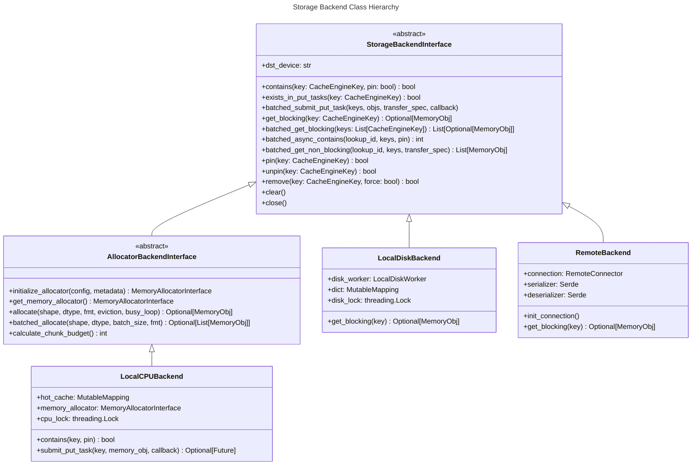
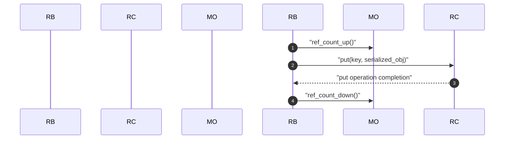

<!-- source: DeepWiki mcp.deepwiki.com · repo LMCache/LMCache · page 4.1 Storage Backend Interface · fetched 2026-10-21 -->

# Storage Backend Interface

Relevant source files

The following files were used as context for generating this wiki page:

- [lmcache/observability.py](lmcache/observability.py)
- [lmcache/v1/memory_management.py](lmcache/v1/memory_management.py)
- [lmcache/v1/storage_backend/__init__.py](lmcache/v1/storage_backend/__init__.py)
- [lmcache/v1/storage_backend/abstract_backend.py](lmcache/v1/storage_backend/abstract_backend.py)
- [lmcache/v1/storage_backend/local_cpu_backend.py](lmcache/v1/storage_backend/local_cpu_backend.py)
- [lmcache/v1/storage_backend/local_disk_backend.py](lmcache/v1/storage_backend/local_disk_backend.py)
- [lmcache/v1/storage_backend/remote_backend.py](lmcache/v1/storage_backend/remote_backend.py)
- [lmcache/v1/storage_backend/storage_manager.py](lmcache/v1/storage_backend/storage_manager.py)
- [tests/test_observability.py](tests/test_observability.py)
- [tests/v1/storage_backend/test_local_cpu_backend.py](tests/v1/storage_backend/test_local_cpu_backend.py)
- [tests/v1/storage_backend/test_local_disk_backend.py](tests/v1/storage_backend/test_local_disk_backend.py)
- [tests/v1/storage_backend/test_storage_manager.py](tests/v1/storage_backend/test_storage_manager.py)
- [tests/v1/test_address_manager.py](tests/v1/test_address_manager.py)
- [tests/v1/test_memory_management.py](tests/v1/test_memory_management.py)

This page documents the abstract storage backend interfaces used within LMCache's multi-tier storage system. It covers the contracts defined by the `StorageBackendInterface` and `AllocatorBackendInterface` abstract classes, their design rationale, key methods, and implementation patterns. These interfaces form the foundation for all concrete storage backends in LMCache, enabling flexible memory and cache management over diverse devices and remote stores.

For how these backends coordinate in operation, see the [Storage Manager](4.2) page.

---

## 1. Purpose and Scope

LMCache implements a hierarchical storage system for key-value caches, interfacing with GPU-based LLM serving engines. To unify access across local CPU memory, disk caches, remote storage, and other custom backends, it defines a formal interface hierarchy expressing key behaviors:

- **`StorageBackendInterface`**: The fundamental backend interface providing asynchronous and synchronous logic for lookup, insertion, removal, and pinning of cache entries keyed by `CacheEngineKey` [lmcache/v1/storage_backend/abstract_backend.py:27-207]().
- **`AllocatorBackendInterface`**: An extension of the basic interface for backends capable of allocating and managing physical memory pools, offering memory allocator references and allocation functionality [lmcache/v1/storage_backend/abstract_backend.py:27-207]().

Together, these interfaces encapsulate the contract all LMCache backends must fulfill, ensuring interoperability and allowing dynamic backend loading via a plugin system [lmcache/v1/storage_backend/__init__.py:40-105]().

Sources:  
- `[lmcache/v1/storage_backend/abstract_backend.py:27-207]()`  
- `[lmcache/v1/storage_backend/__init__.py:40-105]()`

---

## 2. Interface Hierarchy

LMCache's storage backend abstraction splits logically between basic backends (responding to key/value storage queries) and allocator-backed storage modules (handling internal memory management and allocation). The main classes are:

- `StorageBackendInterface` (base interface) [lmcache/v1/storage_backend/abstract_backend.py:27-60]()
- `AllocatorBackendInterface` (extending the base with allocation capabilities) [lmcache/v1/storage_backend/abstract_backend.py:27-207]()

Concrete implementations include:

- `LocalCPUBackend`: Supports hot in-memory cache with thread-safe access and allocator [lmcache/v1/storage_backend/local_cpu_backend.py:42-108]().
- `LocalDiskBackend`: Manages async/sync disk I/O with thread pools [lmcache/v1/storage_backend/local_disk_backend.py:119-197]().
- `RemoteBackend`: Wraps remote connectors for cloud or plugin-based backends using async transport [lmcache/v1/storage_backend/remote_backend.py:27-104]().

### Interface Class Diagram

**Figure Explanation:**
- `StorageBackendInterface` is the primary abstract interface implemented by all backends (`[lmcache/v1/storage_backend/abstract_backend.py:27-60]()`).
- `AllocatorBackendInterface` extends it with allocation and allocator access methods for backends managing memory pools (`[lmcache/v1/storage_backend/abstract_backend.py:27-207]()`).
- `LocalCPUBackend` is a memory allocator backend managing an in-memory cache with a thread lock (`[lmcache/v1/storage_backend/local_cpu_backend.py:42-108]()`).
- `LocalDiskBackend` and `RemoteBackend` implement basic `StorageBackendInterface` for asynchronous disk and network operations (`[lmcache/v1/storage_backend/local_disk_backend.py:119-197]()`, `[lmcache/v1/storage_backend/remote_backend.py:27-104]()`).

Sources:  
- `[lmcache/v1/storage_backend/abstract_backend.py:27-207]()`  
- `[lmcache/v1/storage_backend/local_cpu_backend.py:42-108]()`  
- `[lmcache/v1/storage_backend/local_disk_backend.py:119-197]()`  
- `[lmcache/v1/storage_backend/remote_backend.py:27-104]()`

---

## 3. `StorageBackendInterface` Contract

The `StorageBackendInterface` declares methods that all backends implement for key-value cache management with asynchronous and synchronous APIs.

### Core Attribute
- `dst_device: str` — Indicates the target device where retrieved memory objects reside, such as `cuda:0` or `cpu` (`[lmcache/v1/storage_backend/abstract_backend.py:27-46]()`).

### Key Methods

| Method | Purpose |
|-----------------------------------|----------------------------------------------------------------------------------------------|
| `contains(key, pin=False)` | Check if a key exists in cache; optional pin to prevent eviction (`[lmcache/v1/storage_backend/local_cpu_backend.py:127-136]()`). |
| `exists_in_put_tasks(key)` | (Optional) Checks if the key is pending asynchronous write operations (`[lmcache/v1/storage_backend/local_cpu_backend.py:144-148]()`). |
| `batched_submit_put_task(...)` | Submits multiple key-memobj pairs for storage asynchronously, with optional completion callback (`[lmcache/v1/storage_backend/abstract_backend.py:72-101]()`). |
| `get_blocking(key)` | Synchronously retrieve a single `MemoryObj` associated with `key` (`[lmcache/v1/storage_backend/abstract_backend.py:119-130]()`). |
| `batched_get_blocking(keys)` | Synchronously retrieve multiple `MemoryObj` entries (`[lmcache/v1/storage_backend/abstract_backend.py:178-192]()`). |
| `batched_async_contains(lookup_id, keys, pin)` | Check asynchronously if keys exist (returns hit count) (`[lmcache/v1/storage_backend/abstract_backend.py:142-159]()`). |
| `batched_get_non_blocking(...)` | Asynchronously prefetch `MemoryObj`s (non-blocking retrieval) (`[lmcache/v1/storage_backend/abstract_backend.py:161-174]()`). |
| `pin(key)` / `unpin(key)` | Control eviction eligibility of cached keys (`[lmcache/v1/storage_backend/abstract_backend.py:195-207]()`). |
| `remove(key, force=True)` | Remove a key from the cache, optionally forcing removal. |
| `clear()` | Clear all cached entries in this backend. |
| `close()` | Shut down internal resources gracefully. |

### Behavioral Notes
- **Pinning:** Calling `contains` with `pin=True` in `LocalCPUBackend` pins the `MemoryObj` and tracks the keys used in the current request for later cache policy updates (`[lmcache/v1/storage_backend/local_cpu_backend.py:127-136]()`).
- **Asynchronous Methods:** Backends support asynchronous batched operations such as `batched_async_contains` and `batched_get_non_blocking` for efficient concurrent prefetch and lookup (`[lmcache/v1/storage_backend/abstract_backend.py:142-174]()`).

Sources:  
- `[lmcache/v1/storage_backend/abstract_backend.py:27-207]()`  
- `[lmcache/v1/storage_backend/local_cpu_backend.py:127-148]()`  
- `[lmcache/v1/storage_backend/remote_backend.py:163-182]()`  
- `[lmcache/v1/storage_backend/local_disk_backend.py:107-110]()`

---

## 4. `AllocatorBackendInterface` and Memory Allocation

The `AllocatorBackendInterface` extends `StorageBackendInterface`, allowing backends to allocate physical memory for cache entries and expose the allocator in use (`[lmcache/v1/storage_backend/abstract_backend.py:27-207]()`).

### Allocation Methods

| Method | Purpose |
|------------------------------------------------|---------------------------------------------------------|
| `initialize_allocator(config, metadata)` | Creates or initializes the backend's `MemoryAllocatorInterface`. |
| `get_memory_allocator()` | Returns the active allocator instance. |
| `allocate(shape, dtype, fmt, eviction, busy_loop)` | Allocates a single `MemoryObj` within the backend's memory pool (`[lmcache/v1/storage_manager.py:92-98]()`). |
| `batched_allocate(shape, dtype, batch_size, fmt)` | Performs batched allocation of several `MemoryObj` instances. |
| `calculate_chunk_budget()` | Returns the maximum block or chunk capacity for this backend (`[lmcache/v1/storage_manager.py:181-181]()`). |

### Implementation
- `LocalCPUBackend` implements `AllocatorBackendInterface` (`[lmcache/v1/storage_backend/local_cpu_backend.py:42-108]()`).
- Memory allocation coordinates with LMCache's memory managers to satisfy eviction and reservation requests.
- Batched allocation supports optimized prefetching scenarios (`[lmcache/v1/storage_manager.py:64-120]()`).

Sources:  
- `[lmcache/v1/storage_backend/abstract_backend.py:27-207]()`  
- `[lmcache/v1/storage_backend/local_cpu_backend.py:42-108]()`  
- `[lmcache/v1/storage_manager.py:64-181]()`

---

## 5. Data Flow and Reference Counting in Asynchronous Operations

Backends must carefully manage `MemoryObj` lifetimes through reference counting because retrieval and storage tasks are often asynchronous (`[lmcache/v1/storage_backend/local_cpu_backend.py:167-168]()`).

### Reference Counting Contract
- Before handing off a `MemoryObj` to asynchronous I/O or transfer tasks, backends **must call** `ref_count_up()` to ensure the object remains valid (`[lmcache/v1/storage_backend/local_cpu_backend.py:167]()`).
- After asynchronous transfer completion (success or failure), backends **must call** `ref_count_down()` to release resources appropriately (`[lmcache/v1/storage_manager.py:110]()`).
- Callback functions triggered on completion should be exception-safe and do not affect reference counting (`[lmcache/v1/storage_backend/local_cpu_backend.py:181-185]()`).

### Remote Backend Put Sequence

### Concurrency and Deadlock Avoidance
- The `AsyncMultiSerializer` and helper classes like `WeightedSemaphore` prevent deadlocks due to parallel memory allocations when multiple concurrent requests compete for limited cache capacity (`[lmcache/v1/storage_manager.py:123-194]()`).

Sources:  
- `[lmcache/v1/storage_backend/local_cpu_backend.py:167-185]()`  
- `[lmcache/v1/storage_backend/remote_backend.py:27-72]()`  
- `[lmcache/v1/storage_manager.py:110-194]()`

---

## 6. Storage Plugin System

LMCache supports dynamically loadable custom storage backends via a plugin architecture (`[lmcache/v1/storage_backend/__init__.py:40-105]()`).

### Plugin Loading Workflow
- Plugins are registered in the configuration under `config.storage_plugins` (`[lmcache/v1/storage_backend/__init__.py:55]()`).
- The plugin classes are specified via `extra_config` sections like `extra_config.storage_plugin.<name>.module_path` and `.class_name` (`[lmcache/v1/storage_backend/__init__.py:69-74]()`).
- The plugin backend class is imported dynamically using `importlib.import_module` and `getattr` (`[lmcache/v1/storage_backend/__init__.py:89-92]()`).
- Backend instance is created with the standard backend constructor signature, including `config`, `dst_device`, `metadata`, `local_cpu_backend`, and `loop` (`[lmcache/v1/storage_backend/__init__.py:95-101]()`).
- The instantiated backend is inserted into the LMCache backend manager's dictionary for use (`[lmcache/v1/storage_backend/__init__.py:104-105]()`).

Sources:  
- `[lmcache/v1/storage_backend/__init__.py:40-105]()`

---

