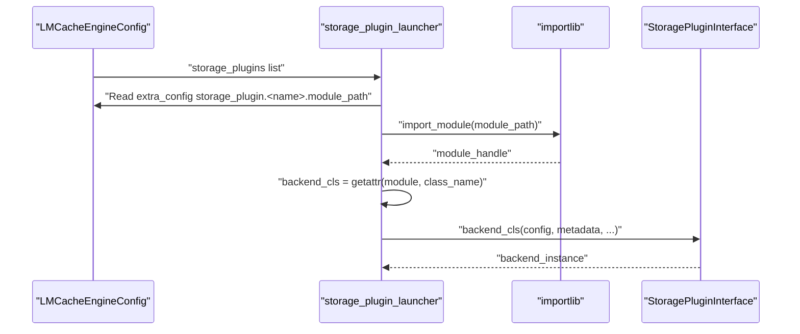
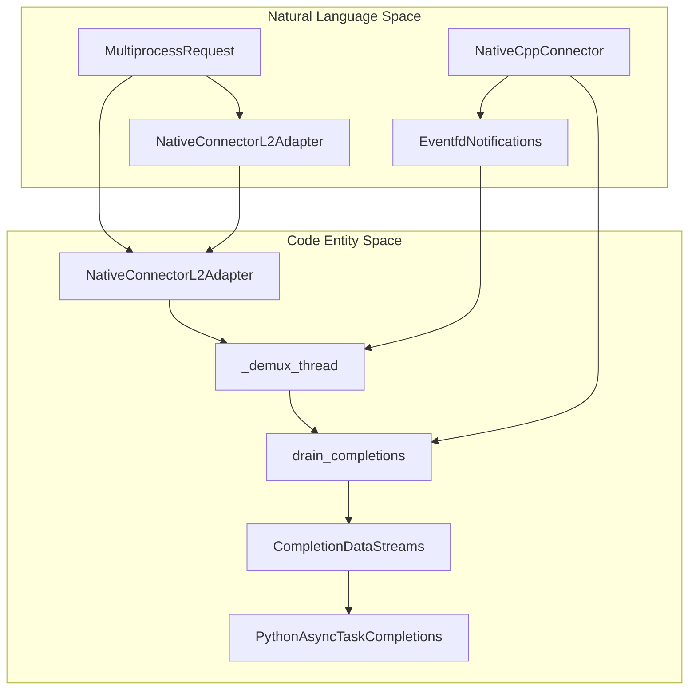
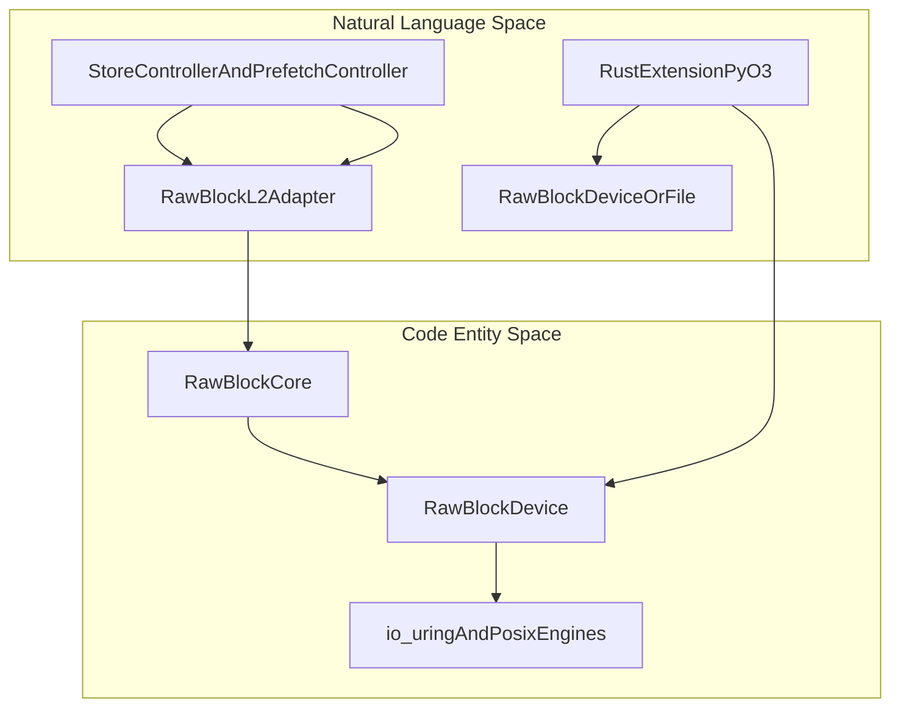

<!-- source: DeepWiki mcp.deepwiki.com · repo LMCache/LMCache · page 4.10 Storage Plugins and Native Connectors · fetched 2026-10-21 -->

# Storage Plugins and Native Connectors

Relevant source files

The following files were used as context for generating this wiki page:

- [benchmarks/storage_backend_io/README.md](benchmarks/storage_backend_io/README.md)
- [benchmarks/storage_backend_io/storage_backend_io_benchmark.py](benchmarks/storage_backend_io/storage_backend_io_benchmark.py)
- [csrc/storage_backends/connector_base.h](csrc/storage_backends/connector_base.h)
- [csrc/storage_backends/connector_pybind_utils.h](csrc/storage_backends/connector_pybind_utils.h)
- [csrc/storage_backends/event_notifier.h](csrc/storage_backends/event_notifier.h)
- [csrc/storage_backends/fs/connector.cpp](csrc/storage_backends/fs/connector.cpp)
- [csrc/storage_backends/fs/connector.h](csrc/storage_backends/fs/connector.h)
- [csrc/storage_backends/mooncake/connector.cpp](csrc/storage_backends/mooncake/connector.cpp)
- [csrc/storage_backends/mooncake/connector.h](csrc/storage_backends/mooncake/connector.h)
- [csrc/storage_backends/mooncake/pybind.cpp](csrc/storage_backends/mooncake/pybind.cpp)
- [docs/design/v1/distributed/l2_adapters/dax.md](docs/design/v1/distributed/l2_adapters/dax.md)
- [docs/design/v1/distributed/l2_adapters/l2_per_user_quota.md](docs/design/v1/distributed/l2_adapters/l2_per_user_quota.md)
- [docs/design/v1/distributed/l2_adapters/raw_block.md](docs/design/v1/distributed/l2_adapters/raw_block.md)
- [docs/source/kv_cache/storage_backends/dax.rst](docs/source/kv_cache/storage_backends/dax.rst)
- [docs/source/kv_cache/storage_backends/fs.rst](docs/source/kv_cache/storage_backends/fs.rst)
- [docs/source/kv_cache/storage_backends/index.rst](docs/source/kv_cache/storage_backends/index.rst)
- [docs/source/kv_cache/storage_backends/resp.rst](docs/source/kv_cache/storage_backends/resp.rst)
- [docs/source/mp/l2_storage/raw_block.rst](docs/source/mp/l2_storage/raw_block.rst)
- [examples/kv_cache_reuse/local_backends/README.md](examples/kv_cache_reuse/local_backends/README.md)
- [examples/kv_cache_reuse/local_backends/rust_backend_offload.py](examples/kv_cache_reuse/local_backends/rust_backend_offload.py)
- [examples/kv_cache_reuse/remote_backends/resp/README.md](examples/kv_cache_reuse/remote_backends/resp/README.md)
- [examples/kv_cache_reuse/remote_backends/resp/resp.yaml](examples/kv_cache_reuse/remote_backends/resp/resp.yaml)
- [examples/lmc_external_native_connector/csrc/connector.cpp](examples/lmc_external_native_connector/csrc/connector.cpp)
- [examples/lmc_external_native_connector/csrc/connector.h](examples/lmc_external_native_connector/csrc/connector.h)
- [lmcache/v1/check/check_mode_test_l2_adapter.py](lmcache/v1/check/check_mode_test_l2_adapter.py)
- [lmcache/v1/distributed/l2_adapters/dax_l2_adapter.py](lmcache/v1/distributed/l2_adapters/dax_l2_adapter.py)
- [lmcache/v1/distributed/l2_adapters/fs_native_l2_adapter.py](lmcache/v1/distributed/l2_adapters/fs_native_l2_adapter.py)
- [lmcache/v1/distributed/l2_adapters/mooncake_store_l2_adapter.py](lmcache/v1/distributed/l2_adapters/mooncake_store_l2_adapter.py)
- [lmcache/v1/distributed/l2_adapters/native_connector_l2_adapter.py](lmcache/v1/distributed/l2_adapters/native_connector_l2_adapter.py)
- [lmcache/v1/distributed/l2_adapters/native_plugin_l2_adapter.py](lmcache/v1/distributed/l2_adapters/native_plugin_l2_adapter.py)
- [lmcache/v1/distributed/l2_adapters/raw_block_l2_adapter.py](lmcache/v1/distributed/l2_adapters/raw_block_l2_adapter.py)
- [lmcache/v1/distributed/l2_adapters/reconfiguration.py](lmcache/v1/distributed/l2_adapters/reconfiguration.py)
- [lmcache/v1/distributed/l2_adapters/resp_l2_adapter.py](lmcache/v1/distributed/l2_adapters/resp_l2_adapter.py)
- [lmcache/v1/multiprocess/http_apis/reconfigure_api.py](lmcache/v1/multiprocess/http_apis/reconfigure_api.py)
- [lmcache/v1/storage_backend/dax/__init__.py](lmcache/v1/storage_backend/dax/__init__.py)
- [lmcache/v1/storage_backend/dax/core.py](lmcache/v1/storage_backend/dax/core.py)
- [lmcache/v1/storage_backend/plugins/dax_backend.py](lmcache/v1/storage_backend/plugins/dax_backend.py)
- [lmcache/v1/storage_backend/plugins/rust_raw_block_backend.py](lmcache/v1/storage_backend/plugins/rust_raw_block_backend.py)
- [lmcache/v1/storage_backend/raw_block/core.py](lmcache/v1/storage_backend/raw_block/core.py)
- [rust/raw_block/Cargo.toml](rust/raw_block/Cargo.toml)
- [rust/raw_block/README.md](rust/raw_block/README.md)
- [rust/raw_block/src/lib.rs](rust/raw_block/src/lib.rs)
- [rust/raw_block/src/tests.rs](rust/raw_block/src/tests.rs)
- [tests/v1/distributed/test_fs_l2_adapter_keys.py](tests/v1/distributed/test_fs_l2_adapter_keys.py)
- [tests/v1/distributed/test_fs_native_l2_adapter_config.py](tests/v1/distributed/test_fs_native_l2_adapter_config.py)
- [tests/v1/distributed/test_mooncake_store_l2_adapter.py](tests/v1/distributed/test_mooncake_store_l2_adapter.py)
- [tests/v1/distributed/test_native_connector_l2_adapter.py](tests/v1/distributed/test_native_connector_l2_adapter.py)
- [tests/v1/distributed/test_raw_block_l2_adapter.py](tests/v1/distributed/test_raw_block_l2_adapter.py)
- [tests/v1/distributed/test_resp_env_vars.py](tests/v1/distributed/test_resp_env_vars.py)
- [tests/v1/multiprocess/http_apis/test_reconfigure_api.py](tests/v1/multiprocess/http_apis/test_reconfigure_api.py)
- [tests/v1/multiprocess/test_raw_block_l2_adapter.py](tests/v1/multiprocess/test_raw_block_l2_adapter.py)
- [tests/v1/storage_backend/test_dax_backend.py](tests/v1/storage_backend/test_dax_backend.py)
- [tests/v1/storage_backend/test_raw_block_core.py](tests/v1/storage_backend/test_raw_block_core.py)
- [tests/v1/storage_backend/test_raw_block_device.py](tests/v1/storage_backend/test_raw_block_device.py)
- [tests/v1/storage_backend/test_rust_raw_block_backend.py](tests/v1/storage_backend/test_rust_raw_block_backend.py)

## Purpose and Scope

This page documents LMCache's storage extension architecture, covering the dynamic plugin loading mechanism via `storage_plugin_launcher`, the `ConnectorAdapter` interface, high-performance native C++ connectors under `csrc/storage_backends`, the Rust raw block backend (`RawBlockCore` and `RustRawBlockBackend`), and the DAX persistent memory backend.

---

## Dynamic Plugin Loading and `storage_plugin_launcher`

Dynamic plugin loading enables LMCache to discover, import, and instantiate custom storage backends at runtime based on configuration parameters without compile-time coupling.

### Mechanism

- Configuration options specify the module path and class name under the storage plugin definitions [rust/raw_block/README.md:3-11]().
- Python's `importlib` dynamically resolves the module and loads the target class implementation of `StoragePluginInterface` [lmcache/v1/storage_backend/plugins/rust_raw_block_backend.py:17-18]().
- The launcher instantiates the backend class by passing configuration objects, runtime metadata, local CPU backends, and event loop references [lmcache/v1/storage_backend/plugins/rust_raw_block_backend.py:90-104]().

### Dynamic Plugin Loading Flow

Sources: [lmcache/v1/storage_backend/plugins/rust_raw_block_backend.py:17-104]()

---

## ConnectorAdapter Interface and Native C++ Connectors

Native C++ connectors provide low-latency, high-throughput connectivity for remote and local key-value stores using dedicated worker thread pools and batch operations.

### C++ Abstraction (`ConnectorBase`)

Located under `csrc/storage_backends/`, `ConnectorBase` implements the core `IStorageConnector` contract. It manages worker thread pools, executes batched asynchronous operations (`submit_batch_get`, `submit_batch_set`, `submit_batch_exists`, `submit_batch_delete`), and exposes pollable event descriptors (`event_fd`) via platform-agnostic event notifiers [csrc/storage_backends/connector_base.h:47-78]().

### Python Bridge (`NativeConnectorL2Adapter`)

`NativeConnectorL2Adapter` wraps pybind11-exposed native connector instances, coordinating asynchronous multiprocess L2 tasks across separate eventfds (`store_efd`, `lookup_efd`, `load_efd`) and a background thread (`_demux_thread` running `_demux_loop`) [lmcache/v1/distributed/l2_adapters/raw_block_l2_adapter.py:28-31]().

### Native Connector Space Bridge

Sources: [csrc/storage_backends/connector_base.h:47-78](), [lmcache/v1/distributed/l2_adapters/raw_block_l2_adapter.py:28-31]()

---

## Rust Raw Block Backend

The Rust raw block backend stores key-value objects in fixed-size slots on raw NVMe block devices or pre-sized files using Rust PyO3 bindings (`lmcache_rust_raw_block_io`) [rust/raw_block/README.md:3-11]().

### Core Components

- **`RawBlockCore`**: Manages device handles, in-memory key indexing, free-slot tracking, lock reference counts, and metadata checkpointing [lmcache/v1/storage_backend/raw_block/core.py:185-206](), [docs/design/v1/distributed/l2_adapters/raw_block.md:84-102]().
- **`RawBlockL2Adapter`**: Adapts `RawBlockCore` to the non-blocking `L2AdapterInterface` contract for multiprocess storage coordination [lmcache/v1/distributed/l2_adapters/raw_block_l2_adapter.py:28-50]().
- **`RustRawBlockBackend`**: Legacy non-MP storage plugin wrapper preserving prefix semantics and per-TP device path mappings [lmcache/v1/storage_backend/plugins/rust_raw_block_backend.py:79-146]().

### I/O Engines and Features

- **Engines:** Supports synchronous `"posix"` (`pread`/`pwrite`) and asynchronous `"io_uring"` execution engines [rust/raw_block/README.md:15-20]().
- **`use_uring_cmd`:** Enables NVMe passthrough via io_uring command interfaces on character device nodes (e.g., `/dev/ng0n1`) [docs/source/mp/l2_storage/raw_block.rst:36-39]().
- **Flexible Data Placement (FDP):** Maps `cache_salt` prefixes to NVMe reclaim unit handles to isolate workloads and reduce write amplification [docs/source/mp/l2_storage/raw_block.rst:46-58]().

### Rust Raw Block Architecture Bridge

Sources: [rust/raw_block/README.md:3-62](), [lmcache/v1/storage_backend/raw_block/core.py:185-206](), [lmcache/v1/distributed/l2_adapters/raw_block_l2_adapter.py:28-50]()

---

## DAX Backend

The DAX backend provides low-overhead LMCache storage on `/dev/dax` character devices backed by Persistent Memory (PMEM) or CXL devices [docs/source/kv_cache/storage_backends/dax.rst]().

### Technical Details

- **Memory Mapping:** Opens character devices and maps storage via `mmap(MAP_SHARED)`, bypassing kernel page caches and standard block layer I/O overhead.
- **Staged Restore Pipeline:** Coalesces small key-value chunk retrievals into larger block transfers using CPU-side staging buffers.
- **Adapter Integration:** Wrapped by `DaxL2Adapter` in multiprocess mode to support non-blocking asynchronous operations [lmcache/v1/distributed/l2_adapters/raw_block_l2_adapter.py:28-31]().

Sources: [docs/source/kv_cache/storage_backends/dax.rst](), [lmcache/v1/distributed/l2_adapters/raw_block_l2_adapter.py:28-31]()

---

## Summary

LMCache's storage plugins and native connectors provide modular extensibility and high-throughput I/O pathways:
- Dynamic Python plugin loading via `storage_plugin_launcher`.
- Thread-pooled native C++ connectors via `ConnectorBase` and `NativeConnectorL2Adapter`.
- Durable, high-performance Rust raw block storage (`RawBlockCore`, `io_uring`, `io_uring_cmd`, FDP).
- Direct-mapped DAX persistence for PMEM and CXL hardware.

Sources: [rust/raw_block/README.md:3-62](), [lmcache/v1/storage_backend/plugins/rust_raw_block_backend.py:17-104]()

---

