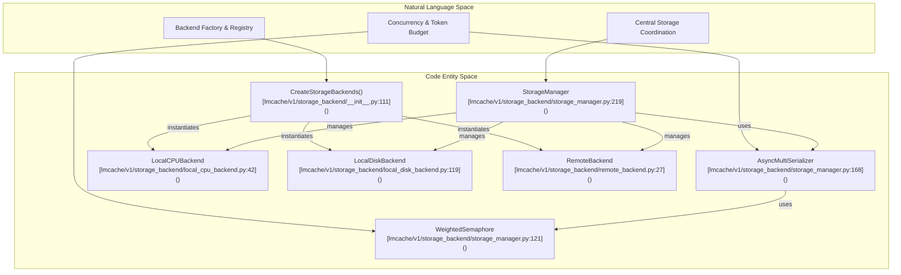
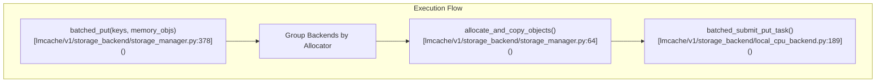
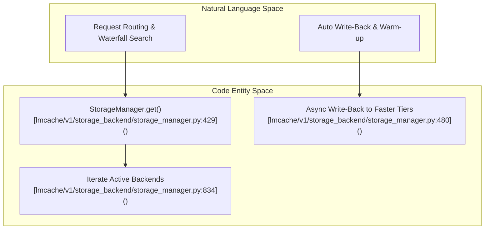

<!-- source: DeepWiki mcp.deepwiki.com · repo LMCache/LMCache · page 4.2 Storage Manager · fetched 2026-10-21 -->

# Storage Manager

<details>
<summary>Relevant source files</summary>

The following files were used as context for generating this wiki page:

- [lmcache/observability.py](lmcache/observability.py)
- [lmcache/v1/memory_management.py](lmcache/v1/memory_management.py)
- [lmcache/v1/storage_backend/__init__.py](lmcache/v1/storage_backend/__init__.py)
- [lmcache/v1/storage_backend/abstract_backend.py](lmcache/v1/storage_backend/abstract_backend.py)
- [lmcache/v1/storage_backend/cache_policy/__init__.py](lmcache/v1/storage_backend/cache_policy/__init__.py)
- [lmcache/v1/storage_backend/cache_policy/base_policy.py](lmcache/v1/storage_backend/cache_policy/base_policy.py)
- [lmcache/v1/storage_backend/cache_policy/fifo.py](lmcache/v1/storage_backend/cache_policy/fifo.py)
- [lmcache/v1/storage_backend/cache_policy/lfu.py](lmcache/v1/storage_backend/cache_policy/lfu.py)
- [lmcache/v1/storage_backend/cache_policy/lru.py](lmcache/v1/storage_backend/cache_policy/lru.py)
- [lmcache/v1/storage_backend/cache_policy/mru.py](lmcache/v1/storage_backend/cache_policy/mru.py)
- [lmcache/v1/storage_backend/job_executor/base_executor.py](lmcache/v1/storage_backend/job_executor/base_executor.py)
- [lmcache/v1/storage_backend/job_executor/pq_executor.py](lmcache/v1/storage_backend/job_executor/pq_executor.py)
- [lmcache/v1/storage_backend/local_cpu_backend.py](lmcache/v1/storage_backend/local_cpu_backend.py)
- [lmcache/v1/storage_backend/local_disk_backend.py](lmcache/v1/storage_backend/local_disk_backend.py)
- [lmcache/v1/storage_backend/remote_backend.py](lmcache/v1/storage_backend/remote_backend.py)
- [lmcache/v1/storage_backend/storage_manager.py](lmcache/v1/storage_backend/storage_manager.py)
- [tests/test_observability.py](tests/test_observability.py)
- [tests/v1/__init__.py](tests/v1/__init__.py)
- [tests/v1/storage_backend/test_local_cpu_backend.py](tests/v1/storage_backend/test_local_cpu_backend.py)
- [tests/v1/storage_backend/test_local_disk_backend.py](tests/v1/storage_backend/test_local_disk_backend.py)
- [tests/v1/storage_backend/test_storage_manager.py](tests/v1/storage_backend/test_storage_manager.py)
- [tests/v1/test_address_manager.py](tests/v1/test_address_manager.py)
- [tests/v1/test_cache_policy.py](tests/v1/test_cache_policy.py)
- [tests/v1/test_memory_management.py](tests/v1/test_memory_management.py)

</details>


## Purpose and Scope

The `StorageManager` class serves as the central coordination and orchestration entity for LMCache's multi-tier storage system. It manages multiple heterogeneous storage backends, governs their lifecycles, and coordinates cache operations such as batch lookups, stores, prefetching, and auto write-back policies with concurrency control. 

This page provides full technical detail on `StorageManager` coordination, active backend selection via `get_active_storage_backends()`, waterfall search order, job executors, cache policies, and the auto write-back mechanism.

For general storage backend interfaces, see [Storage Backend Interface (4.1)](4.1), and for specific backends, see subsequent sections.

Sources:
- `[lmcache/v1/storage_backend/storage_manager.py:219-883]()`
- `[lmcache/v1/storage_backend/abstract_backend.py:1-207]()`

---

## Architecture Overview and Coordination

`StorageManager` (`[lmcache/v1/storage_backend/storage_manager.py:219-883]()`) acts as a high-level facade over an ordered dictionary of storage backends (`OrderedDict[str, StorageBackendInterface]`). It coordinates data flow between the CPU/GPU memory layers and external tiers such as local disk, remote object stores, and peer-to-peer nodes.

### Diagram: Storage Manager Coordination & Code Entities



Sources:
- `[lmcache/v1/storage_backend/storage_manager.py:121-219]()`
- `[lmcache/v1/storage_backend/__init__.py:111-168]()`
- `[lmcache/v1/storage_backend/local_cpu_backend.py:42-78]()`
- `[lmcache/v1/storage_backend/local_disk_backend.py:119-158]()`
- `[lmcache/v1/storage_backend/remote_backend.py:27-68]()`

---

## Backend Management and Active Backends

### Initialization and Factory Creation

The `StorageManager` constructor initializes background event loops (`start_loop_in_thread_with_exceptions`) `[lmcache/v1/storage_backend/storage_manager.py:230-237]()`, invokes `CreateStorageBackends()` `[lmcache/v1/storage_backend/__init__.py:111]()`, and assigns the primary memory allocator backend (`AllocatorBackendInterface`) `[lmcache/v1/storage_backend/abstract_backend.py]()` used during batched stores.

### `get_active_storage_backends()`

The method `get_active_storage_backends()` `[lmcache/v1/storage_backend/storage_manager.py:834-883]()` yields the sequence of backends currently participating in cache operations based on engine flags (`freeze`) and per-backend bypass states:

```python
def get_active_storage_backends(self):
    if self.freeze:
        yield self.local_cpu_backend
    else:
        for name, backend in self.storage_backends.items():
            if not self.backend_bypass.get(name, False):
                yield backend
```

Sources:
- `[lmcache/v1/storage_backend/storage_manager.py:230-883]()`
- `[lmcache/v1/storage_backend/__init__.py:111-124]()`
- `[lmcache/v1/storage_backend/abstract_backend.py:1-207]()`

---

## Operation Routing and Auto Write-Back

### Put Operations and Data Flow

When storing cache entries via `batched_put()` `[lmcache/v1/storage_backend/storage_manager.py:378-428]()`, `StorageManager` groups backends by their underlying allocator and invokes `allocate_and_copy_objects()` `[lmcache/v1/storage_backend/storage_manager.py:64-119]()` to transfer data from source GPU memory objects into shared CPU memory buffers once per group.

### Diagram: Batched Store & Copy Data Flow



Sources:
- `[lmcache/v1/storage_backend/storage_manager.py:64-119]()`
- `[lmcache/v1/storage_backend/storage_manager.py:378-428]()`
- `[lmcache/v1/storage_backend/local_cpu_backend.py:189-210]()`

### Get Operations, Waterfall Search, and Auto Write-Back

Retrieval methods (`get()` and `batched_get()` `[lmcache/v1/storage_backend/storage_manager.py:429-535]()`) traverse backends in order of configured search priority (fastest to slowest). If data is found in a slower tier (e.g., `RemoteBackend`) but missing from a faster tier (e.g., `LocalCPUBackend`), an **auto write-back** operation is triggered asynchronously to warm up the faster tiers.

### Diagram: Request Routing and Waterfall Search Space Bridge



Sources:
- `[lmcache/v1/storage_backend/storage_manager.py:429-535]()`
- `[lmcache/v1/storage_backend/storage_manager.py:834-883]()`

---

## Job Executors, Cache Policies, and Concurrency Control

### Job Executors

Backends such as `LocalDiskBackend` utilize asynchronous thread pools (`AsyncPQThreadPoolExecutor` `[lmcache/v1/storage_backend/job_executor/pq_executor.py]()`) to prioritize I/O jobs (e.g., prefetches vs. puts vs. deletes).

### Cache Policies

Local backends integrate pluggable cache eviction policies `[lmcache/v1/storage_backend/cache_policy/__init__.py]()` such as LRU (`lru.py`), LFU (`lfu.py`), FIFO (`fifo.py`), and MRU (`mru.py`) to govern cache hit tracking and eviction candidate selection.

### Concurrency Control: `AsyncMultiSerializer` and `WeightedSemaphore`

To prevent deadlocks and control memory overhead during concurrent async cache operations, `AsyncMultiSerializer` (`[lmcache/v1/storage_backend/storage_manager.py:168-196]()`) wraps execution using a `WeightedSemaphore` (`[lmcache/v1/storage_backend/storage_manager.py:121-164]()`).

Sources:
- `[lmcache/v1/storage_backend/storage_manager.py:121-196]()`
- `[lmcache/v1/storage_backend/cache_policy/__init__.py:1-40]()`
- `[lmcache/v1/storage_backend/job_executor/pq_executor.py:1-50]()`

---

## Summary of Key Classes and Functions

| Class / Function | Description | Location |
|------------------|-------------|----------|
| `StorageManager` | Central coordination and orchestration facade | `[lmcache/v1/storage_backend/storage_manager.py:219-883]()` |
| `get_active_storage_backends()` | Generator yielding active, non-bypassed backends | `[lmcache/v1/storage_backend/storage_manager.py:834-883]()` |
| `allocate_and_copy_objects()` | Helper to allocate and copy memory objects across streams | `[lmcache/v1/storage_backend/storage_manager.py:64-119]()` |
| `AsyncMultiSerializer` | Serializes concurrent async allocations using budget caps | `[lmcache/v1/storage_backend/storage_manager.py:168-196]()` |
| `WeightedSemaphore` | Semaphore managing chunk allocation budgets | `[lmcache/v1/storage_backend/storage_manager.py:121-164]()` |

Sources:
- `[lmcache/v1/storage_backend/storage_manager.py:1-883]()`

---

