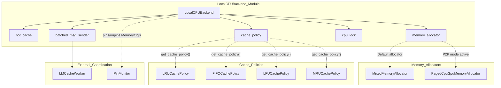
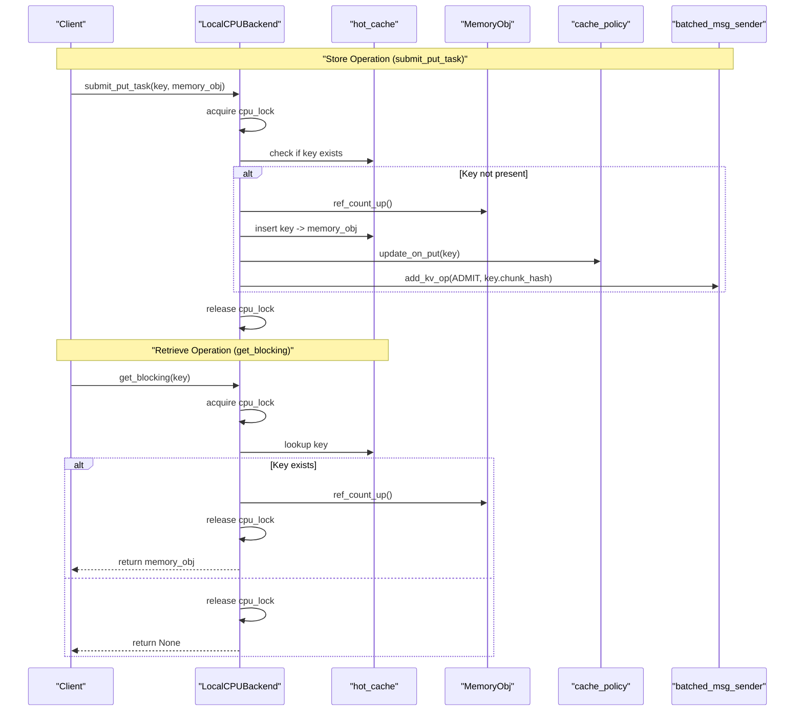
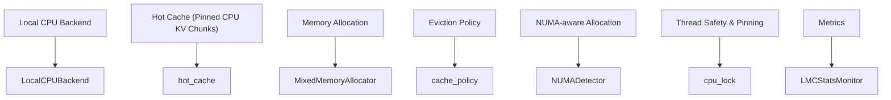
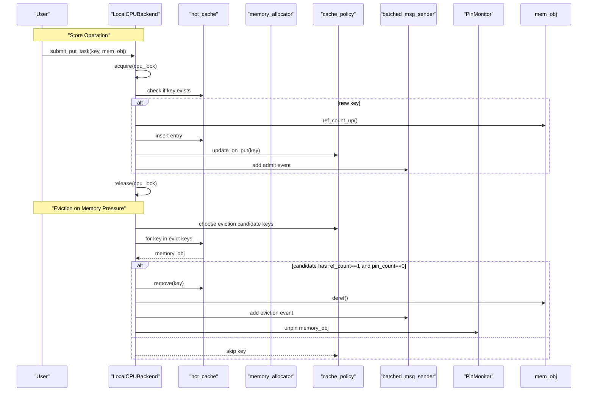

<!-- source: DeepWiki mcp.deepwiki.com · repo LMCache/LMCache · page 4.3 Local CPU Backend · fetched 2026-10-21 -->

# Local CPU Backend

Relevant source files

The following files were used as context for generating this wiki page:

- [lmcache/observability.py](lmcache/observability.py)
- [lmcache/v1/memory_management.py](lmcache/v1/memory_management.py)
- [lmcache/v1/storage_backend/__init__.py](lmcache/v1/storage_backend/__init__.py)
- [lmcache/v1/storage_backend/abstract_backend.py](lmcache/v1/storage_backend/abstract_backend.py)
- [lmcache/v1/storage_backend/local_cpu_backend.py](lmcache/v1/storage_backend/local_cpu_backend.py)
- [lmcache/v1/storage_backend/local_disk_backend.py](lmcache/v1/storage_backend/local_disk_backend.py)
- [lmcache/v1/storage_backend/remote_backend.py](lmcache/v1/storage_backend/remote_backend.py)
- [lmcache/v1/storage_backend/storage_manager.py](lmcache/v1/storage_backend/storage_manager.py)
- [tests/test_observability.py](tests/test_observability.py)
- [tests/v1/storage_backend/test_local_cpu_backend.py](tests/v1/storage_backend/test_local_cpu_backend.py)
- [tests/v1/storage_backend/test_local_disk_backend.py](tests/v1/storage_backend/test_local_disk_backend.py)
- [tests/v1/storage_backend/test_storage_manager.py](tests/v1/storage_backend/test_storage_manager.py)
- [tests/v1/test_address_manager.py](tests/v1/test_address_manager.py)
- [tests/v1/test_memory_management.py](tests/v1/test_memory_management.py)

## Purpose and Scope

The Local CPU Backend (`LocalCPUBackend`) serves as LMCache's primary in-memory storage tier. It manages a hot cache holding KV cache chunks in CPU memory for low-latency access and eviction management. It also coordinates memory allocation for cached tensors, supports NUMA-aware pinned memory allocation, and integrates with LMCache's cache policies and coordination frameworks. This backend is critical for achieving efficient KV cache lifecycle management on local CPU memory.

This page documents the `LocalCPUBackend` implementation, data flow for cache operations, eviction policies, memory allocator strategies, and NUMA-aware allocation mechanisms.

For broader storage coordination, see [Storage Manager]. For persistent cache on disk, see [Local Disk Backend].

Sources: `[lmcache/v1/storage_backend/local_cpu_backend.py:42-108]()`, `[lmcache/v1/storage_backend/local_cpu_backend.py:109-188]()`, `[lmcache/v1/storage_backend/storage_manager.py:64-121]()`

---

## Architecture and Components

`LocalCPUBackend` extends the abstract `AllocatorBackendInterface` which itself extends `StorageBackendInterface`, supporting active memory allocation and cache management control `[lmcache/v1/storage_backend/abstract_backend.py:27-44]()`. It maintains internal thread safety via a CPU-wide mutex lock `[lmcache/v1/storage_backend/local_cpu_backend.py:77]()`.

### Diagram: LocalCPUBackend Architecture Mapping

Sources: `[lmcache/v1/storage_backend/local_cpu_backend.py:42-108]()`, `[lmcache/v1/storage_backend/cache_policy/__init__.py]()`

### Core Components

- **`hot_cache`**: A mutable mapping (often `OrderedDict` or policy-specific dict) that stores KV chunk keys (`CacheEngineKey`) mapped to pinned `MemoryObj` instances `[lmcache/v1/storage_backend/local_cpu_backend.py:62-64]()`.
- **`memory_allocator`**: Responsible for allocating pinned host memory for cached KV tensors. Defaults to `MixedMemoryAllocator` for NUMA-aware pinned memory management. Optionally uses `PagedCpuGpuMemoryAllocator` in P2P mode `[lmcache/v1/storage_backend/local_cpu_backend.py:20-23]()`, `[lmcache/v1/storage_backend/local_cpu_backend.py:70-74]()`.
- **`cache_policy`**: Dynamically loaded eviction policy instance (e.g., LRU, LFU, FIFO, MRU) which controls replacement based on policy rules `[lmcache/v1/storage_backend/local_cpu_backend.py:62]()`.
- **`batched_msg_sender`**: If LMCacheController is enabled, it aggregates and sends batched cache events such as admission (`ADMIT`) and eviction (`EVICT`) messages to the control plane `[lmcache/v1/storage_backend/local_cpu_backend.py:97-103]()`.
- **`cpu_lock`**: A threading lock guarding all `hot_cache` operations and internal state mutations to ensure thread-safe access `[lmcache/v1/storage_backend/local_cpu_backend.py:77]()`.

Sources: `[lmcache/v1/storage_backend/local_cpu_backend.py:62-108]()`

---

## Hot Cache Operations and Data Flow

The hot cache implementation supports synchronous and asynchronous get/put operations with strict thread safety through `cpu_lock`. Pinning keys during lookups preserves correct cache recency ordering.

### Diagram: LocalCPUBackend Hot Cache Basic Operation Flow

Sources: `[lmcache/v1/storage_backend/local_cpu_backend.py:127-188]()`

### Key Public Methods

| Method | Description | Thread-Safe | Returns |
|---|---|---|---|
| `contains(key, pin=False)` | Checks presence in hot cache; optionally pins MemoryObj | Yes | `bool` |
| `submit_put_task(key, mem_obj, on_complete_callback=None)` | Inserts new cache item, updates eviction policy, sends admission event | Yes | `None` |
| `batched_submit_put_task(keys, objects, on_complete_callback=None)` | Batch insert multiple cache entries | Yes | `None` |
| `get_blocking(key)` | Synchronous retrieval of `MemoryObj` from hot cache | Yes | `Optional[MemoryObj]` |
| `batched_get_non_blocking(lookup_id, keys)` | Async batch retrieval returning immediate hits | Yes | `List[MemoryObj]` |
| `batched_async_contains(lookup_id, keys, pin)` | Async batch presence check with optional pinning | Yes | `int` (hits count) |
| `touch_cache()` | Marks pinned keys as recently used by updating cache policy | Yes | `None` |

Sources: `[lmcache/v1/storage_backend/local_cpu_backend.py:127-250]()`

---

## Memory Allocation and Management

The backend uses a memory allocator to provide pinned CPU memory blocks for KV tensors. It supports multiple memory formats based on whether MLA (Multi-Level Attention), blending, or layerwise settings are enabled.

### Allocation Formats

- **MLA format**: `MemoryFormat.KV_MLA_FMT` for MLA models `[lmcache/v1/memory_management.py:97-99]()`.
- **Full Layer / other formats**: Handled via `MemoryFormat` configurations `[lmcache/v1/memory_management.py:77-130]()`.

The allocation method `allocate()` accepts tensor shapes, `dtype`, memory format enum, an eviction flag, and a busy loop flag controlling blocking `[lmcache/v1/storage_backend/local_cpu_backend.py:490-528]()`.

### NUMA-Aware Memory Allocation

To reduce cross-node memory access latency and maximize local NUMA bandwidth, the system integrates with:

- `SystemMemoryDetector`: Detects physical memory configuration `[lmcache/v1/storage_backend/local_cpu_backend.py:33]()`
- `NUMADetector`: Detects CPU NUMA topology and device-to-node memory mapping `[lmcache/v1/storage_backend/local_cpu_backend.py:33]()`

When a valid NUMA mapping exists for the current GPU device, the allocator ensures pinned host memory allocation on the matching NUMA node `[lmcache/v1/storage_backend/local_cpu_backend.py:348-488]()`:

- If NUMA affinity is detected for the target device, create `MixedMemoryAllocator` pinned to the desired node.  
- Fallback to a uniform allocator if no mapping is found or NUMA is disabled.  

This improves throughput for GPU-CPU and CPU-CPU data transfers when used in hybrid storage or P2P coordination scenarios.

Sources: `[lmcache/v1/storage_backend/local_cpu_backend.py:33]()`, `[lmcache/v1/storage_backend/local_cpu_backend.py:348-488]()`

---

## Eviction Strategy

When the backend faces memory pressure or requires space for new cache entries while eviction is enabled, it triggers its eviction mechanism.

### Eviction Workflow

- Checks if eviction is allowed by configuration and cache policy.  
- Runs `cache_policy.choose_eviction_candidate` to select keys for eviction based on its policy (e.g., LRU, LFU).  
- Ensures that candidate `MemoryObj` entries:
  - Have `ref_count == 1` (only referenced by the hot cache dict).  
  - Have `pin_count == 0` (not pinned or locked by active requests).  
- Evicted entries are removed from `hot_cache` and counted for statistics. Eviction messages are sent if control messaging is enabled `[lmcache/v1/storage_backend/local_cpu_backend.py:535-590]()`.

### Conditions for Eviction Eligibility

| Condition | Description |
|---|---|
| `ref_count == 1` | Entry only referenced in cache |
| `pin_count == 0` | Entry is not locked/pinned |
| Eviction policy active | Eviction enabled by config |

Ejections remove mapped entries ensuring clean deallocation.

Sources: `[lmcache/v1/storage_backend/local_cpu_backend.py:535-590]()`

---

## Thread Safety and Concurrency

All operations modifying or retrieving from the hot cache are guarded by a `threading.Lock` named `cpu_lock`. The lock ensures atomicity of lookup, insert, deletion, and eviction operations `[lmcache/v1/storage_backend/local_cpu_backend.py:77]()`.

### Request Key Tracking and Pinning

During lookups, keys can be "pinned" meaning the corresponding cache entries are locked to prevent eviction while in use:

- `keys_in_request` list tracks these pinned keys per active request, preserving their order to facilitate suffix-to-prefix ordering assumptions `[lmcache/v1/storage_backend/local_cpu_backend.py:88-143]()`.
- The method `touch_cache()` iterates the pinned keys in reverse order, updating their recency in the cache policy to preserve accurate LRU or LFU metrics.

This preserves consistency between lookup access patterns and cache replacement policy timing.

Sources: `[lmcache/v1/storage_backend/local_cpu_backend.py:77]()`, `[lmcache/v1/storage_backend/local_cpu_backend.py:88-143]()`

---

## Metrics and Monitoring

`LocalCPUBackend` integrates with LMCache's observability framework, exporting runtime statistics via:

- `LMCStatsMonitor` `[lmcache/v1/storage_backend/local_cpu_backend.py:79]()`
- `PrometheusLogger` `[lmcache/v1/storage_backend/local_cpu_backend.py:113]()`

### Exposed Metrics

| Metric Name | Type | Description |
|---|---|---|
| `local_cpu_hot_cache_count` | Gauge | Number of entries in hot cache |
| `local_cpu_keys_in_request_count` | Gauge | Number of keys pinned in current request |

These metrics provide insight into cache pressure, usage, and request-specific load `[lmcache/v1/storage_backend/local_cpu_backend.py:109-123]()`.

Sources: `[lmcache/v1/storage_backend/local_cpu_backend.py:109-123]()`

---

## Summary Diagram: Natural Language to Code Entity Mapping for Local CPU Backend

Sources: `[lmcache/v1/storage_backend/local_cpu_backend.py:42-250]()`, `[lmcache/v1/memory_management.py:77-135]()`

---

## Detailed Data Flow: Store and Evict Lifecycle in LocalCPUBackend

Sources: `[lmcache/v1/storage_backend/local_cpu_backend.py:150-190]()`, `[lmcache/v1/storage_backend/local_cpu_backend.py:535-590]()`

---

## References

- `LocalCPUBackend` Class Implementation: `[lmcache/v1/storage_backend/local_cpu_backend.py:42-250]()`
- Memory Allocation and Formats: `[lmcache/v1/memory_management.py:77-135]()`
- Cache Policies and Eviction Utilities: `[lmcache/v1/storage_backend/cache_policy/__init__.py]()`
- Storage Manager Coordination: `[lmcache/v1/storage_backend/storage_manager.py:64-121]()`

---

